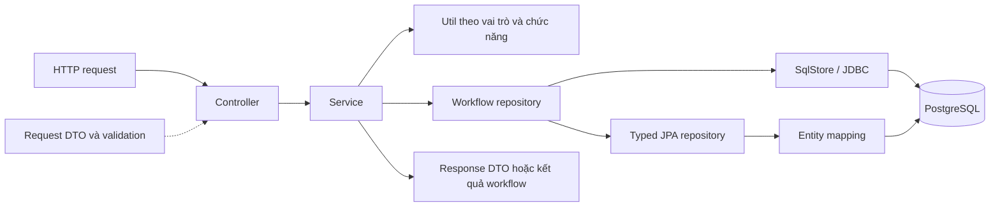

# Cấu trúc backend theo lớp và vai trò

Mã Java nằm trong `src/main/java/com/example/intelligent_cv_matching_ai_agent`. Thứ tự thư mục là **lớp → vai trò → chức năng**. Riêng DTO thêm `request` hoặc `response` ngay sau `dto` để nhìn rõ dữ liệu đi vào và đi ra của API.

```text
controller/<role>/<chức năng>/       HTTP endpoint, validation, gọi service
dto/request/<role>/<chức năng>/      Dữ liệu đầu vào, lớp có hậu tố Request
dto/response/<role>/<chức năng>/     Dữ liệu đầu ra, lớp có hậu tố Response
service/<role>/<chức năng>/          Nghiệp vụ, phân quyền, transaction, điều phối AI
repository/<role>/<chức năng>/       Truy vấn JDBC của từng workflow
repository/<role>/<chức năng>/jpa/   Spring Data JPA repository có kiểu entity/khóa
repository/shared/SqlStore.java     Prepared statement, bind tham số, đọc JDBC
entity/<role>/<chức năng>/           Entity và lớp khóa ghép
util/<role>/<chức năng>/             Helper kiểm tra, chuyển đổi dữ liệu và xử lý kỹ thuật
util/shared/                        Tiện ích tổng quát Values, FlowSupport
config/shared/                      Cấu hình Spring, Security, OpenAPI, lịch tác vụ
security/shared/                    Bearer filter, CurrentUser, giới hạn xác thực
exception/shared/                   Lỗi nghiệp vụ và phản hồi HTTP
```

| Thư mục vai trò | Nhóm chức năng |
| --- | --- |
| `guest` | Phiên khách, giới hạn dùng thử, CV demo và AI trial |
| `candidate` | Hồ sơ nghề nghiệp, CV, matching, học tập và career assistant |
| `consultant` | Công việc tư vấn và dữ liệu hội thoại tư vấn |
| `admin` | Quản lý tài khoản, cấu hình AI, crawl/index job, RAG và giám sát |
| `shared` | Đăng nhập, hồ sơ cá nhân, thanh toán, thông báo, support và tiện ích dùng cho nhiều vai trò |

Thư mục thể hiện nhóm phụ trách chức năng. Quyền truy cập vẫn được kiểm tra bằng `SecurityConfig`, `CurrentUser` và service; việc đặt lớp trong `shared` không làm endpoint trở thành công khai. Các workflow có nhiều vai trò dùng chung service/repository để giữ một bộ quy tắc nghiệp vụ.

Có **23 controller**. Endpoint dành riêng cho từng vai trò được đặt trong controller tương ứng, ví dụ `controller/admin/consultation/AdminConsultationController`, `controller/consultant/consultation/ConsultantConsultationController` và `controller/candidate/consultation/CandidateConsultationController`. Phần xem hội thoại, gửi tin nhắn và SSE dùng cho nhiều vai trò nằm trong `controller/shared/consultation/ConsultationController`, gọi chung `service/shared/consultation/ConsultationService`.

## Request và response DTO

Có **48 request DTO và 3 response DTO**. Ví dụ:

```text
dto/request/shared/identity/LoginRequest.java
dto/request/admin/consultation/AssignConsultantRequest.java
dto/request/candidate/learning/AssessmentAnswerRequest.java
dto/request/candidate/resume/ResumeWriteRequest.java
dto/request/consultant/consultation/ConsultationAnalysisRequest.java
dto/response/shared/identity/PersonalProfileResponse.java
dto/response/candidate/resume/ResumeDownloadResponse.java
dto/response/consultant/consultation/ConsultationAnalysesResponse.java
```

Request DTO chứa validation và giữ quy tắc xử lý trường bị thiếu hoặc có giá trị `null` của API. Response DTO chọn dữ liệu trả về, tách khỏi entity. Các kết quả workflow có cấu trúc linh hoạt vẫn trả JSON hoặc `Map<String, Object>`. Kết quả trích xuất tệp `ExtractedResume` là dữ liệu nội bộ, nằm trong `util/shared/resume` cùng `ResumeFileExtractor` và `ResumeData`.

`ConsultationAnalysisService` và `ConsultationAnalysisRepository` nằm trong package `consultant/consultation`.
API đọc các báo cáo đã lưu của ứng viên qua hội thoại tư vấn, dùng request DTO cho bộ lọc/phân trang
và response DTO cho bảy nhóm kết quả. Repository khóa chia sẻ hội thoại và kiểm tra quyền trước khi đọc,
để việc phân công lại consultant không xen giữa kiểm tra quyền và truy xuất báo cáo.

`util/shared/jobs/JobSourceValidator` kiểm tra URL nguồn cho import, crawling và mở trang ứng tuyển. Các workflow dùng chung quy tắc URL mà không phụ thuộc vào service crawler của admin.

## Ranh giới giữa service và util

Service giữ thứ tự thực hiện nghiệp vụ, phân quyền theo tài nguyên, transaction, truy cập repository,
ghi audit và điều phối AI/quota. Các kiểm tra cần đọc database hoặc xác định người dùng hiện tại vẫn
nằm trong luồng service/repository. Helper kiểm tra giá trị, chuẩn hóa, dựng nội dung và chuyển đổi
kết quả được đặt trong `util/<role>/<chức năng>`; chúng nhận dữ liệu qua tham số để service gọi trực tiếp.

`util/admin`, `util/candidate` và `util/consultant` chứa helper của từng vai trò. `util/shared/<chức năng>`
chứa helper dùng chung giữa các vai trò; `Values` và `FlowSupport` vẫn nằm ngay trong `util/shared`
vì cung cấp thao tác tổng quát. Một số ví dụ trong mã nguồn:

| Nhóm | Helper | Phần xử lý được tách |
| --- | --- | --- |
| `admin/jobs` | [CrawlSettingsSupport](../src/main/java/com/example/intelligent_cv_matching_ai_agent/util/admin/jobs/CrawlSettingsSupport.java), [JobCollectionSupport](../src/main/java/com/example/intelligent_cv_matching_ai_agent/util/admin/jobs/JobCollectionSupport.java) | Kiểm tra thời gian chờ, chuẩn hóa nguồn crawl, dựng response cấu hình và tên lease |
| `admin/rag` | [RagDocumentSupport](../src/main/java/com/example/intelligent_cv_matching_ai_agent/util/admin/rag/RagDocumentSupport.java), [RagCourseSupport](../src/main/java/com/example/intelligent_cv_matching_ai_agent/util/admin/rag/RagCourseSupport.java) | Chia chunk, giới hạn thông báo lỗi, kiểm tra kỹ năng và dựng nội dung khóa học |
| `candidate/resume` | [ResumeInput](../src/main/java/com/example/intelligent_cv_matching_ai_agent/util/candidate/resume/ResumeInput.java), [ResumeContent](../src/main/java/com/example/intelligent_cv_matching_ai_agent/util/candidate/resume/ResumeContent.java) | Kiểm tra đầu vào, dựng nội dung CV chuẩn, kết quả cơ bản và hash |
| `candidate/learning` | [AssessmentValidator](../src/main/java/com/example/intelligent_cv_matching_ai_agent/util/candidate/learning/AssessmentValidator.java), [RoadmapValidator](../src/main/java/com/example/intelligent_cv_matching_ai_agent/util/candidate/learning/RoadmapValidator.java) | Kiểm tra câu hỏi AI, node lộ trình và prerequisite |
| `consultant/consultation` | [ConsultationEvaluationData](../src/main/java/com/example/intelligent_cv_matching_ai_agent/util/consultant/consultation/ConsultationEvaluationData.java) | Kiểm tra phản hồi đánh giá CV/ATS và dựng response cache |
| `shared/ai`, `shared/identity` | [AiResponseData](../src/main/java/com/example/intelligent_cv_matching_ai_agent/util/shared/ai/AiResponseData.java), [AuthValidation](../src/main/java/com/example/intelligent_cv_matching_ai_agent/util/shared/identity/AuthValidation.java), [TokenSupport](../src/main/java/com/example/intelligent_cv_matching_ai_agent/util/shared/identity/TokenSupport.java) | Schema/validation phản hồi AI, chuẩn hóa email, giới hạn độ dài mật khẩu và thao tác kỹ thuật JWT/hash/token |

Ví dụ, `RagDocumentService.create()` kiểm tra quyền admin, chuẩn bị metadata và lưu document/chunk
qua repository; phần cắt chuỗi gọi `RagDocumentSupport.split(content)`. `RagDocumentService.index()`
tiếp tục điều phối embedding, trạng thái indexing và audit. Tương tự, `CrawlSettingsService.update()`
kết hợp kiểm tra/chuẩn hóa từ `CrawlSettingsSupport` với kiểm tra actor, lưu cấu hình và ghi audit trong service.

Các helper mới được tách không truy cập repository hoặc lấy `CurrentUser`. Thư mục `util` còn chứa
tiện ích kỹ thuật có I/O, chẳng hạn `ResumeFileExtractor` đọc PDF/DOCX/TXT và thực hiện OCR khi bật;
do đó cần đọc trách nhiệm của từng lớp khi sử dụng. Service vẫn giữ các helper phụ thuộc nghiệp vụ
hoặc transaction, chẳng hạn kiểm tra sở hữu CV và ghi audit.

Các điểm gọi public static có sẵn như `RagDocumentService.split()` và `TokenService.hash()`/`random()`
được giữ dưới dạng delegate tới util để tương thích với caller cũ. Xem
[hướng dẫn từng service và helper](service-code-guide.md) để lần theo đầy đủ các phương thức.

## Luồng xử lý

Controller nhận request DTO và gọi service. Service quyết định nghiệp vụ, gọi util cho phần xử lý dữ liệu
và repository cho phần truy xuất database. DTO là dữ liệu đi vào/ra của API; entity mô tả dữ liệu lưu trong database.



Các workflow dùng JDBC để giữ các truy vấn đặc thù PostgreSQL: `ON CONFLICT`, khóa hàng, advisory lock, JSON aggregation, pgvector và các thao tác nhiều bảng. SQL nằm trong repository; controller và service gọi các phương thức truy vấn đã đặt tên.

Mỗi bảng đồng thời có repository Spring Data JPA trong `repository/<role>/<chức năng>/jpa`, ví dụ `repository/shared/identity/jpa/UserJpaRepository extends JpaRepository<User, UUID>`. Những repository này cung cấp truy cập có kiểu cho entity. Phần lớn workflow hiện tại tiếp tục dùng repository JDBC; việc có JPA repository không có nghĩa mọi API đã chuyển sang thao tác entity.

Một luồng JPA đang được sử dụng thực tế là hồ sơ cá nhân:

```text
GET /api/v1/me
  → ProfileController.me()
  → ProfileService.me()
  → ProfileRepository.getProfile(currentUserId)
  → UserJpaRepository.findById(currentUserId)
  → User
  → PersonalProfileResponse.from(user)
```

`PersonalProfileResponse` giữ tên trường JSON của API và chỉ công khai các trường hồ sơ. Nó không chứa password hash, Google subject hoặc token. Cập nhật hồ sơ vẫn dùng JDBC trong `ProfileRepository`, rồi đọc lại qua luồng trên. Các kết quả AI, nội dung CV, snapshot matching và dữ liệu phân tích có cấu trúc thay đổi tiếp tục dùng `Map<String, Object>` hoặc JSON khi cần tính linh hoạt.

## Entity và schema

Có **76 entity cho 76 bảng, ánh xạ đủ 705 cột**: 74 bảng từ DBML và 2 bảng vận hành bổ sung là `ai_token_reservations` và `payment_webhook_events`. Các lớp khóa ghép là lớp hỗ trợ, không làm tăng số bảng.

| Kiểu hoặc quy tắc database | Ánh xạ Java |
| --- | --- |
| `uuid` | `UUID`; khóa `id` đơn dùng `@Id`, `@GeneratedValue`, `@UuidGenerator` |
| Khóa chính ghép | Nhiều trường `@Id` cùng `@IdClass`, ví dụ `CandidateProfileSkillId` |
| Khóa ngoại | Trường ID rõ ràng như `userId`, `resumeId`, `marketJobId`; ràng buộc FK nằm trong migration |
| `jsonb` | `Object`, `@JdbcTypeCode(SqlTypes.JSON)`, giữ nguyên object/array JSON |
| `uuid[]` | `UUID[]`, `@JdbcTypeCode(SqlTypes.ARRAY)` |
| `vector(1536)` | Chuỗi biểu diễn vector, `@ColumnTransformer` đọc `::text` và ghi `?::vector` |
| `inet` | `String`, `@ColumnTransformer` đọc `::text` và ghi `?::inet` |
| `decimal` / `numeric` | `BigDecimal`, giữ `precision` và `scale` của cột |
| `timestamptz` / `date` | `OffsetDateTime` / `LocalDate` |
| Trạng thái và enum | `String`, với tập giá trị được kiểm soát bằng CHECK constraint trong database |

Vector trong entity là biểu diễn lưu trữ; kiểm tra đủ 1536 chiều và giá trị hữu hạn thuộc lớp xử lý vector trước khi ghi. Truy vấn cosine/HNSW của matching nằm ở workflow repository và cần PostgreSQL có extension pgvector.

Entity dùng Lombok cho getter/setter/constructor rỗng, `@DynamicInsert` và `@DynamicUpdate`. Trường credential/hash nhạy cảm có `@JsonIgnore`; API vẫn dùng projection/DTO để quyết định chính xác dữ liệu công khai.

Flyway là nguồn tạo schema và ràng buộc. `spring.jpa.hibernate.ddl-auto=none` và `spring.jpa.open-in-view=false`; Hibernate không tự sửa schema. Các FK, CHECK, unique index, trigger và quy tắc liên bảng tiếp tục được quản lý trong migration, kể cả khi entity giữ FK dưới dạng ID thay vì association JPA.

## Repository và bind tham số

`SqlStore` dùng `JdbcTemplate` và `PreparedStatementSetter`. Giá trị request được truyền qua placeholder `?`; tên bảng/cột chỉ đến từ mã phía server và phải đúng mẫu identifier cho phép khi dựng câu INSERT.

`SqlStore.json(value)` tạo `JsonValue`, được bind bằng `Types.OTHER` để PostgreSQL xử lý `jsonb`. Enum được bind thành tên giá trị; `Instant` được chuyển sang thời gian UTC. Kết quả JDBC giữ tên cột/projection, chuyển `json`/`jsonb` thành object/array Java và đọc SQL array thành mảng Java.

Repository chứa điều kiện sở hữu và điều kiện trạng thái trong truy vấn khi workflow yêu cầu, ví dụ CV thuộc người dùng, tin tuyển dụng đang hoạt động hoặc session chưa bị thu hồi. Các đoạn SQL động còn lại chỉ chọn từ tập giá trị đóng phía server: kỳ quota `day/month/year/all`, nhánh truy vấn hoặc chế độ khóa; không ghép dữ liệu request vào SQL.

## Nghiệp vụ, transaction và bảo mật

Transaction đặt ở service để bao phủ toàn bộ thao tác nghiệp vụ nhiều bảng. Repository thực hiện truy vấn trong transaction đó. Ví dụ cập nhật career profile đồng thời thay kỹ năng và đánh dấu embedding/roadmap cũ; xác nhận webhook đồng thời ghi sự kiện, kích hoạt subscription, tạo invoice và notification.

Các khóa đã được giữ khi chuyển lớp:

- Thay đổi/xóa quản trị viên dùng advisory lock chung và khóa danh sách admin đang hoạt động để bảo vệ admin cuối cùng.
- Cấp/đổi token và thay đổi mật khẩu khóa tài khoản, kiểm tra trạng thái đang hoạt động và thu hồi session khi cần.
- Quota AI khóa người dùng và tính cả token đang được giữ chỗ, tránh các yêu cầu đồng thời vượt hạn mức.
- Gửi tin nhắn support khóa ticket trước khi kiểm tra trạng thái đóng.
- Webhook khóa payment order, kiểm tra provider, số tiền, tiền tệ và xử lý event trùng trong cùng transaction.

Các thao tác giữ chỗ/hoàn tất/hủy quota dùng `REQUIRES_NEW` để việc hạch toán không phụ thuộc transaction của yêu cầu AI bên ngoài. `AuthService.verify` giữ cấu hình `noRollbackFor=ApiException` nhằm lưu số lần nhập OTP sai.

`SecurityConfig` kiểm soát truy cập URL; `BearerFilter` xác thực token và lấy vai trò/trạng thái hiện hành. `CurrentUser` cung cấp ID, kiểm tra role và quyền sở hữu. Service giữ các kiểm tra quyền theo tài nguyên; repository JPA không tự cấp quyền truy cập cho người gọi. Request DTO giữ validation và che thông tin nhạy cảm trong `toString()`. `ApiExceptionHandler` chuyển lỗi nghiệp vụ/validation/database thành phản hồi HTTP nhất quán.

`TokenService` dùng `NimbusJwtEncoder`/`NimbusJwtDecoder` của Spring Security để ký và xác minh JWT HS256.
Access token cần `sub` UUID, `exp`, `iat`, `jti`; decoder kiểm chữ ký, hạn dùng, `nbf` nếu có và thời điểm phát hành.
Mỗi lần xác thực còn tra hash token trong database, kiểm session chưa thu hồi/chưa hết hạn, tài khoản
`ACTIVE`/chưa xóa và đối chiếu chủ token với `sub`. Rotation khóa account trước token, đối chiếu chủ sở hữu
và chỉ cấp cặp mới khi thao tác thu hồi có điều kiện cập nhật đúng một bản ghi trong cùng transaction.

`APP_JWT_SECRET` bắt buộc, không có fallback hoặc constructor tự dùng secret development. Ứng dụng từ chối
secret trống, dưới 32 byte UTF-8 và placeholder đã biết. Hãy sinh secret từ ít nhất 32 byte ngẫu nhiên mật mã
theo [hướng dẫn chạy local](../README.md); độ dài không chứng minh độ ngẫu nhiên. Secret được dùng nguyên
dưới dạng UTF-8, không giải mã Base64, và phải giống nhau giữa các instance.

## Cấu hình runtime

`application.yaml` giữ cấu hình dùng chung, import `.env` và `spring.profiles.default=dev`.
Ba file `application-dev.yaml`, `application-prod.yaml`, `application-docker.yaml` chỉ bổ sung các thiết lập theo môi trường; cấu hình chung tiếp tục được ánh xạ bằng `${VAR}`.
Ứng dụng nạp `.env` UTF-8 từ working directory qua
`spring.config.import=optional:file:${APP_ENV_FILE:.env}[extension=.properties][encoding=utf-8]` của Spring Boot.
Chạy IDE, Maven hoặc JAR từ thư mục dự án chứa `.env`; các key và giá trị mẫu nằm trong
[.env.example](../.env.example). Biến môi trường hệ điều hành/container có độ ưu tiên cao hơn file;
import optional cho phép triển khai chỉ bằng biến môi trường nếu cung cấp đủ các key bắt buộc.
`APP_ENV_FILE` là biến môi trường tùy chọn để chọn file khác; script local thiết lập nó theo `-EnvFile`.

File `.env` dùng `KEY=value` không bọc nháy, không có `export` hoặc comment cuối dòng.
Comment đặt trên dòng riêng; đường dẫn Windows dùng `/`. Sau khi sửa cấu hình, khởi động lại ứng dụng.

| Profile | Trách nhiệm cấu hình |
| --- | --- |
| `dev` | Mặc định kết nối `localhost` cho PostgreSQL/Redis, upload `./uploads`, logging tùy chỉnh qua biến môi trường |
| `docker` | Fallback YAML: PostgreSQL `postgres:5432`, Redis `redis:6379`, upload `/app/uploads`; Compose hiện ghi đè database sang host `host.docker.internal:5432/edunexus`; tắt Spring tự khởi động Compose |
| `prod` | Bắt buộc URL database và host/port Redis từ môi trường; tắt Compose tự động, devtools, development OTP, chi tiết lỗi và health |

Chọn một profile qua `SPRING_PROFILES_ACTIVE`, tham số `--spring.profiles.active` của JAR hoặc cấu hình Maven/IDE. Script `run-local.ps1 -RuntimeProfile` chỉ thay lựa chọn profile khi truyền tham số; nếu bỏ thì giữ môi trường hiện có và mặc định `dev` của Spring. File `.env.example` không bật sẵn một active profile để tránh áp dụng nhầm sang container.

Dockerfile đóng gói cùng một JAR cho mọi môi trường và không gán profile. `compose.yaml` đặt app trong Compose profile `app`, gán Spring profile `docker`, kết nối PostgreSQL trên host qua `host.docker.internal:5432/edunexus` và chờ Redis healthy. Redis thuộc profile `optional`; PostgreSQL container riêng thuộc profile `database`, không phải dependency của app. `compose.production.yaml` chỉ chạy app với Spring profile `prod` và dịch vụ ngoài. Cả hai cách chạy container gắn volume `resume_uploads` vào `/app/uploads`.

Compose `environment` có ưu tiên hơn `env_file`; Spring ưu tiên tham số command line và biến môi trường hơn file import. Compose local gán rõ URL database trên host, Redis `redis:6379` với username/password trống và upload `/app/uploads`, nên các key cùng tên trong `.env` không thay các giá trị đó. Lệnh chạy app là `docker compose --profile app --profile optional up -d --build app`; chi tiết và phân biệt Compose profile với Spring profile ở [runtime-profiles.md](runtime-profiles.md).

## Sinh lại entity và JPA repository

Chạy từ thư mục có `pom.xml`, với JDK của dự án:

```powershell
java scripts/dev/GenerateEntities.java
mvn formatter:format
```

Generator đọc `V1__edunexus_complete_schema.sql` và `V3__ai_token_reservations.sql`, sinh lại entity, lớp khóa ghép và repository JPA, rồi kiểm tra số lượng 76 bảng/705 cột. [role-packages.properties](../scripts/dev/role-packages.properties) xác định package của từng lớp, chẳng hạn `Resume=entity.candidate.resume` và `ResumeJpaRepository=repository.candidate.resume.jpa`. Generator kiểm tra ánh xạ package trước khi ghi, để lần sinh tiếp theo giữ đúng thư mục vai trò.

Lệnh ghi đè các tệp được sinh; các thay đổi ánh xạ cần được cập nhật trong generator và bảng package trước khi sinh lại. Nó không chạy migration, không truy cập database và không tạo lại workflow service/controller.

Chạy formatter sau generator để áp dụng thụt lề 4 dấu cách, annotation riêng dòng và quy tắc tham số. Xem [quy ước Java](java-coding-style.md) cho cách kiểm tra định dạng và bảo toàn giá trị chuỗi.

Khi schema thay đổi, cập nhật migration và generator/kiểm tra coverage tương ứng, sinh lại mô hình, rồi chạy kiểm thử dự án. Các migration bổ sung về khóa, trigger và index vẫn cần được áp dụng bằng Flyway.
