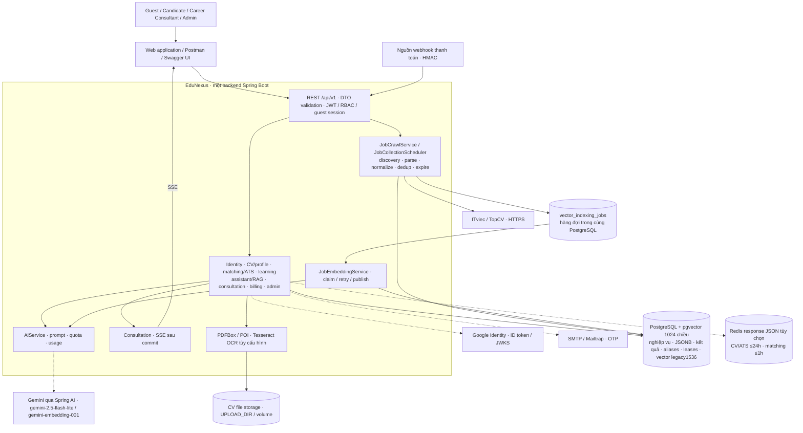
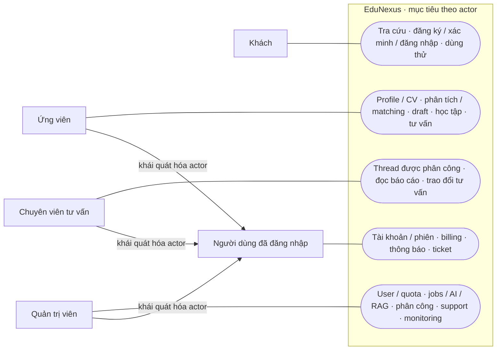
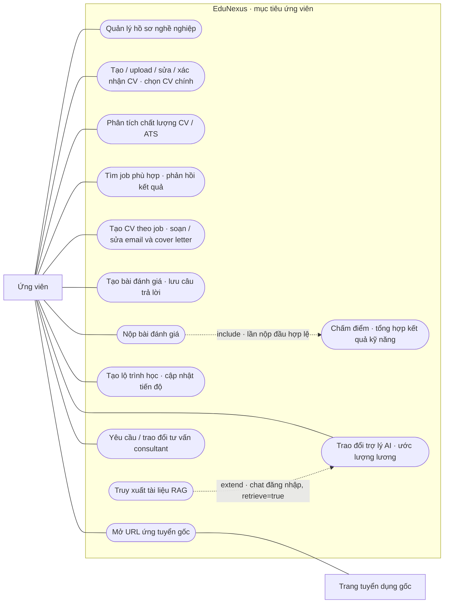
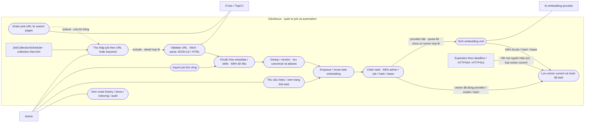
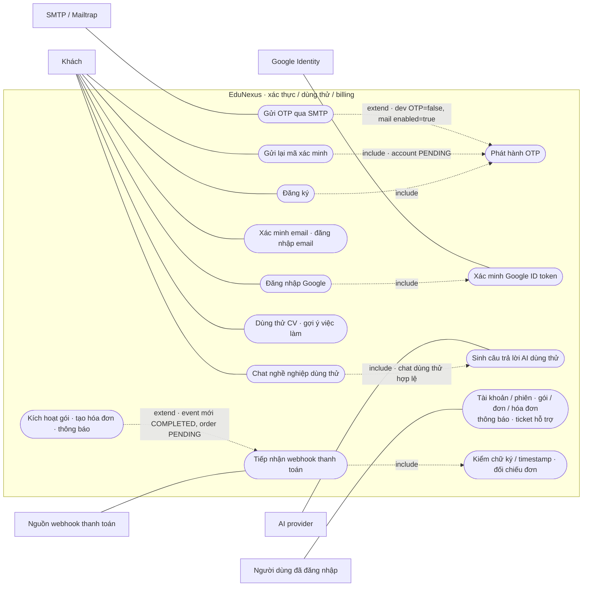

# EduNexus — Tài liệu tổng hợp toàn bộ dự án

Bản tổng hợp ban đầu ngày **13/10/2026** gồm tổng quan, cài đặt, kiến trúc, use case, database, giải thích code, API/Postman, automation và kiểm chứng. Mục lục dẫn tới từng phần ngay trong file; liên kết nguồn giúp đối chiếu với mã Java và tài liệu chuyên sâu.

Phần service/util được cập nhật theo mã nguồn ngày **20/10/2026**, gồm **35 lớp trong thư mục `service`**, bảng tra cứu các helper đã tách và liên kết đến file Java. Các phần API, cấu hình và kiểm chứng khác giữ mốc đối chiếu được ghi trong từng phần.

Cấu hình AI runtime được cập nhật ngày **04/11/2026**: Spring AI kết nối Gemini: chat qua giao thức tương thích OpenAI, embedding qua native REST, chat `gemini-2.5-flash-lite`,
embedding `gemini-embedding-001` 1024 chiều, cần GEMINI_API_KEY. Xem [gemini.md](gemini.md)
để khởi động Docker/model và [schema.md](schema.md) cho V10 giữ vector legacy 1536.
Các mô tả schema V1/V5 và kết quả kiểm chứng của lượt chạy cũ bên dưới là lịch sử;
không dùng các số liệu đó để kết luận runtime hiện tại đã được kiểm chứng.

Sơ đồ Mermaid nằm trong file. Liên kết Java/script/ảnh/source diagram phục vụ đối chiếu/chỉnh sửa; nội dung và mô hình hiện tại đã được diễn giải bên dưới.

<a id="unified-contents"></a>

## Mục lục lớn

1. [Tổng quan dự án, cài đặt và luồng chức năng](#unified-project)
2. [Sơ đồ hệ thống và use case hiện tại](#unified-diagrams)
3. [Database, migration, constraint và dữ liệu mẫu](#unified-database)
4. [Service và util: cấu trúc, chức năng và luồng xử lý](#unified-services)
5. [Toàn bộ 138 API và input để test Postman](#unified-api)
6. [Crawl, parsing, normalization, dedup và embedding](#unified-crawling)
7. [Cấu hình collection theo lịch và expiration](#unified-scheduling)
8. [Swagger, kiểm thử thực tế và quy trình phát triển](#unified-operations)
9. [Kết quả kiểm chứng và giới hạn của lần chạy](#unified-verification)

<a id="unified-current-scope"></a>

## Cách đọc và trạng thái tài liệu

Đọc tổng quan → sơ đồ/database → code service → API → cấu hình và vận hành. Để tìm một hàm hoặc route, dùng mục lục service/API bên trong hoặc Ctrl+F tên lớp/endpoint.

Pipeline hiện tại có discovery keyword hoặc URL explicit; JSON-LD/HTML parsing; skills/requirements/employment type; normalization; source aliases/dedup/expiry; scheduled collection và automatic embedding queue. Collection mặc định tắt, cần admin cấu hình; provider/quota phải sẵn sàng để worker gọi model.

Kết quả lịch sử của lượt kiểm thử automation trước chuyển OpenAI:185 test không lỗi,2 skip Docker/pgvector;
parser cuối20 test qua. Lượt đó chưa kiểm thử website nguồn/provider trả phí. Hình usecase PNG/SVG cũ
là snapshot trước automation; cấu hình AI hiện tại xem [gemini.md](gemini.md).

---

<a id="unified-project"></a>

## Phần 1. Tổng quan dự án, cài đặt và luồng chức năng

Tài liệu đối chiếu với repository `INTELLIGENT_CV_MATCHING_AI_AGENT` ngày **13/10/2026**, bao gồm toàn bộ backend: API, bảo mật, database, CV, AI, việc làm, học tập, tư vấn, thanh toán và quản trị. Repository cung cấp Swagger UI; frontend web/mobile cần gọi các API này.

Ví dụ dùng `http://localhost:8080`. Thay UUID, token, email, mật khẩu và key mẫu bằng dữ liệu của môi trường chạy. Giữ đúng tên trường DTO; dự án dùng cả `camelCase` và `snake_case` tùy API.

<a id="project-mục-lục"></a>

### Mục lục


1. [Tổng quan](#project-1-tổng-quan)
2. [Cấu trúc code và vòng đời request](#project-2-cấu-trúc-code-và-vòng-đời-request)
3. [Database và migration](#project-3-database-và-migration)
4. [Chạy dự án và cấu hình](#project-4-chạy-dự-án-và-cấu-hình)
5. [Tài khoản, phiên, guest và Mailtrap](#project-5-tài-khoản-phiên-guest-và-mailtrap)
6. [Career profile và CV](#project-6-career-profile-và-cv)
7. [AI và quota](#project-7-ai-và-quota)
8. [Việc làm, crawling, matching và ứng tuyển](#project-8-việc-làm-crawling-matching-và-ứng-tuyển)
9. [Assessment và roadmap](#project-9-assessment-và-roadmap)
10. [Assistant và RAG](#project-10-assistant-và-rag)
11. [Consultation và SSE](#project-11-consultation-và-sse)
12. [Subscription và thanh toán](#project-12-subscription-và-thanh-toán)
13. [Admin, thông báo, hỗ trợ và monitoring](#project-13-admin-thông-báo-hỗ-trợ-và-monitoring)
14. [Hướng dẫn sử dụng từ đầu đến cuối](#project-14-hướng-dẫn-sử-dụng-từ-đầu-đến-cuối)
15. [Danh mục API](#project-15-danh-mục-api)
16. [Kiểm thử, build, Docker và CI/CD](#project-16-kiểm-thử-build-docker-và-cicd)
17. [Tra lỗi và giới hạn hiện tại](#project-17-tra-lỗi-và-giới-hạn-hiện-tại)
18. [Cách mở rộng và nguồn tra cứu](#project-18-cách-mở-rộng-và-nguồn-tra-cứu)

<a id="project-1-tổng-quan"></a>

### 1. Tổng quan


EduNexus hỗ trợ chuẩn bị CV, tìm việc phù hợp, đánh giá kỹ năng, lập lộ trình học và tư vấn nghề nghiệp. Các module cùng chạy trong một ứng dụng Spring Boot.

| Thành phần | Cấu hình trong repository | Vai trò |
| --- | --- | --- |
| Java / Maven | Java 25 | Runtime và build |
| Spring Boot | 4.1.1 | REST, dependency injection, cấu hình, scheduling |
| Spring AI | 2.0.1, adapter chat giao thức OpenAI và adapter embedding native để gọi Gemini | `ChatModel`/`EmbeddingModel` gọi Gemini API |
| Spring Security | JWT bearer + kiểm tra database | Xác thực, phân quyền, thu hồi phiên |
| PostgreSQL / pgvector | Compose PostgreSQL 17, embedding hiện tại 1024 chiều | Dữ liệu nghiệp vụ, semantic matching, RAG; V10 giữ vector legacy 1536 |
| Flyway | V1–V10 | Schema, constraint, seed, ingestion automation và chuyển embedding |
| JDBC / JPA | Cùng tồn tại | Workflow SQL và truy cập entity có kiểu |
| Redis | Tùy chọn | Cache JSON response ATS/matching/phân tích CV; ATS/matching có database fallback |
| PDFBox / POI / Tesseract | Trích xuất tệp/OCR | Đọc CV và scan khi OCR được cấu hình |
| Jsoup | Fetch và parse HTML | Discovery keyword và detail parsing ITviec/TopCV |
| SMTP | `JavaMailSender` | Gửi OTP; dùng được với Mailtrap |
| SSE | `SseEmitter` | Tin nhắn tư vấn trong cùng process |
| Docker / GitHub Actions | JAR, image, CI/CD | Đóng gói và triển khai |

Có container/dependency Qdrant nhưng workflow hiện tại lưu vector trong PostgreSQL, phát sự kiện tư vấn qua SSE. Chỉ bật chúng khi cần adapter tương ứng.

| Người dùng | Xác thực | Công việc |
| --- | --- | --- |
| Guest | `X-Guest-Session` | CV demo/template, builder/recommendations/chat dùng thử |
| `CANDIDATE` | Bearer | CV, matching, học tập, assistant, mua gói, yêu cầu tư vấn |
| `CAREER_CONSULTANT` | Bearer | Thread được phân công, hồ sơ và báo cáo ứng viên trong thread |
| `ADMIN` | Bearer | User, gói/quota, job, AI/prompt, RAG, support, monitoring |

Vai trò thư mục không tự quyết định quyền. Một số API yêu cầu role cụ thể; một số kiểm tra đăng nhập và ownership. Xem `SecurityConfig`, `CurrentUser` và service.

Xem [use case diagram](#unified-diagrams) để đọc các mục tiêu người dùng bằng sơ đồ, gồm hình tổng quan và ba hình chi tiết có PNG/SVG và nguồn draw.io/PlantUML.

<a id="project-2-cấu-trúc-code-và-vòng-đời-request"></a>

### 2. Cấu trúc code và vòng đời request


<a id="project-21-bản-đồ-thư-mục"></a>

#### 2.1. Bản đồ thư mục


Thư mục để chạy lệnh là nơi chứa `pom.xml`.

~~~text
INTELLIGENT_CV_MATCHING_AI_AGENT/
├── pom.xml
├── .env.example
├── compose.yaml                    PostgreSQL và dịch vụ optional
├── compose.production.yaml         app container trên server
├── Dockerfile                      JAR đã build → image
├── .github/workflows/ci-cd.yml
├── scripts/                        run-local, bootstrap admin, test DB, dev tools
├── docs/
└── src/
    ├── main/
    │   ├── java/com/example/intelligent_cv_matching_ai_agent/
    │   │   ├── controller/<role>/<feature>/
    │   │   ├── dto/request/<role>/<feature>/
    │   │   ├── dto/response/<role>/<feature>/
    │   │   ├── service/<role>/<feature>/
    │   │   ├── repository/<role>/<feature>/       SQL workflow
    │   │   ├── repository/<role>/<feature>/jpa/   JPA repositories
    │   │   ├── entity/<role>/<feature>/
    │   │   ├── security/shared/
    │   │   ├── config/shared/
    │   │   ├── exception/shared/
    │   │   └── util/<role>/<feature>/
    │   └── resources/
    │       ├── application.yaml
    │       └── db/migration/
    └── test/
~~~

| Lớp | Trách nhiệm | Ví dụ |
| --- | --- | --- |
| Controller | Route, body/query, `@Valid`, gọi service | `ResumeController` |
| Request DTO | Hợp đồng đầu vào/validation | `ResumeWriteRequest` |
| Service | Quyền, nghiệp vụ, transaction, điều phối | `ResumeService` |
| Repository workflow | SQL có tham số | `ResumeRepository` |
| `SqlStore` | Bọc `JdbcTemplate`, bind/read JSON và SQL | `repository/shared/SqlStore.java` |
| Entity/JPA | Mapping bảng và truy cập có kiểu | `User`/`UserJpaRepository` |
| Response DTO | Chọn dữ liệu công khai | `PersonalProfileResponse` |
| Util | Validation, chuẩn hóa, dựng text/hash/projection và xử lý tệp/URL/webhook | `ResumeContent`/`JobEmbeddingSupport`/`WebhookVerifier` |
| Exception | Lỗi nghiệp vụ và HTTP response | `ApiException`/`ApiExceptionHandler` |

Các hàm hỗ trợ được nhóm trong `util/admin`, `util/candidate`, `util/consultant` và `util/shared`,
theo feature tương ứng. Service gọi util để kiểm tra hoặc biến đổi dữ liệu; kiểm tra quyền,
transaction, truy cập repository và điều phối các bước nghiệp vụ vẫn nằm trong service.
Một số hàm public cũ như `ResumeService.canonicalText`, `JobService.embeddingText`,
`RagDocumentService.split` và `TokenService.hash` được giữ làm delegate để tương thích với caller hiện có.

Phần lớn workflow dùng JDBC cho `FOR UPDATE`, `ON CONFLICT`, advisory lock, JSON và pgvector. Có JPA repository không có nghĩa tất cả API đều dùng JPA.

Ví dụ JPA thực tế: `GET /me → ProfileController → ProfileService → ProfileRepository.getProfile → UserJpaRepository.findById → PersonalProfileResponse`. Response này không chứa password hash, Google subject hoặc token.

<a id="project-22-request-và-bảo-mật"></a>

#### 2.2. Request và bảo mật


~~~mermaid
flowchart LR
    Client["Frontend / Swagger / HTTP client"] --> Sec["SecurityConfig + BearerFilter"]
    Sec --> C["Controller + DTO validation"]
    C --> S["Service: role, ownership, transaction"]
    S --> R["Workflow repository / JPA"]
    R --> DB[("PostgreSQL + pgvector")]
    S --> AI["AiService"]
    S --> Mail["SMTP"]
    S --> Files["Upload storage"]
    S --> Cache["Redis"]
    S --> Out["Response DTO / Map / JSON"]
    Out --> Client
~~~

1. `IntelligentCvMatchingAiAgentApplication.main` khởi động Spring, load configuration và bean; Flyway áp dụng migration.
2. Client gọi `/api/v1/...` bằng JSON/multipart.
3. `BearerFilter` đọc header nếu có. Token sai trả `401` ngay, kể cả route công khai nhưng client gửi bearer sai.
4. `TokenService.authenticate` kiểm tra JWT rồi hash token trong DB, tài khoản active và token chưa revoked/hết hạn.
5. `SecurityConfig` cho các route public đi qua; `/admin/**` cần admin, route còn lại mặc định cần đăng nhập.
6. Controller validate DTO. Service lấy chủ sở hữu từ `CurrentUser`, kiểm tra role và tài nguyên; không dùng user ID do client tự chọn để quyết định ownership.
7. Repository đọc/ghi database; service gọi AI/mail/file/cache khi cần.
8. Response trả DTO/Map/JSON. Lỗi được xử lý theo lớp phát sinh.

Lỗi nghiệp vụ là `application/problem+json`, thường có `status`, `detail`, `instance`; validation thêm `errors`. Lỗi security filter trả JSON `status`/`message`. Frontend đọc `detail ?? message`.

~~~json
{
  "type": "about:blank",
  "title": "Bad Request",
  "status": 400,
  "detail": "Invalid or expired verification code",
  "instance": "/api/v1/auth/verify-email"
}
~~~

`@Transactional` bảo vệ database, không thu hồi được email đã gửi, file đã ghi hay lượt AI đã gọi. OTP gửi trước commit DB; usage AI có transaction riêng. Không coi tác vụ bên ngoài và database là một giao dịch nguyên tử.

<a id="project-23-cách-lần-theo-một-chức-năng"></a>

#### 2.3. Cách lần theo một chức năng


Với `POST /resumes/{id}/confirm`: đọc route trong controller → DTO → `ResumeService.confirm` → các hàm `ResumeRepository` → constraint migration → test liên quan.

~~~powershell
rg -n 'confirm|/resumes' src/main/java
rg -n 'email_verification_codes' src/main/resources/db/migration
rg -n 'registrationVerification' src/test/java
~~~

<a id="project-3-database-và-migration"></a>

### 3. Database và migration


`spring.jpa.hibernate.ddl-auto=none`; Flyway quản lý schema thay vì Hibernate tự tạo bảng.

| Migration | Nội dung |
| --- | --- |
| `V1__edunexus_complete_schema.sql` | DBML gốc: 74 bảng, PK/FK, unique, index và constraint |
| `V2__workflow_integrity_and_vector_indexes.sql` | Constraint workflow, HNSW cosine, index, trigger |
| `V3__ai_token_reservations.sql` | `ai_token_reservations` và `payment_webhook_events` |
| `V4__initial_catalog.sql` | Gói/quota, skill, template, CV demo, tài nguyên học |
| `V5__job_collection_automation.sql` | Metadata/deadline/source aliases, collection leases và durable embedding queue |

Sau V5 có 78 bảng ứng dụng, ngoài lịch sử Flyway (V1 có74, V3 thêm2, V5 thêm2). UUID dùng `gen_random_uuid()`, JSON dùng `jsonb`, thời gian dùng `timestamptz`, embedding `vector(1536)`. Enum nghiệp vụ thường là varchar có `CHECK`.

Đó là mốc V5. Schema hiện tại sau V1–V10 có **80 bảng ứng dụng**. V10 giữ vector cũ trong
`embedding_legacy_1536`, thêm cột `embedding vector(1024)`, hạ `is_current` của embedding cũ và
chuyển RAG đã hoàn tất với vector cũ về `PENDING`. Cần index lại bằng model Gemini mới;
chi tiết migration V6–V10 ở [schema.md](schema.md).

| Module | Các bảng quan trọng |
| --- | --- |
| Identity | `users`, `email_verification_codes`, `refresh_tokens` |
| Guest | `guest_sessions`, `trial_usage_events` |
| Profile/CV | `candidate_profiles`, `candidate_profile_skills`, `resumes`, `resume_experiences`, `resume_educations`, `resume_projects`, `resume_certifications`, `resume_skills`, `resume_parse_results`, `resume_analyses`, `resume_embeddings` |
| Job/crawl | `market_job_posts`, `market_job_sources`, `market_job_skills`, `market_job_embeddings`, `market_crawl_runs`, `market_crawl_items`, `job_collection_leases` |
| Matching/ứng tuyển | `job_matching_runs`, `matching_run_resumes`, `job_match_results`, `job_match_feedback`, `job_resume_analyses`, `application_drafts`, `external_apply_events`, `salary_estimations` |
| Học tập | `assessment_sessions`, `assessment_questions`, `assessment_answers`, `gap_analyses`, `gap_analysis_skills`, `roadmaps`, `roadmap_nodes`, `roadmap_node_prerequisites`, `roadmap_node_resources`, `learning_resources` |
| AI/RAG | `ai_configurations`, `ai_prompt_templates`, `ai_usage_logs`, `ai_token_reservations`, `rag_documents`, `rag_chunks`, `rag_chunk_embeddings` |
| Assistant | `career_assistant_conversations`, `career_assistant_messages`, `career_assistant_message_sources`, `career_assistant_feedback` |
| Consultation | `consultation_threads`, `consultation_messages` |
| Billing | `subscription_tiers`, `subscription_quotas`, `user_subscriptions`, `subscription_renewal_notifications`, `payment_orders`, `payment_webhook_events`, `invoices`, `payment_reports` |
| Vận hành | `announcements`, `announcement_targets`, `notifications`, `support_tickets`, `support_ticket_messages`, `audit_logs`, `admin_actions`, `system_logs`, `vector_indexing_jobs`, `vector_store_metrics` |

Seed có FREE/BASIC/PRO, 15 skill, 2 template trial, một CV demo hệ thống, 7 learning resources. BASIC/PRO giá 99.000/199.000 VND là dữ liệu mẫu phát triển. Đọc API gói để biết giá/quota đang có.

Constraint bảo vệ một CV primary hợp lệ, một subscription active, answer đúng assessment, prerequisite đúng roadmap, một invoice/order và ngân sách không vượt trần. Xóa user là soft delete để giữ FK/lịch sử.

Vector chỉ so sánh cùng provider/model; đổi model cần index lại. File gốc nằm tại `UPLOAD_DIR`, mặc định `./uploads`. Khi chuyển môi trường cần giữ cả database và thư mục/volume upload.

<a id="project-4-chạy-dự-án-và-cấu-hình"></a>

### 4. Chạy dự án và cấu hình


<a id="project-41-chạy-local-trên-windows"></a>

#### 4.1. Chạy local trên Windows


Cần Java 25, Maven và PostgreSQL có pgvector; Docker Desktop chạy PostgreSQL Compose. Script local gọi `mvn`, cần Maven trong PATH.

~~~powershell
java -version
mvn -version
docker version
if (!(Test-Path -LiteralPath '.env')) {
    Copy-Item -LiteralPath '.env.example' -Destination '.env'
}
~~~

Sửa `POSTGRES_PASSWORD` và các placeholder. Bắt buộc sinh và lưu `APP_JWT_SECRET` vào `.env`
theo [README](../README.md) trước khi chạy; không có secret mặc định. Nếu chưa có SMTP, thử local bằng
`AUTH_EXPOSE_DEV_OTP=true`.

~~~powershell
powershell -NoProfile -ExecutionPolicy Bypass -File scripts/run-local.ps1 -WithInfrastructure
~~~

Script chuyển về thư mục dự án → đọc `.env` vào process → kiểm tra mật khẩu DB → khởi động/chờ PostgreSQL nếu có switch → `mvn spring-boot:run`. Với PostgreSQL riêng, sửa URL/user/password rồi chạy script không có `-WithInfrastructure`.

- Swagger: `http://localhost:8080/swagger-ui/index.html`.
- OpenAPI: `http://localhost:8080/v3/api-docs`.
- Health: `http://localhost:8080/actuator/health`.
- Base API: `http://localhost:8080/api/v1`.

Dừng backend bằng Ctrl+C. Database/cache là process/container riêng.

<a id="project-42-biến-cấu-hình"></a>

#### 4.2. Biến cấu hình


| Nhóm | Biến | Mục đích |
| --- | --- | --- |
| DB | `DATABASE_URL` | JDBC URL; giá trị mẫu localhost:5432/edunexus |
| DB | `POSTGRES_DB`, `POSTGRES_USER`, `POSTGRES_PASSWORD`, `POSTGRES_PORT` | DB/credentials/port mapping Compose |
| Security | `APP_JWT_SECRET` | Bắt buộc; secret HS256 từ ít nhất 32 byte ngẫu nhiên mật mã, dùng nguyên chuỗi UTF-8 |
| Security | `CORS_ALLOWED_ORIGINS` | Origin frontend cách nhau bằng dấu phẩy; mẫu localhost 3000/5173 |
| Identity | `AUTH_EXPOSE_DEV_OTP`, `GOOGLE_CLIENT_ID` | Dev OTP và Google audience |
| Mail | `MAIL_ENABLED`, `MAIL_FROM`, `MAIL_HOST`, `MAIL_PORT`, `MAIL_USERNAME`, `MAIL_PASSWORD`, `MAIL_SMTP_AUTH`, `MAIL_STARTTLS` | SMTP OTP |
| AI | `AI_ENABLED`, `AI_PROVIDER`, `AI_CHAT_PROVIDER`, `AI_EMBEDDING_PROVIDER`, `GEMINI_BASE_URL` | Bật AI/cấu hình provider `gemini` và endpoint API |
| AI | `AI_CHAT_MODEL`, `AI_EMBEDDING_MODEL`, `AI_EMBEDDING_DIMENSIONS`, `AI_MAX_OUTPUT_TOKENS` | Model, embedding 1024 chiều và output limit |
| Guest | `GUEST_TOKEN_LIMIT` | Ngân sách session mới; giá trị mẫu 5000 |
| Payment | `PAYMENT_PROVIDER`, `PAYMENT_WEBHOOK_SECRET` | Provider generic và HMAC secret |
| Billing | `BILLING_MAINTENANCE_ENABLED`, `BILLING_MAINTENANCE_BATCH_SIZE` | Bật expiry/reminder job và giới hạn mỗi lượt |
| Storage | `UPLOAD_DIR` | Thư mục file |
| OCR | `APP_OCR_ENABLED`, `APP_OCR_TESSDATA`, `APP_OCR_LANGUAGE` | Bật OCR, thư mục tessdata và ngôn ngữ |
| Redis | `REDIS_HOST`, `REDIS_PORT`, `REDIS_USERNAME`, `REDIS_PASSWORD`, `REDIS_DATABASE` | Cache connection |
| Redis | `REDIS_TIMEOUT`, `REDIS_CONNECT_TIMEOUT`, `REDIS_SSL_ENABLED` | Giá trị mẫu timeout 500 ms, SSL false |

Ứng dụng tự nạp `.env` UTF-8 từ working directory bằng `spring.config.import` của Spring Boot;
IDE, `mvn spring-boot:run` và `java -jar` đều dùng được khi working directory là thư mục chứa `pom.xml`
và `.env`. `application.yaml` ánh xạ các giá trị runtime qua `${VAR}`; các key và giá trị mẫu được
liệt kê trong [.env.example](../.env.example). Nếu đã có `.env`, bổ sung key mới và giữ cấu hình hiện tại.
Muốn dùng file khác, đặt biến môi trường `APP_ENV_FILE` trước khi khởi động hoặc truyền `-EnvFile` cho script local.

Biến môi trường hệ điều hành/container được ưu tiên hơn file. Import optional cho phép chạy Docker
chỉ bằng biến môi trường khi đã cấp đủ các key bắt buộc. File dùng `KEY=value` không bọc nháy, không có
`export` hoặc comment cuối dòng; comment đặt trên dòng riêng. Dùng `/` cho đường dẫn Windows và tránh
key trùng. Sửa `.env` rồi restart backend.

`DEBUG`/`TRACE` là tùy chọn logging của Spring Boot; mức log HTTP/SQL được cấu hình bằng các key trong `.env.example`.

<a id="project-43-bật-ai"></a>

#### 4.3. Bật AI


Đây là giá trị mẫu của repository:

~~~dotenv
AI_ENABLED=true
AI_PROVIDER=gemini
AI_CHAT_PROVIDER=openai
AI_EMBEDDING_PROVIDER=gemini
AI_CHAT_MODEL=gemini-2.5-flash-lite
AI_EMBEDDING_MODEL=gemini-embedding-001
AI_EMBEDDING_DIMENSIONS=1024
GEMINI_BASE_URL=https://generativelanguage.googleapis.com/v1beta/openai
AI_MAX_OUTPUT_TOKENS=2000
~~~

`AI_ENABLED=true` cần `GEMINI_API_KEY` hợp lệ, model được tài khoản cấp quyền và bean chat/embedding tương ứng.
Runtime dùng `spring.ai.model.chat=openai`, `spring.ai.model.embedding=none`,
`spring.ai.openai.base-url`, `spring.ai.openai.chat.model` và `app.ai.embedding-model`;
cần `GEMINI_API_KEY`. Constructor chỉ nhận provider `gemini` và embedding dimension 1024.
Lưu config admin không kiểm tra hoặc thay thế API key. Đổi model embedding cần restart/index lại;
model có số chiều khác cần migration phù hợp. Xem [gemini.md](gemini.md).

<a id="project-44-redis-container-và-ocr"></a>

#### 4.4. Redis, container và OCR


~~~powershell
docker compose up -d --wait redis
docker compose exec redis redis-cli PING
~~~

`PONG` xác nhận Redis. Local Redis không auth/TLS; credentials trống, SSL false. Switch `-WithInfrastructure` chỉ chạy PostgreSQL.

Redis giữ JSON envelope `schema_version/identity/response`, gồm toàn bộ kết quả FE. ATS TTL tối đa 24 giờ dùng `edunexus:ats:response:v1:<userId>:<resumeId>:<jobId>:<inputHash>`; matching tối đa 1 giờ dùng `edunexus:matching:response:v1:<userId>:<requestHash>` và không vượt tuổi run/deadline job. Phân tích CV dùng `edunexus:resume-analysis:response:v1:<userId>:<resumeId>:<inputHash>`, tối đa 24 giờ. Cache hit không đọc lại analysis/run/results nhưng vẫn kiểm tra owner, đầu vào và hiệu lực tài nguyên bằng DB. Hash xét nội dung/ngôn ngữ/model/prompt tương ứng; matching còn xét catalog/vector/chính sách lương. ATS/matching Redis miss có DB fallback và DB hit ghi lại cache; phân tích CV Redis miss tạo báo cáo mới, không có DB lookup theo hash. Ghi Redis sau commit, rollback không publish; `cached=true` của ATS/matching có thể đến từ DB.

Trong app container, `localhost` là container app; cần host DB/cache truy cập được. `compose.production.yaml` chỉ tạo app, không tạo PostgreSQL/Redis.

OCR trong mẫu cấu hình tắt; `app.ocr.enabled/tessdata/language` ánh xạ từ các key sau trong `.env`:

~~~dotenv
APP_OCR_ENABLED=true
APP_OCR_TESSDATA=C:/path/to/tessdata
APP_OCR_LANGUAGE=eng+vie
~~~

Cần Tesseract/native libraries và language data tương thích. Các key này đã có trong `.env.example`.
Bật AI không tự bật OCR.

<a id="project-5-tài-khoản-phiên-guest-và-mailtrap"></a>

### 5. Tài khoản, phiên, guest và Mailtrap


<a id="project-51-register--otp--verify--login"></a>

#### 5.1. Register → OTP → verify → login


Luồng code: `AuthController → AuthFlowService → AuthService → AuthRepository → SqlStore`; `SecurityConfig` cung cấp BCrypt strength 12, `TokenService` quản lý token.

~~~mermaid
sequenceDiagram
    participant Client
    participant Auth as AuthController / AuthFlowService
    participant Service as AuthService
    participant DB as PostgreSQL
    participant SMTP as SMTP / Mailtrap
    Client->>Auth: POST /auth/register
    Auth->>Service: Validation + rate limit
    Service->>DB: User PENDING, hash OTP, expiry
    alt Development OTP
        Service-->>Client: developmentCode
    else SMTP enabled
        Service->>SMTP: SimpleMailMessage
        SMTP-->>Service: SMTP response
        Service-->>Client: 200, expiresIn 600
    end
    Client->>Auth: POST /auth/verify-email
    Auth->>Service: email + code
    Service->>DB: Lock OTP, tăng attempt, so hash
    Service->>DB: ACTIVE + verified_at + profile
    Service-->>Client: Email verified
    Client->>Auth: POST /auth/login
    Service->>DB: Password/ACTIVE + lưu token hashes
    Service-->>Client: accessToken + refreshToken
~~~

Register yêu cầu email hợp lệ/max255, password 10–72 ký tự và tối đa **72 byte UTF-8**, fullName không trống/max255, language tùy chọn `vi|en`. Service trim/lowercase email, trim tên; user mới `EMAIL/CANDIDATE/PENDING`, language mặc định vi.

`issueCode` kiểm tra mã mới trong 60 giây → expire mã chưa verified cũ → sinh chuỗi 6 số → BCrypt mã → lưu expiry 10 phút → gửi SMTP hoặc trả development code.

Thư plain text: subject `EduNexus email verification`, body `Your verification code is <code>. It expires in 10 minutes.`. Hiện không đổi ngôn ngữ theo profile.

~~~json
{"message":"If this account is pending, a verification code will be sent","expiresIn":600}
~~~

Dev mode thêm `developmentCode`. Register chưa active và chưa cấp token.

Verify tìm mã mới nhất chưa verified/chưa hết hạn của user pending, khóa `FOR UPDATE OF c`, tăng attempt trước so hash. Đúng mã → verified timestamp, user ACTIVE, tạo candidate profile nếu chưa có:

~~~json
{"message":"Email verified; you can log in"}
~~~

Sau đó gọi login riêng. Password đúng nhưng pending trả 403.

<a id="project-52-resend-giới-hạn-và-transaction"></a>

#### 5.2. Resend, giới hạn và transaction


`POST /auth/resend-code` nhận email, chỉ gửi cho pending. User không tồn tại/không pending nhận thông điệp chung, không có expiresIn và không gửi. Nhánh response/cooldown không hoàn toàn giống nhau.

| Quy tắc | Giá trị/hành vi |
| --- | --- |
| OTP lifetime/cooldown | 10 phút / 60 giây mỗi user |
| Nhập sai | 5 lần đầu 400; request tiếp theo 429 dù mã đúng |
| Register/resend | Mỗi API 10 request/IP/giờ |
| Verify | 30/IP/10 phút |
| Login | 100/IP/15 phút + 15/email/15 phút |
| Refresh | 100/IP/15 phút |
| Google | 30/IP/15 phút |

Limiter `AuthThrottle` là memory từng process; IP từ `request.getRemoteAddr()`, không chia sẻ replica, restart mất count. Cooldown dùng query DB nhưng chưa khóa user để chống resend đồng thời tuyệt đối.

Register/resend transaction rollback nếu mail disabled/thiếu sender/gửi lỗi. Verify dùng `noRollbackFor=ApiException.class` để giữ attempt nhập sai; DTO sai định dạng chưa vào service nên không tăng attempt DB. Verify đúng cũng tăng attempt trước khi mark verified.

<a id="project-53-token-và-profile-cá-nhân"></a>

#### 5.3. Token và profile cá nhân


Access là JWT HS256 hạn 15 phút; refresh ngẫu nhiên `r_` hạn 30 ngày. **Hash SHA-256 của cả access và refresh** nằm trong `refresh_tokens`. Mỗi bearer kiểm tra DB user/role hiện tại và revoke/expiry.

`TokenService` dùng `NimbusJwtEncoder`/`NimbusJwtDecoder` của Spring Security, chỉ chấp nhận HS256,
yêu cầu `sub` UUID, `exp`, `iat`, `jti` và kiểm hạn dùng, `nbf` nếu có, thời điểm phát hành.
`sub` phải trùng user sở hữu token trong database; tài khoản phải `ACTIVE` và chưa xóa.

~~~json
{"accessToken":"<JWT>","refreshToken":"r_<random>","tokenType":"Bearer","expiresIn":900}
~~~

`POST /auth/refresh` nhận `refreshToken`, xoay refresh và trả cặp mới; refresh cũ không dùng lại. Rotate refresh không tự revoke access cũ. `POST /auth/logout` revoke mọi token.

Rotation khóa account trước token, đối chiếu chủ sở hữu và yêu cầu UPDATE thu hồi có điều kiện cập nhật
đúng một bản ghi. UPDATE kiểm hạn bằng `clock_timestamp()` tại thời điểm sử dụng, kể cả sau khi chờ lock.
Thu hồi token cũ và lưu cặp mới nằm trong cùng transaction.

`GET/PUT /me` xem/sửa fullName/avatarUrl/preferredLanguage/githubUrl. `PUT /me/password` nhận currentPassword/newPassword, chỉ EMAIL, revoke mọi token. `GET /me/sessions` liệt kê token rows còn hiệu lực, không phải mô hình session thiết bị hay cặp token. `DELETE /me/sessions/{id}` revoke row thuộc user. `DELETE /me` soft delete; bảo vệ admin active cuối cùng.

<a id="project-54-google-và-guest"></a>

#### 5.4. Google và guest


Google: `POST /auth/google` với idToken, cần GOOGLE_CLIENT_ID. `GoogleTokenVerifier` kiểm tra signature/issuer/audience/expiry/sub/email_verified. Code coi Gmail hoặc token có claim hd là authoritative → user mới ACTIVE. Email bên thứ ba cần OTP hệ thống. Email đã có account khác trả409, không tự link. Google pending đã tồn tại trả emailVerificationRequired=true; gọi resend riêng. Sau OTP, Google user đăng nhập tiếp bằng Google.

Guest: `GuestController → GuestSessionService/GuestAccess → GuestSessionRepository/GuestAccessRepository`. Tạo `POST /guest/sessions` không body: key ngẫu nhiên `g_`, DB giữ hash, hạn24 giờ/quota5000 mặc định, 3 session/IP/ngày. Lưu sessionKey lúc trả về; gửi `X-Guest-Session` ở API trial.

Guest chỉ dùng demo/template hệ thống. Trial builder cần AI; recommendations rule-based tối đa500 jobs/top3, thu100 credit cố định khi thành công. Chat guest dùng quota trial; không RAG cá nhân. Session hết hạn/đã converted không được dùng. Hiện không thấy API chuyển history guest sang tài khoản đăng ký; register là luồng riêng.

<a id="project-55-mailtrap-và-smtp"></a>

#### 5.5. Mailtrap và SMTP


Project đã có starter mail. `spring.mail` cấu hình connection; `app.mail.enabled` và `app.auth.expose-development-code` quyết định gửi. `MAIL_FROM` map vào app.mail.from và app.auth.mail-from; OTP dùng property thứ hai.

| AUTH_EXPOSE_DEV_OTP | MAIL_ENABLED | Kết quả |
| --- | --- | --- |
| true | false/true | Trả code, **bỏ qua SMTP** |
| false | false | Luồng cần gửi OTP 503 và rollback |
| false | true | Gửi SMTP; lỗi 503 |

**Sandbox:** theo [Mailtrap](https://docs.mailtrap.io/email-sandbox/overview), giữ email kiểm thử trong Mailtrap, không gửi tới hộp thư thật và không cần verify domain. Chọn **Sandboxes → sandbox → Integration → SMTP**, lấy credentials.

~~~dotenv
MAIL_ENABLED=true
MAIL_HOST=sandbox.smtp.mailtrap.io
MAIL_PORT=2525
MAIL_USERNAME=your-sandbox-username
MAIL_PASSWORD=your-sandbox-password
MAIL_SMTP_AUTH=true
MAIL_STARTTLS=true
MAIL_FROM=noreply@edunexus.test
AUTH_EXPOSE_DEV_OTP=false
~~~

Host/port/STARTTLS theo [Sandbox setup](https://docs.mailtrap.io/email-sandbox/setup) và [Sandbox help](https://docs.mailtrap.io/email-sandbox/help). Restart backend, register email mới, đọc OTP trong đúng sandbox, verify rồi login.

**Gửi thật:** Mailtrap **API/SMTP → Sending Setup → domain → Transactional Stream → SMTP**. Verify domain/DNS/compliance, dùng token được quyền gửi. Domain Demo chỉ gửi tới email đăng ký Mailtrap. Xem [SMTP integration](https://docs.mailtrap.io/email-api-smtp/setup/smtp-integration) và [Sending domain](https://docs.mailtrap.io/email-api-smtp/setup/sending-domain).

~~~dotenv
MAIL_ENABLED=true
MAIL_HOST=live.smtp.mailtrap.io
MAIL_PORT=587
MAIL_USERNAME=api
MAIL_PASSWORD=your-mailtrap-api-token
MAIL_SMTP_AUTH=true
MAIL_STARTTLS=true
MAIL_FROM=noreply@your-verified-domain.com
AUTH_EXPOSE_DEV_OTP=false
~~~

Không dùng credentials sandbox cho live. Code hiện map STARTTLS, chưa có biến riêng bật implicit SSL; dùng 2525/587 thay vì chỉ đổi sang465. Timeout connection/read5000ms. Gửi đồng bộ trước commit DB; chưa queue/outbox/auto retry. SMTP success chưa bảo đảm inbox delivery; kiểm tra Mailtrap logs/hộp nhận. Health mail indicator đang tắt.

SMTP hiện chỉ gửi OTP. Thông báo nghiệp vụ nằm trong database; draft email ứng tuyển chưa được gửi.

<a id="project-6-career-profile-và-cv"></a>

### 6. Career profile và CV


<a id="project-61-hồ-sơ-nghề-nghiệp"></a>

#### 6.1. Hồ sơ nghề nghiệp


`ProfileController → ProfileService → ProfileRepository` đọc/ghi `candidate_profiles` và `candidate_profile_skills`.

~~~json
{
  "targetJobTitle": "Java Backend Developer",
  "careerGoal": "Phát triển backend bằng Spring Boot",
  "yearsExperience": 1,
  "expectedSalary": 7500000,
  "salaryCurrency": "VND",
  "preferredLocation": "Ho Chi Minh",
  "skills": [
    {
      "skillId": "<UUID từ GET /skills>",
      "proficiencyLevel": "intermediate",
      "yearsExperience": 1
    }
  ]
}
~~~

`PUT /me/career-profile` tạo profile nếu thiếu → kiểm tra một mức lương kỳ vọng theo tháng/skill active và không trùng → ghi scalar → thay skill links nếu có list → invalidate profile embeddings và đánh dấu mọi roadmap user `is_outdated=true`.

Đây là PUT: cần gửi đủ scalar muốn giữ vì field bỏ qua thường được ghi null. `skills` bỏ qua/null giữ links cũ; `skills: []` xóa links. Currency VND/USD/EUR, experience0–99.9, tối đa100 skill. GET trả SQL fields snake_case. Không có API profile embedding riêng; matching xử lý vector từ input profile.

<a id="project-62-ba-đường-tạo-cv"></a>

#### 6.2. Ba đường tạo CV


Luồng chung: `ResumeController → ResumeService → ResumeRepository`. `ResumeData` chuẩn hóa JSON CV;
`ResumeInput` kiểm tra đầu vào; `ResumeContent` dựng nội dung chuẩn, hash và kết quả kiểm tra cơ bản;
`ResumeFileExtractor` trích xuất tệp. Các helper này nằm trong `util` theo vai trò/chức năng.

| Cách | API | Source/status sau tạo |
| --- | --- | --- |
| Manual | `POST /resumes` | MANUAL / DRAFT |
| AI builder | `POST /resumes/build` | AI_BUILDER / REVIEW_REQUIRED |
| Upload | `POST /resumes/upload` multipart | UPLOAD / REVIEW_REQUIRED |

Body manual tối thiểu:

~~~json
{
  "title": "CV Java Backend",
  "language": "vi",
  "structured_data": {
    "full_name": "Nguyễn An",
    "summary": "Đã xây dựng REST API với Java và PostgreSQL",
    "experience": [],
    "education": [],
    "projects": [
      {
        "project_name": "CV Matching",
        "role": "Backend",
        "description": "Các công việc thực tế đã thực hiện",
        "technologies": ["Java", "Spring Boot", "PostgreSQL"]
      }
    ],
    "certifications": [],
    "skills": ["Java", "SQL"]
  }
}
~~~

`experience`/`education` dùng số ít; `projects`/`certifications`/`skills` dùng số nhiều. Title bắt buộc/max255; language vi/en; raw_content tối đa200000 ký tự. `template_id` tùy chọn phải active.

Manual validate/normalize/hash dữ liệu rồi tạo DRAFT; các bảng section chi tiết được ghi khi confirm. AI builder thêm career profile vào facts input → `AiService.generate("CV_BUILD",...)` → normalize output → lưu REVIEW_REQUIRED. Template ID được kiểm tra và chuyển vào input; hiện chưa load nội dung template để render PDF/DOCX.

`ResumeData` giữ field allowlisted, chuẩn hóa skill string thành object, giới hạn100 entry/section và100 technologies, kiểm tra ngày ISO/đầu cuối, experience current không có end_date. Chỉ thông tin user cung cấp là dữ kiện cho AI.

<a id="project-63-upload-và-parsing"></a>

#### 6.3. Upload và parsing


1. Controller nhận `file`, `title` tùy chọn, `language` mặc định vi.
2. Extractor kiểm tra size/extension/MIME/signature và đọc text.
3. Ghi bytes với UUID storage key, tạo file mới trong UPLOAD_DIR.
4. Nếu chat AI bật và text không rỗng, gọi `CV_PARSE`.
5. Lưu `resumes` và `resume_parse_results`; nếu AI parse phát sinh ApiException, vẫn giữ CV để review và lưu trạng thái/lỗi parsing.
6. Nếu database transaction rollback, xóa file mới ghi.

| Loại | Điều kiện |
| --- | --- |
| Chung | File tối đa10MiB, multipart request tối đa11MB, text tối đa200000 ký tự |
| PDF | Đúng signature, không encrypted, tối đa50 trang; PDFBox lấy text |
| PDF scan | OCR nếu bật và text rỗng; nếu OCR chưa bật có thể giữ CV với text rỗng để nhập thủ công |
| DOCX | ZIP chứa word/document.xml; tối đa2000 entries, expanded50MiB; POI đọc |
| TXT | UTF-8 hợp lệ, không NUL |
| PNG/JPEG | OCR phải bật; signature/image hợp lệ, tối đa25 triệu pixels; OCR tắt trả503 |

MIME phải tương thích extension; application/octet-stream được chấp nhận theo extractor. Tạo CV/upload thành công không đồng nghĩa AI đã hiểu CV; xem parse_results và nội dung thực tế trước confirm.

<a id="project-64-review-confirm-primary-và-archive"></a>

#### 6.4. Review, confirm, primary và archive


~~~mermaid
stateDiagram-v2
    [*] --> DRAFT: Manual
    [*] --> REVIEW_REQUIRED: Upload / AI build
    DRAFT --> READY: Confirm
    REVIEW_REQUIRED --> READY: Review + confirm
    READY --> REVIEW_REQUIRED: PATCH đổi nội dung/title/language
    DRAFT --> ARCHIVED: DELETE
    REVIEW_REQUIRED --> ARCHIVED: DELETE
    READY --> ARCHIVED: DELETE
~~~

GET detail trả CV và sections/skills/parse_results. PATCH sửa title/language/raw/structured; nội dung thay đổi đưa về REVIEW_REQUIRED, bỏ primary, invalidate embedding và roadmap liên quan.

`POST /resumes/{id}/confirm` nhận body tùy chọn:

~~~json
{"is_primary":true}
~~~

Có thể gửi structured_data đã sửa. Confirm không sửa title/language; dùng PATCH cho các field đó. Cần nội dung có ý nghĩa: summary/raw hoặc một section/skill; chỉ full_name/email chưa đủ.

Service normalize → khóa user để primary an toàn → thay `resume_experiences`, `resume_educations`, `resume_projects`, `resume_certifications`, `resume_skills` → resolve/upsert skill theo catalog/slug, deduplicate → READY. Section relational sau PATCH có thể vẫn là snapshot lần confirm cũ đến khi confirm lại.

`POST /resumes/{id}/primary` chỉ chọn READY, bỏ primary cũ. DELETE soft archive, bỏ primary, invalidate, trả204; không xóa file gốc/vật lý. List lọc archived nhưng owner vẫn có thể GET/download archived bằng ID trong code hiện tại.

<a id="project-65-analysis-embedding-và-download"></a>

#### 6.5. Analysis, embedding và download


**Analysis:** READY → nếu chat bật gọi CV_ANALYZE, lưu analysis/suggestions; nếu AI tắt chạy RULE_BASED. Baseline cho20 điểm mỗi nhóm summary/experience/education/skills/projects có nội dung: đo độ đầy đủ, không đo chất lượng thực tế và `ats_score=null`. Báo cáo CV chung không thay thế JOB_ATS so CV–job.

**Embedding:** READY + embedding provider → canonical text/hash → dùng lại vector current cùng provider/model/hash nếu có → nếu chưa có tạo indexing job, gọi embed, kiểm tra lại CV sau network →409 nếu CV đổi → lưu vector/current và indexing status. Raw vector không trả API. Failure giữ indexing job FAILED để tra cứu.

**Canonical/invalidation:** canonical ưu tiên structured content đã review, fallback raw extraction, có title. Hash phụ thuộc title/language/raw/structured. Sửa/confirm đổi nội dung/archive làm vector noncurrent và roadmap phụ thuộc outdated.

**Download:** default trả original upload nếu có; nếu không có trả UTF-8 TXT. `?text=true` trả canonical text. Có ownership/path validation, attachment và nosniff. Chưa render PDF/DOCX theo template.

Các API CV/assistant private kiểm tra đăng nhập và ownership; không nên mô tả tất cả đều có gate CANDIDATE như matching hoặc create assessment.

<a id="project-7-ai-và-quota"></a>

### 7. AI và quota


<a id="project-71-luồng-gọi-dùng-chung"></a>

#### 7.1. Luồng gọi dùng chung


`AiService` là điểm điều phối chat/embedding; `AiRepository` đọc config/prompt, `EntitlementService` hoặc `GuestAccess` đặt ngân sách, `AiUsageRecorder` ghi telemetry.

~~~text
Service nghiệp vụ
→ chọn feature + input
→ AiService kiểm tra provider/enabled
→ chọn model/config/prompt active + schema JSON
→ tính budget và reserve
→ ChatModel / EmbeddingModel
→ parse + validate output
→ settle actual usage / cancel khi chưa có response
→ ghi ai_usage_logs
→ service lưu kết quả nghiệp vụ
~~~

Các feature: `CV_BUILD`, `CV_PARSE`, `CV_ANALYZE`, `JOB_MATCH_RERANK`, `JOB_ATS`, `ASSESSMENT_GENERATE`, `ROADMAP_GENERATE`, `APPLICATION_EMAIL`, `CAREER_CHAT`, `SALARY_ESTIMATE`; embedding dùng `EMBEDDING`.

Chat dùng system guidance yêu cầu JSON/facts/language, coi CV/job/history/document là dữ liệu không đáng tin cậy. Top-level language vi/en quyết định ngôn ngữ, mặc địnhvi. Output được validate theo feature: score, required strings/arrays, salary range...

Model chat lấy từ CHAT config active phù hợp provider process hoặc fallback env. Prompt active theo feature được nối vào guidance. `userPromptTemplate` hiện là text hướng dẫn, chưa có engine nội suy placeholder.

<a id="project-72-tính-ngân-sách-và-settlement"></a>

#### 7.2. Tính ngân sách và settlement


| Bước | Hiện thực |
| --- | --- |
| Chat reserve | UTF-8 bytes(system+input) +512 + maxOutputTokens |
| Embedding reserve | UTF-8 bytes(text) +128 |
| Output limit | Cấu hình clamp256–16000, mặc định2000 |
| Input limits | Chat input/output string250000 ký tự; embedding text200000 |
| User reservation | REQUIRES_NEW, khóa user, effective tier, ghi ai_token_reservations |
| Guest reservation | REQUIRES_NEW, atomic budget increment, trial_usage_events PROCESSING |
| Total quota | AI_TOTAL_TOKENS bắt buộc; quota feature0 chặn feature |
| Period | DAILY/MONTHLY/YEARLY/LIFETIME |
| Usage tính quota | Budget RESERVED + actual COMPLETED; CANCELLED không tính |

Budget byte là upper estimate bảo thủ, không phải tokenization thực tế. Entitlement giới hạn reservation1–200000; input Unicode lớn có thể vượt budget trước khi chạm char limit.

Nếu provider đã trả response, settle usage thực tế không vượt reservation; thiếu/zero token metadata tính cả budget đặt chỗ. Output JSON sai sau khi nhận response vẫn có thể bị tính phí. Nếu chưa nhận response, cancel/refund phần reservation theo code. Guest settlement khóa event, chống refund lần hai.

`AiUsageRecorder` ghi độc lập transaction, có thể còn log/usage khi nghiệp vụ ngoài rollback. Không phải mọi request bị từ chối trước provider đều có ai_usage_log.

<a id="project-73-chạy-khi-ai-tắt"></a>

#### 7.3. Chạy khi AI tắt


| Chức năng | Hành vi |
| --- | --- |
| Manual CV/upload text/review/confirm/download | Hoạt động |
| CV analysis | RULE_BASED completeness |
| Matching | SKILL_OVERLAP |
| Trial recommendations | Keyword overlap |
| AI builder/ATS/email draft/assessment/roadmap/chat/salary | Cần chat provider, thường503 khi chưa bật |
| CV/job/RAG index, RAG retrieval | Cần embedding provider |
| Tư vấn người thật/billing/admin/support | Không cần AI |

AI dùng adapter chat giao thức OpenAI và adapter embedding native để gọi Gemini; chat mặc định `gemini-2.5-flash-lite`, embedding `gemini-embedding-001`.
Embedding phải có đúng 1024 giá trị hữu hạn để khớp schema V10; vector legacy 1536 được giữ riêng
và không dùng trong truy vấn hiện tại. Runtime không nhận provider khác chỉ bằng đổi tên cấu hình.

<a id="project-8-việc-làm-crawling-matching-và-ứng-tuyển"></a>

### 8. Việc làm, crawling, matching và ứng tuyển


<a id="project-81-nạp-dữ-liệu-việc-làm"></a>

#### 8.1. Nạp dữ liệu việc làm


Job public đi `JobController → JobService → JobRepository`. GET jobs tìm q/location bằng ILIKE, chỉ ACTIVE/chưa expired; GET skills chỉ active. GET job có sources aliases. Chưa import/crawl thì danh sách job có thể trống.

**Manual import admin:** `POST /admin/jobs` nhận:

~~~json
{
  "sourceSite": "ITVIEC",
  "sourceUrl": "https://itviec.com/it-jobs/example",
  "jobTitle": "Java Developer",
  "companyName": "Example",
  "location": "Ho Chi Minh",
  "salaryText": "Thỏa thuận",
  "roleCategory": "Backend",
  "content": "Nội dung tuyển dụng thực tế từ nguồn, có yêu cầu Java và SQL.",
  "employmentType": "FULL_TIME",
  "requirements": "Có kinh nghiệm Java và SQL.",
  "responsibilities": "Xây dựng REST API và bảo trì backend.",
  "benefits": "Quyền lợi có trong nguồn.",
  "postedAt": "2026-10-01T08:00:00+07:00",
  "validThrough": "2030-12-31T23:59:59+07:00",
  "skills": [
    {"name":"Java","required":true},
    {"name":"SQL","required":true}
  ]
}
~~~

URL ví dụ phải thay bằng URL chi tiết nguồn thực. Content normalize HTML thành text tối thiểu30 ký tự; giữ HTML gốc. `JobSourceValidator` chỉ chấp nhận HTTPS đúng host ITVIEC/TOPCV, không credentials/explicit port.

Import nhận15 fields trên, dates có offset; bỏ metadata tùy chọn nếu nguồn không có và dùng ngày/nội dung thực. Normalize location/employment/skills và HTML → text; hash gồm metadata/skills/dates. Unchanged ACTIVE refresh source alias/deduplicated=true; inactive cùng hash trả409. Source đổi version, canonical cũ chỉ REMOVED khi không còn alias ACTIVE. Fingerprint bảo thủ có company và cùng title/location/content/requirements chuẩn hóa để link nguồn khác; không fuzzy merge. Lưu source aliases/skills/audit và enqueue embedding tự động.

<a id="project-82-crawling"></a>

#### 8.2. Crawling


`JobCrawlController → JobCrawlService → JobCrawlRepository/JobService`:

~~~json
{
  "sourceSite": "ITVIEC",
  "keyword": "Java",
  "roleCategory": "Backend",
  "location": "Ho Chi Minh",
  "limit": 20,
  "maxPages": 3
}
~~~

Crawl bỏ urls/null/[] tự tìm detail URL từ keyword trên nguồn. Nếu có urls, dùng tối đa20 URL chi tiết đã biết. Source ITVIEC/TOPCV, keyword/roleCategory bắt buộc; limit1–20 mặc định20, maxPages1–5 mặc định3. API crawl vẫn tuần tự; collection định kỳ dùng cùng pipeline, mặc định tắt, cần admin thật và PostgreSQL lease. Xem [cấu hình collection](#unified-scheduling).

Fetch timeout5s mỗi connection, body≤2MiB, tối đa3 redirect kiểm tra host. Ưu tiên một JSON-LD JobPosting, hỗ trợ @graph/array; thiếu thì fallback HTML selector theo nguồn. Không chạy JavaScript/headless browser/bypass challenge. Fixture tests không chứng minh website nguồn hiện tại tương thích.

Location lọc substring không dấu sau alias normalization; không dịch mọi địa điểm. Lấy requirements/responsibilities/benefits/employmentType/dates qua metadata/sections và skills qua dictionary; imported_skills có thể tăng. Dictionary không bao quát mọi skill; admin có thể cung cấp dữ liệu đúng bằng import manual. Expiry ngày-only dùng cuối ngày Asia/Ho_Chi_Minh; HTTP404/410/deadline quá hạn chỉ hết hạn alias nguồn, giữ canonical nếu alias khác còn hiệu lực.

Mỗi item xử lý độc lập; lỗi một URL không rollback job khác. Search outcomes SEARCH_FETCHED/SEARCH_FETCH_FAILED; detail outcomes IMPORTED/DUPLICATE/EXPIRED/WRONG_REGION/REJECTED/FETCH_FAILED/IMPORT_FAILED; run COMPLETED/PARTIAL/FAILED. GET crawl list/detail xem items và search_pages_checked/candidate_urls_discovered/imported_skills. Scheduler expiration mặc định15 phút, chỉ vô hiệu canonical/vector khi không còn source ACTIVE/unexpired. Tin không có deadline không tự hết hạn theo tuổi crawl.

<a id="project-83-index-và-vòng-đời-job"></a>

#### 8.3. Index và vòng đời job


Import/crawl/status ACTIVE enqueue embedding tự động vào vector_indexing_jobs theo job/provider/model/content_hash. Worker claim lease/SKIP LOCKED, có retry hữu hạn và quota admin; kiểm lại ACTIVE/expiry/hash/lease trước publish. Provider tắt để task chờ, không sinh vector giả. QUEUED → PROCESSING → COMPLETED; retry lỗi rồi FAILED hoặc dữ liệu không hợp lệ CANCELLED.

`GET /admin/jobs/{id}/index` dành ADMIN chỉ đọc, trả job_id/indexing_jobs tối đa20 task mới nhất. `POST` cùng path enqueue/reuse và thử xử lý khi claim được; HTTP200 có thể QUEUED/PROCESSING/FAILED/CANCELLED, không luôn COMPLETED. Dùng error_message/attempt_count/provider/model/content_hash để kiểm tra trước semantic matching.

`PATCH /admin/jobs/{id}/status` nhận ACTIVE/EXPIRED/REMOVED/INVALID. Non-ACTIVE làm vector noncurrent và cập nhật alias; ACTIVE enqueue lại, không restore vector ngay. Deadline đã qua không được activate; cần source version mới. Chi tiết parsing/dedup/queue ở [crawling.md](#unified-crawling).

<a id="project-84-matching"></a>

#### 8.4. Matching


`CareerToolsController → CareerToolsService → MatchingService → MatchingRepository`, yêu cầu candidate.

~~~json
{"basis":"SELECTED_CV","resumeIds":["<READY_RESUME_UUID>"],"limit":20}
~~~

`limit` bắt buộc1–100; bỏ field làm giá trị mặc định0 bị validation từ chối. Basis:

- CAREER_PROFILE: dùng profile/skills.
- SELECTED_CV: đúng1 CV READY thuộc user.
- ALL_CVS: tất cả CV READY của user, tối đa100, không dùng demo.

AI tắt: so required-skill keyword overlap, không required skill thì score0; kết quả ghi SKILL_OVERLAP, không giả vector/LLM score.

AI bật: canonical candidate text → embed → retrieve job ACTIVE/vector current cùng provider/model, top min(100,max(limit,20)) → JOB_MATCH_RERANK → validate/save run/results. Chưa có job indexed phù hợp trả409. Kết quả có score0–1, reason, matched/missing skills.

Lưu job_matching_runs, matching_run_resumes, job_match_results. Hash cache gồm input CV/profile, metadata/nguồn job hiện hành, catalog/vector/provider/model/prompt/basis/limit và chính sách lương; Redis giữ response tối đa 1 giờ, DB fallback tìm run hoàn tất trong 1 giờ. GET matching history/detail chỉ user. Feedback PUT LIKE/DISLIKE, rating1–5/comment lưu job_match_feedback.

<a id="project-85-ats-và-công-cụ-ứng-tuyển"></a>

#### 8.5. ATS và công cụ ứng tuyển


| Chức năng | Luồng và output |
| --- | --- |
| ATS | READY owned CV + ACTIVE job → hash toàn bộ input/ngôn ngữ/provider/model/prompt → Redis response TTL24h hoặc tái dùng DB cùng hash rồi rewarm; DB không có TTL riêng → JOB_ATS khi chưa có kết quả → job_resume_analyses, score0–100/strengths/missing/suggestions |
| CV hướng job | Job requirements + dữ kiện thật user → AI CV → REVIEW_REQUIRED → review/confirm |
| Email/cover letter | APPLICATION_EMAIL → hai application_drafts loại APPLICATION_EMAIL và COVER_LETTER |
| Sửa draft | PATCH content, kiểm tra ownership |
| External apply | Validate job source + optional READY CV → external_apply_events REDIRECT → event_id/target_url |
| Salary | SALARY_ESTIMATE với career profile + job hoặc target vị trí → salary_estimations min/max/currency/reasoning |

Frontend mở target_url để người dùng ứng tuyển trên trang nguồn. Backend chưa tự submit hồ sơ và chưa gửi email draft qua SMTP. Salary là ước lượng AI, không phải dữ liệu lương đã kiểm chứng.

<a id="project-9-assessment-và-roadmap"></a>

### 9. Assessment và roadmap


`LearningController → LearningService/AssessmentService → LearningRepository/AssessmentRepository`. Tạo assessment/roadmap yêu cầu candidate; các thao tác khác kiểm tra owner.

<a id="project-91-assessment-sinh--trả-lời--nộp"></a>

#### 9.1. Assessment: sinh → trả lời → nộp


~~~json
{"targetJobTitle":"Java Developer","jobId":"<OPTIONAL_JOB_UUID>"}
~~~

Target lấy từ request, job hoặc career profile. `ASSESSMENT_GENERATE` nhận mục tiêu/job/profile và yêu cầu câu hỏi foundation+technical. Code validate2–30 câu, có cả part1 và part2; không bảo đảm đúng10 câu dù prompt đề nghị5+5.

Lưu `assessment_sessions` và `assessment_questions`, set current, phiên cũ cùng user/target noncurrent. GET chưa completed ẩn correct_option/explanation.

~~~json
{"questionId":"<QUESTION_UUID>","selectedOption":"B"}
~~~

PUT answers khóa session, kiểm tra in_progress và question đúng session, upsert A/B/C/D. Có thể đổi lựa chọn trước submit.

POST submit yêu cầu trả lời đủ → chấm theo đáp án server → nhóm skill/score0–100 → completed/skill_scores/submitted_at → đánh dấu roadmap cùng target outdated. Submit lại trả kết quả đã có; không sửa answer sau completed. Chấm/nộp không gọi AI mới. Sau completed có thể đọc đáp án/lời giải.

<a id="project-92-tạo-skill-gap-và-roadmap"></a>

#### 9.2. Tạo skill gap và roadmap


~~~json
{
  "targetJobTitle": "Java Developer",
  "jobId": "<OPTIONAL_JOB_UUID>",
  "resumeId": "<OPTIONAL_READY_RESUME_UUID>",
  "assessmentId": "<OPTIONAL_COMPLETED_ASSESSMENT_UUID>"
}
~~~

Nếu chọn assessment phải owned/completed/cùng target; nếu bỏ chọn, tìm completed current assessment của target. CV nếu truyền phải owned/READY, job phải active.

Assemble profile/skills/job/CV/assessment → ROADMAP_GENERATE → validate gaps/nodes → lock user → version mới theo target, gap cũ nonlatest → ghi gap_analyses/gap_analysis_skills → roadmaps/nodes → liên kết skill/prerequisites/resources catalog.

Nodes1–50, hours nguyên1–1000/node; prerequisites là số thứ tự1-based trỏ node trước, không cycle; gaps≤100, urgency0–100. Tổng giờ roadmap tính từ tổng giờ node. input_source ưu tiên ASSESSMENT → RESUME → JOB → PROFILE.

Resource lấy từ `learning_resources` active với title chứa tên skill (`ILIKE`), free trước, tối đa3/node; không lấy URL AI tự bịa. Resources rỗng là kết quả hợp lệ. Roadmap là API riêng, submit assessment không tự sinh roadmap.

<a id="project-93-tiến-độ-và-outdated"></a>

#### 9.3. Tiến độ và outdated


~~~json
{"status":"completed"}
~~~

Node status: not_started/in_progress/completed. Muốn học/complete node phải xong prerequisites. Reset hoặc lùi trạng thái node yêu cầu dependent nodes về not_started trước; sai thứ tự409.

Progress=floor(100 × completed/count); tất cả node completed thì roadmap completed, còn lại ready. Sửa profile/CV hoặc nộp assessment mới đánh dấu outdated. Outdated báo input đã đổi, không tự xóa progress và không chặn progress API; user tạo roadmap mới khi cần.

<a id="project-10-assistant-và-rag"></a>

### 10. Assistant và RAG


<a id="project-101-career-assistant"></a>

#### 10.1. Career assistant


`CareerAssistantController → CareerAssistantService → CareerAssistantRepository`.

Tạo conversation không gọi AI:

~~~json
{
  "title": "Luyện phỏng vấn Java",
  "context_type": "resume",
  "related_resume_id": "<OPTIONAL_UUID>",
  "related_job_id": "<OPTIONAL_UUID>",
  "related_gap_analysis_id": "<OPTIONAL_UUID>",
  "related_roadmap_id": "<OPTIONAL_UUID>"
}
~~~

Kiểm tra ownership CV/gap/roadmap và job active. Assistant CV reference không có gate READY như matching. Context_type là chuỗi, mặc định general; conversation ACTIVE.

Gửi:

~~~json
{"message":"Mình nên cải thiện CV thế nào?","retrieve":true}
~~~

1. Kiểm tra conversation ACTIVE/owned, message≤8000.
2. Lấy20 tin gần nhất theo thứ tự thời gian; thêm career profile/CV/job/gap/roadmap linked.
3. Nếu người dùng đăng nhập gửi retrieve=true, embed message và retrieve tối đa5 chunks cosine≥0.55 cùng provider/model; guest không đi qua nhánh này.
4. Chỉ dùng document COMPLETED, chưa disabled, do user sở hữu hoặc admin upload.
5. CAREER_CHAT → validate answer.
6. Khóa conversation, kiểm tra ACTIVE lại sau network.
7. Lưu USER/ASSISTANT messages và sources gắn đúng assistant reply, update conversation.
8. Trả reply và sources.

Retrieve true gọi embedding rồi chat, có quota hai lần. Không source vẫn có thể chat. Sources là chunks đã đưa vào model, chưa bảo đảm model sử dụng/trích dẫn từng nguồn.

Generate lỗi hoặc conversation bị archive trong lúc chờ thì không lưu reply; usage đã phát sinh vẫn có thể được tính/log. DELETE conversation soft archive/204; GET list hiện vẫn có archived. Feedback chỉ assistant message owned, rating nguyên1–5 tùy chọn, is_helpful boolean, feedback_text≤4000; insert feedback mới.

Guest assistant cùng service nhưng context trial và history của session, không dùng dữ liệu CV cá nhân; retrieve=true không bật RAG cho guest.

<a id="project-102-rag-admin"></a>

#### 10.2. RAG admin


`RagAdminController → RagDocumentService → RagDocumentRepository`:

~~~json
{
  "title": "Hướng dẫn phỏng vấn Java",
  "content": "Nội dung tài liệu thực tế...",
  "sourceType": "ADMIN",
  "metadata": {"topic":"java"}
}
~~~

POST document → PENDING → chia chunks4000 ký tự, overlap300. Content tối đa100000. sourceType nếu có phải ADMIN; metadata nếu có phải object; không truyền explicit null cho hai field này.

POST index cần embedding provider → PROCESSING → bỏ qua chunk đã indexed đúng model/provider → embed/lưu rag_chunk_embeddings và indexing jobs → COMPLETED/metrics. Bước index commit riêng; lỗi FAILED có thể retry.

POST archive đặt embedding_status=FAILED và metadata.disabled=true/archived_at. Không có enum ARCHIVED cho document. Vectors giữ lại nhưng retrieval bỏ document disabled; không index document đã archive. Archive đồng thời không bị bước index kích hoạt lại.

<a id="project-11-consultation-và-sse"></a>

### 11. Consultation và SSE


`CandidateConsultationController` tạo thread, `AdminConsultationController` phân công, `ConsultationController` xử lý message/SSE, `ConsultantConsultationController` cung cấp hồ sơ/báo cáo. Service chính `ConsultationService`; đọc báo cáo dùng `ConsultationAnalysisService`.

1. Candidate POST consultations với subject và description bắt buộc, requestType tùy chọn → OPEN thread.
2. Admin PUT consultantId → consultant phải ACTIVE/CAREER_CONSULTANT, thread OPEN.
3. Candidate owner, consultant hiện được assign hoặc admin đọc/gửi.
4. POST messages khóa thread, yêu cầu OPEN, lưu consultation_messages.
5. Publish SSE sau commit; đọc lịch sử qua GET messages.
6. Close giữ timestamp đầu tiên và không cho gửi tiếp.

Người không có quyền nhận404 để không lộ thread. Reassign ngắt SSE và quyền consultant cũ. Message read không mark tin của chính mình. List tối đa100 gần nhất; message có limit/offset.

<a id="project-sse"></a>

#### SSE


GET events phát connected/message, timeout5 phút. Registry trong memory process; không replay và không phát xuyên replicas. Frontend dùng fetch streaming để gửi bearer; EventSource thuần không hỗ trợ tùy ý Authorization header. Khi reconnect, tải lại messages để bù tin; adapter sự kiện chung cần được bổ sung nếu chạy nhiều app instances.

<a id="project-hồ-sơ-và-báo-cáo-ứng-viên"></a>

#### Hồ sơ và báo cáo ứng viên


GET candidate-profile cung cấp career profile/skills và CV READY chỉ định bằng resumeId hoặc primary READY. CV phải thuộc candidate trong thread.

GET candidate-analyses đọc **7 nhóm đã lưu**: resume_analyses, ats_analyses, matching_results, salary_estimations, assessments completed metadata, gap_analyses, roadmaps. Không gọi AI mới/không tiêu quota.

Filter resumeId/jobId và limit1–100(default20)/offset≥0. Pagination riêng mỗi mảng. resumeId không lọc salary/assessment; jobId không lọc generic resume analysis. Thread khóa chia sẻ để assignment ổn định; candidate deleted trả404. API không thay thế endpoint tải file CV.

<a id="project-12-subscription-và-thanh-toán"></a>

### 12. Subscription và thanh toán


<a id="project-121-quyềnquota-và-tạo-đơn"></a>

#### 12.1. Quyền/quota và tạo đơn


`BillingController → BillingQueryService → EntitlementService/BillingQueryRepository` đọc quyền. Effective tier dùng subscription ACTIVE/chưa hết hạn/tier active; quá hạn fallback FREE ngay, không chờ scheduler.

GET tiers công khai; GET me trả tier/quotas/tokensUsedThisMonth; history chỉ owner. Cancel subscription dừng quyền ngay, auto_renew=false; chưa tự refund.

`BillingService.order` nhận:

~~~json
{"tierId":"<PAID_TIER_UUID>","durationMonths":1}
~~~

Duration1–12; số tiền=priceMonthly trên server×months, tối đa99999999.99. Order PENDING, provider_order_id mặc định UUID order. FREE không cần mua. POST order chưa là thanh toán thành công.

<a id="project-122-webhook"></a>

#### 12.2. Webhook


~~~mermaid
sequenceDiagram
    participant C as Candidate
    participant B as Billing backend
    participant G as Gateway adapter
    participant D as PostgreSQL
    C->>B: POST payments/orders
    B->>D: PENDING order, amount từ tier
    B-->>C: Order metadata
    Note over C,G: Checkout/provider adapter cần tích hợp
    G->>B: Raw webhook + timestamp + HMAC
    B->>B: Verify signature/time/body
    B->>D: Lock order, check amount/currency/provider, receipt
    B->>D: COMPLETED + ACTIVE subscription + PAID invoice + notification
    B-->>G: Accepted
~~~

Webhook `POST /payments/webhook` là server-to-server, không cần bearer nhưng cần chữ ký:

~~~json
{
  "orderId": "<ORDER_UUID>",
  "providerOrderId": "<PROVIDER_ORDER_ID>",
  "eventId": "<UNIQUE_EVENT_ID>",
  "status": "COMPLETED",
  "amount": 99000,
  "currency": "VND"
}
~~~

`WebhookVerifier` kiểm chữ ký **trước parse JSON**; raw body tối đa65536 ký tự Java. PAYMENT_WEBHOOK_SECRET ít nhất32 byte UTF-8. Header X-Payment-Timestamp là Unix seconds, lệch tối đa300s. Header X-Payment-Signature là64 ký tự hex HMAC-SHA256 của:

~~~text
timestamp + "." + rawBody
~~~

Ký đúng UTF-8 nguyên văn body; không format/serialize JSON lại sau ký. Status COMPLETED/FAILED/CANCELLED.

`BillingService` lock order → kiểm provider/providerOrderId/amount/currency → unique receipt(provider,event_id). Duplicate đúng order không tạo kết quả lần hai; event dùng cho order khác409; order finalized không đổi terminal status khác.

COMPLETED khóa user → cancel gói ACTIVE cũ → gói mới bắt đầu tại thời điểm thanh toán, không cộng dư hạn cũ → order completed → invoice PAID/subtotal=amount/tax0 → PAYMENT_SUCCESS notification, cùng transaction. FAILED/CANCELLED chỉ cập nhật order.

Hiện MANUAL_GATEWAY là hợp đồng webhook generic: chưa adapter tạo QR/checkout, truy vấn ngân hàng, refund hay tự thu tiền. Callback URL từ browser không kích hoạt gói.

<a id="project-123-hóa-đơn-report-và-maintenance"></a>

#### 12.3. Hóa đơn, report và maintenance


GET invoices/orders/reports chỉ owner. Payment report POST theo order có subject/description; admin resolve bằng resolution, không tự refund.

`SubscriptionMaintenance` chạy mặc định08:00 Asia/Ho_Chi_Minh, bật bằng BILLING_MAINTENANCE_ENABLED. Property app.billing.maintenance-cron/zone/batch-size có thể override; batch mặc định500, clamp1–1000 mỗi nhóm.

Expired ACTIVE → EXPIRED. Nhắc7 ngày (>1..7ngày),1 ngày (>now..1ngày), hết hạn; locks SKIP LOCKED và receipt tránh notify trùng. Chỉ tạo in-app notifications, không SMTP, không auto-renew charge.

<a id="project-13-admin-thông-báo-hỗ-trợ-và-monitoring"></a>

### 13. Admin, thông báo, hỗ trợ và monitoring


<a id="project-131-admin-đầu-tiên-và-tài-khoản"></a>

#### 13.1. Admin đầu tiên và tài khoản


Không seed user/mật khẩu admin. Đăng ký/xác minh account rồi chạy bootstrap SQL bằng quyền vận hành database:

~~~powershell
Get-Content -Raw scripts/bootstrap-admin.sql | docker compose exec -T postgres psql -U edunexus -d edunexus -v admin_email='you@example.com'
~~~

Thay DB user/database/email nếu khác mẫu. Script chỉ promote ACTIVE/verified account khi chưa có active admin, ghi audit BOOTSTRAP_ADMIN. Role bearer được đọc từ DB mỗi request.

`AdminController → AdminService → AdminRepository/AuditService`. GET users search/page/size(size1–100). POST user nhận email/fullName/role/temporaryPassword, tạo EMAIL ACTIVE và verified theo trusted admin flow, thêm career profile nếu candidate. Không gửi temporary password qua SMTP và chưa có forced-change flag.

PUT user cần fullName/role/status ACTIVE|SUSPENDED; không kích hoạt pending chưa verified hoặc reactivate deleted. Đổi role/inactive và DELETE revoke tokens; delete soft. Advisory/row locks bảo vệ active admin cuối cùng.

<a id="project-132-tierquota-ai-configuration-và-prompt"></a>

#### 13.2. Tier/quota, AI configuration và prompt


Admin tạo/sửa tier và upsert quotas theo tier/feature. Quota không âm, period DAILY/MONTHLY/YEARLY/LIFETIME, tối đa100/item batch, không trùng feature. Field omitted trong quota batch không bị xóa. FREE phải giữ code FREE/active/giá0.

Config input:

~~~json
{
  "configType":"CHAT",
  "provider":"gemini",
  "modelName":"gemini-2.5-flash-lite",
  "configuration": {}
}
~~~

Prompt input:

~~~json
{
  "featureCode":"CAREER_CHAT",
  "name":"Career assistant",
  "systemPrompt":"Hướng dẫn hệ thống cho feature",
  "userPromptTemplate":"Hướng dẫn bổ sung cho input"
}
~~~

Không lưu API key/password/secret vào configuration; code stringify toàn bộ configuration rồi từ chối nội dung chứa `api_key`, `apikey`, `secret`, `password`, gồm cả tên key và value. Credentials qua env.

Save/restore lock group, deactivate phiên bản cũ, tạo UUID mới với version=max+1 và active. Restore v1 khi có v2 tạo v3 chứa nội dung v1, không ghi đè v1/v2. oldVersionId là UUID record, không phải số version.

Lưu/restore không gọi model, không bật AI, không kiểm tra hoặc thay thế API key. CHAT config đúng
provider `gemini` áp dụng lần chat kế tiếp; model phải được tài khoản cấp quyền. Prompt active theo feature áp dụng lần sinh tiếp.

<a id="project-133-announcement-và-notification"></a>

#### 13.3. Announcement và notification


`AdminAnnouncementController/AnnouncementController → AnnouncementService → AnnouncementRepository`.

~~~json
{
  "title":"Thông báo hệ thống",
  "content":"Nội dung thông báo",
  "targets":[{"type":"ALL"}]
}
~~~

Target ALL/ROLE/USER; ROLE nhận CANDIDATE|CAREER_CONSULTANT|ADMIN, USER cần active userId. Title≤255/content≤50000, targets1–100, expiresAt tùy chọn phải tương lai.

Create DRAFT → chỉ draft edit/publish → publish lock, kiểm expiry/target → PUBLISHED và tạo notifications cho distinct ACTIVE audience trong transaction. Archive ARCHIVED. GET announcements trả published/còn hạn/đúng audience. Notification own user, unreadOnly tùy chọn, mark read từng cái/all. Không tự gửi mail.

<a id="project-134-support"></a>

#### 13.4. Support


`SupportController/AdminSupportController → SupportService → SupportRepository`.

~~~json
{"subject":"Cần hỗ trợ CV","category":"RESUME","description":"Mô tả vấn đề cụ thể"}
~~~

Tạo ticket OPEN/priority NORMAL. Owner hoặc admin đọc/gửi message; admin đọc toàn bộ. Message content≤10000. CLOSED không nhận message; row lock giữ thứ tự close/send.

Admin PATCH ticket nhận status OPEN|IN_PROGRESS|RESOLVED|CLOSED, priority LOW|NORMAL|HIGH|URGENT, assignedAdminId tùy chọn phải admin hợp lệ. Admin reply user khác tạo SUPPORT_REPLY notification; không gửi Mailtrap.

<a id="project-135-dashboard-và-monitoring"></a>

#### 13.5. Dashboard và monitoring


Dashboard trả users chưa deleted, subscription còn hiệu lực, payment revenue theo currency, AI usage tháng và open/in-progress tickets.

Monitoring category: ai-usage/vector-stores/indexing-jobs/logs/audit/billing/crawl-runs; thường100 bản ghi gần nhất. Audit/admin_actions ghi các thay đổi quản trị. Không coi dashboard/health là bằng chứng toàn bộ dịch vụ ngoài hoạt động.

<a id="project-14-hướng-dẫn-sử-dụng-từ-đầu-đến-cuối"></a>

### 14. Hướng dẫn sử dụng từ đầu đến cuối


<a id="project-141-thử-qua-swagger"></a>

#### 14.1. Thử qua Swagger


1. Khởi động backend, mở Swagger UI.
2. Gọi route public mà không bearer.
3. Register → lấy OTP từ dev response hoặc Mailtrap → verify → login.
4. Copy **accessToken**, bấm Authorize trong Swagger và nhập token theo ô bearer.
5. Dùng UUID từ response/API danh mục, không gửi nguyên placeholder.
6. Dùng token riêng cho candidate, consultant, admin khi đổi vai trò.
7. Với API guest, nhập X-Guest-Session; bearer không thay guest key.
8. Upload dùng multipart file; endpoint download nhận bytes/attachment, không xử lý như JSON.

Không gọi lại register cùng email đã có rồi coi409 là lỗi hệ thống. Cần email mới cho mỗi vòng đăng ký hoặc login account đã có.

<a id="project-142-candidate-ví-dụ-chạy-local-bằng-powershell"></a>

#### 14.2. Candidate: ví dụ chạy local bằng PowerShell


Hàm dưới đây chỉ gửi request khi bạn gọi; dùng cho môi trường local đã chạy backend. Nó encode JSON UTF-8 và giữ nested fields bằng Depth20.

~~~powershell
$baseUrl = 'http://localhost:8080/api/v1'
function Send-JsonRequest {
    param(
        [string]$Method,
        [string]$Path,
        [object]$Payload,
        [hashtable]$Headers = @{}
    )
    $requestJson = ConvertTo-Json -InputObject $Payload -Depth 20
    $requestBytes = [Text.Encoding]::UTF8.GetBytes($requestJson)
    Invoke-RestMethod -Method $Method -Uri ($baseUrl + $Path) -Headers $Headers -ContentType 'application/json;charset=utf-8' -Body $requestBytes
}
~~~

**Bước1 — register/verify/login.** Email example.com dùng cho sandbox/dev; live sending thay bằng email nhận được thư.

~~~powershell
$testEmail = 'candidate.' + [guid]::NewGuid().ToString('N') + '@example.com'
$testPassword = 'DemoPassword2026!'
$registration = Send-JsonRequest -Method Post -Path '/auth/register' -Payload @{
    email = $testEmail
    password = $testPassword
    fullName = 'Candidate Demo'
    preferredLanguage = 'vi'
}
$registration
$verificationCode = Read-Host 'Nhap OTP 6 chu so tu response dev hoac Mailtrap'
Send-JsonRequest -Method Post -Path '/auth/verify-email' -Payload @{
    email = $testEmail
    code = $verificationCode
}
$session = Send-JsonRequest -Method Post -Path '/auth/login' -Payload @{
    email = $testEmail
    password = $testPassword
}
$authHeaders = @{ Authorization = 'Bearer ' + $session.accessToken }
Invoke-RestMethod -Method Get -Uri "$baseUrl/me" -Headers $authHeaders
~~~

**Bước2 — profile/CV.** Mẫu sau tạo CV manual, không cần AI.

~~~powershell
Send-JsonRequest -Method Put -Path '/me/career-profile' -Headers $authHeaders -Payload @{
    targetJobTitle = 'Java Developer'
    careerGoal = 'Backend development'
    yearsExperience = 1
    salaryCurrency = 'VND'
    expectedSalary = 7500000
    preferredLocation = 'Ho Chi Minh'
}
$manualCv = Send-JsonRequest -Method Post -Path '/resumes' -Headers $authHeaders -Payload @{
    title = 'Java Backend CV'
    language = 'vi'
    structured_data = @{
        full_name = 'Candidate Demo'
        summary = 'Built REST APIs with Java and PostgreSQL'
        experience = @()
        education = @()
        projects = @(
            @{
                project_name = 'CV Matching'
                role = 'Backend'
                description = 'Implemented REST API and database queries'
                technologies = @('Java', 'Spring Boot', 'PostgreSQL')
            }
        )
        certifications = @()
        skills = @('Java', 'SQL')
    }
}
$resumeId = $manualCv.id
Send-JsonRequest -Method Post -Path "/resumes/$resumeId/confirm" -Headers $authHeaders -Payload @{ is_primary = $true }
~~~

Profile sample không gửi skills; nếu muốn matching từ CAREER_PROFILE, lấy UUID GET skills rồi thêm links bằng PUT. CV sample có kỹ năng riêng cho SELECTED_CV.

**Bước3 — browse/matching/analysis.** Admin phải có ACTIVE job; semantic matching còn cần index.

~~~powershell
Invoke-RestMethod -Method Get -Uri "$baseUrl/jobs?q=Java&limit=20&offset=0"
Send-JsonRequest -Method Post -Path '/matching' -Headers $authHeaders -Payload @{
    basis = 'SELECTED_CV'
    resumeIds = @($resumeId)
    limit = 20
}
Send-JsonRequest -Method Post -Path "/resumes/$resumeId/analyses" -Headers $authHeaders -Payload @{}
Invoke-RestMethod -Method Get -Uri "$baseUrl/resumes/$resumeId/download?text=true" -Headers $authHeaders -OutFile 'cv-reviewed.txt'
~~~

Với job UUID thực, tiếp tục ATS/application drafts/salary khi chat AI đã được cấu hình. External apply lấy URL để tự mở; không coi response là đã nộp đơn.

<a id="project-143-candidate-học-tập-assistant-tư-vấn-và-mua-gói"></a>

#### 14.3. Candidate: học tập, assistant, tư vấn và mua gói


| Mục tiêu | Thứ tự thao tác |
| --- | --- |
| Đánh giá kỹ năng | POST assessments → GET detail → PUT answers cho từng question → POST submit |
| Lộ trình học | POST roadmaps với target/CV/job/assessment phù hợp → GET detail/resources → PATCH nodes theo prerequisites |
| Chat AI | POST assistant/conversations → POST messages → GET conversation → feedback |
| RAG chat | Admin tạo/index tài liệu → user message retrieve=true với cả chat/embedding providers |
| Tư vấn người thật | POST consultations → chờ admin assign → GET/POST messages hoặc subscribe events → close |
| Support | POST support/tickets → GET detail → POST messages |
| Thông báo | GET announcements/notifications → PATCH read hoặc POST read-all |
| Mua gói | GET tiers/quota → POST order → checkout qua adapter → webhook verified → GET subscription/invoice |
| Khi CV đổi | PATCH → review/confirm lại → analysis/matching mới; kiểm outdated roadmap |
| Khi access hết hạn | Refresh bằng refreshToken hiện tại; giữ cặp token mới |
| Đổi mật khẩu/logout | Đăng nhập lại sau khi mọi token bị revoke |

<a id="project-144-guest"></a>

#### 14.4. Guest


~~~powershell
$guest = Invoke-RestMethod -Method Post -Uri "$baseUrl/guest/sessions"
$guestHeaders = @{ 'X-Guest-Session' = $guest.sessionKey }
Invoke-RestMethod -Method Get -Uri "$baseUrl/guest/sessions/me" -Headers $guestHeaders
Invoke-RestMethod -Method Get -Uri "$baseUrl/guest/demo-resumes" -Headers $guestHeaders
Invoke-RestMethod -Method Get -Uri "$baseUrl/guest/templates" -Headers $guestHeaders
~~~

Lấy demo/template UUID trả về để gọi trial build/recommendations. Không truyền CV cá nhân vào guest builder và mong lưu CV riêng. Hết quota/hạn cần session/account workflow phù hợp; đăng ký chưa tự chuyển history guest.

<a id="project-145-admin-và-consultant"></a>

#### 14.5. Admin và consultant


Admin nên làm theo thứ tự:

1. Bootstrap account verified đầu tiên; login/Authorize bằng token admin.
2. Kiểm tiers/quotas và tạo consultant nếu cần.
3. Manual import hoặc crawl keyword/URL job thực; xem run/items và source aliases.
4. Nếu dùng semantic, bật embedding rồi xem GET job index status; automatic queue phải COMPLETED, retry POST index nếu cần.
5. Cấu hình prompt/model active; tạo/index RAG documents.
6. Phân công thread candidate cho consultant ACTIVE.
7. Publish announcement, xử lý tickets/payment reports.
8. Xem dashboard/usage/indexing/crawl/audit để tra lỗi.

Consultant login bằng account được admin tạo → GET consultations được assign → đọc candidate-profile/candidate-analyses → trao đổi messages/SSE → đóng thread khi hoàn tất. Consultant không tự đọc toàn bộ CV/báo cáo của ứng viên ngoài thread được phân công.

<a id="project-146-kết-nối-frontend"></a>

#### 14.6. Kết nối frontend


Ví dụ helper fetch JSON đọc được cả lỗi ProblemDetail và lỗi filter:

~~~javascript
const API_BASE = "http://localhost:8080/api/v1";

async function requestJson(path, { method = "GET", body, accessToken, guestKey } = {}) {
  const headers = {};
  if (body !== undefined) headers["Content-Type"] = "application/json";
  if (accessToken) headers.Authorization = "Bearer " + accessToken;
  if (guestKey) headers["X-Guest-Session"] = guestKey;

  const response = await fetch(API_BASE + path, {
    method,
    headers,
    body: body === undefined ? undefined : JSON.stringify(body),
  });
  if (response.status === 204) return null;

  const data = await response.json();
  if (!response.ok) {
    const error = new Error(data.detail ?? data.message ?? "Request failed");
    error.status = response.status;
    error.validationErrors = data.errors ?? [];
    throw error;
  }
  return data;
}
~~~

Helper dành JSON; upload dùng FormData, download xử lý Blob/bytes, SSE dùng streaming riêng. FormData không tự set Content-Type vì browser cần tạo boundary.

Khi refresh, chỉ dùng một request refresh đang chạy cho cùng token rồi cập nhật cặp mới; gọi đồng thời cùng refresh có thể có request401. Không refresh khi lỗi400/403/409/429/502/503. Header bearer sai trên public route cũng gây401, nên bỏ token đã hết hạn ở request public nếu chưa refresh.

CORS chỉ allow origins cấu hình và headers Authorization/Content-Type/X-Guest-Session. Header ký thanh toán thuộc server-to-server; không đặt signing secret trên frontend.

<a id="project-15-danh-mục-api"></a>

### 15. Danh mục API


Danh mục dưới đây được đối chiếu **138 cặp HTTP method/route trong 23 controller**. Bảng bỏ tiền tố `/api/v1`. Query/body đầy đủ xem DTO/Swagger; luồng sử dụng đã giải thích ở từng module.

Các route `/admin/**` cần ADMIN. Route phân công consultant và PATCH support ticket không có tiền tố admin nhưng vẫn gate admin trong service. Public jobs/skills/templates/tiers không cần bearer; guest API trừ tạo session cần X-Guest-Session. Route private kiểm tra ownership và role theo service, không suy quyền chỉ từ controller package.

<a id="project-151-tài-khoản-và-hồ-sơ"></a>

#### 15.1. Tài khoản và hồ sơ


[AuthController](../src/main/java/com/example/intelligent_cv_matching_ai_agent/controller/shared/identity/AuthController.java), [ProfileController](../src/main/java/com/example/intelligent_cv_matching_ai_agent/controller/shared/identity/ProfileController.java).

| Controller | Method | Path |
| --- | --- | --- |
| AuthController | POST | `/auth/register` |
| AuthController | POST | `/auth/verify-email` |
| AuthController | POST | `/auth/resend-code` |
| AuthController | POST | `/auth/login` |
| AuthController | POST | `/auth/refresh` |
| AuthController | POST | `/auth/logout` |
| AuthController | POST | `/auth/google` |
| ProfileController | GET | `/me` |
| ProfileController | PUT | `/me` |
| ProfileController | GET | `/me/career-profile` |
| ProfileController | PUT | `/me/career-profile` |
| ProfileController | DELETE | `/me` |
| ProfileController | PUT | `/me/password` |
| ProfileController | GET | `/me/sessions` |
| ProfileController | DELETE | `/me/sessions/{id}` |

<a id="project-152-guest-và-trial"></a>

#### 15.2. Guest và trial


[GuestController](../src/main/java/com/example/intelligent_cv_matching_ai_agent/controller/guest/identity/GuestController.java), [GuestTrialController](../src/main/java/com/example/intelligent_cv_matching_ai_agent/controller/guest/ai/GuestTrialController.java), [GuestAssistantController](../src/main/java/com/example/intelligent_cv_matching_ai_agent/controller/guest/ai/GuestAssistantController.java).

| Controller | Method | Path |
| --- | --- | --- |
| GuestController | POST | `/guest/sessions` |
| GuestController | GET | `/guest/sessions/me` |
| GuestController | GET | `/guest/demo-resumes` |
| GuestController | GET | `/guest/templates` |
| GuestTrialController | POST | `/guest/trials/build` |
| GuestTrialController | POST | `/guest/trials/recommendations` |
| GuestAssistantController | POST | `/guest/assistant/conversations` |
| GuestAssistantController | GET | `/guest/assistant/conversations/{id}` |
| GuestAssistantController | POST | `/guest/assistant/conversations/{id}/messages` |

<a id="project-153-cv"></a>

#### 15.3. CV


[ResumeController](../src/main/java/com/example/intelligent_cv_matching_ai_agent/controller/candidate/resume/ResumeController.java).

| Controller | Method | Path |
| --- | --- | --- |
| ResumeController | GET | `/resumes/templates` |
| ResumeController | GET | `/resumes` |
| ResumeController | GET | `/resumes/{id}` |
| ResumeController | POST | `/resumes` |
| ResumeController | POST | `/resumes/build` |
| ResumeController | POST | `/resumes/upload` |
| ResumeController | PATCH | `/resumes/{id}` |
| ResumeController | POST | `/resumes/{id}/confirm` |
| ResumeController | POST | `/resumes/{id}/primary` |
| ResumeController | DELETE | `/resumes/{id}` |
| ResumeController | POST | `/resumes/{id}/analyses` |
| ResumeController | GET | `/resumes/{id}/analyses` |
| ResumeController | GET | `/resumes/{id}/analyses/{analysisId}` |
| ResumeController | POST | `/resumes/{id}/embedding` |
| ResumeController | GET | `/resumes/{id}/download` |

<a id="project-154-jobs-và-công-cụ-nghề-nghiệp"></a>

#### 15.4. Jobs và công cụ nghề nghiệp


[JobController](../src/main/java/com/example/intelligent_cv_matching_ai_agent/controller/shared/jobs/JobController.java), [CareerToolsController](../src/main/java/com/example/intelligent_cv_matching_ai_agent/controller/candidate/jobs/CareerToolsController.java).

| Controller | Method | Path |
| --- | --- | --- |
| JobController | GET | `/skills` |
| JobController | GET | `/jobs` |
| JobController | GET | `/jobs/{id}` |
| CareerToolsController | POST | `/matching` |
| CareerToolsController | GET | `/matching/{id}` |
| CareerToolsController | GET | `/matching` |
| CareerToolsController | GET | `/ai/usage` |
| CareerToolsController | PUT | `/matching/results/{id}/feedback` |
| CareerToolsController | POST | `/jobs/{jobId}/ats` |
| CareerToolsController | POST | `/jobs/{jobId}/resume-draft` |
| CareerToolsController | POST | `/jobs/{jobId}/application-drafts` |
| CareerToolsController | GET | `/application-drafts` |
| CareerToolsController | PATCH | `/application-drafts/{id}` |
| CareerToolsController | POST | `/jobs/{id}/external-apply` |
| CareerToolsController | POST | `/jobs/{id}/salary-estimation` |
| CareerToolsController | POST | `/salary-estimations` |

<a id="project-155-học-tập-và-assistant"></a>

#### 15.5. Học tập và assistant


[LearningController](../src/main/java/com/example/intelligent_cv_matching_ai_agent/controller/candidate/learning/LearningController.java), [CareerAssistantController](../src/main/java/com/example/intelligent_cv_matching_ai_agent/controller/candidate/ai/CareerAssistantController.java).

| Controller | Method | Path |
| --- | --- | --- |
| LearningController | POST | `/assessments` |
| LearningController | GET | `/assessments` |
| LearningController | GET | `/assessments/{id}` |
| LearningController | PUT | `/assessments/{id}/answers` |
| LearningController | POST | `/assessments/{id}/submit` |
| LearningController | POST | `/roadmaps` |
| LearningController | GET | `/roadmaps` |
| LearningController | GET | `/roadmaps/{id}` |
| LearningController | PATCH | `/roadmaps/{id}/nodes/{nodeId}` |
| CareerAssistantController | GET | `/assistant/conversations` |
| CareerAssistantController | POST | `/assistant/conversations` |
| CareerAssistantController | GET | `/assistant/conversations/{id}` |
| CareerAssistantController | POST | `/assistant/conversations/{id}/messages` |
| CareerAssistantController | DELETE | `/assistant/conversations/{id}` |
| CareerAssistantController | POST | `/assistant/messages/{id}/feedback` |

<a id="project-156-consultation"></a>

#### 15.6. Consultation


[CandidateConsultationController](../src/main/java/com/example/intelligent_cv_matching_ai_agent/controller/candidate/consultation/CandidateConsultationController.java), [ConsultationController](../src/main/java/com/example/intelligent_cv_matching_ai_agent/controller/shared/consultation/ConsultationController.java), [AdminConsultationController](../src/main/java/com/example/intelligent_cv_matching_ai_agent/controller/admin/consultation/AdminConsultationController.java), [ConsultantConsultationController](../src/main/java/com/example/intelligent_cv_matching_ai_agent/controller/consultant/consultation/ConsultantConsultationController.java).

| Controller | Method | Path |
| --- | --- | --- |
| CandidateConsultationController | POST | `/consultations` |
| ConsultationController | GET | `/consultations` |
| ConsultationController | GET | `/consultations/{id}` |
| ConsultationController | GET | `/consultations/{id}/messages` |
| ConsultationController | POST | `/consultations/{id}/messages` |
| ConsultationController | PATCH | `/consultations/{id}/messages/{messageId}/read` |
| ConsultationController | POST | `/consultations/{id}/close` |
| ConsultationController | GET | `/consultations/{id}/events` |
| AdminConsultationController | PUT | `/consultations/{id}/consultant` |
| ConsultantConsultationController | GET | `/consultations/{id}/candidate-profile` |
| ConsultantConsultationController | GET | `/consultations/{id}/candidate-analyses` |

<a id="project-157-billing"></a>

#### 15.7. Billing


[BillingController](../src/main/java/com/example/intelligent_cv_matching_ai_agent/controller/shared/billing/BillingController.java).

| Controller | Method | Path |
| --- | --- | --- |
| BillingController | GET | `/subscriptions/tiers` |
| BillingController | GET | `/subscriptions/me` |
| BillingController | GET | `/subscriptions/history` |
| BillingController | POST | `/subscriptions/{id}/cancel` |
| BillingController | POST | `/payments/orders` |
| BillingController | GET | `/payments/orders` |
| BillingController | GET | `/payments/orders/{id}` |
| BillingController | POST | `/payments/orders/{id}/reports` |
| BillingController | GET | `/payments/reports` |
| BillingController | GET | `/invoices` |
| BillingController | GET | `/invoices/{id}` |
| BillingController | POST | `/payments/webhook` |

<a id="project-158-admin-users-tiers-ai-và-monitoring"></a>

#### 15.8. Admin users, tiers, AI và monitoring


[AdminController](../src/main/java/com/example/intelligent_cv_matching_ai_agent/controller/admin/management/AdminController.java).

| Controller | Method | Path |
| --- | --- | --- |
| AdminController | GET | `/admin/dashboard` |
| AdminController | GET | `/admin/users` |
| AdminController | GET | `/admin/users/{id}` |
| AdminController | POST | `/admin/users` |
| AdminController | PUT | `/admin/users/{id}` |
| AdminController | DELETE | `/admin/users/{id}` |
| AdminController | GET | `/admin/subscription-tiers` |
| AdminController | POST | `/admin/subscription-tiers` |
| AdminController | PUT | `/admin/subscription-tiers/{id}` |
| AdminController | PUT | `/admin/subscription-tiers/{id}/quotas` |
| AdminController | GET | `/admin/ai/configurations` |
| AdminController | POST | `/admin/ai/configurations` |
| AdminController | POST | `/admin/ai/configurations/{oldVersionId}/restore` |
| AdminController | GET | `/admin/ai/prompts` |
| AdminController | POST | `/admin/ai/prompts` |
| AdminController | POST | `/admin/ai/prompts/{oldVersionId}/restore` |
| AdminController | GET | `/admin/monitoring/{category}` |
| AdminController | GET | `/admin/payment-reports` |
| AdminController | POST | `/admin/payment-reports/{id}/resolve` |

<a id="project-159-admin-jobs-và-rag"></a>

#### 15.9. Admin jobs và RAG


[AdminJobController](../src/main/java/com/example/intelligent_cv_matching_ai_agent/controller/admin/jobs/AdminJobController.java), [JobCrawlController](../src/main/java/com/example/intelligent_cv_matching_ai_agent/controller/admin/jobs/JobCrawlController.java), [RagAdminController](../src/main/java/com/example/intelligent_cv_matching_ai_agent/controller/admin/rag/RagAdminController.java).

| Controller | Method | Path |
| --- | --- | --- |
| AdminJobController | POST | `/admin/jobs` |
| AdminJobController | POST | `/admin/jobs/{id}/index` |
| AdminJobController | GET | `/admin/jobs/{id}/index` |
| AdminJobController | PATCH | `/admin/jobs/{id}/status` |
| JobCrawlController | POST | `/admin/jobs/crawl` |
| JobCrawlController | GET | `/admin/jobs/crawl` |
| JobCrawlController | GET | `/admin/jobs/crawl/{id}` |
| RagAdminController | GET | `/admin/rag/documents` |
| RagAdminController | POST | `/admin/rag/documents` |
| RagAdminController | GET | `/admin/rag/documents/{id}` |
| RagAdminController | POST | `/admin/rag/documents/{id}/index` |
| RagAdminController | POST | `/admin/rag/documents/{id}/archive` |

<a id="project-1510-thông-báo-và-support"></a>

#### 15.10. Thông báo và support


[AnnouncementController](../src/main/java/com/example/intelligent_cv_matching_ai_agent/controller/shared/announcement/AnnouncementController.java), [AdminAnnouncementController](../src/main/java/com/example/intelligent_cv_matching_ai_agent/controller/admin/announcement/AdminAnnouncementController.java), [SupportController](../src/main/java/com/example/intelligent_cv_matching_ai_agent/controller/shared/support/SupportController.java), [AdminSupportController](../src/main/java/com/example/intelligent_cv_matching_ai_agent/controller/admin/support/AdminSupportController.java).

| Controller | Method | Path |
| --- | --- | --- |
| AnnouncementController | GET | `/announcements` |
| AnnouncementController | GET | `/notifications` |
| AnnouncementController | PATCH | `/notifications/{id}/read` |
| AnnouncementController | POST | `/notifications/read-all` |
| AdminAnnouncementController | GET | `/admin/announcements` |
| AdminAnnouncementController | POST | `/admin/announcements` |
| AdminAnnouncementController | PUT | `/admin/announcements/{id}` |
| AdminAnnouncementController | POST | `/admin/announcements/{id}/publish` |
| AdminAnnouncementController | POST | `/admin/announcements/{id}/archive` |
| SupportController | GET | `/support/tickets` |
| SupportController | POST | `/support/tickets` |
| SupportController | GET | `/support/tickets/{id}` |
| SupportController | POST | `/support/tickets/{id}/messages` |
| AdminSupportController | PATCH | `/support/tickets/{id}` |

<a id="project-16-kiểm-thử-build-docker-và-cicd"></a>

### 16. Kiểm thử, build, Docker và CI/CD


<a id="project-161-kiểm-tra-phù-hợp-từng-phần"></a>

#### 16.1. Kiểm tra phù hợp từng phần


| Loại | Kiểm được | Điều kiện |
| --- | --- | --- |
| Unit/mock tests | Validation, quyền, quota, token, workflow với phản hồi kiểm soát | Không cần dịch vụ ngoài cho nhóm unit |
| Testcontainers | Flyway/pgvector/toán tử vector | Docker daemon khả dụng |
| CoreFlowIntegrationTests | API và nghiệp vụ PostgreSQL | EDUNEXUS_TEST_DATABASE_URL tới DB thử nghiệm riêng |
| SMTP integration thực | OTP gửi/nhận | MAIL_ENABLED, dev OTP false, Mailtrap credentials |
| AI integration thực | Chat/embedding/provider usage | Provider/key/quota, job/RAG indexed phù hợp |
| Gateway integration thực | Checkout và signed webhook | Adapter/gateway bên ngoài chưa có sẵn |

Các test AI hiện dùng mock có kiểm soát; crawl tests dùng fixture/mock fetch. Không coi unit pass là đã kiểm thử SMTP, provider AI trả phí, gateway hoặc website nguồn đang hoạt động.

Kết quả kiểm chứng mới nhất nằm ở [phần kiểm chứng](#unified-verification): 185 test, không lỗi, 2 skip Docker/pgvector. Đây là một lần chạy đã ghi nhận, không chứng minh đã thử các dịch vụ ngoài.

~~~powershell
mvn verify
~~~

`verify` gồm formatter validate. Với Maven wrapper trên Windows có thể dùng `.\mvnw.cmd verify`. Một số integration test sẽ skipped khi thiếu Docker/env; đọc số skipped và báo cáo thay vì chỉ nhìn BUILD SUCCESS.

<a id="project-162-postgresql-thử-nghiệm-riêng"></a>

#### 16.2. PostgreSQL thử nghiệm riêng


~~~powershell
powershell -NoProfile -ExecutionPolicy Bypass -File scripts/start-local-test-postgres.ps1
$env:EDUNEXUS_TEST_DATABASE_URL = 'jdbc:postgresql://127.0.0.1:55439/edunexus_test'
$env:EDUNEXUS_TEST_DATABASE_USER = 'edunexus_test'
$env:EDUNEXUS_TEST_DATABASE_PASSWORD = ''
$env:EDUNEXUS_TEST_FLYWAY = 'false'
mvn verify
powershell -NoProfile -ExecutionPolicy Bypass -File scripts/stop-local-test-postgres.ps1
~~~

Script dùng cluster riêng trong target/local-pg và PostgreSQL binary đã cài trên máy; xem tham số PgBinPath trong script nếu đường dẫn khác. Schema test sinh riêng dùng real[] thay vector và bỏ HNSW khi local PostgreSQL không có extension. Cách này kiểm nghiệp vụ quan hệ, **không kiểm semantic search/vector dimension/cosine/HNSW**.

Để kiểm vector thật, dùng DB thử nghiệm PostgreSQL+pgvector, đặt URL/user/password riêng và EDUNEXUS_TEST_FLYWAY=true. Không trỏ bộ test tạo fixture vào database đang dùng cho người dùng thật.

<a id="project-163-các-ca-kiểm-tra-chức-năng-nên-chạy"></a>

#### 16.3. Các ca kiểm tra chức năng nên chạy


| Luồng | Ca đúng | Ca lỗi có ý nghĩa |
| --- | --- | --- |
| Auth/mail | register → mail → verify → login | dev flag bỏ gửi; mail disabled503; email trùng409; pending login403 |
| OTP | resend sau cooldown, mã mới verify | resend sớm429; mã cũ400; sai5 lần rồi request tiếp429 |
| CV | manual/upload → review → confirm READY | CV user khác404; file quá lớn413; ảnh không OCR503; chưa đủ nội dung confirm400 |
| Matching | profile/CV READY + job ACTIVE | SELECTED nhiều CV400; limit thiếu400; semantic chưa có indexed job409 |
| ATS/cache | Gọi cùng input lần2 tái dùng | CV/job đổi hash phải tạo mới; Redis down vẫn dùng DB |
| Assessment | đủ answers → submit | question sai session; chưa đủ answers; không sửa completed |
| Roadmap | progress đúng prerequisite | bỏ qua prerequisite409; reset sai dependency409 |
| Assistant/RAG | owned conversation + source indexed | conversation user khác404; archive lúc chờ; document disabled không retrieved |
| Consultation | đúng assigned consultant | consultant cũ sau reassign404; gửi khi closed409; reconnect lấy history |
| Billing | signed COMPLETED → một invoice/gói | sai chữ ký/timestamp/amount; event replay; event dùng cho order khác |
| Admin/support | trusted create/assign/publish/reply | non-admin403; last admin guard; CLOSED ticket không gửi |
| Ownership | Dữ liệu user A chỉ user A đọc | user B không đọc CV/run/invoice/ticket/thread không có quyền |

<a id="project-164-build-và-docker"></a>

#### 16.4. Build và Docker


~~~powershell
mvn verify
docker build -t edunexus-backend:local .
~~~

Dockerfile dùng Java25 JRE, user spring, upload directory và COPY target/*.jar. Nó **không chạy Maven để build source**. Cần JAR tồn tại trước docker build, build context phải là thư mục pom.xml. .dockerignore cho phép JAR và bỏ output khác.

Production compose đọc .env của server, env profile prod, mount resume_uploads, expose APP_PORT mặc định8080. Cần IMAGE reference và database/cache/secret runtime. Tạo lại app container sau đổi env; restart container đơn thuần không cập nhật env đã đóng trong cấu hình container.

<a id="project-165-cicd"></a>

#### 16.5. CI/CD


[.github/workflows/ci-cd.yml](../.github/workflows/ci-cd.yml):

1. PR vào main, push main/chore/ci-cd hoặc workflow_dispatch → Maven verify với Java25 → upload JAR.
2. Push main thành công → download JAR → validate một JAR → build/push GHCR image tag SHA và latest.
3. Deploy chỉ chạy push main khi DEPLOY_HOST được cấu hình.
4. SCP production compose tới server → SSH pull image SHA → compose up app.

Cấu hình deploy: DEPLOY_HOST, DEPLOY_USER, DEPLOY_PATH và secret DEPLOY_SSH_KEY; server giữ .env runtime, auth GHCR nếu image private. Production compose không cung cấp TLS/reverse proxy hoặc tự tạo database. Repository cấu hình pipeline không đồng nghĩa môi trường production đã được thiết lập.

<a id="project-17-tra-lỗi-và-giới-hạn-hiện-tại"></a>

### 17. Tra lỗi và giới hạn hiện tại


<a id="project-171-tra-lỗi-theo-tầng"></a>

#### 17.1. Tra lỗi theo tầng


| Dấu hiệu | Kiểm tra |
| --- | --- |
| Không start | Java25/Maven PATH, DB URL/password, container health, Flyway log |
| .env đã sửa nhưng không đổi | Kiểm working directory chứa đúng file, restart backend và kiểm biến môi trường đang ghi đè |
| Health UP nhưng mail/Redis lỗi | Health indicators mail/Redis tắt; kiểm request thực và kết nối riêng |
| Register503 | Dev flag false + mail disabled, thiếu sender hoặc SMTP lỗi |
| Không thấy Mailtrap thư | Đúng sandbox/credentials; AUTH_EXPOSE_DEV_OTP=false; quota Mailtrap |
| SMTP530/535 | Auth bật chưa, credentials đúng sandbox/live, token có quyền domain |
| Live domain rejected | MAIL_FROM thuộc domain Verified/compliance của token |
| Kết nối mail timeout | Host/port/firewall; kiểm TCP, không suy TCP success là auth success |
| CV upload thành công nhưng rỗng | PDF scan/OCR, parse_results, tự review nhập dữ liệu |
| 401 | Access expiry, refresh dùng sai, revoked/session invalid; đọc message filter |
| 403 | Role, account pending/inactive hoặc feature quota0 |
| 404 | ID không tồn tại hoặc không có ownership/assignment |
| 409 | Duplicate/conflicting state, CV đổi lúc index, thiếu vector job, prerequisite/order terminal conflict |
| 429 | Auth cooldown/attempts/IP hoặc AI/guest quota |
| 502 | Provider AI/output structured không hợp lệ |
| 503 AI | Enabled + bean/key/provider, DB/config đang unavailable |
| Job list trống/score0 | Chưa nạp ACTIVE job hoặc thiếu structured required skills |
| RAG không sources | Doc COMPLETED/not disabled, provider/model đúng, similarity ngưỡng, quyền |
| Docker COPY target/*.jar lỗi | JAR chưa build, sai build context hoặc không tải CI artifact |

~~~powershell
Test-NetConnection sandbox.smtp.mailtrap.io -Port 2525
Test-NetConnection live.smtp.mailtrap.io -Port 587
~~~

TCP test chỉ kiểm khả năng kết nối port, không kiểm SMTP authentication hay delivery. Lỗi SMTP bị AuthService đổi thành thông điệp503 chung; không có log nguyên nhân exception SMTP ngay tại catch block hiện tại. Xem provider logs và đối chiếu cấu hình. [Mailtrap troubleshooting](https://docs.mailtrap.io/email-sandbox/help/troubleshooting).

Thiếu `APP_JWT_SECRET` khiến ứng dụng không khởi động; secret trống, dưới 32 byte UTF-8 hoặc placeholder
đã biết cũng bị từ chối. Sinh secret bằng bộ sinh ngẫu nhiên mật mã theo [README](../README.md), giữ bí mật
và cấu hình cùng giá trị giữa các instance. Secret được dùng nguyên dưới dạng UTF-8, không giải mã Base64;
kiểm tra độ dài/placeholder không chứng minh độ ngẫu nhiên. IDE/JAR/Maven tự nạp `.env` từ working
directory; kiểm biến môi trường đang ghi đè nếu giá trị có hiệu lực không giống cấu hình trong file.

Nếu Flyway báo checksum sau thay migration đã áp dụng, kiểm migration history và phiên bản SQL trước; không tự sửa/xóa lịch sử để ép chạy mà chưa xác định dữ liệu/môi trường cần giữ. Schema thay đổi mới nên có migration mới.

<a id="project-172-phạm-vi-hiện-tại"></a>

#### 17.2. Phạm vi hiện tại


| Phần | Giới hạn cần hiểu khi dùng |
| --- | --- |
| Frontend | Backend và Swagger có sẵn; web/mobile sản phẩm ngoài repository này |
| CV template | Có catalog/ID; chưa render PDF/DOCX theo template |
| SMTP | OTP plain text đồng bộ; chưa reset-password email, notification mail, send application draft |
| Payment | Generic signed webhook; chưa checkout/QR/provider SDK/refund/auto charge |
| Guest conversion | Chưa có workflow chuyển history trial sang user |
| AI | Kết quả phụ thuộc provider; mock tests không kiểm chứng chất lượng thật |
| Matching | Rule overlap cần structured skills; semantic cần indexed vector cùng model |
| Salary | Ước lượng AI có reasoning, không số liệu lương đã xác minh |
| Crawling | Discovery/JSON-LD/HTML/dictionary/scheduler có sẵn; không JS/challenge bypass hoặc cam kết tương thích HTML nguồn chưa kiểm thực tế |
| OCR | Native dependency local, mặc định tắt |
| SSE/limiter | Memory từng instance; cần adapter/limiter chung khi nhiều replica |
| Cache | Redis optional; PostgreSQL là nguồn kết quả và quyền |
| Usage | Có thể bị tính khi provider đã trả nhưng output/nghiệp vụ sau đó lỗi |
| Tài liệu cũ | Có chỗ mô tả random access token; code hiện tại là JWT + DB revocation |

<a id="project-18-cách-mở-rộng-và-nguồn-tra-cứu"></a>

### 18. Cách mở rộng và nguồn tra cứu


<a id="project-181-thêm-hoặc-thay-một-chức-năng"></a>

#### 18.1. Thêm hoặc thay một chức năng


1. Xác định route, vai trò và dữ liệu đầu vào.
2. Tạo/sửa request DTO đúng layer/role/feature và validation.
3. Controller chỉ nhận HTTP/gọi service.
4. Service kiểm CurrentUser/ownership và trạng thái, chọn transaction phù hợp.
5. SQL đặt trong repository; cập nhật schema bằng migration mới nếu cần.
6. Chọn response DTO hoặc projection, không trả secret entity field.
7. Nếu gọi AI, thêm feature schema/quota/prompt và accounting qua AiService.
8. Nếu thay dữ liệu CV/profile/job, xem cache hash/vector current/roadmap outdated liên quan.
9. Kiểm tra lỗi/quyền/cạnh tranh thực sự của thay đổi, cập nhật docs/Swagger.
10. Tuân thủ AGENTS.md và formatter Java.

~~~powershell
mvn formatter:format
mvn formatter:validate
mvn verify
~~~

Đây là lệnh cho thay đổi Java; thay Markdown không cần chạy formatter trên toàn source. Không đặt API key/SMTP password/secret vào doc, prompt config hoặc source.

Để bổ sung gửi mail ngoài OTP, cần xác định trigger/content/audience, service gửi dùng chung và cách xử lý lỗi/transaction; chỉ bật MAIL_ENABLED không tự tạo các luồng đó. Để bổ sung gateway/SSE nhiều instance/render CV, cần adapter thật và kiểm thử tích hợp tương ứng.

<a id="project-182-bản-đồ-file-bắt-đầu-đọc"></a>

#### 18.2. Bản đồ file bắt đầu đọc


Các file dưới đây dùng link tương đối từ thư mục docs; các lớp khác nằm cùng prefix Java `src/main/java/com/example/intelligent_cv_matching_ai_agent`.

| Muốn hiểu | Điểm bắt đầu |
| --- | --- |
| Cấu hình và chạy | [application.yaml](../src/main/resources/application.yaml), [.env.example](../.env.example), [run-local.ps1](../scripts/run-local.ps1), [pom.xml](../pom.xml) |
| Security/token | [SecurityConfig.java](../src/main/java/com/example/intelligent_cv_matching_ai_agent/config/shared/SecurityConfig.java), [BearerFilter.java](../src/main/java/com/example/intelligent_cv_matching_ai_agent/security/shared/BearerFilter.java), [TokenService.java](../src/main/java/com/example/intelligent_cv_matching_ai_agent/service/shared/identity/TokenService.java) |
| OTP/mail | [AuthService.java](../src/main/java/com/example/intelligent_cv_matching_ai_agent/service/shared/identity/AuthService.java), [AuthRepository.java](../src/main/java/com/example/intelligent_cv_matching_ai_agent/repository/shared/identity/AuthRepository.java) |
| Profile | [ProfileService.java](../src/main/java/com/example/intelligent_cv_matching_ai_agent/service/shared/identity/ProfileService.java) |
| CV/extraction | [ResumeService.java](../src/main/java/com/example/intelligent_cv_matching_ai_agent/service/candidate/resume/ResumeService.java), [ResumeFileExtractor.java](../src/main/java/com/example/intelligent_cv_matching_ai_agent/util/shared/resume/ResumeFileExtractor.java), [ResumeData.java](../src/main/java/com/example/intelligent_cv_matching_ai_agent/util/shared/resume/ResumeData.java) |
| AI/quota | [AiService.java](../src/main/java/com/example/intelligent_cv_matching_ai_agent/service/shared/ai/AiService.java), [EntitlementService.java](../src/main/java/com/example/intelligent_cv_matching_ai_agent/service/shared/billing/EntitlementService.java) |
| Matching/ATS | [MatchingService.java](../src/main/java/com/example/intelligent_cv_matching_ai_agent/service/candidate/jobs/MatchingService.java), [CareerToolsService.java](../src/main/java/com/example/intelligent_cv_matching_ai_agent/service/candidate/jobs/CareerToolsService.java) |
| Job/crawl | [JobService.java](../src/main/java/com/example/intelligent_cv_matching_ai_agent/service/shared/jobs/JobService.java), [JobCrawlService.java](../src/main/java/com/example/intelligent_cv_matching_ai_agent/service/admin/jobs/JobCrawlService.java) |
| Learning | [LearningService.java](../src/main/java/com/example/intelligent_cv_matching_ai_agent/service/candidate/learning/LearningService.java), [AssessmentService.java](../src/main/java/com/example/intelligent_cv_matching_ai_agent/service/candidate/learning/AssessmentService.java) |
| Assistant/RAG | [CareerAssistantService.java](../src/main/java/com/example/intelligent_cv_matching_ai_agent/service/candidate/ai/CareerAssistantService.java), [RagDocumentService.java](../src/main/java/com/example/intelligent_cv_matching_ai_agent/service/admin/rag/RagDocumentService.java) |
| Tư vấn | [ConsultationService.java](../src/main/java/com/example/intelligent_cv_matching_ai_agent/service/shared/consultation/ConsultationService.java), [ConsultationAnalysisService.java](../src/main/java/com/example/intelligent_cv_matching_ai_agent/service/consultant/consultation/ConsultationAnalysisService.java) |
| Billing/webhook | [BillingService.java](../src/main/java/com/example/intelligent_cv_matching_ai_agent/service/shared/billing/BillingService.java), [WebhookVerifier.java](../src/main/java/com/example/intelligent_cv_matching_ai_agent/util/shared/billing/WebhookVerifier.java), [SubscriptionMaintenance.java](../src/main/java/com/example/intelligent_cv_matching_ai_agent/service/shared/billing/SubscriptionMaintenance.java) |
| Admin/support | [AdminService.java](../src/main/java/com/example/intelligent_cv_matching_ai_agent/service/admin/management/AdminService.java), [SupportService.java](../src/main/java/com/example/intelligent_cv_matching_ai_agent/service/shared/support/SupportService.java) |
| Hàm hỗ trợ của service | [Thư mục util](../src/main/java/com/example/intelligent_cv_matching_ai_agent/util), [hướng dẫn service và util](#unified-services) |
| SQL nền | [SqlStore.java](../src/main/java/com/example/intelligent_cv_matching_ai_agent/repository/shared/SqlStore.java), [migration directory](../src/main/resources/db/migration) |
| CI/Docker | [ci-cd.yml](../.github/workflows/ci-cd.yml), [Dockerfile](../Dockerfile), [compose.production.yaml](../compose.production.yaml) |

Tài liệu chuyên sâu có sẵn: [architecture.md](#unified-operations), [schema.md](#unified-database), [api.md](#unified-api), [identity-billing.md](#unified-services), [resume-ai.md](#unified-services), [crawling.md](#unified-crawling), [swagger-testing.md](#unified-operations), [java-coding-style.md](#unified-operations), [verification.md](#unified-verification).

File hướng dẫn này tổng hợp code hiện tại và cách dùng. Khi thay implementation/DTO, cập nhật phần liên quan và dùng source/Swagger để giải quyết khác biệt với tài liệu lịch sử.

---

<a id="unified-diagrams"></a>

## Phần 2. Sơ đồ hệ thống và use case hiện tại

<a id="unified-diagram-overview"></a>

<a id="diagrams-sơ-đồ-hệ-thống-và-use-case-để-đọc-ngay-trong-tài-liệu"></a>

### Sơ đồ hệ thống và use case để đọc ngay trong tài liệu


Phần này hợp nhất nội dung của sơ đồ hệ thống và bốn góc nhìn use case. Các sơ đồ Mermaid nằm trực tiếp trong Markdown; khi trình đọc chưa hỗ trợ render Mermaid, bảng và lời giải thích bên dưới vẫn đủ để hiểu chức năng. Mỗi sơ đồ mô tả một góc nhìn, không phải một ứng dụng hay microservice riêng.

Nội dung đã đối chiếu với backend sau migration `V5__job_collection_automation.sql`. Một số ảnh PNG/SVG và mô hình PlantUML/draw.io được tạo trước V5 còn ghi crawl chỉ nhận URL do admin cung cấp và import không tự index. Khi đọc về discovery, lịch crawl, dedup đa nguồn, expiration và queue embedding, dùng mô tả cập nhật trong phần này.

<a id="unified-diagram-architecture"></a>

<a id="diagrams-1-kiến-trúc-hệ-thống-và-các-kết-nối"></a>

#### 1. Kiến trúc hệ thống và các kết nối


Backend là một ứng dụng Spring Boot. REST API chuyển request qua validation, xác thực và phân quyền trước khi gọi service. Service phối hợp repository, lưu file và các adapter ngoài. PostgreSQL vừa chứa dữ liệu nghiệp vụ, vừa chứa pgvector, cache kết quả nghiệp vụ và hàng đợi embedding bền vững.



Trong sơ đồ kiến trúc, mũi tên chỉ hướng tương tác hoặc phụ thuộc; nét đứt chỉ tích hợp tùy cấu hình. Phần frontend biểu diễn bên tiêu thụ API theo core-flow. Repository này triển khai backend và Swagger UI.

| Thành phần | Vai trò và điều kiện sử dụng |
| --- | --- |
| API và bảo mật | Prefix `/api/v1`, kiểm tra request DTO, JWT bearer access token, RBAC, ownership và guest session theo từng endpoint. |
| Các module nghiệp vụ | Identity/guest, CV/profile, matching/ATS, learning, AI assistant/support, consultation, billing và administration chạy trong cùng backend. |
| `AiService` | Phối hợp Spring AI `ChatModel`/`EmbeddingModel`, nội dung prompt, quota và usage. Gọi provider phụ thuộc cấu hình và luồng cụ thể; đọc kết quả đã lưu không tự gọi AI. |
| PostgreSQL + pgvector | Lưu dữ liệu nghiệp vụ, JSONB, embedding hiện tại 1024 chiều, matching cache, phân tích và các bảng automation. V10 giữ riêng vector legacy 1536. |
| `vector_indexing_jobs` | Hàng đợi embedding bền vững trong PostgreSQL. Worker dùng lease và retry; queue không cần RabbitMQ riêng. |
| Redis tùy chọn | Lưu toàn bộ response CV/ATS tối đa 24 giờ và matching tối đa 1 giờ (giới hạn tuổi run/deadline). Cache hit không đọc result rows; backend vẫn kiểm tra owner/đầu vào/hiệu lực tài nguyên. |
| CV file storage | Lưu upload tại `UPLOAD_DIR` hoặc volume. PDFBox/POI đọc file; Tesseract local hỗ trợ OCR khi cấu hình phù hợp. |
| ITviec / TopCV | Nguồn HTML qua HTTPS cho search/discovery và trang chi tiết. Khi ứng tuyển, backend cung cấp URL nguồn để ứng viên mở. |
| Gemini | Adapter native chat/embedding của Spring AI. Cần bật AI, API key và model được cấp quyền. Embedding 1024 chiều của job vẫn cần quota admin được ghi nhận trên task. |
| SMTP / Mailtrap | Gửi OTP xác minh email trong chế độ SMTP. Thông báo nghiệp vụ khác được lưu trong ứng dụng. |
| Google Identity | Backend xác minh ID token và lấy JWKS qua HTTPS khi bật Google login. |
| Nguồn webhook thanh toán | Gửi webhook đã ký vào backend theo hợp đồng adapter generic. Backend xử lý đơn/gói/hóa đơn; adapter checkout/QR/refund/auto-charge chưa có. |
| SSE tư vấn | Client gửi tin nhắn qua REST. Backend lưu tin nhắn rồi phát sự kiện SSE sau commit cho hội thoại người dùng được phép truy cập. |

<a id="unified-diagram-actors"></a>

<a id="diagrams-2-actor-và-phạm-vi-chức-năng"></a>

#### 2. Actor và phạm vi chức năng


Actor chính gồm **Khách**, **Ứng viên**, **Chuyên viên tư vấn** và **Quản trị viên**. Candidate, consultant và admin đều là trường hợp của **Người dùng đã đăng nhập**, nên có thể sử dụng các chức năng chung phù hợp. Bảng này thể hiện mục tiêu nghiệp vụ; quyền thực tế vẫn do controller/service, trạng thái tài khoản và ownership quyết định.

| Actor | Mục tiêu và chức năng |
| --- | --- |
| Khách / Guest | Tra cứu việc làm, kỹ năng, mẫu CV và gói; đăng ký, xác minh email, đăng nhập; dùng thử CV, gợi ý việc làm và assistant theo guest session. |
| Ứng viên / Candidate | Quản lý career profile, CV và CV chính; phân tích chất lượng CV/ATS; matching và feedback; tạo CV theo job, email/cover letter draft; assessment, roadmap và tiến độ; assistant, ước lượng lương; yêu cầu và trao đổi tư vấn. |
| Chuyên viên / `CAREER_CONSULTANT` | Xem thread được phân công, đọc profile/CV/báo cáo được phép trong thread, gửi tư vấn cải thiện CV/nghề nghiệp/lương/ứng tuyển, trao đổi và đóng thread theo quyền. |
| Quản trị viên / Admin | Quản lý user và trạng thái tài khoản, gói/quota, job/import/crawl/index, AI/prompt/RAG, phân công consultant, thông báo/support, phản ánh thanh toán, dashboard/usage/audit/monitoring. |
| Người dùng đã đăng nhập | Quản lý tài khoản, mật khẩu và phiên; xem/quản lý gói, đơn và hóa đơn; đọc/đánh dấu thông báo; tạo và trao đổi ticket hỗ trợ. |
| Actor hỗ trợ | Google Identity, SMTP/Mailtrap, AI provider, ITviec/TopCV và nguồn webhook thanh toán tham gia các tương tác ngoài biên backend. |



Mermaid flowchart dùng nút bo tròn để thể hiện use case và nhãn để thể hiện quan hệ, không có bộ ký hiệu UML actor hình que/tam giác rỗng như PlantUML. Đường `---` là liên kết actor–use case, không thể hiện thứ tự gọi API. Trong sơ đồ này, mũi tên khái quát hóa đi từ actor chuyên biệt đến actor tổng quát.

**Quyền consultant trong thread.** Admin phân công yêu cầu cho consultant đang hoạt động. `GET /api/v1/consultations` và `GET /api/v1/consultations/{id}` trả thread theo quyền. Chỉ ứng viên chủ thread, admin và consultant đang được phân công được đọc profile/báo cáo; consultant cũ mất quyền sau khi phân công lại. Các API riêng của candidate vẫn kiểm tra ownership.

| Endpoint tư vấn | Nội dung và điều kiện |
| --- | --- |
| `GET /api/v1/consultations/{id}/candidate-profile` | Trả career profile, skills và một CV READY. Không truyền `resumeId` thì chọn CV primary; truyền `resumeId` thì CV phải READY và thuộc ứng viên trong thread. |
| `GET /api/v1/consultations/{id}/candidate-analyses` | Chỉ đọc kết quả đã lưu: resume analyses/suggestions, ATS analyses, matching results, salary estimations, completed assessments, gap analyses/skills và roadmaps ready/completed kèm nodes/prerequisites/resources. Không gọi AI để tạo phân tích mới. |
| `POST /api/v1/consultations/{id}/messages` | Lưu nội dung trao đổi, sau commit phát sự kiện SSE. Consultant tư vấn CV, nghề nghiệp, lương và ứng tuyển thông qua nội dung tin nhắn. |

Với `candidate-analyses`, query `resumeId` lọc các nhóm gắn với CV; lương và assessment không bị lọc theo CV. Query `jobId` lọc các nhóm gắn job; báo cáo chất lượng CV không bị lọc theo job. `limit` từ 1–100, mặc định 20, và `offset` không âm, mặc định 0, áp dụng riêng từng nhóm. Nhóm chưa có dữ liệu trả mảng rỗng. Quyền tư vấn hiện chưa cung cấp endpoint tải file hoặc liệt kê toàn bộ CV của ứng viên cho consultant.

<a id="unified-diagram-candidate"></a>

<a id="diagrams-3-use-case-ứng-viên-đánh-giá-kỹ-năng-và-lộ-trình-học"></a>

#### 3. Use case ứng viên, đánh giá kỹ năng và lộ trình học




| Nhóm use case | Tiền điều kiện và kết quả cần hiểu |
| --- | --- |
| Quản lý CV | Tạo/upload/chỉnh sửa, confirm và chọn CV chính là thao tác cụ thể. Confirm quyết định trạng thái sẵn sàng; phân tích không gọi confirm thay người dùng. |
| Phân tích CV và ATS | CV thuộc người dùng và READY. ATS theo job cần job còn hiệu lực. |
| Matching | Có career profile hoặc CV READY theo basis được chọn; backend có luồng rule và luồng vector/LLM theo cấu hình. Feedback được lưu riêng. |
| CV theo job / email / cover letter | Là nội dung draft để chỉnh sửa/copy. Chức năng này chưa gửi email ứng tuyển hoặc tự nộp hồ sơ. |
| Assessment | Tạo bài, lưu câu trả lời và nộp bài là API độc lập. Nộp lần đầu hợp lệ chấm bằng đáp án đã lưu; nộp lại khi completed trả kết quả đã có. |
| Roadmap | Có thể dựa trên job và CV/profile, hoặc assessment completed phù hợp mục tiêu. Tài nguyên học lấy từ catalog. Submit assessment chưa tự sinh roadmap. |
| Assistant và RAG | RAG mở rộng chat khi người dùng đã đăng nhập gửi `retrieve=true`, có chat/embedding được cấu hình. Guest không chạy retrieval. |
| Ứng tuyển | Trả/mở URL trang tuyển dụng gốc; việc người dùng gửi hồ sơ diễn ra tại nguồn. |

**Hai hướng tạo roadmap.**

1. **Theo job mong muốn:** chọn job → backend đọc JD và kỹ năng CV/profile → phân tích gap → tạo, kiểm tra và lưu roadmap → người dùng theo dõi nodes và cập nhật tiến độ. Gọi `POST /api/v1/roadmaps` với `jobId`, có thể kèm `resumeId`. Assessment không bắt buộc; backend có thể bổ sung assessment completed hiện hành cùng mục tiêu khi có.
2. **Theo bài đánh giá:** chọn nghề/nhóm kỹ năng → tạo và lưu câu hỏi → trả lời → submit/chấm điểm/lưu kết quả → gọi API roadmap với `assessmentId` đã completed → phân tích gap và tạo lộ trình. Mục tiêu assessment phải phù hợp mục tiêu roadmap.

AI sinh câu hỏi và nội dung lộ trình theo cấu hình; hệ thống chấm trắc nghiệm bằng đáp án đã lưu. Tiền điều kiện CV READY, job hiệu lực và assessment completed không được vẽ thành `include`, vì đây là điều kiện truy cập chứ không phải thao tác backend tự thực hiện trong use case.

Code liên quan: [ResumeService](../src/main/java/com/example/intelligent_cv_matching_ai_agent/service/candidate/resume/ResumeService.java), [ProfileService](../src/main/java/com/example/intelligent_cv_matching_ai_agent/service/shared/identity/ProfileService.java), [MatchingService](../src/main/java/com/example/intelligent_cv_matching_ai_agent/service/candidate/jobs/MatchingService.java), `CareerToolsService`, `AssessmentService`, `LearningService`, `CareerAssistantService` và `ConsultationService`. Phần hướng dẫn service phía sau giải thích từng phương thức.

<a id="unified-diagram-admin"></a>

<a id="diagrams-4-use-case-quản-trị-và-pipeline-job-sau-v5"></a>

#### 4. Use case quản trị và pipeline job sau V5


Admin có thể cung cấp detail URLs hoặc bỏ `urls`/gửi mảng rỗng để discovery. `JobCollectionScheduler` chạy cùng pipeline thay cho thao tác HTTP khi collection được bật và cấu hình admin thật. Scheduler là thành phần bên trong backend; nguồn website và AI provider là actor hỗ trợ bên ngoài.



Sơ đồ này kết hợp góc nhìn use case và pipeline: các đường `include`/`extend` là quan hệ use case; mũi tên còn lại là luồng xử lý. Nút `Publish` biểu diễn nơi quản lý vector current: nhánh expiration vô hiệu vector, nhánh embedding publish vector mới. Vì reuse hoặc task không hợp lệ có thể kết thúc trước provider, **yêu cầu index không được mô tả như luôn include một lần gọi embedding mới**.

| Chức năng job | Hành vi đang có |
| --- | --- |
| URL discovery | Search theo keyword, chỉ lấy detail URLs của ITVIEC/TOPCV đúng pattern, giới hạn pages/details và canonicalize tracking query. Explicit mode không chạy search. |
| URL/fetch validation | HTTPS đúng host cho phép, không credentials hoặc explicit port; kiểm host mỗi redirect. Timeout/body/redirect có giới hạn. Không có headless browser hoặc vượt CAPTCHA. |
| Parsing | Ưu tiên một JSON-LD JobPosting hợp lệ; hỗ trợ arrays, `@graph`, `@type` arrays; fallback HTML theo nguồn khi thiếu JSON-LD. Không tạo job từ trang thiếu title/description đủ dùng hoặc trang challenge. |
| Structured data | Title, company, location, salary, description, skills, requirements/responsibilities/benefits, employment type, ngày đăng và deadline khi nguồn có. Skills dùng dictionary/aliases; metadata thiếu để null. |
| Normalization | Chuyển HTML thành text, giữ nội dung gốc riêng; chuẩn hóa aliases location/employment/skills và hash ổn định. |
| Dedup đa nguồn | Hash nguồn theo canonical URL và metadata; fingerprint bảo thủ theo company/title/location/description/requirements. Thiếu company không merge. Không dùng fuzzy/AI similarity để quyết định hai tin là một. |
| Canonical và aliases | `market_job_sources` lưu URL/hash/status/deadline từng nguồn. Version mới thay alias nguồn; canonical cũ chỉ REMOVED khi không còn alias ACTIVE. Một alias hết hạn không làm mất alias khác còn hiệu lực. |
| Expiration | Deadline hoặc HTTP404/410 có thể expire alias đã lưu. Canonical EXPIRED và vector noncurrent khi không còn nguồn ACTIVE chưa hết hạn. Deadline null không được suy ra từ số ngày sau crawl. |
| Collection theo lịch | Mặc định tắt. Cần UUID admin `ADMIN/ACTIVE`, cấu hình nguồn và bật collection. PostgreSQL lease giữ việc chạy giữa nhiều instance; mỗi nguồn lỗi không chặn nguồn tiếp theo. |
| Embedding tự động | Import/refresh/status ACTIVE enqueue task theo job/provider/model/content hash. Worker mặc định bật nhưng chỉ xử lý khi embedding provider được cấu hình/bật; usage và quota quy về admin yêu cầu. |
| Queue an toàn | `QUEUED → PROCESSING → COMPLETED`; retry hữu hạn rồi `FAILED`; job/actor/hash không hợp lệ → `CANCELLED`. Claim bằng lease; kiểm trước provider và trước publish. Vector đúng provider/model/hash có thể reuse. |
| Index thủ công | `POST /api/v1/admin/jobs/{id}/index` enqueue/reuse và thử xử lý khi claim được. Response là trạng thái task; HTTP200 không bảo đảm embedding đã thành công. |
| Theo dõi | `GET /api/v1/admin/jobs/{id}/index` chỉ đọc task; crawl GET/list/detail, monitoring crawl-runs/indexing-jobs và audit để xem kết quả từng item. |

Collection mặc định nghỉ `PT6H`, expiration mặc định `PT15M`. Ngày deadline không có giờ được hiểu còn hiệu lực đến cuối ngày `Asia/Ho_Chi_Minh`. Queue kiểm định kỳ mặc định 30000ms, batch mặc định 10 task/lượt, lease 300 giây, retry tối đa 3 lần. Cấu hình bật scheduler/AI/quota được mô tả đầy đủ ở phần vận hành; enqueue chưa có nghĩa semantic search đã có vector.

| Nhóm quản trị ngoài pipeline job | Use case và điểm cần hiểu |
| --- | --- |
| User | Quản lý người dùng, role và trạng thái; đổi role/đình chỉ/xóa có thể thu hồi token theo luồng hiện tại. |
| Gói và quota | Quản lý tier, giới hạn tính năng và quota dịch vụ. |
| AI/prompt | Lưu cấu hình, tạo version, activate và restore. Restore v1 sau v2 tạo v3 chứa nội dung v1, giữ lịch sử. |
| RAG | Tạo/xem/archive và index tài liệu. Có thể tái dùng chunk đã có vector đúng provider/model; archive ngăn retrieval. |
| Tư vấn | Phân công consultant; assignment quyết định quyền consultant trong thread. |
| Thông báo | Tạo, xuất bản, lưu trữ thông báo trong ứng dụng. |
| Support | Xử lý ticket và phản hồi người dùng. |
| Thanh toán | Xử lý payment report; resolve report chưa tự refund. |
| Monitoring | Dashboard, usage, audit, crawl runs, indexing jobs và các dữ liệu vận hành được cung cấp. |

Quan hệ `Khôi phục cấu hình/prompt cũ include Tạo phiên bản mới và kích hoạt nội dung đã chọn` vẫn đúng cho luồng restore hợp lệ. Việc có embedding provider là điều kiện của index, còn reuse/caching quyết định có thực sự gọi model hay không.

Code liên quan: `AdminService`, `JobService`, `JobCrawlService`, `JobCollectionScheduler`, `JobEmbeddingService`, `RagDocumentService`, `AnnouncementService`, `SupportService` và `ConsultationService`.

<a id="unified-diagram-shared"></a>

<a id="diagrams-5-use-case-chung-và-tích-hợp-bên-ngoài"></a>

#### 5. Use case chung và tích hợp bên ngoài




| Quan hệ | Ý nghĩa theo code |
| --- | --- |
| Đăng ký / resend `include` phát hành OTP | Trong luồng hợp lệ, hệ thống phát hành mã xác minh. Resend dành cho account tồn tại và còn PENDING. |
| SMTP `extend` phát hành OTP | Chỉ khi `AUTH_EXPOSE_DEV_OTP=false` và `MAIL_ENABLED=true`. Dev OTP bỏ qua SMTP và trả code trong response. |
| Google login `include` xác minh ID token | Backend kiểm token Google; account Google có email bên thứ ba vẫn có thể cần OTP hệ thống. |
| Trial chat `include` câu trả lời AI | Chat dùng thử hợp lệ cần chat provider. Trial CV builder cần AI; trial recommendations có luồng rule. |
| Webhook `include` kiểm chữ ký/timestamp/đơn | Hợp đồng webhook ký HMAC được xác minh trước khi xử lý thanh toán. |
| Kích hoạt gói `extend` webhook | Chỉ webhook mới hợp lệ, status COMPLETED và order PENDING mới kích hoạt gói, tạo hóa đơn và thông báo. Webhook lặp không tạo lại gói/hóa đơn; FAILED/CANCELLED không kích hoạt. |

Tạo order chỉ lưu trạng thái PENDING. Repository hiện chưa có adapter checkout/QR, refund hoặc auto-charge. Quên mật khẩu qua email, gửi email ứng tuyển, xuất PDF/DOCX theo template và chuyển lịch sử guest sang user cũng chưa có trong triển khai hiện tại. Vì vậy các hành vi đó không xuất hiện như use case đã hoàn thành.

Code liên quan: `AuthService`, `GoogleTokenVerifier`, `GuestSessionService`, `CareerAssistantService`, `BillingQueryService`, `WebhookVerifier` và `BillingService`.

<a id="unified-diagram-notation"></a>

<a id="diagrams-6-đọc-đúng-quan-hệ-uml-và-sơ-đồ-flow"></a>

#### 6. Đọc đúng quan hệ UML và sơ đồ flow


| Ký hiệu | Cách đọc |
| --- | --- |
| Actor | Người dùng hoặc hệ thống ngoài biên backend tham gia tương tác. |
| Use case | Mục tiêu/hành vi người dùng quan sát được; trong UML chuẩn dùng ellipse. |
| Biên EduNexus | Khung xác định phạm vi hệ thống đang được mô hình hóa. |
| Đường actor–use case | Actor tham gia use case; không biểu diễn thứ tự gọi API. |
| `include` | Trỏ từ use case chính tới hành vi bắt buộc dùng chung trong luồng hợp lệ. |
| `extend` | Trỏ từ nhánh có điều kiện tới use case được mở rộng. |
| Khái quát hóa actor | Trỏ từ actor chuyên biệt về actor tổng quát; UML chuẩn dùng tam giác rỗng. |
| Mũi tên trong flowchart pipeline | Thứ tự tương tác/xử lý hoặc phụ thuộc, theo nhãn; không tự mang nghĩa include/extend. |

Các nhóm màu hoặc nhóm nghiệp vụ trong ảnh chỉ giúp đọc sơ đồ; chúng không phải microservice. Điều kiện quyền, trạng thái dữ liệu và cấu hình không tự biến thành bước API: CV READY không đồng nghĩa phân tích sẽ confirm CV, assessment completed không đồng nghĩa submit sẽ gọi roadmap, và queue có task không đồng nghĩa provider đã tạo vector.

<a id="unified-diagram-assets"></a>

<a id="diagrams-7-artifact-sơ-đồ-để-chỉnh-sửa-hoặc-đưa-vào-báo-cáo"></a>

#### 7. Artifact sơ đồ để chỉnh sửa hoặc đưa vào báo cáo


Toàn bộ kiến trúc, actor, quan hệ và pipeline cần đọc đã có trong phần này. Các liên kết dưới đây là artifact bổ sung khi muốn xuất ảnh hoặc chỉnh layout; chúng không bắt buộc để hiểu tài liệu.

| Artifact | Công dụng |
| --- | --- |
| [System PNG](diagrams/edunexus-system-diagram.png) / [SVG](diagrams/edunexus-system-diagram.svg) / [draw.io](diagrams/edunexus-system-diagram.drawio) | Sơ đồ kiến trúc được xuất trước đó; PNG 3840 × 2800, SVG để phóng to hoặc xuất PDF, draw.io để chỉnh. |
| [Use case overview PNG](diagrams/edunexus-usecase-overview.png) / [SVG](diagrams/edunexus-usecase-overview.svg) | Góc nhìn toàn dự án. |
| [Candidate PNG](diagrams/edunexus-usecase-candidate.png) / [SVG](diagrams/edunexus-usecase-candidate.svg) | Góc nhìn ứng viên. |
| [Admin PNG](diagrams/edunexus-usecase-admin.png) / [SVG](diagrams/edunexus-usecase-admin.svg) | Góc nhìn quản trị trước automation V5; đối chiếu pipeline cập nhật ở trên khi dùng báo cáo. |
| [Shared PNG](diagrams/edunexus-usecase-shared.png) / [SVG](diagrams/edunexus-usecase-shared.svg) | Chức năng chung và tích hợp. |
| [Use case draw.io](diagrams/edunexus-usecase.drawio) | Bốn trang để sửa box, nội dung và kết nối qua diagrams.net. |
| [PlantUML](diagrams/edunexus-usecase.puml) | Bốn block `@startuml` làm nguồn ngữ nghĩa; layout tự động có thể khác ảnh. |
| [Model JSON](diagrams/edunexus-usecase-model.json) | Dữ liệu use case và tọa độ dùng để sinh PNG/SVG/draw.io; vẫn chứa một số mô tả trước V5. |
| [Script render offline](../scripts/dev/GenerateUseCaseDiagrams.ps1) | Tạo lại các artifact từ JSON; không tự cập nhật ngữ nghĩa trong model. |

Để render lại bộ ảnh từ thư mục có `pom.xml`:

~~~powershell
powershell -NoProfile -ExecutionPolicy Bypass -File scripts/dev/GenerateUseCaseDiagrams.ps1
~~~

Script đọc model và ghi artifact sơ đồ, không khởi động backend, gọi AI, gửi mail hoặc thay đổi database. Nếu đưa ảnh admin vào báo cáo sau V5, cần sửa model/source để phản ánh discovery, collection theo lịch, expiration, dedup và queue embedding trước khi render lại.

---

<a id="unified-database"></a>

## Phần 3. Database, migration, constraint và dữ liệu mẫu

Phần dưới giữ số liệu schema gốc và kết quả kiểm thử trước V10. Schema hiện tại có 80 bảng,
embedding `vector(1024)` và vector legacy 1536 được bảo toàn; xem [schema.md](schema.md)
để đối chiếu đầy đủ V1–V10 và yêu cầu index lại sau chuyển model.

`V1__edunexus_complete_schema.sql` chuyển đầy đủ DBML đã cung cấp sang PostgreSQL: **74 bảng, 693 cột, 118 quan hệ**, gồm cả bảng phụ và các khóa ghép. JSON dùng `jsonb`, thời điểm dùng `timestamptz`, địa chỉ IP dùng `inet`, danh sách UUID dùng `uuid[]`, embedding dùng `vector(1536)`.

15 enum logic trong DBML được biểu diễn bằng `varchar(32)` với `CHECK` đúng tập giá trị. Cách này giữ ràng buộc giá trị và cho phép JDBC truyền chuỗi trực tiếp. Khóa UUID `id` có mặc định `gen_random_uuid()`; các thời điểm bắt buộc như `created_at`, `updated_at`, `started_at` có mặc định `now()`.

| Migration | Nội dung |
| --- | --- |
| V1 | Toàn bộ bảng, cột, PK, unique, index và FK của DBML; kiểm tra số không âm và miền điểm số |
| V2 | Bảo vệ luồng nghiệp vụ, index tìm kiếm/lịch sử, HNSW cosine, trigger cập nhật `updated_at` |
| V3 | Hai bảng vận hành `ai_token_reservations` và `payment_webhook_events` |
| V4 | Danh mục khởi tạo để chạy thử |
| V5 | Job metadata/deadline/fingerprint, source aliases, collection leases và queue embedding có retry |

V3 thêm **2 bảng**, tổng cộng **76 bảng ứng dụng**: `ai_token_reservations` đặt chỗ ngân sách AI trước khi gọi dịch vụ; `payment_webhook_events` chống xử lý lặp cùng thông báo thanh toán của nhà cung cấp. Các bảng này bổ sung triển khai, không thuộc DBML gốc.

V5 bổ sung **2 bảng**, nâng tổng số bảng ứng dụng lên **78**: `market_job_sources` giữ nguồn/deadline riêng cho job đa nguồn và `job_collection_leases` điều phối scheduler giữa các instance. Migration thêm employment type/deadline/fingerprint vào jobs, admin yêu cầu vào crawl runs, hash/actor/lease/retry vào vector indexing jobs. Các migration đã áp dụng được giữ nguyên; xem [crawling.md](#unified-crawling) và [kết quả kiểm chứng](#unified-verification).

Các ràng buộc bổ sung gồm một chủ thể user/guest cho mỗi lần matching và hội thoại AI; một CV chính đã xác nhận và một subscription đang hoạt động trên mỗi người dùng; ngân sách guest không vượt giới hạn; tổng token bằng input cộng output và số token sử dụng không vượt đặt chỗ; khoảng lương/ngày hợp lệ; câu trả lời thuộc đúng assessment; tránh prerequisite tự tham chiếu; mỗi đơn thanh toán chỉ có một hóa đơn; tổng tiền hóa đơn bằng subtotal cộng tax. Hệ thống giữ FK về tài khoản và lịch sử thanh toán bằng `NO ACTION`; xóa tài khoản ở API nên thực hiện bằng trạng thái và `deleted_at`.

Điểm ATS, chất lượng, confidence và relevance dùng miền 0–100; điểm final/rerank chuẩn hóa dùng 0–1; cosine similarity có thể âm nên dùng -1–1. Embedding được phân biệt bởi provider/model; chỉ một bản `is_current` trên mỗi thực thể/provider/model. Truy vấn phải lọc provider/model trước khi so sánh embedding. Pgvector được bật bằng `CREATE EXTENSION vector`; các HNSW index dùng `vector_cosine_ops`. Tham khảo [tài liệu pgvector](https://github.com/pgvector/pgvector).

Seed có 3 gói FREE/BASIC/PRO, 30 hạn mức token theo tháng gồm `AI_TOTAL_TOKENS`, 15 kỹ năng, 2 mẫu CV trial, một CV demo không có tài khoản chủ sở hữu và 7 tài nguyên từ tài liệu chính thức. Ngân sách tổng lần lượt là 20.000/200.000/1.000.000 token; các feature dùng cùng mức trần ban đầu và vẫn chịu ngân sách tổng. Giá 99.000/199.000 VND và hạn mức là dữ liệu mẫu cho môi trường phát triển, cần cấu hình theo yêu cầu kinh doanh. Không seed tài khoản admin, mật khẩu, API key hay vector giả.

<a id="database-chạy-postgresql-có-pgvector"></a>

### Chạy PostgreSQL có pgvector


Sao chép `.env.example` thành `.env`, thay mật khẩu mẫu, chạy `docker compose up -d postgres`, rồi khởi động ứng dụng. Flyway áp dụng migration theo thứ tự. PostgreSQL trong Compose dùng `pgvector/pgvector:0.8.7-pg17-bookworm`, được liệt kê trong [các tag chính thức của pgvector](https://github.com/pgvector/pgvector#docker). Các dịch vụ Qdrant và Redis được giữ dưới profile `optional`; bật tất cả bằng `docker compose --profile optional up -d`.

Redis được dùng cho cache kết quả phân tích CV, ATS và matching, nhưng không thay thế các bảng nghiệp vụ. Để chỉ
khởi động Redis, dùng `docker compose up -d --wait redis`, sau đó
`docker compose exec redis redis-cli PING` phải trả `PONG`. Cấu hình `REDIS_*` nằm trong
`.env.example` và `spring.data.redis` trong `application.yaml`; script `run-local.ps1`
nạp `.env` cho backend nhưng `-WithInfrastructure` chỉ khởi động PostgreSQL.

Redis lưu JSON envelope `schema_version`, `identity`, `response`, gồm toàn bộ kết quả trả cho FE:

| Luồng | Key Redis | TTL tối đa |
| --- | --- | --- |
| ATS CV–job | `edunexus:ats:response:v1:<userId>:<resumeId>:<jobId>:<inputHash>` | 24 giờ |
| Matching | `edunexus:matching:response:v1:<userId>:<requestHash>` | 1 giờ, không vượt tuổi run hoặc deadline job |
| Phân tích CV | `edunexus:resume-analysis:response:v1:<userId>:<resumeId>:<inputHash>` | 24 giờ |

Cache hit hợp lệ trả response trực tiếp, không đọc lại các dòng analysis/run/results trong PostgreSQL.
Backend vẫn đọc dữ liệu hiện tại để kiểm tra owner, trạng thái CV/job và tính hash; thay nội dung,
ngôn ngữ, model hoặc prompt làm đổi hash tương ứng. Matching còn kiểm tra catalog/vector/chính sách lương.
ATS và matching tìm lại cache database khi Redis miss/lỗi; DB hit sẽ ghi lại response vào Redis.
Phân tích CV không có DB lookup theo input hash: Redis miss thì tạo phân tích mới và lưu lịch sử trong DB.
Các lần ghi Redis được thực hiện sau commit; rollback không publish cache. Key cũ chỉ chứa ID không được đọc
bằng namespace response mới. PostgreSQL vẫn là nguồn dữ liệu nghiệp vụ và lịch sử.
Xem [cấu hình Redis local](#unified-project)
và [cách kiểm tra key/TTL](#unified-operations).

<a id="database-kiểm-chứng-cục-bộ"></a>

### Kiểm chứng cục bộ


`scripts/start-local-test-postgres.ps1` tạo cluster PostgreSQL riêng trong `target/local-pg`, chỉ lắng nghe `127.0.0.1:55439`, user/database `edunexus_test`, xác thực trust cho môi trường kiểm thử. Script không dùng database đang có trên máy. `scripts/stop-local-test-postgres.ps1` dừng đúng cluster này và giữ dữ liệu trong `target`.

PostgreSQL 18 trên máy hiện tại có binary nhưng chưa có extension pgvector. Script chỉ biến đổi bản SQL kiểm thử trong `target/local-pg-schema.sql`: thay `vector(1536)` bằng `real[]`, bỏ extension và HNSW. Migration nguồn giữ nguyên pgvector. Cách kiểm thử này xác minh DDL, dữ liệu seed và nghiệp vụ quan hệ; không xác minh kích thước vector, toán tử cosine hay HNSW. Chạy integration vector trên PostgreSQL Compose có pgvector để kiểm chứng các phần đó.

Sau khi cluster riêng đã chạy, dùng kết nối `jdbc:postgresql://127.0.0.1:55439/edunexus_test`, user `edunexus_test`, mật khẩu rỗng và `SPRING_FLYWAY_ENABLED=false` vì script đã cài schema. Chạy kiểm tra ràng buộc bằng:

```powershell
& 'C:\Program Files\PostgreSQL\18\bin\psql.exe' -h 127.0.0.1 -p 55439 -U edunexus_test -d edunexus_test -v ON_ERROR_STOP=1 -f scripts/schema-smoke.sql
```

Smoke test tạo fixture trong một transaction, kiểm tra 22 thao tác không hợp lệ rồi rollback toàn bộ, bao gồm prerequisite thuộc đúng roadmap. Toàn bộ V1–V4 đã chạy thành công trong cluster riêng với biến đổi vector nêu trên.

---

<a id="unified-services"></a>

## Phần 4. Service và util: cấu trúc, chức năng và luồng xử lý

Đối chiếu mã nguồn ngày **20/10/2026** tại repository `INTELLIGENT_CV_MATCHING_AI_AGENT`. Tài liệu giải thích dependency, API, dữ liệu, quyền, transaction và trạng thái theo code hiện tại.

Phạm vi: **35 file Java trong thư mục service**. Lần refactor helper tác động **17 service** và thêm **17 util**. Không thống kê số method vì overload, callback và delegate dễ khiến con số nhanh lỗi thời.

Các bảng/SQL được diễn giải từ repository mà service thực sự gọi; không suy hoạt động chỉ từ tên lớp hoặc package. Liên kết nguồn mở đúng file Java để bạn đối chiếu khi đọc. Đây là giải thích logic hiện có, không phải bản sao toàn bộ source.

<a id="services-mục-lục-theo-service"></a>

### Mục lục theo service


| STT | Service | Package dưới service/ | Nội dung |
| --- | --- | --- | --- |
| 1 | [AuthFlowService](#svc-authflowservice) | shared/identity | Điều phối auth và throttle |
| 2 | [AuthService](#svc-authservice) | shared/identity | Đăng ký, OTP, login |
| 3 | [TokenService](#svc-tokenservice) | shared/identity | JWT, session, rotation |
| 4 | [GoogleLoginService](#svc-googleloginservice) | shared/identity | Google ID token |
| 5 | [ProfileService](#svc-profileservice) | shared/identity | Tài khoản/career profile |
| 6 | [GuestSessionService](#svc-guestsessionservice) | guest/identity | Phiên và dữ liệu demo |
| 7 | [GuestAccess](#svc-guestaccess) | guest/identity | Quyền và token budget guest |
| 8 | [GuestTrialService](#svc-guesttrialservice) | guest/ai | Builder/recommendation thử |
| 9 | [AiService](#svc-aiservice) | shared/ai | Model, schema và usage/quota |
| 10 | [AiUsageRecorder](#svc-aiusagerecorder) | shared/ai | Persist AI telemetry |
| 11 | [ResumeService](#svc-resumeservice) | candidate/resume | Vòng đời CV, extraction và xác nhận |
| 12 | [MatchingService](#svc-matchingservice) | candidate/jobs | Ranking, vectors và cache |
| 13 | [CareerToolsService](#svc-careertoolsservice) | candidate/jobs | ATS, draft, apply và salary |
| 14 | [CareerAssistantService](#svc-careerassistantservice) | candidate/ai | Conversation, RAG và chat |
| 15 | [AssessmentService](#svc-assessmentservice) | candidate/learning | Question/answer/submit assessment |
| 16 | [LearningService](#svc-learningservice) | candidate/learning | Gap, assessment và roadmap |
| 17 | [BillingService](#svc-billingservice) | shared/billing | Order/webhook và activation |
| 18 | [BillingQueryService](#svc-billingqueryservice) | shared/billing | Billing HTTP facade và ownership |
| 19 | [EntitlementService](#svc-entitlementservice) | shared/billing | Tier, quota và reservation |
| 20 | [SubscriptionMaintenance](#svc-subscriptionmaintenance) | shared/billing | Subscription expiry và notifications |
| 21 | [ConsultationService](#svc-consultationservice) | shared/consultation | Threads, messages, assignment và SSE |
| 22 | [ConsultationAnalysisService](#svc-consultationanalysisservice) | consultant/consultation | Báo cáo candidate trong consultation |
| 23 | [JobService](#svc-jobservice) | shared/jobs | Catalog, import, dedup và trạng thái |
| 24 | [JobCrawlService](#svc-jobcrawlservice) | admin/jobs | Discovery/fetch/parse/import |
| 25 | [JobCollectionScheduler](#svc-jobcollectionscheduler) | admin/jobs | Collection/expiry có lease |
| 26 | [JobEmbeddingService](#svc-jobembeddingservice) | shared/jobs | Queue, retry và vector publishing |
| 27 | [RagDocumentService](#svc-ragdocumentservice) | admin/rag | Tài liệu tham khảo và chunk indexing |
| 28 | [AdminService](#svc-adminservice) | admin/management | User/tier/AI/prompt/monitoring |
| 29 | [AuditService](#svc-auditservice) | admin/monitoring | Audit và admin actions |
| 30 | [AnnouncementService](#svc-announcementservice) | shared/announcement | Thông báo/audience/notifications |
| 31 | [SupportService](#svc-supportservice) | shared/support | Support ticket và trao đổi |
| 32 | [LearningReferenceService](#svc-learningreferenceservice) | shared/learning | Nguồn học từ catalog |
| 33 | [ConsultantEvaluationService](#svc-consultantevaluationservice) | consultant/consultation | Consultant phân tích CV và ATS |
| 34 | [CrawlSettingsService](#svc-crawlsettingsservice) | admin/jobs | Cấu hình crawl trong DB |
| 35 | [RagCourseService](#svc-ragcourseservice) | admin/rag | Duyệt khóa học cho catalog và RAG |

Các phần đọc chung:

- [Ranh giới service/util và các hàm đã tách](#doc-utils).
- [Cách đọc tài liệu và lần theo code](#doc-reading).
- [Các cú pháp/thành phần dùng chung](#doc-language).
- [Transaction, quyền và lỗi](#doc-boundaries).
- [Luồng liên kết giữa các service](#doc-flows).
- [Cách chạy và kiểm tra chức năng](#doc-usage).
- [Các giới hạn cần hiểu đúng](#doc-limits).

<a id="doc-utils"></a>


<a id="services-ranh-giới-serviceutil-và-các-hàm-đã-tách"></a>

### Ranh giới service/util và các hàm đã tách


Service giữ **luồng nghiệp vụ**: quyền/ownership/assignment, repository, trạng thái, transaction/lock, AI/provider, Redis, mail, file I/O, audit, scheduling và retry. Util giữ **kiểm tra và biến đổi dữ liệu**: kiểu/độ dài/schema, chuỗi/UUID, map/list/DTO, hash/nội dung, chia chunk và thuật toán so kỹ năng. Không chuyển một hàm chỉ vì nó là private hoặc nằm cuối file.

Các util mới là lớp final với constructor private và hàm static. Chúng không tự đọc repository hoặc phiên người dùng. Service truyền dữ liệu cần xử lý vào util rồi quyết định hành động tiếp theo. `ResumeContent.canonicalText/contentHash` nhận thêm `ObjectMapper`; `TokenSupport.encodeAccessToken` nhận `JwtEncoder` và `decodeAccessToken` nhận `JwtDecoder`. Service vẫn tạo/giữ các dependency này. Một số util dùng giờ hiện tại hoặc sinh số ngẫu nhiên nên không hoàn toàn là hàm thuần.

Thư mục `util` còn có tiện ích kỹ thuật với I/O như `ResumeFileExtractor` để đọc tệp và OCR.
Khi lần theo luồng, đọc trách nhiệm của từng lớp; phần refactor này giữ truy cập database và ranh giới transaction ở service/repository.

`replaceSections`, `invalidate`, `owned`, `verifyContext`, `assignedCandidate`, cache và callback dọn file vẫn nằm trong service. `AuditService.record` giữ nguyên vì nó ghi DB. Package ở cột util dưới đây tính từ `com.example.intelligent_cv_matching_ai_agent.util`; mỗi liên kết mở file nguồn.

| Service | Util hiện tại | Hàm/nhóm logic |
| --- | --- | --- |
| [AuthService](../src/main/java/com/example/intelligent_cv_matching_ai_agent/service/shared/identity/AuthService.java) | [`shared.identity.AuthValidation`](../src/main/java/com/example/intelligent_cv_matching_ai_agent/util/shared/identity/AuthValidation.java) | email, passwordLength |
| [TokenService](../src/main/java/com/example/intelligent_cv_matching_ai_agent/service/shared/identity/TokenService.java) | [`shared.identity.TokenSupport`](../src/main/java/com/example/intelligent_cv_matching_ai_agent/util/shared/identity/TokenSupport.java) | signingKey, random/hash, encodeAccessToken/decodeAccessToken |
| [AiService](../src/main/java/com/example/intelligent_cv_matching_ai_agent/service/shared/ai/AiService.java) | [`shared.ai.AiResponseData`](../src/main/java/com/example/intelligent_cv_matching_ai_agent/util/shared/ai/AiResponseData.java) | schema, requestedLanguage, validate; array/string/score nội bộ |
| [ResumeService](../src/main/java/com/example/intelligent_cv_matching_ai_agent/service/candidate/resume/ResumeService.java) | [`candidate.resume.ResumeContent`](../src/main/java/com/example/intelligent_cv_matching_ai_agent/util/candidate/resume/ResumeContent.java)<br>[`candidate.resume.ResumeInput`](../src/main/java/com/example/intelligent_cv_matching_ai_agent/util/candidate/resume/ResumeInput.java) | canonicalText, contentHash, baseline; title/language/document/UUID/skillSlug |
| [MatchingService](../src/main/java/com/example/intelligent_cv_matching_ai_agent/service/candidate/jobs/MatchingService.java) | [`candidate.jobs.JobSkillOverlap`](../src/main/java/com/example/intelligent_cv_matching_ai_agent/util/candidate/jobs/JobSkillOverlap.java) | overlap |
| [CareerToolsService](../src/main/java/com/example/intelligent_cv_matching_ai_agent/service/candidate/jobs/CareerToolsService.java) | [`candidate.jobs.CareerToolsSupport`](../src/main/java/com/example/intelligent_cv_matching_ai_agent/util/candidate/jobs/CareerToolsSupport.java) | analysisResponse, requiredAi, languageOf, salary interval/currency |
| [CareerAssistantService](../src/main/java/com/example/intelligent_cv_matching_ai_agent/service/candidate/ai/CareerAssistantService.java) | [`candidate.ai.CareerAssistantData`](../src/main/java/com/example/intelligent_cv_matching_ai_agent/util/candidate/ai/CareerAssistantData.java) | message, feedbackRating/feedbackHelpful, citation, contextUuid |
| [AssessmentService](../src/main/java/com/example/intelligent_cv_matching_ai_agent/service/candidate/learning/AssessmentService.java) | [`candidate.learning.AssessmentValidator`](../src/main/java/com/example/intelligent_cv_matching_ai_agent/util/candidate/learning/AssessmentValidator.java) | validateQuestions |
| [LearningService](../src/main/java/com/example/intelligent_cv_matching_ai_agent/service/candidate/learning/LearningService.java) | [`candidate.learning.RoadmapValidator`](../src/main/java/com/example/intelligent_cv_matching_ai_agent/util/candidate/learning/RoadmapValidator.java) | validateNodes, validateGaps; optionalText nội bộ |
| [LearningReferenceService](../src/main/java/com/example/intelligent_cv_matching_ai_agent/service/shared/learning/LearningReferenceService.java) | [`shared.learning.LearningReferenceData`](../src/main/java/com/example/intelligent_cv_matching_ai_agent/util/shared/learning/LearningReferenceData.java) | focusSkills, assessmentFocus, skillPattern, trustedResources |
| [ConsultantEvaluationService](../src/main/java/com/example/intelligent_cv_matching_ai_agent/service/consultant/consultation/ConsultantEvaluationService.java) | [`consultant.consultation.ConsultationEvaluationData`](../src/main/java/com/example/intelligent_cv_matching_ai_agent/util/consultant/consultation/ConsultationEvaluationData.java) | suggestion, aiArray/aiStrings/aiText, languageOf, atsResponse |
| [JobService](../src/main/java/com/example/intelligent_cv_matching_ai_agent/service/shared/jobs/JobService.java) | [`shared.jobs.JobEmbeddingSupport`](../src/main/java/com/example/intelligent_cv_matching_ai_agent/util/shared/jobs/JobEmbeddingSupport.java) | embeddingText |
| [JobEmbeddingService](../src/main/java/com/example/intelligent_cv_matching_ai_agent/service/shared/jobs/JobEmbeddingService.java) | [`shared.jobs.JobEmbeddingSupport`](../src/main/java/com/example/intelligent_cv_matching_ai_agent/util/shared/jobs/JobEmbeddingSupport.java) | embeddingText, usable, safeError |
| [CrawlSettingsService](../src/main/java/com/example/intelligent_cv_matching_ai_agent/service/admin/jobs/CrawlSettingsService.java) | [`admin.jobs.CrawlSettingsSupport`](../src/main/java/com/example/intelligent_cv_matching_ai_agent/util/admin/jobs/CrawlSettingsSupport.java) | fromEnvironment/fromDatabase, fixedDelay, normalize; bounded/instant nội bộ |
| [JobCollectionScheduler](../src/main/java/com/example/intelligent_cv_matching_ai_agent/service/admin/jobs/JobCollectionScheduler.java) | [`admin.jobs.JobCollectionSupport`](../src/main/java/com/example/intelligent_cv_matching_ai_agent/util/admin/jobs/JobCollectionSupport.java) | leaseName |
| [RagDocumentService](../src/main/java/com/example/intelligent_cv_matching_ai_agent/service/admin/rag/RagDocumentService.java) | [`admin.rag.RagDocumentSupport`](../src/main/java/com/example/intelligent_cv_matching_ai_agent/util/admin/rag/RagDocumentSupport.java) | split, safeError |
| [RagCourseService](../src/main/java/com/example/intelligent_cv_matching_ai_agent/service/admin/rag/RagCourseService.java) | [`admin.rag.RagCourseSupport`](../src/main/java/com/example/intelligent_cv_matching_ai_agent/util/admin/rag/RagCourseSupport.java) | content, skills, text |

**Delegate giữ tương thích:** `AuthService.email`; `TokenService.random/hash`; `ResumeService.canonicalText`; `MatchingService.overlap`; `AssessmentService.validateQuestions`; `LearningService.validateNodes/validateGaps`; `JobService.embeddingText`; `RagDocumentService.split`. `JobCollectionScheduler.leaseName` giữ delegate phạm vi package. Logic thực nằm trong util; caller/test cũ vẫn gọi được entry trước đây. Helper private đã chuyển không còn thuộc service.

Ví dụ: `ResumeService.create` gọi `ResumeInput.requiredTitle/language/optionalUuid`, chuẩn hóa qua `ResumeData.normalize`, tính `ResumeContent.contentHash(mapper, title, language, raw, data)` rồi mới ghi repository.

Giữ nguyên khác biệt validation: `ResumeInput.language` dùng vi khi giá trị null, nhận vi/en/VI/EN và từ chối giá trị khác; `CareerToolsSupport.languageOf` mặc định vi khi giá trị không phù hợp. Không gộp hai quy tắc này thành một hàm chung.

<a id="doc-reading"></a>


<a id="services-cách-đọc-tài-liệu-và-lần-theo-code"></a>

### Cách đọc tài liệu và lần theo code


Nếu mới đọc backend, đi theo thứ tự: AuthFlowService → AuthService → TokenService → ProfileService → ResumeService → AiService/EntitlementService → MatchingService/CareerToolsService. Sau đó đọc Learning/Assessment, consultation/billing, jobs/crawl/worker và admin.

Mỗi phần service có:

1. **Vai trò/đường gọi:** controller hoặc service nào gọi, ai được dùng.
2. **Constructor/dependency:** field nào là repository, service, helper hay cấu hình.
3. **Phương thức:** input/output, luồng thành công, các nhánh khác và lỗi.
4. **Dữ liệu/trạng thái:** ghi bảng nào, thay đổi trạng thái nào và có tác dụng phụ gì.
5. **Cách sử dụng:** route hoặc lịch chạy, mẫu body/điều kiện cần có.

Khi đọc một phương thức:

~~~text
Controller route + request DTO
    → method service
    → util kiểm tra/biến đổi dữ liệu hoặc service chuyên trách
    → repository method và SQL
    → constraint/migration
    → response hoặc exception
~~~

Đừng dừng ở tên repository như update...ById2: nhiều hàm tên gần giống nhưng SQL/điều kiện khác nhau. Mở câu SQL để biết có owner/status/hash/lock và số row kỳ vọng hay không.

Cách tìm nhanh trong IDE hoặc terminal:

~~~powershell
rg -n 'importPrepared|enqueue|indexNow' src/main/java
rg -n 'findJobForUpdate|claimNext' src/main/java
rg -n 'market_job_sources' src/main/resources/db/migration
~~~

Ví dụ cùng `index(id)` nhưng JobService chuyển sang queue worker, còn RagDocumentService chạy synchronous từng chunk. Tên hàm giống nhau không cho biết transaction, retry hay thời điểm gọi AI.

<a id="doc-language"></a>


<a id="services-các-cú-pháp-và-thành-phần-code-dùng-chung"></a>

### Các cú pháp và thành phần code dùng chung


| Cú pháp/thành phần | Cách hiểu trong dự án |
| --- | --- |
| `@Service` | Đăng ký class thành Spring bean; controller/service khác được inject bean này |
| Constructor và `private final` | Dependency truyền từ ngoài vào và không đổi tham chiếu sau khởi tạo |
| `@Autowired` | Chọn constructor để Spring tạo bean khi lớp có nhiều constructor |
| `@Value` | Lấy property của ứng dụng, có fallback ở annotation; application.yaml/env có thể cung cấp giá trị khác fallback |
| `@Valid` | Validate DTO/đối tượng lồng khi framework xử lý request; gọi service trực tiếp không tự chạy mọi validation controller |
| `@Scheduled` | Spring gọi entry theo lịch; cần scheduling được bật; không cần request HTTP |
| `Map<String,Object>` | Một object JSON/SQL row có field khác kiểu; thường phải kiểm/cast trước dùng |
| `List<Map<String,Object>>` | Một danh sách SQL rows hoặc các object trong response |
| `Map.of` | Map không sửa được và không cho Java null; phù hợp các key/value chắc có giá trị |
| `LinkedHashMap` | Map sửa được/cho null, giữ thứ tự insert; dùng fields, snapshot và response bổ sung |
| `List.of/List.copyOf` | List không sửa được; copyOf tạo snapshot danh sách trước xử lý |
| `Optional` | Kết quả có thể thiếu; map/filter/orElse/ifPresent thể hiện các nhánh không cần null thủ công |
| `stream().map/filter/distinct/sorted/toList` | Biến đổi/lọc/loại trùng/sắp tập dữ liệu; không mặc nhiên chạy async |
| `var` | Java suy kiểu local variable từ biểu thức, không phải biến dynamic JavaScript |
| `record` | Kiểu dữ liệu bất biến gọn cho request/snapshot/metadata; accessor được Java sinh |
| `UUID` | ID tài nguyên/actor; client gửi đúng UUID trong path/body |
| `OffsetDateTime/Instant/Timestamp` | Thời điểm ứng dụng/JDBC; cần chuyển cùng hệ quy chiếu để so deadline |
| `BigDecimal` | Tiền/giá/quota liên quan precision; không cộng các currency khác nhau như một loại tiền |
| `ObjectProvider` | Tìm bean model tùy chọn; cho phép ứng dụng chạy khi provider không được cấu hình |
| Jackson `ObjectMapper/JsonMapper` | Serialize/parse JSON; kết quả AI còn phải validate nghiệp vụ sau parse |
| Jsoup | Parse HTML thành text/DOM và HTTP GET nguồn job |
| `PasswordEncoder` | Encode/matches password hash, không dùng plaintext để so DB |
| `Arrays.toString(float[])` | Dạng textual vector; repository cast sang pgvector |
| SLF4J Logger | Log vận hành; khác các bảng audit/usage hoặc state task |
| `ApiException` | Lỗi nghiệp vụ chứa HTTP status, được advice chuyển thành response |

Một số tên trường đầu vào dùng camelCase, nhưng nhiều SQL row/response dùng snake_case. Ví dụ DTO `employmentType` trở thành cột `employment_type`. Với CV JSON cần giữ đúng `structured_data` và schema bên trong, không đổi tên tùy ý.

Các helper thường gặp ngoài thư mục service:

| Code | Vai trò |
| --- | --- |
| [CurrentUser.java](../src/main/java/com/example/intelligent_cv_matching_ai_agent/security/shared/CurrentUser.java) | UUID/role/ownership của Authentication hiện tại |
| [SqlStore.java](../src/main/java/com/example/intelligent_cv_matching_ai_agent/repository/shared/SqlStore.java) | Bind parameter SQL, map JDBC rows/JSON và insert động với identifiers do server kiểm soát |
| [Values.java](../src/main/java/com/example/intelligent_cv_matching_ai_agent/util/shared/Values.java) | text/uuid/required/fields/pageSize/offset dùng lại |
| [FlowSupport.java](../src/main/java/com/example/intelligent_cv_matching_ai_agent/util/shared/FlowSupport.java) | Hash/vector và hỗ trợ luồng chung |
| [ResumeData.java](../src/main/java/com/example/intelligent_cv_matching_ai_agent/util/shared/resume/ResumeData.java) | Chuẩn hóa/validate CV canonical JSON |
| [ResumeFileExtractor.java](../src/main/java/com/example/intelligent_cv_matching_ai_agent/util/shared/resume/ResumeFileExtractor.java) | MIME/signature, PDF/DOCX/TXT/image và OCR khi bật |
| [WebhookVerifier.java](../src/main/java/com/example/intelligent_cv_matching_ai_agent/util/shared/billing/WebhookVerifier.java) | Xác minh signature/timestamp webhook trước xử lý payment |
| [GoogleTokenVerifier.java](../src/main/java/com/example/intelligent_cv_matching_ai_agent/security/shared/GoogleTokenVerifier.java) | Xác minh Google ID token |
| [JobNormalizer.java](../src/main/java/com/example/intelligent_cv_matching_ai_agent/util/shared/jobs/JobNormalizer.java) | Chuẩn hóa job/hash/fingerprint |
| [JobPostingParser.java](../src/main/java/com/example/intelligent_cv_matching_ai_agent/util/shared/jobs/JobPostingParser.java) | JobPosting JSON-LD/HTML/skills/metadata |
| [JobUrlDiscovery.java](../src/main/java/com/example/intelligent_cv_matching_ai_agent/util/shared/jobs/JobUrlDiscovery.java) | Search URL, detail links và tracking canonicalization |

<a id="doc-boundaries"></a>


<a id="services-transaction-quyền-và-lỗi"></a>

### Transaction, quyền và lỗi


<a id="services-transaction"></a>

#### Transaction


| Cơ chế | Hành vi cần hiểu |
| --- | --- |
| `@Transactional` mặc định | Gọi qua Spring proxy; tham gia transaction đang có hoặc mở transaction mới; runtime exception thường rollback |
| `REQUIRES_NEW` | Tạm dừng transaction ngoài, commit/rollback riêng; rollback nghiệp vụ không mặc nhiên rollback quota/usage đã commit riêng |
| `NOT_SUPPORTED` | Không giữ transaction ngoài khi xử lý; worker dùng các transaction ngắn có chủ đích |
| `TransactionTemplate.execute` | Chạy callback trong transaction và trả giá trị |
| `executeWithoutResult` | Transaction callback chỉ có tác dụng ghi/check, không cần giá trị trả |
| `FOR UPDATE` | Khóa row để các lượt ghi cùng đối tượng không chồng nhau |
| `FOR SHARE` | Khóa đọc dùng ở luồng cần giữ điều kiện quyền/assignment trong transaction |
| Advisory lock | Khóa theo khóa nghiệp vụ như membership/fingerprint/URL/config/feature |
| `SKIP LOCKED` | Worker bỏ row instance khác đang khóa, claim công việc khác |
| Lease token/expiry | Quyền tạm xử lý task; token mới ngăn worker cũ publish/completion sai |
| `ON CONFLICT` | Upsert/idempotency dựa trên unique key; cần đọc đúng nhánh update/ignore |

Public method gọi qua bean inject mới đi qua transaction interceptor. Tự gọi method khác cùng class không tự mở transaction mới chỉ vì method đó có annotation. Một số service dùng template rõ ràng để xử lý trường hợp này.

Không phải tất cả lỗi đều cùng rollback: AI call/usage, file system, SMTP hoặc SSE nằm ngoài database theo cách khác nhau. Phần service cụ thể giải thích log nào vẫn giữ sau lỗi, file nào được dọn bằng callback và event nào phát sau commit.

<a id="services-quyền-và-owner"></a>

#### Quyền và owner


Request HTTP qua [SecurityConfig.java](../src/main/java/com/example/intelligent_cv_matching_ai_agent/config/shared/SecurityConfig.java) và bearer filter trước controller. DTO @Valid rồi service kiểm role/owner/trạng thái theo chức năng.

- `/admin/**` cần ADMIN ở SecurityConfig, service vẫn kiểm lại.
- Public GET gồm skill/job/template/tier; không đồng nghĩa mọi method trong module đó public.
- Guest route public ở lớp security nhưng thường cần X-Guest-Session hợp lệ.
- Phần lớn tài nguyên cá nhân lấy owner từ CurrentUser, không tin userId body.
- Package consultant/shared/candidate không tự quyết định quyền; đọc access/owns/requireRole thật.
- Background job dùng actor đã lưu/cấu hình và kiểm identity trong DB thay vì giả Authentication HTTP.

<a id="services-lỗi-http"></a>

#### Lỗi HTTP


[ApiExceptionHandler.java](../src/main/java/com/example/intelligent_cv_matching_ai_agent/exception/shared/ApiExceptionHandler.java) chuyển ApiException, validation và lỗi DB đã biết sang ProblemDetail.

| Status | Ý nghĩa thường gặp trong service |
| --- | --- |
| 400 | Input/UUID/JSON/enum/size không hợp lệ, dữ liệu thiếu, deadline/options sai |
| 401 | Thiếu/hết hạn token hoặc guest session, refresh không còn dùng được |
| 403 | Role/trạng thái account/feature không cho phép |
| 404 | Row không có hoặc bị ẩn do ownership/assignment/status |
| 409 | State/prerequisite/duplicate/concurrent operation xung đột |
| 413 | File vượt multipart limit |
| 429 | OTP/IP/attempt/token quota limit |
| 502 | Provider/output AI không đáp ứng contract |
| 503 | Provider/mail/database/cấu hình phụ thuộc chưa sẵn sàng |

Một lỗi RuntimeException chưa được advice map có thể vẫn là 500. Không nên suy mọi lỗi service đều được đổi thành 400/409.

Ví dụ service owner thường trả404 khi tài nguyên của người khác, thay vì xác nhận tài nguyên tồn tại rồi trả403. Với async/index/crawl, HTTP200 có thể chứa FAILED/PARTIAL/QUEUED, cần đọc state trong body.

<a id="svc-authflowservice"></a>


<a id="services-authflowservice"></a>

### AuthFlowService


Nguồn: [AuthFlowService.java](../src/main/java/com/example/intelligent_cv_matching_ai_agent/service/shared/identity/AuthFlowService.java).

<a id="services-vai-trò-nơi-gọi-và-các-phụ-thuộc"></a>

#### Vai trò, nơi gọi và các phụ thuộc


`AuthController` gọi service này cho các API `/api/v1/auth`.
Lớp điều phối thứ tự kiểm tra chống spam rồi chuyển dữ liệu đến lớp xử lý nghiệp vụ.
Nó không trực tiếp truy cập bảng nào và không có `@Transactional`.
Transaction của đăng ký, xác thực, đăng nhập hoặc refresh nằm ở service được gọi.

Constructor nhận:

| Phụ thuộc | Dùng để |
| --- | --- |
| [AuthService](#svc-authservice) | Đăng ký, OTP, đăng nhập email/password. |
| [TokenService](#svc-tokenservice) | Xoay refresh token và thu hồi token. |
| `CurrentUser` | Lấy ID người đang đăng nhập khi logout. |
| `AuthThrottle` | Đếm số lần thao tác theo IP hoặc email. |
| [GoogleLoginService](#svc-googleloginservice) | Xác minh và đăng nhập bằng Google ID token. |

`remoteAddress` lấy từ `HttpServletRequest.getRemoteAddr()` ở controller.
Service không tự đọc `X-Forwarded-For`.
`AuthThrottle` lưu cửa sổ đếm trong `ConcurrentHashMap` của một instance.
Nếu chạy nhiều replica, bộ đếm hiện tại không tự chia sẻ giữa các replica.

<a id="services-registerregistrationrequest-body-string-remoteaddress"></a>

#### register(RegistrationRequest body, String remoteAddress)


Đầu vào là DTO đăng ký đã qua `@Valid`; đầu ra là map hướng dẫn xác minh email.

1. Gọi `throttle.check("register:" + remoteAddress, 10, 3600)`.
2. Chuyển `email`, `password`, `fullName`, `preferredLanguage` sang `AuthService.register`.
3. Trả nguyên kết quả của service nghiệp vụ.

Vượt 10 lần/IP trong 3.600 giây gây HTTP 429.
Bộ đếm tăng trước nghiệp vụ; đăng ký thất bại vẫn tính một lượt chống spam.
Thành công chưa trả access token: tài khoản email mới còn `PENDING`.

<a id="services-verifyverifyemailrequest-body-string-remoteaddress"></a>

#### verify(VerifyEmailRequest body, String remoteAddress)


Nhận email và mã sáu chữ số; trả map thông báo xác minh thành công.

1. Giới hạn key `verify:<IP>` ở 30 lượt/600 giây.
2. Gọi `AuthService.verify(email, code)`.
3. Chuyển kết quả hoặc lỗi lên controller.

Đây là giới hạn IP; số lần thử một mã còn bị giới hạn riêng trong database ở `AuthService`.

<a id="services-resendemailrequest-body-string-remoteaddress"></a>

#### resend(EmailRequest body, String remoteAddress)


Nhận email và trả thông báo gửi mã, hoặc thông báo trung lập nếu tài khoản không phù hợp.

1. Giới hạn key `resend:<IP>` ở 10 lượt/3.600 giây.
2. Gọi `AuthService.resend(email)`.
3. Trả kết quả; không tự kiểm tra tài khoản hoặc tự gửi SMTP.

<a id="services-loginloginrequest-body-string-remoteaddress"></a>

#### login(LoginRequest body, String remoteAddress)


Nhận email/password và trả cặp access/refresh token khi xác thực đúng.

1. Giới hạn IP theo `login-ip:<IP>`: 100 lượt/900 giây.
2. Giới hạn email theo `login-email:<email chuẩn hóa>`: 15 lượt/900 giây.
3. Gọi `AuthService.login`.

Hai giới hạn kết hợp chống thử mật khẩu tập trung vào một tài khoản.
`AuthService.email` làm cho các cách viết hoa/thường của cùng email dùng chung key.
Lượt thử được đếm cả khi password sai hoặc tài khoản chưa active.

<a id="services-refreshrefreshtokenrequest-body-string-remoteaddress"></a>

#### refresh(RefreshTokenRequest body, String remoteAddress)


Nhận `refreshToken`, trả cặp token mới.

1. Giới hạn key `refresh:<IP>` ở 100 lượt/900 giây.
2. Gọi `TokenService.rotate(body.refreshToken())`.
3. Trả kết quả rotation.

Không xác thực refresh bằng JWT: token refresh là chuỗi ngẫu nhiên có tiền tố `r_` và được tra bằng hash.

<a id="services-logout"></a>

#### logout()


Nhận người dùng qua security context; trả `{"message":"All sessions logged out"}`.

1. Lấy `current.id()`; thiếu xác thực gây HTTP 401.
2. Gọi `TokenService.revokeAll`.
3. Trả thông báo.

Logout thu hồi tất cả bản ghi token chưa thu hồi của người dùng.
Các API protected kiểm tra lại session database nên access token đã cấp cũng ngừng dùng được.

<a id="services-googlegoogleloginrequest-body-string-remoteaddress"></a>

#### google(GoogleLoginRequest body, String remoteAddress)


Nhận `idToken` Google; trả cặp token ứng dụng hoặc yêu cầu xác minh email.

1. Giới hạn key `google:<IP>` ở 30 lượt/900 giây.
2. Gọi `GoogleLoginService.login(idToken)`.
3. Trả kết quả.

Google ID token dùng làm bằng chứng danh tính tại bước đăng nhập.
Sau đó client dùng token riêng do ứng dụng phát hành.

<a id="services-sử-dụng-các-api-xác-thực"></a>

#### Sử dụng các API xác thực


| API | DTO/body |
| --- | --- |
| `POST /api/v1/auth/register` | `RegistrationRequest`. |
| `POST /api/v1/auth/verify-email` | `VerifyEmailRequest`. |
| `POST /api/v1/auth/resend-code` | `EmailRequest`. |
| `POST /api/v1/auth/login` | `LoginRequest`. |
| `POST /api/v1/auth/refresh` | `RefreshTokenRequest`. |
| `POST /api/v1/auth/logout` | Không cần body; cần Bearer token. |
| `POST /api/v1/auth/google` | `GoogleLoginRequest`. |

Ví dụ đăng ký:

```json
{
  "email": "reader@example.com",
  "password": "ExamplePass123!",
  "fullName": "Nguyễn An",
  "preferredLanguage": "vi"
}
```

Password đăng ký tối thiểu 10 ký tự, tối đa 72 ký tự ở DTO.
Service còn kiểm tra tối đa 72 byte UTF-8.
`preferredLanguage` nhận `vi` hoặc `en`; có thể bỏ để dùng mặc định `vi`.

Ví dụ xác minh:

```json
{
  "email": "reader@example.com",
  "code": "123456"
}
```

Sau đó đăng nhập:

```json
{
  "email": "reader@example.com",
  "password": "ExamplePass123!"
}
```

Refresh gửi `{"refreshToken":"{{refreshToken}}"}`.
Google login gửi `{"idToken":"{{googleIdToken}}"}`.
Các DTO chứa password/token/OTP override `toString()` bằng chuỗi đã che dữ liệu.

<a id="svc-authservice"></a>


<a id="services-authservice"></a>

### AuthService


Nguồn: [AuthService.java](../src/main/java/com/example/intelligent_cv_matching_ai_agent/service/shared/identity/AuthService.java).

Util đã tách: [AuthValidation.java](../src/main/java/com/example/intelligent_cv_matching_ai_agent/util/shared/identity/AuthValidation.java). Xem [ranh giới service/util](#doc-utils).

<a id="services-vai-trò-phụ-thuộc-và-dữ-liệu"></a>

#### Vai trò, phụ thuộc và dữ liệu


[AuthFlowService](#svc-authflowservice) gọi lớp này cho tài khoản email/password.
[GoogleLoginService](#svc-googleloginservice) cũng dùng `resend` khi Google không có thẩm quyền xác nhận địa chỉ email.

Constructor nhận `AuthRepository`, `PasswordEncoder`, [TokenService](#svc-tokenservice),
`ObjectProvider<JavaMailSender>` và ba cấu hình mail/development.
`SecurityConfig` tạo `BCryptPasswordEncoder(12)`, dùng cho password và hash OTP.

Các bảng được đụng tới:

| Bảng | Nội dung |
| --- | --- |
| `users` | Tạo tài khoản, kiểm tra trạng thái, xác minh email, cập nhật lần đăng nhập. |
| `email_verification_codes` | Hash OTP, hạn dùng, số lần thử, thời điểm đã xác minh. |
| `candidate_profiles` | Khởi tạo hồ sơ nghề nghiệp sau xác minh email. |
| `refresh_tokens` | Được ghi gián tiếp qua `TokenService.issue` khi đăng nhập. |

Constructor tạo `dummyHash = encoder.encode(TokenService.random(""))` một lần.
Hash này dùng khi email không tồn tại để login vẫn thực hiện BCrypt.
Nhờ đó nhánh email lạ không bỏ qua công việc kiểm tra password.

<a id="services-authserviceemailstring-email--authvalidationemailstring-email"></a>

#### `AuthService.email(String email)` → `AuthValidation.email(String email)`


Method public static của service là delegate. Logic nằm ở `com.example.intelligent_cv_matching_ai_agent.util.shared.identity.AuthValidation.email`.

Đầu vào là email; đầu ra là `trim().toLowerCase(Locale.ROOT)`.

Các lớp auth dùng chung helper để đồng nhất lookup database và key giới hạn email.
`Locale.ROOT` tránh việc chuyển chữ phụ thuộc locale của máy chạy.
Helper không tự xác minh cú pháp email hoặc xử lý `null`; DTO chịu trách nhiệm đầu vào HTTP.

Ví dụ `" Reader@Example.com "` trở thành `"reader@example.com"`.
Nó không thay đổi dấu chấm hoặc phần `+tag` của địa chỉ email.

<a id="services-authvalidationpasswordlengthstring-password--util-public-static"></a>

#### `AuthValidation.passwordLength(String password)` — util public static


Hàm thuộc `com.example.intelligent_cv_matching_ai_agent.util.shared.identity.AuthValidation`; register/login gọi trực tiếp.

Nhận password; không trả dữ liệu.

1. Mã hóa password thành byte UTF-8.
2. So sánh chiều dài với 72.
3. Ném HTTP 400 nếu dài hơn giới hạn.

Giới hạn là byte vì BCrypt có giới hạn đầu vào.
Một password gồm ký tự tiếng Việt có thể có số byte lớn hơn số ký tự.
DTO `@Size` và helper này kiểm tra hai điều khác nhau.

<a id="services-registerstring-email-string-password-string-fullname-string-language"></a>

#### register(String email, String password, String fullName, String language)


Phương thức có `@Transactional`.
Đầu ra là kết quả `issueCode`, không phải session đăng nhập.

1. Kiểm tra số byte password.
2. Chuẩn hóa email.
3. Tra `users`; nếu email đã có bản ghi, ném HTTP 409.
4. Tạo user với password BCrypt, `auth_provider=EMAIL`, `role=CANDIDATE`, `status=PENDING`.
5. Trim họ tên; mặc định ngôn ngữ `vi` nếu `language == null`.
6. Gọi `issueCode` cho user vừa tạo.
7. Trả thông báo và thời gian sống OTP.

Insert user và OTP cùng transaction.
Nếu gửi SMTP thất bại hoặc mail chưa cấu hình ở chế độ cần mail, `ApiException` làm rollback cả hai.
Việc SMTP đã gửi thành công nằm ngoài tính nguyên tử của database transaction;
SMTP không tự rollback nếu một lỗi database xuất hiện sau thao tác gửi.

<a id="services-resendstring-email"></a>

#### resend(String email)


Có `@Transactional`.
Đầu vào là email; đầu ra là thông báo trung lập hoặc thông tin OTP mới.

1. Chuẩn hóa email.
2. Repository chỉ tìm user có `status=PENDING`.
3. Nếu không có, trả cùng thông báo trung lập, không tiết lộ email có tồn tại hay không.
4. Nếu có, gọi `issueCode`.

Tài khoản `ACTIVE`, `SUSPENDED` hoặc đã xóa không đi vào nhánh gửi mã.
Cooldown 60 giây được thực hiện trong `issueCode`.

<a id="services-issuecodeuuid-user-string-email--helper-private"></a>

#### issueCode(UUID user, String email) — helper private


Đây là phần tạo, lưu và gửi OTP.
Được gọi bên trong transaction của `register` hoặc `resend`.

1. Tìm bất kỳ OTP nào của user được tạo trong 60 giây gần nhất.
2. Nếu có, ném HTTP 429.
3. Cho hết hạn các OTP chưa xác minh trước đó.
4. Sinh mã từ `SecureRandom.nextInt(1000000)` và định dạng thành sáu chữ số.
5. Lưu BCrypt hash của mã, hạn 10 phút và thời gian tạo.
6. Nếu không bật chế độ trả OTP phát triển, kiểm tra mail và gửi `SimpleMailMessage`.
7. Trả `message`, `expiresIn=600`; có thêm `developmentCode` khi cấu hình development bật.

Đoạn tạo mã trong code:

```java
String code = String.format("%06d", new SecureRandom().nextInt(1000000));
```

Số 42 được biểu diễn thành `"000042"`.
Database giữ `code_hash`, không lưu mã OTP thô.

Các nhánh gửi mail:

| Điều kiện | Hành vi |
| --- | --- |
| `app.auth.expose-development-code=true` | Không gửi SMTP; trả mã trong `developmentCode`. |
| Development code tắt và `app.mail.enabled=false` | HTTP 503 yêu cầu cấu hình mail. |
| Mail bật nhưng không có `JavaMailSender` | HTTP 503 mail chưa cấu hình. |
| Sender ném `RuntimeException` | HTTP 503 gửi thất bại; không đưa lỗi SMTP chi tiết vào response. |
| Mail gửi được | Trả thông báo và `expiresIn`, không trả OTP. |

`ObjectProvider` giúp service được tạo ngay cả khi bean mail không tồn tại.
Mailtrap được dùng thông qua cấu hình SMTP/`JavaMailSender`; service không gọi Mailtrap API trực tiếp.
`mailFrom` lấy từ `app.auth.mail-from`, được `application.yaml` ánh xạ từ `MAIL_FROM`.
Giá trị mặc định ở YAML là `noreply@example.invalid`;
`noreply@edunexus.local` trong annotation chỉ là fallback khi property không được khai báo.

<a id="services-verifystring-email-string-code"></a>

#### verify(String email, String code)


Có `@Transactional(noRollbackFor = ApiException.class)`.
Đầu ra là `{"message":"Email verified; you can log in"}`.

1. Chuẩn hóa email.
2. Tìm mã mới nhất chưa xác minh, chưa hết hạn của user `PENDING`.
3. Khóa bản ghi mã bằng `FOR UPDATE OF c`.
4. Nếu `attempt_count >= 5`, trả HTTP 429.
5. Tăng `attempt_count` trước khi so khớp.
6. So mã với BCrypt hash; sai gây HTTP 400.
7. Đánh dấu mã đã xác minh.
8. Chuyển user `PENDING → ACTIVE`, ghi `email_verified_at`.
9. Insert `candidate_profiles` theo kiểu `ON CONFLICT DO NOTHING`.
10. Trả thông báo để client đăng nhập riêng.

`noRollbackFor` giữ lần thử đã tăng khi OTP sai gây `ApiException`.
Nếu dùng rollback mặc định, nhập sai sẽ rollback bộ đếm và giới hạn năm lần mất tác dụng.
Khóa mã giữ các lần xác minh đồng thời không cùng đọc một số lần thử cũ.

Mã đã dùng, hết hạn hoặc không có đều nhận thông báo `Invalid or expired verification code`.
Service không trả token ngay sau xác minh.

<a id="services-loginstring-email-string-password"></a>

#### login(String email, String password)


Có `@Transactional`.
Đầu ra là map `accessToken`, `refreshToken`, `tokenType`, `expiresIn`.

1. Kiểm tra chiều dài password theo byte.
2. Chuẩn hóa email.
3. Repository tìm user có provider `EMAIL`, chưa bị soft delete và khóa `FOR NO KEY UPDATE`.
4. Lấy password hash thật; dùng `dummyHash` nếu không tìm thấy.
5. Thực hiện `encoder.matches`.
6. Email không có hoặc password sai: HTTP 401 với cùng thông báo.
7. User chưa `ACTIVE`: HTTP 403.
8. Cập nhật `last_login_at` và `updated_at`.
9. Gọi `TokenService.issue(userId)`.

Tài khoản Google không đăng nhập qua password tại nhánh này.
Khóa account phối hợp với đổi password, suspend và cấp token để giảm race giữa trạng thái tài khoản và session mới.

<a id="services-cấu-hình-và-trình-tự-đọc"></a>

#### Cấu hình và trình tự đọc


| Property | Biến môi trường trong application.yaml | Tác dụng |
| --- | --- | --- |
| `app.auth.expose-development-code` | `AUTH_EXPOSE_DEV_OTP` | Cho đọc OTP trực tiếp khi phát triển; mặc định false. |
| `app.mail.enabled` | `MAIL_ENABLED` | Bật nhánh gửi mail; mặc định false. |
| `app.auth.mail-from` | `MAIL_FROM` | Địa chỉ From của OTP. |

Để test email đăng ký, cấu hình SMTP và bật mail rồi thực hiện chuỗi
`register → verify-email → login`.
Để test local không dùng SMTP, có thể dùng chế độ development code đã nêu;
response lúc đó có mã đọc để gửi vào API verify.
Chi tiết API/body nằm ở [AuthFlowService](#svc-authflowservice).

<a id="svc-tokenservice"></a>


<a id="services-tokenservice"></a>

### TokenService


Nguồn: [TokenService.java](../src/main/java/com/example/intelligent_cv_matching_ai_agent/service/shared/identity/TokenService.java).

Util đã tách: [TokenSupport.java](../src/main/java/com/example/intelligent_cv_matching_ai_agent/util/shared/identity/TokenSupport.java). Xem [ranh giới service/util](#doc-utils).

<a id="services-vai-trò-phụ-thuộc-và-mô-hình-token"></a>

#### Vai trò, phụ thuộc và mô hình token


Các service auth gọi lớp này để cấp hoặc thu hồi session.
Bộ lọc Bearer xác thực gọi `authenticate`.
[ProfileService](#svc-profileservice) gọi `revokeAll` khi đổi mật khẩu hoặc xóa tài khoản.

Constructor Spring nhận `TokenRepository` và `app.security.jwt-secret`.
Cấu hình runtime bắt buộc ánh xạ secret từ `APP_JWT_SECRET`, không có fallback.
Test cũng phải truyền secret tường minh; không còn constructor chỉ nhận repository.
Constructor từ chối secret trống, dưới 32 byte UTF-8 hoặc placeholder đã biết.
Sinh secret từ ít nhất 32 byte ngẫu nhiên mật mã theo [README](../README.md); độ dài không chứng minh độ ngẫu nhiên.
Secret được dùng nguyên dưới dạng UTF-8, không giải mã Base64, và phải giống nhau giữa các instance.
Lớp sử dụng `NimbusJwtEncoder` và `NimbusJwtDecoder` của Spring Security cho JWT HS256.

Lớp dùng hai bảng:

| Bảng | Mục đích |
| --- | --- |
| `users` | Khóa account, kiểm tra ACTIVE/chưa xóa, đọc role và tên. |
| `refresh_tokens` | Lưu hash và hạn dùng cho cả access token lẫn refresh token. |

Tên bảng `refresh_tokens` có thể gây hiểu nhầm khi đọc:
`save` được dùng cho cả hai loại token.
Access là JWT HS256; refresh là chuỗi ngẫu nhiên `r_...`.
Cả hai cần bản ghi session database còn hiệu lực.

Các method `TokenSupport` dưới đây thuộc `com.example.intelligent_cv_matching_ai_agent.util.shared.identity.TokenSupport`; chỉ random/hash giữ entry tương thích trong service.

<a id="services-tokensupportsigningkeystring-secret--util"></a>

#### `TokenSupport.signingKey(String secret)` — util


Kiểm secret bắt buộc, không trống, có ít nhất 32 byte UTF-8 và không trùng placeholder đã biết.
Trả `SecretKeySpec` dùng cho HS256; cấu hình không hợp lệ gây lỗi khi khởi tạo service.
Helper kiểm độ dài/cấu hình, không xác minh độ ngẫu nhiên của secret.

<a id="services-tokenservicerandomstring-prefix--tokensupportrandomstring-prefix"></a>

#### `TokenService.random(String prefix)` → `TokenSupport.random(String prefix)`


Service giữ delegate public static.

Đầu vào là tiền tố; đầu ra là tiền tố nối chuỗi Base64 URL-safe của 32 byte ngẫu nhiên.

1. Tạo mảng 32 byte.
2. Dùng `SecureRandom` static sinh byte.
3. Encode URL-safe không padding.
4. Nối `prefix`.

Phần ngẫu nhiên có 43 ký tự.
Tiền tố `r_` hoặc `g_` làm chuỗi có tổng độ dài 45.
[GuestSessionService](#svc-guestsessionservice) tái sử dụng helper để sinh guest key.

<a id="services-tokenservicehashstring-value--tokensupporthashstring-value"></a>

#### `TokenService.hash(String value)` → `TokenSupport.hash(String value)`


Service giữ delegate public static.

Nhận chuỗi token/key; trả SHA-256 dạng hexadecimal.

1. Chuyển chuỗi thành UTF-8.
2. Tính digest `MessageDigest.getInstance("SHA-256")`.
3. `HexFormat` đổi 32 byte thành 64 ký tự hex.
4. Nếu thuật toán/digest gặp lỗi bất thường, ném `IllegalStateException`.

Hash cho phép tra token mà không lưu chuỗi token thô.
Hash OTP/password khác với helper này: chúng dùng BCrypt.

<a id="services-issueuuid-userid"></a>

#### issue(UUID userId)


Có `@Transactional`.
Đầu ra: `accessToken`, `refreshToken`, `tokenType="Bearer"`, `expiresIn=900`.

1. `requireActive(userId)` khóa và xác nhận user còn active.
2. Lấy `issuedAt` có độ chính xác giây, tạo JWT access với `exp = issuedAt + 900 giây`.
3. Tạo refresh qua `random("r_")`.
4. Lưu hash SHA-256 access với `expires_at` đúng bằng `exp` của JWT, hạn 15 phút.
5. Lưu hash SHA-256 refresh, hạn 30 ngày.
6. Trả hai chuỗi raw cho client.

Hai lần save chạy trong cùng transaction.
`jti` của JWT dùng `UUID.randomUUID()`:
nhiều token cấp cho cùng user trong cùng một giây vẫn khác nhau.
Nếu chỉ dùng `sub/iat/exp`, token có thể giống nhau và đụng unique hash.

<a id="services-saveuuid-user-string-raw-offsetdatetime-expires--private"></a>

#### save(UUID user, String raw, OffsetDateTime expires) — private


Nhận user, chuỗi token và hạn dùng; không trả dữ liệu.

Insert vào `refresh_tokens`:

- `user_id` là chủ session.
- `token_hash` bằng `hash(raw)`.
- `expires_at` là hạn của loại token.
- `created_at` là thời điểm hiện tại.

Helper không tự phân loại access/refresh bằng một cột riêng.
Loại token được nhận biết ở phía input/hình thức và hàm xử lý.

<a id="services-requireactiveuuid-user--private"></a>

#### requireActive(UUID user) — private


Nhận ID user; không trả giá trị.

Repository tìm `users` với `status=ACTIVE`, `deleted_at IS NULL`,
đồng thời khóa `FOR NO KEY UPDATE`.
Không tìm thấy gây HTTP 401 `Account unavailable`.

Lock account được lấy trước lock refresh token trong rotation.
Thứ tự này đồng bộ với các luồng thay đổi account/thu hồi token để tránh khóa chéo.

<a id="services-authenticatestring-access"></a>

#### authenticate(String access)


Không có `@Transactional` riêng.
Đầu ra là map user chứa `id`, `role`, `full_name` để tạo authentication context.

1. Từ chối `null` và chuỗi bắt đầu `r_` bằng HTTP 401.
2. Gọi `decodeAccessToken` để kiểm chữ ký HS256, claims, thời hạn và lấy UUID trong `sub`.
3. Tra SHA-256 access trong `refresh_tokens`.
4. SQL chỉ cho session chưa revoked, chưa hết hạn và user `ACTIVE`, chưa xóa.
5. Kiểm `sub` JWT trùng `id` user tìm từ session.
6. Trả map session/user.

Do tra database ở mỗi lần xác thực, logout/suspend/delete có hiệu lực với access token hiện tại.
JWT hợp lệ về chữ ký nhưng không có session còn hoạt động vẫn bị từ chối.
Access token không tồn tại trong bảng hoặc account bị vô hiệu nhận HTTP 401.

<a id="services-rotatestring-refresh"></a>

#### rotate(String refresh)


Có `@Transactional`.
Nhận refresh token cũ; trả cặp token mới.

1. Yêu cầu không `null`, có tiền tố `r_`, dài đúng 45 ký tự.
2. Tra hash để lấy `user_id` của token chưa revoked/chưa hết hạn.
3. Khóa account qua `requireActive`.
4. Đọc lại token với `FOR UPDATE OF t`, điều kiện account active và đối chiếu `user_id` với account đã khóa.
5. Thu hồi token refresh cũ bằng UPDATE có điều kiện chưa revoked/chưa hết hạn và đúng chủ sở hữu;
   yêu cầu số bản ghi cập nhật bằng 1, nếu không trả HTTP 401.
6. Gọi `issue` cấp cặp mới.
7. Trả cặp mới.

Tra lại dưới lock xử lý hai request cùng dùng một refresh:
một request thu hồi token; request đến sau không còn thấy token hợp lệ.
Kiểm tra số bản ghi cập nhật bảo vệ việc sử dụng một lần ngay cả khi trạng thái token thay đổi.
UPDATE kiểm `expires_at > clock_timestamp()` tại thời điểm sử dụng, nên token hết hạn trong lúc chờ lock bị từ chối.
Thu hồi refresh và lưu cặp mới nằm trong cùng transaction; lỗi cấp token mới rollback việc thu hồi.
Refresh cũ chỉ dùng một lần.
Rotation không trực tiếp thu hồi access token cũ; nó vẫn theo hạn/revocation hiện có.
`revokeAll` là luồng thu hồi tất cả session.

<a id="services-revokealluuid-user"></a>

#### revokeAll(UUID user)


Có `@Transactional`; không trả dữ liệu.

1. Khóa account `FOR NO KEY UPDATE`, không yêu cầu account còn ACTIVE.
2. Đánh dấu `revoked_at` cho mọi token của user còn chưa revoked.

Điểm này cho phép `deleteAccount` thu hồi token sau khi đã chuyển user sang `DELETED`.
Lock vẫn tồn tại đến cuối transaction gọi bên ngoài nếu cùng tham gia transaction.

<a id="services-tokensupportencodeaccesstokenjwtencoder-encoder-uuid-userid-instant-issuedat-instant-expiresat"></a>

#### `TokenSupport.encodeAccessToken(JwtEncoder encoder, UUID userId, Instant issuedAt, Instant expiresAt)`


Hàm public static nhận encoder từ service.

Nhận ID user, thời điểm phát hành và deadline; trả chuỗi JWT ba phần.

1. Tạo `JwsHeader` với thuật toán `HS256` và type `JWT`.
2. Tạo `JwtClaimsSet` chứa `sub` là UUID user, `jti` UUID ngẫu nhiên, `iat` và `exp`.
3. `NimbusJwtEncoder` serialize JSON, encode và ký token bằng secret đã kiểm tra trong constructor.

`issue` dùng thời điểm có độ chính xác giây cho JWT và hạn access trong database.

Claims được server tạo; client không điều khiển payload tại bước phát hành.
Role không nằm trong payload; role được lấy từ database khi authenticate.

<a id="services-tokensupportdecodeaccesstokenjwtdecoder-decoder-string-token"></a>

#### `TokenSupport.decodeAccessToken(JwtDecoder decoder, String token)`


Hàm public static nhận decoder đã cấu hình từ service.

Đầu ra là UUID user hoặc HTTP 401.

1. `NimbusJwtDecoder` parse JWT và xác minh chữ ký; chỉ chấp nhận `HS256`.
2. Yêu cầu `sub` parse được UUID, có `exp`/`iat`, và `jti` không trống.
3. Kiểm token chưa hết hạn, `nbf` nếu có, `iat` không nằm trong tương lai và `iat < exp`.
4. Trả UUID từ `sub`; JWT hoặc claims không hợp lệ gây HTTP 401.

Validator thời gian dùng clock skew bằng 0; token hết hạn không có khoảng gia hạn.
Thư viện xử lý cấu trúc JSON và chữ ký; lớp không tự ghép JWT hoặc parse claims bằng regex.
Session còn phải vượt qua các điều kiện database trong `authenticate`.

<a id="services-cách-dùng-và-quan-sát-session"></a>

#### Cách dùng và quan sát session


Client lấy token từ login/Google/refresh rồi gửi `Authorization: Bearer {{accessToken}}`.
`POST /api/v1/auth/refresh` nhận `{"refreshToken":"{{refreshToken}}"}`.
`POST /api/v1/auth/logout` thu hồi toàn bộ các bản ghi token đang hoạt động.
API quản lý từng bản ghi session nằm ở [ProfileService](#svc-profileservice).

Không dùng token Google làm Bearer cho các API ứng dụng.
Không dùng `r_` refresh hoặc `g_` guest key thay access JWT.

<a id="svc-googleloginservice"></a>


<a id="services-googleloginservice"></a>

### GoogleLoginService


Nguồn: [GoogleLoginService.java](../src/main/java/com/example/intelligent_cv_matching_ai_agent/service/shared/identity/GoogleLoginService.java).

<a id="services-vai-trò-và-các-phụ-thuộc"></a>

#### Vai trò và các phụ thuộc


[AuthFlowService](#svc-authflowservice) gọi `login` sau khi giới hạn request.
Constructor nhận:

| Phụ thuộc | Vai trò |
| --- | --- |
| `GoogleTokenVerifier` | Decode/xác minh ID token Google và đánh giá quyền xác nhận email. |
| `GoogleLoginRepository` | Tìm/tạo user Google, tạo candidate profile, cập nhật login. |
| [TokenService](#svc-tokenservice) | Cấp token ứng dụng. |
| [AuthService](#svc-authservice) | Gửi OTP nếu email còn phải xác minh. |

Bảng trực tiếp: `users`, `candidate_profiles`.
Bảng gián tiếp: `email_verification_codes` và `refresh_tokens`.

<a id="services-loginstring-idtoken"></a>

#### login(String idToken)


Có `@Transactional`.
Đầu ra là cặp token ứng dụng, thông tin OTP hoặc thông báo cần xác minh email.

1. Gọi `verifier.verify(idToken)`.
2. Chuẩn hóa email trong claim.
3. Tìm tài khoản `auth_provider=GOOGLE` theo `google_sub`.
4. Nếu chưa có user theo subject, kiểm xem email có tài khoản khác chưa.
5. Nếu email đã có tài khoản, HTTP 409; không tự nối hai tài khoản theo email.
6. Nếu là tài khoản mới, tính `authoritativeEmail`.
7. Lấy tên từ claim `name`; fallback email; cắt tối đa 255 ký tự.
8. Insert user Google, role `CANDIDATE`, trạng thái `ACTIVE` hoặc `PENDING`.
9. Với authoritative email, ghi `email_verified_at`.
10. Insert candidate profile.
11. Nếu user mới còn `PENDING`, gọi `auth.resend(email)` và trả ngay.
12. Với user cũ `PENDING`, trả `emailVerificationRequired=true`.
13. Với user cũ khác `ACTIVE`, HTTP 403.
14. Cập nhật login và gọi `sessions.issue(id)` khi active.

Điều kiện xác minh do `GoogleTokenVerifier` thực hiện trước nghiệp vụ:

- Cấu hình `app.auth.google-client-id` phải có; thiếu trả HTTP 503.
- Kiểm chữ ký theo JWK Google, issuer `https://accounts.google.com` và thời hạn.
- Audience phải chứa client ID của ứng dụng.
- Subject không rỗng, tối đa 255 ký tự.
- `email_verified` phải bằng true và email hợp lệ.
- Nếu nhiều audience, `azp` phải trùng client ID.

`authoritativeEmail` true khi email kết thúc `@gmail.com` hoặc có claim `hd`.
Email ngoài các trường hợp đó vẫn cần OTP ứng dụng dù claim `email_verified` là true.
Đây là phân biệt mức tin cậy email trong code hiện hành.

<a id="services-sử-dụng"></a>

#### Sử dụng


`POST /api/v1/auth/google`:

```json
{
  "idToken": "{{googleIdToken}}"
}
```

DTO yêu cầu token không blank, tối đa 10.000 ký tự.
Cấu hình client ID bằng `GOOGLE_CLIENT_ID`.
Client cần lấy Google **ID token** cho đúng client ID.
Response `emailVerificationRequired` cần được xử lý bằng resend/verify-email rồi đăng nhập lại Google.

<a id="svc-profileservice"></a>


<a id="services-profileservice"></a>

### ProfileService


Nguồn: [ProfileService.java](../src/main/java/com/example/intelligent_cv_matching_ai_agent/service/shared/identity/ProfileService.java).

<a id="services-vai-trò-constructor-và-bảng"></a>

#### Vai trò, constructor và bảng


`ProfileController` gọi service qua `/api/v1/me`.
Constructor nhận `ProfileRepository`, `CurrentUser`, [TokenService](#svc-tokenservice), `PasswordEncoder`.
Mọi thao tác chọn chủ thể bằng `user.id()`; không nhận một user ID tùy ý từ body.

| Bảng | Cách dùng |
| --- | --- |
| `users` | Đọc/sửa hồ sơ cá nhân, đổi password, soft delete. |
| `candidate_profiles` | Upsert hồ sơ nghề nghiệp. |
| `candidate_profile_skills`, `skills` | Lưu kỹ năng nghề nghiệp và kiểm skill active. |
| `career_profile_embeddings` | Đánh dấu vector cũ không còn current khi đổi hồ sơ. |
| `roadmaps` | Đánh dấu lộ trình cũ `is_outdated`. |
| `refresh_tokens` | Liệt kê/thu hồi session; revoke toàn bộ khi đổi password/xóa. |

Repository đọc profile cá nhân bằng `UserJpaRepository` rồi map sang DTO response.
Các cập nhật/hồ sơ nghề nghiệp dùng SQL qua `SqlStore`.

<a id="services-me"></a>

#### me()


Đầu vào lấy từ security context; đầu ra `PersonalProfileResponse`.

1. Lấy ID người đang đăng nhập.
2. Repository tìm entity `User` theo ID.
3. Không tìm thấy: HTTP 404.
4. `PersonalProfileResponse.from` chuyển entity sang DTO dữ liệu cá nhân.
5. Trả DTO.

Response DTO tránh trả toàn bộ entity, nhất là password hash.
Không có transaction annotation riêng trong method này.

<a id="services-updatepersonalprofilerequest-body"></a>

#### update(PersonalProfileRequest body)


Đầu ra là profile cá nhân sau cập nhật.

1. Trim `fullName`.
2. Cập nhật `avatarUrl`, `preferredLanguage`, `githubUrl` cho user hiện tại.
3. SQL dùng `COALESCE` để giữ ngôn ngữ cũ nếu input null.
4. Ghi `updated_at`.
5. Gọi `me` và trả DTO.

`avatarUrl` và `githubUrl` null có thể thay giá trị hiện tại thành null.
Vì vậy đây không phải cơ chế PATCH tự bỏ qua mọi field null.
Method không có `@Transactional` riêng; update SQL và đọc sau update là hai thao tác service.

<a id="services-career"></a>

#### career()


Đầu ra là map hồ sơ nghề nghiệp kèm `skills`.

1. Lấy `candidate_profiles` của user hiện tại.
2. Nếu chưa có, dùng map tối thiểu `{"user_id":<id>}`.
3. Sao chép vào `LinkedHashMap`.
4. Truy vấn skill nối danh mục `skills`.
5. Gắn `skills` vào response.

Không tạo profile mới ở nhánh đọc.
Các skill trả kèm `skill_id`, tên, slug, trình độ và số năm kinh nghiệm.

<a id="services-careerupdatecareerprofilerequest-body"></a>

#### careerUpdate(CareerProfileRequest body)


Có `@Transactional`.
Đầu ra là `career()` sau cập nhật.

1. DTO kiểm một `expectedSalary` tùy chọn, lớn hơn 0 và tối đa 12 chữ số nguyên/2 thập phân; đơn vị theo tháng.
2. Vi phạm hoặc còn gửi trường lương min/max cũ trả HTTP 400.
3. Upsert bản ghi profile tối thiểu theo user ID.
4. Cập nhật job hiện tại, mục tiêu, kinh nghiệm, lương, địa điểm, workplace/employment type và summary.
5. Serialize `preferences` thành JSON để ghi `preferences_json`.
6. Nếu `skills != null`, kiểm không có `skillId` trùng.
7. Xóa toàn bộ skill nghề nghiệp trước đó.
8. Với mỗi skill mới, kiểm ID có trong danh mục đang active.
9. Insert từng `candidate_profile_skills`.
10. Đặt tất cả career embedding của user `is_current=false`.
11. Đặt các roadmap của user `is_outdated=true`.
12. Trả hồ sơ và skill mới.

`skills=null` giữ danh sách skill cũ.
`skills=[]` xóa danh sách skill cũ.
Nếu một skill không hợp lệ, transaction rollback cả profile, việc xóa skill và các cờ invalidation.

Đoạn kiểm trùng trong code:

```java
if (body.skills().stream().map(CareerSkillRequest::skillId).distinct().count()
        != body.skills().size())
    throw ApiException.badRequest("Duplicate skill IDs");
```

`stream → map → distinct → count` so số ID khác nhau với số phần tử.
Không tạo vector mới trực tiếp ở method này; nó chỉ làm vector cũ mất hiệu lực.
Matching/roadmap phải sử dụng dữ liệu mới hoặc xử lý dấu outdated tương ứng.

<a id="services-deleteaccount"></a>

#### deleteAccount()


Có `@Transactional`.
Đầu ra `{"message":"Account closed"}`.

1. Lấy PostgreSQL transaction advisory lock `ACCOUNT_ADMIN_MEMBERSHIP`.
2. Đọc role hiện tại từ database.
3. Nếu user là admin, khóa danh sách admin active.
4. Kiểm còn admin active khác với chính user.
5. Nếu đây là admin active cuối cùng, HTTP 409.
6. Soft delete user: `status=DELETED`, `deleted_at=now()`.
7. Gọi `tokens.revokeAll(user.id())`.
8. Trả thông báo.

Role lấy từ database ở bước bảo vệ admin cuối thay vì chỉ tin role trong security context.
Advisory lock phối hợp với các luồng thay đổi membership admin.
Đây là soft delete; method không tự xóa vật lý tất cả CV/payment/history.

<a id="services-passwordpasswordchangerequest-body"></a>

#### password(PasswordChangeRequest body)


Có `@Transactional`.
Đầu ra `{"message":"Password changed; log in again"}`.

1. Kiểm cả password cũ/mới không vượt 72 byte UTF-8.
2. Khóa user `ACTIVE` bằng `FOR UPDATE`.
3. Yêu cầu `auth_provider=EMAIL` và có password hash.
4. Nếu dùng Google/provider khác, HTTP 400.
5. So password cũ với BCrypt hash.
6. Sai password cũ: HTTP 401.
7. Encode và ghi password mới.
8. Thu hồi mọi token của user.
9. Trả thông báo đăng nhập lại.

DTO yêu cầu password mới dài 10–72 ký tự.
Sau thành công, access token đang gọi API này cũng đã bị revoke qua bảng session.
Không có bước tự cấp session mới.

<a id="services-sessions"></a>

#### sessions()


Đầu ra là danh sách bản ghi token hiện còn hiệu lực của user.

Repository chọn `id`, `created_at`, `expires_at`,
lọc chưa revoked/chưa hết hạn, sort mới nhất và giới hạn 100.
Không trả hash hoặc token raw.
Vì bảng chứa cả access và refresh, danh sách này có thể có hai bản ghi từ một lần login.

<a id="services-revokesessionuuid-id"></a>

#### revokeSession(UUID id)


Nhận ID **bản ghi** `refresh_tokens`; trả thông báo thu hồi.

1. Repository đọc bản ghi có đúng `id` và `user_id` hiện tại.
2. Không tồn tại/không thuộc user: HTTP 404.
3. Ghi `revoked_at` cho đúng bản ghi.
4. Trả `Session revoked`.

Method chỉ thu hồi một row.
Nếu muốn logout tất cả access/refresh còn hiệu lực, dùng `/auth/logout`.

<a id="services-api-và-ví-dụ"></a>

#### API và ví dụ


| API | Method |
| --- | --- |
| `GET /api/v1/me` | `me`. |
| `PUT /api/v1/me` | `update`. |
| `GET /api/v1/me/career-profile` | `career`. |
| `PUT /api/v1/me/career-profile` | `careerUpdate`. |
| `DELETE /api/v1/me` | `deleteAccount`. |
| `PUT /api/v1/me/password` | `password`. |
| `GET /api/v1/me/sessions` | `sessions`. |
| `DELETE /api/v1/me/sessions/{id}` | `revokeSession`. |

Sửa hồ sơ cá nhân:

```json
{
  "fullName": "Nguyễn An",
  "avatarUrl": null,
  "preferredLanguage": "vi",
  "githubUrl": "https://github.com/example"
}
```

Sửa nghề nghiệp, dùng ID skill đã có trong danh mục:

```json
{
  "targetJobTitle": "Java Backend Developer",
  "yearsExperience": 1.5,
  "expectedSalary": 7500000,
  "salaryCurrency": "VND",
  "preferredLocation": "Hồ Chí Minh",
  "workplacePreference": "HYBRID",
  "employmentType": "FULL_TIME",
  "profileSummary": "Có kinh nghiệm Java và Spring Boot.",
  "preferences": {"industries": ["IT"]},
  "skills": [
    {
      "skillId": "{{javaSkillId}}",
      "proficiencyLevel": "INTERMEDIATE",
      "yearsExperience": 1.5
    }
  ]
}
```

Các trường nghề nghiệp phần lớn optional; giới hạn nằm ở `CareerProfileRequest`.
Số năm 0–99,9; salary không âm; currency nhận `VND|USD|EUR`.
Body đổi password dùng `currentPassword` và `newPassword`.

<a id="svc-guestsessionservice"></a>


<a id="services-guestsessionservice"></a>

### GuestSessionService


Nguồn: [GuestSessionService.java](../src/main/java/com/example/intelligent_cv_matching_ai_agent/service/guest/identity/GuestSessionService.java).

<a id="services-vai-trò-và-các-phụ-thuộc-1"></a>

#### Vai trò và các phụ thuộc


`GuestController` gọi service này để tạo session thử nghiệm và đọc dữ liệu demo.
Constructor nhận `GuestSessionRepository`, [GuestAccess](#svc-guestaccess), `AuthThrottle`
và `app.guest.token-limit`.
Cấu hình ánh xạ `GUEST_TOKEN_LIMIT`, mặc định 5.000.

Bảng `guest_sessions` được ghi khi tạo session.
`resumes` và `resume_templates` được đọc ở API demo/template.
Các method của lớp không có `@Transactional` riêng.

<a id="services-createstring-remoteaddress"></a>

#### create(String remoteAddress)


Đầu vào là IP được controller cung cấp; đầu ra gồm ID, session key raw, quota và thời hạn.

1. Giới hạn `guest:<IP>` ở 3 lượt/86.400 giây.
2. Sinh key qua `TokenService.random("g_")`.
3. Đặt hạn session sau 24 giờ.
4. Insert `guest_sessions` với hash của key, `token_limit`, `token_used=0`.
5. Trả `id`, `sessionKey` raw, `tokenLimit`, `tokenUsed`, `expiresAt`.

Chỉ lúc tạo session service trả key raw.
Database giữ SHA-256 trong cột `session_key`.
Lượt tạo thất bại sau throttle vẫn đã được đếm vào giới hạn IP.

<a id="services-mestring-key"></a>

#### me(String key)


Đầu vào là guest key; đầu ra là row session đã bỏ hash key.

1. Gọi `guest.require(key)` để kiểm định dạng, hạn và trạng thái.
2. Sao chép row vào `LinkedHashMap`.
3. Xóa trường `session_key`.
4. Trả map còn lại, gồm quota/expiry.

Không tạo session mới và không trừ quota ở API đọc này.

<a id="services-demosstring-key"></a>

#### demos(String key)


Đầu ra danh sách CV demo.

1. Xác nhận guest session hợp lệ.
2. Query `resumes` với `is_demo=true`, `status=READY`.
3. Chọn `id`, `title`, `language`, `structured_data`.
4. Sort theo title, tối đa 20.

Method dùng dữ liệu demo của hệ thống.
Đọc danh sách không thực hiện AI và không trừ trial token.

<a id="services-templatesstring-key"></a>

#### templates(String key)


Đầu ra danh sách template cho trial.

1. Xác nhận session hợp lệ.
2. Query template `is_active=true` và `is_trial_enabled=true`.
3. Sort theo tên.
4. Trả danh sách.

Template active nhưng trial chưa bật không xuất hiện.
Điều kiện tương tự được kiểm lại khi `GuestTrialService.build` nhận một ID template.

<a id="services-sử-dụng-1"></a>

#### Sử dụng


`POST /api/v1/guest/sessions` không cần body.
Lưu `sessionKey` vào biến Postman `guestSession`.
Các API sau gửi header `X-Guest-Session: {{guestSession}}`:

| API | Method |
| --- | --- |
| `GET /api/v1/guest/sessions/me` | `me`. |
| `GET /api/v1/guest/demo-resumes` | `demos`. |
| `GET /api/v1/guest/templates` | `templates`. |

Guest key khác với access token.
Có key hợp lệ chưa đồng nghĩa còn đủ quota cho AI; kiểm quota nằm ở [GuestAccess](#svc-guestaccess).

<a id="svc-guestaccess"></a>


<a id="services-guestaccess"></a>

### GuestAccess


Nguồn: [GuestAccess.java](../src/main/java/com/example/intelligent_cv_matching_ai_agent/service/guest/identity/GuestAccess.java).

<a id="services-vai-trò-và-dữ-liệu"></a>

#### Vai trò và dữ liệu


Constructor nhận `GuestAccessRepository`.
[GuestSessionService](#svc-guestsessionservice), [GuestTrialService](#svc-guesttrialservice),
`AiService` và các luồng guest dùng lớp này để kiểm session và hạch toán quota.

| Bảng | Cách dùng |
| --- | --- |
| `guest_sessions` | Kiểm key/expiry/converted, tăng hoặc hoàn token đã dùng. |
| `trial_usage_events` | Lưu feature, ngân sách/chi phí, trạng thái PROCESSING/COMPLETED/FAILED. |

`reserve`, `consume`, `settle` dùng `Propagation.REQUIRES_NEW`.
Mỗi thao tác quota có transaction độc lập với công việc đang gọi.
Điều này giúp quota đã reserve/settle không mất chỉ vì transaction lưu kết quả nghiệp vụ rollback.

<a id="services-requirestring-key"></a>

#### require(String key)


Đầu ra là row guest session.

1. Yêu cầu key không null, bắt đầu `g_`, dài đúng 45 ký tự.
2. Sai hình thức: HTTP 401 `X-Guest-Session header required`.
3. Tính hash key bằng `TokenService.hash`.
4. Tra session có `converted_user_id IS NULL` và `expires_at > now()`.
5. Không có session hợp lệ: HTTP 401 `Guest session expired`.
6. Trả row session.

Session đã được chuyển thành tài khoản không dùng tiếp như guest ở lookup này.
Method không kiểm quota còn bao nhiêu vì các API đọc không cần bị chặn bởi quota AI.

<a id="services-idstring-key"></a>

#### id(String key)


Nhận guest key; trả UUID của session.
Chỉ là `return (UUID) require(key).get("id")`.
Mọi caller của `id` được hưởng cùng kiểm định dạng/expiry/converted của `require`.

<a id="services-consumestring-key-string-feature-int-tokens-uuid-demoresume"></a>

#### consume(String key, String feature, int tokens, UUID demoResume)


Có `REQUIRES_NEW`; không trả dữ liệu.

1. Gọi `id(key)` để xác thực session.
2. Gọi `charge(..., "COMPLETED")`.
3. Ghi chi phí và event hoàn tất ngay.

Dùng khi biết chi phí cố định và không cần hai bước reserve/settle.
Lớp không tự suy ra token theo feature; caller cung cấp số lượng.

<a id="services-reserveuuid-guestid-string-feature-int-tokens-uuid-demoresume"></a>

#### reserve(UUID guestId, String feature, int tokens, UUID demoResume)


Có `REQUIRES_NEW`.
Đầu ra là UUID `trial_usage_events` cần dùng để settle.

1. Gọi `charge` với `status=PROCESSING`.
2. Tăng `token_used` ngay nếu còn đủ quota.
3. Trả event ID.

Reserve giữ trước một ngân sách tối đa.
Quota đủ lúc đọc session không đảm bảo còn đủ lúc reserve;
SQL update nguyên tử xử lý những request chạy đồng thời.

<a id="services-chargeuuid-guestid-string-feature-int-tokens-uuid-demoresume-string-status--private"></a>

#### charge(UUID guestId, String feature, int tokens, UUID demoResume, String status) — private


Đầu ra là event ID.

1. Từ chối số token âm bằng HTTP 400.
2. Cập nhật `token_used=token_used+tokens`.
3. Điều kiện SQL yêu cầu chưa hết hạn, chưa converted và tổng dùng không vượt token limit.
4. Nếu số row update khác 1, HTTP 429 `Trial limit reached`.
5. Tạo event có guest ID, feature code, token dùng, status và thời gian.
6. Thêm `demo_resume_id` khi caller cung cấp ID.
7. Insert `trial_usage_events`.
8. Trả ID event.

Câu SQL thể hiện điều kiện quota:

```sql
UPDATE guest_sessions
SET token_used = token_used + ?
WHERE id = ?
  AND token_used + ? <= token_limit
  AND expires_at > now()
  AND converted_user_id IS NULL
```

Đây là kiểm và ghi trong một câu update.
Hai request không thể cùng vượt quota chỉ vì cả hai từng đọc một số dư cũ.
Nếu insert event lỗi, transaction của caller quota rollback cả update.

<a id="services-settleuuid-eventid-int-actualtokens-boolean-success"></a>

#### settle(UUID eventId, int actualTokens, boolean success)


Có `REQUIRES_NEW`; không trả dữ liệu.

1. Khóa event bằng `FOR UPDATE`.
2. Tính trạng thái cuối: thành công `COMPLETED`, thất bại `FAILED`.
3. Nếu event đã final, trả ngay khi trạng thái và token thực tế trùng yêu cầu.
4. Nếu event đã final nhưng khác yêu cầu, HTTP 409.
5. Yêu cầu `0 <= actualTokens <= reserved`; sai trả HTTP 400.
6. Tính `refund = reserved - actualTokens`.
7. Giảm `guest_sessions.token_used` đi refund; SQL yêu cầu còn đủ số token để hoàn.
8. Nếu không update đúng một row, HTTP 409 về accounting.
9. Cập nhật event token thực tế và trạng thái cuối.

Tính idempotent cho phép lặp đúng cùng kết quả settle mà không hoàn token hai lần.
`success=false` không mặc nhiên miễn phí: caller vẫn có thể settle một chi phí >0 nếu provider đã trả response.
`AiService` quyết định cách tính tiêu thụ từ usage/provider response.

<a id="services-ví-dụ-ngân-sách"></a>

#### Ví dụ ngân sách


Nếu đã dùng 200/5.000 và reserve 1.000, `token_used` trở thành 1.200.
Nếu thực tế dùng 300, settle hoàn 700, quota dùng còn 500.
Nếu provider chưa trả response và caller settle 0/false, hoàn toàn bộ 1.000.
Nếu provider đã trả nhưng không cung cấp usage, `AiService` có thể giữ chi phí ngân sách đã reserve.

Không có API HTTP riêng cho `reserve/settle`.
Client chỉ quan sát `GET /api/v1/guest/sessions/me` trước/sau thao tác trial.

<a id="svc-guesttrialservice"></a>


<a id="services-guesttrialservice"></a>

### GuestTrialService


Nguồn: [GuestTrialService.java](../src/main/java/com/example/intelligent_cv_matching_ai_agent/service/guest/ai/GuestTrialService.java).

<a id="services-vai-trò-constructor-và-dữ-liệu"></a>

#### Vai trò, constructor và dữ liệu


`GuestTrialController` gọi lớp này ở `/api/v1/guest/trials`.
Constructor nhận `GuestTrialRepository`, [GuestAccess](#svc-guestaccess), `AiService`, `ResumeService`.

Bảng trực tiếp:

| Bảng | Vai trò |
| --- | --- |
| `resume_templates` | Template active và được bật trial. |
| `resumes` | CV demo READY, không có user owner ở bước lấy demo. |
| `market_job_posts`, `market_job_skills` | Danh sách job để demo recommendation. |
| `job_matching_runs` | Ghi lần gợi ý thử nghiệm. |
| `matching_run_resumes` | Liên kết run với CV demo. |
| `job_match_results` | Lưu top kết quả và giải thích. |

Quota/event guest được ghi gián tiếp qua `GuestAccess`.
Usage model được ghi qua `AiService`/`AiUsageRecorder` trong nhánh build.

<a id="services-buildstring-key-guestbuildrequest-request"></a>

#### build(String key, GuestBuildRequest request)


Không có `@Transactional` riêng.
Đầu ra là object chứa `trial=true`, `template_id`, `structured_data` và lời mời đăng ký.

1. Xác nhận guest session và lấy UUID.
2. Lấy template theo `template_id`; query chỉ cho active và trial-enabled.
3. Gọi `demo` cho `demo_resume_id`.
4. Tạo input gồm template, structured data của demo, `trial=true` và ngôn ngữ template.
5. Gọi `ai.generateForGuest("CV_BUILD", input, guestId)`.
6. Chuẩn hóa output bằng `ResumeData.normalize`.
7. Trả CV thử nghiệm và lời mời tạo/lưu CV cá nhân sau khi đăng ký.

Input sử dụng facts CV demo và template được phép.
DTO `@JsonIgnoreProperties(ignoreUnknown=true)` bỏ field không biết;
gửi thêm CV cá nhân vào body không làm luồng này dùng CV đó.
Không insert một CV cá nhân của guest vào `resumes` ở method này.

Build cần chat provider thật:
AI tắt hoặc chưa có provider gây HTTP 503.
`AiService` reserve guest quota theo ngân sách prompt/output, gọi model, validate JSON rồi settle.
Quota đã settle chạy transaction độc lập với caller.
Lỗi provider hoặc output không hợp lệ được `AiService` chuyển thành HTTP 502.

<a id="services-recommendstring-key-guestrecommendationrequest-request"></a>

#### recommend(String key, GuestRecommendationRequest request)


Có `@Transactional`.
Đầu ra chứa `matching_run_id`, `mode=SKILL_OVERLAP`, `trial=true`, tối đa ba results và lời mời đăng ký.

1. Xác nhận guest key và lấy guest UUID.
2. Lấy demo CV theo `demo_resume_id`.
3. Reserve chi phí cố định 100 trial credit cho `JOB_RECOMMENDATION`.
4. Query tối đa 500 job `status=ACTIVE`, mới nhất theo collected time, kèm skill.
5. Gọi `resumes.canonicalText(demo)` để lấy văn bản chuẩn.
6. Với mỗi job, gọi `MatchingService.overlap(text, job)`.
7. Gắn comparison và score vào bản sao map job.
8. Sort score giảm dần; hòa điểm sort theo ID.
9. Insert run `COMPLETED`, provider `RULE_BASED`, model `skill-overlap-v1`.
10. Lưu snapshot mode/demo ID và liên kết run-resume.
11. Lấy tối đa ba job đầu.
12. Insert từng result với điểm, rank, reason, strengths và skill gaps.
13. Settle 100 token, success true.
14. Trả response.

Nếu có `RuntimeException` trong khối tính/lưu, settle 0/false rồi ném lại lỗi.
Run/results nằm trong transaction nghiệp vụ và rollback khi lỗi.
Reservation/refund nằm ở `REQUIRES_NEW` của `GuestAccess` và vẫn được giữ.

Nhánh này là rule-based, không gọi LLM hoặc embedding.
Nó có thể chạy khi chat provider tắt nếu đủ quota và có demo/job hợp lệ.
Query hiện tại của repository lọc `status=ACTIVE`; không có điều kiện `valid_through` riêng.
Việc xử lý hết hạn ở pipeline job cần chuyển status đúng để preview này loại job cũ.

Thuật toán xếp hạng trong code:

```java
ranked.sort(
    Comparator.<Map<String, Object>>comparingDouble(
        row -> ((Number) row.get("score")).doubleValue()
    ).reversed().thenComparing(row -> row.get("id").toString())
);
```

`thenComparing` tạo thứ tự ổn định khi nhiều job cùng điểm.
Top 3 cố định trong service; request không có trường tùy chỉnh limit.

<a id="services-demouuid-id--helper-private"></a>

#### demo(UUID id) — helper private


Nhận ID resume; trả row CV demo.

Repository yêu cầu đồng thời:

- `is_demo=true`.
- `user_id IS NULL`.
- `status=READY`.

CV cá nhân của user hoặc CV chưa ready không đi qua helper này.
Không tìm được row phù hợp sẽ gây lỗi not-found từ lớp lưu trữ.

<a id="services-api-và-ví-dụ-1"></a>

#### API và ví dụ


Cả hai API gửi `X-Guest-Session: {{guestSession}}`.

`POST /api/v1/guest/trials/build`:

```json
{
  "template_id": "{{trialTemplateId}}",
  "demo_resume_id": "{{demoResumeId}}"
}
```

`POST /api/v1/guest/trials/recommendations`:

```json
{
  "demo_resume_id": "{{demoResumeId}}"
}
```

Tên field của hai DTO này là **snake_case** do `@JsonProperty`.
Lấy ID từ `GET /guest/templates` và `GET /guest/demo-resumes`.
Đọc lại `GET /guest/sessions/me` để quan sát quota thay đổi.

<a id="svc-announcementservice"></a>


<a id="services-announcementservice"></a>

### AnnouncementService


Nguồn: [AnnouncementService.java](../src/main/java/com/example/intelligent_cv_matching_ai_agent/service/shared/announcement/AnnouncementService.java).

<a id="services-vai-trò-các-phụ-thuộc-và-trạng-thái"></a>

#### Vai trò, các phụ thuộc và trạng thái


`AdminAnnouncementController` gọi các thao tác quản trị.
`AnnouncementController` gọi đọc thông báo và notification của người hiện tại.
Constructor nhận `AnnouncementRepository`, `CurrentUser`, `AuditService`.

| Bảng | Cách dùng |
| --- | --- |
| `announcements` | Nội dung, trạng thái DRAFT/PUBLISHED/ARCHIVED, publish/expiry. |
| `announcement_targets` | Audience ALL, ROLE hoặc USER. |
| `users` | Kiểm người nhận active, lấy role hiện tại. |
| `notifications` | Notification tạo khi publish và cờ đọc. |
| `audit_logs` | Ghi gián tiếp qua AuditService cho thao tác admin. |

Luồng chính: `create DRAFT → edit khi DRAFT → publish PUBLISHED → archive ARCHIVED`.
Không có luồng sửa nội dung announcement đã publish ở service này.

<a id="services-visible"></a>

#### visible()


Đầu ra là danh sách announcement người hiện tại được xem.

Repository lọc:

1. `status=PUBLISHED` và `publish_at <= now()`.
2. Chưa hết hạn, hoặc không có hạn.
3. Audience `ALL`, đúng role hiện tại hoặc target đúng user ID.
4. `DISTINCT` tránh một announcement xuất hiện nhiều lần vì nhiều target.
5. Sort publish time giảm dần, tối đa 100.

Method lấy `user.id()` nên cần đăng nhập.
Audience role được xét theo database user tại thời điểm đọc.

<a id="services-all"></a>

#### all()


Đầu ra danh sách announcement quản trị, tối đa 100 mới nhất.

1. `user.requireRole("ADMIN")`.
2. Repository trả tất cả trạng thái, sort theo created time.

Thiếu xác thực: HTTP 401; sai role: HTTP 403.
Danh sách không gắn targets như response `detail` nội bộ.

<a id="services-createannouncementrequest-body"></a>

#### create(AnnouncementRequest body)


Có `@Transactional`.
Đầu ra là announcement mới có `targets`.

1. Require admin.
2. Tạo map fields gồm creator ID, title/content, expiry và timestamps.
3. Đặt status `DRAFT`.
4. Insert announcement.
5. Gọi `targets(id, body.targets())`.
6. Đọc lại bằng `detail`.
7. Ghi audit `CREATE_ANNOUNCEMENT`.
8. Trả response.

Thông báo draft chưa tạo notification người nhận.
Nếu target không hợp lệ hoặc audit lỗi, transaction rollback thao tác tạo.

<a id="services-edituuid-id-announcementrequest-body"></a>

#### edit(UUID id, AnnouncementRequest body)


Có `@Transactional`.
Đầu ra announcement/targets sau sửa.

1. Require admin.
2. Khóa announcement `FOR UPDATE`.
3. Chỉ chấp nhận `DRAFT`; trạng thái khác gây HTTP 409.
4. Update title/content/expiry.
5. Xóa toàn bộ target cũ.
6. Insert target mới qua helper `targets`.
7. Đọc lại detail.
8. Ghi audit `UPDATE_ANNOUNCEMENT` với before/after.
9. Trả dữ liệu mới.

Đây là thay thế toàn bộ danh sách target.
Việc xóa target và insert lại cùng transaction tránh trạng thái thiếu audience khi một target lỗi.

<a id="services-targetsuuid-id-list-targets--private"></a>

#### targets(UUID id, List<AnnouncementTargetRequest> targets) — private


Không trả giá trị.

Với mỗi target:

1. Nếu `type=ROLE` mà thiếu `role`, HTTP 400.
2. Nếu `type=USER` mà thiếu `userId`, HTTP 400.
3. Tạo fields `announcement_id` và `target_type`.
4. Với ROLE, ghi `target_role`.
5. Với USER, kiểm user ID thuộc account active rồi ghi `target_user_id`.
6. Insert target.

DTO giới hạn type `ALL|ROLE|USER` và role `CANDIDATE|CAREER_CONSULTANT|ADMIN`.
Body phải có ít nhất một target, tối đa 100.
Type ALL không cần role/userId.
Helper không sử dụng role/userId thừa của type khác.

<a id="services-detailuuid-id--private"></a>

#### detail(UUID id) — private


Đầu ra là map announcement có trường `targets`.

1. Đọc announcement.
2. Sao chép vào `LinkedHashMap`.
3. Query targets theo announcement ID.
4. Gắn vào response.

Helper không expose API detail riêng và không tự kiểm role.
Các caller admin đã kiểm role trước khi dùng.

<a id="services-publishuuid-id"></a>

#### publish(UUID id)


Có `@Transactional`.
Đầu ra là announcement/targets sau publish.

1. Require admin.
2. Khóa announcement, query thêm cờ `is_expired`.
3. Yêu cầu status DRAFT; sai gây HTTP 409.
4. Nếu đã hết hạn, HTTP 400 yêu cầu sửa expiry.
5. Nếu không có target, HTTP 400 yêu cầu chọn audience.
6. Update status `PUBLISHED`, `publish_at=now()`.
7. Insert notifications cho các user active phù hợp với audience.
8. Đọc detail và ghi audit `PUBLISH_ANNOUNCEMENT`.
9. Trả dữ liệu.

Query insert dùng `SELECT DISTINCT u.id`, tránh một user nhận hai row do trùng audience.
Notification được tạo trong database, không gửi email.
Method gọi `updateNotificationsById` nhưng repository thực chất dùng `INSERT ... SELECT`.

<a id="services-archiveuuid-id"></a>

#### archive(UUID id)


Có `@Transactional`.
Đầu ra `{"message":"Announcement archived"}`.

1. Require admin.
2. Đọc before.
3. Update status `ARCHIVED` và updated time.
4. Ghi audit `ARCHIVE_ANNOUNCEMENT`.
5. Trả thông báo.

Method không đặt điều kiện chỉ archive từ một trạng thái cụ thể.
Announcement archived không còn trong `visible`.
Notification đã tạo trước đó không được xóa ở method này.

<a id="services-notificationsboolean-unreadonly"></a>

#### notifications(boolean unreadOnly)


Đầu ra danh sách notification của user hiện tại, tối đa 100 mới nhất.

SQL luôn lọc `user_id=user.id()`.
Nếu `unreadOnly=true`, lọc thêm `is_read=false`.
Nếu false, trả cả đã đọc/chưa đọc.
Danh sách có thể chứa ANNOUNCEMENT và các loại notification do service khác tạo.

<a id="services-readuuid-id"></a>

#### read(UUID id)


Nhận ID notification; trả `{"message":"Notification read"}`.

1. Kiểm row notification thuộc user hiện tại.
2. Không thuộc/không có: HTTP 404.
3. Set `is_read=true`.
4. Ghi `read_at=COALESCE(read_at,now())`.
5. Trả thông báo.

Đọc lại cùng notification giữ thời gian đọc đầu tiên.
Method không có transaction annotation riêng; kiểm ownership vẫn được lặp trong SQL update.

<a id="services-readall"></a>

#### readAll()


Đầu ra `{"message":"Notifications read"}`.

Update notification của user hiện tại đang chưa đọc:
`is_read=true`, `read_at=now()`.
Không ảnh hưởng notification của user khác.
Không require admin.

<a id="services-api-và-ví-dụ-2"></a>

#### API và ví dụ


| API | Method |
| --- | --- |
| `GET /api/v1/admin/announcements` | `all`. |
| `POST /api/v1/admin/announcements` | `create`. |
| `PUT /api/v1/admin/announcements/{id}` | `edit`. |
| `POST /api/v1/admin/announcements/{id}/publish` | `publish`. |
| `POST /api/v1/admin/announcements/{id}/archive` | `archive`. |
| `GET /api/v1/announcements` | `visible`. |
| `GET /api/v1/notifications?unreadOnly=true` | `notifications`. |
| `PATCH /api/v1/notifications/{id}/read` | `read`. |
| `POST /api/v1/notifications/read-all` | `readAll`. |

Body tạo/sửa:

```json
{
  "title": "Lịch bảo trì",
  "content": "Hệ thống bảo trì vào tối thứ Bảy.",
  "expiresAt": null,
  "targets": [
    {"type": "ROLE", "role": "CANDIDATE"}
  ]
}
```

`expiresAt` có thể null; nếu cung cấp phải ở tương lai theo DTO `@Future`.
Tạo xong gọi API publish để người dùng thấy và nhận notification.
Để nhắm một người, dùng `{"type":"USER","userId":"{{targetUserId}}"}`.
Để nhắm toàn bộ, dùng `{"type":"ALL"}`.

<a id="svc-supportservice"></a>


<a id="services-supportservice"></a>

### SupportService


Nguồn: [SupportService.java](../src/main/java/com/example/intelligent_cv_matching_ai_agent/service/shared/support/SupportService.java).

<a id="services-vai-trò-phụ-thuộc-và-dữ-liệu-1"></a>

#### Vai trò, phụ thuộc và dữ liệu


`SupportController` gọi các API list/create/detail/message.
`AdminSupportController` gọi API update.
Cả hai controller dùng base path `/api/v1/support/tickets`.
Chữ `Admin` trong tên controller không có nghĩa route bắt đầu `/admin`.

Constructor nhận `SupportRepository`, `CurrentUser`, `AuditService`.

| Bảng | Vai trò |
| --- | --- |
| `support_tickets` | Owner, subject/category/description, status/priority/admin phụ trách. |
| `support_ticket_messages` | Lịch sử tin nhắn với sender. |
| `users` | Kiểm admin được assign, đọc tên sender. |
| `notifications` | Thông báo SUPPORT_REPLY cho chủ ticket. |
| `audit_logs` | Audit cập nhật ticket của admin. |

Status body nhận `OPEN|IN_PROGRESS|RESOLVED|CLOSED`.
Priority nhận `LOW|NORMAL|HIGH|URGENT`.
Ticket mới bắt đầu `OPEN`, `NORMAL`.

<a id="services-list"></a>

#### list()


Đầu ra danh sách ticket, tối đa 100 mới nhất.

1. Nếu user có role ADMIN, query tất cả ticket.
2. Nếu không, query ticket có `user_id` bằng user hiện tại.
3. Trả list.

Service áp dụng ownership cho người dùng thường.
Không thêm role check CANDIDATE trong method; security route và người đăng nhập quyết định access chung.

<a id="services-createsupportticketrequest-body"></a>

#### create(SupportTicketRequest body)


Không có `@Transactional` riêng.
Đầu ra ticket mới có `messages`.

1. Lấy user ID hiện tại.
2. Insert subject, category, description.
3. Đặt status OPEN, priority NORMAL và timestamps.
4. Gọi `detail(id)`.
5. Trả ticket với danh sách messages ban đầu rỗng.

Body không nhận user owner hoặc assigned admin.
Caller không thể tạo ticket dưới danh tính user khác bằng cách thêm field owner.
Method không ghi audit hoặc gửi mail khi mở ticket.

<a id="services-owneduuid-id--private-overload"></a>

#### owned(UUID id) — private overload


Nhận ticket ID; trả row sau kiểm ownership.
Ủy quyền sang `owned(id, false)`.
Dùng ở các thao tác đọc không cần khóa row.

<a id="services-owneduuid-id-boolean-lock--private-overload"></a>

#### owned(UUID id, boolean lock) — private overload


1. Nếu `lock=true`, repository đọc ticket `FOR UPDATE`.
2. Nếu false, đọc ticket thông thường.
3. Không có ticket: HTTP 404 từ persistence.
4. Nếu user không phải admin, gọi `user.owns(ticket, "user_id")`.
5. Không đúng owner: HTTP 404.
6. Trả ticket.

Trả 404 cho ticket của người khác giúp không tiết lộ tài nguyên tồn tại.
Admin bỏ qua ownership để hỗ trợ người dùng.

<a id="services-detailuuid-id"></a>

#### detail(UUID id)


Đầu ra ticket kèm messages.

1. Gọi `owned(id)`.
2. Sao chép row sang `LinkedHashMap`.
3. Query messages theo ticket ID, nối `users` để lấy `full_name` sender.
4. Sort created time tăng dần, tối đa 500.
5. Gắn `messages` và trả response.

Query messages chỉ chạy sau khi ownership/admin access đã được kiểm.

<a id="services-messageuuid-id-supportmessagerequest-body"></a>

#### message(UUID id, SupportMessageRequest body)


Có `@Transactional`.
Đầu ra row message vừa insert.

1. Gọi `owned(id, true)` để khóa và kiểm quyền.
2. Nếu status CLOSED, HTTP 409.
3. Insert message với ticket ID, sender user ID, content và thời gian.
4. Update `support_tickets.updated_at`.
5. Nếu sender là admin và khác owner, insert notification cho owner.
6. Notification có `type=SUPPORT_REPLY` và reference đến ticket.
7. Đọc message vừa tạo và trả response.

Status RESOLVED chưa bị chặn ở method này; chỉ CLOSED bị chặn.
Notification là dữ liệu in-app, không gửi SMTP.
Khóa ticket phối hợp với `update` để tránh chèn message song song với một lần đóng ticket đã lấy lock.

<a id="services-updateuuid-id-supportticketupdaterequest-body"></a>

#### update(UUID id, SupportTicketUpdateRequest body)


Có `@Transactional`.
Đầu ra detail sau cập nhật.

1. Require ADMIN.
2. Khóa ticket qua `owned(id, true)`.
3. Nếu có `assignedAdminId`, kiểm user đó là admin ACTIVE.
4. Cập nhật status, priority, assigned admin.
5. SQL đặt `resolved_at=now()` khi status RESOLVED hoặc CLOSED.
6. Các status còn lại đặt `resolved_at=NULL`.
7. Ghi updated time.
8. Đọc after và audit `UPDATE_SUPPORT_TICKET`.
9. Trả detail.

Service chấp nhận các giá trị status do DTO cho phép; không áp một bảng transition chặt hơn.
Đưa `assignedAdminId=null` xóa assignment hiện tại.
Sửa từ RESOLVED sang IN_PROGRESS xóa resolved timestamp theo SQL.

<a id="services-api-và-ví-dụ-3"></a>

#### API và ví dụ


| API | Method/quyền |
| --- | --- |
| `GET /api/v1/support/tickets` | `list`; admin thấy tất cả, user thấy ticket mình. |
| `POST /api/v1/support/tickets` | `create`; user đăng nhập. |
| `GET /api/v1/support/tickets/{id}` | `detail`; owner hoặc admin. |
| `POST /api/v1/support/tickets/{id}/messages` | `message`; owner hoặc admin, ticket chưa CLOSED. |
| `PATCH /api/v1/support/tickets/{id}` | `update`; ADMIN. |

Mở ticket:

```json
{
  "subject": "Không tạo được CV",
  "category": "TECHNICAL",
  "description": "Sau khi chọn template, thao tác tạo CV báo lỗi."
}
```

Gửi message:

```json
{
  "content": "Mình đã thử lại và vẫn gặp lỗi."
}
```

Admin cập nhật:

```json
{
  "status": "IN_PROGRESS",
  "priority": "HIGH",
  "assignedAdminId": "{{adminId}}"
}
```

`subject` tối đa 255 ký tự, `category` 50 ký tự, description/content 10.000 ký tự.
Category hiện tại là chuỗi có giới hạn độ dài, không có enum TECHNICAL bắt buộc trong DTO.


<a id="svc-resumeservice"></a>


<a id="services-resumeservice"></a>

### ResumeService


Nguồn: [ResumeService.java](../src/main/java/com/example/intelligent_cv_matching_ai_agent/service/candidate/resume/ResumeService.java).

Util đã tách: [ResumeContent.java](../src/main/java/com/example/intelligent_cv_matching_ai_agent/util/candidate/resume/ResumeContent.java), [ResumeInput.java](../src/main/java/com/example/intelligent_cv_matching_ai_agent/util/candidate/resume/ResumeInput.java). Xem [ranh giới service/util](#doc-utils).

<a id="services-vai-trò-nơi-gọi-và-dữ-liệu"></a>

#### Vai trò, nơi gọi và dữ liệu


Service quản lý vòng đời CV của người đăng nhập: tạo, upload, sửa, xác nhận, chọn CV chính,
phân tích, tạo embedding và tải xuống. `ResumeController` gọi các phương thức HTTP;
[MatchingService](#svc-matchingservice), [CareerToolsService](#svc-careertoolsservice),
[LearningService](#svc-learningservice) và [CareerAssistantService](#svc-careerassistantservice)
dùng `owned`/`canonicalText` để đọc CV theo cùng quy tắc.

Constructor `ResumeService(...)` nhận `ResumeRepository`, `CurrentUser`, [AiService](#svc-aiservice),
`ResumeFileExtractor`, Jackson `ObjectMapper` và `app.storage.path`.
`Path.of(...).toAbsolutePath().normalize()` chuyển nơi lưu file thành đường dẫn tuyệt đối trước khi sử dụng.
Trong annotation có fallback `./storage/resumes`; với application.yaml hiện tại, mặc định hiệu lực là `./uploads` qua UPLOAD_DIR.

| Nhóm dữ liệu | Bảng sử dụng | Ý nghĩa |
| --- | --- | --- |
| CV chính | `resumes`, `resume_templates` | Metadata, dữ liệu JSON, trạng thái, file, hash, template |
| Dữ liệu từng mục | `resume_experiences`, `resume_educations`, `resume_projects`, `resume_certifications`, `resume_skills`, `skills` | Các mục đã được ứng viên xác nhận |
| Parsing và phân tích | `resume_parse_results`, `resume_analyses`, `resume_analysis_suggestions` | Kết quả trích xuất, điểm, đề xuất |
| Vector và phụ thuộc | `resume_embeddings`, `vector_indexing_jobs`, `roadmaps`, `gap_analyses` | Vector hiện hành và roadmap bị ảnh hưởng khi CV thay đổi |
| Khóa thao tác | `users` | `FOR UPDATE` để tránh hai yêu cầu cùng chọn hai CV chính |

<a id="services-trạng-thái-cần-hiểu-trước-khi-đọc"></a>

#### Trạng thái cần hiểu trước khi đọc


`MANUAL`, `UPLOAD` và `AI_BUILDER` là giá trị của `source`; chúng mô tả cách tạo CV.
`DRAFT`, `REVIEW_REQUIRED`, `READY` và `ARCHIVED` là giá trị của `status`.
Tạo thủ công đưa CV vào `DRAFT`; upload hoặc tạo bằng AI đưa vào `REVIEW_REQUIRED`.
Chỉ `confirm` mới đưa CV sang `READY` sau khi kiểm tra nội dung.
Sửa nội dung làm hash thay đổi đưa CV về `REVIEW_REQUIRED` và bỏ cờ CV chính.
`ARCHIVED` không được sửa/xác nhận và không xuất hiện trong danh sách CV thông thường.

`structured_data` là JSON ứng viên đã xem lại. Các bảng `resume_*` chứa dữ liệu từng mục được
đồng bộ ở bước xác nhận; `update` chưa tự xây lại những bảng này.
Điều này giải thích vì sao chức năng matching/ATS/roadmap yêu cầu CV `READY`.

<a id="services-templates-list-owneduuid-id-getuuid-id"></a>

#### `templates()`, `list()`, `owned(UUID id)`, `get(UUID id)`


- `templates` không có input; trả danh sách template `is_active=true`, sắp theo tên.
- `list` lấy `current.id()`, trả metadata của CV thuộc người hiện tại, loại `ARCHIVED`,
  sắp CV chính trước rồi mới theo `updated_at` giảm dần.
- `owned` lấy CV theo ID, gọi `current.owns(row,"user_id")`; tài nguyên của người khác được
  trả như không tìm thấy. Đây là kiểm tra quyền dùng chung, không chỉ một câu SQL đọc dữ liệu.
- `get` tạo `new LinkedHashMap<>(owned(id))` để bổ sung `experiences`, `educations`,
  `projects`, `certifications`, `skills` và `parse_results`. Output là một map chi tiết CV.

`get` đọc được CV đã archive nếu đúng chủ sở hữu; việc loại CV archive áp dụng ở `list`,
không phải mọi phương thức đọc.

<a id="services-uploadmultipartfile-file-string-title-string-language"></a>

#### `upload(MultipartFile file, String title, String language)`


HTTP: `POST /api/v1/resumes/upload`, `multipart/form-data` với `file`, `title` tùy chọn và
`language` mặc định `vi`. Phương thức có `@Transactional`.

1. Xác định user, kiểm tra ngôn ngữ và title tối đa 255 ký tự.
2. Gọi `extractor.extract(file)` để xác thực và trích xuất text.
   Extractor hỗ trợ PDF, DOCX, TXT, PNG/JPEG; giới hạn 10 MiB, PDF tối đa 50 trang,
   text tối đa 200.000 ký tự. Nó kiểm tra MIME/signature; ảnh cần bật OCR/Tesseract.
3. Nếu thiếu title, dùng tên file gốc đã làm sạch. Tạo file key bằng UUID cộng đuôi file.
   Tên người dùng gửi không trực tiếp trở thành đường dẫn lưu trữ.
4. `write` lưu bytes. Chuẩn bị structured data rỗng qua `ResumeData.normalize(Map.of())`.
5. Nếu chat AI bật và text không rỗng, gọi `CV_PARSE` rồi chuẩn hóa output.
   `ApiException` tại bước AI được bắt: lưu parse `FAILED` và thông báo lỗi, nhưng CV vẫn
   được tạo để người dùng sửa thủ công.
6. Insert `resumes` với `source=UPLOAD`, `status=REVIEW_REQUIRED`, raw text, JSON chuẩn hóa
   và content hash. Insert `resume_parse_results` chứa parser, OCR, raw/extracted/normalized data.
7. Trả `get(id)` để client xem lại.

Nếu AI tắt, parser file vẫn chạy và parse status mặc định `COMPLETED`.
Nếu text rỗng, parse record có thông báo cần OCR/nhập thủ công; đó không đồng nghĩa CV đã sẵn sàng.
File được xóa khi transaction database rollback bằng synchronization trong `write`.

<a id="services-createmap-input-boolean-generated"></a>

#### `create(Map<String,Object> input, boolean generated)`


HTTP: `POST /api/v1/resumes` truyền `generated=false`;
`POST /api/v1/resumes/build` truyền `generated=true`. Cả hai dùng `ResumeWriteRequest.toInputMap()`.
Input có `title` bắt buộc, `language`, `raw_content`, `template_id` và `structured_data`.
Phương thức có transaction.

- Title phải không rỗng, tối đa 255; language chỉ `vi/en`; raw text tối đa 200.000.
- Nếu có template ID, repository yêu cầu template đang active.
- Khi `generated=false`, `document(input)` yêu cầu `structured_data` là object;
  `ResumeData.normalize` chỉ giữ schema CV được hỗ trợ.
- Khi `generated=true`, copy input vào map mới, bổ sung `career_profile` thuộc user hiện tại,
  gọi `ai.generate("CV_BUILD",safe)` và normalize. Các dữ kiện mở rộng trong input có thể
  được gửi cho AI; schema lưu cuối cùng vẫn là schema CV.
- Lưu source `MANUAL`/`AI_BUILDER`, status `DRAFT`/`REVIEW_REQUIRED` rồi trả CV chi tiết.

`ResumeData` chuẩn hóa năm section thành array, mỗi section tối đa 100 mục;
skills có thể là chuỗi hoặc object. Nó kiểm tra ISO date, thứ tự ngày, boolean `is_current`,
years experience 0..99 và UUID skill. Không nên gửi trường lạ rồi kỳ vọng trường đó được lưu nguyên trạng.

Ví dụ tạo thủ công:

```http
POST /api/v1/resumes
Authorization: Bearer {{candidateToken}}
Content-Type: application/json
```

```json
{
  "title": "CV Backend Java",
  "language": "vi",
  "structured_data": {
    "full_name": "Nguyen Van A",
    "summary": "Sinh vien CNTT co du an Spring Boot.",
    "experience": [],
    "education": [],
    "projects": [
      {
        "project_name": "CV Matching",
        "description": "Xay dung REST API va xu ly du lieu.",
        "technologies": ["Java", "Spring Boot", "PostgreSQL"]
      }
    ],
    "certifications": [],
    "skills": ["Java", "Spring Boot", "PostgreSQL"]
  }
}
```

<a id="services-updateuuid-id-map-input"></a>

#### `update(UUID id, Map<String,Object> input)`


HTTP: `PATCH /api/v1/resumes/{id}`; transaction bảo vệ cập nhật và invalidation.
Đầu tiên kiểm tra sở hữu và từ chối `ARCHIVED` bằng 409.
Mỗi trường chỉ được thay khi `input.containsKey(field)`; trường không gửi giữ giá trị cũ.
Đây là điểm cần phân biệt giữa không gửi field với gửi field bằng `null`.
DTO giữ thông tin field có mặt, còn service/helper quyết định `null` có hợp lệ không.

Service chuẩn hóa structured data, lấy raw/title/language mới hoặc cũ rồi tính `newHash`.
`changed` là kết quả so sánh hash cũ và mới.
Nếu đổi, SQL đặt `REVIEW_REQUIRED`, bỏ `is_primary` và `invalidate(id)`;
nếu không đổi, giữ trạng thái hiện tại. Output là CV mới qua `get`.

<a id="services-confirmuuid-id-map-input"></a>

#### `confirm(UUID id, Map<String,Object> input)`


HTTP: `POST /api/v1/resumes/{id}/confirm`; body có thể bỏ qua.
Transaction khóa row `users` của người hiện tại trước khi xác nhận.

1. Kiểm tra sở hữu, từ chối archived.
2. Lấy structured data/raw text từ input nếu có, nếu không lấy bản đang lưu; normalize.
3. `hasContent` yêu cầu raw text, summary hoặc ít nhất một section có nội dung.
   Chỉ full name/email không đủ để xác nhận CV.
4. Tính hash mới; `replaceSections` xây lại các bảng dữ liệu từng mục từ structured data.
5. Nếu hash thay đổi thì invalidate embedding/roadmap.
6. `is_primary` được giữ nếu trước đó đã true hoặc input yêu cầu true.
   Nếu true, bỏ cờ primary của các CV khác trong cùng user.
7. SQL cập nhật JSON/raw/hash, đặt `READY` rồi trả chi tiết.

Body tối thiểu `{}` dùng dữ liệu đang lưu. Có thể gửi `{"is_primary":true}`.
Khóa user bảo đảm việc thay CV chính diễn ra tuần tự trong các thao tác của service.

<a id="services-primaryuuid-id-và-archiveuuid-id"></a>

#### `primary(UUID id)` và `archive(UUID id)`


`primary` có transaction, khóa user, kiểm tra sở hữu và status `READY`.
Sau đó bỏ cờ primary của toàn bộ CV chính hiện tại, đặt CV được chọn làm primary và trả detail.
HTTP: `POST /api/v1/resumes/{id}/primary`.

`archive` có transaction, kiểm tra sở hữu, đặt `ARCHIVED` và `is_primary=false`,
đồng thời invalidate embedding/roadmap. HTTP `DELETE /api/v1/resumes/{id}` trả 204.
Nó không xóa vật lý file và không xóa toàn bộ lịch sử phân tích.

<a id="services-analyzeuuid-id"></a>

#### `analyze(UUID id)`


HTTP: `POST /api/v1/resumes/{id}/analyses`. Chỉ CV `READY` được phân tích; transaction
lưu analysis và suggestions cùng nhau.

Sau khi kiểm tra owner/READY, `analyze` tính hash toàn bộ đầu vào CV/ngôn ngữ, mode AI/rule,
model/prompt và phiên bản rubric. Key `edunexus:resume-analysis:response:v1:{userId}:{resumeId}:{inputHash}`
lưu JSON envelope `schema_version/identity/response` tối đa 24 giờ. Cache hit hợp lệ trả analysis và
suggestions trực tiếp với `cached=true`, không đọc các dòng kết quả trong DB. Redis miss/lỗi tạo
phân tích mới; luồng này không có DB cache lookup theo input hash. Kết quả mới vẫn được lưu lịch sử
và chỉ ghi Redis sau commit; rollback không publish cache.

Nếu `ai.enabled()`, gọi `CV_ANALYZE` với row CV và `canonicalText`, lưu `AI_QUALITY` và model.
Nếu chat AI tắt, gọi `baseline`, lưu `RULE_BASED` và `rules-v1`.
Output luôn là analysis chi tiết, nhưng rule mode chỉ kiểm tra độ đầy đủ section:
`ats_score=null`, không có điểm ATS thực.

Result AI/rule được ghi vào `resume_analyses`; các phần tử map trong `suggestions` được insert
sang `resume_analysis_suggestions` với các cột được hỗ trợ.
Map/result không được lưu như một khối tùy ý vào tất cả cột database.

<a id="services-analysesuuid-id-và-analysisuuid-analysisid-uuid-resumeid"></a>

#### `analyses(UUID id)` và `analysis(UUID analysisId, UUID resumeId)`


`analyses` xác thực chủ CV rồi trả lịch sử phân tích.
`analysis` xác thực chủ CV, truy vấn analysis theo cả analysis ID lẫn resume ID,
bổ sung array `suggestions`. Ghép cả hai ID ngăn đọc analysis của CV khác bằng ID đoán được.
HTTP lần lượt là `GET /api/v1/resumes/{id}/analyses` và
`GET /api/v1/resumes/{id}/analyses/{analysisId}`.

<a id="services-embeddinguuid-id"></a>

#### `embedding(UUID id)`


HTTP: `POST /api/v1/resumes/{id}/embedding`.
Annotation là `@Transactional(noRollbackFor = ApiException.class)` để giữ task lỗi khi một
`ApiException` được ném; các runtime exception khác vẫn theo quy tắc rollback mặc định.

1. Xác thực chủ CV, yêu cầu `READY` và `ai.embeddingsEnabled()`.
2. Tìm vector current theo CV ID + provider + embedding model + content hash.
   Có rồi thì trả metadata vector, không gọi provider lại.
3. Insert `vector_indexing_jobs` với `RESUME/EMBED/PROCESSING` và attempt 1.
4. Gọi `ai.embed(canonicalText(resume))`.
5. Đọc lại CV bằng `FOR UPDATE` sau network call; nếu status/hash thay đổi thì báo 409,
   ghi task `FAILED`. Đây là kiểm tra bản chụp chống publish vector của dữ liệu cũ.
6. Chuyển các embedding cũ `is_current=false`, upsert vector mới theo hash/model/provider,
   đặt task `COMPLETED` và trả metadata embedding.

`Arrays.toString(float[])` tạo literal dạng `[0.1, ...]` để SQL cast sang pgvector.
Vector 1024 chiều và giá trị hữu hạn được [AiService](#svc-aiservice) kiểm tra qua `FlowSupport.vector`.
Output repository không trả toàn bộ vector; chỉ ID/model/hash/current/timestamp.

<a id="services-resumeservicecanonicaltextmap-resume--resumecontentcanonicaltextobjectmapper-mapper-map-resume"></a>

#### `ResumeService.canonicalText(Map<String,Object> resume)` → `ResumeContent.canonicalText(ObjectMapper mapper, Map<String,Object> resume)`


Service giữ API public cũ và truyền mapper vào `com.example.intelligent_cv_matching_ai_agent.util.candidate.resume.ResumeContent.canonicalText`.

Đây là nguồn text chung cho phân tích, matching, ATS, chat context và embedding.
Nếu JSON có summary hoặc có dữ liệu trong experience/education/projects/certifications/skills,
service serialize JSON đó; nếu chưa có nội dung có cấu trúc, dùng `raw_content`.
Cuối cùng ghép `title + "\n" + text`.

Như vậy nội dung ứng viên sửa/xác nhận được ưu tiên so với text trích xuất cũ.
Việc thay đổi title cũng thay canonical text và content hash.

<a id="services-downloaduuid-id-boolean-text"></a>

#### `download(UUID id, boolean text)`


HTTP: `GET /api/v1/resumes/{id}/download?text=false`.
Kiểm tra sở hữu trước khi đọc file.

Nếu `text=false` và CV có `file_url`, đọc bytes bằng `safeFile` rồi trả
`ResumeDownloadResponse(content, filename, mimeType)`. Không đọc được file trả 404.
Các CV không có file, hoặc `text=true`, được xuất thành canonical text UTF-8,
filename là title đã thay ký tự không phù hợp thành `_` cộng `.txt`.
Controller đặt Content-Disposition attachment và `X-Content-Type-Options: nosniff`.

<a id="services-hàm-điều-phối-của-service-và-helper-trong-util"></a>

#### Hàm điều phối của service và helper trong util


| Phương thức | Input/output | Giải thích code và tác động |
| --- | --- | --- |
| `replaceSections(UUID,Map)` | JSON chuẩn hóa → ghi nhiều bảng | Xóa rồi insert lại experience/education/projects/certifications; đổi cột ngày thành `LocalDate`, technologies thành JSON. Xây lại resume skills, kiểm tra skill ID active hoặc tạo/đọc skill theo slug, dùng `Set<UUID> seen` loại trùng, gắn source `REVIEWED`. |
| `invalidate(UUID)` | CV ID → void | Tắt `is_current` của resume embeddings; đặt `roadmaps.is_outdated=true` đối với gap analysis dùng CV này. |
| `ResumeContent.baseline(Map)` | CV → map analysis | Duyệt summary/experience/education/skills/projects; mỗi mục hiện diện +20, tổng tối đa 100. Ghi strengths/issues/suggestions tương ứng; ATS để null. |
| `write(String,byte[])` | Key/bytes → file | Tạo thư mục, kiểm tra safe path, ghi `CREATE_NEW` để không ghi đè; đăng ký transaction callback xóa file khi DB rollback. Storage lỗi trả 503. |
| `afterCompletion(int status)` | Trạng thái transaction → void | Callback public trong anonymous `TransactionSynchronization` được tạo ở `write`; chỉ khi `STATUS_ROLLED_BACK` thì `Files.deleteIfExists(file)`, bỏ qua IOException khi dọn file. Commit thành công giữ file. |
| `safeFile(String)` | Key → `Path` | Chỉ nhận UUID-like key với đuôi pdf/docx/txt/png/jpg/jpeg; dùng root real path, resolve/normalize, yêu cầu nằm trong root, từ chối symbolic link. |
| `ResumeContent.hash(String) (private util)` | Text → hex SHA-256 | Băm UTF-8 qua `MessageDigest`; lỗi tạo digest chuyển thành `IllegalStateException`. |
| `ResumeContent.contentHash(ObjectMapper,String,String,String,Map)` | title/language/raw/data → hash | Serialize list bốn thành phần, ổn định key JSON bằng `stable`, rồi SHA-256. |
| `ResumeContent.stable(Object) (private util)` | JSON bất kỳ → JSON có key ổn định | Map được chuyển thành `TreeMap` và xử lý đệ quy; list giữ thứ tự nhưng normalize từng item bằng stream. Đổi thứ tự key object không làm hash thay đổi; đổi thứ tự list vẫn có thể làm đổi hash. |
| `ResumeInput.optionalUuid(Object)` | null/text → null/UUID | Null nghĩa không có ID; UUID sai trả 400. |
| `ResumeInput.requiredTitle(Map)` | input → title | Dùng `ResumeData.text` giới hạn 255 rồi yêu cầu không rỗng. |
| `ResumeInput.language(Object)` | giá trị → vi/en | Null mặc định vi; nhận vi/en/VI/EN rồi lower case; giá trị khác trả 400. |
| `ResumeInput.skillSlug(String)` | Tên skill → slug | Chuẩn hóa chữ thường, thay ký tự ngoài chữ/số bằng gạch và bỏ gạch đầu/cuối; trống trả 400. Việc đọc/tạo skill vẫn ở service. |
| `ResumeInput.document(Map)` | input → structured map | Yêu cầu `structured_data` là object, khác loại trả 400. |
| `Values.object(Object)` | object → map | Pattern check/cast map; thiếu hoặc khác loại trả `Map.of()`. |

Đoạn tiêu biểu cho invalidation:

```java
boolean changed = !Objects.equals(before.get("content_hash"), newHash);
if (changed)
    invalidate(id);
```

`Objects.equals` so sánh an toàn khi một phía null; `changed` đi cùng SQL đổi status/primary.
Nếu chỉ sửa field không tham gia hash, service không xem đó là sửa nội dung CV.
Các field hash hiện có là title, language, raw content và structured data.

<a id="svc-matchingservice"></a>


<a id="services-matchingservice"></a>

### MatchingService


Nguồn: [MatchingService.java](../src/main/java/com/example/intelligent_cv_matching_ai_agent/service/candidate/jobs/MatchingService.java).

Util đã tách: [JobSkillOverlap.java](../src/main/java/com/example/intelligent_cv_matching_ai_agent/util/candidate/jobs/JobSkillOverlap.java). Xem [ranh giới service/util](#doc-utils).

<a id="services-vai-trò-phụ-thuộc-và-dữ-liệu-2"></a>

#### Vai trò, phụ thuộc và dữ liệu


Service xếp hạng job cho ứng viên, lưu một lần chạy và các kết quả.
[CareerToolsService](#svc-careertoolsservice) làm lớp nhận DTO cho controller rồi gọi service này.
Constructor nhận `MatchingRepository`, `CurrentUser`, [AiService](#svc-aiservice),
[ResumeService](#svc-resumeservice) và `ObjectProvider<StringRedisTemplate>`.

Đọc `candidate_profiles`, `candidate_profile_skills`, `skills`, `resumes`,
`market_job_posts`, `market_job_skills`, `market_job_embeddings` và `market_job_sources`;
ghi `job_matching_runs`, `matching_run_resumes`, `job_match_results`.
Redis là cache tùy chọn; thiếu Redis hoặc lỗi kết nối vẫn dùng database.

<a id="services-resultuuid-runid"></a>

#### `result(UUID runId)`


Đọc run theo cả ID và `user.id()`, bổ sung `results` theo rank.
Không đọc run của người khác. Job result chứa metadata và nguồn apply hiện còn active.
Repository giữ `original_source_url`, đồng thời chiếu `source_url`/`source_site` từ
`market_job_sources` để job dedup đa nguồn có thể chuyển sang link nguồn còn sống.
Nếu deadline đã qua nhưng status chưa cập nhật, result chiếu `job_status=EXPIRED`.

<a id="services-matchstring-basis-list-selected-int-limit"></a>

#### `match(String basis, List<UUID> selected, int limit)`


HTTP thông qua `POST /api/v1/matching` với `MatchRequest`; method có transaction.
Yêu cầu role `CANDIDATE`, limit 1..100, basis thuộc ba giá trị sau.

| Basis | Cách tạo candidate text | Điều kiện |
| --- | --- | --- |
| `CAREER_PROFILE` | Profile cộng danh sách profile skills | Phải có profile |
| `SELECTED_CV` | `resumes.canonicalText` của một CV | `resumeIds` đúng một ID, thuộc user, `READY` |
| `ALL_CVS` | Ghép canonical text của các CV | SQL chỉ lấy CV `READY` và không demo, cần ít nhất một, tối đa 100 |

SQL lấy tối đa 101 CV cho `ALL_CVS` để service phát hiện vượt 100.
`StringBuilder` ghép text theo basis, tránh lặp phép tạo chuỗi trong vòng lặp.

Service đọc tối đa 5.000 job active chưa quá `valid_through` với skills có cấu trúc.
Không có job thì trả 409. Mode là `SEMANTIC_LLM` khi chat AI bật, hoặc `SKILL_OVERLAP` khi tắt.
Nhánh semantic còn cần embedding provider hoạt động; chỉ bật chat mà embedding tắt sẽ lỗi 503
ở `ai.embed`, không tự chuyển sang rule mode.

<a id="services-cache-nằm-trong-match"></a>

#### Cache nằm trong `match`


Hash cache gồm basis, danh sách resume ID đã sort, candidate text, catalog fingerprint,
vector fingerprint khi AI bật, mode, provider/chat model/embedding model/prompt, limit và chính sách lương/tỷ giá.
Catalog fingerprint băm các job active/chưa hết hạn với raw hash, metadata hiển thị, deadline và URL/site nguồn active; vector fingerprint băm
các vector current đúng provider/model và đúng hash job.
Do đó đổi CV/profile, import job mới, job hết hạn hoặc re-index model có thể làm cache miss.

1. Redis key `edunexus:matching:response:v1:{userId}:{hash}` lưu JSON toàn bộ response trong envelope `schema_version/identity/response`.
2. Nếu identity/payload/tuổi run/deadline hợp lệ, trả trực tiếp `cached=true/cache_source=REDIS`, không gọi `result(runId)` hoặc đọc run/results.
3. Nếu Redis miss, tìm run `COMPLETED` cùng request hash trong 1 giờ ở database.
4. Có DB cache thì trả `cached=true/cache_source=DATABASE` và nhớ lại Redis.
5. Cache miss mới tạo run `PROCESSING` và liên kết những CV được sử dụng.

Cache là bản chụp response của kết quả đã persist; việc ghi Redis chỉ diễn ra sau commit.
Kiểm tra owner, CV/profile, catalog/vector và chính sách lương vẫn chạy trước lookup Redis.
TTL tối đa một giờ, không vượt thời điểm run hoàn tất + một giờ hoặc deadline gần nhất của job trong response.
Key ID cũ không được đọc bằng namespace response mới; JSON sai hoặc Redis lỗi được coi là miss.

<a id="services-nhánh-semantic-trong-match"></a>

#### Nhánh semantic trong `match`


```text
candidate text → ai.embed → pgvector top K
               → JOB_MATCH_RERANK → final_score → lưu top limit
```

- `FlowSupport.vector` chuyển float array thành vector literal.
- Repository dùng `e.embedding <=> queryVector`, tức khoảng cách cosine của pgvector.
  Điểm được xuất bằng `1 - distance`; semantic retrieval không đồng nghĩa điểm LLM.
- Chỉ vector current, đúng provider, đúng embedding model, đúng content hash và job active
  chưa hết hạn được tham gia.
- K là `min(100,max(limit,20))`; kể cả limit nhỏ vẫn có ít nhất 20 ứng viên cho rerank.
- Không tìm được vector phù hợp trả 409 yêu cầu index job theo model đang cấu hình.
- Gọi AI feature `JOB_MATCH_RERANK` với candidate và danh sách job vừa lấy.
- Chuyển kết quả AI thành `Map<UUID,Map>`; duplicate ID trả 502, score ngoài 0..1 trả lỗi.
- Mỗi job retrieval phải có phần giải thích tương ứng; AI bỏ sót một job trả 502.
  Kết quả bổ sung ID ngoài danh sách không được dùng để tạo job mới.

<a id="services-nhánh-rule-và-lưu-kết-quả-trong-match"></a>

#### Nhánh rule và lưu kết quả trong `match`


Khi chat AI tắt, copy danh sách job vào `ArrayList` rồi gọi `overlap` cho từng job.
Cả hai nhánh sort giảm dần theo `final_score`; hòa điểm thì sort theo ID để kết quả ổn định.
Lưu tối đa `limit` result với rank bắt đầu từ 1; vector score, LLM score là các cột riêng.
Nhánh rule có `llm_rerank_score=null` và reason method `SKILL_OVERLAP`.

Run được cập nhật `COMPLETED`, lấy `result(runId)` với `cached=false` và chuẩn bị cache response;
chỉ publish Redis sau commit, với TTL giới hạn theo tuổi run/deadline job.
Nếu exception làm transaction rollback, các row run/result vừa tạo rollback cùng nhau.
Quota/model usage đã được [AiService](#svc-aiservice) xử lý riêng, không mặc nhiên được hoàn
chỉ vì transaction matching sau đó thất bại.

Ví dụ input DTO:

```json
{
  "basis": "SELECTED_CV",
  "resumeIds": ["{{resumeId}}"],
  "limit": 10
}
```

`{{resumeId}}` phải thay bằng UUID của CV `READY`. Với profile có thể gửi
`{"basis":"CAREER_PROFILE","resumeIds":[],"limit":10}`.

<a id="services-matchingserviceoverlapstring-candidate-map-job--jobskilloverlapoverlap"></a>

#### `MatchingService.overlap(String candidate, Map<String,Object> job)` → `JobSkillOverlap.overlap`


Service giữ delegate public static; thuật toán thuộc `com.example.intelligent_cv_matching_ai_agent.util.candidate.jobs.JobSkillOverlap.overlap(String,Map)`.

Public static helper dùng được trực tiếp trong test.
Đổi candidate và skill name sang lowercase `Locale.ROOT`.
Mỗi skill được tìm bằng regex ranh giới chữ/số:
`Pattern.quote(name)` làm tên như `C++` hoặc `.NET` không bị hiểu là cú pháp regex.

`required` mặc định true, chỉ `Boolean.FALSE` mới là optional.
Skill tìm thấy được đưa vào strengths; skill required chưa tìm thấy đưa vào gaps.
Điểm bằng `matchedRequired / requiredCount`; optional skill không tăng mẫu số.
Nếu job không có required skill thì score 0 và reason nói thiếu structured skills.
Đây là so khớp từ khóa, không có kiến thức ngữ nghĩa hoặc đánh giá kinh nghiệm làm việc.

Ví dụ job cần Java/PostgreSQL, ứng viên chỉ có Java: score `1/2=0.5`,
strengths `["java"]` và gaps `["postgresql"]`.

<a id="services-helper-cache-của-matchingservice"></a>

#### Helper cache của MatchingService


| Phương thức | Input/output | Cách xử lý |
| --- | --- | --- |
| `AiResponseCache.read(key, identity)` | Key/identity → response tùy chọn | Kiểm schema/identity; JSON hoặc Redis lỗi trả empty. |
| `validCachedResult(result, basis, cacheHash)` | Response → boolean | Kiểm run/user/basis/hash, danh sách result, tuổi run và deadline. |
| `remember(key, identity, result)` | Response → void | Tính TTL còn lại rồi đăng ký ghi toàn bộ response sau commit. |
| `cacheLifetime(result)` | Response → Duration | Giới hạn bởi completed_at + một giờ và deadline job gần nhất. |

Đoạn sort cần hiểu:

```java
ranked.sort(
    Comparator.<Map<String, Object>>comparingDouble(j -> number(j.get("final_score"), 0))
        .reversed()
        .thenComparing(j -> j.get("id").toString())
);
```

Lambda lấy điểm từng map; `reversed()` đặt điểm lớn trước;
`thenComparing` giải quyết hòa điểm. Cast kiểu generic tường minh giúp Java suy luận `j`
là map thay vì object.

<a id="svc-careertoolsservice"></a>


<a id="services-careertoolsservice"></a>

### CareerToolsService


Nguồn: [CareerToolsService.java](../src/main/java/com/example/intelligent_cv_matching_ai_agent/service/candidate/jobs/CareerToolsService.java).

Util đã tách: [CareerToolsSupport.java](../src/main/java/com/example/intelligent_cv_matching_ai_agent/util/candidate/jobs/CareerToolsSupport.java). Xem [ranh giới service/util](#doc-utils).

<a id="services-vai-trò-constructor-và-dữ-liệu-1"></a>

#### Vai trò, constructor và dữ liệu


Service cung cấp các công cụ quanh việc tìm và ứng tuyển job:
matching façade, phản hồi, phân tích ATS, CV theo job, email/cover letter, link apply và ước lượng lương.
`CareerToolsController` gọi service dưới prefix `/api/v1`.

Constructor `CareerToolsService(...)` nhận `CareerToolsRepository`, `CurrentUser`,
[MatchingService](#svc-matchingservice), [ResumeService](#svc-resumeservice),
[AiService](#svc-aiservice) và Redis provider tùy chọn.
Các bảng chính: `job_matching_runs`, `job_match_results`, `job_match_feedback`,
`job_resume_analyses`, `application_drafts`, `external_apply_events`,
`salary_estimations`, `ai_usage_logs`, `candidate_profiles`,
`market_job_posts`, `market_job_skills`, `market_job_sources`.

<a id="services-matchmatchrequest-request-và-runuuid-id"></a>

#### `match(MatchRequest request)` và `run(UUID id)`


`match` truyền thẳng `basis/resumeIds/limit` cho `MatchingService.match`.
`run` truyền ID cho `MatchingService.result`. Không có thuật toán matching thứ hai trong lớp này.
HTTP lần lượt `POST /api/v1/matching` và `GET /api/v1/matching/{id}`.
Xem [MatchingService](#svc-matchingservice) để hiểu cache/vector/rerank/quyền sở hữu.

<a id="services-historyint-limit-và-aiusageint-limit-int-offset"></a>

#### `history(int limit)` và `aiUsage(int limit, int offset)`


`history` liệt kê run của user hiện tại theo `started_at` giảm dần, limit 1..100.
HTTP `GET /api/v1/matching?limit=20`.

`aiUsage` yêu cầu role candidate, limit 1..100, offset 0..100.000,
đọc lịch sử model usage của đúng user: feature, model, tokens, latency, success và error.
HTTP `GET /api/v1/ai/usage?limit=20&offset=0`.
Nó đọc log thực tế, không tự tính lại số dư quota.

<a id="services-feedbackuuid-id-matchingfeedbackrequest-feedback"></a>

#### `feedback(UUID id, MatchingFeedbackRequest feedback)`


HTTP `PUT /api/v1/matching/results/{id}/feedback`; transaction.
`id` là ID một `job_match_results`, không phải job ID hay matching run ID.
Repository join run để xác nhận result thuộc user hiện tại.

Upsert theo cặp `(user_id,match_result_id)`:
gửi lần hai sẽ thay feedback cũ, không tạo thêm một phản hồi cho cùng cặp.
DTO nhận `feedbackType=LIKE/DISLIKE`, rating tùy chọn 1..5, comment tối đa 2.000.
Output là row feedback sau upsert.

<a id="services-atsuuid-jobid-cvrequest-request"></a>

#### `ats(UUID jobId, CvRequest request)`


HTTP `POST /api/v1/jobs/{jobId}/ats` với `{"resumeId":"{{resumeId}}"}`.
Transaction yêu cầu candidate, CV của user ở `READY` và job active/chưa qua deadline.

Tính `inputHash` từ toàn bộ input gửi `JOB_ATS` (structured CV, canonical text, job hiện hành,
ngôn ngữ), provider/chat model và fingerprint prompt active.
Key Redis gồm user + CV + job + hash; vì vậy cùng UUID nhưng nội dung đổi sẽ không dùng cache cũ.

1. Key `edunexus:ats:response:v1:{userId}:{resumeId}:{jobId}:{inputHash}` chứa JSON envelope `schema_version/identity/response`.
2. Redis response hợp lệ trả trực tiếp `cached=true`, không đọc lại analysis từ DB; kiểm tra owner/READY/job và hash đã chạy trước lookup.
3. Redis miss/JSON sai/lỗi kết nối thì tìm DB theo user/CV/job/hash; có kết quả thì `analysisResponse(row,true)` và ghi lại response Redis sau commit, không gọi AI.
4. Miss mới gọi `JOB_ATS` với structured CV, canonical text, job và ngôn ngữ CV.
5. Kiểm tra score 0..100, lưu strengths/missing skills và suggestions.
6. Suggestions JSON được lưu dưới object `{"input_hash":...,"items":[...]}`.
   API trả lại items array, không lộ cấu trúc cache nội bộ.
7. Trả response `cached=false` và chỉ ghi toàn bộ response Redis sau commit, TTL tối đa 24 giờ.

DB lookup ATS không giới hạn thời gian theo `created_at`. TTL 24 giờ chỉ áp dụng Redis;
nếu input hash không đổi, DB vẫn có thể tái sử dụng analysis lâu hơn 24 giờ.
Redis fail không làm ATS fail.

<a id="services-careertoolssupportanalysisresponsemap-row-boolean-cached"></a>

#### `CareerToolsSupport.analysisResponse(Map<String,Object> row, boolean cached)`


Hàm static thuộc `com.example.intelligent_cv_matching_ai_agent.util.candidate.jobs.CareerToolsSupport`, không còn là method của service; nó sửa và trả map đầu vào.

Private helper bóc `improvement_suggestions_json.items` ra array,
thay field response bằng array đó và thêm cờ `cached`.
Method sửa map row đang nhận; không thực hiện UPDATE database.
`Values.object/array` giúp giá trị thiếu/sai shape được biểu diễn thành object/list rỗng.

<a id="services-targetedresumeuuid-jobid-map-input"></a>

#### `targetedResume(UUID jobId, Map input)`


HTTP `POST /api/v1/jobs/{jobId}/resume-draft`.
Service kiểm tra candidate và active job, copy input vào `LinkedHashMap`.
Title mặc định `CV - {job_title}` nếu input không có title;
bổ sung target job, structured job requirements và language.
Thêm `accuracy_requirement` yêu cầu chỉ viết lại dựa trên sự thật ứng viên đã cung cấp,
không tự thêm kinh nghiệm/chứng chỉ thiếu.

Gọi `resumes.create(request,true)` nên CV tạo ra có source `AI_BUILDER`,
status `REVIEW_REQUIRED`, cần xác nhận trước các chức năng yêu cầu CV ready.
Map input này linh hoạt nhưng validation lưu CV vẫn do ResumeService/ResumeData thực hiện.

<a id="services-createdraftuuid-jobid-draftrequest-request"></a>

#### `createDraft(UUID jobId, DraftRequest request)`


HTTP `POST /api/v1/jobs/{jobId}/application-drafts`.
Input `resumeId` bắt buộc và language `vi/en` tùy chọn.
Transaction: candidate → confirmed CV → active job → `APPLICATION_EMAIL`.

AI phải trả `email`, `cover_letter` không rỗng, mỗi phần tối đa 30.000 ký tự.
Tạo hai row `application_drafts`:

- `APPLICATION_EMAIL`: content ghép subject, hai newline và email.
- `COVER_LETTER`: content là thư xin việc.

Cả hai gắn user/job/resume/model; output là list hai row vừa tạo.
Đây là tạo nội dung bản nháp; service không gửi email hoặc gửi hồ sơ đến nhà tuyển dụng.

<a id="services-draftsuuid-jobid-và-editdraftuuid-id-applicationdraftupdaterequest-input"></a>

#### `drafts(UUID jobId)` và `editDraft(UUID id, ApplicationDraftUpdateRequest input)`


`drafts` liệt kê draft của user, tối đa 100 theo updated time.
Có job ID thì thêm filter; null thì đọc tất cả draft của user.
HTTP `GET /api/v1/application-drafts?jobId={{jobId}}`.

`editDraft` kiểm tra ID thuộc user, update content/timestamp rồi trả row mới.
DTO yêu cầu content không rỗng tối đa 30.000.
HTTP `PATCH /api/v1/application-drafts/{id}`.
Nó không gọi lại AI và không cập nhật CV gốc.

<a id="services-applyuuid-id-cvrequest-request"></a>

#### `apply(UUID id, CvRequest request)`


HTTP `POST /api/v1/jobs/{id}/external-apply`; body có thể bỏ qua.
Yêu cầu candidate; lấy job active chưa hết hạn cùng nguồn active được projection chọn.
Nếu không có nguồn khả dụng thì 409.

`JobSourceValidator.validateExternalUrl` kiểm tra link HTTPS thuộc các domain được cho phép.
Nếu body có resume ID thì CV phải thuộc user và `READY`.
Insert `external_apply_events` với event type `REDIRECT`, target URL và thời gian;
trả `{"event_id":...,"target_url":...}` cho client.

Service trả URL dưới JSON; nó không tự trả HTTP 302, không submit CV lên TopCV/ITviec.
`source_url` có thể là một alias còn sống nếu nguồn gốc đã expired,
còn `original_source_url` giữ thông tin nguồn đầu tiên trong row job.

<a id="services-salaryuuid-id"></a>

#### `salary(UUID id)`


HTTP `POST /api/v1/jobs/{id}/salary-estimation`.
Yêu cầu candidate, profile hiện tại và active job; gọi `SALARY_ESTIMATE`.
Điểm min/max được kiểm tra hữu hạn, không âm, tối đa `999999999999`;
max phải lớn hơn hoặc bằng min. Currency output chỉ `VND/USD/EUR`.
Interval hoặc currency sai trả 502.

Lưu estimate với user, job, target job title, min/max/currency/reasoning/model.
Output là row estimate, phục vụ tham khảo từ AI theo input; code không query một bảng
mức lương thống kê để xác nhận mức lương thị trường.

<a id="services-salaryforcareersalaryestimaterequest-request"></a>

#### `salaryForCareer(SalaryEstimateRequest request)`


HTTP `POST /api/v1/salary-estimations`.
Dùng profile cùng career position gồm `targetJobTitle`, `location`, `currency`,
thay vì bắt buộc có market job ID.
Kiểm tra interval/currency output và lưu estimate tương tự `salary`,
nhưng row không gắn `market_job_id`.

DTO yêu cầu target title không rỗng tối đa 160, location tối đa 120,
currency input tối đa 80 và language `vi/en`.
Whitelist currency kiểm tra trên output AI; DTO không hạn chế currency input bằng whitelist.

Ví dụ:

```json
{
  "targetJobTitle": "Java Backend Developer",
  "location": "Ho Chi Minh",
  "currency": "VND",
  "language": "vi"
}
```

<a id="services-helper-điều-phối-và-util-của-careertoolsservice"></a>

#### Helper điều phối và util của CareerToolsService


| Phương thức | Input/output | Vai trò và lỗi |
| --- | --- | --- |
| `confirmed(UUID)` | CV ID → row CV | Gọi `resumes.owned` rồi yêu cầu status READY; chưa confirm trả 409. |
| `activeJob(UUID)` | Job ID → row job | Repository lọc ACTIVE và deadline; chiếu nguồn active. Không tìm thấy trả 404 qua SqlStore. |
| `CareerToolsSupport.requiredAi(Map,String)` | AI result/key → text | Giá trị trống hoặc dài hơn 30.000 trả 502; dùng cho email/cover letter. |
| `CareerToolsSupport.languageOf(Object)` | giá trị → vi/en | Lowercase với Locale.ROOT; giá trị ngoài vi/en hoặc null mặc định vi. |

`CareerToolsSupport.validateSalaryInterval(min,max)` kiểm max ≥ min; `salaryCurrency(Object)` kiểm VND/USD/EUR. Service vẫn dùng `FlowSupport.score` cho từng mức lương trước khi gọi util và lưu DB.

Điểm đọc code: `putIfAbsent` chỉ thêm mặc định nếu chưa có giá trị hữu dụng theo quy tắc Map,
trong khi `put` luôn ghi đè bằng dữ liệu job được server chọn.
Dữ kiện `target_job` và `job_requirements` vì vậy được service bổ sung từ DB.

<a id="svc-careerassistantservice"></a>


<a id="services-careerassistantservice"></a>

### CareerAssistantService


Nguồn: [CareerAssistantService.java](../src/main/java/com/example/intelligent_cv_matching_ai_agent/service/candidate/ai/CareerAssistantService.java).

Util đã tách: [CareerAssistantData.java](../src/main/java/com/example/intelligent_cv_matching_ai_agent/util/candidate/ai/CareerAssistantData.java). Xem [ranh giới service/util](#doc-utils).

<a id="services-vai-trò-dependency-và-dữ-liệu"></a>

#### Vai trò, dependency và dữ liệu


Service dùng chung cho chat nghề nghiệp có tài khoản và guest.
`CareerAssistantController` dùng `/api/v1/assistant`;
`GuestAssistantController` dùng `/api/v1/guest/assistant` và header `X-Guest-Session`.
Constructor nhận `CareerAssistantRepository`, `CurrentUser`,
[GuestAccess](#svc-guestaccess), [AiService](#svc-aiservice), [ResumeService](#svc-resumeservice).

Bảng chính: `career_assistant_conversations`, `career_assistant_messages`,
`career_assistant_message_sources`, `career_assistant_feedback`.
Context đọc profile/CV/job/gap analysis/roadmap; retrieval đọc
`rag_documents`, `rag_chunks`, `rag_chunk_embeddings` và `users`.

<a id="services-list-1"></a>

#### `list()`


Trả conversation theo `user_id` hiện tại, updated time giảm dần.
Repository không filter status nên có cả thread archived.
Guest không gọi method này; guest chỉ đọc thread với guest session phù hợp.

<a id="services-createmap-body-và-creategueststring-key"></a>

#### `create(Map body)` và `createGuest(String key)`


`create(body)` gọi private overload `create(body,null)` cho tài khoản.
`createGuest(key)` xác thực guest key bằng `guests.id` rồi gọi private overload với title dùng thử.
Hai entry point trả row conversation mới.

Private `create(Map body, UUID guest)`:

1. Nếu không có guest, yêu cầu tài khoản xác thực.
2. Gắn `user_id` hoặc `guest_session_id`, title tối đa 255,
   context type tối đa 50, status `ACTIVE`.
3. Với user, đọc những context ID được gửi rồi gọi `verifyContext` trước khi lưu.
4. Với guest, không nhận các liên kết context riêng của user.
5. Insert và trả thread.

`uuid` kiểm tra ID; `verifyContext` đảm bảo CV/gap/roadmap thuộc user, job đang active.
DTO tạo conversation dùng các JSON field snake_case như `related_resume_id`.

Ví dụ `POST /api/v1/assistant/conversations`:

```json
{
  "title": "Tu van huong Backend",
  "context_type": "resume",
  "related_resume_id": "{{resumeId}}"
}
```

<a id="services-getuuid-id-getguestuuid-idstring-key-và-detailmap-thread"></a>

#### `get(UUID id)`, `getGuest(UUID id,String key)` và `detail(Map thread)`


`get` gọi `owned(id,null)` rồi `detail`.
`getGuest` giải key thành guest UUID và gọi `owned` theo guest.
`detail` copy thread vào map, thêm toàn bộ `messages` theo thời gian/ID
và `sources` của các message trong thread.
Output chi tiết này không phải history giới hạn đưa vào prompt AI;
history prompt được query riêng tối đa 20 message.

<a id="services-senduuid-idmap-body-và-sendguestuuid-idmap-bodystring-key"></a>

#### `send(UUID id,Map body)` và `sendGuest(UUID id,Map body,String key)`


Hai method public đều có `@Transactional` và ủy quyền cho
private `send(UUID id,Map body,UUID guestId)`.
Guest key được xác thực trước khi dùng. Cùng một thuật toán gửi, nhưng quyền context/retrieval
và nơi trừ quota khác nhau.

<a id="services-private-senduuidmapuuid-dựng-input"></a>

#### Private `send(UUID,Map,UUID)`: dựng input


1. `owned` xác nhận người/guest có quyền đọc thread; thread phải `ACTIVE`.
2. Message bắt buộc không rỗng, tối đa 8.000; nếu có `retrieve` thì phải boolean.
3. Input gồm message, tối đa 20 message gần nhất sắp lại theo thời gian tăng,
   cùng `context(thread,guestId)`.
4. Nếu là tài khoản và `retrieve=true`, tạo embedding message rồi query RAG.
   Guest không chạy nhánh retrieval dù gửi `retrieve=true`.
5. Bổ sung nguồn vừa query và `citation_rule` chỉ được viện dẫn nguồn thực sự được cung cấp.
6. Gọi `CAREER_CHAT` qua `ai.generate` với user hoặc `ai.generateForGuest` với guest.

Retrieval RAG chỉ lấy tối đa 5 chunk, cosine similarity tối thiểu 0.55,
đúng provider/model, document `embedding_status=COMPLETED`, không disabled.
Document phải do user này upload hoặc uploader là ADMIN.
Do đó retrieval không lấy tài liệu riêng của người khác/consultant chỉ vì vector gần nhau.

<a id="services-private-senduuidmapuuid-ghi-kết-quả"></a>

#### Private `send(UUID,Map,UUID)`: ghi kết quả


Sau network call, service đọc thread `FOR UPDATE` và kiểm tra lại ACTIVE.
Nếu thread bị archive trong lúc AI sinh câu trả lời, trả 409 và không append message.

Ghi một message USER tại `sentAt` và một message ASSISTANT tại `sentAt+1 ms`
để thứ tự hai message ổn định.
Assistant row lưu answer, model, input/output tokens và retrieval flag.
Các nguồn retrieval được ghi sang bảng sources với chunk/document ID, label và similarity.
Thread cập nhật last-message/updated time; output là message ASSISTANT kèm `sources`.

Service lưu tất cả nguồn đã cấp cho model, không parse answer để kết luận model đã trích dẫn
đúng từng câu trong đó.
Nếu transaction chat rollback sau provider call, usage/quota AI vẫn được ghi/xử lý độc lập.

Ví dụ gửi:

```http
POST /api/v1/assistant/conversations/{{conversationId}}/messages
```

```json
{
  "message": "Tu CV nay, toi nen hoc them ky nang gi cho vi tri Java Backend?",
  "retrieve": true
}
```

<a id="services-archiveuuid-id-1"></a>

#### `archive(UUID id)`


Kiểm tra thread thuộc user, đặt `ARCHIVED` và updated time.
HTTP `DELETE /api/v1/assistant/conversations/{id}` trả 204.
Không xóa messages; gửi tiếp vào thread archived bị 409.
Guest controller hiện không cung cấp thao tác archive.

<a id="services-feedbackuuid-messagemap-body"></a>

#### `feedback(UUID message,Map body)`


HTTP `POST /api/v1/assistant/messages/{id}/feedback`.
Repository chỉ đọc message ASSISTANT, join thread để kiểm tra user sở hữu.
Rating nếu có phải số nguyên 1..5; `is_helpful` nếu có phải boolean;
`feedback_text` nếu có tối đa 4.000.

Insert row feedback mới và trả row.
Code dùng insert, không dùng upsert như feedback matching;
không nên coi hai API có cùng cơ chế ghi đè.

<a id="services-helper-quyền-sở-hữu-và-dữ-liệu-context"></a>

#### Helper quyền sở hữu và dữ liệu context


| Phương thức | Input/output | Chi tiết |
| --- | --- | --- |
| `owned(UUID,UUID)` | Thread ID/guest ID → row | User dùng `current.owns(...,"user_id")`; guest UUID phải bằng guest_session_id. Không khớp trả 404. |
| `verifyContext(String,UUID)` | Tên field/ID → void | Switch cố định: CV thuộc user, job active, gap/roadmap thuộc user; field ngoài whitelist trả 400. |
| `context(Map,UUID)` | Thread/guest → map context | Guest chỉ `{"trial":true}`. User lấy profile và những resume/job/gap/roadmap được liên kết; roadmap thêm nodes. |
| `CareerAssistantData.contextUuid(Object)` | null/text → null/UUID | ID không hợp lệ trả 400; null nghĩa chưa liên kết. |

`com.example.intelligent_cv_matching_ai_agent.util.candidate.ai.CareerAssistantData` còn chứa `message(Map)`, `feedbackRating(Object)`, `feedbackHelpful(Object)` và `citation(UUID,Map)`. Service giữ kiểm quyền/context, retrieval/AI và ghi message/citation; util chỉ kiểm dữ liệu hoặc dựng map gồm chunk/document, nhãn, similarity, URL và provider nguồn.

Trong `context`, CV dùng canonical text nhưng không kiểm tra `READY` trong method này.
Job context được đọc theo ID để giữ context hội thoại, không kiểm tra lại deadline ở query đó.
Quy tắc yêu cầu CV READY của ATS/matching vì vậy không tự áp dụng vào chat.

Đoạn kiểm tra sau gọi AI:

```java
Map<String, Object> locked = db.getCareerAssistantConversationsByIdForUpdate(id);
if (!"ACTIVE".equals(locked.get("status")))
    throw ApiException.conflict("Conversation was closed while the response was being generated");
```

Kiểm tra trước call chặn thread vốn đã đóng; kiểm tra sau call chặn thay đổi đồng thời.
Row lock bảo vệ giai đoạn ghi kết quả và phối hợp với UPDATE archive.

<a id="svc-learningservice"></a>


<a id="services-learningservice"></a>

### LearningService


Nguồn: [LearningService.java](../src/main/java/com/example/intelligent_cv_matching_ai_agent/service/candidate/learning/LearningService.java).

Util đã tách: [RoadmapValidator.java](../src/main/java/com/example/intelligent_cv_matching_ai_agent/util/candidate/learning/RoadmapValidator.java). Xem [ranh giới service/util](#doc-utils).

<a id="services-vai-trò-constructor-và-dữ-liệu-2"></a>

#### Vai trò, constructor và dữ liệu


Service làm façade cho assessment và trực tiếp xây roadmap từ job/profile/CV/assessment.
`LearningController` gọi service dưới prefix `/api/v1`.
Constructor nhận `LearningRepository`, `CurrentUser`, [AiService](#svc-aiservice),
[AssessmentService](#svc-assessmentservice), [ResumeService](#svc-resumeservice), [LearningReferenceService](#svc-learningreferenceservice).

Đọc profile/skills/job/CV/assessment và catalog `learning_resources`;
ghi `gap_analyses`, `gap_analysis_skills`, `roadmaps`, `roadmap_nodes`,
`roadmap_node_resources`, `roadmap_node_prerequisites`.
Row `users` được khóa khi cấp version gap analysis.

<a id="services-những-method-ủy-quyền-assessment"></a>

#### Những method ủy quyền assessment


| Method | HTTP/input | Output và nơi xử lý chính |
| --- | --- | --- |
| `assess(AssessmentRequest request)` | POST `/api/v1/assessments`; targetJobTitle/jobId | Gọi `assessments.create` tạo đề và session |
| `assessments()` | GET `/api/v1/assessments` | Query tối đa 100 session của user, mới nhất trước |
| `assessment(UUID id)` | GET `/api/v1/assessments/{id}` | Gọi `assessments.get`, áp dụng quy tắc ẩn đáp án |
| `answer(UUID id,AssessmentAnswerRequest answer)` | PUT `/api/v1/assessments/{id}/answers` | Gọi `assessments.answer` với questionId/selectedOption |
| `submit(UUID id)` | POST `/api/v1/assessments/{id}/submit` | Gọi `assessments.submit` chấm bài và hoàn thành |

Logic đề thi nằm ở [AssessmentService](#svc-assessmentservice).
Lớp này giữ controller gọn và tập trung nhóm chức năng học tập vào một façade.

<a id="services-createroadmaproadmaprequest-request-chọn-dữ-liệu-đầu-vào"></a>

#### `createRoadmap(RoadmapRequest request)`: chọn dữ liệu đầu vào


HTTP `POST /api/v1/roadmaps`; transaction; yêu cầu role candidate.
Input gồm `targetJobTitle`, `jobId`, `resumeId`, `assessmentId`, đều có thể tùy chọn
nhưng cuối cùng phải xác định được target nghề nghiệp.

1. Đọc profile nếu có; job ID nếu có phải là job ACTIVE theo query hiện tại.
2. Nếu có CV, kiểm tra sở hữu và `READY`; CV chưa confirm trả 409.
3. Target ưu tiên request → job title → profile target; không có thì 400.
4. Nếu chỉ rõ assessment ID, lấy assessment đã `completed` của user và yêu cầu target khớp,
   so sánh target không phân biệt hoa thường.
5. Nếu không chỉ rõ assessment, lấy assessment completed/current mới nhất theo user + target.
6. Đọc profile skills và job required skills nếu có.
7. Gọi `ROADMAP_GENERATE` với toàn bộ dữ kiện và quy ước prerequisite đánh số 1-based,
   chỉ tham chiếu node trước đó, không tạo URL tài liệu chưa xác minh.

Query job trong LearningRepository hiện kiểm tra `status=ACTIVE`;
không thêm predicate deadline như MatchingRepository/CareerToolsRepository.
Tài liệu phản ánh đúng code tại thời điểm viết, không gán thêm điều kiện chưa có.

<a id="services-createroadmap-kiểm-tra-và-lưu-gap-analysis"></a>

#### `createRoadmap`: kiểm tra và lưu gap analysis


Output AI phải có nodes, title và skill gaps hợp lệ.
`validateNodes` kiểm tra cấu trúc node/prerequisite; title bắt buộc tối đa 255;
`skill_gaps` phải là list rồi `validateGaps` kiểm tra từng gap.

Sau khi AI đã trả output hợp lệ, khóa row user bằng `FOR UPDATE`.
SQL lấy `max(version)+1` theo user/target, bỏ `is_latest` của gap analysis cũ,
insert gap analysis mới với `COMPLETED` và completed time.

`input_source` ưu tiên theo dữ liệu có mặt:
`ASSESSMENT` → `RESUME` → `JOB` → `PROFILE`.
Đây là nhãn nguồn chính của gap analysis; prompt vẫn có thể chứa nhiều nguồn cùng lúc.

Mỗi gap ghi skill name/status/current level/target level/urgency/reasoning sang
`gap_analysis_skills`. Dữ liệu thô AI không được biến thành SQL column tùy ý.

<a id="services-createroadmap-lưu-nodes-tài-nguyên-và-prerequisite"></a>

#### `createRoadmap`: lưu nodes, tài nguyên và prerequisite


Tổng giờ được tính từ `estimated_hours` của từng node bằng `stream().mapToInt(...).sum()`,
thay vì tin trường `estimated_total_hours` do AI trả.
Roadmap lưu `status=ready`, liên kết gap analysis, target/job/title và `learning_recommendations_snapshot` từ `references.recommend`.

Vòng lặp đầu tạo node theo thứ tự 1..N:

- Tìm skill ID active bằng tên không phân biệt hoa thường; không tìm thấy vẫn lưu skill name,
  skill ID null.
- Insert node với description/giờ/thứ tự.
- Lưu node UUID vào `nodeIds` để vòng sau chuyển sequence sang UUID.
- Gọi `references.resourcesForSkill(skill)`, bỏ ID thiếu/trùng rồi gắn tài nguyên có sẵn trong catalog; không tạo resource URL từ AI.

Vòng lặp sau đọc prerequisite của mỗi node, đổi số thứ tự `sequence-1` thành node UUID,
insert quan hệ và đánh dấu node được tham chiếu `is_prerequisite=true`.
Trả detail qua `roadmap(roadmapId)`.

Ví dụ request:

```json
{
  "targetJobTitle": "Java Backend Developer",
  "jobId": "{{jobId}}",
  "resumeId": "{{resumeId}}",
  "assessmentId": "{{assessmentId}}"
}
```

Các biến ID phải là UUID hợp lệ. Có thể bỏ các ID không dùng;
assessment chỉ rõ phải đã hoàn thành và tương ứng target.

<a id="services-learningservicevalidatenodeslist-nodes--roadmapvalidatorvalidatenodeslist-nodes"></a>

#### `LearningService.validateNodes(List<?> nodes)` → `RoadmapValidator.validateNodes(List<?> nodes)`


Service giữ delegate public static; thuật toán nằm ở `com.example.intelligent_cv_matching_ai_agent.util.candidate.learning.RoadmapValidator`.

Public static validator, thường được gọi trong unit test.
Yêu cầu 1..50 nodes.
Mỗi node phải có skill name chuỗi không rỗng tối đa 150,
hours là số nguyên hữu hạn 1..1.000; description nếu có là text tối đa 30.000.
Prerequisites nếu có phải list.

Với node tại index `i`, prerequisite chỉ nhận số nguyên từ 1 đến `i` và không lặp.
Index Java bắt đầu 0, sequence API bắt đầu 1.
Node thứ nhất có `i=0` nên không có prerequisite hợp lệ.
Chỉ tham chiếu node trước đó làm quan hệ không có chu kỳ.

Ví dụ hợp lệ của output AI:

```json
[
  {"skill_name":"Java","estimated_hours":20,"prerequisites":[]},
  {"skill_name":"Spring Boot","estimated_hours":30,"prerequisites":[1]},
  {"skill_name":"REST API","estimated_hours":15,"prerequisites":[1,2]}
]
```

Đây là hình dạng nodes AI trả, không phải body `RoadmapRequest`.
Prerequisite `[2]` ở node thứ hai bị từ chối vì tự tham chiếu.

<a id="services-roadmapvalidatorvalidategapslist-gaps-và-roadmapvalidatoroptionaltextmapstringint"></a>

#### `RoadmapValidator.validateGaps(List<?> gaps)` và `RoadmapValidator.optionalText(Map,String,int)`


Service giữ delegate validateGaps; optionalText là private static trong util.

`validateGaps` giới hạn 100 gap.
Mỗi gap có skill name không rỗng tối đa 150 và gap status không rỗng tối đa 20.
Current/target level nếu có tối đa 20, reasoning nếu có tối đa 30.000.
`FlowSupport.score` kiểm tra urgency hữu hạn trong 0..100.
Code cast urgency sang int khi lưu, nên giá trị phần thập phân có thể bị bỏ;
validator không bắt urgency phải số nguyên.

Private static `optionalText` chỉ kiểm tra field hiện diện khác null có phải String
và nằm trong chiều dài cho phép không; field thiếu/null được chấp nhận.
Các output AI sai shape/giới hạn trả 502.

<a id="services-roadmaps-và-roadmapuuid-id"></a>

#### `roadmaps()` và `roadmap(UUID id)`


List bỏ snapshot nội bộ khỏi từng row. Detail trả snapshot dưới key `learning_recommendations`; dữ liệu cũ thiếu snapshot được bổ sung qua `references.recommend` từ target và skill nodes. `withAssessmentRecommendations` bổ sung gợi ý học khi lấy/chấm assessment.

`roadmaps` đọc tối đa 100 roadmap của user theo thời gian tạo mới nhất.
HTTP `GET /api/v1/roadmaps`.

`roadmap` đọc roadmap theo ID/user, lấy nodes theo sequence;
với mỗi node thêm prerequisite IDs và resources active,
sau đó thêm gap skills của gap analysis vào roadmap.
HTTP `GET /api/v1/roadmaps/{id}`.
Output gồm cả `is_outdated` nếu dữ liệu CV/assessment sau đó đã làm roadmap cũ.

<a id="services-nodeuuid-id-uuid-nodeid-roadmapnodestatusrequest-input"></a>

#### `node(UUID id, UUID nodeId, RoadmapNodeStatusRequest input)`


HTTP `PATCH /api/v1/roadmaps/{id}/nodes/{nodeId}` với
`{"status":"not_started|in_progress|completed"}`. DTO kiểm tra whitelist.
Transaction khóa roadmap theo ID/user, xác nhận node thuộc roadmap.

- Nếu muốn status khác `not_started`, mọi prerequisite phải `completed`,
  nếu chưa thì 409.
- Nếu muốn reset về `not_started`, không được có dependent node đã bắt đầu.
- Nếu muốn status khác `completed`, cũng không được có dependent node đã bắt đầu.
  Điều này chặn chuyển prerequisite đã hoàn thành về in_progress trong khi node sau đang học.
- Update status và completed time: chỉ `completed` có timestamp.
- SQL tính `floor(100 * completedCount / totalCount)`; tất cả nodes completed thì roadmap
  `completed`, nếu còn node chưa xong thì `ready`.
- Trả roadmap detail mới.

Đoạn chuyển số thứ tự prerequisite thành ID:

```java
int sequence = ((Number) prerequisite).intValue();
db.updateRoadmapNodePrerequisites(nodeIds.get(i), nodeIds.get(sequence - 1));
```

`sequence-1` là bước chuyển từ numbering 1-based của AI sang index 0-based Java.
Validator chạy trước nên index tham chiếu luôn tồn tại và nằm trước node hiện tại.

<a id="svc-learningreferenceservice"></a>


<a id="services-learningreferenceservice"></a>

### LearningReferenceService


Nguồn: [LearningReferenceService.java](../src/main/java/com/example/intelligent_cv_matching_ai_agent/service/shared/learning/LearningReferenceService.java). Util: [LearningReferenceData.java](../src/main/java/com/example/intelligent_cv_matching_ai_agent/util/shared/learning/LearningReferenceData.java).

Service được LearningService gọi khi trả assessment hoặc tạo/đọc roadmap. Constructor nhận LearningRepository và RoadmapReferenceCatalog. Không có endpoint riêng; không gọi website hoặc AI để tạo gợi ý. Nó đọc catalog đã có và chọn link hợp lệ.

| Method | Luồng và dữ liệu trả về |
| --- | --- |
| `recommend(String target, Collection<String> skills)` | Lọc tối đa 20 focus skills; chọn roadmap từ catalog; gom resource khóa học đã duyệt, resource theo URL roadmap và từng skill; trả provider, source_catalog_url, focus_skills, roadmaps và tối đa 15 resources. |
| `forAssessment(Map session)` | Session chưa completed trả map rỗng. Session hoàn thành lấy skill score hữu hạn trong 0..<70, ưu tiên điểm thấp, bỏ General rồi recommend theo target. |
| `resourcesForSkill(String skill)` | Null/trống trả list rỗng; tìm resource theo slug/pattern và roadmap URL rồi lọc còn tối đa 8 resources. |
| `skillSlugs(String)` (private service) | Hợp nhất alias catalog và slug fallback từ CourseLink; vẫn ở service vì cần catalog. |

`com.example.intelligent_cv_matching_ai_agent.util.shared.learning.LearningReferenceData` chứa `focusSkills`, `assessmentFocus`, `skillPattern` và `trustedResources`. Pattern escape các ký tự đặc biệt của LIKE. Resource được ưu tiên khi metadata có course_id, cần ID và URL HTTPS có host, không user-info; URL trùng chỉ giữ một. Việc đã qua bộ lọc URL không đồng nghĩa service đã fetch hoặc xác nhận nội dung hiện tại của trang.

Luồng liên quan: [RagCourseService](#svc-ragcourseservice) approve khóa học → learning_resources → recommend/resourcesForSkill → gợi ý học trong assessment/roadmap.

<a id="svc-assessmentservice"></a>


<a id="services-assessmentservice"></a>

### AssessmentService


Nguồn: [AssessmentService.java](../src/main/java/com/example/intelligent_cv_matching_ai_agent/service/candidate/learning/AssessmentService.java).

Util đã tách: [AssessmentValidator.java](../src/main/java/com/example/intelligent_cv_matching_ai_agent/util/candidate/learning/AssessmentValidator.java). Xem [ranh giới service/util](#doc-utils).

<a id="services-vai-trò-dependency-và-trạng-thái"></a>

#### Vai trò, dependency và trạng thái


[LearningService](#svc-learningservice) gọi service này để tạo đề, lưu đáp án và chấm bài.
Constructor nhận `AssessmentRepository`, `CurrentUser`, [AiService](#svc-aiservice).
Bảng chính: `assessment_sessions`, `assessment_questions`, `assessment_answers`;
đọc candidate profile/job và đặt roadmap cùng target `is_outdated` khi có kết quả mới.

Status session dùng chữ thường: `in_progress` và `completed`.
Không dùng `READY/COMPLETED` của CV/job task để so sánh status assessment.

<a id="services-getuuid-id"></a>

#### `get(UUID id)`


Lấy session theo ID và user; thêm questions và answers.
Repository chỉ trả cột public của câu hỏi khi chưa completed:
ID/part/question/options/related skill, không có correct option hoặc explanation.
Khi completed mới trả đầy đủ question row.
Answers trả selected option/time; không cung cấp `is_correct` qua query answers.
Người dùng xem score ở session và đáp án question sau submit.

<a id="services-createstring-target-uuid-jobid"></a>

#### `create(String target, UUID jobId)`


Transaction; yêu cầu role candidate.
Nếu có job ID, lấy job ACTIVE. Target ưu tiên target input, rồi job title,
rồi target profile; cần không rỗng và tối đa 255.

Gọi `ASSESSMENT_GENERATE` với target/job/profile và đề nghị 5 foundation + 5 role-specific.
Code không bắt buộc đúng 10: `validateQuestions` nhận 2..30 với cả hai phần.
Sau khi output hợp lệ, bỏ cờ `is_current` của session cũ cùng user/target,
tính số câu part 1 và part 2, insert session rồi insert từng question với sequence 1..N.
Session mới dựa vào default database cho trạng thái bắt đầu/current.

Trả `get(id)` nên correct answers vẫn bị ẩn ngay khi tạo đề.
AI generation lỗi làm transaction không tạo một bộ câu hỏi chưa đầy đủ.

<a id="services-assessmentservicevalidatequestionslist-questions--assessmentvalidatorvalidatequestions"></a>

#### `AssessmentService.validateQuestions(List<?> questions)` → `AssessmentValidator.validateQuestions`


Service giữ delegate public static; logic nằm ở `com.example.intelligent_cv_matching_ai_agent.util.candidate.learning.AssessmentValidator.validateQuestions(List<?>)`.

Public static validator kiểm tra output provider trước khi ghi DB:

- 2..30 questions; phải có ít nhất một part 1 và một part 2.
- Part chỉ 1 hoặc 2.
- Question text String không rỗng tối đa 5.000.
- Related skill nếu có là text tối đa 150; explanation nếu có tối đa 10.000.
- Options map phải có chính xác bốn key `A/B/C/D`.
- Mỗi option là String không rỗng tối đa 2.000.
- Correct option phải là String trùng một key trong options.

Giới hạn này ngăn model trả câu hỏi thiếu lựa chọn, đáp án `E` hoặc một phần thi duy nhất.
Lỗi output là 502 vì input API có thể hợp lệ nhưng provider trả dữ liệu không đúng hợp đồng.

<a id="services-answeruuid-sessionid-uuid-questionid-string-selected"></a>

#### `answer(UUID sessionId, UUID questionId, String selected)`


HTTP qua `PUT /api/v1/assessments/{id}/answers`.
Transaction khóa session `FOR UPDATE` theo ID/user, yêu cầu `in_progress`.
Selected option phải A/B/C/D; question ID phải thuộc session.

Upsert `(session_id,question_id)` cho phép ứng viên đổi lựa chọn trước submit.
Output chỉ question ID/selected option, chưa chấm đúng sai.
Session completed trả 409, không cho thay đáp án.

Ví dụ:

```json
{
  "questionId": "{{questionId}}",
  "selectedOption": "B"
}
```

<a id="services-submituuid-id"></a>

#### `submit(UUID id)`


Transaction khóa session và kiểm tra sở hữu.
Nếu đã completed, trả lại `get(id)`; submit lặp không chấm/lưu một session mới.
Trạng thái khác in_progress/completed trả 409.

SQL đếm câu chưa có answer; còn câu trống trả 400.
Sau đó cập nhật `is_correct=(selected_option=correct_option)` bằng join câu hỏi.
Group score theo skill: total, correct và `round(100*correct/total,2)`;
câu không có skill dùng `General`.
Lưu scores JSON vào session, đặt `completed`/submitted time;
roadmap cùng user/target được đặt outdated vì có assessment mới.
Output lúc này đã được phép xem correct option/explanation của câu hỏi.

Không có lời gọi AI để chấm lựa chọn: đáp án đã lưu lúc tạo đề là chuẩn so sánh.
Khóa session phối hợp answer/submit để tránh ghi đáp án trong khi bài đang hoàn tất.

<a id="svc-aiservice"></a>


<a id="services-aiservice"></a>

### AiService


Nguồn: [AiService.java](../src/main/java/com/example/intelligent_cv_matching_ai_agent/service/shared/ai/AiService.java).

Util đã tách: [AiResponseData.java](../src/main/java/com/example/intelligent_cv_matching_ai_agent/util/shared/ai/AiResponseData.java). Xem [ranh giới service/util](#doc-utils).

<a id="services-vai-trò-và-constructor"></a>

#### Vai trò và constructor


Đây là ranh giới tập trung gọi provider model thật của dự án.
Resume, matching, ATS, assessment, roadmap, salary, chat, guest trial,
consultation analysis, RAG indexing và job embedding sử dụng service này.
Controller không gọi trực tiếp SDK provider.

Constructor `AiService(...)` nhận:

| Dependency/cấu hình | Công dụng |
| --- | --- |
| `ObjectProvider<ChatModel>` | Lấy chat model nếu bean được cấu hình; cho phép ứng dụng chạy khi AI tắt |
| `ObjectProvider<EmbeddingModel>` | Embedding provider riêng; khả năng chat/embedding không đồng nhất |
| Jackson `ObjectMapper` | Serialize input và parse JSON output |
| `AiRepository` | Đọc chat model config/prompt template active mới nhất |
| `CurrentUser` | Người dùng sở hữu quota/log trong request có tài khoản |
| [EntitlementService](#svc-entitlementservice) | Reserve/settle quota user |
| [GuestAccess](#svc-guestaccess) | Reserve/settle quota guest |
| [AiUsageRecorder](#svc-aiusagerecorder) | Ghi model usage trong transaction riêng |
| `app.ai.enabled`, `app.ai.provider` | Bật khả năng gọi và tên provider |
| `spring.ai.openai.chat.model`, `app.ai.embedding-model` | Model chat mặc định và model embedding đã cấu hình |
| `app.ai.embedding-dimensions` | Bắt buộc 1024 chiều |
| `app.ai.max-output-tokens` | Giới hạn output; clamp vào 256..16.000 |

Các giá trị mặc định đọc từ annotation trong code là provider `gemini`, chat `gemini-2.5-flash-lite`,
embedding `gemini-embedding-001` và max output 2.000. Constructor từ chối provider khác `gemini`
hoặc embedding dimension khác 1024 để khớp schema V10. Model server lấy địa chỉ từ
`spring.ai.openai.base-url`; cần `GEMINI_API_KEY`. Xem [cấu hình Gemini](gemini.md).

Service đọc `ai_configurations` và `ai_prompt_templates`.
Quota đi qua service tương ứng; log ghi `ai_usage_logs`.
Không có `@Transactional` bao quanh toàn bộ provider call trong lớp này;
reservation/log được quản lý bởi những service được inject.

<a id="services-enabled-và-embeddingsenabled"></a>

#### `enabled()` và `embeddingsEnabled()`


`enabled` trả `configured && chatModels.getIfAvailable()!=null`.
`embeddingsEnabled` trả `configured && embeddingModels.getIfAvailable()!=null`.
Đây là kiểm tra cấu hình/bean, không gửi request thử để chứng minh Gemini/model đang nhận inference.

Có thể chat bật nhưng embedding không có hoặc ngược lại.
Các service khác phải kiểm tra khả năng thích hợp: analyze CV dùng chat,
embedding CV/job dùng embedding.

<a id="services-provider-model-và-embeddingmodel"></a>

#### `provider()`, `model()` và `embeddingModel()`


`provider` trả tên provider đã inject.
`model` tìm chat configuration active cùng provider, version cao nhất;
lấy `model_name` khác rỗng nếu có, nếu không dùng default.
Chuỗi method `Optional.map(...).filter(...).orElse(...)` xử lý trường hợp thiếu row/model.

`embeddingModel` trả cấu hình embedding đã inject.
Code không đọc `ai_configurations` để đổi embedding model động bằng method này.
Mọi cache/vector lookup phải sử dụng đúng model do getter tương ứng trả về.

<a id="services-generatestring-feature-map-input"></a>

#### `generate(String feature, Map<String,Object> input)`


Entry point cho user, gọi `generateForGuest(feature,input,null)`.
Feature là mã nghiệp vụ như `CV_BUILD`, `JOB_ATS` hay `ROADMAP_GENERATE`.
Input là JSON-compatible map do service nghiệp vụ dựng.
Output là map đã parse, validate shape và bổ sung `_usage`/`_model`.

Đây không phải HTTP endpoint. Caller cần tự kiểm tra quyền sở hữu CV/job/context
trước khi đưa dữ liệu vào map.

<a id="services-generateforgueststring-feature-map-input-uuid-guestid-dựng-prompt"></a>

#### `generateForGuest(String feature, Map input, UUID guestId)`: dựng prompt


Nếu chat AI không enabled, trả 503 trước khi reserve.
`schema(feature)` từ chối mã feature không được hỗ trợ.
Lấy effective model và bắt đầu đồng hồ latency bằng `System.nanoTime()`.

Prompt system yêu cầu một JSON object, không markdown, đúng schema của feature;
coi CV/job/tài liệu/history là dữ liệu không đáng tin để làm instruction;
không tự tạo kinh nghiệm, chứng chỉ, nhà tuyển dụng, assessment result,
course URL đã xác minh hoặc source citation.
Ngôn ngữ lấy từ `requestedLanguage`, mặc định tiếng Việt.

Nếu có prompt template active mới nhất, bổ sung `system_prompt` và
`user_prompt_template` thành task guidance/output guidance.
Code nối những chuỗi này vào system prompt; không thực hiện phép thay placeholder
của một template engine.

Jackson serialize toàn bộ input thành user JSON.
Input JSON dài hơn 250.000 ký tự trả 400.
Hai message system/user được tách qua Spring AI `SystemMessage` và `UserMessage`;
`OpenAiChatOptions` chọn effective model, `maxTokens(maxOutputTokens)` và response format `JSON_OBJECT`. Schema được đặt trong system prompt và backend tiếp tục validate kết quả.

<a id="services-generateforguest-reservation-và-provider-call"></a>

#### `generateForGuest`: reservation và provider call


Budget reserve được ước lượng:

```text
UTF8 byte length(system)
+ UTF8 byte length(user JSON)
+ 512
+ maxOutputTokens
```

Đây là cận dự trù theo byte, không phải số token thực do tokenizer provider tính.
Guest null → `entitlement.reserve(current.id(),feature,budget)`.
Guest có UUID → `guests.reserve(guestId,feature,budget,null)`.

Sau reserve gọi `chatModels.getObject().call(new Prompt(...))`.
Theo dõi `responseReceived` để phân biệt provider chưa trả phản hồi với phản hồi không dùng được.
Nếu metadata usage có mặt, lấy prompt/completion tokens không âm.
Yêu cầu response/result/output tồn tại và output không quá 250.000 ký tự.

Parse output thành `Map.class` rồi `validate(feature,result)`.
Không có bước bóc code fence; model trả markdown thay vì JSON sẽ bị parse lỗi.
Copy result sang `LinkedHashMap`, thêm:

```json
{
  "_usage": {"input_tokens": 100, "output_tokens": 40, "total_tokens": 140},
  "_model": "effective-model-name"
}
```

Các số minh họa trên là metadata provider, không phải ước tính budget.

<a id="services-generateforguest-kết-thúc-và-lỗi"></a>

#### `generateForGuest`: kết thúc và lỗi


Thành công: gọi `settle(...,success=true)`,
xóa biến reservation/budget để tránh settle lặp, ghi log success rồi trả output.

`ApiException` được giữ nguyên status/message; nếu đã reserve thì settle trước khi ném lại.
Những lỗi khác như network, output trống, JSON sai hoặc validate thất bại:
settle, ghi log failure với thông báo tổng quát, trả 502.

Không thể coi mọi 502 là “không mất quota”:
provider đã trả response thì tokens thực hoặc budget vẫn được tính theo `settle`.
Quota bị từ chối trước khi reserve thành công không tạo model call.
Các lỗi `ApiException` đi qua catch riêng không luôn tạo ai_usage log failure trong method này.

<a id="services-embedstring-text-và-embedforuseruuid-actorstring-text"></a>

#### `embed(String text)` và `embedForUser(UUID actor,String text)`


`embed` gọi `embedForActor(null,text)` và dùng user hiện tại.
`embedForUser` yêu cầu actor không null rồi gọi helper với actor chỉ định.
Entry point này phục vụ job indexing worker khi không có HTTP SecurityContext.

`embedForUser` không tự kiểm tra role ADMIN trong method;
caller nội bộ phải xác thực chủ usage/job task và attribution trước khi gọi.
Không có API public cho client tùy ý chọn một user khác để bị trừ quota.

Output là `float[]` có 1024 phần tử, không phải row embedding database.
Caller chịu trách nhiệm kiểm tra hash/status mới nhất trước khi publish và lưu vector.

<a id="services-embedforactoruuid-requestedactorstring-text"></a>

#### `embedForActor(UUID requestedActor,String text)`


Private helper dùng chung cho hai entry point:

1. Embedding phải enabled; text bắt buộc không rỗng, tối đa 200.000.
2. Actor là requested actor hoặc `current.id()`.
3. Reserve quota `EMBEDDING` với `UTF8 bytes(text)+128`.
4. Gọi `EmbeddingModel.call(new EmbeddingRequest(...))` với adapter `GeminiEmbeddingModel` native: model đã cấu hình và `outputDimensionality=1024`.
5. Lấy total tokens từ metadata nếu có; yêu cầu response/result/output tồn tại.
6. `FlowSupport.vector` yêu cầu vector đúng 1024 chiều, mọi giá trị `Float.isFinite`.
7. Settle và ghi usage success với actor/model embedding; trả vector.

Exception trong provider/result/validation: settle, ghi failure với actor,
trả 502 nếu Gemini lỗi hoặc vector không tương thích `vector(1024)`.
Reserve thực hiện trước khối try provider, nên lỗi entitlement được trả theo lỗi gốc.
Embedding API không lưu job/CV vector; nó chỉ tạo vector và quản lý usage.

Đoạn kiểm tra:

```java
float[] vector = response.getResult().getOutput();
FlowSupport.vector(vector);
```

Chỉ chiều vector bằng 1024 chưa đủ: NaN/Infinity vẫn bị chặn trước SQL cast.
`Float.isFinite` là kiểm tra từng phần tử, không phải một điều kiện cho cả mảng.

<a id="services-settleuuid-reservation-uuid-guestreservation-int-budget-int-actual-boolean-responded-boolean-success"></a>

#### `settle(UUID reservation, UUID guestReservation, int budget, int actual, boolean responded, boolean success)`


Helper tính lượng quota tiêu thụ:

| Provider đã trả response? | Có usage thực dương? | Consumed |
| --- | --- | --- |
| Không | Bất kỳ | 0, user reservation bị cancel |
| Có | Có | `min(actual,budget)` |
| Có | Không/0 | Toàn budget |

User response nhận được → `entitlement.complete`; chưa response → `entitlement.cancel`.
Guest dùng `guests.settle` với consumed và success.
`success=false` không tự làm consumed bằng 0; JSON sai sau một response vẫn là một call
provider đã thực hiện.

Khi provider không báo usage, log token có thể bằng 0 nhưng quota tiêu thụ là budget.
Số token log và số quota đã charge vì vậy cần đọc theo đúng ý nghĩa của từng trường.

<a id="services-log-và-logforuser"></a>

#### `log(...)` và `logForUser(...)`


`log` giải user ID từ CurrentUser nếu không phải guest; nếu không lấy được user thì giữ null.
Sau đó gọi `logForUser`.

`logForUser` dựng map với user/guest, feature, provider, model, input/output/total tokens,
latency milliseconds, success và error rồi gọi `usageRecorder.record`.
Latency lấy chênh lệch `System.nanoTime` chia 1.000.000 để đổi nanosecond sang millisecond.
Không ghi raw CV, toàn prompt hay API key trong map log này.

Job worker gọi logForUser với actor rõ ràng nên model usage có người sở hữu
ngay cả khi không có tài khoản trong SecurityContext của thread nền.

<a id="services-airesponsedataschemastring-feature--util"></a>

#### `AiResponseData.schema(String feature)` — util


Public static switch ở `com.example.intelligent_cv_matching_ai_agent.util.shared.ai.AiResponseData` trả chuỗi mô tả schema prompt, không phải Java record hay JSON Schema validator.
Các feature được hỗ trợ:

| Feature | Dữ liệu chính yêu cầu AI trả |
| --- | --- |
| `CV_BUILD`, `CV_PARSE` | Full name/summary và experience/education/projects/certifications/skills |
| `CV_ANALYZE` | Overall score/ATS score 0..100, summary, strengths/issues/suggestions |
| `JOB_MATCH_RERANK` | Results gồm job UUID, score 0..1, reason, strengths/gaps |
| `JOB_ATS` | ATS score 0..100, strengths/missing skills/improvement suggestions |
| `ASSESSMENT_GENERATE` | Questions có part, A/B/C/D, correct option, related skill/explanation |
| `ROADMAP_GENERATE` | Title/hours/summary/gaps/nodes/prerequisites |
| `APPLICATION_EMAIL` | Subject/email/cover letter |
| `CAREER_CHAT` | Answer |
| `SALARY_ESTIMATE` | Estimated min/max/currency/reasoning |

Feature không có trong switch trả 400.
Các service nghiệp vụ dùng validator riêng để kiểm tra sâu theo domain
như prerequisite roadmap, số chiều vector hoặc job IDs trong rerank.

<a id="services-airesponsedatarequestedlanguagemap-input--util"></a>

#### `AiResponseData.requestedLanguage(Map<String,Object> input)` — util


Public static helper trong util: null input/field → vi;
toString/lowercase với Locale.ROOT; chỉ en/vi được dùng, giá trị khác → vi.
Service caller không thêm language thì prompt mặc định tiếng Việt.
Ví dụ MatchingService/AssessmentService hiện không đưa language vào map AI.

<a id="services-airesponsedatavalidatestring-feature-map-result--util"></a>

#### `AiResponseData.validate(String feature, Map<String,Object> result)` — util


Service vẫn quản lý provider call, catch, reservation và usage; util chỉ kiểm output đã parse.

Từ chối result null/rỗng.
Switch kiểm tra những field cơ bản theo feature:

- CV build/parse: năm section phải array.
- CV analyze: hai score 0..100, summary nonblank và strengths/issues/suggestions array.
- Job rerank: results array; chi tiết job ID/score do MatchingService kiểm tra tiếp.
- ATS: score 0..100 và ba array.
- Assessment: questions array; nội dung từng câu do AssessmentService kiểm tra.
- Roadmap: title nonblank, nodes/skill gaps array; DAG/gap do LearningService kiểm tra.
- Email: subject/email/cover letter nonblank.
- Chat: answer nonblank.
- Salary: min/max số hữu hạn 0..`1e15`, currency String;
  CareerToolsService còn kiểm interval, mức tối đa và whitelist currency.

Các helper validation ném `IllegalArgumentException`;
generate catch chuyển thành 502 và xử lý reservation/log.
Việc kiểm shape tại AiService không thay thế việc kiểm nghiệp vụ ở caller.

<a id="services-helper-private-của-airesponsedata-arraymapstring-stringmapstring-scoremapstringdouble"></a>

#### Helper private của `AiResponseData`: `array(Map,String)`, `string(Map,String)`, `score(Map,String,double)`


Ba helper thuộc util, không còn là method của AiService.

| Helper | Điều kiện hợp lệ | Điểm đọc code |
| --- | --- | --- |
| `array` | Field là List, size ≤200 | Đây là validator, trả void; khác `Values.array(Object)` chuyển missing value thành list rỗng |
| `string` | Field là String và không blank | Không có một giới hạn chiều dài chung riêng từng field tại helper này |
| `score` | Field là Number, finite, trong 0..max | `instanceof Number n` pattern matching lấy biến n chỉ khi đúng kiểu |

Ví dụ gọi trong code nghiệp vụ:

```java
Map<String, Object> result = ai.generate(
    "JOB_ATS",
    Map.of("resume_text", confirmedText, "job", activeJob, "language", "vi")
);
```

Input object phải do service dựng sau kiểm tra quyền; output được đọc bằng key theo schema.
`Map.of` không nhận null, nên code có dữ liệu tùy chọn thường dùng `LinkedHashMap`
hoặc helper `Values.fields` để giữ các giá trị null hợp lệ với database.

<a id="svc-aiusagerecorder"></a>


<a id="services-aiusagerecorder"></a>

### AiUsageRecorder


Nguồn: [AiUsageRecorder.java](../src/main/java/com/example/intelligent_cv_matching_ai_agent/service/shared/ai/AiUsageRecorder.java).

<a id="services-vai-trò-và-constructor-1"></a>

#### Vai trò và constructor


Service rất nhỏ nhưng có vai trò quan trọng: giữ lịch sử call model dù nghiệp vụ gọi AI
về sau bị rollback. Constructor `AiUsageRecorder(AiUsageRecorderRepository db)`
nhận repository ghi bảng `ai_usage_logs`.
[AiService](#svc-aiservice) là nơi dựng các field và gọi recorder.

<a id="services-recordmap-fields"></a>

#### `record(Map<String,Object> fields)`


Input là map log chứa user/guest, feature/provider/model, tokens, latency, success/error.
Output void; repository insert row log.

```java
@Transactional(propagation = Propagation.REQUIRES_NEW)
public void record(Map<String, Object> fields) {
    db.insertAiUsageLogs(fields);
}
```

`REQUIRES_NEW` tạm dừng transaction bên ngoài nếu có, mở transaction riêng cho log.
Ví dụ provider đã sinh roadmap nhưng validation/SQL roadmap sau đó thất bại:
row roadmap có thể rollback, log call đã commit vẫn tồn tại.
AiService gọi recorder qua bean inject nên transaction proxy có cơ hội áp dụng.

Method này không reserve/complete quota và không đếm tokens từ prompt.
Nó chỉ persist số liệu do AiService đưa vào.
Service không tự bỏ qua lỗi insert: lỗi database vẫn có thể truyền về caller.
Phân biệt recorder với [EntitlementService](#svc-entitlementservice):
recorder lưu lịch sử, entitlement quản lý quyền và số dư quota.

<a id="svc-billingservice"></a>


<a id="services-billingservice"></a>

### BillingService


[Nguồn BillingService.java](../src/main/java/com/example/intelligent_cv_matching_ai_agent/service/shared/billing/BillingService.java)

<a id="services-vai-trò-và-đường-gọi"></a>

#### Vai trò và đường gọi


Đây là lớp ghi nghiệp vụ payment: tạo đơn và xử lý event đã được xác minh. Nó được gọi bởi [BillingQueryService](#svc-billingqueryservice), không nhận HTTP trực tiếp.
Controller tương ứng là BillingController tại /api/v1. Service không mở checkout, tạo QR hay truy vấn giao dịch ngân hàng.
MANUAL_GATEWAY hiện là tên provider cho hợp đồng webhook generic.

Constructor nhận BillingRepository và property app.payment.provider. PAYMENT_PROVIDER mặc định MANUAL_GATEWAY được ánh xạ tại application.yaml.
Service giữ provider trong field final, không đọc lại biến môi trường từng request.

Các bảng chính:

| Bảng | Đọc/ghi |
| --- | --- |
| subscription_tiers | Đọc tier active và giá/currency hiện hành |
| payment_orders | Tạo PENDING, khóa và finalization |
| payment_webhook_events | Receipt chống replay theo provider/event_id |
| users | Khóa account khi đổi gói |
| user_subscriptions | Hủy gói ACTIVE cũ, tạo gói mới |
| invoices | Tạo hóa đơn PAID cho order |
| notifications | Thông báo PAYMENT_SUCCESS trong ứng dụng |

Cả order() và webhook() có @Transactional. Exception nghiệp vụ RuntimeException khiến thay đổi DB của lượt bị rollback.
activate() chạy bên trong transaction webhook, không phải transaction ngoài riêng.

<a id="services-orderuuid-user-uuid-tierid-int-months"></a>

#### order(UUID user, UUID tierId, int months)


**Đầu vào:** UUID chủ đơn, UUID tier và số tháng.
**Đầu ra:** Map row payment_orders vừa lưu; có id, amount, currency, status.
**HTTP caller:** POST /api/v1/payments/orders.
**Quyền:** caller HTTP authenticated; UUID user do BillingQueryService lấy từ CurrentUser.

Luồng code:

1. Kiểm months trong 1–12; ngoài khoảng trả400.
2. Repository tìm tier theo id và is_active=true; không có trả404.
3. Chuyển price_monthly thành BigDecimal.
4. Giá <=0 trả400: FREE không cần mua đơn.
5. amount = priceMonthly × months.
6. Tổng vượt99999999.99 trả400.
7. Sinh UUID order.
8. Insert user_id/tier_id/duration_months/amount/currency/payment_provider.
9. provider_order_id hiện dùng chuỗi UUID order.
10. status PENDING, created_at là thời điểm server.
11. Đọc lại row và trả về.

BigDecimal được dùng để tính tiền thay vì số thực double. Giá/currency lấy từ DB, không lấy amount do frontend gửi.
Core method nhận user như tham số; bản thân nó không dùng CurrentUser để kiểm account. API an toàn nhờ caller truyền ID từ bearer, không cho client chỉ định owner.
Chưa có thao tác charge bên ngoài transaction này.

~~~json
{
  "tierId": "{{paidTierId}}",
  "durationMonths": 1
}
~~~

Lưu json.id thành paymentOrderId. Lưu json.provider_order_id, json.amount và json.currency để đối chiếu webhook.
Đơn PENDING không làm thay đổi entitlement.

<a id="services-webhookpaymentwebhookrequest-event"></a>

#### webhook(PaymentWebhookRequest event)


**Đầu vào:** event DTO đã được BillingQueryService xác minh HMAC và parse.
**Đầu ra:** accepted, duplicate và orderId.
**HTTP caller:** POST /api/v1/payments/webhook, không dùng bearer.
**Trust boundary:** method này không tự kiểm signature; không gọi trực tiếp từ đường HTTP mới mà bỏ verifier.

Validation thực hiện trong service vì DTO webhook không có Bean Validation annotations:

| Điều kiện | Kết quả lỗi |
| --- | --- |
| orderId/providerOrderId/eventId/amount/currency null | 400 |
| eventId blank hoặc >255 | 400 |
| providerOrderId >255 | 400 |
| status không COMPLETED/FAILED/CANCELLED | 400 |
| Không tìm được order | 404 |
| Provider hoặc provider reference không khớp | 400 |
| Số tiền/currency không khớp | 400 |
| Event ID đã gắn order khác | 409 |
| Order đã final sang trạng thái khác | 409 |

Luồng sau validation:

1. SELECT payment_orders ... FOR UPDATE.
2. So configured provider với payment_provider của đơn.
3. So event.providerOrderId với provider_order_id.
4. So amount bằng BigDecimal.compareTo(), không yêu cầu cùng scale.
5. Trim currency trong row rồi so exact với currency event.
6. Insert receipt với ON CONFLICT(provider,event_id) DO NOTHING.
7. Nếu receipt đã có, đọc payment_order_id cũ.
8. Cùng order trả duplicate=true; khác order trả409.
9. Nếu receipt mới nhưng order không PENDING, so terminal status.
10. Terminal status giống event trả duplicate=true, không chạy activate lần nữa.
11. Terminal status khác event trả409 và rollback receipt mới.
12. PENDING + COMPLETED gọi activate(order).
13. PENDING + FAILED/CANCELLED chỉ cập nhật status đơn.
14. Trả accepted=true, duplicate=false cho lượt xử lý mới.

Đoạn code quyết định khả năng replay:

~~~java
int received = db.updatePaymentWebhookEvents(provider, event.eventId(), event.orderId());
if (received == 0) {
    Map<String, Object> previous = db.getPaymentWebhookEventsByProvider(provider, event.eventId());
    if (!event.orderId().equals(previous.get("payment_order_id")))
        throw ApiException.conflict("Event ID reused for another order");

    return Map.of("accepted", true, "duplicate", true, "orderId", event.orderId());
}
~~~

Unique receipt là đảm bảo trong PostgreSQL, không phải set trong RAM. Khóa order khiến hai callback cùng đơn được xử lý theo thứ tự.
Receipt lưu identity event/order; nó không lưu bản hash toàn bộ payload. Event cùng ID/cùng order được nhận như duplicate sau khi provider/amount/currency vẫn khớp.
Một event ID mới nhưng terminal status giống đơn cũng được xem là duplicate về kết quả nghiệp vụ. Không phát hành gói/hóa đơn lần hai trong hai nhánh này.

~~~json
{
  "orderId": "{{paymentOrderId}}",
  "providerOrderId": "{{providerOrderId}}",
  "eventId": "{{paymentEventId}}",
  "status": "COMPLETED",
  "amount": 99000,
  "currency": "VND"
}
~~~

Amount99000 chỉ minh họa BASIC một tháng của seed; dùng số tiền thực của order. Header/chữ ký được mô tả tại BillingQueryService.webhook().
HTTP200 accepted không xác nhận thanh toán ngân hàng đã diễn ra; adapter gửi event chịu trách nhiệm xác minh giao dịch bên ngoài.

<a id="services-activatemap-order--private"></a>

#### activate(Map<String,Object> order) — private


Helper ghi kết quả COMPLETED; không trả dữ liệu riêng. Chỉ được gọi từ webhook() khi event mới và đơn còn PENDING.

Các bước:

1. Lấy user_id từ row order.
2. Khóa users bằng FOR UPDATE.
3. Chuyển mọi user_subscription ACTIVE cũ của account thành CANCELLED.
4. Lấy duration_months từ order.
5. Tạo user_subscription mới ACTIVE bắt đầu now.
6. expires_at = now.plusMonths(months), auto_renew=false.
7. Finalize order COMPLETED, completed_at và subscription_id.
8. Insert invoices với invoice_number EN-<order UUID>.
9. subtotal=amount, tax_amount=0, total_amount=amount.
10. Invoice PAID, issued_at/paid_at cùng now.
11. Insert notification PAYMENT_SUCCESS tham chiếu PAYMENT_ORDER.

Khóa account bảo vệ concurrent activation của nhiều đơn cùng user. Mỗi đơn mới có thể thay gói; gói ACTIVE cũ bị hủy ngay.
Thời gian còn dư không được cộng vào gói mới. Không refund gói cũ, không tự auto-renew charge.
Invoice/subscription/notification cùng transaction với đơn và receipt. Nếu insert invoice hoặc constraint lỗi, toàn bộ kết quả event rollback.
PAYMENT_SUCCESS là notification DB, không gọi SMTP.

Luồng đọc quyền sau đó đi qua [EntitlementService.effectiveTier()](#svc-entitlementservice). Scheduler hết hạn nằm tại [SubscriptionMaintenance](#svc-subscriptionmaintenance).

<a id="svc-billingqueryservice"></a>


<a id="services-billingqueryservice"></a>

### BillingQueryService


[Nguồn BillingQueryService.java](../src/main/java/com/example/intelligent_cv_matching_ai_agent/service/shared/billing/BillingQueryService.java)

<a id="services-vai-trò-dependency-và-constructor"></a>

#### Vai trò, dependency và constructor


Lớp này nối BillingController với core payment/quota và SQL đọc theo owner. Mọi endpoint BillingController dùng service này.
Nó có năm dependency constructor:

| Dependency | Mục đích |
| --- | --- |
| BillingQueryRepository | Query owner-only, reports, invoices và cancel |
| CurrentUser | UUID account của request |
| BillingService | Tạo order/xử lý event |
| EntitlementService | Summary quyền hiện hành |
| WebhookVerifier | HMAC/time window trước parse JSON |

Field mapper là JsonMapper tạo một lần bằng builder. Service trả Map/List vì đa số projection là row SQL.
Các trường SQL như user_id/provider_order_id thường snake_case. Quota list public có inner JSON featureCode/quotaValue/quotaPeriod do SQL tạo.

Bảng được dùng: subscription_tiers, subscription_quotas, user_subscriptions, payment_orders, payment_reports và invoices.
Các bảng side effect webhook thuộc BillingService.

Không có @Transactional trên lớp hoặc các method của BillingQueryService. Tạo đơn/webhook nhận transaction từ BillingService.
cancel()/report() là các bước repository riêng, không nên mô tả như một transaction service chung.

<a id="services-tiers"></a>

#### tiers()


**Input:** không có.
**Output:** List<Map> active tiers.
**API:** GET /api/v1/subscriptions/tiers, PUBLIC.

Gọi db.listSubscriptionQuotasByTierId() không truyền user. SQL chọn st.is_active, sort price_monthly.
Mỗi tier kèm quotas array aggregate theo tier_id. Tier không có quota trả array rỗng nhờ COALESCE.
Không khai báo page/limit/offset query cho API này.

Đây là giá cấu hình hiện hành; không hardcode seed BASIC/PRO vào client. Method không khẳng định tier nào thích hợp với nhu cầu user.

<a id="services-subscription"></a>

#### subscription()


**Input:** không có.
**Output:** Map tier/quotas/tokensUsedThisMonth.
**API:** GET /api/v1/subscriptions/me, USER.

Lấy CurrentUser.id(). Delegate entitlement.summary(id).
Không đọc client-supplied owner ID. Không tự tạo FREE subscription row khi user chưa mua gói.
Fallback FREE là kết quả effectiveTier(), không cần insert gói mặc định.

<a id="services-history"></a>

#### history()


**Input:** không có.
**Output:** List user_subscriptions của account.
**API:** GET /api/v1/subscriptions/history, USER.

Repository nhận user.id(). JOIN tier để bổ sung display_name.
Sort created_at giảm dần, LIMIT100. Không lọc chỉ ACTIVE; có cả lịch sử CANCELLED/EXPIRED.
ID trong row là subscription UUID, khác tier_id.

<a id="services-canceluuid-id"></a>

#### cancel(UUID id)


**Input:** UUID subscription cần hủy.
**Output:** message Subscription cancelled.
**API:** POST /api/v1/subscriptions/{id}/cancel, USER, body none.

1. Query id + user_id để xác nhận owner.
2. Không có row hoặc thuộc user khác trả404.
3. Update status CANCELLED, auto_renew=false.
4. Set cancelled_at/updated_at=now.
5. Trả message.

Không kiểm phải đang ACTIVE trước update. Có thể hủy lại một row thuộc user và vẫn nhận message.
Quyền paid dừng khi effectiveTier không còn tìm thấy ACTIVE. Không tự refund hoặc gọi provider.
Các bước get/update không nằm trong @Transactional method này.

<a id="services-orderpaymentorderrequest-body"></a>

#### order(PaymentOrderRequest body)


**Input:** DTO tierId/durationMonths.
**Output:** payment order Map.
**API:** POST /api/v1/payments/orders, USER.

Lấy owner từ CurrentUser.id(). Delegate billing.order(owner,body.tierId(),body.durationMonths()).
Controller @Valid yêu cầu tierId nonnull và durationMonths1–12. Thiếu primitive durationMonths thành0 rồi bị validation.
Body không có ownerId, amount hay payment status làm nguồn quyết định. Chi tiết transaction/giá nằm tại [BillingService.order()](#svc-billingservice).

<a id="services-orders"></a>

#### orders()


**Input:** không có.
**Output:** List payment_orders.
**API:** GET /api/v1/payments/orders, USER.

Query chỉ user_id=current user. Sort created_at DESC, LIMIT100.
Không query pagination hay status filter ở controller. PENDING trong danh sách không phải paid subscription.

<a id="services-orderuuid-id--overload-đọc"></a>

#### order(UUID id) — overload đọc


**Input:** UUID order.
**Output:** Map order thuộc account.
**API:** GET /api/v1/payments/orders/{id}, USER.

db.getPaymentOrdersById(id,user.id()) đặt owner condition ngay trong SQL. Không đọc order của account khác rồi trả một phần.
Thiếu/không owner trả404. Order COMPLETED có subscription_id để liên kết history.
Method không query lại gateway.

<a id="services-reportuuid-id-paymentreportrequest-body"></a>

#### report(UUID id, PaymentReportRequest body)


**Input:** UUID order và subject/description.
**Output:** payment_reports row vừa tạo.
**API:** POST /api/v1/payments/orders/{id}/reports, USER.

1. Gọi order(id) để xác nhận owner.
2. Insert payment_order_id/id user/subject/description.
3. Status OPEN, created_at now.
4. Đọc lại report theo UUID server tạo.
5. Trả row.

DTO subject nonblank/max255, description nonblank/max10000. Report có thể tạo cho order ở trạng thái khác nhau; method không yêu cầu COMPLETED.
Không sửa status payment hoặc hoàn tiền. Admin resolve report là workflow service admin riêng.
Đường đọc lại by report ID an toàn vì ID vừa tạo trong method, không từ input tùy ý.

<a id="services-reports"></a>

#### reports()


**Input:** không có.
**Output:** List reports thuộc current user.
**API:** GET /api/v1/payments/reports, USER.

WHERE user_id trong repository. ORDER BY created_at DESC LIMIT100.
Không có query status/page/offset. Có thể đọc resolution đã được admin cập nhật nếu row có dữ liệu đó.

<a id="services-invoices"></a>

#### invoices()


**Input:** không có.
**Output:** List invoices owner-only.
**API:** GET /api/v1/invoices, USER.

Repository WHERE user_id. ORDER BY issued_at DESC LIMIT100.
Đơn chưa COMPLETED thường chưa có invoice. Array rỗng là kết quả hợp lệ.
Không render hoặc tải PDF hóa đơn.

<a id="services-invoiceuuid-id"></a>

#### invoice(UUID id)


**Input:** UUID invoice, không phải UUID order.
**Output:** Map invoice.
**API:** GET /api/v1/invoices/{id}, USER.

SQL id + user_id. Không có/không owner trả404.
Trả amount/status/issued_at theo dữ liệu đã lưu. Không phát hành invoice mới, không SMTP.

<a id="services-webhookstring-timestamp-string-signature-string-body"></a>

#### webhook(String timestamp, String signature, String body)


**Input:** raw HTTP body và hai header.
**Output:** Map accepted/duplicate/orderId từ core service.
**API:** POST /api/v1/payments/webhook.
**Authorization:** route PUBLIC nhưng bắt buộc signed webhook.

Luồng:

1. body.length()>65536 →400.
2. verifier.verify(timestamp,signature,body).
3. Parse nguyên body sang PaymentWebhookRequest.
4. Parse lỗi RuntimeException →400 Invalid webhook JSON.
5. Delegate billing.webhook(event).

Body limit là Java char count, không phải byte size. Chữ ký được kiểm trước parse; không serialize JSON rồi mới verify.
WebhookVerifier đọc app.payment.webhook-secret/PAYMENT_WEBHOOK_SECRET. Secret cần ít nhất32 byte UTF-8, thiếu trả503.
Timestamp phải Unix seconds, trong ±300 giây; invalid/expired trả401. Signature phải64 ký tự hex, HMAC-SHA256:
UTF8(timestamp + "." + rawBody). So byte chữ ký bằng MessageDigest.isEqual.

~~~http
POST /api/v1/payments/webhook
Content-Type: application/json
X-Payment-Timestamp: <Unix-seconds>
X-Payment-Signature: <64-hex-HMAC>
~~~

Giữ chính xác body sau thay biến, không pretty-print lại sau ký. Postman input/script đầy đủ nằm trong postman-api-guide.md.
Service không chứa checkout/provider SDK thực. Đừng dùng JWT secret hoặc user token thay payment webhook secret.

<a id="svc-entitlementservice"></a>


<a id="services-entitlementservice"></a>

### EntitlementService


[Nguồn EntitlementService.java](../src/main/java/com/example/intelligent_cv_matching_ai_agent/service/shared/billing/EntitlementService.java)

<a id="services-vai-trò-caller-và-constructor"></a>

#### Vai trò, caller và constructor


Constructor chỉ nhận EntitlementRepository. Service xử lý effective tier và accounting quota AI cho user đăng nhập.
Caller chính là [AiService](#svc-aiservice), bao gồm gọi embedding attributed actor. [BillingQueryService](#svc-billingqueryservice) dùng summary() để hiển thị quota.
Guest quota được [GuestAccess](#svc-guestaccess) xử lý riêng.

Bảng chính: users, user_subscriptions, subscription_tiers, subscription_quotas và ai_token_reservations.
ai_usage_logs là telemetry provider, không phải nguồn tính quota ở đây.

Core trạng thái reservation:

~~~text
reserve -> RESERVED
provider có phản hồi -> complete -> COMPLETED
không nhận phản hồi -> cancel -> CANCELLED
~~~

reserve()/complete()/cancel() có propagation REQUIRES_NEW. Accounting có transaction riêng với nghiệp vụ gọi AI.
Lỗi lưu kết quả CV/chat sau provider không tự rollback lượng token đã tính. Không có endpoint public để client tự reserve hoặc tự báo actual usage.

<a id="services-reserveuuid-user-string-feature-int-tokenbudget"></a>

#### reserve(UUID user, String feature, int tokenBudget)


**Input:** owner UUID, feature code và budget dự kiến.
**Output:** UUID ai_token_reservations mới.
**Caller:** AiService trước gọi chat/embedding provider.

Luồng:

1. Budget ngoài1–200000 →400.
2. Khóa users ACTIVE bằng FOR NO KEY UPDATE.
3. Tìm effective tier.
4. Tìm quota feature AI_TOTAL_TOKENS.
5. Thiếu global quota →503.
6. Tìm optional quota riêng của feature.
7. Quota riêng bằng0 →403 Feature unavailable.
8. Tính usage global trong quota period.
9. used + budget vượt global quota →429.
10. Nếu có quota riêng, tính usage feature đúng period riêng.
11. Vượt quota feature →429.
12. Insert RESERVED, reserved_tokens=budget, consumed_tokens=0.
13. created_at now; trả UUID.

Không lấy user ID tùy ý từ body HTTP. Caller đang authenticated hoặc worker có actor đã được xác minh.
Repository không tìm được ACTIVE user trả404 qua SqlStore.one. Method không giới hạn chỉ role CANDIDATE; actor admin cũng dùng accounting user.

Lock user là điểm serialize kiểm budget. Hai request cùng user không cùng nhìn usage cũ rồi cùng reserve vượt quota.
Reservation chưa xử lý vẫn tính full reserved_tokens.

Đoạn quyết định quota riêng:

~~~java
var specific = db.findSubscriptionQuotasByTierId2(tier.get("id"), feature);
if (specific.isPresent() && ((Number) specific.get().get("quota_value")).longValue() == 0)
    throw ApiException.forbidden("Feature unavailable in this subscription");
~~~

Không có quota riêng không đồng nghĩa feature bị tắt; global quota vẫn áp dụng. Service còn kiểm quota>=0 trước so ngân sách.
Đó là xử lý value nội bộ âm như unlimited, không phải API admin cho phép nhập âm. SubscriptionQuotaRequest của admin có @Min(0).

<a id="services-periodobject-raw--private"></a>

#### period(Object raw) — private


**Input:** quota_period raw hoặc null.
**Output:** string dùng chọn SQL boundary.

| Giá trị đầu vào | Kết quả |
| --- | --- |
| DAILY | day |
| YEARLY | year |
| LIFETIME | all |
| MONTHLY/null/khác | month |

Uppercase dùng Locale.ROOT để không phụ thuộc locale process. Null mặc định MONTHLY.
Repository chỉ dùng boundary day/month/year/all do service tạo. Không đưa query period tự do từ client vào string SQL.

<a id="services-usageuuid-user-string-feature-string-period--private"></a>

#### usage(UUID user, String feature, String period) — private


Delegate db.tokensUsed(user,feature,period), trả long. feature=null tính tổng; feature có giá trị chỉ tính feature đó.
SQL COUNT accounting gồm RESERVED và COMPLETED. RESERVED dùng reserved_tokens, COMPLETED dùng consumed_tokens.
CANCELLED không tính. day/month/year dùng created_at>=date_trunc(period,now()).
all không có time boundary. Ranh giới này theo clock/timezone PostgreSQL, không ngày client tự chọn.

<a id="services-effectivetieruuid-user"></a>

#### effectiveTier(UUID user)


**Input:** UUID user.
**Output:** Map subscription_tiers effective.
**Caller:** reserve()/summary(); có thể được service khác dùng nội bộ.

Repository tìm user_subscription ACTIVE, tier is_active=true. expires_at phải null hoặc >now().
Chọn started_at mới nhất. Không tìm paid/active tier hợp lệ → tìm tier_code FREE/is_active=true.
Thiếu FREE →503 Free subscription tier is not configured.

Hết hạn quyền có hiệu lực ngay ở query. Không đợi [SubscriptionMaintenance](#svc-subscriptionmaintenance) đổi status sang EXPIRED.
Không tự insert subscription FREE. Nếu admin tắt paid tier, tier đó không còn effective theo query.
Không cộng quota còn dư của gói cũ khi fallback.

<a id="services-completeuuid-reservation-int-actualtokens"></a>

#### complete(UUID reservation, int actualTokens)


**Input:** reservation UUID và usage được caller tính.
**Output:** void; cập nhật DB.
**Transaction:** REQUIRES_NEW.

1. SELECT reservation FOR UPDATE.
2. Không có row →404.
3. Status khác RESERVED →409 Reservation already finalized.
4. actual<0 hoặc actual>reserved →400.
5. Update consumed_tokens=actual và status=COMPLETED.

Remaining budget không được giữ như usage khi actual thấp hơn reserved. Đây là cập nhật accounting, không thực hiện refund tiền payment.
complete không idempotent cho lần gọi thứ hai; lần sau trả409. Row lock ngăn hai settlement cùng đổi reservation.
Service không tự đọc metadata provider; caller chịu trách nhiệm tính actual.

AiService.settle() là cầu nối quan trọng: responded=true, actual>0 →min(actual,budget).
responded=true nhưng không có usage đáng tin →budget. responded=false →cancel reservation.
Provider đã trả nhưng JSON/nghiệp vụ sau đó thất bại vẫn có thể được complete. Xem [AiService](#svc-aiservice) để biết xử lý respond/success trong từng feature.

<a id="services-canceluuid-reservation"></a>

#### cancel(UUID reservation)


**Input:** UUID reservation.
**Output:** void.
**Transaction:** REQUIRES_NEW.

SQL chỉ đổi status CANCELLED khi hiện RESERVED. Không lock/đọc row trước bằng service.
Không raise409 nếu row đã COMPLETED/CANCELLED hoặc không tồn tại; update có thể0. Không thể dùng cancel để xóa accounting của một COMPLETE đã tính.
Cancel không xóa row để vẫn giữ lịch sử accounting.

<a id="services-summaryuuid-user"></a>

#### summary(UUID user)


**Input:** UUID account.
**Output:**

~~~json
{
  "tier": {"id": "<tier UUID>", "tier_code": "FREE"},
  "quotas": [],
  "tokensUsedThisMonth": 0
}
~~~

1. effectiveTier(user).
2. Query tất cả quota của tier, sorted feature_code.
3. usage(user,null,"month").
4. Trả Map.of tier/quotas/tokensUsedThisMonth.

tokensUsedThisMonth luôn boundary tháng để hiển thị. Nếu một quota là DAILY/YEARLY, field này không phải remaining quota period đó.
Summary không reserve, không gọi AI. Không nhất thiết là snapshot transaction chung của cả ba query.

<a id="svc-subscriptionmaintenance"></a>


<a id="services-subscriptionmaintenance"></a>

### SubscriptionMaintenance


[Nguồn SubscriptionMaintenance.java](../src/main/java/com/example/intelligent_cv_matching_ai_agent/service/shared/billing/SubscriptionMaintenance.java)

<a id="services-vai-trò-và-constructor-2"></a>

#### Vai trò và constructor


Scheduled service giữ status subscription và tạo notification trong ứng dụng. Không gọi SMTP, gateway hoặc AI.
Dependency duy nhất là SubscriptionMaintenanceRepository. Bảng: user_subscriptions, subscription_renewal_notifications, notifications.

Constructor nhận:

| Property | Default | Hành vi |
| --- | --- | --- |
| app.billing.maintenance-enabled | true | false bỏ toàn bộ DB work |
| app.billing.maintenance-batch-size | 500 | Clamp1–1000 |
| app.billing.maintenance-cron | 0 0 8 * * * | @Scheduled, mặc định08:00 |
| app.billing.maintenance-zone | Asia/Ho_Chi_Minh | Múi giờ lịch |

Cron/zone được dùng trong annotation, không phải constructor field. BILLING_MAINTENANCE_ENABLED ánh xạ enabled trong application.yaml.
Cron/batch có thể override bằng Spring properties. Có @EnableScheduling trong config của dự án.

<a id="services-maintain"></a>

#### maintain()


**Input/output:** không tham số, void.
**Caller:** Spring scheduler.
**Transaction:** @Transactional cho toàn lượt.

1. enabled=false →return ngay.
2. Query batch subscriptions ACTIVE đã expires_at<=now().
3. SQL khóa due rows FOR UPDATE SKIP LOCKED.
4. Update EXPIRED/auto_renew=false/updated_at.
5. Với mỗi row, notifyOnce(...,"EXPIRED",...).
6. Query batch ACTIVE còn >1day và <=7days.
7. Loại rows đã có receipt RENEWAL_7D.
8. notifyOnce(...,"RENEWAL_7D",...).
9. Query batch ACTIVE còn >now và <=1day.
10. Loại rows đã có receipt RENEWAL_1D.
11. notifyOnce(...,"RENEWAL_1D",...).

Batch applies riêng cho ba nhóm, không chỉ500 tổng. Có thể xử lý tới ba nhóm batch trong một lượt.
SQL sort expires_at để xử lý gần nhất trước. SKIP LOCKED cho phép replica khác xử lý row còn lại thay vì chờ cùng row.
Unique receipt tiếp tục bảo vệ nếu hai lượt thử cùng notification type.

“Nhắc7 ngày” là window >1day..7days, không đúng một thời điểm duy nhất trước7 ngày. Một gói đã gần hết hạn<=1day sẽ vào nhóm1D thay vì7D.
Nếu scheduler bỏ lỡ window thì không tạo bù7D khi đã expired. Entitlement đã fallback FREE trước khi maintain chạy.
Notification receipt và insert notification cùng transaction.

<a id="services-notifyoncemap-subscription-string-type-string-title-string-content"></a>

#### notifyOnce(Map subscription, String type, String title, String content)


**Visibility:** package-private, có test gọi trực tiếp.
**Output:** boolean true nếu tạo notification mới, false nếu receipt đã có.

1. Insert subscription_renewal_notifications(user,subscription,type,sent_at).
2. ON CONFLICT(subscription_id,notification_type) DO NOTHING.
3. inserted=0 →false.
4. Insert notifications user/type/title/content.
5. reference_type SUBSCRIPTION, reference_id subscription UUID.
6. created_at now, return true.

Không dùng Set hay memory flag để chống trùng. Unique constraint bảo vệ qua restart và replica.
Được gọi trong maintain transaction nên nếu insert notification thất bại, receipt rollback. Helper tự nó không có @Transactional riêng khi gọi trực tiếp ngoài scheduler.
Không cần MAIL_ENABLED để tạo notification. Auto_renew là dữ liệu cờ; job không charge hoặc kéo dài subscription.

<a id="svc-consultationservice"></a>


<a id="services-consultationservice"></a>

### ConsultationService


[Nguồn ConsultationService.java](../src/main/java/com/example/intelligent_cv_matching_ai_agent/service/shared/consultation/ConsultationService.java)

<a id="services-vai-trò-caller-và-dữ-liệu"></a>

#### Vai trò, caller và dữ liệu


Constructor nhận ConsultationRepository và CurrentUser. Bốn controller gọi các phần của service:
CandidateConsultationController, ConsultationController, AdminConsultationController và ConsultantConsultationController.

Đây là trao đổi người thật qua thread/messages/SSE. Không gọi AI chat hoặc quota token.
Bảng chính consultation_threads/consultation_messages. candidateProfile đọc users/candidate_profiles/candidate_profile_skills/skills/resumes.
assign ghi audit_logs. Service không tạo notification DB cho mỗi consultation message.

Subscriber là record private gồm UUID userId và SseEmitter. subscribers là ConcurrentHashMap<UUID,CopyOnWriteArrayList<Subscriber>>.
Map và emitter sống trong process, không nằm trong PostgreSQL. Messages có lịch sử DB; danh sách connection SSE không bền qua restart.

Quyền theo method, không theo package controller:

| Operation | Quyền thực |
| --- | --- |
| create | CANDIDATE |
| assign | ADMIN |
| list/detail/messages/read/close/events/profile | Owner candidate, assigned consultant hoặc ADMIN |

ConsultantConsultationController không tự gate mọi request bằng role consultant. Người candidate owner và ADMIN cũng có thể đọc candidate profile qua cùng path.
Bearer filter vẫn yêu cầu user ACTIVE trước gọi các API này.

<a id="services-accessuuid-id--private"></a>

#### access(UUID id) — private


**Input:** thread UUID.
**Output:** toàn row thread nếu được phép.

1. Repository tìm thread; không có →404.
2. Nếu caller ADMIN thì cho phép.
3. Nếu current user bằng candidate_user_id thì cho phép.
4. Nếu bằng consultant_user_id thì cho phép.
5. Còn lại trả404 Consultation not found.

404 giúp không xác nhận một thread tồn tại với người không có quyền. Method không yêu cầu thread OPEN.
Closed thread vẫn có thể đọc. Không cho consultant đọc thread chỉ vì cùng role nếu chưa được assign.
Helper được dùng làm cổng chung cho các method đọc/gửi.

<a id="services-createcreateconsultationrequest-input"></a>

#### create(CreateConsultationRequest input)


**Output:** row thread tạo mới.
**API:** POST /api/v1/consultations.
**Role:** current.requireRole("CANDIDATE").

DTO:

| Field | Validation |
| --- | --- |
| subject | Nonblank/max255 |
| requestType | Optional/max50, không enum trong DTO |
| description | Nonblank/max10000 |

1. Gate role candidate.
2. Insert candidate_user_id từ CurrentUser.
3. Ghi subject/request_type/request_description.
4. priority NORMAL.
5. Database default status OPEN và created_at.
6. Trả access(id).

Không nhận consultantId trong DTO tạo thread. Không tự assign consultant.
Không reserve AI tokens. Method không có @Transactional riêng; insert là một statement.
Không dùng candidate UUID do client gửi.

~~~json
{
  "subject": "Nhờ tư vấn CV backend",
  "requestType": "CV_REVIEW",
  "description": "Tôi muốn được tư vấn về CV Java và kế hoạch tìm việc."
}
~~~

Lưu json.id thành threadId. Admin assign trước khi consultant cụ thể có quyền.

<a id="services-list-2"></a>

#### list()


**Input:** không có.
**Output:** List<Map> thread.
**API:** GET /api/v1/consultations.

ADMIN →db.listConsultationThreads(), tối đa100 mới nhất. User khác →where candidate_user_id=current OR consultant_user_id=current.
Current UUID được truyền cả hai vị trí SQL. Không query limit/offset/status tại endpoint list này.
Không chỉ OPEN; CLOSED cũng xuất hiện. Một consultant chưa assign có thể nhận array rỗng.

<a id="services-threaduuid-id"></a>

#### thread(UUID id)


**Output:** Map row thread.
**API:** GET /api/v1/consultations/{id}.

Chỉ delegate access(id). Không tự append messages.
Không query profile hoặc gọi report service. Không có/không quyền404.
OPEN/CLOSED đều đọc được.

<a id="services-candidateprofileuuid-id-uuid-resumeid"></a>

#### candidateProfile(UUID id, UUID resumeId)


**Input:** thread UUID và CV optional.
**Output:** Map có candidate/career_profile/resume.
**API:** GET /api/v1/consultations/{id}/candidate-profile?resumeId=<UUID>.

1. access(id) kiểm thread.
2. Owner là candidate_user_id của thread, không current user tự chọn.
3. Đọc candidate_profile; thiếu thì LinkedHashMap rỗng.
4. Thêm skills join names/proficiency/experience.
5. Đọc candidate id/full_name/preferred_language.
6. Candidate DELETED bị query loại, trả404.
7. resumeId null →tìm primary READY CV của candidate.
8. Không có primary →resume là Map rỗng.
9. Có resumeId →query id + owner + READY, sai trả404.
10. Trả fields(candidate,career_profile,resume).

Projection CV chỉ id/title/language/structured_data/updated_at. Không trả file system path, token hoặc password hash.
Không chọn CV đầu tiên tùy ý nếu thiếu primary. Không cho consultant truyền resumeId của candidate khác để đọc.
Method không có transaction snapshot chung giữa các query. Không gọi AiService để phân tích CV.

<a id="services-assignuuid-id-assignconsultantrequest-request"></a>

#### assign(UUID id, AssignConsultantRequest request)


**Input:** thread UUID, consultantId nonnull.
**Output:** row thread sau assign.
**API:** PUT /api/v1/consultations/{id}/consultant.
**Role:** ADMIN.
**Transaction:** @Transactional.

1. requireRole ADMIN.
2. Lock thread WHERE status OPEN FOR UPDATE.
3. Closed hoặc không có thread →404 từ repository query.
4. Tìm user consultantId role CAREER_CONSULTANT/status ACTIVE.
5. Không hợp lệ →404.
6. Update consultant_user_id.
7. Insert audit action CONSULTATION_ASSIGN.
8. new_value JSON chứa consultant_id.
9. Register afterCommit disconnect(id).
10. Trả access(id) với assignment mới.

~~~json
{"consultantId":"{{consultantId}}"}
~~~

Có thể reassign OPEN thread. Không giữ quyền consultant cũ chỉ vì họ từng gửi message.
Disconnect diễn ra sau commit, để connection phải nối lại theo assignment mới. Tất cả subscriber của thread bị disconnect, không chỉ consultant cũ.
Không gửi SMTP hoặc automatic notification trong method này.

<a id="services-messagesuuid-id-int-limit-int-offset"></a>

#### messages(UUID id, int limit, int offset)


**Output:** List message rows join full_name/role.
**API:** GET /api/v1/consultations/{id}/messages.
**Defaults controller:** limit50, offset0.

1. access(id).
2. pageSize(limit) chấp nhận1–100, sai400.
3. offset(offset) chấp nhận0–100000, sai400.
4. SQL sort sent_at,id tăng dần rồi LIMIT/OFFSET.
5. Trả history.

Không chỉ lấy message sau thời điểm connect. Client dùng pagination để bù history khi SSE reconnect.
CLOSED thread vẫn đọc history được. Không gọi AI và không consume quota.

<a id="services-senduuid-id-consultationmessagerequest-input"></a>

#### send(UUID id, ConsultationMessageRequest input)


**Input:** thread UUID và content nonblank/max10000.
**Output:** message row vừa insert.
**API:** POST /api/v1/consultations/{id}/messages.
**Transaction:** @Transactional.

1. Lock thread FOR UPDATE, không filter OPEN ở câu lock.
2. access(id) kiểm assignment/owner hiện tại.
3. Thread không OPEN →409 Consultation is closed.
4. Insert thread_id/sender_user_id/content/sent_at now.
5. message_type nhận default TEXT trong DB.
6. Đọc row message.
7. Register afterCommit publish(id,message).
8. Trả row.

~~~json
{"content":"Tôi đã xem CV và có vài góp ý về phần dự án."}
~~~

Khóa thread serialize send với close/assign. Nếu close commit trước, send thấy CLOSED và bị409.
Nếu send commit trước, message đã được lưu trước close. Sender ID từ token; DTO không cho giả sender.
Không gửi SSE khi transaction insert chưa commit.

<a id="services-readuuid-id-uuid-messageid"></a>

#### read(UUID id, UUID messageId)


**Output:** {id:messageId,read:true}.
**API:** PATCH /api/v1/consultations/{id}/messages/{messageId}/read.
**Body:** none.

1. access thread.
2. Xác nhận messageId thuộc threadId.
3. Update read_at=COALESCE(read_at,now()) khi sender_user_id<>current user.
4. Trả read=true.

COALESCE giữ timestamp đọc đầu tiên. Người gửi không tự đánh dấu message của mình bằng update này.
Response vẫn read=true nếu update0 do caller chính là sender. Method không đọc row lần nữa để chứng minh read_at đã đổi.
Không có receipt riêng cho từng người nhận; mỗi message chỉ một read_at. Không có @Transactional method riêng và không phát SSE read event.

<a id="services-closeuuid-id"></a>

#### close(UUID id)


**Output:** thread row CLOSED.
**API:** POST /api/v1/consultations/{id}/close, body none.
**Transaction:** @Transactional.

1. Lock thread FOR UPDATE.
2. access kiểm quyền.
3. Update CLOSED.
4. closed_at=COALESCE(closed_at,now()), giữ lần đóng đầu.
5. Register afterCommit disconnect.
6. Trả row.

Owner candidate, assigned consultant hoặc ADMIN đều đóng được. Không cần riêng role ADMIN để close.
Close lại row CLOSED vẫn được update và giữ closed_at đầu. Không xóa history.
Không có reopen API trong service này.

<a id="services-eventsuuid-id"></a>

#### events(UUID id)


**Input:** UUID thread.
**Output:** SseEmitter.
**API:** GET /api/v1/consultations/{id}/events.
**Header:** Authorization Bearer, Accept:text/event-stream.

1. access(id).
2. Tạo SseEmitter(300000L): timeout5 phút.
3. Tạo Subscriber(user.id(),emitter).
4. computeIfAbsent thread list.
5. Add subscriber.
6. Đăng ký cleanup cho completion/timeout/error.
7. Gửi event connected với data {thread_id:id}.
8. Nếu IOException lúc gửi connected, complete emitter.
9. Trả emitter cho controller.

Đoạn quản lý connection:

~~~java
SseEmitter emitter = new SseEmitter(300_000L);
Subscriber subscriber = new Subscriber(user.id(), emitter);
var list = subscribers.computeIfAbsent(id, key -> new CopyOnWriteArrayList<>());
list.add(subscriber);
~~~

ConcurrentHashMap bảo vệ các thread keys khi nhiều request. CopyOnWriteArrayList cho iteration publish trong lúc connection add/remove.
Cleanup xóa subscriber; list rỗng thì xóa map entry. Method không filter status OPEN nên có thể connect CLOSED thread nếu access hợp lệ.
Close/reassign sẽ complete các emitter đã đăng ký tại thời điểm afterCommit. Không replay message theo Last-Event-ID.
Client reconnect và GET messages để lấy phần lịch sử còn thiếu.

<a id="services-publishuuid-id-map-message--private"></a>

#### publish(UUID id, Map message) — private


**Caller:** callback sau send commit.
**Output:** void; phát SSE tới subscribers của process.

1. Lấy subscriber list của thread, thiếu thì list rỗng.
2. Với mỗi subscriber, query quyền hiện tại trong DB.
3. Query yêu cầu user ACTIVE và ADMIN/owner/current assigned consultant.
4. Nếu có quyền, gửi event name message.
5. Event id là message.id, data toàn row message.
6. Mất quyền →complete emitter.
7. IOException/IllegalStateException →complete emitter.

Đây là recheck theo subscriber.userId, không dựa trên CurrentUser của request send. Có thể loại consultant cũ hoặc account vừa inactive khỏi notification tiếp theo.
Không kiểm token expiry cho connection đã mở; kiểm trạng thái account/assignment bằng DB. DB query chạy ngoài try send; lỗi DB có thể làm callback thất bại.
Message đã commit vẫn tồn tại để client lấy qua GET history.

Map process-local nghĩa là message ở instance A không tự fan-out tới emitter ở B. Database history dùng chung không đồng nghĩa SSE bus dùng chung.
Không có Redis Pub/Sub, RabbitMQ hay WebSocket fan-out trong service này.

<a id="services-disconnectuuid-id--private"></a>

#### disconnect(UUID id) — private


Remove thread list khỏi subscribers. Nếu có list, gọi complete() từng emitter.
Nếu không có thì không làm gì. Được dùng sau assign/close commit.
Không xóa messages trong DB. Không gửi một payload event “closed”; đóng connection là side effect.
Reconnect phải kiểm quyền và thread state lại qua API.

<a id="services-aftercommitrunnable-action--private-static"></a>

#### afterCommit(Runnable action) — private static


Helper đăng ký TransactionSynchronization với manager hiện tại. Caller là assign/send/close đều có @Transactional.
Không chạy action ngay lúc đăng ký.

~~~java
TransactionSynchronizationManager.registerSynchronization(new TransactionSynchronization() {
    @Override
    public void afterCommit() {
        action.run();
    }
});
~~~

Anonymous override afterCommit() là method thực được Spring gọi sau commit. Transaction rollback không chạy publish/disconnect.
Tách hiệu ứng network/in-memory khỏi trạng thái DB chưa commit. Nếu callback lỗi sau commit, message/assignment/close đã được lưu; không rollback được DB.
Helper cần active synchronization; không dùng tùy ý ngoài transaction. Nó không biến SSE và DB thành một distributed transaction.

<a id="services-workflow-sử-dụng-đúng-quyền"></a>

#### Workflow sử dụng đúng quyền


1. Candidate tạo consultation.
2. ADMIN assign consultant ACTIVE.
3. Candidate/consultant đọc thread và profile theo assignment.
4. GET events mở connection, POST messages từ request khác.
5. Nhận event message hoặc đọc history khi reconnect.
6. read dùng token người nhận.
7. Candidate/consultant/admin close khi hoàn tất.
8. Report đã lưu được đọc qua [ConsultationAnalysisService](#svc-consultationanalysisservice).

<a id="svc-consultationanalysisservice"></a>


<a id="services-consultationanalysisservice"></a>

### ConsultationAnalysisService


[Nguồn ConsultationAnalysisService.java](../src/main/java/com/example/intelligent_cv_matching_ai_agent/service/consultant/consultation/ConsultationAnalysisService.java)

<a id="services-vai-trò-và-constructor-3"></a>

#### Vai trò và constructor


Service đọc bảy nhóm báo cáo đã có của candidate trong thread. Caller duy nhất là ConsultantConsultationController.candidateAnalyses().
Không sinh báo cáo AI mới, không embedding, không reserve quota.

Constructor nhận:

| Dependency | Vai trò |
| --- | --- |
| ConsultationAnalysisRepository | Xác định candidate theo thread, query bảy nhóm |
| ConsultationRepository | Xác minh resume READY thuộc candidate |
| CurrentUser | ID viewer hiện tại |

Bảng đọc gồm consultation_threads/users; resumes/resume_analyses/resume_analysis_suggestions;
job_resume_analyses/market_job_posts; job_matching_runs/matching_run_resumes/job_match_results;
salary_estimations; assessment_sessions;
gap_analyses/gap_analysis_skills; roadmaps/roadmap_nodes/roadmap_node_prerequisites/roadmap_node_resources/learning_resources.

<a id="services-candidateanalysesuuid-consultationid-consultationanalysisrequest-request"></a>

#### candidateAnalyses(UUID consultationId, ConsultationAnalysisRequest request)


**API:** GET /api/v1/consultations/{id}/candidate-analyses.
**Input:** thread UUID và query DTO.
**Output:** ConsultationAnalysesResponse.
**Transaction:** @Transactional để giữ share lock assignment trong cả lượt đọc.

DTO:

| Query | Default/validation |
| --- | --- |
| resumeId | UUID optional |
| jobId | UUID optional |
| limit | null ->20, 1–100 |
| offset | null ->0, >=0 |

Controller dùng @Valid @ModelAttribute @ParameterObject. Đây là query, không JSON body.
Offset DTO không có Max100000 như messages(); không áp đặt giới hạn không có trong code.

Luồng method:

1. repository.candidateIdForThread(consultationId,currentUser.id()).
2. SQL JOIN viewer và candidate.
3. Viewer phải ACTIVE; candidate không DELETED.
4. Viewer ADMIN hoặc candidate owner hoặc assigned consultant.
5. SELECT FOR SHARE OF t giữ assignment ổn định.
6. Không đủ quyền/thread không có →404.
7. Lấy resumeId/jobId/limit/offset từ request.
8. Nếu resumeId có, ConsultationRepository xác nhận owner + READY.
9. Sai CV/không READY →404.
10. Query bảy list với candidateId và filters.
11. Tạo typed response gồm metadata và bảy list.
12. Transaction kết thúc rồi thả lock.

FOR SHARE ngăn assign/close update cùng row trong lúc ghép báo cáo. Không giữ quyền chỉ dựa trên thread ID client hoặc role consultant.
CLOSED thread vẫn được đọc, vì query không filter OPEN. Service không gate “chỉ consultant”; owner candidate và ADMIN được phép theo SQL.
jobId chỉ làm filter; service không query để khẳng định job phải ACTIVE hay có tồn tại. jobId không match có thể trả list rỗng.

<a id="services-bảy-nhóm-và-điều-kiện-sql"></a>

#### Bảy nhóm và điều kiện SQL


| Output key | Repository query/điều kiện quan trọng |
| --- | --- |
| resume_analyses | CV owner/READY; optional resumeId; kèm suggestions aggregate |
| ats_analyses | Owner, CV READY, job; match_result liên quan phải run owner/COMPLETED nếu có |
| matching_results | Run user owner và COMPLETED; filter job/CV; kèm các READY resume_ids |
| salary_estimations | Owner, optional job filter, LEFT JOIN job |
| assessments | Session owner/status lowercase completed; kiểm ownership reused_from_session nếu có |
| gap_analyses | Owner/status uppercase COMPLETED; kiểm resume/assessment liên quan cùng owner |
| roadmaps | Owner/status ready hoặc completed; gap cùng owner, prerequisite/resource theo node |

Mỗi nhóm có LIMIT/OFFSET riêng. limit20 không nghĩa tổng response chỉ20 items.
Một lượt có thể tới20 items cho mỗi trong bảy nhóm. Thứ tự thường created_at DESC,id DESC ổn định.
Các list không là trang chung cross-module.

Báo cáo vẫn có thể mô tả job cũ inactive, kèm job_status. Không yêu cầu chỉ dữ liệu mới nhất: gap is_latest/roadmap is_outdated có trong projection.
Client đọc flags thay vì coi mọi report còn phù hợp với profile/CV hiện tại. Roadmap output có nodes, prerequisite_ids và resources active.
Assessment output là metadata/skill scores đã lưu, không tự trả toàn bộ câu hỏi/đáp án. ATS improvement_suggestions_json normalize array hoặc object.items; kiểu khác thành[].
Dữ liệu liên kết sai owner bị SQL loại, không chỉ dựa vào filter top-level.

<a id="services-response-và-cách-gọi"></a>

#### Response và cách gọi


~~~http
GET /api/v1/consultations/{{threadId}}/candidate-analyses?resumeId={{resumeId}}&jobId={{jobId}}&limit=20&offset=0
Authorization: Bearer <candidate-or-assigned-consultant-or-admin-token>
~~~

Bỏ resumeId/jobId khi không có UUID thực, không gửi "". resumeId phải READY của candidate trong thread, không CV của consultant.
Query valid vẫn có thể trả các nhóm rỗng nếu chưa tạo reports.

Response keys:

~~~json
{
  "candidate_id": "<candidate UUID>",
  "resume_id": null,
  "job_id": null,
  "limit": 20,
  "offset": 0,
  "resume_analyses": [],
  "ats_analyses": [],
  "matching_results": [],
  "salary_estimations": [],
  "assessments": [],
  "gap_analyses": [],
  "roadmaps": []
}
~~~

Typed response dùng @JsonProperty cho snake_case IDs/group keys. Null filter không đổi owner; owner luôn lấy từ thread được xác minh.
Không trả password/token/email verification hash. Projection báo cáo có nội dung AI đã lưu, không chứng minh chất lượng AI ngoài các nguồn đó.
Nếu assignment đổi sau response hoàn tất, request tiếp theo phải qua SQL access lại.


<a id="svc-consultantevaluationservice"></a>


<a id="services-consultantevaluationservice"></a>

### ConsultantEvaluationService


Nguồn: [ConsultantEvaluationService.java](../src/main/java/com/example/intelligent_cv_matching_ai_agent/service/consultant/consultation/ConsultantEvaluationService.java). Controller: [ConsultantEvaluationController.java](../src/main/java/com/example/intelligent_cv_matching_ai_agent/controller/consultant/consultation/ConsultantEvaluationController.java). Util: [ConsultationEvaluationData.java](../src/main/java/com/example/intelligent_cv_matching_ai_agent/util/consultant/consultation/ConsultationEvaluationData.java).

Cho CAREER_CONSULTANT xem CV READY và tạo báo cáo cho candidate được gán trong consultation. Constructor nhận ConsultationEvaluationRepository, CurrentUser, AiService và ResumeService. Cả ba entry public có `@Transactional`. Candidate sở hữu báo cáo; người gọi consultant là actor của AI usage và audit.

| Method/API dưới `/api/v1/consultations` | Luồng |
| --- | --- |
| `candidateResumes(id)`; GET `/{id}/candidate-resumes` | assignedCandidate kiểm role/assignment; trả CV READY của candidate. Entry này không bắt consultation còn OPEN. |
| `analyzeResume(id,resumeId)`; POST `/{id}/resumes/{resumeId}/analyze` | Yêu cầu consultation OPEN và CV READY đúng candidate; requireAi; gọi CV_ANALYZE bằng structured/canonical text, kiểm score/text/arrays/suggestion, ghi resume analysis/suggestions và audit. |
| `ats(id,jobId,request)`; POST `/{id}/jobs/{jobId}/ats` | Kiểm consultation OPEN, CV READY và job active; lấy skills, tính hash gồm version, canonical text/language, job/skills/provider/model; đọc cache DB trước khi requireAi. Cache miss gọi JOB_ATS, validate, ghi báo cáo và audit. Body chứa resumeId. |

Provider tắt khiến lượt phân tích mới trả 503; cache ATS phù hợp vẫn có thể trả trước guard này. Không dùng rule fallback cho lượt đánh giá mới. General CV analysis không suy độ phù hợp với một JD; ATS sử dụng yêu cầu rõ ràng của job và coi điểm là tư vấn.

`com.example.intelligent_cv_matching_ai_agent.util.consultant.consultation.ConsultationEvaluationData` kiểm `aiArray/aiStrings/aiText/suggestion` và dựng `languageOf/atsResponse`. Output AI sai trả 502. `assignedCandidate`, `requireAi`, `modelOf` và `audit` vẫn trong service vì liên quan quyền, provider hoặc lưu dữ liệu. atsResponse copy row và thêm cached; cơ chế này khác CareerToolsSupport.analysisResponse.

Report được lưu cho candidate nhưng quyền tạo bắt buộc consultant đang được gán; không dùng ResumeService.owned vì CV không thuộc người gọi.

<a id="svc-jobservice"></a>


<a id="services-jobservice"></a>

### JobService


**Code:** [JobService.java](../src/main/java/com/example/intelligent_cv_matching_ai_agent/service/shared/jobs/JobService.java).

Util đã tách: [JobEmbeddingSupport.java](../src/main/java/com/example/intelligent_cv_matching_ai_agent/util/shared/jobs/JobEmbeddingSupport.java). Xem [ranh giới service/util](#doc-utils).

Lớp này là cửa vào đọc và nhập tin tuyển dụng. Public controller dùng nó để đọc job/skill; admin controller dùng để import, đổi trạng thái và thao tác indexing. Crawl cũng đi qua cùng pipeline import nên dữ liệu được chuẩn hóa và dedup theo cùng một cách.

<a id="services-dependency-biến-và-thư-viện"></a>

#### Dependency, biến và thư viện


| Thành phần | Ý nghĩa trong lớp |
| --- | --- |
| `JobRepository db` | Đọc/ghi jobs, skills, aliases, embeddings, indexing jobs và audit; SQL nằm ở repository |
| `CurrentUser user` | Lấy UUID người đang gọi và kiểm role ADMIN |
| `AiService ai` | Provider/model và embedding; nhánh Spring thông thường gọi qua worker |
| `JobEmbeddingService embeddings` | Enqueue/index ngay qua queue bền vững |
| `JobNormalizer` | Chuẩn hóa metadata, canonical URL, hash và fingerprint |
| `Jsoup.parse(...).text()` | Chuyển HTML description thành plain text |
| `Values.fields(...)` | Tạo map tên cột → giá trị, cho phép giá trị null |
| `UUID / OffsetDateTime` | Định danh job/actor và deadline theo thời điểm |

Constructor bốn tham số có `@Autowired` và được Spring dùng. Constructor ba tham số truyền `embeddings=null` để tương thích cách khởi tạo trực tiếp trong test cũ. Do đó nhánh fallback trong `index` không phải worker chuẩn của ứng dụng khi chạy bằng Spring.

Bảng chính: `market_job_posts`, `market_job_sources`, `market_job_skills`, `market_job_embeddings`, `vector_indexing_jobs`, `skills`, `audit_logs`.

<a id="services-các-hàm-đọc-skills-jobs-job"></a>

#### Các hàm đọc: skills, jobs, job


| Hàm | Input → output | Code thực hiện |
| --- | --- | --- |
| `skills()` | Không input → danh sách skill đang active | Gọi repository; giới hạn 1.000, sắp theo tên; không tự kiểm login |
| `jobs(q, location, limit, offset)` | Hai chuỗi tìm kiếm/phân trang → danh sách job | Từ chối q/location dài hơn255, bọc thành `%...%` cho ILIKE; `pageSize` kiểm1–100 và `offset` kiểm0–100000 |
| `job(id)` | UUID canonical job → map chi tiết | Lấy job ACTIVE/chưa quá deadline, thêm `skills` và `sources`; không có job phù hợp trả404 |

Public projection chọn nguồn còn ACTIVE/chưa quá deadline, ưu tiên nguồn chính nếu vẫn hợp lệ; giữ `original_source_url` và `original_source_site` để tra nguồn gốc. Vì vậy `source_url` trả frontend có thể là alias TOPCV của canonical job ban đầu nhập từ ITVIEC.

<a id="services-importjobinput-nhập-từ-http-admin"></a>

#### importJob(input): nhập từ HTTP admin


Input là `ImportJobRequest` gồm sourceSite/sourceUrl/title/company/location/salary/category/content/skills và metadata tùy chọn employmentType, requirements, responsibilities, benefits, postedAt, validThrough. Output là job đã lưu với `deduplicated`.

1. `user.requireRole("ADMIN")` kiểm quyền.
2. Lấy actor bằng `user.id()`.
3. Gọi `importPrepared(input, actor)`.
4. `@Transactional` bao phủ insert/update nguồn, job, skills, enqueue và audit. Lỗi trong phần này rollback các thay đổi cùng transaction.

Hàm này không fetch website. URL hợp lệ trong body chỉ là định danh nguồn; admin tự cung cấp nội dung.

<a id="services-importjobasinput-actor-nhập-từ-scheduler"></a>

#### importJobAs(input, actor): nhập từ scheduler


Hợp đồng dữ liệu giống `importJob`, nhưng không lấy người dùng từ SecurityContext HTTP. Repository kiểm actor tồn tại, role ADMIN, status ACTIVE và chưa bị soft delete rồi mới gọi `importPrepared`. Actor cũng là chủ quota cho task embedding.

Đây là phương thức nội bộ được [JobCrawlService](#svc-jobcrawlservice) gọi khi scheduled=true; không có endpoint để client tùy ý truyền actor và giả danh admin.

<a id="services-importpreparedraw-actor-pipeline-nhập-dữ-liệu"></a>

#### importPrepared(raw, actor): pipeline nhập dữ liệu


**Bước1 — normalize và kiểm dữ liệu:**

- `JobNormalizer.normalize(raw)` chuẩn hóa site/URL/tên, aliases địa điểm, employment type và skill.
- Deadline `<= now()` bị từ chối400.
- Description được strip HTML và phải còn tối thiểu30 ký tự.
- `contentHash` xác định nội dung/version ở một nguồn. Hash bao gồm metadata, skills và dates.
- `fingerprint` nhận diện cùng nội dung ở nguồn khác; yêu cầu company và cùng title/location/description/requirements chuẩn hóa.

**Bước2 — khóa trước khi tìm duplicate:**

~~~java
if (fingerprint != null)
    db.readDatabaseValue("FINGERPRINT:" + fingerprint);
db.readDatabaseValue(input.sourceUrl());
~~~

`readDatabaseValue` gọi PostgreSQL advisory lock gắn với transaction. Cả hai importer dùng cùng thứ tự fingerprint → URL, hạn chế hai request cùng tạo bản tin tương đương. Sau đó đọc mapping URL hiện tại và tìm job cùng source/hash hoặc raw hash.

**Bước3 — chọn một trong ba nhánh:**

| Nhánh | Điều kiện | Tác dụng |
| --- | --- | --- |
| Cùng version | Tìm được job cùng hash | Job phải ACTIVE; khóa canonical cũ/mới, refresh alias/deadline, retire mapping cũ nếu đã chuyển, enqueue/reuse task, trả `deduplicated=true` |
| Cùng nội dung ở nguồn khác | Không cùng hash nhưng tìm được fingerprint ACTIVE ở source khác | Gắn URL mới vào canonical đã có; không tạo job thứ hai; ghi audit `JOB_SOURCE_LINK` |
| Tin mới/version mới | Không match hai nhánh trên | Insert job/skills/source, retire bản cũ không còn nguồn active, invalidate vectors cũ, enqueue, ghi `JOB_IMPORT`, trả `deduplicated=false` |

Trong nhánh cùng hash, job inactive trả409 thay vì tự hồi sinh. Khi URL quay lại nội dung version cũ vẫn ACTIVE nhờ alias khác, `retirePrevious` giúp bản version vừa bị thay thế không còn ACTIVE nếu đã mất nguồn cuối cùng.

**Bước4 — giải quyết skill và lưu tin mới:**

- Có skillId: kiểm skill đó còn active.
- Chỉ có name: thử lookup tên/slug trong catalog; không match thì vẫn lưu skill text với skillId=null.
- `normalized_skill` dùng tên lowercase và lưu `is_required`.
- Nội dung gốc giữ ở `original_content`; plain text ở `raw_content/parsed_description`.
- Requirements/responsibilities/benefits, employment type, postedAt, validThrough được lưu riêng.
- Queue được ghi cùng transaction import; provider chưa bật vẫn có thể để task chờ.

<a id="services-retirepreviousprevious-current-dọn-canonical-cũ"></a>

#### retirePrevious(previous, current): dọn canonical cũ


`previous` là Optional mapping URL trước khi đổi; `current` là UUID canonical sau import.

`map` lấy market_job_id cũ; `filter` bỏ trường hợp không đổi canonical; `ifPresent` mới thực hiện cập nhật. Repository đánh REMOVED chỉ nếu job cũ không còn alias ACTIVE, invalidate vectors tương ứng và tính lại deadline. Không xóa bản tin lịch sử.

<a id="services-locksourcejobsprevious-target-thứ-tự-row-lock"></a>

#### lockSourceJobs(previous, target): thứ tự row lock


Tạo list gồm target và canonical cũ nếu khác nhau, rồi repository dùng `ORDER BY id FOR UPDATE` để khóa theo thứ tự nhất quán. Job row được khóa trước khi sửa source row; expiration maintenance cũng dùng thứ tự job → source.

<a id="services-enqueueid-hash-actor-wrapper-gọi-queue"></a>

#### enqueue(id, hash, actor): wrapper gọi queue


Nếu dependency embeddings tồn tại, gọi `embeddings.enqueue`. Đây là enqueue database, chưa gọi provider. Check null phục vụ constructor ba tham số trong test.

<a id="services-indexid-indexretry-admin"></a>

#### index(id): index/retry admin


Kiểm ADMIN. Khi chạy Spring, gọi `JobEmbeddingService.indexNow(id, user.id())` và trả trạng thái task hiện tại. HTTP200 có thể đi cùng QUEUED/PROCESSING/FAILED; phải đọc body.

Fallback khi embeddings=null: đọc job, gọi `ai.embed`, invalidate vector cũ, upsert vector mới rồi insert indexing job COMPLETED. Nhánh này không dùng cơ chế lease/queue chuẩn và được giữ cho khởi tạo trực tiếp cũ.

`index` không có transaction dài bao quanh provider; đường worker tự chia transaction ngắn trước/sau network.

<a id="services-jobserviceembeddingtextmap-job--jobembeddingsupportembeddingtextmap-job"></a>

#### `JobService.embeddingText(Map job)` → `JobEmbeddingSupport.embeddingText(Map job)`


Service giữ delegate public static; thuật toán dùng chung với worker nằm ở `com.example.intelligent_cv_matching_ai_agent.util.shared.jobs.JobEmbeddingSupport`.

Hàm static ghép title, raw_content, parsed_requirements, parsed_responsibilities, employment_type bằng newline. `Values.text` đổi null thành chuỗi rỗng nên không có chữ "null" giả trong embedding input.

Hàm không ghép salary, source URL, benefits hoặc bảng skills riêng. Muốn hiểu vector đang đại diện cho gì cần đọc hàm này, không chỉ xem job có metadata nào.

<a id="services-indexstatusid-đọc-monitoring-riêng-một-job"></a>

#### indexStatus(id): đọc monitoring riêng một job


Kiểm ADMIN và sự tồn tại của job kể cả inactive. Output:

~~~json
{"job_id":"<UUID job>","indexing_jobs":[]}
~~~

Repository trả tối đa20 task mới nhất với provider/model/hash/status/attempt/error/timestamps. Hàm không gọi AI, không enqueue và không tiêu quota.

<a id="services-statusid-input-đổi-trạng-thái-canonical-job"></a>

#### status(id, input): đổi trạng thái canonical job


Input map có `status` thuộc ACTIVE/EXPIRED/REMOVED/INVALID; trạng thái khác hoặc thiếu trả400.

1. Đọc bản tin hiện tại.
2. Chuyển deadline JDBC thành Instant: hỗ trợ OffsetDateTime, Timestamp, Instant hoặc chuỗi ISO.
3. Không cho chuyển ACTIVE nếu deadline đã qua.
4. Cập nhật job và trạng thái các mapping nguồn.
5. Trạng thái khác ACTIVE làm vectors noncurrent; ACTIVE enqueue/reuse task.
6. Ghi audit JOB_STATUS và trả bản ghi mới.

Được bao trong `@Transactional`. Đây là thao tác rõ ràng của admin, khác cơ chế tự đánh expired khi mọi source đều không còn hiệu lực.

<a id="services-contenthashsourcesite-sourceurl-input-normalizedcontent-wrapper-tương-thích"></a>

#### contentHash(sourceSite, sourceUrl, input, normalizedContent): wrapper tương thích


Hàm package-private static vẫn nhận bốn tham số theo hợp đồng cũ, nhưng hiện chỉ dùng input và delegate `JobNormalizer.normalize/contentHash`. Ba tham số phụ không quyết định hash riêng; muốn sửa định nghĩa hash phải sửa normalizer, không sửa wrapper này.

<a id="services-cách-sử-dụng"></a>

#### Cách sử dụng


| Nhu cầu | API |
| --- | --- |
| Catalog skill | `GET /api/v1/skills` |
| Tìm job | `GET /api/v1/jobs?q=Java&location=Ho%20Chi%20Minh&limit=20&offset=0` |
| Chi tiết canonical | `GET /api/v1/jobs/{id}` |
| Nhập nội dung | `POST /api/v1/admin/jobs` |
| Index/retry / đọc queue | `POST /api/v1/admin/jobs/{id}/index` / `GET` cùng path |
| Đổi status | `PATCH /api/v1/admin/jobs/{id}/status` |

Ví dụ body import; dùng URL thật thuộc nguồn hỗ trợ:

~~~json
{
  "sourceSite": "ITVIEC",
  "sourceUrl": "https://itviec.com/it-jobs/java-example-123456",
  "jobTitle": "Java Backend Developer",
  "companyName": "Example Company",
  "location": "HCM",
  "roleCategory": "Backend",
  "content": "Build reliable Java backend services and maintain production applications.",
  "skills": [{"name": "Java", "required": true}],
  "employmentType": "FULL_TIME",
  "requirements": "Experience with Java and SQL.",
  "validThrough": "2099-12-31T23:59:59+07:00"
}
~~~

Import → lấy job UUID → đọc indexStatus → khi COMPLETED với đúng hash/provider/model mới chạy semantic matching.

<a id="svc-jobembeddingservice"></a>


<a id="services-jobembeddingservice"></a>

### JobEmbeddingService


**Code:** [JobEmbeddingService.java](../src/main/java/com/example/intelligent_cv_matching_ai_agent/service/shared/jobs/JobEmbeddingService.java).

Util đã tách: [JobEmbeddingSupport.java](../src/main/java/com/example/intelligent_cv_matching_ai_agent/util/shared/jobs/JobEmbeddingSupport.java). Xem [ranh giới service/util](#doc-utils).

Đây là worker tạo vector cho job đã import và đường index thủ công dùng cùng queue. Nó giữ task trong PostgreSQL, phối hợp giữa nhiều instance và tránh ghi vector từ nội dung/lease đã cũ.

<a id="services-constructor-dependency-và-cấu-hình"></a>

#### Constructor, dependency và cấu hình


`JobEmbeddingRepository` làm claim/upsert/retry; [AiService](#svc-aiservice) tạo vector theo actor; `PlatformTransactionManager` tạo TransactionTemplate. Record nội bộ `Work(jobId, actor, hash, job)` giữ snapshot đã được kiểm tra trước network.

| Tham số | Default / clamp trong constructor |
| --- | --- |
| enabled | true; chỉ gate scheduled worker |
| batchSize | 10; ép vào1–100 |
| leaseSeconds | 300; ép vào30–3600 |
| retrySeconds | 30; ép vào1–3600 |

Task ở `vector_indexing_jobs` với entity_type=JOB/operation=INDEX; vector ở `market_job_embeddings`. Không cần RabbitMQ cho queue này.

<a id="services-enqueuejobid-contenthash-requestedby"></a>

#### enqueue(jobId, contentHash, requestedBy)


Input: UUID job, SHA-256 lowercase64 ký tự, UUID admin. Output: UUID task được tạo hoặc reuse.

1. Kiểm null/hash format →400; kiểm admin ACTIVE/chưa delete →403.
2. Khóa job FOR UPDATE; không có →404.
3. `usable` kiểm ACTIVE/hash/deadline. Không hợp lệ tạo/cập nhật trạng thái CANCELLED.
4. Đã có current embedding đúng job/hash/provider/model: COMPLETED, không gọi lại model.
5. Còn lại QUEUED.
6. Upsert queue theo unique job/hash/provider/model; task QUEUED/PROCESSING đang chạy được giữ, task terminal có thể requeue khi cần.

`@Transactional` thường tham gia transaction import đang có, nên không xuất hiện task của job mà import đã rollback. Enqueue không yêu cầu model đang bật.

<a id="services-processpending-worker-theo-lịch"></a>

#### processPending(): worker theo lịch


Có `@Scheduled`: fixedDelay mặc định30000ms, initialDelay10000ms. `@Transactional(NOT_SUPPORTED)` tránh kéo theo transaction của caller.

- Nếu worker tắt hoặc embedding provider chưa sẵn sàng: return ngay.
- Lặp tối đa batchSize.
- Mỗi lượt dùng transaction ngắn claim một task cùng provider/model hiện tại, token lease mới và TTL.
- Repository dùng FOR UPDATE SKIP LOCKED; instance khác đang giữ row sẽ được bỏ qua.
- Không có task: kết thúc lượt.
- Gọi `process`; lỗi runtime bất ngờ được log loại lỗi, task có lease để reclaim về sau.

Không kiểm `ai.enabled()` của chat; embedding provider có thể chạy khi chat provider không có.

<a id="services-indexnowjobid-requestedby-xử-lý-có-chủ-đích"></a>

#### indexNow(jobId, requestedBy): xử lý có chủ đích


Provider embedding chưa bật →503. Dùng transaction ngắn đọc/khóa job, kiểm usable, enqueue hoặc reuse task. Sau đó claim đúng task bằng `claimById` và xử lý khi claim được.

Nếu instance khác giữ task, trả trạng thái PROCESSING. Nếu task trong backoff chưa đến hạn, có thể trả QUEUED. Output lấy từ row queue sau khi xử lý; không giả định mọi POST index đều COMPLETED.

Phương thức cũng `NOT_SUPPORTED`; việc gọi trực tiếp `enqueue` trong cùng lớp không đi qua proxy annotation riêng, nhưng ở đây enqueue đã nằm bên trong `transactions.execute`.

<a id="services-preparetask-kiểm-tra-trước-khi-gọi-model"></a>

#### prepare(task): kiểm tra trước khi gọi model


Khóa job rồi khóa/kiểm lease queue theo cùng thứ tự với enqueue/publish.

| Trường hợp | Kết quả |
| --- | --- |
| Lease không còn thuộc token hoặc hết hạn | Return null; worker cũ không xử lý tiếp |
| Job mất, inactive, quá deadline hoặc hash khác | CANCELLED rồi return null |
| requested_by mất quyền ADMIN/ACTIVE | CANCELLED rồi return null |
| Vector đúng nội dung đã có | COMPLETED rồi return null |
| Đủ điều kiện | Trả Work để gọi provider ngoài transaction |

Không cần SecurityContext HTTP: actor nằm trong task và được kiểm lại trong database.

<a id="services-processtask-gọi-ai-rồi-publish-có-điều-kiện"></a>

#### process(task): gọi AI rồi publish có điều kiện


Chỉ nhận task PROCESSING. Nếu `prepare` không trả Work thì dừng.

~~~java
float[] vector = ai.embedForUser(work.actor(), JobService.embeddingText(work.job()));
~~~

Lệnh này chạy ngoài transaction job/queue, nhưng [AiService](#svc-aiservice) tự quản lý reservation và usage. Admin đã yêu cầu là chủ quota, không phải thread scheduler.

Sau provider, mở transaction mới:

1. Đọc/khóa job hiện tại.
2. Kiểm token lease vẫn hợp lệ; lease đã đổi thì không publish.
3. Kiểm usable với hash snapshot; job thay đổi/hết hạn thì CANCELLED.
4. Vô hiệu vector cũ, upsert current vector mới cùng provider/model/hash.
5. Chuyển task COMPLETED, xóa lease/error trong cùng transaction.

Lỗi runtime trong provider/publication đi qua retryOrFail. Khoảng nghỉ:

~~~java
int delay = Math.min(3600,
    retrySeconds * (1 << Math.min(2, Math.max(0, attempt - 1))));
~~~

Toán tử bit shift `1 << n` cho hệ số1/2/4, nên default backoff là30/60/120 giây; repository dừng sau tối đa3 attempt. Mỗi update gắn lease token nên worker cũ không ghi đè task đã được instance khác reclaim.

<a id="services-jobembeddingsupportusablemap-job-string-hash--util"></a>

#### `JobEmbeddingSupport.usable(Map<String,Object> job, String hash)` — util


Trả boolean; không ghi DB. Phải ACTIVE và raw_content_hash khớp hash. Không có deadline coi là còn hợp lệ; nếu có, chuyển Instant/OffsetDateTime/Timestamp/chuỗi về Instant và so với now.

Việc hỗ trợ Timestamp cần thiết vì SQL map đọc từ JDBC có thể không trả OffsetDateTime.

<a id="services-jobembeddingsupportsafeerrorruntimeexception-ex--util"></a>

#### `JobEmbeddingSupport.safeError(RuntimeException ex)` — util


Cả hai method public static thuộc `com.example.intelligent_cv_matching_ai_agent.util.shared.jobs.JobEmbeddingSupport`.

Giữ message của ApiException để admin thấy lỗi quota/config hợp lệ; lỗi runtime khác dùng thông điệp chung. Message null có fallback và bị cắt tối đa1000 ký tự, tránh đưa lỗi provider nội bộ dài vào queue.

<a id="services-state-và-cách-dùng"></a>

#### State và cách dùng


~~~mermaid
stateDiagram-v2
    [*] --> QUEUED: import/enqueue
    QUEUED --> PROCESSING: claim
    PROCESSING --> COMPLETED: vector published
    PROCESSING --> QUEUED: retry still allowed
    PROCESSING --> FAILED: attempt limit
    PROCESSING --> CANCELLED: stale job or invalid actor
    PROCESSING --> PROCESSING: lease reclaimed
~~~

Cấu hình `AI_ENABLED=true`, `AI_PROVIDER=gemini`, `AI_EMBEDDING_PROVIDER=gemini` và `GEMINI_BASE_URL`;
đặt `GEMINI_API_KEY` và dùng `gemini-embedding-001` với `dimensions=1024`.
Các biến `JOB_EMBEDDING_ENABLED/BATCH_SIZE/FIXED_DELAY_MS/INITIAL_DELAY_MS/LEASE_SECONDS/RETRY_SECONDS`
ánh xạ ở application.yaml; lệnh chuẩn bị model ở [gemini.md](gemini.md).

Dùng `GET /api/v1/admin/jobs/{jobId}/index` để xem queue. Sau khi sửa provider/quota, `POST` cùng path retry/reuse task. Không dùng task UUID thay job UUID.

<a id="svc-jobcrawlservice"></a>


<a id="services-jobcrawlservice"></a>

### JobCrawlService


**Code:** [JobCrawlService.java](../src/main/java/com/example/intelligent_cv_matching_ai_agent/service/admin/jobs/JobCrawlService.java).

Điều phối discovery URL, fetch HTML, parse và import từng job. Parser/normalizer thuộc util; service quản lý thứ tự, counter, transaction và lỗi từng trang.

<a id="services-constructor-dependency-và-dữ-liệu"></a>

#### Constructor, dependency và dữ liệu


`JobCrawlRepository` ghi market_crawl_runs/items/metadata/expiry/audit; `CurrentUser` kiểm admin HTTP; [JobService](#svc-jobservice) xử lý import/dedup/queue. Constructor tạo `TransactionTemplate` với `PROPAGATION_REQUIRES_NEW` để run/item/log có transaction độc lập.

`Jsoup Connection` dùng HTTP GET, không chạy JavaScript. `MAX_BODY_BYTES` là2MiB. `JobUrlDiscovery/JobPostingParser/JobNormalizer/JobSourceValidator` xử lý URL/parsing/chuẩn hóa/whitelist.

<a id="services-crawlinput-và-crawlasinput-actor"></a>

#### crawl(input) và crawlAs(input, actor)


| Hàm | Người gọi | Quyền và delegate |
| --- | --- | --- |
| `crawl(CrawlRequest)` | POST admin crawl | CurrentUser.requireRole ADMIN → collect(input,user.id(),false) |
| `crawlAs(CrawlRequest,UUID)` | Scheduler | DB kiểm actor ADMIN/ACTIVE/chưa delete → collect(input,actor,true) |

Flag scheduled quyết định importJobAs hay importJob. Scheduler không dựng SecurityContext giả.

<a id="services-collectinput-actor-scheduled-pipeline-chính"></a>

#### collect(input, actor, scheduled): pipeline chính


**Input:** sourceSite, keyword, roleCategory, location, urls, limit, maxPages. Output: map run gồm counters/status/timestamps và items.

**1. Kiểm đầu vào trước tạo run/network**

- limit1–20, maxPages1–5, default20/3 từ effectiveLimit/effectiveMaxPages.
- source strip/uppercase; searchUrl(site,keyword,1) xác nhận nguồn/keyword.
- urls null thành list rỗng; canonicalize/whitelist mọi URL, distinct; tối đa20 URL khác nhau.
- requested_limit bằng số explicit URL hoặc limit discovery.
- Insert RUNNING/requested_by/started_at trong transaction riêng.

**2. Discovery nếu urls rỗng**

1. LinkedHashSet giữ thứ tự và loại trùng.
2. Lặp search pages đến maxPages hoặc đủ limit.
3. Fetch; HTTP ngoài2xx là lỗi.
4. discoverLinks lấy detail URL phù hợp và loại tracking.
5. Ghi SEARCH_FETCHED với số URL mới.
6. Không có link mới thì dừng.
7. IOException/ApiException ghi SEARCH_FETCH_FAILED, tăng rejected, dừng discovery; các URL đã có vẫn được import.

Keyword là search thật ở chế độ discovery; ở explicit mode chủ yếu là nhãn run. roleCategory là nhãn admin chọn, không phải AI classification.

**3. Detail processing tuần tự**

~~~text
fetch
 ├─ HTTP404/410 → expire source + EXPIRED
 ├─ HTTP khác2xx → REJECTED
 └─ HTML2xx → parse → kiểm deadline → lọc location → import+item
~~~

Final URL canonicalize sau fetch. HTTP404/410 expire requested URL và final URL nếu khác; không dùng timeout/500 làm bằng chứng hết hạn.

Parser ưu tiên JSON-LD JobPosting, fallback HTML theo nguồn. Thiếu dữ liệu đủ nhận diện hoặc metadata không hợp lệ → ApiException, ghi REJECTED.

parsed_jobs tăng sau parse, trước expiry/region nên parsed không đồng nghĩa imported.

- validThrough đã qua: expire alias, ghi EXPIRED, rejected++.
- location có yêu cầu: normalize/fold và kiểm substring; không match ghi WRONG_REGION, tăng wrongRegion và rejected.
- Location là text/alias comparison, không geocoding và không tự coi Remote phù hợp mọi thành phố.

**4. Import và item chung một transaction**

~~~java
Map<String, Object> saved =
    scheduled ? jobs.importJobAs(posting.job(), actor) : jobs.importJob(posting.job());
boolean reused = existing || Boolean.TRUE.equals(saved.get("deduplicated"));
~~~

Repository thử tìm raw hash ACTIVE trước đó; cờ deduplicated của JobService bao phủ cả reuse khác nguồn.

| Kết quả | Thao tác/counter |
| --- | --- |
| Job mới | Update quality json_ld/html và parsed_at, item IMPORTED, imported++, cộng số skills parser |
| Reuse | Refresh alias, item DUPLICATE, duplicates++; không tăng imported_skills |
| Import lỗi | Transaction import/item rollback; sau đó recordItem lỗi trong transaction khác |

**5. Phân loại exception**

| Exception | Item status |
| --- | --- |
| IOException/FetchFailure | FETCH_FAILED |
| ApiException | REJECTED |
| RuntimeException khác | IMPORT_FAILED |

Runtime còn lại chỉ ghi tên loại lỗi vào message. FetchFailure giữ HTTPstatus đã biết để counter/monitoring phản ánh response nhận trước lỗi.

**6. Tính trạng thái và trả kết quả**

~~~java
String outcome = rejected == 0
    ? "COMPLETED"
    : imported + duplicates == 0 ? "FAILED" : "PARTIAL";
~~~

Không rejected →COMPLETED, kể cả không tìm được URL. Có rejected nhưng không import/reuse được job →FAILED. Có cả thành công và rejected →PARTIAL. HTTP200 chỉ cho biết API trả được kết quả run.

Counter: fetched_urls, parsed_jobs, imported_jobs, skipped_duplicates, detail_pages_checked, wrong_region_pages, rejected_pages, search_pages_checked, candidate_urls_discovered, imported_skills. detail_pages_checked là số URL đã lên danh sách kiểm, không phải số fetch nhận response. Explicit mode không tăng search/discovered counters.

Update finished_at/run/audit trong transaction cuối; trả run+items.

<a id="services-fetchsource-url-request-http-an-toàn-hữu-hạn"></a>

#### fetch(source, url): request HTTP an toàn, hữu hạn


Protected method trả `HttpPage(url,status,html)`, ném IOException; test override để dùng fixture.

1. validateSourceUrl kiểm whitelist HTTPS.
2. Jsoup GET: user-agent EduNexus, timeout5000ms, body cap2MiB+1.
3. followRedirects(false); tự xử lý301/302/303/307/308.
4. Tối đa3 redirect, phải có Location và validate lại target sau resolve.
5. Body vượt2MiB →FetchFailure.
6. HTTP ngoài2xx →HttpPage với HTML rỗng để collect xử lý.
7. HTTP2xx chỉ nhận text/html hoặc application/xhtml+xml.
8. Trả final URL/status/body.

ignoreHttpErrors(true) giúp đọc404/410; ignoreContentType(true) không bỏ kiểm content type của code. Timeout theo mỗi connection, không phải tổng run.

Cho exact host itviec.com/www.itviec.com/topcv.vn/www.topcv.vn, không userinfo/port/custom host. Redirect ra ngoài bị từ chối.

<a id="services-các-helper-record-và-nested-class"></a>

#### Các helper, record và nested class


| Thành phần | Giải thích |
| --- | --- |
| `expireSource(site,url)` | Transaction riêng + advisory URL lock; khóa job trước source, expire alias/tính deadline; chỉ expire canonical/invalidate vector nếu hết nguồn hợp lệ |
| `runs(limit,offset)` | ADMIN; kiểm pageSize/offset rồi đọc run list |
| `run(id)` | ADMIN; đọc run+items; thiếu run404 |
| `recordItem(...)` | Bọc insertItem trong REQUIRES_NEW, giữ log lỗi sau rollback import |
| `insertItem(...)` | Tạo fields map, cắt message1000 ký tự, lưu created_at và item |
| `parseJobPosting(html,source,url,roleCategory)` | Wrapper static tương thích test cũ, delegate parser rồi tạo ParsedJob; main collect dùng parser trực tiếp |
| `contentHash(job)` | Wrapper static JobNormalizer.contentHash |
| `HttpPage` | Record final URL/HTTPstatus/HTML |
| `ParsedJob` | Record ImportJobRequest/postedAt/validThrough |
| `FetchFailure` | IOException con; constructor gọi super(message), giữ thêm HTTPstatus trước lỗi |

<a id="services-utility-cần-đọc-cùng-service"></a>

#### Utility cần đọc cùng service


| Utility | Logic liên quan |
| --- | --- |
| JobUrlDiscovery | Search URL keyword/page, numeric detail paths, resolve links, loại tracking đã biết/giữ query khác |
| JobPostingParser | JSON-LD array/@graph/@type; HTML selectors/sections; dictionary skills required/optional; date-only expiry đến hết ngày nguồn; tránh section việc làm liên quan |
| JobNormalizer | Aliases location/employment/skill; giữ original HTML, hash text; hash dates theo Instant; fingerprint không dùng URL |
| JobSourceValidator | Exact HTTPS host whitelist, URI normalize, reject mismatch/redirect ngoài nguồn |

Không invent company/deadline/salary khi thiếu. Dictionary không hiểu mọi công nghệ hoặc ý nghĩa phủ định; trang JavaScript/challenge có thể chỉ tạo item lỗi.

<a id="services-cách-sử-dụng-1"></a>

#### Cách sử dụng


`POST /api/v1/admin/jobs/crawl` với Bearer ADMIN:

~~~json
{
  "sourceSite": "TOPCV",
  "keyword": "Java",
  "roleCategory": "Backend",
  "location": "Ho Chi Minh",
  "limit": 10,
  "maxPages": 2
}
~~~

Bỏ urls/null/[] để discovery. Có list URLs là explicit mode, maxPages không dùng. Đọc `GET /api/v1/admin/jobs/crawl?limit=20&offset=0` hoặc `GET /api/v1/admin/jobs/crawl/{id}`.

<a id="svc-crawlsettingsservice"></a>


<a id="services-crawlsettingsservice"></a>

### CrawlSettingsService


Nguồn: [CrawlSettingsService.java](../src/main/java/com/example/intelligent_cv_matching_ai_agent/service/admin/jobs/CrawlSettingsService.java). Controller: [CrawlSettingsController.java](../src/main/java/com/example/intelligent_cv_matching_ai_agent/controller/admin/jobs/CrawlSettingsController.java). Util: [CrawlSettingsSupport.java](../src/main/java/com/example/intelligent_cv_matching_ai_agent/util/admin/jobs/CrawlSettingsSupport.java).

Quản lý snapshot cấu hình collection, tách khỏi lịch expiration. Constructor nhận CrawlSettingsRepository, JobCollectionProperties, JobCollectionRepository và CurrentUser. Repository lưu một row `job_crawl_settings` (id=1), tăng version khi cập nhật và ghi audit CRAWL_SETTINGS_UPDATED.

| Method/API | Luồng |
| --- | --- |
| `get()`; GET `/api/v1/admin/crawl-settings` | Kiểm ADMIN rồi trả effective. Controller cũng hỗ trợ prefix /api/admin. |
| `update(CrawlSettingsRequest)`; PUT cùng route | Transaction; kiểm ADMIN, enabled/sources bắt buộc, tối đa 20 nguồn; parse fixedDelay; actor mặc định user gọi và phải là admin active. Chuẩn hóa nguồn, từ chối trùng identity hoặc enabled với list rỗng; save và audit rồi trả snapshot DB. |
| `effective()` | Đọc mới row DB, có thì fromDatabase; chưa có thì fromEnvironment. Entry nền không đòi SecurityContext, được scheduler dùng mỗi lượt. |

`com.example.intelligent_cv_matching_ai_agent.util.admin.jobs.CrawlSettingsSupport` có `fromEnvironment(JobCollectionProperties)`, `fromDatabase(Map)`, `fixedDelay(String)` và `normalize(CrawlSourceSettingsRequest)`. fixedDelay phải ISO-8601 từ PT1M đến P30D, chuẩn hóa tới millisecond. Nguồn chỉ ITVIEC/TOPCV; keyword/roleCategory bắt buộc, location hợp lệ tối đa 120 ký tự, limit 1..20 và maxPages 1..5. bounded/instant là helper private của util.

Snapshot cho biết source ENVIRONMENT/DATABASE, version, actor và thông tin cập nhật. Việc lưu DB ghi đè nguồn fallback cho các lượt đọc sau; thay đổi môi trường không tự thay row DB đã lưu. Scheduler đọc lại enabled/version giữa các nguồn để dừng lượt theo cấu hình mới. GET /api/v1/admin/crawl-history thuộc controller này nhưng ủy quyền JobCrawlService.runs.

<a id="svc-jobcollectionscheduler"></a>


<a id="services-jobcollectionscheduler"></a>

### JobCollectionScheduler


**Code:** [JobCollectionScheduler.java](../src/main/java/com/example/intelligent_cv_matching_ai_agent/service/admin/jobs/JobCollectionScheduler.java).

Util đã tách: [JobCollectionSupport.java](../src/main/java/com/example/intelligent_cv_matching_ai_agent/util/admin/jobs/JobCollectionSupport.java). Xem [ranh giới service/util](#doc-utils).

Hai entry theo lịch: collection tìm/nhập job và expiration kiểm deadline đã lưu. PostgreSQL lease phối hợp nhiều replica theo tên lịch; không lưu token HTTP trong cấu hình.

<a id="services-constructor-dependency-và-cấu-hình-1"></a>

#### Constructor, dependency và cấu hình


- [CrawlSettingsService](#svc-crawlsettingsservice): snapshot cấu hình DB; fallback JobCollectionProperties từ môi trường khi chưa có bản ghi.
- JobCollectionRepository: kiểm admin, acquire/complete lease, transaction expiration.
- [JobCrawlService](#svc-jobcrawlservice): pipeline nhập tin.
- expirationEnabled mặc địnhtrue; expirationDelay15 phút phải dương.
- expirationBatchSize500, clamp1–1000.
- COLLECTION_LEASE15 phút, EXPIRATION_LEASE5 phút; SLF4J logger.

Constructor từ chối expirationDelay null/0/âm. Properties validation kiểm actor/list khi bật collection, source/keyword/category và giới hạn limit/pages/delay.

<a id="services-collect-collection-entry"></a>

#### collect(): collection entry


`@Scheduled(fixedDelay=30000, initialDelay=30000)` kiểm cấu hình hiệu lực mỗi lượt. Khoảng cách collection thực tế của từng nguồn được guard bằng `configuration.fixedDelay` trong lease, không phải chu kỳ 30 giây của polling.

1. Disabled →return.
2. Kiểm actor ADMIN/ACTIVE/chưa delete; sai thì log warning và return.
3. Parse fixedDelay và tạo snapshot nguồn bằng List.copyOf.
4. Trước các nguồn tiếp theo, đọc lại enabled/version; dừng vòng nếu cấu hình tắt hoặc đổi.
5. Duyệt source qua collectSource(source, actor, interval).

Actor cấu hình là chủ audit/quota cho job import/embedding; không cần phiên đăng nhập HTTP.

<a id="services-collectsourcesource-actor-interval"></a>

#### collectSource(source, actor, interval)


1. Tạo leaseName, UUID token.
2. acquireCollectionLease TTL15 phút + guard thời gian từ last_started_at theo fixedDelay.
3. Không claim được: return.
4. Tạo CrawlRequest urls=[]/limit/maxPages, gọi crawlAs.
5. Run FAILED/PARTIAL: last_error chứa run/status.
6. RuntimeException trong pipeline: log/store loại lỗi và message.
7. finally completeLease theo token, ghi last_completed_at; worker cũ không ghi đè lease mới.

Guard last_started_at tránh replica startup lệch giờ chạy lại ngay cùng source. Lỗi pipeline một nguồn được ghi trước khi chuyển sang nguồn khác; lỗi DB ngay tại acquire/complete nằm ngoài catch này có thể làm lượt scheduler kết thúc lỗi.

<a id="services-expire-expiration-entry"></a>

#### expire(): expiration entry


`@Scheduled` đọc app.jobs.expiration.fixed-delay, defaultPT15M. Không fetch nguồn hoặc gọi AI.

Disabled thì return; claim lease job-expiration TTL5 phút; gọi expireSources(batch), log số source/job/vector thay đổi; catch lỗi và finally ghi completion/error.

Repository làm trong một transaction: khóa due jobs bằng SKIP LOCKED, expire aliases quá deadline, chỉ canonical EXPIRED khi không còn ACTIVE alias future/null deadline, tính lại deadline và invalidate current vectors. Không suy expiry từ số ngày kể từ crawl.

<a id="services-jobcollectionsupportleasenamecrawlsourcesettingsresponse-source"></a>

#### `JobCollectionSupport.leaseName(CrawlSourceSettingsResponse source)`


Logic nằm ở `com.example.intelligent_cv_matching_ai_agent.util.admin.jobs.JobCollectionSupport`; service giữ delegate phạm vi package.

Ghép sourceSite viết hoa, keyword/roleCategory viết thường và location chuẩn hóa/fold bằng newline. Băm qua `TokenSupport.hash` rồi thêm prefix `job-collection:`.

Key không chứa limit/maxPages, nên cấu hình cùng source/keyword/category/location chia lease ngay cả khi khác limit.

<a id="services-cách-sử-dụng-2"></a>

#### Cách sử dụng


Có thể cập nhật runtime qua `PUT /api/v1/admin/crawl-settings`. Cấu hình môi trường dưới đây là fallback khi chưa có row DB:

~~~dotenv
JOB_COLLECTION_ENABLED=true
JOB_COLLECTION_ACTOR_ID=<UUID admin ACTIVE>
JOB_COLLECTION_FIXED_DELAY=PT6H
JOB_COLLECTION_LIMIT=50
JOB_COLLECTION_MAX_PAGES=5
JOB_EXPIRATION_ENABLED=true
JOB_EXPIRATION_FIXED_DELAY=PT15M
~~~

Nguồn default ITVIEC/TOPCV nhận keyword/category/location qua application.yaml/env; có thể đổi list YAML. Xem [job-collection-setup.md](job-collection-setup.md).

Monitoring: crawl-runs API, `GET /api/v1/admin/monitoring/crawl-runs` và job_collection_leases. Collection kết thúc không có nghĩa task embedding đã hoàn tất; đọc indexing status riêng.

<a id="svc-ragdocumentservice"></a>


<a id="services-ragdocumentservice"></a>

### RagDocumentService


**Code:** [RagDocumentService.java](../src/main/java/com/example/intelligent_cv_matching_ai_agent/service/admin/rag/RagDocumentService.java).

Util đã tách: [RagDocumentSupport.java](../src/main/java/com/example/intelligent_cv_matching_ai_agent/util/admin/rag/RagDocumentSupport.java). Xem [ranh giới service/util](#doc-utils).

Admin nhập tài liệu tham khảo thành chunks và tạo embeddings để [CareerAssistantService](#svc-careerassistantservice) tìm nội dung liên quan. Đây là tài liệu hệ thống do admin cung cấp; không phải toàn bộ CV của ứng viên được tự đưa vào RAG.

<a id="services-constructor-dependency-và-bảng"></a>

#### Constructor, dependency và bảng


`RagDocumentRepository` quản lý rag_documents/rag_chunks/rag_chunk_embeddings/vector_indexing_jobs/vector_store_metrics/audit_logs. `CurrentUser` kiểm ADMIN; [AiService](#svc-aiservice) tạo embedding và ghi quota/usage.

`ResumeData.text` kiểm kiểu/độ dài input; `Map/List/LinkedHashMap` biểu diễn JSON/database; `Character.isHighSurrogate/isLowSurrogate` bảo vệ ranh giới UTF-16 khi split. Constructor chỉ inject ba dependency.

<a id="services-list-và-getid"></a>

#### list() và get(id)


| Hàm | Output/luồng |
| --- | --- |
| `list()` | ADMIN, list tối đa100 tài liệu, newest first; gồm cả archived để quản trị |
| `get(id)` | ADMIN, lấy row document, copy sang LinkedHashMap, thêm chunks và thông tin vector provider/model/indexed_at; thiếu document404 |

get dùng map copy để bổ sung key chunks; không sửa nội dung row gốc trong DB.

<a id="services-createinput-nhập-nội-dung"></a>

#### create(input): nhập nội dung


Input map từ `CreateRagDocumentRequest.toInputMap`; có title/content/sourceType/metadata.

1. Kiểm ADMIN.
2. Title text tối đa255, content100000; blank →400.
3. Nếu có sourceType phải ADMIN.
4. Metadata phải object/map; copy key sang String.
5. Ghi đè metadata.disabled=false.
6. Gọi `RagDocumentSupport.split(content)`.
7. Insert rag_documents với uploaded_by, title, source_type=ADMIN, metadata JSON, chunks_count, embedding_status=PENDING.
8. Insert từng rag_chunks có chunk_index bắt đầu0 và content.
9. Audit IMPORT_RAG_DOCUMENT và trả get(id).

`@Transactional` bảo đảm document/chunks/audit đồng bộ. Create chưa gọi AI, chưa sinh vector. Metadata do client gửi không thể tạo document disabled ngay qua nhánh này.

<a id="services-ragdocumentservicesplitstring-content--ragdocumentsupportsplitstring-content"></a>

#### `RagDocumentService.split(String content)` → `RagDocumentSupport.split(String content)`


Service giữ delegate public static; thuật toán nằm ở `com.example.intelligent_cv_matching_ai_agent.util.admin.rag.RagDocumentSupport.split`.

Public static helper, trả List<String>. Đoạn tối đa4000 Java char, overlap300 char.

~~~java
int end = Math.min(content.length(), start + 4000);
if (end < content.length() && Character.isHighSurrogate(content.charAt(end - 1)))
    end--;
result.add(content.substring(start, end));
if (end == content.length())
    break;
start = Math.max(start + 1, end - 300);
if (start > 0 && Character.isLowSurrogate(content.charAt(start)))
    start--;
~~~

- Overlap giữ ngữ cảnh quanh ranh giới đoạn.
- Char count không phải token count.
- Surrogate là hai code unit biểu diễn một ký tự Unicode như nhiều emoji; code không cắt đôi cặp ở đầu/cuối đoạn.
- Math.max(start+1,...) bảo đảm vòng lặp tiến lên.
- Helper không tách theo câu/heading hoặc dùng AI; content="" cho list rỗng, create đã từ chối input blank.

<a id="services-indexid-tạo-vector-cho-từng-chunk"></a>

#### index(id): tạo vector cho từng chunk


ADMIN; archived metadata.disabled=true →409; embedding provider chưa bật →503.

Đầu tiên repository update có điều kiện document sang PROCESSING, chỉ nhận PENDING/FAILED/COMPLETED và chưa disabled. Update không được1 row →409 để tránh index chồng hoặc archive.

Sau đó:

1. Lấy chunks đúng thứ tự; không có →409.
2. Chunk đã có vector cùng provider/model: skip, không gọi provider lại.
3. Chunk thiếu vector: insert vector_indexing_jobs entity_type=RAG_CHUNK/operation=EMBED/status=PROCESSING/attempt_count1.
4. ai.embed(content) tạo vector, quota gắn admin đang gọi.
5. Đọc lại metadata.disabled sau network; đã archive →409, không chủ động hồi sinh document.
6. Upsert embedding chunk, ghi task COMPLETED.
7. Lỗi chunk →ghi task FAILED với safeError và ném lại lỗi.
8. Hết chunks: update document COMPLETED/chunks_count có điều kiện chưa archived.
9. Ghi vector_store_metrics theo tổng vector provider/model và audit INDEX_RAG_DOCUMENT, trả get.

Catch ngoài cùng chuyển document FAILED rồi ném lỗi. Chunks đã thành công được giữ, nên retry skip chúng và xử lý phần thiếu.

`index` không có một transaction dài bao trùm toàn bộ provider calls; các bước ghi được commit độc lập. Cơ chế này khác worker JobEmbeddingService: RAG index là synchronous qua API, không dùng queue lease/retry3 lần tự động. Check archive sau provider là check được thực hiện tại thời điểm đọc, không phải một khóa toàn bộ document xuyên suốt network.

<a id="services-archiveid"></a>

#### archive(id)


ADMIN, kiểm tồn tại, update metadata.disabled=true và archived_at, embedding_status=FAILED; audit ARCHIVE_RAG_DOCUMENT, trả get(id).

`@Transactional`; không xóa vật lý document/chunks/embeddings. Retrieval RAG phải đọc điều kiện disabled để bỏ tài liệu đã archive.

<a id="services-auditactioniddetail-trong-service-và-ragdocumentsupportsafeerrorruntimeexception-ex"></a>

#### `audit(action,id,detail)` trong service và `RagDocumentSupport.safeError(RuntimeException ex)`


| Helper | Tác dụng |
| --- | --- |
| `audit` | Insert audit_logs actor/admin, entity_type=RAG_DOCUMENT, entity_id/document và new_value JSON |
| `RagDocumentSupport.safeError` | Giữ ApiException message, lỗi khác dùng thông điệp chung; tối đa1000 ký tự, null có fallback |

Audit ở đây là helper riêng, không gọi [AuditService](#svc-auditservice), nên không tự tạo thêm admin_actions.

<a id="services-cách-sử-dụng-3"></a>

#### Cách sử dụng


`POST /api/v1/admin/rag/documents`:

~~~json
{
  "title": "Hướng dẫn phỏng vấn Java",
  "content": "Nội dung tham khảo thực tế mà admin muốn đưa vào hệ thống tìm kiếm tài liệu.",
  "sourceType": "ADMIN",
  "metadata": {"topic": "java-interview"}
}
~~~

Lấy document UUID → POST `/api/v1/admin/rag/documents/{id}/index` → GET cùng document để xem chunks/embedding_status. Archive bằng POST `.../{id}/archive`. Tất cả cần Bearer ADMIN.

<a id="svc-ragcourseservice"></a>


<a id="services-ragcourseservice"></a>

### RagCourseService


Nguồn: [RagCourseService.java](../src/main/java/com/example/intelligent_cv_matching_ai_agent/service/admin/rag/RagCourseService.java). Controller: [RagCourseController.java](../src/main/java/com/example/intelligent_cv_matching_ai_agent/controller/admin/rag/RagCourseController.java). Util: [RagCourseSupport.java](../src/main/java/com/example/intelligent_cv_matching_ai_agent/util/admin/rag/RagCourseSupport.java).

Quản trị link khóa học qua review trước khi dùng trong gợi ý học và RAG. Constructor nhận RagCourseRepository, CurrentUser và RagDocumentService. Các entry đều kiểm ADMIN; route gốc `/api/v1/admin/rag/courses`. Không tự crawl nội dung khóa học.

| Method/API | Trạng thái và tác động |
| --- | --- |
| `list/get`; GET gốc hoặc /{id} | List tối đa 200 row mới nhất hoặc đọc một khóa học. |
| `create(CourseLinkRequest)`; POST gốc | Transaction; CourseLink.parse kiểm URL/provider; kiểm title/description/language/isFree và skills; ghi rag_course_links PENDING_REVIEW, URL trùng trả 409; audit CREATE_RAG_COURSE. |
| `approve(id)`; POST /{id}/approve | Transaction, lock row; APPROVED trả lại idempotent, trạng thái khác PENDING_REVIEW trả 409. Tạo learning_resources ADMIN_CURATED active cùng metadata reviewed/course/skills, tạo rag document từ mô tả quản trị, lưu liên kết/reviewer, chuyển APPROVED và audit. URL resource đã tồn tại trả 409. |
| `archive(id)`; POST /{id}/archive | Transaction, lock row; ARCHIVED trả lại. Chỉ pending/approved được archive; tắt learning resource liên kết, archive rag document nếu có, cập nhật trạng thái và audit. |
| `index(id)`; POST /{id}/index | Chỉ APPROVED có rag_document_id; gọi rag.index và trả course kèm rag_document. Không bao transaction dài quanh provider calls; giữ trạng thái retry của RagDocumentService. |

Approve chưa tạo embeddings. Sau approve, resource đã vào catalog; muốn dùng semantic retrieval cho tài liệu cần index thành công. Archive giữ dữ liệu để quản trị nhưng tắt resource và document khỏi các query phù hợp.

`com.example.intelligent_cv_matching_ai_agent.util.admin.rag.RagCourseSupport.content(Map,List<String>)` dựng nội dung tài liệu; `skills(Object)` kiểm/chuẩn hóa danh sách skill; `text(String,String,int)` kiểm text bắt buộc/giới hạn. URL/provider/skill slug dùng CourseLink. Quyền, transition, row lock, repository và audit vẫn thuộc service.

<a id="svc-adminservice"></a>


<a id="services-adminservice"></a>

### AdminService


**Code:** [AdminService.java](../src/main/java/com/example/intelligent_cv_matching_ai_agent/service/admin/management/AdminService.java).

Một facade cho tài khoản, gói/quota, cấu hình AI, prompt, monitoring và xử lý payment report. Controller ánh xạ các route /api/v1/admin vào lớp này; từng hàm vẫn tự gọi admin().

<a id="services-constructor-dependency-và-dữ-liệu-1"></a>

#### Constructor, dependency và dữ liệu


`AdminRepository` đọc/ghi SQL; `CurrentUser` kiểm ADMIN; [AuditService](#svc-auditservice) ghi before/after; [TokenService](#svc-tokenservice) revoke sessions; `PasswordEncoder` băm temporary password.

Bảng liên quan: users/candidate_profiles, subscription_tiers/quotas/user_subscriptions, payment_orders/reports, ai_configurations/ai_prompt_templates/ai_usage_logs, vector_store_metrics/vector_indexing_jobs, system_logs/audit_logs/admin_actions, market_crawl_runs, support_tickets.

Account projection chỉ chọn field quản trị được phép trả; không trả password_hash, google_sub hoặc token raw.

<a id="services-admin-guard-dùng-chung"></a>

#### admin(): guard dùng chung


Private void, gọi user.requireRole("ADMIN"). Không phải annotation tự suy role từ package. Helper này được gọi trước mỗi thao tác public trong service.

<a id="services-dashboard"></a>

#### dashboard()


Output Map.of gồm users, activeSubscriptions, revenue, aiUsage, openSupportTickets.

- users: tổng chưa DELETED.
- activeSubscriptions: ACTIVE và chưa quá expiry.
- revenue: cộng completed payment theo currency, không trộn các tiền tệ thành một số.
- aiUsage: tổng tokens/estimated_cost/count request trong tháng DB.
- tickets: OPEN/IN_PROGRESS.

Hàm tổng hợp read queries, không phải workflow ghi hoặc số liệu cache được refresh nền.

<a id="services-userssearchpagesize-và-accountid"></a>

#### users(search,page,size) và account(id)


users kiểm ADMIN; repository tìm email/fullName ILIKE, offset=(long)page*size. Annotation/controller giới hạn search255, page>=0, size1–100. Ép long trước nhân tránh overflow int.

account lấy user theo UUID, thiếu →404. Projection trả được cả account pending/suspended/deleted để admin quản trị.

<a id="services-createbody-tạo-tài-khoản-có-thể-đăng-nhập"></a>

#### create(body): tạo tài khoản có thể đăng nhập


Body AccountCreateRequest: email/fullName/role/temporaryPassword.

1. ADMIN.
2. Email trim/lowercase.
3. Mật khẩu UTF-8 tối đa72 byte bên cạnh Size10–72 character của DTO.
4. Email đã tồn tại →409.
5. PasswordEncoder.encode, insert auth_provider=EMAIL/status=ACTIVE/email_verified_at=now.
6. Role CANDIDATE: tạo candidate_profiles.
7. Đọc account và audit CREATE_USER, trả account.

`@Transactional`. Hàm này coi admin đã xác nhận account nên không phát OTP, không tự gửi temporary password hoặc bắt buộc đổi password ở lần đầu.

<a id="services-editidbody-đổi-tênrolestatus"></a>

#### edit(id,body): đổi tên/role/status


1. ADMIN; advisory lock ACCOUNT_ADMIN_MEMBERSHIP.
2. Đọc before; DELETED không reactivation →409.
3. protectLastAdmin kiểm không mất admin ACTIVE cuối cùng.
4. Chuyển ACTIVE chỉ được nếu email_verified_at đã có →400 nếu chưa verify.
5. Update fullName/role/status.
6. Role đổi hoặc account trở inactive →tokens.revokeAll(id).
7. Đọc after, audit UPDATE_USER, trả after.

`@Transactional`; revoke và thay account cùng transaction. Hợp đồng PUT cần đủ scalar DTO muốn giữ, không phải patch map tùy ý.

<a id="services-deleteid-soft-delete"></a>

#### delete(id): soft delete


ADMIN, cùng advisory lock membership, before/protectLastAdmin; update DELETED/deleted_at theo repository, revokeAll, audit DELETE_USER. Output message "Account deleted".

Không drop user row/FK lịch sử. Cần giữ tối thiểu một admin hoạt động nên có thể409 nếu xóa admin cuối cùng.

<a id="services-protectlastadminbeforerolestatus"></a>

#### protectLastAdmin(before,role,status)


Chỉ vào kiểm khi before.role=ADMIN và trạng thái/role mới không còn ADMIN/ACTIVE. Repository khóa danh sách admin hoạt động FOR UPDATE; stream.noneMatch kiểm không có admin khác UUID before. Không có người thay thế →409.

Lock dùng ở edit/delete giúp hai request đồng thời không cùng nghĩ còn một admin khác rồi loại cả hai.

<a id="services-tiers-createtierbody-edittieridbody"></a>

#### tiers(), createTier(body), editTier(id,body)


| Hàm | Thực hiện |
| --- | --- |
| `tiers` | ADMIN, đọc các tier để quản trị |
| `createTier` | Insert tier_code/display_name/price_monthly/currency/is_active và timestamps, audit CREATE_TIER, trả row |
| `editTier` | Đọc before, bảo vệ FREE, update fields, audit UPDATE_TIER, trả after |

Create/edit là transaction. DTO price BigDecimal>=0, tối đa99999999.99 với2 chữ số thập phân; currency3 chữ uppercase; code2–30 chữ uppercase/số/underscore.

Nếu before.tier_code=FREE, không cho đổi code, deactivate hoặc đặt giá khác0. Đây là tier fallback mà [EntitlementService](#svc-entitlementservice) cần khi user không có paid subscription phù hợp.

<a id="services-quotasidbody-upsert-quota-theo-feature"></a>

#### quotas(id,body): upsert quota theo feature


Body list tối đa100 SubscriptionQuotaRequest: featureCode/quotaValue/quotaPeriod.

1. ADMIN, kiểm tier tồn tại.
2. Stream map featureCode/distinct/count; duplicate trong body →400.
3. Đọc before.
4. Duyệt từng quota, upsert theo unique tier_id/feature_code.
5. Đọc after toàn bộ tier, audit UPDATE_QUOTAS, trả list.

Không xóa quota không xuất hiện trong body; list rỗng không xóa toàn bộ quotas. quotaValue>=0; quotaPeriod DAILY/MONTHLY/YEARLY/LIFETIME. Transaction bảo đảm cập nhật một batch hoặc rollback cùng batch.

<a id="services-configurations-và-configurebody"></a>

#### configurations() và configure(body)


configurations đọc tối đa100 phiên bản AI config, sắp config_type/version desc.

configure:

1. ADMIN, nhận AiConfigurationRequest(configType,provider,modelName,configuration).
2. Map configuration đổi toString/lowercase; nếu có api_key/apikey/secret/password thì400. Đây là kiểm substring của code, không phải parser secret đầy đủ.
3. Advisory lock theo configType.
4. version=max(version)+1; inactive các version cùng type.
5. Insert config mới active với JSON, updated_by/timestamps.
6. Audit CONFIGURE_AI, trả row.

Transaction + lock giữ version nhất quán giữa request đồng thời. Credentials thực nằm trong env. Config DB không tự tạo provider bean mới; [AiService](#svc-aiservice) đọc config CHAT theo provider, trong khi embedding model/provider bean phụ thuộc startup configuration.

<a id="services-restoreconfigurationoldversionid"></a>

#### restoreConfiguration(oldVersionId)


Không sửa version cũ thành active tại chỗ. Đọc old → lock configType → version mới → inactive cùng type → clone provider/model/config_json thành row UUID mới active → audit RESTORE_AI_CONFIGURATION → trả clone.

LinkedHashMap cho phép config_json null; audit lưu old và row restored. Gọi lặp có thể tạo nhiều version mới.

<a id="services-prompts-và-promptbody"></a>

#### prompts() và prompt(body)


prompts đọc tối đa100 phiên bản theo feature/version.

prompt nhận featureCode/name/systemPrompt/userPromptTemplate:

1. ADMIN, lock feature.
2. version mới, inactive template cùng feature.
3. Insert prompt active + updated_by/timestamps.
4. Audit UPDATE_PROMPT và trả row.

DTO feature code2–100 uppercase/số/underscore, name tối đa150, mỗi prompt text tối đa50000. AI service dùng các prompt làm task guidance; JSON schema và ranh giới dữ liệu untrusted vẫn được service áp dụng.

<a id="services-restorepromptoldversionid"></a>

#### restorePrompt(oldVersionId)


Đọc prompt cũ → lock featureCode → version mới → inactive feature → clone name/system/user prompt thành row mới active → audit RESTORE_AI_PROMPT → trả clone. Transaction không xóa lịch sử cũ.

<a id="services-monitorcategory"></a>

#### monitor(category)


ADMIN; switch whitelist cố định, không ghép table name trực tiếp từ client:

| Category | Nguồn đọc |
| --- | --- |
| ai-usage | ai_usage_logs |
| vector-stores | vector_store_metrics |
| indexing-jobs | vector_indexing_jobs |
| logs | system_logs |
| audit | audit_logs |
| billing | payment_orders |
| crawl-runs | market_crawl_runs |

Mỗi query trả tối đa100 mới nhất. category ngoài danh sách →400. Monitoring hiện không nhận filter/pagination tùy ý ở method này.

<a id="services-reports-và-resolveidbody"></a>

#### reports() và resolve(id,body)


reports đọc payment_reports, tối đa100 mới nhất.

resolve là transaction: ADMIN →before report →update resolution/resolved_by/resolved_at/status RESOLVED theo repository →after →audit RESOLVE_PAYMENT_REPORT. Không tự refund payment hoặc gọi gateway; đây là xử lý báo cáo/hỗ trợ.

<a id="services-cách-sử-dụng-4"></a>

#### Cách sử dụng


Prefix /api/v1/admin:

| Nhóm | Route gọi service |
| --- | --- |
| Dashboard/user | GET /dashboard; GET/POST /users; GET/PUT/DELETE /users/{id} |
| Tier/quota | GET/POST /subscription-tiers; PUT /subscription-tiers/{id}; PUT /subscription-tiers/{id}/quotas |
| Config | GET/POST /ai/configurations; POST /ai/configurations/{oldVersionId}/restore |
| Prompt | GET/POST /ai/prompts; POST /ai/prompts/{oldVersionId}/restore |
| Monitor | GET /monitoring/{category} |
| Report | GET /payment-reports; POST /payment-reports/{id}/resolve |

Ví dụ tạo consultant; dùng mật khẩu tạm và email của môi trường test:

~~~json
{
  "email": "consultant@example.test",
  "fullName": "Consultant Example",
  "role": "CAREER_CONSULTANT",
  "temporaryPassword": "Example12345!"
}
~~~

Ví dụ config không chứa credentials:

~~~json
{
  "configType": "CHAT",
  "provider": "gemini",
  "modelName": "gemini-2.5-flash-lite",
  "configuration": {"temperature": 0.2}
}
~~~

Giá trị model ở ví dụ khớp default repository; configure lưu cấu hình, không bảo đảm mọi key config_json được dùng để thay tất cả option runtime.

<a id="svc-auditservice"></a>


<a id="services-auditservice"></a>

### AuditService


**Code:** [AuditService.java](../src/main/java/com/example/intelligent_cv_matching_ai_agent/service/admin/monitoring/AuditService.java).

Dùng chung cho AdminService để ghi dấu vết thay đổi và hành động quản trị. Không có controller/endpoint riêng gọi record để người dùng tự tạo log.

<a id="services-constructor-và-dependency"></a>

#### Constructor và dependency


AuditRepository insert audit_logs/admin_actions và serialize JSON. CurrentUser xác định actor từ HTTP context. Không tự lấy actor scheduler; background job/crawl sử dụng helper audit riêng với explicit UUID.

<a id="services-recordactionentityidbeforeafter"></a>

#### record(action,entity,id,before,after)


Input: tên action/entity, UUID đối tượng, snapshot before/after; output void.

1. Tạo LinkedHashMap để before/after có thể null.
2. actor_user_id=current.id(), action/entity/entity_id/timestamp.
3. old_value/new_value qua db.json, insert audit_logs.
4. Nếu current.hasRole("ADMIN"), insert thêm admin_actions với admin_user_id/action_type/target_type/target_id/metadata(after)/timestamp.

Không có `REQUIRES_NEW` riêng. Khi caller như AdminService.create/edit dùng transaction, log tham gia cùng transaction, rollback nghiệp vụ cũng rollback log.

Map.of trong nhánh admin không nhận Java null; db.json(after) tạo wrapper JSON kể cả input null. Actor/entity UUID vẫn phải do workflow cung cấp hợp lệ. Snapshot account đã được repository loại password/token trước khi audit.

<a id="services-cách-sử-dụng-và-phân-biệt-các-loại-log"></a>

#### Cách sử dụng và phân biệt các loại log


Admin đổi user/tier/config/prompt/report → gọi record với before/after → xem `GET /api/v1/admin/monitoring/audit`. audit_logs ghi sự kiện nghiệp vụ; admin_actions ghi vai trò quản trị; ai_usage_logs do [AiUsageRecorder](#svc-aiusagerecorder) ghi; vector_indexing_jobs là trạng thái tác vụ, không phải audit.

<a id="doc-flows"></a>


<a id="services-luồng-liên-kết-giữa-các-service"></a>

### Luồng liên kết giữa các service


<a id="services-auth-và-dữ-liệu-ứng-viên"></a>

#### Auth và dữ liệu ứng viên


~~~mermaid
flowchart TD
    C[AuthController] --> F[AuthFlowService]
    F --> A[AuthService]
    F --> G[GoogleLoginService]
    F --> T[TokenService]
    A --> T
    G --> T
    T --> S[Bearer authentication and DB session]
    S --> P[ProfileService]
    S --> R[ResumeService]
    R --> AI[AiService]
    AI --> E[EntitlementService or GuestAccess]
    AI --> U[AiUsageRecorder]
~~~

Đăng ký email mới cần verify trước login. Login/Google trả token; bearer dùng token đó cho owner. CV READY là prerequisite cho nhiều luồng nghề nghiệp, không chỉ upload có file là đủ.

<a id="services-job-crawl-và-semantic-recommendation"></a>

#### Job crawl và semantic recommendation


~~~mermaid
flowchart TD
    AC[Admin request] --> CR[JobCrawlService]
    SCH[JobCollectionScheduler] --> CR
    CR --> JS[JobService]
    JS --> Q[JobEmbeddingService queue]
    Q --> AI[AiService embedding]
    AI --> V[Current job vector]
    EX[Scheduled expiration] --> ST[Source and canonical status]
    ST --> V
    CV[Candidate profile or READY CV] --> M[MatchingService]
    V --> M
    M --> R[AI rerank or rule branch]
    R --> CT[CareerToolsService result]
~~~

Arrow từ expiry đến vector nghĩa invalidate khi canonical không còn hiệu lực. Rerank sử dụng chat khi AI phù hợp; rule branch có thể hoạt động khi chat tắt. Khi model/provider thay đổi, phải index dữ liệu tương thích; queue không tự đổi model của task cũ.

<a id="services-billing-quota-và-consultation"></a>

#### Billing, quota và consultation


1. BillingQueryService kiểm request/owner/signature.
2. BillingService tạo PENDING order hoặc xử lý webhook đã verify.
3. Payment completed kích hoạt subscription/invoice/notification.
4. EntitlementService chọn tier và reserve quota trước các AI calls.
5. SubscriptionMaintenance xử lý các subscription quá hạn và thông báo.
6. ConsultationService tạo/assign thread; messages/close/read/SSE đều theo quyền thread.
7. ConsultationAnalysisService đọc các báo cáo đã lưu của candidate trong thread, không gọi AI mới.

<a id="services-các-luồng-học-tậpassistantadmin"></a>

#### Các luồng học tập/assistant/admin


- LearningService gọi AI đánh giá gap/lộ trình, kiểm output và lưu DAG. AssessmentService kiểm questions/answers rồi submit kết quả.
- CareerAssistantService giữ conversation/message/context; RAG index do RagDocumentService chuẩn bị, retrieval chỉ lấy tài liệu đủ điều kiện.
- AnnouncementService phát nội dung theo audience và giữ notifications.
- SupportService xử lý ticket có owner và trao đổi.
- AdminService điều chỉnh user/quota/config/prompt và monitoring; AuditService giữ snapshot thay đổi.

<a id="doc-usage"></a>


<a id="services-cách-chạy-và-kiểm-tra-chức-năng"></a>

### Cách chạy và kiểm tra chức năng


File này giải thích code; để chạy backend xem [project-guide.md](project-guide.md), danh mục138 API/input xem [postman-api-guide.md](postman-api-guide.md).

<a id="services-một-vòng-đọc-và-test-từ-đầu"></a>

#### Một vòng đọc và test từ đầu


1. Khởi động PostgreSQL/schema qua Flyway, cấu hình .env bằng script local hoặc env của IDE/JAR.
2. Tạo/verify account, login; lấy token đúng role.
3. GET profile; tạo/upload CV, xem parse result, sửa structured_data và confirm READY.
4. Admin nhập/crawl job; đọc run/items và index status.
5. Candidate matching/ATS/analysis/draft; lấy UUID từ response đúng loại.
6. Sau đó mới test assessment/roadmap/assistant/consultation theo prerequisite của từng phương thức.
7. Billing/payment webhook và SMTP/model thật cần adapter/credentials thật nếu muốn test external integration.
8. Đọc monitoring/log/errors để hiểu nhánh thất bại, thay vì chỉ kiểm HTTP200.

Không tự tạo IDs giả: jobId, resumeId, taskId, conversationId, paymentOrderId, reservationId và consultationThreadId là các đối tượng khác nhau.

<a id="services-dữ-liệu-đầu-vào"></a>

#### Dữ liệu đầu vào


- Dùng tên field DTO; metadata optional thì bỏ khi không có dữ kiện.
- Boolean/number là JSON boolean/number, không đổi tất cả thành chuỗi.
- Ngày ISO8601 có timezone khi field là OffsetDateTime.
- Ví dụ URL/email/password/model trong file là mẫu; thay bằng dữ liệu đúng môi trường.
- Với GET public, bỏ bearer đã hết hạn nếu đang inherit trong Postman.
- Tạo resource → đọc detail để kiểm normalize → chuyển state cần thiết → gọi feature phụ thuộc.

<a id="services-cấu-hình-quan-trọng"></a>

#### Cấu hình quan trọng


| Nhóm | Cấu hình cần đọc |
| --- | --- |
| Identity/SMTP | MAIL_ENABLED/MAIL_HOST/MAIL_PORT/MAIL_USERNAME/MAIL_PASSWORD/MAIL_SMTP_AUTH/MAIL_STARTTLS/MAIL_FROM, AUTH_EXPOSE_DEV_OTP |
| Google | GOOGLE_CLIENT_ID và ID token hợp lệ |
| AI | AI_ENABLED, AI_PROVIDER=gemini, AI_CHAT_PROVIDER=openai, AI_EMBEDDING_PROVIDER=gemini, GEMINI_BASE_URL; chat gemini-2.5-flash-lite, embedding gemini-embedding-001/1024 chiều; cần GEMINI_API_KEY |
| Storage | UPLOAD_DIR hoặc app.storage.path; app YAML default ./uploads, annotation ResumeService có fallback ./storage/resumes khi property không có |
| Guest | Guest token limit và X-Guest-Session |
| Payment | PAYMENT_PROVIDER, PAYMENT_WEBHOOK_SECRET, signature/timestamp body contract |
| Crawl/expiry | JOB_COLLECTION_* / JOB_EXPIRATION_*, configured admin ACTIVE |
| Embedding worker | JOB_EMBEDDING_*, provider và quota owner |
| Billing maintenance | BILLING_MAINTENANCE_ENABLED và maintenance zone/batch properties |
| Cache/SSE | Redis tùy chọn cho cache; SSE subscribers trong memory của một process |

Cấu hình dùng chung được ánh xạ ở [application.yaml](../src/main/resources/application.yaml); các profile `dev`, `prod`, `docker` bổ sung cấu hình và giá trị mặc định theo môi trường. Không chọn active profile thì dùng `dev`. Spring Boot tự nạp `.env` UTF-8 từ working directory qua `spring.config.import`; có thể chọn file khác bằng `APP_ENV_FILE`. Biến môi trường hệ điều hành/container được ưu tiên hơn file; secret và các biến bắt buộc vẫn phải được cấp. Xem [cấu hình profile](runtime-profiles.md) và [README](../README.md) để chọn cách chạy và khai báo biến.

Compose local hiện chạy app với PostgreSQL trên host qua `host.docker.internal:5432/edunexus`, Redis `redis:6379` và chờ Redis healthy. Chạy bằng `docker compose --profile app --profile optional up -d --build app`; PostgreSQL container là lựa chọn riêng trong profile `database` cho backend chạy trên host.

<a id="services-kiểm-thử-code-hiện-có"></a>

#### Kiểm thử code hiện có


Các test được đặt theo feature trong [src/test/java](../src/test/java/com/example/intelligent_cv_matching_ai_agent). Lần cập nhật Markdown này không chạy lại toàn bộ test; không xem việc sửa tài liệu là một lần kiểm thử mới. Kết quả build/ingestion lần trước xem [job-automation-verification.md](job-automation-verification.md); không coi kết quả đó là đã thử provider/website hôm nay.

<a id="doc-limits"></a>


<a id="services-các-giới-hạn-cần-hiểu-đúng-khi-đọc-code"></a>

### Các giới hạn cần hiểu đúng khi đọc code


| Điều dễ nhầm | Hành vi thật |
| --- | --- |
| Import job xong là có vector | Import enqueue; cần task COMPLETED đúng hash/provider/model |
| Mọi index đều cùng queue | Job index dùng lease worker; RAG và CV embedding có luồng riêng |
| AI off là mọi tính năng vẫn sinh kết quả AI | Một số feature có rule/baseline fallback; feature bắt buộc provider trả503 |
| Parse JSON AI thành công là nội dung hợp lệ | Service còn kiểm schema/score/questions/DAG/ownership và điều kiện nghiệp vụ |
| Rollback SQL sẽ hoàn tiền/quota provider | Reservation/usage có transaction riêng; provider đã phản hồi có thể vẫn bị charge |
| Event SSE chắc replay được sau reconnect | Subscribers process-local, không có message replay tự động ở SSE entry |
| Package consultant nghĩa chỉ consultant dùng | Quyền thread/owner/assigned/admin do code kiểm, không do tên folder |
| Cache luôn có cùng TTL | Matching và ATS dùng điều kiện/cache khác nhau; đọc phần cache của từng service |
| Mọi query job kiểm deadline | Một số query guest/learning còn chỉ lọc status ACTIVE; phần service mô tả đúng query hiện tại |
| Deadline thiếu thì tự expire theo tuổi job | Expiration không suy ngày hết hạn khi nguồn không cung cấp |
| Config AI JSON thay mọi runtime option | Nhiều field chỉ được lưu; bean/provider/model và option sử dụng phụ thuộc code đọc |
| Payment endpoint tạo checkout/QR thật | Hiện là order + signed webhook generic, không adapter checkout gateway đầy đủ |
| Skills từ crawl là hiểu ngôn ngữ hoàn chỉnh | Dictionary/aliases/section heuristic, không nhận biết mọi skill/phủ định |
| Callback transaction giống rollback mọi file | Cần xem afterCompletion/write cleanup; file system không là JDBC transaction |

Đọc source khi muốn sửa hành vi, sau đó tìm controller/DTO/repository/test liên quan để giữ contract và dữ liệu. Khi thêm một service/phương thức mới, cập nhật mục lục và phần tương ứng của file này.

---

<a id="unified-api"></a>

## Phần 5. Toàn bộ 138 API và input để test Postman

Đối chiếu controller, request DTO và service ngày **13/10/2026**. Tài liệu chứa **138 cặp method/route nghiệp vụ thuộc 23 controller**, kèm input mẫu, query, path variable, header, quyền truy cập và điều kiện sử dụng.

Base URL API: `http://localhost:8080/api/v1`. Mỗi endpoint ở phần danh mục có URL dùng biến Postman `{{baseUrl}}`. Không có endpoint tạo dữ liệu nào đã được gọi trong quá trình viết tài liệu.

<a id="postman-mục-lục"></a>

### Mục lục


- [1. Chuẩn bị backend và Postman](#postman-1-chuẩn-bị-backend-và-postman)
- [2. Biến môi trường và header](#postman-2-biến-môi-trường-và-header)
- [3. Lưu token, OTP và UUID từ response](#postman-3-lưu-token-otp-và-uuid-từ-response)
- [4. Thứ tự test từng luồng](#postman-4-thứ-tự-test-từng-luồng)
- [5. Upload, download, SSE và webhook](#postman-5-upload-download-sse-và-webhook)
- [6. Danh mục API và input mẫu](#postman-6-danh-mục-api-và-input-mẫu)
- [7. API kỹ thuật và lỗi thường gặp](#postman-7-api-kỹ-thuật-và-lỗi-thường-gặp)

<a id="postman-1-chuẩn-bị-backend-và-postman"></a>

### 1. Chuẩn bị backend và Postman


Từ thư mục chứa `pom.xml`, dùng `scripts/run-local.ps1` để nạp `.env` rồi chạy backend:

~~~powershell
powershell -NoProfile -ExecutionPolicy Bypass -File scripts/run-local.ps1 -WithInfrastructure
~~~

Cần Java25/Maven/PostgreSQL có pgvector. Nếu DB riêng đã chạy, bỏ switch WithInfrastructure. Chi tiết setup nằm ở [project-guide.md](#unified-project).

Để test đăng ký trước khi có SMTP, đặt `AUTH_EXPOSE_DEV_OTP=true`. Nếu test gửi mail, đặt flag này false, bật MAIL_ENABLED và credentials SMTP/Mailtrap. Cả hai chế độ tắt làm luồng gửi OTP503.

Các API AI generation cần `AI_ENABLED=true`, provider `gemini` và API key/model và quota provider sẵn sàng;
semantic matching/index/RAG cần embedding 1024 chiều, cần GEMINI_API_KEY. Chưa bật AI vẫn
có thể test CV manual, extraction/review, rule matching/analysis, tư vấn người thật, billing contract và quản trị.

Trong Postman:

1. Tạo Environment **EduNexus Local** và chọn nó trước khi Send.
2. Thêm các biến ở mục2; giá trị mẫu email/password dùng cho tài khoản test.
3. Tạo request với method/URL của endpoint.
4. Nhập query trong tab **Params**.
5. Nếu có JSON body: **Body → raw → JSON**, dán mẫu.
6. Nếu bodyless: **Body → none**, không tự thêm `{}` cho GET/DELETE.
7. Chọn **Authorization → Bearer Token** hoặc **No Auth** theo từng API.
8. Dán script lưu dữ liệu vào **Scripts → Post-response** nếu cần nối các request.

Postman dùng biến environment trong URL/body/header và hỗ trợ `pm.environment.set(...)` để cập nhật sau response. [Tài liệu biến Postman](https://learning.postman.com/docs/use/send-requests/variables/environment-variables).

Dùng đúng field case. Ví dụ `resumeId` của ATS khác `related_resume_id` của assistant và `structured_data` của CV. Placeholder `{{...}}` phải có giá trị; không gửi nguyên một placeholder chưa resolve tới backend.

<a id="postman-2-biến-môi-trường-và-header"></a>

### 2. Biến môi trường và header


<a id="postman-21-biến-cần-khai-báo"></a>

#### 2.1. Biến cần khai báo


| Biến | Giá trị mẫu/cách điền | Ý nghĩa |
| --- | --- | --- |
| `baseUrl` | http://localhost:8080/api/v1 | Tiền tố API, không thêm /api/v1 lần hai. |
| `candidateEmail` | candidate.postman.20261013@example.com | Email mới cho register; live SMTP dùng hộp thư thật. |
| `candidatePassword` | PostmanDemo2026! | Mật khẩu candidate test, ít nhất10 ký tự/tối đa72 byte UTF-8. |
| `candidateNewPassword` | PostmanNewPassword2026! | Mật khẩu mới khi thử change password; sau đổi cập nhật candidatePassword/login lại. |
| `adminEmail` | admin.postman@example.com | Account đã register/verified/bootstrap admin; đổi body login. |
| `adminPassword` | PostmanAdmin2026! | Phải đúng password account admin đã tạo; không là mật khẩu mặc định. |
| `consultantEmail` | consultant.postman@example.com | Account CAREER_CONSULTANT do admin tạo. |
| `consultantPassword` | PostmanConsultant2026! | Đúng temporaryPassword khi tạo consultant. |
| `adminAccountEmail` | consultant.postman@example.com | Email account mới trong POST /admin/users; đổi nếu đã tồn tại. |
| `temporaryPassword` | PostmanConsultant2026! | Dùng cho account admin tạo. |
| `activeToken` | Để trống, sau đó dán access token | Token của role đang test USER/THREAD. |
| `candidateAccessToken` | Để trống | Lưu từ candidate login/refresh. |
| `candidateRefreshToken` | Để trống | Lưu refresh mới sau mỗi lần dùng. |
| `adminAccessToken` | Để trống | Lưu từ login admin; dùng Bearer cho ADMIN. |
| `adminRefreshToken` | Để trống | Refresh admin, nếu cần. |
| `consultantAccessToken` | Để trống | Lưu từ login consultant; dán vào activeToken khi thử thread. |
| `consultantRefreshToken` | Để trống | Refresh consultant, nếu cần. |
| `googleIdToken` | Để trống | ID token Google thật cho GOOGLE_CLIENT_ID cấu hình. |
| `otpCode` | Để trống | Code6 số từ developmentCode hoặc email; giữ string. |
| `guestSession` | Để trống | sessionKey response guest/sessions; không dùng UUID session. |
| `aiProvider` | gemini | Provider hiện có trong cấu hình process. |
| `aiChatModel` | gemini-2.5-flash-lite | Model chat mặc định; cần tải sẵn được API key Gemini cấp quyền. |
| `sourceJobUrl` | Để trống rồi nhập URL nguồn | HTTPS trang chi tiết ITviec/TopCV, phải khớp sourceSite; không URL giả khi crawl. |
| `monitoringCategory` | audit | ai-usage/vector-stores/indexing-jobs/logs/audit/billing/crawl-runs. |
| `paymentWebhookSecret` | Điền secret backend test | Secret test đúng backend, &gt;=32 byte UTF-8; không phải JWT/token user. |
| `paymentAmount` | Để trống | Number từ amount order; script đọc Number(...) và kiểm &gt;0. |
| `paymentCurrency` | VND | Lấy currency thật từ order, có thể khác giá trị mẫu. |
| `paymentEventId` | postman-event-20261013-001 | Đổi ID mỗi event mới; giữ ID khi cố ý test duplicate. |
| `paymentStatus` | COMPLETED | COMPLETED/FAILED/CANCELLED; script mặc định COMPLETED. |
| `paymentTimestamp` | Được script sinh | Unix seconds, lệch tối đa300 giây. |
| `paymentSignature` | Được script sinh | Hex HMAC-SHA256, không nhập giá trị mẫu giả. |
| `paymentWebhookBody` | Được Pre-request script sinh cục bộ | Đặt raw body thành {{paymentWebhookBody}}; không điền chuỗi ký thủ công. |
| `adminUserId` | Để trống | Lưu từ POST /api/v1/admin/users; ID tài khoản đích để GET/PUT/DELETE admin/users. |
| `aiConfigurationId` | Để trống | Lưu từ POST /api/v1/admin/ai/configurations; UUID record dùng để restore. |
| `aiPromptId` | Để trống | Lưu từ POST /api/v1/admin/ai/prompts; UUID record dùng để restore prompt. |
| `analysisId` | Để trống | Lưu từ POST /api/v1/resumes/{id}/analyses; Đây là ID resume_analyses dùng route /resumes/{id}/analyses/{analysisId}; không thay bằng ID ATS job. |
| `announcementId` | Để trống | Lưu từ POST /api/v1/admin/announcements; UUID draft để edit/publish/archive. |
| `applicationDraftId` | Để trống | Lưu từ POST /api/v1/jobs/{jobId}/application-drafts; Chọn theo draft_type; không giả định array[0] luôn là email. |
| `assessmentId` | Để trống | Lưu từ POST /api/v1/assessments; Chỉ lưu sau response thành công; chọn đúng bản ghi cần kiểm thử. |
| `assistantConversationId` | Để trống | Lưu từ POST /api/v1/assistant/conversations; Chỉ lưu sau response thành công; chọn đúng bản ghi cần kiểm thử. |
| `assistantMessageId` | Để trống | Lưu từ POST /api/v1/assistant/conversations/{id}/messages; ID ASSISTANT reply để feedback; không thay assistantConversationId. |
| `candidateExpiresIn` | Để trống | Lưu từ POST /api/v1/auth/login; Số giây access token có hiệu lực; hiện 900. |
| `candidateId` | Để trống | Lưu từ GET /api/v1/me; UUID người gọi; chỉ dùng như ID tham chiếu, quyền quyết định bởi token. |
| `consultantId` | Để trống | Lưu từ POST /api/v1/admin/users; Ví dụ role CAREER_CONSULTANT nên dùng ID này để assign consultation. |
| `consultationMessageId` | Để trống | Lưu từ POST /api/v1/consultations/{id}/messages; ID tin; dùng token của người nhận để mark read. |
| `crawlRunId` | Để trống | Lưu từ POST /api/v1/admin/jobs/crawl; UUID run để GET lịch sử chi tiết. |
| `demoResumeId` | Để trống | Lưu từ GET /api/v1/guest/demo-resumes; Chọn demo thực, chỉ lưu nếu array không rỗng. |
| `gapAnalysisId` | Để trống | Lưu từ POST /api/v1/roadmaps; Chỉ lưu sau response thành công; chọn đúng bản ghi cần kiểm thử. |
| `guestAssistantMessageId` | Để trống | Lưu từ POST /api/v1/guest/assistant/conversations/{id}/messages; UUID message phản hồi. Guest không có feedback API riêng. |
| `guestConversationId` | Để trống | Lưu từ POST /api/v1/guest/assistant/conversations; UUID để GET conversation và POST messages bằng cùng guest session. |
| `guestMatchingRunId` | Để trống | Lưu từ POST /api/v1/guest/trials/recommendations; ID run guest để theo dõi; không phải candidate matchingRunId. |
| `guestSessionId` | Để trống | Lưu từ POST /api/v1/guest/sessions; UUID guest session; không thay header raw key. |
| `invoiceId` | Để trống | Lưu từ GET /api/v1/invoices; Chọn invoice thực thuộc user; chỉ lưu nếu array không rỗng. |
| `jobId` | Để trống | Lưu từ GET /api/v1/jobs; Chọn đúng job muốn kiểm thử; nếu [] phải import trước. |
| `indexingJobId` | Để trống | ID vector_indexing_jobs từ POST job index hoặc GET trạng thái index; khác canonical jobId. |
| `matchResultId` | Để trống | Lưu từ POST /api/v1/matching; Chỉ khi results có phần tử; đây là ID job_match_results, không phải jobId. |
| `matchingRunId` | Để trống | Lưu từ POST /api/v1/matching; Chỉ lưu sau response thành công; chọn đúng bản ghi cần kiểm thử. |
| `notificationId` | Để trống | UUID thật theo path/body của endpoint; lấy từ API liên quan. |
| `paidTierId` | Để trống | Lưu từ GET /api/v1/subscriptions/tiers; Chọn gói active có giá &gt;0; thường BASIC do sort giá tăng. Kiểm tra giá/currency trước tạo order. |
| `paymentOrderId` | Để trống | Lưu từ POST /api/v1/payments/orders; UUID order dùng GET/report/webhook. |
| `paymentReportId` | Để trống | Lưu từ POST /api/v1/payments/orders/{id}/reports; UUID report để admin resolve. |
| `providerOrderId` | Để trống | Lưu từ POST /api/v1/payments/orders; Provider reference phải khớp khi ký webhook. |
| `questionId` | Để trống | Lưu từ POST /api/v1/assessments; Lưu một question để trả lời; phải tiếp tục trả lời mọi question trước submit. |
| `ragDocumentId` | Để trống | Lưu từ POST /api/v1/admin/rag/documents; UUID document dùng index/get/archive. |
| `resumeId` | Để trống | Lưu từ GET /api/v1/resumes; Chỉ chọn bản ghi mong muốn khi danh sách không rỗng; thao tác tạo bên dưới lưu ID chính xác hơn. |
| `resumeTemplateId` | Để trống | Lưu từ GET /api/v1/resumes/templates; Danh sách không rỗng; chọn template phù hợp, không suy UUID từ tên/seed. |
| `roadmapId` | Để trống | Lưu từ POST /api/v1/roadmaps; Chỉ lưu sau response thành công; chọn đúng bản ghi cần kiểm thử. |
| `roadmapNodeId` | Để trống | Lưu từ POST /api/v1/roadmaps; Chọn node không có prerequisites hoặc đã hoàn thành prerequisites. |
| `sessionId` | Để trống | Lưu từ GET /api/v1/me/sessions; Chọn row muốn revoke; chỉ lưu khi array không rỗng, có thể chính là access hiện dùng. |
| `skillId` | Để trống | Lưu từ GET /api/v1/skills; Chọn skill phù hợp tên Java/SQL theo response; không lưu nếu danh sách rỗng. |
| `subscriptionId` | Để trống | Lưu từ GET /api/v1/subscriptions/history; Chọn subscription thật thuộc account; kiểm expiry và side effect trước cancel. |
| `threadId` | Để trống | Lưu từ POST /api/v1/consultations; UUID consultation dùng xuyên các endpoints tư vấn. |
| `ticketId` | Để trống | Lưu từ POST /api/v1/support/tickets; UUID ticket để xem, gửi message, admin PATCH. |
| `trialTemplateId` | Để trống | Lưu từ GET /api/v1/guest/templates; Chọn template active/trial thực; chỉ lưu khi array không rỗng. |

UUID lấy từ response hoặc GET danh mục, không tự dùng UUID ngẫu nhiên để liên kết tài nguyên. `skillId` là skill active; `resumeId` là CV của account đang test; `paidTierId` phải là tier trả phí.

Email đăng ký mỗi lượt nên khác nhau. Có thể đặt biến candidateEmail thủ công, ví dụ `candidate.postman.20261013@example.com`; sandbox nhận thư dù địa chỉ test không có hộp thư thật. Khi gửi SMTP live, dùng email nhận thư được.

<a id="postman-22-quy-ước-quyền-trong-tài-liệu"></a>

#### 2.2. Quy ước quyền trong tài liệu


| Mã quyền | Postman Authorization/header |
| --- | --- |
| PUBLIC | **No Auth**, bỏ header bearer cũ |
| GUEST | **No Auth** + `X-Guest-Session: {{guestSession}}` |
| USER | `Authorization: Bearer {{activeToken}}`; dữ liệu thường phải thuộc user |
| CANDIDATE | `Authorization: Bearer {{candidateAccessToken}}` |
| ADMIN | `Authorization: Bearer {{adminAccessToken}}` |
| THREAD | `Authorization: Bearer {{activeToken}}`; candidate owner, assigned consultant hoặc admin tùy thread |

Với USER/THREAD, dán access token của vai trò đang test vào `activeToken`. Có thể đổi token sang candidate, consultant hoặc admin. Trong Bearer Token input chỉ nhập biến token, không thêm từ Bearer lần nữa.

JSON request dùng `Content-Type: application/json`. GET JSON có thể dùng `Accept: application/json`. Multipart và SSE dùng header riêng ở mục5.

Public route vẫn có thể401 nếu gửi bearer sai/hết hạn vì BearerFilter kiểm header trước. Thư mục controller không thay thế quy tắc quyền service; ví dụ PATCH support ticket và phân công consultant cần admin dù URL không bắt đầu /admin.

<a id="postman-3-lưu-token-otp-và-uuid-từ-response"></a>

### 3. Lưu token, OTP và UUID từ response


<a id="postman-31-token-và-otp"></a>

#### 3.1. Token và OTP


Sau login candidate hoặc refresh candidate, dán vào **Post-response**:

~~~javascript
if (pm.response.code === 200) {
  const json = pm.response.json();
  if (json.accessToken) {
    pm.environment.set("candidateAccessToken", json.accessToken);
    pm.environment.set("activeToken", json.accessToken);
  }
  if (json.refreshToken) {
    pm.environment.set("candidateRefreshToken", json.refreshToken);
  }
}
~~~

Đăng nhập admin/consultant qua cùng API login nhưng thay email/password đúng account. Đổi tên biến script tương ứng thành `adminAccessToken/adminRefreshToken` hoặc `consultantAccessToken/consultantRefreshToken`. Không ghi đè candidate tokens khi đổi role.

Sau register/resend trong dev mode:

~~~javascript
if (pm.response.code === 200) {
  const json = pm.response.json();
  if (json.developmentCode) {
    pm.environment.set("otpCode", json.developmentCode);
  }
}
~~~

Nếu SMTP bật, đọc code trong Mailtrap/hộp thư và nhập otpCode thủ công. Code giữ dạng string6 ký tự, kể cả đầu0.

Access hạn15 phút, refresh30 ngày; refresh xoay sau dùng và không dùng làm bearer. Logout/password change/delete/suspend có thể thu hồi token ngay. GET sessions là token rows, không phải một session thiết bị có cặp access/refresh.

<a id="postman-32-lưu-uuid"></a>

#### 3.2. Lưu UUID


Sau API tạo CV trả object có id:

~~~javascript
if (pm.response.code === 200) {
  const json = pm.response.json();
  if (json.id) pm.environment.set("resumeId", json.id);
}
~~~

Mỗi endpoint có bảng **Lưu biến** chỉ rõ expression theo response của nó. `json` trong bảng nghĩa là `pm.response.json()`. Dùng UUID đúng loại; không nhầm id của CV, analysis, matching run, match result và conversation.

Response list rỗng là hợp lệ. Chỉ chọn phần tử có thật và phù hợp owner/trạng thái; không lưu `undefined` từ array rỗng. Field database thường snake_case.

<a id="postman-4-thứ-tự-test-từng-luồng"></a>

### 4. Thứ tự test từng luồng


| Luồng | Thứ tự |
| --- | --- |
| Candidate | register → verify-email → login → GET me → career-profile → tạo/upload CV → review/confirm |
| Job cơ bản | Admin import/crawl ACTIVE job → candidate GET jobs → matching CV READY/profile |
| Job AI | Bật AI/embedding → import/crawl enqueue tự động → GET job index status → retry POST index nếu cần → candidate matching semantic/ATS/draft/salary |
| Assessment/roadmap | Tạo assessment → trả lời đủ question → submit → tạo roadmap → update node theo prerequisites |
| Assistant/RAG | Tạo conversation → gửi message; retrieve cần admin document indexed và chat/embedding |
| Guest | POST session → giữ sessionKey → demo/template → trial build/recommendations/chat |
| Tư vấn | Candidate tạo thread → admin assign consultant ACTIVE → các role đọc/gửi/SSE → close |
| Thanh toán contract | GET tiers → tạo order trả phí → lưu order/amount/currency/provider ID → ký webhook → xem gói/invoice |
| Support/thông báo | User tạo ticket → admin reply/update; admin create announcement → publish → user xem/read |
| Các thao tác kết thúc | Thử archive/delete/cancel/logout/password change sau khi đã dùng dữ liệu liên quan |

Đăng ký/xác minh một account rồi bootstrap admin đầu tiên bằng `scripts/bootstrap-admin.sql`; không có admin/password mặc định. Sau đó admin tạo consultant bằng API. Lệnh bootstrap và cách giữ token theo vai trò xem [project-guide.md](#unified-project).

Tài liệu là danh mục request để chạy có chủ đích; không sắp mọi API thành một run tuần tự tự động. DELETE account, cancel gói và close thread làm các bước tiếp theo trên tài nguyên đó thay đổi kết quả.

<a id="postman-5-upload-download-sse-và-webhook"></a>

### 5. Upload, download, SSE và webhook


<a id="postman-51-upload-cv"></a>

#### 5.1. Upload CV


`POST {{baseUrl}}/resumes/upload`:

- Authorization: Bearer candidate/active token hợp lệ.
- Body **form-data**: file (type **File**, chọn tệp), title (Text, tùy chọn), language (Text, vi/en).
- Để Postman tạo Content-Type multipart kèm boundary; không dán application/json.
- File tối đa10MiB, request11MB. PDF/DOCX/TXT; PNG/JPEG cần OCR. PDF scan có thể cần nhập/review thủ công.

<a id="postman-52-download-cv"></a>

#### 5.2. Download CV


GET download trả bytes/attachment, không phải JSON. Lưu response thành file trong Postman. `text=true` tải canonical text đã review; default có thể trả original upload.

<a id="postman-53-sse-tư-vấn"></a>

#### 5.3. SSE tư vấn


GET events gửi bearer + `Accept: text/event-stream`, body none. Mở request SSE và gửi message từ request/role khác để xem event connected/message; stream của backend timeout5 phút. Reconnect thì GET messages để bù lịch sử.

Postman hỗ trợ mở HTTP request và hiển thị SSE events. [Tài liệu SSE Postman](https://learning.postman.com/latest-v-12/docs/use/send-requests/response-data/responses).

<a id="postman-54-webhook-thanh-toán-có-chữ-ký"></a>

#### 5.4. Webhook thanh toán có chữ ký


Chỉ mô phỏng trên môi trường test của bạn. Đây là giả lập notification contract, không thực hiện thu tiền hay checkout thật.

1. Tạo order từ candidate.
2. Lưu paymentOrderId/providerOrderId/paymentAmount/paymentCurrency từ response.
3. Đặt paymentWebhookSecret **đúng secret backend test** và ít nhất32 byte UTF-8.
4. POST payments/webhook: No Auth, raw JSON, body ở endpoint tương ứng.
5. Nếu dùng script bên dưới, đặt toàn bộ raw body thành `{{paymentWebhookBody}}` (không có dấu nháy); script tạo payload từ biến đã lưu, timestamp và signature.
6. Header X-Payment-Timestamp/X-Payment-Signature được script upsert; không thêm bản trùng.

Đặt paymentEventId là ID mới cho mỗi event. Khi test duplicate, giữ cùng event ID và body/đơn. Mẫu JSON trong danh mục minh họa payload. Với script bên dưới, raw body thực của request chỉ là `{{paymentWebhookBody}}`; amount/currency và các ID được lấy từ Environment.

~~~javascript
const { Buffer } = require("buffer");
const secret = pm.environment.get("paymentWebhookSecret");
if (!secret || Buffer.byteLength(secret, "utf8") < 32) {
  throw new Error("paymentWebhookSecret must match backend and contain at least 32 UTF-8 bytes");
}
if (!pm.request.body || pm.request.body.mode !== "raw" ||
    pm.request.body.raw.trim() !== "{{paymentWebhookBody}}") {
  throw new Error("Set the entire raw body to {{paymentWebhookBody}} without quotes");
}

const amount = Number(pm.environment.get("paymentAmount"));
const currency = pm.environment.get("paymentCurrency");
const payload = {
  orderId: pm.environment.get("paymentOrderId"),
  providerOrderId: pm.environment.get("providerOrderId"),
  eventId: pm.environment.get("paymentEventId"),
  status: pm.environment.get("paymentStatus") || "COMPLETED",
  amount,
  currency,
};
if (!payload.orderId || !payload.providerOrderId || !payload.eventId ||
    !Number.isFinite(amount) || amount <= 0 || !currency) {
  throw new Error("Save order IDs, event ID, amount and currency before signing");
}
if (!["COMPLETED", "FAILED", "CANCELLED"].includes(payload.status)) {
  throw new Error("paymentStatus must be COMPLETED, FAILED or CANCELLED");
}

const rawBody = JSON.stringify(payload);
pm.variables.set("paymentWebhookBody", rawBody);
const timestamp = String(Math.floor(Date.now() / 1000));
const key = await crypto.subtle.importKey(
  "raw",
  Buffer.from(secret, "utf8"),
  { name: "HMAC", hash: "SHA-256" },
  false,
  ["sign"]
);
const digest = await crypto.subtle.sign(
  "HMAC",
  key,
  Buffer.from(timestamp + "." + rawBody, "utf8")
);
const signature = Buffer.from(digest).toString("hex");
pm.environment.set("paymentTimestamp", timestamp);
pm.environment.set("paymentSignature", signature);
pm.request.headers.upsert({ key: "X-Payment-Timestamp", value: timestamp });
pm.request.headers.upsert({ key: "X-Payment-Signature", value: signature });
pm.request.headers.upsert({ key: "Content-Type", value: "application/json" });
~~~

Raw body dùng biến thay thế, không sửa `pm.request.body` trong script. [Postman request properties](https://learning.postman.com/latest-v-12/docs/tests-and-scripts/write-scripts/postman-sandbox-reference/pm-request).

HMAC tính trên UTF-8 `timestamp + "." + rawBody`, timestamp lệch tối đa300 giây. Không sửa body sau ký. Script dùng Web Crypto và module buffer được sandbox hiện tại hỗ trợ; built-in crypto-js cũ đã deprecated/không còn được hỗ trợ. [Postman Sandbox libraries](https://learning.postman.com/latest-v-12/docs/tests-and-scripts/write-scripts/postman-sandbox-reference/pm-require).

COMPLETED mới trên order PENDING hợp lệ kích hoạt gói và tạo invoice; FAILED/CANCELLED không kích hoạt. Lặp webhook không tạo lại gói/invoice. Secret là cấu hình test server, không phải access token candidate và không đưa vào frontend.

<a id="postman-6-danh-mục-api-và-input-mẫu"></a>

### 6. Danh mục API và input mẫu


Mỗi mục có method/path gốc, URL Postman, header, body mode và các input. Không có query nghĩa là controller không khai báo query; không tự thêm limit/offset cho endpoint không hỗ trợ.

Trường **bắt buộc** phải có giá trị hợp lệ trong luồng đó; **tùy chọn** nên bỏ khỏi JSON khi chưa có dữ liệu. Bỏ field UUID tùy chọn nếu biến còn trống, không gửi `""` hoặc chuỗi placeholder. Các record/map extensible còn được service kiểm tra ngoài DTO.

**Tra nhanh 138 request:** bấm method/path để tới input của endpoint.

| # | Method / path | Quyền | Mục đích |
| --- | --- | --- | --- |
| API-001 | [POST /api/v1/auth/register](#api-001) | PUBLIC | Đăng ký tài khoản ứng viên |
| API-002 | [POST /api/v1/auth/verify-email](#api-002) | PUBLIC | Xác minh email bằng OTP |
| API-003 | [POST /api/v1/auth/resend-code](#api-003) | PUBLIC | Gửi lại OTP xác minh |
| API-004 | [POST /api/v1/auth/login](#api-004) | PUBLIC | Đăng nhập bằng email và mật khẩu |
| API-005 | [POST /api/v1/auth/refresh](#api-005) | PUBLIC | Đổi refresh token lấy cặp token mới |
| API-006 | [POST /api/v1/auth/logout](#api-006) | USER | Đăng xuất toàn bộ token của tài khoản |
| API-007 | [POST /api/v1/auth/google](#api-007) | PUBLIC | Đăng nhập hoặc đăng ký bằng Google ID token |
| API-008 | [GET /api/v1/me](#api-008) | USER | Xem thông tin cá nhân hiện tại |
| API-009 | [PUT /api/v1/me](#api-009) | USER | Cập nhật thông tin cá nhân |
| API-010 | [GET /api/v1/me/career-profile](#api-010) | USER | Xem hồ sơ nghề nghiệp và kỹ năng |
| API-011 | [PUT /api/v1/me/career-profile](#api-011) | USER | Cập nhật đầy đủ hồ sơ nghề nghiệp |
| API-012 | [DELETE /api/v1/me](#api-012) | USER | Đóng tài khoản hiện tại |
| API-013 | [PUT /api/v1/me/password](#api-013) | USER | Đổi mật khẩu và thu hồi toàn bộ token |
| API-014 | [GET /api/v1/me/sessions](#api-014) | USER | Liệt kê token còn hiệu lực của tài khoản |
| API-015 | [DELETE /api/v1/me/sessions/{id}](#api-015) | USER | Thu hồi một token row thuộc tài khoản |
| API-016 | [POST /api/v1/guest/sessions](#api-016) | PUBLIC | Tạo phiên guest dùng thử |
| API-017 | [GET /api/v1/guest/sessions/me](#api-017) | GUEST | Xem phiên guest và hạn mức còn lại |
| API-018 | [GET /api/v1/guest/demo-resumes](#api-018) | GUEST | Liệt kê CV demo hệ thống cho guest |
| API-019 | [GET /api/v1/guest/templates](#api-019) | GUEST | Liệt kê template cho phép dùng thử |
| API-020 | [POST /api/v1/guest/trials/build](#api-020) | GUEST | Sinh bản CV thử nghiệm từ demo và template |
| API-021 | [POST /api/v1/guest/trials/recommendations](#api-021) | GUEST | Gợi ý việc làm thử nghiệm từ CV demo |
| API-022 | [POST /api/v1/guest/assistant/conversations](#api-022) | GUEST | Tạo cuộc trò chuyện trợ lý cho guest |
| API-023 | [GET /api/v1/guest/assistant/conversations/{id}](#api-023) | GUEST | Xem conversation và lịch sử của guest |
| API-024 | [POST /api/v1/guest/assistant/conversations/{id}/messages](#api-024) | GUEST | Gửi câu hỏi nghề nghiệp cho trợ lý guest |
| API-025 | [GET /api/v1/resumes/templates](#api-025) | PUBLIC | Danh sách template CV đang hoạt động |
| API-026 | [GET /api/v1/resumes](#api-026) | USER | Danh sách CV cá nhân |
| API-027 | [GET /api/v1/resumes/{id}](#api-027) | USER | Chi tiết CV và lịch sử parsing |
| API-028 | [POST /api/v1/resumes](#api-028) | USER | Tạo CV thủ công đầy đủ |
| API-029 | [POST /api/v1/resumes/build](#api-029) | USER | Sinh CV bằng AI từ dữ kiện đầy đủ |
| API-030 | [POST /api/v1/resumes/upload](#api-030) | USER | Upload và trích xuất CV |
| API-031 | [PATCH /api/v1/resumes/{id}](#api-031) | USER | Sửa dữ liệu CV trước khi xác nhận lại |
| API-032 | [POST /api/v1/resumes/{id}/confirm](#api-032) | USER | Xác nhận dữ liệu CV và chọn primary |
| API-033 | [POST /api/v1/resumes/{id}/primary](#api-033) | USER | Chọn CV READY làm CV chính |
| API-034 | [DELETE /api/v1/resumes/{id}](#api-034) | USER | Lưu trữ CV cá nhân |
| API-035 | [POST /api/v1/resumes/{id}/analyses](#api-035) | USER | Phân tích chất lượng CV |
| API-036 | [GET /api/v1/resumes/{id}/analyses](#api-036) | USER | Lịch sử phân tích CV |
| API-037 | [GET /api/v1/resumes/{id}/analyses/{analysisId}](#api-037) | USER | Chi tiết một lần phân tích CV |
| API-038 | [POST /api/v1/resumes/{id}/embedding](#api-038) | USER | Tạo hoặc tái dùng vector CV |
| API-039 | [GET /api/v1/resumes/{id}/download](#api-039) | USER | Tải CV gốc hoặc nội dung đã review |
| API-040 | [GET /api/v1/skills](#api-040) | PUBLIC | Danh mục kỹ năng công khai |
| API-041 | [GET /api/v1/jobs](#api-041) | PUBLIC | Tìm việc làm đang hoạt động |
| API-042 | [GET /api/v1/jobs/{id}](#api-042) | PUBLIC | Chi tiết việc làm và kỹ năng yêu cầu |
| API-043 | [POST /api/v1/matching](#api-043) | CANDIDATE | So khớp ứng viên với việc làm |
| API-044 | [GET /api/v1/matching/{id}](#api-044) | USER | Chi tiết lần matching của mình |
| API-045 | [GET /api/v1/matching](#api-045) | USER | Lịch sử matching cá nhân |
| API-046 | [GET /api/v1/ai/usage](#api-046) | CANDIDATE | Lịch sử AI và token của ứng viên |
| API-047 | [PUT /api/v1/matching/results/{id}/feedback](#api-047) | USER | Đánh giá kết quả matching |
| API-048 | [POST /api/v1/jobs/{jobId}/ats](#api-048) | CANDIDATE | Phân tích ATS của CV theo job |
| API-049 | [POST /api/v1/jobs/{jobId}/resume-draft](#api-049) | CANDIDATE | Sinh CV hướng tới một job |
| API-050 | [POST /api/v1/jobs/{jobId}/application-drafts](#api-050) | CANDIDATE | Sinh email ứng tuyển và cover letter |
| API-051 | [GET /api/v1/application-drafts](#api-051) | USER | Lịch sử nội dung ứng tuyển |
| API-052 | [PATCH /api/v1/application-drafts/{id}](#api-052) | USER | Sửa nội dung email hoặc cover letter |
| API-053 | [POST /api/v1/jobs/{id}/external-apply](#api-053) | CANDIDATE | Lấy URL ứng tuyển ngoài và lưu event |
| API-054 | [POST /api/v1/jobs/{id}/salary-estimation](#api-054) | CANDIDATE | Ước lượng lương theo job và profile |
| API-055 | [POST /api/v1/salary-estimations](#api-055) | CANDIDATE | Ước lượng lương theo nghề không cần job |
| API-056 | [POST /api/v1/assessments](#api-056) | CANDIDATE | Sinh bài đánh giá kỹ năng |
| API-057 | [GET /api/v1/assessments](#api-057) | USER | Lịch sử assessment cá nhân |
| API-058 | [GET /api/v1/assessments/{id}](#api-058) | USER | Chi tiết assessment và lựa chọn đã lưu |
| API-059 | [PUT /api/v1/assessments/{id}/answers](#api-059) | USER | Lưu lựa chọn cho một câu hỏi |
| API-060 | [POST /api/v1/assessments/{id}/submit](#api-060) | USER | Nộp và chấm bài assessment |
| API-061 | [POST /api/v1/roadmaps](#api-061) | CANDIDATE | Tạo skill gap và lộ trình học |
| API-062 | [GET /api/v1/roadmaps](#api-062) | USER | Lịch sử roadmap cá nhân |
| API-063 | [GET /api/v1/roadmaps/{id}](#api-063) | USER | Chi tiết roadmap, gaps và resources |
| API-064 | [PATCH /api/v1/roadmaps/{id}/nodes/{nodeId}](#api-064) | USER | Cập nhật tiến độ học một node |
| API-065 | [GET /api/v1/assistant/conversations](#api-065) | USER | Danh sách hội thoại assistant |
| API-066 | [POST /api/v1/assistant/conversations](#api-066) | USER | Tạo hội thoại có ngữ cảnh nghề nghiệp |
| API-067 | [GET /api/v1/assistant/conversations/{id}](#api-067) | USER | Đọc hội thoại, messages và sources |
| API-068 | [POST /api/v1/assistant/conversations/{id}/messages](#api-068) | USER | Gửi tin nhắn assistant, tùy chọn RAG |
| API-069 | [DELETE /api/v1/assistant/conversations/{id}](#api-069) | USER | Lưu trữ hội thoại assistant |
| API-070 | [POST /api/v1/assistant/messages/{id}/feedback](#api-070) | USER | Đánh giá câu trả lời assistant |
| API-071 | [POST /api/v1/consultations](#api-071) | CANDIDATE | Candidate tạo yêu cầu tư vấn |
| API-072 | [GET /api/v1/consultations](#api-072) | USER | Xem các consultation được phép truy cập |
| API-073 | [GET /api/v1/consultations/{id}](#api-073) | THREAD | Xem một consultation |
| API-074 | [GET /api/v1/consultations/{id}/messages](#api-074) | THREAD | Đọc lịch sử tin nhắn tư vấn |
| API-075 | [POST /api/v1/consultations/{id}/messages](#api-075) | THREAD | Gửi tin nhắn trong thread tư vấn |
| API-076 | [PATCH /api/v1/consultations/{id}/messages/{messageId}/read](#api-076) | THREAD | Đánh dấu tin nhắn tư vấn đã đọc |
| API-077 | [POST /api/v1/consultations/{id}/close](#api-077) | THREAD | Đóng consultation |
| API-078 | [GET /api/v1/consultations/{id}/events](#api-078) | THREAD | Subscribe SSE tin nhắn tư vấn |
| API-079 | [PUT /api/v1/consultations/{id}/consultant](#api-079) | ADMIN | Admin phân công tư vấn viên |
| API-080 | [GET /api/v1/consultations/{id}/candidate-profile](#api-080) | THREAD | Đọc career profile và CV của candidate trong thread |
| API-081 | [GET /api/v1/consultations/{id}/candidate-analyses](#api-081) | THREAD | Đọc các báo cáo đã lưu của candidate |
| API-082 | [GET /api/v1/subscriptions/tiers](#api-082) | PUBLIC | Xem các gói và quota đang hoạt động |
| API-083 | [GET /api/v1/subscriptions/me](#api-083) | USER | Xem gói hiệu lực và hạn mức tài khoản |
| API-084 | [GET /api/v1/subscriptions/history](#api-084) | USER | Xem lịch sử subscription của tài khoản |
| API-085 | [POST /api/v1/subscriptions/{id}/cancel](#api-085) | USER | Hủy subscription thuộc tài khoản |
| API-086 | [POST /api/v1/payments/orders](#api-086) | USER | Tạo đơn mua gói có trả phí |
| API-087 | [GET /api/v1/payments/orders](#api-087) | USER | Liệt kê đơn thanh toán của tài khoản |
| API-088 | [GET /api/v1/payments/orders/{id}](#api-088) | USER | Xem một đơn thanh toán thuộc tài khoản |
| API-089 | [POST /api/v1/payments/orders/{id}/reports](#api-089) | USER | Tạo báo cáo lỗi cho đơn thanh toán |
| API-090 | [GET /api/v1/payments/reports](#api-090) | USER | Liệt kê báo cáo lỗi thanh toán của tài khoản |
| API-091 | [GET /api/v1/invoices](#api-091) | USER | Liệt kê hóa đơn thuộc tài khoản |
| API-092 | [GET /api/v1/invoices/{id}](#api-092) | USER | Xem hóa đơn thuộc tài khoản |
| API-093 | [POST /api/v1/payments/webhook](#api-093) | PUBLIC | Xử lý webhook thanh toán có chữ ký HMAC |
| API-094 | [GET /api/v1/admin/dashboard](#api-094) | ADMIN | Thống kê quản trị |
| API-095 | [GET /api/v1/admin/users](#api-095) | ADMIN | Tìm danh sách tài khoản |
| API-096 | [GET /api/v1/admin/users/{id}](#api-096) | ADMIN | Xem tài khoản theo ID |
| API-097 | [POST /api/v1/admin/users](#api-097) | ADMIN | Admin tạo tài khoản consultant |
| API-098 | [PUT /api/v1/admin/users/{id}](#api-098) | ADMIN | Admin cập nhật tài khoản |
| API-099 | [DELETE /api/v1/admin/users/{id}](#api-099) | ADMIN | Admin soft-delete tài khoản |
| API-100 | [GET /api/v1/admin/subscription-tiers](#api-100) | ADMIN | Xem gói và cấu hình quota |
| API-101 | [POST /api/v1/admin/subscription-tiers](#api-101) | ADMIN | Tạo subscription tier |
| API-102 | [PUT /api/v1/admin/subscription-tiers/{id}](#api-102) | ADMIN | Sửa subscription tier |
| API-103 | [PUT /api/v1/admin/subscription-tiers/{id}/quotas](#api-103) | ADMIN | Upsert hạn mức theo feature |
| API-104 | [GET /api/v1/admin/ai/configurations](#api-104) | ADMIN | Xem lịch sử AI configuration |
| API-105 | [POST /api/v1/admin/ai/configurations](#api-105) | ADMIN | Lưu phiên bản AI configuration |
| API-106 | [POST /api/v1/admin/ai/configurations/{oldVersionId}/restore](#api-106) | ADMIN | Khôi phục cấu hình thành phiên bản mới |
| API-107 | [GET /api/v1/admin/ai/prompts](#api-107) | ADMIN | Xem lịch sử prompt |
| API-108 | [POST /api/v1/admin/ai/prompts](#api-108) | ADMIN | Lưu phiên bản prompt cho feature |
| API-109 | [POST /api/v1/admin/ai/prompts/{oldVersionId}/restore](#api-109) | ADMIN | Khôi phục prompt thành phiên bản mới |
| API-110 | [GET /api/v1/admin/monitoring/{category}](#api-110) | ADMIN | Xem logs và trạng thái vận hành |
| API-111 | [GET /api/v1/admin/payment-reports](#api-111) | ADMIN | Xem các báo cáo thanh toán |
| API-112 | [POST /api/v1/admin/payment-reports/{id}/resolve](#api-112) | ADMIN | Đánh dấu báo cáo thanh toán đã giải quyết |
| API-113 | [POST /api/v1/admin/jobs](#api-113) | ADMIN | Import job bằng dữ liệu admin cung cấp |
| API-114 | [POST /api/v1/admin/jobs/{id}/index](#api-114) | ADMIN | Sinh embedding cho job |
| API-138 | [GET /api/v1/admin/jobs/{id}/index](#api-138) | ADMIN | Xem trạng thái hàng đợi embedding job |
| API-115 | [PATCH /api/v1/admin/jobs/{id}/status](#api-115) | ADMIN | Đổi trạng thái job |
| API-116 | [POST /api/v1/admin/jobs/crawl](#api-116) | ADMIN | Tìm và crawl job từ keyword hoặc URL có sẵn |
| API-117 | [GET /api/v1/admin/jobs/crawl](#api-117) | ADMIN | Xem lịch sử crawl runs |
| API-118 | [GET /api/v1/admin/jobs/crawl/{id}](#api-118) | ADMIN | Xem crawl run và từng item |
| API-119 | [GET /api/v1/admin/rag/documents](#api-119) | ADMIN | Xem danh sách tài liệu RAG |
| API-120 | [POST /api/v1/admin/rag/documents](#api-120) | ADMIN | Nhập tài liệu RAG dạng text |
| API-121 | [GET /api/v1/admin/rag/documents/{id}](#api-121) | ADMIN | Xem tài liệu RAG và chunks |
| API-122 | [POST /api/v1/admin/rag/documents/{id}/index](#api-122) | ADMIN | Index embedding tài liệu RAG |
| API-123 | [POST /api/v1/admin/rag/documents/{id}/archive](#api-123) | ADMIN | Archive tài liệu khỏi retrieval |
| API-124 | [GET /api/v1/admin/announcements](#api-124) | ADMIN | Admin xem mọi announcement |
| API-125 | [POST /api/v1/admin/announcements](#api-125) | ADMIN | Tạo announcement nháp |
| API-126 | [PUT /api/v1/admin/announcements/{id}](#api-126) | ADMIN | Sửa nội dung và audience announcement |
| API-127 | [POST /api/v1/admin/announcements/{id}/publish](#api-127) | ADMIN | Publish announcement và tạo notifications |
| API-128 | [POST /api/v1/admin/announcements/{id}/archive](#api-128) | ADMIN | Archive announcement |
| API-129 | [GET /api/v1/announcements](#api-129) | USER | Xem thông báo đúng audience |
| API-130 | [GET /api/v1/notifications](#api-130) | USER | Xem thông báo riêng của tài khoản |
| API-131 | [PATCH /api/v1/notifications/{id}/read](#api-131) | USER | Đánh dấu một notification đã đọc |
| API-132 | [POST /api/v1/notifications/read-all](#api-132) | USER | Đánh dấu tất cả notification đã đọc |
| API-133 | [GET /api/v1/support/tickets](#api-133) | USER | Xem support tickets |
| API-134 | [POST /api/v1/support/tickets](#api-134) | USER | Tạo yêu cầu hỗ trợ |
| API-135 | [GET /api/v1/support/tickets/{id}](#api-135) | USER | Xem ticket và lịch sử hỗ trợ |
| API-136 | [POST /api/v1/support/tickets/{id}/messages](#api-136) | USER | Gửi tin nhắn hỗ trợ |
| API-137 | [PATCH /api/v1/support/tickets/{id}](#api-137) | ADMIN | Admin cập nhật trạng thái và phân công ticket |

<a id="postman-61-đăng-ký-otp-đăng-nhập"></a>

#### 6.1. Đăng ký, OTP, đăng nhập


[AuthController](../src/main/java/com/example/intelligent_cv_matching_ai_agent/controller/shared/identity/AuthController.java).

<a id="api-001"></a>


<a id="postman-api-001--đăng-ký-tài-khoản-ứng-viên"></a>

##### API-001 — Đăng ký tài khoản ứng viên


**Method/path:** `POST /api/v1/auth/register`  
**URL Postman:** `{{baseUrl}}/auth/register`  
**Quyền:** `PUBLIC`  
**Body mode:** `json`

Authorization tab: **No Auth**.

**Headers:**

| Key | Value |
| --- | --- |
| `Content-Type` | `application/json` |

**Query:** Không có query parameter được khai báo.

**Input fields:**

| Field | Type | Bắt buộc | Validation / cách dùng |
| --- | --- | --- | --- |
| `email` | string | Có | Email hợp lệ, không trống, tối đa 255 ký tự; service trim/lowercase. |
| `password` | string | Có | Không trống, 10–72 ký tự khi đăng ký; tối đa 72 byte UTF-8. |
| `fullName` | string | Có | Không trống, tối đa 255 ký tự; service trim. |
| `preferredLanguage` | string | Không | Chỉ vi hoặc en; thiếu/null mặc định vi. |

**Body → raw → JSON (input mẫu):**

~~~json
{
  "email": "{{candidateEmail}}",
  "password": "{{candidatePassword}}",
  "fullName": "Ứng viên thử nghiệm",
  "preferredLanguage": "vi"
}
~~~

**Kết quả mong đợi:** 200 — message và expiresIn=600; dev mode có developmentCode.

**Lưu biến** (`json` = `pm.response.json()`; chỉ lưu khi response thành công và có dữ liệu):

| Biến | Expression | Lưu ý |
| --- | --- | --- |
| `otpCode` | `json.developmentCode` | Chỉ lưu nếu field tồn tại khi AUTH_EXPOSE_DEV_OTP=true. SMTP mode đọc OTP trong Mailtrap rồi tự đặt otpCode; dev mode bỏ gửi SMTP. |

**Điều kiện và lưu ý:**

- Dùng email mới; email đã tồn tại trả 409. Tạo EMAIL/CANDIDATE/PENDING; chưa cấp token.
- Giới hạn 10 request/IP/giờ.
- AUTH_EXPOSE_DEV_OTP=false yêu cầu MAIL_ENABLED=true và SMTP; lỗi gửi trả 503, rollback user/OTP.

<a id="api-002"></a>


<a id="postman-api-002--xác-minh-email-bằng-otp"></a>

##### API-002 — Xác minh email bằng OTP


**Method/path:** `POST /api/v1/auth/verify-email`  
**URL Postman:** `{{baseUrl}}/auth/verify-email`  
**Quyền:** `PUBLIC`  
**Body mode:** `json`

Authorization tab: **No Auth**.

**Headers:**

| Key | Value |
| --- | --- |
| `Content-Type` | `application/json` |

**Query:** Không có query parameter được khai báo.

**Input fields:**

| Field | Type | Bắt buộc | Validation / cách dùng |
| --- | --- | --- | --- |
| `email` | string | Có | Email hợp lệ, không trống; DTO này không khai báo Size(max=255). |
| `code` | string | Có | Đúng 6 chữ số ASCII [0-9]{6}, giữ dưới dạng chuỗi để không mất số 0 đầu. |

**Body → raw → JSON (input mẫu):**

~~~json
{
  "email": "{{candidateEmail}}",
  "code": "{{otpCode}}"
}
~~~

**Kết quả mong đợi:** 200 — {message:'Email verified; you can log in'}.

**Điều kiện và lưu ý:**

- User phải PENDING; OTP chưa dùng và còn hạn 10 phút.
- 5 lần sai đầu trả 400; request tiếp theo trả 429, kể cả mã đúng. DTO sai định dạng không tăng attempt DB.
- Giới hạn 30 request/IP/10 phút. Verify đúng chuyển ACTIVE; gọi login riêng.

<a id="api-003"></a>


<a id="postman-api-003--gửi-lại-otp-xác-minh"></a>

##### API-003 — Gửi lại OTP xác minh


**Method/path:** `POST /api/v1/auth/resend-code`  
**URL Postman:** `{{baseUrl}}/auth/resend-code`  
**Quyền:** `PUBLIC`  
**Body mode:** `json`

Authorization tab: **No Auth**.

**Headers:**

| Key | Value |
| --- | --- |
| `Content-Type` | `application/json` |

**Query:** Không có query parameter được khai báo.

**Input fields:**

| Field | Type | Bắt buộc | Validation / cách dùng |
| --- | --- | --- | --- |
| `email` | string | Có | Email hợp lệ, không trống, tối đa 255 ký tự; service trim/lowercase. |

**Body → raw → JSON (input mẫu):**

~~~json
{
  "email": "{{candidateEmail}}"
}
~~~

**Kết quả mong đợi:** 200 — message; nhánh PENDING có expiresIn=600, dev mode có developmentCode.

**Lưu biến** (`json` = `pm.response.json()`; chỉ lưu khi response thành công và có dữ liệu):

| Biến | Expression | Lưu ý |
| --- | --- | --- |
| `otpCode` | `json.developmentCode` | Chỉ lưu nếu field tồn tại khi AUTH_EXPOSE_DEV_OTP=true. SMTP mode đọc OTP trong Mailtrap rồi tự đặt otpCode; dev mode bỏ gửi SMTP. |

**Điều kiện và lưu ý:**

- Chỉ gửi cho user PENDING; không tồn tại/không PENDING trả message chung, không expiresIn và không gửi.
- Chờ ít nhất 60 giây từ mã trước; sớm hơn trả 429. Gửi mã mới thành công làm mã cũ hết hạn.
- Giới hạn 10 request/IP/giờ. Gửi SMTP lỗi rollback thay đổi OTP.

<a id="api-004"></a>


<a id="postman-api-004--đăng-nhập-bằng-email-và-mật-khẩu"></a>

##### API-004 — Đăng nhập bằng email và mật khẩu


**Method/path:** `POST /api/v1/auth/login`  
**URL Postman:** `{{baseUrl}}/auth/login`  
**Quyền:** `PUBLIC`  
**Body mode:** `json`

Authorization tab: **No Auth**.

**Headers:**

| Key | Value |
| --- | --- |
| `Content-Type` | `application/json` |

**Query:** Không có query parameter được khai báo.

**Input fields:**

| Field | Type | Bắt buộc | Validation / cách dùng |
| --- | --- | --- | --- |
| `email` | string | Có | Email hợp lệ, không trống, tối đa 255 ký tự; service trim/lowercase. |
| `password` | string | Có | Không trống, tối đa 72 ký tự và 72 byte UTF-8; DTO login không yêu cầu tối thiểu 10 ký tự. |

**Body → raw → JSON (input mẫu):**

~~~json
{
  "email": "{{candidateEmail}}",
  "password": "{{candidatePassword}}"
}
~~~

**Kết quả mong đợi:** 200 — accessToken, refreshToken, tokenType='Bearer', expiresIn=900.

**Lưu biến** (`json` = `pm.response.json()`; chỉ lưu khi response thành công và có dữ liệu):

| Biến | Expression | Lưu ý |
| --- | --- | --- |
| `candidateAccessToken` | `json.accessToken` | JWT access 15 phút; dùng Bearer cho request riêng tư. |
| `candidateRefreshToken` | `json.refreshToken` | Refresh random r_ sống 30 ngày; cập nhật token sau login/rotate. |
| `candidateExpiresIn` | `json.accessToken ? json.expiresIn : undefined` | Số giây access token có hiệu lực; hiện 900. |

**Điều kiện và lưu ý:**

- Chỉ EMAIL provider, tài khoản ACTIVE/chưa deleted. Sai thông tin trả 401; password đúng nhưng PENDING/inactive trả 403.
- Giới hạn 100/IP/15 phút và 15/email/15 phút.
- Có thể dùng cùng route cho account ADMIN/CAREER_CONSULTANT; lưu token vào biến role tương ứng khi đổi tài khoản.

<a id="api-005"></a>


<a id="postman-api-005--đổi-refresh-token-lấy-cặp-token-mới"></a>

##### API-005 — Đổi refresh token lấy cặp token mới


**Method/path:** `POST /api/v1/auth/refresh`  
**URL Postman:** `{{baseUrl}}/auth/refresh`  
**Quyền:** `PUBLIC`  
**Body mode:** `json`

Authorization tab: **No Auth**.

**Headers:**

| Key | Value |
| --- | --- |
| `Content-Type` | `application/json` |

**Query:** Không có query parameter được khai báo.

**Input fields:**

| Field | Type | Bắt buộc | Validation / cách dùng |
| --- | --- | --- | --- |
| `refreshToken` | string | Có | DTO không trống/max120; service yêu cầu prefix r_ và dài đúng 45 ký tự. |

**Body → raw → JSON (input mẫu):**

~~~json
{
  "refreshToken": "{{candidateRefreshToken}}"
}
~~~

**Kết quả mong đợi:** 200 — accessToken, refreshToken, tokenType='Bearer', expiresIn=900.

**Lưu biến** (`json` = `pm.response.json()`; chỉ lưu khi response thành công và có dữ liệu):

| Biến | Expression | Lưu ý |
| --- | --- | --- |
| `candidateAccessToken` | `json.accessToken` | JWT access 15 phút; dùng Bearer cho request riêng tư. |
| `candidateRefreshToken` | `json.refreshToken` | Refresh random r_ sống 30 ngày; cập nhật token sau login/rotate. |
| `candidateExpiresIn` | `json.accessToken ? json.expiresIn : undefined` | Số giây access token có hiệu lực; hiện 900. |

**Điều kiện và lưu ý:**

- Giới hạn 100/IP/15 phút; token refresh chỉ dùng một lần. Token hết hạn/đã dùng hoặc account không ACTIVE trả 401.
- Cập nhật cả access và refresh sau response; không chạy đồng thời hai request với cùng refresh.
- Rotate không tự revoke access cũ; logout/đổi mật khẩu/đình chỉ có thể revoke.

<a id="api-006"></a>


<a id="postman-api-006--đăng-xuất-toàn-bộ-token-của-tài-khoản"></a>

##### API-006 — Đăng xuất toàn bộ token của tài khoản


**Method/path:** `POST /api/v1/auth/logout`  
**URL Postman:** `{{baseUrl}}/auth/logout`  
**Quyền:** `USER`  
**Body mode:** `none`

**Headers:**

| Key | Value |
| --- | --- |
| `Authorization` | `Bearer {{activeToken}}` |

**Query:** Không có query parameter được khai báo.

**Body:** none; không cần JSON payload.

**Kết quả mong đợi:** 200 — {message:'All sessions logged out'}.

**Điều kiện và lưu ý:**

- Không body. Cần access token hợp lệ.
- Thu hồi mọi token của account, gồm JWT access và refresh; dọn biến token trong Postman sau response.

<a id="api-007"></a>


<a id="postman-api-007--đăng-nhập-hoặc-đăng-ký-bằng-google-id-token"></a>

##### API-007 — Đăng nhập hoặc đăng ký bằng Google ID token


**Method/path:** `POST /api/v1/auth/google`  
**URL Postman:** `{{baseUrl}}/auth/google`  
**Quyền:** `PUBLIC`  
**Body mode:** `json`

Authorization tab: **No Auth**.

**Headers:**

| Key | Value |
| --- | --- |
| `Content-Type` | `application/json` |

**Query:** Không có query parameter được khai báo.

**Input fields:**

| Field | Type | Bắt buộc | Validation / cách dùng |
| --- | --- | --- | --- |
| `idToken` | string | Có | Không trống/max10000; phải Google ID token hợp lệ dành GOOGLE_CLIENT_ID của backend. |

**Body → raw → JSON (input mẫu):**

~~~json
{
  "idToken": "{{googleIdToken}}"
}
~~~

**Kết quả mong đợi:** 200 — cặp token nếu ACTIVE; hoặc kết quả gửi OTP; hoặc message+emailVerificationRequired=true.

**Lưu biến** (`json` = `pm.response.json()`; chỉ lưu khi response thành công và có dữ liệu):

| Biến | Expression | Lưu ý |
| --- | --- | --- |
| `candidateAccessToken` | `json.accessToken` | JWT access 15 phút; dùng Bearer cho request riêng tư. |
| `candidateRefreshToken` | `json.refreshToken` | Refresh random r_ sống 30 ngày; cập nhật token sau login/rotate. |
| `candidateExpiresIn` | `json.accessToken ? json.expiresIn : undefined` | Số giây access token có hiệu lực; hiện 900. |
| `otpCode` | `json.developmentCode` | Chỉ lưu nếu field tồn tại khi AUTH_EXPOSE_DEV_OTP=true. SMTP mode đọc OTP trong Mailtrap rồi tự đặt otpCode; dev mode bỏ gửi SMTP. |

**Điều kiện và lưu ý:**

- Backend thiếu GOOGLE_CLIENT_ID trả 503; token claims/signature không hợp lệ trả 401; giới hạn 30/IP/15 phút.
- Không tự link account theo email; email đã có account khác trả 409.
- User mới Gmail hoặc token có hd != null được ACTIVE; email bên thứ ba cần OTP hệ thống. User Google PENDING đã tồn tại trả emailVerificationRequired=true; dùng resend-code rồi đăng nhập Google lại.
- Chỉ lưu token nếu response có accessToken/refreshToken; nhánh gửi OTP trả message/expiresIn hoặc developmentCode.

<a id="postman-62-tài-khoản-cá-nhân-và-career-profile"></a>

#### 6.2. Tài khoản cá nhân và career profile


[ProfileController](../src/main/java/com/example/intelligent_cv_matching_ai_agent/controller/shared/identity/ProfileController.java).

<a id="api-008"></a>


<a id="postman-api-008--xem-thông-tin-cá-nhân-hiện-tại"></a>

##### API-008 — Xem thông tin cá nhân hiện tại


**Method/path:** `GET /api/v1/me`  
**URL Postman:** `{{baseUrl}}/me`  
**Quyền:** `USER`  
**Body mode:** `none`

**Headers:**

| Key | Value |
| --- | --- |
| `Authorization` | `Bearer {{activeToken}}` |

**Query:** Không có query parameter được khai báo.

**Body:** none; không cần JSON payload.

**Kết quả mong đợi:** 200 — object profile công khai.

**Lưu biến** (`json` = `pm.response.json()`; chỉ lưu khi response thành công và có dữ liệu):

| Biến | Expression | Lưu ý |
| --- | --- | --- |
| `candidateId` | `json.id` | UUID người gọi; chỉ dùng như ID tham chiếu, quyền quyết định bởi token. |

**Điều kiện và lưu ý:**

- Không body/query; user lấy từ Bearer, không gửi userId.
- Response có snake_case như full_name, auth_provider, email_verified_at; không password hash/Google subject.

<a id="api-009"></a>


<a id="postman-api-009--cập-nhật-thông-tin-cá-nhân"></a>

##### API-009 — Cập nhật thông tin cá nhân


**Method/path:** `PUT /api/v1/me`  
**URL Postman:** `{{baseUrl}}/me`  
**Quyền:** `USER`  
**Body mode:** `json`

**Headers:**

| Key | Value |
| --- | --- |
| `Authorization` | `Bearer {{activeToken}}` |
| `Content-Type` | `application/json` |

**Query:** Không có query parameter được khai báo.

**Input fields:**

| Field | Type | Bắt buộc | Validation / cách dùng |
| --- | --- | --- | --- |
| `fullName` | string | Có | Không trống/max255; trim. |
| `avatarUrl` | string\|null | Không | Tối đa 2000; không có validation URL riêng. |
| `preferredLanguage` | string\|null | Không | vi hoặc en; null giữ language hiện tại nhờ COALESCE. |
| `githubUrl` | string\|null | Không | Tối đa 255; không có validation URL riêng. |

**Body → raw → JSON (input mẫu):**

~~~json
{
  "fullName": "Ứng viên thử nghiệm",
  "avatarUrl": "https://example.com/avatar.png",
  "preferredLanguage": "vi",
  "githubUrl": "https://github.com/example"
}
~~~

**Kết quả mong đợi:** 200 — profile mới.

**Lưu biến** (`json` = `pm.response.json()`; chỉ lưu khi response thành công và có dữ liệu):

| Biến | Expression | Lưu ý |
| --- | --- | --- |
| `candidateId` | `json.id` | UUID account hiện tại. |

**Điều kiện và lưu ý:**

- PUT; fullName bắt buộc. avatarUrl/githubUrl bỏ qua hoặc null sẽ được ghi null.
- Response profile dùng snake_case; request dùng camelCase.

<a id="api-010"></a>


<a id="postman-api-010--xem-hồ-sơ-nghề-nghiệp-và-kỹ-năng"></a>

##### API-010 — Xem hồ sơ nghề nghiệp và kỹ năng


**Method/path:** `GET /api/v1/me/career-profile`  
**URL Postman:** `{{baseUrl}}/me/career-profile`  
**Quyền:** `USER`  
**Body mode:** `none`

**Headers:**

| Key | Value |
| --- | --- |
| `Authorization` | `Bearer {{activeToken}}` |

**Query:** Không có query parameter được khai báo.

**Body:** none; không cần JSON payload.

**Kết quả mong đợi:** 200 — career profile kèm skills.

**Lưu biến** (`json` = `pm.response.json()`; chỉ lưu khi response thành công và có dữ liệu):

| Biến | Expression | Lưu ý |
| --- | --- | --- |
| `candidateId` | `json.user_id` | UUID owner của career profile. |

**Điều kiện và lưu ý:**

- Không body/query. Nếu chưa có candidate_profiles, vẫn trả user_id và skills.
- Response field SQL snake_case; skills gồm skill_id/name/slug/proficiency_level/years_experience.

<a id="api-011"></a>


<a id="postman-api-011--cập-nhật-đầy-đủ-hồ-sơ-nghề-nghiệp"></a>

##### API-011 — Cập nhật đầy đủ hồ sơ nghề nghiệp


**Method/path:** `PUT /api/v1/me/career-profile`  
**URL Postman:** `{{baseUrl}}/me/career-profile`  
**Quyền:** `USER`  
**Body mode:** `json`

**Headers:**

| Key | Value |
| --- | --- |
| `Authorization` | `Bearer {{activeToken}}` |
| `Content-Type` | `application/json` |

**Query:** Không có query parameter được khai báo.

**Input fields:**

| Field | Type | Bắt buộc | Validation / cách dùng |
| --- | --- | --- | --- |
| `currentJobTitle` | string\|null | Không | Tối đa 255. |
| `currentCompany` | string\|null | Không | Tối đa 255. |
| `targetJobTitle` | string\|null | Không | Tối đa 255. |
| `careerGoal` | string\|null | Không | Tối đa 10000. |
| `yearsExperience` | number\|null | Không | 0–99.9; tối đa 1 chữ số thập phân. |
| `expectedSalary` | number\|null | Không | Một mức lương mỗi tháng, lớn hơn 0; tối đa 12 chữ số nguyên, 2 thập phân; null/bỏ qua xóa kỳ vọng. |
| `salaryCurrency` | string\|null | Không | VND\|USD\|EUR. |
| `preferredLocation` | string\|null | Không | Tối đa 255. |
| `workplacePreference` | string\|null | Không | Tối đa 50; DTO không giới hạn enum. |
| `employmentType` | string\|null | Không | Tối đa 50; DTO không giới hạn enum. |
| `profileSummary` | string\|null | Không | Tối đa 10000. |
| `preferences` | object\|null | Không | JSON tùy chọn; không có schema key cố định trong DTO. |
| `skills` | array\|null | Không | Tối đa 100; null/bỏ qua giữ links cũ; [] xóa links. |
| `skills[].skillId` | UUID string | Có | Bắt buộc trong mỗi phần tử, skill phải tồn tại/active; ID không được trùng. |
| `skills[].proficiencyLevel` | string\|null | Không | Tối đa 50; không validation enum. |
| `skills[].yearsExperience` | number\|null | Không | 0–99.9; tối đa 1 chữ số thập phân. |

**Body → raw → JSON (input mẫu):**

~~~json
{
  "currentJobTitle": "Junior Java Developer",
  "currentCompany": "Công ty mẫu",
  "targetJobTitle": "Java Backend Developer",
  "careerGoal": "Phát triển backend Spring Boot",
  "yearsExperience": 1.5,
  "expectedSalary": 7500000,
  "salaryCurrency": "VND",
  "preferredLocation": "Ho Chi Minh",
  "workplacePreference": "HYBRID",
  "employmentType": "FULL_TIME",
  "profileSummary": "Có kinh nghiệm Java, REST API và PostgreSQL.",
  "preferences": {
    "willingToRelocate": false,
    "preferredIndustries": [
      "Software"
    ]
  },
  "skills": [
    {
      "skillId": "{{skillId}}",
      "proficiencyLevel": "intermediate",
      "yearsExperience": 1.5
    }
  ]
}
~~~

**Kết quả mong đợi:** 200 — profile mới kèm skills.

**Lưu biến** (`json` = `pm.response.json()`; chỉ lưu khi response thành công và có dữ liệu):

| Biến | Expression | Lưu ý |
| --- | --- | --- |
| `candidateId` | `json.user_id` | UUID owner của career profile. |

**Điều kiện và lưu ý:**

- Cần skillId thực từ GET /skills; UUID luôn nằm trong chuỗi JSON.
- PUT cập nhật scalar; field bỏ qua thường trở thành null. Gửi đủ giá trị muốn giữ.
- Tạo profile nếu chưa có, vô hiệu current profile embeddings và đánh dấu roadmap user outdated.
- Mẫu preferences chỉ minh họa dữ liệu JSON; không cam kết có xử lý nghiệp vụ các key này.

<a id="api-012"></a>


<a id="postman-api-012--đóng-tài-khoản-hiện-tại"></a>

##### API-012 — Đóng tài khoản hiện tại


**Method/path:** `DELETE /api/v1/me`  
**URL Postman:** `{{baseUrl}}/me`  
**Quyền:** `USER`  
**Body mode:** `none`

**Headers:**

| Key | Value |
| --- | --- |
| `Authorization` | `Bearer {{activeToken}}` |

**Query:** Không có query parameter được khai báo.

**Body:** none; không cần JSON payload.

**Kết quả mong đợi:** 200 — {message:'Account closed'}.

**Điều kiện và lưu ý:**

- Không body. Thực hiện cuối quy trình test trên account thử nghiệm.
- Soft delete status DELETED/deleted_at và revoke mọi token; giữ lịch sử/FK.
- Không cho xóa admin ACTIVE cuối cùng, trả 409.

<a id="api-013"></a>


<a id="postman-api-013--đổi-mật-khẩu-và-thu-hồi-toàn-bộ-token"></a>

##### API-013 — Đổi mật khẩu và thu hồi toàn bộ token


**Method/path:** `PUT /api/v1/me/password`  
**URL Postman:** `{{baseUrl}}/me/password`  
**Quyền:** `USER`  
**Body mode:** `json`

**Headers:**

| Key | Value |
| --- | --- |
| `Authorization` | `Bearer {{activeToken}}` |
| `Content-Type` | `application/json` |

**Query:** Không có query parameter được khai báo.

**Input fields:**

| Field | Type | Bắt buộc | Validation / cách dùng |
| --- | --- | --- | --- |
| `currentPassword` | string | Có | Không trống/max72 ký tự và &lt;=72 byte UTF-8. |
| `newPassword` | string | Có | Không trống, 10–72 ký tự và &lt;=72 byte UTF-8. |

**Body → raw → JSON (input mẫu):**

~~~json
{
  "currentPassword": "{{candidatePassword}}",
  "newPassword": "{{candidateNewPassword}}"
}
~~~

**Kết quả mong đợi:** 200 — {message:'Password changed; log in again'}.

**Điều kiện và lưu ý:**

- Chỉ EMAIL provider; Google user trả 400 và đổi password qua provider.
- Mật khẩu hiện tại sai trả 401. Thành công revoke tất cả access/refresh; cập nhật candidatePassword bằng mật khẩu mới và login lại.
- Không có workflow forgot-password/reset qua email tại đây.

<a id="api-014"></a>


<a id="postman-api-014--liệt-kê-token-còn-hiệu-lực-của-tài-khoản"></a>

##### API-014 — Liệt kê token còn hiệu lực của tài khoản


**Method/path:** `GET /api/v1/me/sessions`  
**URL Postman:** `{{baseUrl}}/me/sessions`  
**Quyền:** `USER`  
**Body mode:** `none`

**Headers:**

| Key | Value |
| --- | --- |
| `Authorization` | `Bearer {{activeToken}}` |

**Query:** Không có query parameter được khai báo.

**Body:** none; không cần JSON payload.

**Kết quả mong đợi:** 200 — array token rows.

**Lưu biến** (`json` = `pm.response.json()`; chỉ lưu khi response thành công và có dữ liệu):

| Biến | Expression | Lưu ý |
| --- | --- | --- |
| `sessionId` | `json[0]?.id` | Chọn row muốn revoke; chỉ lưu khi array không rỗng, có thể chính là access hiện dùng. |

**Điều kiện và lưu ý:**

- Không body/query; tối đa 100 rows.
- Cả access và refresh lưu cùng refresh_tokens; đây không phải session thiết bị hoặc token pair. Response chỉ id/created_at/expires_at.

<a id="api-015"></a>


<a id="postman-api-015--thu-hồi-một-token-row-thuộc-tài-khoản"></a>

##### API-015 — Thu hồi một token row thuộc tài khoản


**Method/path:** `DELETE /api/v1/me/sessions/{id}`  
**URL Postman:** `{{baseUrl}}/me/sessions/{{sessionId}}`  
**Quyền:** `USER`  
**Body mode:** `none`

**Headers:**

| Key | Value |
| --- | --- |
| `Authorization` | `Bearer {{activeToken}}` |

**Path variables:**

| Param | Giá trị Postman | Điều kiện |
| --- | --- | --- |
| `id` | `{{sessionId}}` | UUID row từ GET /me/sessions, không raw token. |

**Query:** Không có query parameter được khai báo.

**Body:** none; không cần JSON payload.

**Kết quả mong đợi:** 200 — {message:'Session revoked'}.

**Điều kiện và lưu ý:**

- Không body. ID phải thuộc user, sai ownership trả 404.
- Nếu revoke row của access hiện dùng, request riêng tư tiếp theo trả 401; đổi refresh nếu còn hợp lệ hoặc login.

<a id="postman-63-guest-và-dùng-thử"></a>

#### 6.3. Guest và dùng thử


[GuestController](../src/main/java/com/example/intelligent_cv_matching_ai_agent/controller/guest/identity/GuestController.java), [GuestTrialController](../src/main/java/com/example/intelligent_cv_matching_ai_agent/controller/guest/ai/GuestTrialController.java), [GuestAssistantController](../src/main/java/com/example/intelligent_cv_matching_ai_agent/controller/guest/ai/GuestAssistantController.java).

<a id="api-016"></a>


<a id="postman-api-016--tạo-phiên-guest-dùng-thử"></a>

##### API-016 — Tạo phiên guest dùng thử


**Method/path:** `POST /api/v1/guest/sessions`  
**URL Postman:** `{{baseUrl}}/guest/sessions`  
**Quyền:** `PUBLIC`  
**Body mode:** `none`

Authorization tab: **No Auth**.

**Headers:** Không có header bắt buộc riêng.

**Query:** Không có query parameter được khai báo.

**Body:** none; không cần JSON payload.

**Kết quả mong đợi:** 200 — id, sessionKey, tokenLimit, tokenUsed=0, expiresAt.

**Lưu biến** (`json` = `pm.response.json()`; chỉ lưu khi response thành công và có dữ liệu):

| Biến | Expression | Lưu ý |
| --- | --- | --- |
| `guestSession` | `json.sessionKey` | Gửi X-Guest-Session: {{guestSession}} cho các API guest tiếp theo. |
| `guestSessionId` | `json.id` | UUID guest session; không thay header raw key. |

**Điều kiện và lưu ý:**

- Không body/query/bearer. Giới hạn 3 session/IP/24 giờ trên mỗi process.
- Phiên hạn 24 giờ; GUEST_TOKEN_LIMIT mặc định 5000. Key raw chỉ trả khi tạo, DB chỉ giữ SHA-256 hash.
- Không có API đổi history guest thành user; registration độc lập.

<a id="api-017"></a>


<a id="postman-api-017--xem-phiên-guest-và-hạn-mức-còn-lại"></a>

##### API-017 — Xem phiên guest và hạn mức còn lại


**Method/path:** `GET /api/v1/guest/sessions/me`  
**URL Postman:** `{{baseUrl}}/guest/sessions/me`  
**Quyền:** `GUEST`  
**Body mode:** `none`

Authorization tab: **No Auth**.

**Headers:**

| Key | Value |
| --- | --- |
| `X-Guest-Session` | `{{guestSession}}` |

**Query:** Không có query parameter được khai báo.

**Input fields:**

| Field | Type | Bắt buộc | Validation / cách dùng |
| --- | --- | --- | --- |
| `header.X-Guest-Session` | string | Có | Header bắt buộc: {{guestSession}}; raw key g_ dài 45 ký tự, còn hạn/chưa converted. |

**Body:** none; không cần JSON payload.

**Kết quả mong đợi:** 200 — guest session công khai gồm token_limit/token_used/expires_at.

**Điều kiện và lưu ý:**

- Không body/query. Header thiếu/invalid/hết hạn trả 401.
- Response dùng SQL snake_case token_limit/token_used/expires_at; không có session_key hash.

<a id="api-018"></a>


<a id="postman-api-018--liệt-kê-cv-demo-hệ-thống-cho-guest"></a>

##### API-018 — Liệt kê CV demo hệ thống cho guest


**Method/path:** `GET /api/v1/guest/demo-resumes`  
**URL Postman:** `{{baseUrl}}/guest/demo-resumes`  
**Quyền:** `GUEST`  
**Body mode:** `none`

Authorization tab: **No Auth**.

**Headers:**

| Key | Value |
| --- | --- |
| `X-Guest-Session` | `{{guestSession}}` |

**Query:** Không có query parameter được khai báo.

**Input fields:**

| Field | Type | Bắt buộc | Validation / cách dùng |
| --- | --- | --- | --- |
| `header.X-Guest-Session` | string | Có | Header bắt buộc: {{guestSession}}; raw key g_ dài 45 ký tự, còn hạn/chưa converted. |

**Body:** none; không cần JSON payload.

**Kết quả mong đợi:** 200 — array id/title/language/structured_data.

**Lưu biến** (`json` = `pm.response.json()`; chỉ lưu khi response thành công và có dữ liệu):

| Biến | Expression | Lưu ý |
| --- | --- | --- |
| `demoResumeId` | `json[0]?.id` | Chọn demo thực, chỉ lưu nếu array không rỗng. |

**Điều kiện và lưu ý:**

- Không body/query; tối đa 20 CV is_demo và READY.
- Lấy demoResumeId ở đây; CV private không dùng được ở trial.

<a id="api-019"></a>


<a id="postman-api-019--liệt-kê-template-cho-phép-dùng-thử"></a>

##### API-019 — Liệt kê template cho phép dùng thử


**Method/path:** `GET /api/v1/guest/templates`  
**URL Postman:** `{{baseUrl}}/guest/templates`  
**Quyền:** `GUEST`  
**Body mode:** `none`

Authorization tab: **No Auth**.

**Headers:**

| Key | Value |
| --- | --- |
| `X-Guest-Session` | `{{guestSession}}` |

**Query:** Không có query parameter được khai báo.

**Input fields:**

| Field | Type | Bắt buộc | Validation / cách dùng |
| --- | --- | --- | --- |
| `header.X-Guest-Session` | string | Có | Header bắt buộc: {{guestSession}}; raw key g_ dài 45 ký tự, còn hạn/chưa converted. |

**Body:** none; không cần JSON payload.

**Kết quả mong đợi:** 200 — array template rows.

**Lưu biến** (`json` = `pm.response.json()`; chỉ lưu khi response thành công và có dữ liệu):

| Biến | Expression | Lưu ý |
| --- | --- | --- |
| `trialTemplateId` | `json[0]?.id` | Chọn template active/trial thực; chỉ lưu khi array không rỗng. |

**Điều kiện và lưu ý:**

- Không body/query. Chỉ template is_active và is_trial_enabled.
- Không có query chọn ngôn ngữ hoặc page/limit trong controller này.

<a id="api-020"></a>


<a id="postman-api-020--sinh-bản-cv-thử-nghiệm-từ-demo-và-template"></a>

##### API-020 — Sinh bản CV thử nghiệm từ demo và template


**Method/path:** `POST /api/v1/guest/trials/build`  
**URL Postman:** `{{baseUrl}}/guest/trials/build`  
**Quyền:** `GUEST`  
**Body mode:** `json`

Authorization tab: **No Auth**.

**Headers:**

| Key | Value |
| --- | --- |
| `X-Guest-Session` | `{{guestSession}}` |
| `Content-Type` | `application/json` |

**Query:** Không có query parameter được khai báo.

**Input fields:**

| Field | Type | Bắt buộc | Validation / cách dùng |
| --- | --- | --- | --- |
| `header.X-Guest-Session` | string | Có | Header bắt buộc: {{guestSession}}; raw key g_ dài 45 ký tự, còn hạn/chưa converted. |
| `template_id` | UUID string | Có | snake_case; template phải active/trial. |
| `demo_resume_id` | UUID string | Có | snake_case; CV hệ thống is_demo=true, user_id null, READY. |

**Body → raw → JSON (input mẫu):**

~~~json
{
  "template_id": "{{trialTemplateId}}",
  "demo_resume_id": "{{demoResumeId}}"
}
~~~

**Kết quả mong đợi:** 200 — {trial:true,template_id,structured_data,registration_prompt}.

**Điều kiện và lưu ý:**

- AI_ENABLED, Gemini/model và quota guest phải sẵn sàng; AI tắt trả 503.
- Chỉ lấy facts demo; field lạ được bỏ qua bởi DTO. Không truyền private CV/structured_data để tạo CV cá nhân.
- Trả preview structured_data, không tạo resumes row; không có resumeId mới để lưu.

<a id="api-021"></a>


<a id="postman-api-021--gợi-ý-việc-làm-thử-nghiệm-từ-cv-demo"></a>

##### API-021 — Gợi ý việc làm thử nghiệm từ CV demo


**Method/path:** `POST /api/v1/guest/trials/recommendations`  
**URL Postman:** `{{baseUrl}}/guest/trials/recommendations`  
**Quyền:** `GUEST`  
**Body mode:** `json`

Authorization tab: **No Auth**.

**Headers:**

| Key | Value |
| --- | --- |
| `X-Guest-Session` | `{{guestSession}}` |
| `Content-Type` | `application/json` |

**Query:** Không có query parameter được khai báo.

**Input fields:**

| Field | Type | Bắt buộc | Validation / cách dùng |
| --- | --- | --- | --- |
| `header.X-Guest-Session` | string | Có | Header bắt buộc: {{guestSession}}; raw key g_ dài 45 ký tự, còn hạn/chưa converted. |
| `demo_resume_id` | UUID string | Có | CV hệ thống demo, user_id null, READY. |

**Body → raw → JSON (input mẫu):**

~~~json
{
  "demo_resume_id": "{{demoResumeId}}"
}
~~~

**Kết quả mong đợi:** 200 — matching_run_id, mode='SKILL_OVERLAP', trial=true, results, registration_prompt.

**Lưu biến** (`json` = `pm.response.json()`; chỉ lưu khi response thành công và có dữ liệu):

| Biến | Expression | Lưu ý |
| --- | --- | --- |
| `guestMatchingRunId` | `json.matching_run_id` | ID run guest để theo dõi; không phải candidate matchingRunId. |

**Điều kiện và lưu ý:**

- Rule-based không cần AI provider; lấy tối đa 500 ACTIVE jobs, trả top tối đa 3.
- Chi phí 100 trial credit cố định khi thành công, kể cả không có job. Không đủ budget trả 429.
- Không có request limit/offset/mode; field lạ bị DTO bỏ qua.
- Run thuộc guest; không lấy run này bằng candidate GET /matching/{id}.

<a id="api-022"></a>


<a id="postman-api-022--tạo-cuộc-trò-chuyện-trợ-lý-cho-guest"></a>

##### API-022 — Tạo cuộc trò chuyện trợ lý cho guest


**Method/path:** `POST /api/v1/guest/assistant/conversations`  
**URL Postman:** `{{baseUrl}}/guest/assistant/conversations`  
**Quyền:** `GUEST`  
**Body mode:** `none`

Authorization tab: **No Auth**.

**Headers:**

| Key | Value |
| --- | --- |
| `X-Guest-Session` | `{{guestSession}}` |

**Query:** Không có query parameter được khai báo.

**Input fields:**

| Field | Type | Bắt buộc | Validation / cách dùng |
| --- | --- | --- | --- |
| `header.X-Guest-Session` | string | Có | Header bắt buộc: {{guestSession}}; raw key g_ dài 45 ký tự, còn hạn/chưa converted. |

**Body:** none; không cần JSON payload.

**Kết quả mong đợi:** 200 — conversation row với id.

**Lưu biến** (`json` = `pm.response.json()`; chỉ lưu khi response thành công và có dữ liệu):

| Biến | Expression | Lưu ý |
| --- | --- | --- |
| `guestConversationId` | `json.id` | UUID để GET conversation và POST messages bằng cùng guest session. |

**Điều kiện và lưu ý:**

- Không body/query. Title/context server mặc định; guest không gửi context CV/job cá nhân.
- Tạo conversation ACTIVE; chưa gọi AI/chưa tiêu quota chat.

<a id="api-023"></a>


<a id="postman-api-023--xem-conversation-và-lịch-sử-của-guest"></a>

##### API-023 — Xem conversation và lịch sử của guest


**Method/path:** `GET /api/v1/guest/assistant/conversations/{id}`  
**URL Postman:** `{{baseUrl}}/guest/assistant/conversations/{{guestConversationId}}`  
**Quyền:** `GUEST`  
**Body mode:** `none`

Authorization tab: **No Auth**.

**Headers:**

| Key | Value |
| --- | --- |
| `X-Guest-Session` | `{{guestSession}}` |

**Path variables:**

| Param | Giá trị Postman | Điều kiện |
| --- | --- | --- |
| `id` | `{{guestConversationId}}` | UUID conversation guest, không candidate conversation. |

**Query:** Không có query parameter được khai báo.

**Input fields:**

| Field | Type | Bắt buộc | Validation / cách dùng |
| --- | --- | --- | --- |
| `header.X-Guest-Session` | string | Có | Header bắt buộc: {{guestSession}}; raw key g_ dài 45 ký tự, còn hạn/chưa converted. |

**Body:** none; không cần JSON payload.

**Kết quả mong đợi:** 200 — conversation object kèm messages/sources.

**Điều kiện và lưu ý:**

- Không body/query. Conversation phải thuộc guest của header; sai ownership trả 404.
- Response includes messages và sources; không gọi AI.

<a id="api-024"></a>


<a id="postman-api-024--gửi-câu-hỏi-nghề-nghiệp-cho-trợ-lý-guest"></a>

##### API-024 — Gửi câu hỏi nghề nghiệp cho trợ lý guest


**Method/path:** `POST /api/v1/guest/assistant/conversations/{id}/messages`  
**URL Postman:** `{{baseUrl}}/guest/assistant/conversations/{{guestConversationId}}/messages`  
**Quyền:** `GUEST`  
**Body mode:** `json`

Authorization tab: **No Auth**.

**Headers:**

| Key | Value |
| --- | --- |
| `X-Guest-Session` | `{{guestSession}}` |
| `Content-Type` | `application/json` |

**Path variables:**

| Param | Giá trị Postman | Điều kiện |
| --- | --- | --- |
| `id` | `{{guestConversationId}}` | UUID conversation tạo bằng cùng guest session. |

**Query:** Không có query parameter được khai báo.

**Input fields:**

| Field | Type | Bắt buộc | Validation / cách dùng |
| --- | --- | --- | --- |
| `header.X-Guest-Session` | string | Có | Header bắt buộc: {{guestSession}}; raw key g_ dài 45 ký tự, còn hạn/chưa converted. |
| `message` | string | Có | Không trống/max8000 ký tự. |
| `retrieve` | boolean | Không | Có gửi phải boolean, không null. Guest không retrieve RAG dù true; dùng false rõ ràng. |

**Body → raw → JSON (input mẫu):**

~~~json
{
  "message": "Tôi nên học gì để trở thành Java Backend Developer?",
  "retrieve": false
}
~~~

**Kết quả mong đợi:** 200 — assistant message row (id,message_text,...) kèm sources=[].

**Lưu biến** (`json` = `pm.response.json()`; chỉ lưu khi response thành công và có dữ liệu):

| Biến | Expression | Lưu ý |
| --- | --- | --- |
| `guestAssistantMessageId` | `json.id` | UUID message phản hồi. Guest không có feedback API riêng. |

**Điều kiện và lưu ý:**

- Conversation phải thuộc guest và ACTIVE. Cần chat AI sẵn sàng và quota trial; lỗi budget trả 429.
- DTO bỏ unknown fields. Không gắn CV/job/roadmap cá nhân trong guest message.
- Response là row tin ASSISTANT với message_text, không phải field answer của provider.

<a id="postman-64-cv--resume"></a>

#### 6.4. CV / resume


[ResumeController](../src/main/java/com/example/intelligent_cv_matching_ai_agent/controller/candidate/resume/ResumeController.java).

<a id="api-025"></a>


<a id="postman-api-025--danh-sách-template-cv-đang-hoạt-động"></a>

##### API-025 — Danh sách template CV đang hoạt động


**Method/path:** `GET /api/v1/resumes/templates`  
**URL Postman:** `{{baseUrl}}/resumes/templates`  
**Quyền:** `PUBLIC`  
**Body mode:** `none`

Authorization tab: **No Auth**.

**Headers:** Không có header bắt buộc riêng.

**Query:** Không có query parameter được khai báo.

**Body:** none; không cần JSON payload.

**Kết quả mong đợi:** 200 mảng resume_templates active

**Lưu biến** (`json` = `pm.response.json()`; chỉ lưu khi response thành công và có dữ liệu):

| Biến | Expression | Lưu ý |
| --- | --- | --- |
| `resumeTemplateId` | `json[0].id` | Danh sách không rỗng; chọn template phù hợp, không suy UUID từ tên/seed. |

<a id="api-026"></a>


<a id="postman-api-026--danh-sách-cv-cá-nhân"></a>

##### API-026 — Danh sách CV cá nhân


**Method/path:** `GET /api/v1/resumes`  
**URL Postman:** `{{baseUrl}}/resumes`  
**Quyền:** `USER`  
**Body mode:** `none`

**Headers:**

| Key | Value |
| --- | --- |
| `Authorization` | `Bearer {{activeToken}}` |

**Query:** Không có query parameter được khai báo.

**Body:** none; không cần JSON payload.

**Kết quả mong đợi:** 200 mảng CV của người dùng

**Lưu biến** (`json` = `pm.response.json()`; chỉ lưu khi response thành công và có dữ liệu):

| Biến | Expression | Lưu ý |
| --- | --- | --- |
| `resumeId` | `json[0].id` | Chỉ chọn bản ghi mong muốn khi danh sách không rỗng; thao tác tạo bên dưới lưu ID chính xác hơn. |

**Điều kiện và lưu ý:**

- Không trả CV ARCHIVED; primary trước rồi updated_at mới nhất. Không có query limit/offset.

<a id="api-027"></a>


<a id="postman-api-027--chi-tiết-cv-và-lịch-sử-parsing"></a>

##### API-027 — Chi tiết CV và lịch sử parsing


**Method/path:** `GET /api/v1/resumes/{id}`  
**URL Postman:** `{{baseUrl}}/resumes/{{resumeId}}`  
**Quyền:** `USER`  
**Body mode:** `none`

**Headers:**

| Key | Value |
| --- | --- |
| `Authorization` | `Bearer {{activeToken}}` |

**Path variables:**

| Param | Giá trị Postman | Điều kiện |
| --- | --- | --- |
| `id` | `{{resumeId}}` | UUID thực từ response/API liên quan; phải thuộc người dùng khi endpoint kiểm tra ownership. |

**Query:** Không có query parameter được khai báo.

**Body:** none; không cần JSON payload.

**Kết quả mong đợi:** 200 object CV chi tiết

**Điều kiện và lưu ý:**

- Owner vẫn GET CV ARCHIVED bằng ID; demo hệ thống không thuộc user.
- Response gồm structured_data, experiences, educations, projects, certifications, skills, parse_results.

<a id="api-028"></a>


<a id="postman-api-028--tạo-cv-thủ-công-đầy-đủ"></a>

##### API-028 — Tạo CV thủ công đầy đủ


**Method/path:** `POST /api/v1/resumes`  
**URL Postman:** `{{baseUrl}}/resumes`  
**Quyền:** `USER`  
**Body mode:** `json`

**Headers:**

| Key | Value |
| --- | --- |
| `Authorization` | `Bearer {{activeToken}}` |
| `Content-Type` | `application/json` |

**Query:** Không có query parameter được khai báo.

**Input fields:**

| Field | Type | Bắt buộc | Validation / cách dùng |
| --- | --- | --- | --- |
| `title` | string | Có | Không rỗng; tối đa 255; explicit null bị từ chối. |
| `language` | string | Không | vi/en (VI/EN cũng normalize); bỏ/null dùng vi. |
| `template_id` | UUID | Không | {{resumeTemplateId}} phải active; bỏ/null nếu không dùng template. |
| `raw_content` | string | Không | Tối đa 200000 ký tự; tạo mới bỏ/null dùng chuỗi rỗng. |
| `structured_data` | object | Có | Manual bắt buộc; normalize chỉ giữ các field được liệt kê. PATCH/confirm nếu gửi object thì thay toàn bộ dữ liệu cấu trúc, không merge sâu. |
| `structured_data.full_name` | string | Không | Tối đa 500 ký tự. |
| `structured_data.email` | string | Không | Tối đa 500; schema CV không áp dụng @Email cho field này. |
| `structured_data.phone` | string | Không | Tối đa 500. |
| `structured_data.location` | string | Không | Tối đa 500. |
| `structured_data.summary` | string | Không | Tối đa 20000 ký tự; nên có thông tin thực tế. |
| `structured_data.experience` | array | Không | Tối đa 100 entries; bỏ field dùng []; explicit null bị từ chối. |
| `structured_data.education` | array | Không | Tối đa 100 entries; bỏ field dùng []; explicit null bị từ chối. |
| `structured_data.projects` | array | Không | Tối đa 100 entries; bỏ field dùng []; explicit null bị từ chối. |
| `structured_data.certifications` | array | Không | Tối đa 100 entries; bỏ field dùng []; explicit null bị từ chối. |
| `structured_data.skills` | array | Không | Tối đa 100 entries; bỏ field dùng []; explicit null bị từ chối. |
| `structured_data.experience[].company_name` | string | Không | Tối đa 255. |
| `structured_data.experience[].job_title` | string | Không | Tối đa 255. |
| `structured_data.experience[].start_date` | string YYYY-MM-DD | Không | ISO date hoặc bỏ/null. |
| `structured_data.experience[].end_date` | string YYYY-MM-DD | Không | Không trước start_date; bỏ/null khi is_current=true. |
| `structured_data.experience[].is_current` | boolean | Không | Phải boolean nếu gửi; true không được có end_date. |
| `structured_data.experience[].description` | string | Không | Tối đa 20000. |
| `structured_data.education[].school_name` | string | Không | Tối đa 255. |
| `structured_data.education[].degree` | string | Không | Tối đa 255. |
| `structured_data.education[].major` | string | Không | Tối đa 255. |
| `structured_data.education[].start_date` | string YYYY-MM-DD | Không | ISO date hoặc bỏ/null. |
| `structured_data.education[].end_date` | string YYYY-MM-DD | Không | Không trước start_date. |
| `structured_data.education[].description` | string | Không | Tối đa 20000. |
| `structured_data.projects[].project_name` | string | Không | Tối đa 255. |
| `structured_data.projects[].role` | string | Không | Tối đa 255. |
| `structured_data.projects[].description` | string | Không | Tối đa 20000. |
| `structured_data.projects[].technologies` | array&lt;string&gt; | Không | Tối đa 100 strings, mỗi string tối đa 150. |
| `structured_data.projects[].project_url` | string | Không | Tối đa 255. |
| `structured_data.projects[].start_date` | string YYYY-MM-DD | Không | ISO date hoặc bỏ/null. |
| `structured_data.projects[].end_date` | string YYYY-MM-DD | Không | Không trước start_date. |
| `structured_data.certifications[].name` | string | Có | Bắt buộc không rỗng cho từng certification; tối đa 255. |
| `structured_data.certifications[].issuer` | string | Không | Tối đa 255. |
| `structured_data.certifications[].issue_date` | string YYYY-MM-DD | Không | ISO date hoặc bỏ/null. |
| `structured_data.certifications[].expiry_date` | string YYYY-MM-DD | Không | Không trước issue_date. |
| `structured_data.certifications[].credential_url` | string | Không | Tối đa 255. |
| `structured_data.skills[]` | string hoặc object | Không | String như Java được normalize thành {name:Java}. |
| `structured_data.skills[].name` | string | Có | Bắt buộc cho từng skill object, kể cả khi có skill_id; tối đa 255. |
| `structured_data.skills[].skill_id` | UUID | Không | Nếu chọn catalog dùng {{skillId}}, phải active; nếu bỏ thì confirm resolve/upsert theo slug của name. |
| `structured_data.skills[].proficiency_level` | string | Không | Tối đa 50; không enum validation ở ResumeData. |
| `structured_data.skills[].years_experience` | number | Không | Hữu hạn, 0..99. |

**Body → raw → JSON (input mẫu):**

~~~json
{
  "title": "CV Java Backend",
  "language": "vi",
  "template_id": "{{resumeTemplateId}}",
  "raw_content": "",
  "structured_data": {
    "full_name": "Nguyễn An",
    "email": "candidate@example.com",
    "phone": "0900000000",
    "location": "Ho Chi Minh",
    "summary": "Đã xây dựng REST API quản lý học tập với Java, Spring Boot và PostgreSQL.",
    "experience": [
      {
        "company_name": "Example Software",
        "job_title": "Backend Intern",
        "start_date": "2025-01-01",
        "end_date": "2025-06-30",
        "is_current": false,
        "description": "Triển khai REST API và viết truy vấn SQL trong dự án thực tập."
      }
    ],
    "education": [
      {
        "school_name": "Đại học Example",
        "degree": "Bachelor",
        "major": "Computer Science",
        "start_date": "2022-09-01",
        "end_date": "2026-06-30",
        "description": "Đã học lập trình, cơ sở dữ liệu và công nghệ phần mềm."
      }
    ],
    "projects": [
      {
        "project_name": "Learning Management API",
        "role": "Backend Developer",
        "description": "Thiết kế API khóa học, người dùng và bài tập; tích hợp PostgreSQL.",
        "technologies": [
          "Java",
          "Spring Boot",
          "PostgreSQL"
        ],
        "project_url": "https://example.com/projects/learning-api",
        "start_date": "2025-07-01",
        "end_date": "2025-12-31"
      }
    ],
    "certifications": [
      {
        "name": "Example Java Course Completion",
        "issuer": "Example Training",
        "issue_date": "2025-12-01",
        "expiry_date": "2027-12-01",
        "credential_url": "https://example.com/credentials/java-course"
      }
    ],
    "skills": [
      {
        "name": "Java",
        "proficiency_level": "BEGINNER",
        "years_experience": 1
      },
      {
        "name": "SQL",
        "proficiency_level": "BEGINNER",
        "years_experience": 1
      }
    ]
  }
}
~~~

**Kết quả mong đợi:** 200 object CV DRAFT

**Lưu biến** (`json` = `pm.response.json()`; chỉ lưu khi response thành công và có dữ liệu):

| Biến | Expression | Lưu ý |
| --- | --- | --- |
| `resumeId` | `json.id` | Chỉ lưu sau response thành công; chọn đúng bản ghi cần kiểm thử. |

**Điều kiện và lưu ý:**

- Dữ liệu mẫu là dữ kiện minh họa: thay bằng kinh nghiệm/chứng chỉ thực tế của người kiểm thử.
- Tên request CV là snake_case; section experience/education dùng số ít.
- Ownership lấy từ access token. Không cần/không dùng user_id client để thay chủ sở hữu.
- Template chỉ được kiểm tra ID active; backend chưa render PDF/DOCX theo template.
- Body bắt buộc. Tạo source MANUAL/status DRAFT; chưa ghi các bảng section đến khi confirm.
- is_primary/status/source nếu gửi thêm không thay trạng thái hoặc chủ sở hữu khi create.

<a id="api-029"></a>


<a id="postman-api-029--sinh-cv-bằng-ai-từ-dữ-kiện-đầy-đủ"></a>

##### API-029 — Sinh CV bằng AI từ dữ kiện đầy đủ


**Method/path:** `POST /api/v1/resumes/build`  
**URL Postman:** `{{baseUrl}}/resumes/build`  
**Quyền:** `USER`  
**Body mode:** `json`

**Headers:**

| Key | Value |
| --- | --- |
| `Authorization` | `Bearer {{activeToken}}` |
| `Content-Type` | `application/json` |

**Query:** Không có query parameter được khai báo.

**Input fields:**

| Field | Type | Bắt buộc | Validation / cách dùng |
| --- | --- | --- | --- |
| `title` | string | Có | Không rỗng; tối đa 255; explicit null bị từ chối. |
| `language` | string | Không | vi/en (VI/EN cũng normalize); bỏ/null dùng vi. |
| `template_id` | UUID | Không | {{resumeTemplateId}} phải active; bỏ/null nếu không dùng template. |
| `raw_content` | string | Không | Tối đa 200000 ký tự; tạo mới bỏ/null dùng chuỗi rỗng. |
| `structured_data` | object | Không | Facts tùy chọn để AI sử dụng; builder không bắt buộc structured_data request. |
| `structured_data.full_name` | string | Không | Tối đa 500 ký tự. |
| `structured_data.email` | string | Không | Tối đa 500; schema CV không áp dụng @Email cho field này. |
| `structured_data.phone` | string | Không | Tối đa 500. |
| `structured_data.location` | string | Không | Tối đa 500. |
| `structured_data.summary` | string | Không | Tối đa 20000 ký tự; nên có thông tin thực tế. |
| `structured_data.experience` | array | Không | Tối đa 100 entries; bỏ field dùng []; explicit null bị từ chối. |
| `structured_data.education` | array | Không | Tối đa 100 entries; bỏ field dùng []; explicit null bị từ chối. |
| `structured_data.projects` | array | Không | Tối đa 100 entries; bỏ field dùng []; explicit null bị từ chối. |
| `structured_data.certifications` | array | Không | Tối đa 100 entries; bỏ field dùng []; explicit null bị từ chối. |
| `structured_data.skills` | array | Không | Tối đa 100 entries; bỏ field dùng []; explicit null bị từ chối. |
| `structured_data.experience[].company_name` | string | Không | Tối đa 255. |
| `structured_data.experience[].job_title` | string | Không | Tối đa 255. |
| `structured_data.experience[].start_date` | string YYYY-MM-DD | Không | ISO date hoặc bỏ/null. |
| `structured_data.experience[].end_date` | string YYYY-MM-DD | Không | Không trước start_date; bỏ/null khi is_current=true. |
| `structured_data.experience[].is_current` | boolean | Không | Phải boolean nếu gửi; true không được có end_date. |
| `structured_data.experience[].description` | string | Không | Tối đa 20000. |
| `structured_data.education[].school_name` | string | Không | Tối đa 255. |
| `structured_data.education[].degree` | string | Không | Tối đa 255. |
| `structured_data.education[].major` | string | Không | Tối đa 255. |
| `structured_data.education[].start_date` | string YYYY-MM-DD | Không | ISO date hoặc bỏ/null. |
| `structured_data.education[].end_date` | string YYYY-MM-DD | Không | Không trước start_date. |
| `structured_data.education[].description` | string | Không | Tối đa 20000. |
| `structured_data.projects[].project_name` | string | Không | Tối đa 255. |
| `structured_data.projects[].role` | string | Không | Tối đa 255. |
| `structured_data.projects[].description` | string | Không | Tối đa 20000. |
| `structured_data.projects[].technologies` | array&lt;string&gt; | Không | Tối đa 100 strings, mỗi string tối đa 150. |
| `structured_data.projects[].project_url` | string | Không | Tối đa 255. |
| `structured_data.projects[].start_date` | string YYYY-MM-DD | Không | ISO date hoặc bỏ/null. |
| `structured_data.projects[].end_date` | string YYYY-MM-DD | Không | Không trước start_date. |
| `structured_data.certifications[].name` | string | Có | Bắt buộc không rỗng cho từng certification; tối đa 255. |
| `structured_data.certifications[].issuer` | string | Không | Tối đa 255. |
| `structured_data.certifications[].issue_date` | string YYYY-MM-DD | Không | ISO date hoặc bỏ/null. |
| `structured_data.certifications[].expiry_date` | string YYYY-MM-DD | Không | Không trước issue_date. |
| `structured_data.certifications[].credential_url` | string | Không | Tối đa 255. |
| `structured_data.skills[]` | string hoặc object | Không | String như Java được normalize thành {name:Java}. |
| `structured_data.skills[].name` | string | Có | Bắt buộc cho từng skill object, kể cả khi có skill_id; tối đa 255. |
| `structured_data.skills[].skill_id` | UUID | Không | Nếu chọn catalog dùng {{skillId}}, phải active; nếu bỏ thì confirm resolve/upsert theo slug của name. |
| `structured_data.skills[].proficiency_level` | string | Không | Tối đa 50; không enum validation ở ResumeData. |
| `structured_data.skills[].years_experience` | number | Không | Hữu hạn, 0..99. |
| `target_job_title` | string (facts mở rộng) | Không | Ví dụ guidance nghề mục tiêu; DTO builder nhận JSON mở rộng, không phải field có enum/validator riêng. |
| `career_goal` | string (facts mở rộng) | Không | Dữ kiện định hướng gửi cho model. |

**Body → raw → JSON (input mẫu):**

~~~json
{
  "title": "CV Java Backend bằng AI",
  "language": "vi",
  "template_id": "{{resumeTemplateId}}",
  "target_job_title": "Java Backend Developer",
  "career_goal": "Tìm vị trí backend phù hợp các kỹ năng đã có",
  "raw_content": "Đã học Java và SQL; xây dựng API quản lý học tập. Dùng các dữ kiện trong structured_data; không tự tạo kinh nghiệm.",
  "structured_data": {
    "full_name": "Nguyễn An",
    "email": "candidate@example.com",
    "phone": "0900000000",
    "location": "Ho Chi Minh",
    "summary": "Đã xây dựng REST API quản lý học tập với Java, Spring Boot và PostgreSQL.",
    "experience": [
      {
        "company_name": "Example Software",
        "job_title": "Backend Intern",
        "start_date": "2025-01-01",
        "end_date": "2025-06-30",
        "is_current": false,
        "description": "Triển khai REST API và viết truy vấn SQL trong dự án thực tập."
      }
    ],
    "education": [
      {
        "school_name": "Đại học Example",
        "degree": "Bachelor",
        "major": "Computer Science",
        "start_date": "2022-09-01",
        "end_date": "2026-06-30",
        "description": "Đã học lập trình, cơ sở dữ liệu và công nghệ phần mềm."
      }
    ],
    "projects": [
      {
        "project_name": "Learning Management API",
        "role": "Backend Developer",
        "description": "Thiết kế API khóa học, người dùng và bài tập; tích hợp PostgreSQL.",
        "technologies": [
          "Java",
          "Spring Boot",
          "PostgreSQL"
        ],
        "project_url": "https://example.com/projects/learning-api",
        "start_date": "2025-07-01",
        "end_date": "2025-12-31"
      }
    ],
    "certifications": [
      {
        "name": "Example Java Course Completion",
        "issuer": "Example Training",
        "issue_date": "2025-12-01",
        "expiry_date": "2027-12-01",
        "credential_url": "https://example.com/credentials/java-course"
      }
    ],
    "skills": [
      {
        "name": "Java",
        "proficiency_level": "BEGINNER",
        "years_experience": 1
      },
      {
        "name": "SQL",
        "proficiency_level": "BEGINNER",
        "years_experience": 1
      }
    ]
  }
}
~~~

**Lưu ý validation AI:** Các giới hạn section/ngày trong bảng mô tả cấu trúc CV **đầu ra** được normalize. Nested facts đầu vào AI không được kiểm tra như CV manual trước khi gọi provider; dùng cấu trúc mẫu để kết quả nhất quán.

**Kết quả mong đợi:** 200 object CV REVIEW_REQUIRED

**Lưu biến** (`json` = `pm.response.json()`; chỉ lưu khi response thành công và có dữ liệu):

| Biến | Expression | Lưu ý |
| --- | --- | --- |
| `resumeId` | `json.id` | Chỉ lưu sau response thành công; chọn đúng bản ghi cần kiểm thử. |

**Điều kiện và lưu ý:**

- Dữ liệu mẫu là dữ kiện minh họa: thay bằng kinh nghiệm/chứng chỉ thực tế của người kiểm thử.
- Tên request CV là snake_case; section experience/education dùng số ít.
- Ownership lấy từ access token. Không cần/không dùng user_id client để thay chủ sở hữu.
- Template chỉ được kiểm tra ID active; backend chưa render PDF/DOCX theo template.
- Body bắt buộc; title vẫn bắt buộc. Chat AI và quota phải sẵn sàng; 503 nếu chat provider tắt.
- Service tự thêm career_profile lấy từ database, bỏ giá trị client nếu client gửi career_profile.
- CV_BUILD → normalize output → source AI_BUILDER/status REVIEW_REQUIRED; user phải review/confirm.
- Để bỏ template, xóa template_id; không giữ placeholder chưa có UUID.

<a id="api-030"></a>


<a id="postman-api-030--upload-và-trích-xuất-cv"></a>

##### API-030 — Upload và trích xuất CV


**Method/path:** `POST /api/v1/resumes/upload`  
**URL Postman:** `{{baseUrl}}/resumes/upload`  
**Quyền:** `USER`  
**Body mode:** `multipart`

**Headers:**

| Key | Value |
| --- | --- |
| `Authorization` | `Bearer {{activeToken}}` |

**Query:** Không có query parameter được khai báo.

**Body → form-data / input:**

| Field | Type | Bắt buộc | Validation / cách dùng |
| --- | --- | --- | --- |
| `file` | File | Có | Postman Body → form-data; key file phải Type File, chọn file local. |
| `title` | Text | Không | Bỏ/null/trống dùng tên file; không trống tối đa 255. |
| `language` | Text | Không | Mặc định vi; vi/en. |

Body tab chọn **form-data**, file dùng type **File**, title/language dùng **Text**. Không set Content-Type thủ công.

**Kết quả mong đợi:** 200 object CV UPLOAD/REVIEW_REQUIRED

**Lưu biến** (`json` = `pm.response.json()`; chỉ lưu khi response thành công và có dữ liệu):

| Biến | Expression | Lưu ý |
| --- | --- | --- |
| `resumeId` | `json.id` | Chỉ lưu sau response thành công; chọn đúng bản ghi cần kiểm thử. |

**Điều kiện và lưu ý:**

- Không tự đặt Content-Type: Postman tạo multipart boundary.
- PDF/DOCX/TXT/PNG/JPEG ≤10 MiB, tổng request ≤11MB; MIME/extension/signature phải phù hợp.
- PDF không encrypted, tối đa 50 trang. TXT UTF-8 không NUL. DOCX đúng structure word/document.xml, ≤2000 entries/50MiB expanded.
- PNG/JPEG cần OCR; OCR tắt trả 503. PDF scan có thể upload text rỗng để nhập thủ công.
- Nếu AI enabled và text có dữ liệu sẽ gọi CV_PARSE; lỗi AI lưu parse FAILED nhưng vẫn giữ CV REVIEW_REQUIRED.
- Lưu ID CV response; review structured_data/parse_results trước confirm.

<a id="api-031"></a>


<a id="postman-api-031--sửa-dữ-liệu-cv-trước-khi-xác-nhận-lại"></a>

##### API-031 — Sửa dữ liệu CV trước khi xác nhận lại


**Method/path:** `PATCH /api/v1/resumes/{id}`  
**URL Postman:** `{{baseUrl}}/resumes/{{resumeId}}`  
**Quyền:** `USER`  
**Body mode:** `json`

**Headers:**

| Key | Value |
| --- | --- |
| `Authorization` | `Bearer {{activeToken}}` |
| `Content-Type` | `application/json` |

**Path variables:**

| Param | Giá trị Postman | Điều kiện |
| --- | --- | --- |
| `id` | `{{resumeId}}` | UUID thực từ response/API liên quan; phải thuộc người dùng khi endpoint kiểm tra ownership. |

**Query:** Không có query parameter được khai báo.

**Input fields:**

| Field | Type | Bắt buộc | Validation / cách dùng |
| --- | --- | --- | --- |
| `title` | string | Không | Bỏ giữ cũ; nếu gửi phải không rỗng/max255; null bị từ chối. |
| `language` | string | Không | Bỏ giữ cũ; vi/en; explicit null chuyển vi. |
| `raw_content` | string | Không | Bỏ giữ cũ; gửi chuỗi ≤200000; explicit null bị service từ chối. |
| `structured_data` | object | Không | Manual bắt buộc; normalize chỉ giữ các field được liệt kê. PATCH/confirm nếu gửi object thì thay toàn bộ dữ liệu cấu trúc, không merge sâu. |
| `structured_data.full_name` | string | Không | Tối đa 500 ký tự. |
| `structured_data.email` | string | Không | Tối đa 500; schema CV không áp dụng @Email cho field này. |
| `structured_data.phone` | string | Không | Tối đa 500. |
| `structured_data.location` | string | Không | Tối đa 500. |
| `structured_data.summary` | string | Không | Tối đa 20000 ký tự; nên có thông tin thực tế. |
| `structured_data.experience` | array | Không | Tối đa 100 entries; bỏ field dùng []; explicit null bị từ chối. |
| `structured_data.education` | array | Không | Tối đa 100 entries; bỏ field dùng []; explicit null bị từ chối. |
| `structured_data.projects` | array | Không | Tối đa 100 entries; bỏ field dùng []; explicit null bị từ chối. |
| `structured_data.certifications` | array | Không | Tối đa 100 entries; bỏ field dùng []; explicit null bị từ chối. |
| `structured_data.skills` | array | Không | Tối đa 100 entries; bỏ field dùng []; explicit null bị từ chối. |
| `structured_data.experience[].company_name` | string | Không | Tối đa 255. |
| `structured_data.experience[].job_title` | string | Không | Tối đa 255. |
| `structured_data.experience[].start_date` | string YYYY-MM-DD | Không | ISO date hoặc bỏ/null. |
| `structured_data.experience[].end_date` | string YYYY-MM-DD | Không | Không trước start_date; bỏ/null khi is_current=true. |
| `structured_data.experience[].is_current` | boolean | Không | Phải boolean nếu gửi; true không được có end_date. |
| `structured_data.experience[].description` | string | Không | Tối đa 20000. |
| `structured_data.education[].school_name` | string | Không | Tối đa 255. |
| `structured_data.education[].degree` | string | Không | Tối đa 255. |
| `structured_data.education[].major` | string | Không | Tối đa 255. |
| `structured_data.education[].start_date` | string YYYY-MM-DD | Không | ISO date hoặc bỏ/null. |
| `structured_data.education[].end_date` | string YYYY-MM-DD | Không | Không trước start_date. |
| `structured_data.education[].description` | string | Không | Tối đa 20000. |
| `structured_data.projects[].project_name` | string | Không | Tối đa 255. |
| `structured_data.projects[].role` | string | Không | Tối đa 255. |
| `structured_data.projects[].description` | string | Không | Tối đa 20000. |
| `structured_data.projects[].technologies` | array&lt;string&gt; | Không | Tối đa 100 strings, mỗi string tối đa 150. |
| `structured_data.projects[].project_url` | string | Không | Tối đa 255. |
| `structured_data.projects[].start_date` | string YYYY-MM-DD | Không | ISO date hoặc bỏ/null. |
| `structured_data.projects[].end_date` | string YYYY-MM-DD | Không | Không trước start_date. |
| `structured_data.certifications[].name` | string | Có | Bắt buộc không rỗng cho từng certification; tối đa 255. |
| `structured_data.certifications[].issuer` | string | Không | Tối đa 255. |
| `structured_data.certifications[].issue_date` | string YYYY-MM-DD | Không | ISO date hoặc bỏ/null. |
| `structured_data.certifications[].expiry_date` | string YYYY-MM-DD | Không | Không trước issue_date. |
| `structured_data.certifications[].credential_url` | string | Không | Tối đa 255. |
| `structured_data.skills[]` | string hoặc object | Không | String như Java được normalize thành {name:Java}. |
| `structured_data.skills[].name` | string | Có | Bắt buộc cho từng skill object, kể cả khi có skill_id; tối đa 255. |
| `structured_data.skills[].skill_id` | UUID | Không | Nếu chọn catalog dùng {{skillId}}, phải active; nếu bỏ thì confirm resolve/upsert theo slug của name. |
| `structured_data.skills[].proficiency_level` | string | Không | Tối đa 50; không enum validation ở ResumeData. |
| `structured_data.skills[].years_experience` | number | Không | Hữu hạn, 0..99. |

**Body → raw → JSON (input mẫu):**

~~~json
{
  "title": "CV Java Backend đã cập nhật",
  "language": "vi",
  "raw_content": "",
  "structured_data": {
    "full_name": "Nguyễn An",
    "email": "candidate@example.com",
    "phone": "0900000000",
    "location": "Ho Chi Minh",
    "summary": "Đã xây dựng REST API quản lý học tập với Java, Spring Boot và PostgreSQL.",
    "experience": [
      {
        "company_name": "Example Software",
        "job_title": "Backend Intern",
        "start_date": "2025-01-01",
        "end_date": "2025-06-30",
        "is_current": false,
        "description": "Triển khai REST API và viết truy vấn SQL trong dự án thực tập."
      }
    ],
    "education": [
      {
        "school_name": "Đại học Example",
        "degree": "Bachelor",
        "major": "Computer Science",
        "start_date": "2022-09-01",
        "end_date": "2026-06-30",
        "description": "Đã học lập trình, cơ sở dữ liệu và công nghệ phần mềm."
      }
    ],
    "projects": [
      {
        "project_name": "Learning Management API",
        "role": "Backend Developer",
        "description": "Thiết kế API khóa học, người dùng và bài tập; tích hợp PostgreSQL.",
        "technologies": [
          "Java",
          "Spring Boot",
          "PostgreSQL"
        ],
        "project_url": "https://example.com/projects/learning-api",
        "start_date": "2025-07-01",
        "end_date": "2025-12-31"
      }
    ],
    "certifications": [
      {
        "name": "Example Java Course Completion",
        "issuer": "Example Training",
        "issue_date": "2025-12-01",
        "expiry_date": "2027-12-01",
        "credential_url": "https://example.com/credentials/java-course"
      }
    ],
    "skills": [
      {
        "name": "Java",
        "proficiency_level": "BEGINNER",
        "years_experience": 1
      },
      {
        "name": "SQL",
        "proficiency_level": "BEGINNER",
        "years_experience": 1
      }
    ]
  }
}
~~~

**Kết quả mong đợi:** 200 object CV cập nhật

**Điều kiện và lưu ý:**

- Dữ liệu mẫu là dữ kiện minh họa: thay bằng kinh nghiệm/chứng chỉ thực tế của người kiểm thử.
- Tên request CV là snake_case; section experience/education dùng số ít.
- Ownership lấy từ access token. Không cần/không dùng user_id client để thay chủ sở hữu.
- Template chỉ được kiểm tra ID active; backend chưa render PDF/DOCX theo template.
- Body bắt buộc, {} hợp lệ và giữ nội dung. Không merge sâu structured_data; section bỏ trong object thay mới thành [].
- ARCHIVED không được edit. Nội dung/title/language/hash đổi → REVIEW_REQUIRED, bỏ primary, invalidate vector/roadmap liên quan.
- PATCH không thay template_id hoặc is_primary; dùng /primary hoặc confirm cho primary.

<a id="api-032"></a>


<a id="postman-api-032--xác-nhận-dữ-liệu-cv-và-chọn-primary"></a>

##### API-032 — Xác nhận dữ liệu CV và chọn primary


**Method/path:** `POST /api/v1/resumes/{id}/confirm`  
**URL Postman:** `{{baseUrl}}/resumes/{{resumeId}}/confirm`  
**Quyền:** `USER`  
**Body mode:** `json`

**Headers:**

| Key | Value |
| --- | --- |
| `Authorization` | `Bearer {{activeToken}}` |
| `Content-Type` | `application/json` |

**Path variables:**

| Param | Giá trị Postman | Điều kiện |
| --- | --- | --- |
| `id` | `{{resumeId}}` | UUID thực từ response/API liên quan; phải thuộc người dùng khi endpoint kiểm tra ownership. |

**Query:** Không có query parameter được khai báo.

**Input fields:**

| Field | Type | Bắt buộc | Validation / cách dùng |
| --- | --- | --- | --- |
| `structured_data` | object | Không | Bỏ dùng structured_data hiện có; nếu gửi object thay cấu trúc hoàn chỉnh; null không hợp lệ. |
| `structured_data.full_name` | string | Không | Tối đa 500 ký tự. |
| `structured_data.email` | string | Không | Tối đa 500; schema CV không áp dụng @Email cho field này. |
| `structured_data.phone` | string | Không | Tối đa 500. |
| `structured_data.location` | string | Không | Tối đa 500. |
| `structured_data.summary` | string | Không | Tối đa 20000 ký tự; nên có thông tin thực tế. |
| `structured_data.experience` | array | Không | Tối đa 100 entries; bỏ field dùng []; explicit null bị từ chối. |
| `structured_data.education` | array | Không | Tối đa 100 entries; bỏ field dùng []; explicit null bị từ chối. |
| `structured_data.projects` | array | Không | Tối đa 100 entries; bỏ field dùng []; explicit null bị từ chối. |
| `structured_data.certifications` | array | Không | Tối đa 100 entries; bỏ field dùng []; explicit null bị từ chối. |
| `structured_data.skills` | array | Không | Tối đa 100 entries; bỏ field dùng []; explicit null bị từ chối. |
| `structured_data.experience[].company_name` | string | Không | Tối đa 255. |
| `structured_data.experience[].job_title` | string | Không | Tối đa 255. |
| `structured_data.experience[].start_date` | string YYYY-MM-DD | Không | ISO date hoặc bỏ/null. |
| `structured_data.experience[].end_date` | string YYYY-MM-DD | Không | Không trước start_date; bỏ/null khi is_current=true. |
| `structured_data.experience[].is_current` | boolean | Không | Phải boolean nếu gửi; true không được có end_date. |
| `structured_data.experience[].description` | string | Không | Tối đa 20000. |
| `structured_data.education[].school_name` | string | Không | Tối đa 255. |
| `structured_data.education[].degree` | string | Không | Tối đa 255. |
| `structured_data.education[].major` | string | Không | Tối đa 255. |
| `structured_data.education[].start_date` | string YYYY-MM-DD | Không | ISO date hoặc bỏ/null. |
| `structured_data.education[].end_date` | string YYYY-MM-DD | Không | Không trước start_date. |
| `structured_data.education[].description` | string | Không | Tối đa 20000. |
| `structured_data.projects[].project_name` | string | Không | Tối đa 255. |
| `structured_data.projects[].role` | string | Không | Tối đa 255. |
| `structured_data.projects[].description` | string | Không | Tối đa 20000. |
| `structured_data.projects[].technologies` | array&lt;string&gt; | Không | Tối đa 100 strings, mỗi string tối đa 150. |
| `structured_data.projects[].project_url` | string | Không | Tối đa 255. |
| `structured_data.projects[].start_date` | string YYYY-MM-DD | Không | ISO date hoặc bỏ/null. |
| `structured_data.projects[].end_date` | string YYYY-MM-DD | Không | Không trước start_date. |
| `structured_data.certifications[].name` | string | Có | Bắt buộc không rỗng cho từng certification; tối đa 255. |
| `structured_data.certifications[].issuer` | string | Không | Tối đa 255. |
| `structured_data.certifications[].issue_date` | string YYYY-MM-DD | Không | ISO date hoặc bỏ/null. |
| `structured_data.certifications[].expiry_date` | string YYYY-MM-DD | Không | Không trước issue_date. |
| `structured_data.certifications[].credential_url` | string | Không | Tối đa 255. |
| `structured_data.skills[]` | string hoặc object | Không | String như Java được normalize thành {name:Java}. |
| `structured_data.skills[].name` | string | Có | Bắt buộc cho từng skill object, kể cả khi có skill_id; tối đa 255. |
| `structured_data.skills[].skill_id` | UUID | Không | Nếu chọn catalog dùng {{skillId}}, phải active; nếu bỏ thì confirm resolve/upsert theo slug của name. |
| `structured_data.skills[].proficiency_level` | string | Không | Tối đa 50; không enum validation ở ResumeData. |
| `structured_data.skills[].years_experience` | number | Không | Hữu hạn, 0..99. |
| `raw_content` | string | Không | Bỏ giữ cũ; tối đa 200000; explicit null bị service từ chối. |
| `is_primary` | boolean | Không | true chọn primary; bỏ/null/false không tự bỏ primary đang có. |

**Body → raw → JSON (input mẫu):**

~~~json
{
  "structured_data": {
    "full_name": "Nguyễn An",
    "email": "candidate@example.com",
    "phone": "0900000000",
    "location": "Ho Chi Minh",
    "summary": "Đã xây dựng REST API quản lý học tập với Java, Spring Boot và PostgreSQL.",
    "experience": [
      {
        "company_name": "Example Software",
        "job_title": "Backend Intern",
        "start_date": "2025-01-01",
        "end_date": "2025-06-30",
        "is_current": false,
        "description": "Triển khai REST API và viết truy vấn SQL trong dự án thực tập."
      }
    ],
    "education": [
      {
        "school_name": "Đại học Example",
        "degree": "Bachelor",
        "major": "Computer Science",
        "start_date": "2022-09-01",
        "end_date": "2026-06-30",
        "description": "Đã học lập trình, cơ sở dữ liệu và công nghệ phần mềm."
      }
    ],
    "projects": [
      {
        "project_name": "Learning Management API",
        "role": "Backend Developer",
        "description": "Thiết kế API khóa học, người dùng và bài tập; tích hợp PostgreSQL.",
        "technologies": [
          "Java",
          "Spring Boot",
          "PostgreSQL"
        ],
        "project_url": "https://example.com/projects/learning-api",
        "start_date": "2025-07-01",
        "end_date": "2025-12-31"
      }
    ],
    "certifications": [
      {
        "name": "Example Java Course Completion",
        "issuer": "Example Training",
        "issue_date": "2025-12-01",
        "expiry_date": "2027-12-01",
        "credential_url": "https://example.com/credentials/java-course"
      }
    ],
    "skills": [
      {
        "name": "Java",
        "proficiency_level": "BEGINNER",
        "years_experience": 1
      },
      {
        "name": "SQL",
        "proficiency_level": "BEGINNER",
        "years_experience": 1
      }
    ]
  },
  "is_primary": true
}
~~~

**Kết quả mong đợi:** 200 object CV READY

**Lưu biến** (`json` = `pm.response.json()`; chỉ lưu khi response thành công và có dữ liệu):

| Biến | Expression | Lưu ý |
| --- | --- | --- |
| `resumeId` | `json.id` | Chỉ lưu sau response thành công; chọn đúng bản ghi cần kiểm thử. |

**Điều kiện và lưu ý:**

- Body hoàn toàn optional: Body none, JSON null hoặc {} dùng dữ liệu hiện có. Sample gửi toàn bộ dữ liệu review.
- CV phải owned và chưa ARCHIVED. Cần raw/summary hoặc ít nhất một entry section/skill; chỉ full_name/email chưa đủ.
- Normalize và thay các bảng section/skills → READY; dữ liệu hash đổi làm vector/roadmap stale.
- Title/language/template_id nếu gửi tại confirm không được cập nhật; PATCH trước nếu cần.
- Chỉ một CV primary per user; primary an toàn bằng lock user.

<a id="api-033"></a>


<a id="postman-api-033--chọn-cv-ready-làm-cv-chính"></a>

##### API-033 — Chọn CV READY làm CV chính


**Method/path:** `POST /api/v1/resumes/{id}/primary`  
**URL Postman:** `{{baseUrl}}/resumes/{{resumeId}}/primary`  
**Quyền:** `USER`  
**Body mode:** `none`

**Headers:**

| Key | Value |
| --- | --- |
| `Authorization` | `Bearer {{activeToken}}` |

**Path variables:**

| Param | Giá trị Postman | Điều kiện |
| --- | --- | --- |
| `id` | `{{resumeId}}` | UUID thực từ response/API liên quan; phải thuộc người dùng khi endpoint kiểm tra ownership. |

**Query:** Không có query parameter được khai báo.

**Body:** none; không cần JSON payload.

**Kết quả mong đợi:** 200 object CV is_primary=true

**Điều kiện và lưu ý:**

- Không cần body. CV phải owned/READY, nếu chưa confirm trả 409.
- Bỏ primary cũ của user rồi chọn CV này.

<a id="api-034"></a>


<a id="postman-api-034--lưu-trữ-cv-cá-nhân"></a>

##### API-034 — Lưu trữ CV cá nhân


**Method/path:** `DELETE /api/v1/resumes/{id}`  
**URL Postman:** `{{baseUrl}}/resumes/{{resumeId}}`  
**Quyền:** `USER`  
**Body mode:** `none`

**Headers:**

| Key | Value |
| --- | --- |
| `Authorization` | `Bearer {{activeToken}}` |

**Path variables:**

| Param | Giá trị Postman | Điều kiện |
| --- | --- | --- |
| `id` | `{{resumeId}}` | UUID thực từ response/API liên quan; phải thuộc người dùng khi endpoint kiểm tra ownership. |

**Query:** Không có query parameter được khai báo.

**Body:** none; không cần JSON payload.

**Kết quả mong đợi:** 204 No Content

**Điều kiện và lưu ý:**

- Không cần body; soft archive, bỏ primary, invalidate vector/roadmap; không xóa file hoặc row vật lý.
- Chạy sau các ca CV/AI khác vì ARCHIVED không confirm/edit/matching được.

<a id="api-035"></a>


<a id="postman-api-035--phân-tích-chất-lượng-cv"></a>

##### API-035 — Phân tích chất lượng CV


**Method/path:** `POST /api/v1/resumes/{id}/analyses`  
**URL Postman:** `{{baseUrl}}/resumes/{{resumeId}}/analyses`  
**Quyền:** `USER`  
**Body mode:** `none`

**Headers:**

| Key | Value |
| --- | --- |
| `Authorization` | `Bearer {{activeToken}}` |

**Path variables:**

| Param | Giá trị Postman | Điều kiện |
| --- | --- | --- |
| `id` | `{{resumeId}}` | UUID thực từ response/API liên quan; phải thuộc người dùng khi endpoint kiểm tra ownership. |

**Query:** Không có query parameter được khai báo.

**Body:** none; không cần JSON payload.

**Kết quả mong đợi:** 200 object resume_analysis và suggestions

**Lưu biến** (`json` = `pm.response.json()`; chỉ lưu khi response thành công và có dữ liệu):

| Biến | Expression | Lưu ý |
| --- | --- | --- |
| `analysisId` | `json.id` | Đây là ID resume_analyses dùng route /resumes/{id}/analyses/{analysisId}; không thay bằng ID ATS job. |

**Điều kiện và lưu ý:**

- Không cần body. CV phải owned/READY.
- Chat bật → CV_ANALYZE và quota; tắt → RULE_BASED completeness, ats_score=null.
- RULE_BASED 20 điểm mỗi mục summary/experience/education/skills/projects có nội dung; không phải phân tích CV-job.

<a id="api-036"></a>


<a id="postman-api-036--lịch-sử-phân-tích-cv"></a>

##### API-036 — Lịch sử phân tích CV


**Method/path:** `GET /api/v1/resumes/{id}/analyses`  
**URL Postman:** `{{baseUrl}}/resumes/{{resumeId}}/analyses`  
**Quyền:** `USER`  
**Body mode:** `none`

**Headers:**

| Key | Value |
| --- | --- |
| `Authorization` | `Bearer {{activeToken}}` |

**Path variables:**

| Param | Giá trị Postman | Điều kiện |
| --- | --- | --- |
| `id` | `{{resumeId}}` | UUID thực từ response/API liên quan; phải thuộc người dùng khi endpoint kiểm tra ownership. |

**Query:** Không có query parameter được khai báo.

**Body:** none; không cần JSON payload.

**Kết quả mong đợi:** 200 mảng resume_analyses

**Lưu biến** (`json` = `pm.response.json()`; chỉ lưu khi response thành công và có dữ liệu):

| Biến | Expression | Lưu ý |
| --- | --- | --- |
| `analysisId` | `json[0].id` | Nếu có record; chọn analysis thuộc chính resumeId này. |

<a id="api-037"></a>


<a id="postman-api-037--chi-tiết-một-lần-phân-tích-cv"></a>

##### API-037 — Chi tiết một lần phân tích CV


**Method/path:** `GET /api/v1/resumes/{id}/analyses/{analysisId}`  
**URL Postman:** `{{baseUrl}}/resumes/{{resumeId}}/analyses/{{analysisId}}`  
**Quyền:** `USER`  
**Body mode:** `none`

**Headers:**

| Key | Value |
| --- | --- |
| `Authorization` | `Bearer {{activeToken}}` |

**Path variables:**

| Param | Giá trị Postman | Điều kiện |
| --- | --- | --- |
| `id` | `{{resumeId}}` | UUID thực từ response/API liên quan; phải thuộc người dùng khi endpoint kiểm tra ownership. |
| `analysisId` | `{{analysisId}}` | ID resume_analyses phải thuộc resumeId; lấy từ POST/GET analyses. |

**Query:** Không có query parameter được khai báo.

**Body:** none; không cần JSON payload.

**Kết quả mong đợi:** 200 analysis object với suggestions

<a id="api-038"></a>


<a id="postman-api-038--tạo-hoặc-tái-dùng-vector-cv"></a>

##### API-038 — Tạo hoặc tái dùng vector CV


**Method/path:** `POST /api/v1/resumes/{id}/embedding`  
**URL Postman:** `{{baseUrl}}/resumes/{{resumeId}}/embedding`  
**Quyền:** `USER`  
**Body mode:** `none`

**Headers:**

| Key | Value |
| --- | --- |
| `Authorization` | `Bearer {{activeToken}}` |

**Path variables:**

| Param | Giá trị Postman | Điều kiện |
| --- | --- | --- |
| `id` | `{{resumeId}}` | UUID thực từ response/API liên quan; phải thuộc người dùng khi endpoint kiểm tra ownership. |

**Query:** Không có query parameter được khai báo.

**Body:** none; không cần JSON payload.

**Kết quả mong đợi:** 200 resume_embedding metadata

**Điều kiện và lưu ý:**

- Không cần body. CV owned/READY, embedding provider enabled và quota đầy đủ.
- Cache theo provider/model/content_hash; vector hiện tại phải 1024 chiều hữu hạn, tách khỏi vector legacy 1536.
- CV đổi trong lúc chờ provider trả 409, indexing job FAILED; confirm phiên bản mới rồi retry.
- Response metadata không chứa raw vector.

<a id="api-039"></a>


<a id="postman-api-039--tải-cv-gốc-hoặc-nội-dung-đã-review"></a>

##### API-039 — Tải CV gốc hoặc nội dung đã review


**Method/path:** `GET /api/v1/resumes/{id}/download`  
**URL Postman:** `{{baseUrl}}/resumes/{{resumeId}}/download?text=true`  
**Quyền:** `USER`  
**Body mode:** `download`

**Headers:**

| Key | Value |
| --- | --- |
| `Authorization` | `Bearer {{activeToken}}` |

**Path variables:**

| Param | Giá trị Postman | Điều kiện |
| --- | --- | --- |
| `id` | `{{resumeId}}` | UUID thực từ response/API liên quan; phải thuộc người dùng khi endpoint kiểm tra ownership. |

**Params (query):**

| Key | Type | Bắt buộc | Default khi bỏ | Input mẫu | Quy tắc |
| --- | --- | --- | --- | --- | --- |
| `text` | boolean | Không | `false` | `true` | false(default): original uploaded file nếu có; true: canonical reviewed content TXT. |

**Body:** none; không cần JSON payload.

**Kết quả mong đợi:** 200 bytes, Content-Disposition attachment

**Điều kiện và lưu ý:**

- Postman dùng Send and Download; response bytes/attachment, không pm.response.json().
- CV generated/manual chưa có PDF/DOCX rendering: trả UTF-8 TXT. Owner vẫn có thể tải ARCHIVED.
- File storage/path/ownership được kiểm tra; header nosniff.

<a id="postman-65-danh-mục-kỹ-năng-và-việc-làm-công-khai"></a>

#### 6.5. Danh mục kỹ năng và việc làm công khai


[JobController](../src/main/java/com/example/intelligent_cv_matching_ai_agent/controller/shared/jobs/JobController.java).

<a id="api-040"></a>


<a id="postman-api-040--danh-mục-kỹ-năng-công-khai"></a>

##### API-040 — Danh mục kỹ năng công khai


**Method/path:** `GET /api/v1/skills`  
**URL Postman:** `{{baseUrl}}/skills`  
**Quyền:** `PUBLIC`  
**Body mode:** `none`

Authorization tab: **No Auth**.

**Headers:** Không có header bắt buộc riêng.

**Query:** Không có query parameter được khai báo.

**Body:** none; không cần JSON payload.

**Kết quả mong đợi:** 200 mảng skill active

**Lưu biến** (`json` = `pm.response.json()`; chỉ lưu khi response thành công và có dữ liệu):

| Biến | Expression | Lưu ý |
| --- | --- | --- |
| `skillId` | `json[0].id` | Chọn skill phù hợp tên Java/SQL theo response; không lưu nếu danh sách rỗng. |

<a id="api-041"></a>


<a id="postman-api-041--tìm-việc-làm-đang-hoạt-động"></a>

##### API-041 — Tìm việc làm đang hoạt động


**Method/path:** `GET /api/v1/jobs`  
**URL Postman:** `{{baseUrl}}/jobs?q=Java&location=Ho%20Chi%20Minh&limit=20&offset=0`  
**Quyền:** `PUBLIC`  
**Body mode:** `none`

Authorization tab: **No Auth**.

**Headers:** Không có header bắt buộc riêng.

**Params (query):**

| Key | Type | Bắt buộc | Default khi bỏ | Input mẫu | Quy tắc |
| --- | --- | --- | --- | --- | --- |
| `q` | string | Không | `""` | `Java` | Tối đa 255 ký tự; tìm substring ILIKE trong job_title (không search company_name/raw_content). |
| `location` | string | Không | `""` | `Ho Chi Minh` | Tối đa 255; lọc substring ILIKE. |
| `limit` | integer | Không | `20` | `20` | 1..100. |
| `offset` | integer | Không | `0` | `0` | 0..100000. |

**Body:** none; không cần JSON payload.

**Kết quả mong đợi:** 200 mảng market_job_posts

**Lưu biến** (`json` = `pm.response.json()`; chỉ lưu khi response thành công và có dữ liệu):

| Biến | Expression | Lưu ý |
| --- | --- | --- |
| `jobId` | `json[0].id` | Chọn đúng job muốn kiểm thử; nếu [] phải import trước. |

**Điều kiện và lưu ý:**

- Admin phải import/crawl ACTIVE jobs; chưa có dữ liệu trả [].
- Lọc chỉ ACTIVE; đây không phải semantic matching.

<a id="api-042"></a>


<a id="postman-api-042--chi-tiết-việc-làm-và-kỹ-năng-yêu-cầu"></a>

##### API-042 — Chi tiết việc làm và kỹ năng yêu cầu


**Method/path:** `GET /api/v1/jobs/{id}`  
**URL Postman:** `{{baseUrl}}/jobs/{{jobId}}`  
**Quyền:** `PUBLIC`  
**Body mode:** `none`

Authorization tab: **No Auth**.

**Headers:** Không có header bắt buộc riêng.

**Path variables:**

| Param | Giá trị Postman | Điều kiện |
| --- | --- | --- |
| `id` | `{{jobId}}` | UUID job ACTIVE; lấy từ GET jobs hoặc admin import. |

**Query:** Không có query parameter được khai báo.

**Body:** none; không cần JSON payload.

**Kết quả mong đợi:** 200 job object + skills

**Điều kiện và lưu ý:**

- Job không ACTIVE trả 404.

<a id="postman-66-matching-ats-và-công-cụ-nghề-nghiệp"></a>

#### 6.6. Matching, ATS và công cụ nghề nghiệp


[CareerToolsController](../src/main/java/com/example/intelligent_cv_matching_ai_agent/controller/candidate/jobs/CareerToolsController.java).

<a id="api-043"></a>


<a id="postman-api-043--so-khớp-ứng-viên-với-việc-làm"></a>

##### API-043 — So khớp ứng viên với việc làm


**Method/path:** `POST /api/v1/matching`  
**URL Postman:** `{{baseUrl}}/matching`  
**Quyền:** `CANDIDATE`  
**Body mode:** `json`

**Headers:**

| Key | Value |
| --- | --- |
| `Authorization` | `Bearer {{candidateAccessToken}}` |
| `Content-Type` | `application/json` |

**Query:** Không có query parameter được khai báo.

**Input fields:**

| Field | Type | Bắt buộc | Validation / cách dùng |
| --- | --- | --- | --- |
| `basis` | string | Có | CAREER_PROFILE\|ALL_CVS\|SELECTED_CV. |
| `resumeIds` | array&lt;UUID&gt; | Không | SELECTED_CV bắt buộc đúng 1 ID owned READY. ALL_CVS/CAREER_PROFILE không dùng list này. |
| `limit` | integer | Có | 1..100; DTO int không có default. Bỏ field =0 gây validation 400, explicit null cũng không tạo default20. |

**Body → raw → JSON (input mẫu):**

~~~json
{
  "basis": "SELECTED_CV",
  "resumeIds": [
    "{{resumeId}}"
  ],
  "limit": 20
}
~~~

**Kết quả mong đợi:** 200 job_matching_run object, results[], cached

**Lưu biến** (`json` = `pm.response.json()`; chỉ lưu khi response thành công và có dữ liệu):

| Biến | Expression | Lưu ý |
| --- | --- | --- |
| `matchingRunId` | `json.id` | Chỉ lưu sau response thành công; chọn đúng bản ghi cần kiểm thử. |
| `matchResultId` | `json.results[0].id` | Chỉ khi results có phần tử; đây là ID job_match_results, không phải jobId. |
| `jobId` | `json.results[0].market_job_id` | Chọn job của result cần test; chỉ khi results không rỗng. |

**Điều kiện và lưu ý:**

- Body bắt buộc; SELECTED_CV sample dùng CV đã confirm.
- CAREER_PROFILE cần profile, nên điền profile skills; ALL_CVS dùng tất cả READY không demo tối đa100 và cần ít nhất1.
- Cần ACTIVE jobs; không có jobs trả409. AI tắt → SKILL_OVERLAP; AI bật cần chat+embedding và ACTIVE jobs indexed đúng provider/model.
- SEMANTIC_LLM tiêu quota embedding và rerank; cache Redis/database 1 giờ có thể trả cached=true.

<a id="api-044"></a>


<a id="postman-api-044--chi-tiết-lần-matching-của-mình"></a>

##### API-044 — Chi tiết lần matching của mình


**Method/path:** `GET /api/v1/matching/{id}`  
**URL Postman:** `{{baseUrl}}/matching/{{matchingRunId}}`  
**Quyền:** `USER`  
**Body mode:** `none`

**Headers:**

| Key | Value |
| --- | --- |
| `Authorization` | `Bearer {{activeToken}}` |

**Path variables:**

| Param | Giá trị Postman | Điều kiện |
| --- | --- | --- |
| `id` | `{{matchingRunId}}` | UUID job_matching_runs owned. |

**Query:** Không có query parameter được khai báo.

**Body:** none; không cần JSON payload.

**Kết quả mong đợi:** 200 run object + results

<a id="api-045"></a>


<a id="postman-api-045--lịch-sử-matching-cá-nhân"></a>

##### API-045 — Lịch sử matching cá nhân


**Method/path:** `GET /api/v1/matching`  
**URL Postman:** `{{baseUrl}}/matching?limit=20`  
**Quyền:** `USER`  
**Body mode:** `none`

**Headers:**

| Key | Value |
| --- | --- |
| `Authorization` | `Bearer {{activeToken}}` |

**Params (query):**

| Key | Type | Bắt buộc | Default khi bỏ | Input mẫu | Quy tắc |
| --- | --- | --- | --- | --- | --- |
| `limit` | integer | Không | `20` | `20` | 1..100. |

**Body:** none; không cần JSON payload.

**Kết quả mong đợi:** 200 mảng matching runs

**Điều kiện và lưu ý:**

- Không có query offset cho endpoint này.

<a id="api-046"></a>


<a id="postman-api-046--lịch-sử-ai-và-token-của-ứng-viên"></a>

##### API-046 — Lịch sử AI và token của ứng viên


**Method/path:** `GET /api/v1/ai/usage`  
**URL Postman:** `{{baseUrl}}/ai/usage?limit=20&offset=0`  
**Quyền:** `CANDIDATE`  
**Body mode:** `none`

**Headers:**

| Key | Value |
| --- | --- |
| `Authorization` | `Bearer {{candidateAccessToken}}` |

**Params (query):**

| Key | Type | Bắt buộc | Default khi bỏ | Input mẫu | Quy tắc |
| --- | --- | --- | --- | --- | --- |
| `limit` | integer | Không | `20` | `20` | 1..100. |
| `offset` | integer | Không | `0` | `0` | 0..100000. |

**Body:** none; không cần JSON payload.

**Kết quả mong đợi:** 200 mảng usage logs với tokens/latency/success/error

<a id="api-047"></a>


<a id="postman-api-047--đánh-giá-kết-quả-matching"></a>

##### API-047 — Đánh giá kết quả matching


**Method/path:** `PUT /api/v1/matching/results/{id}/feedback`  
**URL Postman:** `{{baseUrl}}/matching/results/{{matchResultId}}/feedback`  
**Quyền:** `USER`  
**Body mode:** `json`

**Headers:**

| Key | Value |
| --- | --- |
| `Authorization` | `Bearer {{activeToken}}` |
| `Content-Type` | `application/json` |

**Path variables:**

| Param | Giá trị Postman | Điều kiện |
| --- | --- | --- |
| `id` | `{{matchResultId}}` | ID một job_match_results thuộc matching run owned; không dùng jobId. |

**Query:** Không có query parameter được khai báo.

**Input fields:**

| Field | Type | Bắt buộc | Validation / cách dùng |
| --- | --- | --- | --- |
| `feedbackType` | string | Có | LIKE\|DISLIKE, không trống. |
| `rating` | integer | Không | 1..5; bỏ/null hợp lệ. |
| `comment` | string | Không | Tối đa2000; bỏ/null hợp lệ. |

**Body → raw → JSON (input mẫu):**

~~~json
{
  "feedbackType": "LIKE",
  "rating": 5,
  "comment": "Vị trí phù hợp kỹ năng hiện có"
}
~~~

**Kết quả mong đợi:** 200 feedback object

**Điều kiện và lưu ý:**

- Body bắt buộc. Upsert feedback user/result; gọi lại sửa feedback.

<a id="api-048"></a>


<a id="postman-api-048--phân-tích-ats-của-cv-theo-job"></a>

##### API-048 — Phân tích ATS của CV theo job


**Method/path:** `POST /api/v1/jobs/{jobId}/ats`  
**URL Postman:** `{{baseUrl}}/jobs/{{jobId}}/ats`  
**Quyền:** `CANDIDATE`  
**Body mode:** `json`

**Headers:**

| Key | Value |
| --- | --- |
| `Authorization` | `Bearer {{candidateAccessToken}}` |
| `Content-Type` | `application/json` |

**Path variables:**

| Param | Giá trị Postman | Điều kiện |
| --- | --- | --- |
| `jobId` | `{{jobId}}` | Job ACTIVE. |

**Query:** Không có query parameter được khai báo.

**Input fields:**

| Field | Type | Bắt buộc | Validation / cách dùng |
| --- | --- | --- | --- |
| `resumeId` | UUID | Có | CV owned/READY; camelCase. {} hoặc null thiếu ID bị validation từ chối. |

**Body → raw → JSON (input mẫu):**

~~~json
{
  "resumeId": "{{resumeId}}"
}
~~~

**Kết quả mong đợi:** 200 job_resume_analysis object + cached

**Điều kiện và lưu ý:**

- Body bắt buộc. Chat AI+quota cần cho lần phân tích mới; Redis TTL24h; database tái dùng bản ghi cùng input_hash, không có TTL riêng trong query.
- Response ats_score0..100, strengths_json/missing_skills_json/improvement_suggestions_json và cached.
- Không dùng response.id này làm analysisId của /resumes/.../analyses; ATS lưu bảng riêng.

<a id="api-049"></a>


<a id="postman-api-049--sinh-cv-hướng-tới-một-job"></a>

##### API-049 — Sinh CV hướng tới một job


**Method/path:** `POST /api/v1/jobs/{jobId}/resume-draft`  
**URL Postman:** `{{baseUrl}}/jobs/{{jobId}}/resume-draft`  
**Quyền:** `CANDIDATE`  
**Body mode:** `json`

**Headers:**

| Key | Value |
| --- | --- |
| `Authorization` | `Bearer {{candidateAccessToken}}` |
| `Content-Type` | `application/json` |

**Path variables:**

| Param | Giá trị Postman | Điều kiện |
| --- | --- | --- |
| `jobId` | `{{jobId}}` | Job ACTIVE. |

**Query:** Không có query parameter được khai báo.

**Input fields:**

| Field | Type | Bắt buộc | Validation / cách dùng |
| --- | --- | --- | --- |
| `title` | string | Không | Bỏ/null service mặc định CV - &lt;job_title&gt;; nếu gửi chuỗi phải không rỗng/max255. |
| `language` | string | Không | vi/en (VI/EN cũng normalize); bỏ/null dùng vi. |
| `template_id` | UUID | Không | {{resumeTemplateId}} phải active; bỏ/null nếu không dùng template. |
| `raw_content` | string | Không | Tối đa 200000 ký tự; tạo mới bỏ/null dùng chuỗi rỗng. |
| `structured_data` | object | Không | Facts CV gửi cho AI; có thể dùng đầy đủ object mẫu. |
| `structured_data.full_name` | string | Không | Tối đa 500 ký tự. |
| `structured_data.email` | string | Không | Tối đa 500; schema CV không áp dụng @Email cho field này. |
| `structured_data.phone` | string | Không | Tối đa 500. |
| `structured_data.location` | string | Không | Tối đa 500. |
| `structured_data.summary` | string | Không | Tối đa 20000 ký tự; nên có thông tin thực tế. |
| `structured_data.experience` | array | Không | Tối đa 100 entries; bỏ field dùng []; explicit null bị từ chối. |
| `structured_data.education` | array | Không | Tối đa 100 entries; bỏ field dùng []; explicit null bị từ chối. |
| `structured_data.projects` | array | Không | Tối đa 100 entries; bỏ field dùng []; explicit null bị từ chối. |
| `structured_data.certifications` | array | Không | Tối đa 100 entries; bỏ field dùng []; explicit null bị từ chối. |
| `structured_data.skills` | array | Không | Tối đa 100 entries; bỏ field dùng []; explicit null bị từ chối. |
| `structured_data.experience[].company_name` | string | Không | Tối đa 255. |
| `structured_data.experience[].job_title` | string | Không | Tối đa 255. |
| `structured_data.experience[].start_date` | string YYYY-MM-DD | Không | ISO date hoặc bỏ/null. |
| `structured_data.experience[].end_date` | string YYYY-MM-DD | Không | Không trước start_date; bỏ/null khi is_current=true. |
| `structured_data.experience[].is_current` | boolean | Không | Phải boolean nếu gửi; true không được có end_date. |
| `structured_data.experience[].description` | string | Không | Tối đa 20000. |
| `structured_data.education[].school_name` | string | Không | Tối đa 255. |
| `structured_data.education[].degree` | string | Không | Tối đa 255. |
| `structured_data.education[].major` | string | Không | Tối đa 255. |
| `structured_data.education[].start_date` | string YYYY-MM-DD | Không | ISO date hoặc bỏ/null. |
| `structured_data.education[].end_date` | string YYYY-MM-DD | Không | Không trước start_date. |
| `structured_data.education[].description` | string | Không | Tối đa 20000. |
| `structured_data.projects[].project_name` | string | Không | Tối đa 255. |
| `structured_data.projects[].role` | string | Không | Tối đa 255. |
| `structured_data.projects[].description` | string | Không | Tối đa 20000. |
| `structured_data.projects[].technologies` | array&lt;string&gt; | Không | Tối đa 100 strings, mỗi string tối đa 150. |
| `structured_data.projects[].project_url` | string | Không | Tối đa 255. |
| `structured_data.projects[].start_date` | string YYYY-MM-DD | Không | ISO date hoặc bỏ/null. |
| `structured_data.projects[].end_date` | string YYYY-MM-DD | Không | Không trước start_date. |
| `structured_data.certifications[].name` | string | Có | Bắt buộc không rỗng cho từng certification; tối đa 255. |
| `structured_data.certifications[].issuer` | string | Không | Tối đa 255. |
| `structured_data.certifications[].issue_date` | string YYYY-MM-DD | Không | ISO date hoặc bỏ/null. |
| `structured_data.certifications[].expiry_date` | string YYYY-MM-DD | Không | Không trước issue_date. |
| `structured_data.certifications[].credential_url` | string | Không | Tối đa 255. |
| `structured_data.skills[]` | string hoặc object | Không | String như Java được normalize thành {name:Java}. |
| `structured_data.skills[].name` | string | Có | Bắt buộc cho từng skill object, kể cả khi có skill_id; tối đa 255. |
| `structured_data.skills[].skill_id` | UUID | Không | Nếu chọn catalog dùng {{skillId}}, phải active; nếu bỏ thì confirm resolve/upsert theo slug của name. |
| `structured_data.skills[].proficiency_level` | string | Không | Tối đa 50; không enum validation ở ResumeData. |
| `structured_data.skills[].years_experience` | number | Không | Hữu hạn, 0..99. |

**Body → raw → JSON (input mẫu):**

~~~json
{
  "title": "CV Java cho job được chọn",
  "language": "vi",
  "template_id": "{{resumeTemplateId}}",
  "raw_content": "Sử dụng dữ kiện thật trong structured_data. Không thêm kinh nghiệm hoặc chứng chỉ chưa có.",
  "structured_data": {
    "full_name": "Nguyễn An",
    "email": "candidate@example.com",
    "phone": "0900000000",
    "location": "Ho Chi Minh",
    "summary": "Đã xây dựng REST API quản lý học tập với Java, Spring Boot và PostgreSQL.",
    "experience": [
      {
        "company_name": "Example Software",
        "job_title": "Backend Intern",
        "start_date": "2025-01-01",
        "end_date": "2025-06-30",
        "is_current": false,
        "description": "Triển khai REST API và viết truy vấn SQL trong dự án thực tập."
      }
    ],
    "education": [
      {
        "school_name": "Đại học Example",
        "degree": "Bachelor",
        "major": "Computer Science",
        "start_date": "2022-09-01",
        "end_date": "2026-06-30",
        "description": "Đã học lập trình, cơ sở dữ liệu và công nghệ phần mềm."
      }
    ],
    "projects": [
      {
        "project_name": "Learning Management API",
        "role": "Backend Developer",
        "description": "Thiết kế API khóa học, người dùng và bài tập; tích hợp PostgreSQL.",
        "technologies": [
          "Java",
          "Spring Boot",
          "PostgreSQL"
        ],
        "project_url": "https://example.com/projects/learning-api",
        "start_date": "2025-07-01",
        "end_date": "2025-12-31"
      }
    ],
    "certifications": [
      {
        "name": "Example Java Course Completion",
        "issuer": "Example Training",
        "issue_date": "2025-12-01",
        "expiry_date": "2027-12-01",
        "credential_url": "https://example.com/credentials/java-course"
      }
    ],
    "skills": [
      {
        "name": "Java",
        "proficiency_level": "BEGINNER",
        "years_experience": 1
      },
      {
        "name": "SQL",
        "proficiency_level": "BEGINNER",
        "years_experience": 1
      }
    ]
  }
}
~~~

**Lưu ý validation AI:** Các giới hạn section/ngày trong bảng mô tả cấu trúc CV **đầu ra** được normalize. Nested facts đầu vào AI không được kiểm tra như CV manual trước khi gọi provider; dùng cấu trúc mẫu để kết quả nhất quán.

**Kết quả mong đợi:** 200 CV AI_BUILDER/REVIEW_REQUIRED

**Lưu biến** (`json` = `pm.response.json()`; chỉ lưu khi response thành công và có dữ liệu):

| Biến | Expression | Lưu ý |
| --- | --- | --- |
| `resumeId` | `json.id` | Lưu ID CV mới, khác CV nguồn. |

**Điều kiện và lưu ý:**

- Dữ liệu mẫu là dữ kiện minh họa: thay bằng kinh nghiệm/chứng chỉ thực tế của người kiểm thử.
- Tên request CV là snake_case; section experience/education dùng số ít.
- Ownership lấy từ access token. Không cần/không dùng user_id client để thay chủ sở hữu.
- Template chỉ được kiểm tra ID active; backend chưa render PDF/DOCX theo template.
- Body JSON object bắt buộc; {} vẫn được service xây từ career profile/job, nhưng thiếu facts có thể tạo CV chưa đủ nội dung.
- Service tự thêm target_job/job_requirements/accuracy_requirement; không nhận resumeId để tự lấy CV cũ.
- Chat AI+quota; CV_BUILD tạo REVIEW_REQUIRED, cần review/confirm trước dùng matching.

<a id="api-050"></a>


<a id="postman-api-050--sinh-email-ứng-tuyển-và-cover-letter"></a>

##### API-050 — Sinh email ứng tuyển và cover letter


**Method/path:** `POST /api/v1/jobs/{jobId}/application-drafts`  
**URL Postman:** `{{baseUrl}}/jobs/{{jobId}}/application-drafts`  
**Quyền:** `CANDIDATE`  
**Body mode:** `json`

**Headers:**

| Key | Value |
| --- | --- |
| `Authorization` | `Bearer {{candidateAccessToken}}` |
| `Content-Type` | `application/json` |

**Path variables:**

| Param | Giá trị Postman | Điều kiện |
| --- | --- | --- |
| `jobId` | `{{jobId}}` | Job ACTIVE. |

**Query:** Không có query parameter được khai báo.

**Input fields:**

| Field | Type | Bắt buộc | Validation / cách dùng |
| --- | --- | --- | --- |
| `resumeId` | UUID | Có | CV owned READY. |
| `language` | string | Không | vi\|en; bỏ/null dùng vi. |

**Body → raw → JSON (input mẫu):**

~~~json
{
  "resumeId": "{{resumeId}}",
  "language": "vi"
}
~~~

**Kết quả mong đợi:** 200 mảng 2 application_drafts (APPLICATION_EMAIL và COVER_LETTER)

**Lưu biến** (`json` = `pm.response.json()`; chỉ lưu khi response thành công và có dữ liệu):

| Biến | Expression | Lưu ý |
| --- | --- | --- |
| `applicationDraftId` | `json.find(item => item.draft_type === "APPLICATION_EMAIL").id` | Chọn theo draft_type; không giả định array[0] luôn là email. |

**Điều kiện và lưu ý:**

- Body bắt buộc. Chat AI+quota; APPLICATION_EMAIL lưu hai draft.
- Backend chỉ sinh nội dung, không gửi SMTP hay nộp đơn.

<a id="api-051"></a>


<a id="postman-api-051--lịch-sử-nội-dung-ứng-tuyển"></a>

##### API-051 — Lịch sử nội dung ứng tuyển


**Method/path:** `GET /api/v1/application-drafts`  
**URL Postman:** `{{baseUrl}}/application-drafts?jobId={{jobId}}`  
**Quyền:** `USER`  
**Body mode:** `none`

**Headers:**

| Key | Value |
| --- | --- |
| `Authorization` | `Bearer {{activeToken}}` |

**Params (query):**

| Key | Type | Bắt buộc | Default khi bỏ | Input mẫu | Quy tắc |
| --- | --- | --- | --- | --- | --- |
| `jobId` | UUID | Không | Không gửi | `{{jobId}}` | Bỏ query để lấy mọi draft owned; gửi để lọc market_job_id. Không gửi literal null hay placeholder trống. |

**Body:** none; không cần JSON payload.

**Kết quả mong đợi:** 200 mảng application_drafts

**Điều kiện và lưu ý:**

- Tối đa100 records mới nhất; không có query limit/offset.

<a id="api-052"></a>


<a id="postman-api-052--sửa-nội-dung-email-hoặc-cover-letter"></a>

##### API-052 — Sửa nội dung email hoặc cover letter


**Method/path:** `PATCH /api/v1/application-drafts/{id}`  
**URL Postman:** `{{baseUrl}}/application-drafts/{{applicationDraftId}}`  
**Quyền:** `USER`  
**Body mode:** `json`

**Headers:**

| Key | Value |
| --- | --- |
| `Authorization` | `Bearer {{activeToken}}` |
| `Content-Type` | `application/json` |

**Path variables:**

| Param | Giá trị Postman | Điều kiện |
| --- | --- | --- |
| `id` | `{{applicationDraftId}}` | ID application_drafts owned lấy từ response tạo/list. |

**Query:** Không có query parameter được khai báo.

**Input fields:**

| Field | Type | Bắt buộc | Validation / cách dùng |
| --- | --- | --- | --- |
| `content` | string | Có | Không trống, tối đa30000 ký tự; null/bỏ field không hợp lệ. |

**Body → raw → JSON (input mẫu):**

~~~json
{
  "content": "Kính gửi bộ phận tuyển dụng,\nTôi muốn ứng tuyển vị trí Java Backend Developer. Tôi đã thực hiện dự án REST API bằng Spring Boot và PostgreSQL.\nTrân trọng,\nNguyễn An"
}
~~~

**Kết quả mong đợi:** 200 draft object đã cập nhật

<a id="api-053"></a>


<a id="postman-api-053--lấy-url-ứng-tuyển-ngoài-và-lưu-event"></a>

##### API-053 — Lấy URL ứng tuyển ngoài và lưu event


**Method/path:** `POST /api/v1/jobs/{id}/external-apply`  
**URL Postman:** `{{baseUrl}}/jobs/{{jobId}}/external-apply`  
**Quyền:** `CANDIDATE`  
**Body mode:** `json`

**Headers:**

| Key | Value |
| --- | --- |
| `Authorization` | `Bearer {{candidateAccessToken}}` |
| `Content-Type` | `application/json` |

**Path variables:**

| Param | Giá trị Postman | Điều kiện |
| --- | --- | --- |
| `id` | `{{jobId}}` | Job ACTIVE; source_url phải hợp lệ theo JobSourceValidator. |

**Query:** Không có query parameter được khai báo.

**Input fields:**

| Field | Type | Bắt buộc | Validation / cách dùng |
| --- | --- | --- | --- |
| `resumeId` | UUID | Không | Optional ở endpoint này: controller không @Valid CvRequest; nếu gửi non-null phải owned/READY. |

**Body → raw → JSON (input mẫu):**

~~~json
{
  "resumeId": "{{resumeId}}"
}
~~~

**Kết quả mong đợi:** 200 {event_id,target_url}

**Điều kiện và lưu ý:**

- Body optional: Body none/JSON null/{} hoặc {resumeId:null} đều bỏ gắn CV.
- Sample gắn CV đã confirm. Trả target_url để frontend/người dùng mở.
- Không tự submit tại trang nguồn; event_type REDIRECT không phải ứng tuyển thành công.

<a id="api-054"></a>


<a id="postman-api-054--ước-lượng-lương-theo-job-và-profile"></a>

##### API-054 — Ước lượng lương theo job và profile


**Method/path:** `POST /api/v1/jobs/{id}/salary-estimation`  
**URL Postman:** `{{baseUrl}}/jobs/{{jobId}}/salary-estimation`  
**Quyền:** `CANDIDATE`  
**Body mode:** `none`

**Headers:**

| Key | Value |
| --- | --- |
| `Authorization` | `Bearer {{candidateAccessToken}}` |

**Path variables:**

| Param | Giá trị Postman | Điều kiện |
| --- | --- | --- |
| `id` | `{{jobId}}` | Job ACTIVE. |

**Query:** Không có query parameter được khai báo.

**Body:** none; không cần JSON payload.

**Kết quả mong đợi:** 200 salary_estimation object với estimated_min/estimated_max/currency/reasoning

**Điều kiện và lưu ý:**

- Không cần body; cần career profile DB và chat AI/quota.
- Language mặc định vi; không có field body language tại route này.
- AI output validate min≤max, currency VND/USD/EUR; không phải giá thị trường được xác minh.

<a id="api-055"></a>


<a id="postman-api-055--ước-lượng-lương-theo-nghề-không-cần-job"></a>

##### API-055 — Ước lượng lương theo nghề không cần job


**Method/path:** `POST /api/v1/salary-estimations`  
**URL Postman:** `{{baseUrl}}/salary-estimations`  
**Quyền:** `CANDIDATE`  
**Body mode:** `json`

**Headers:**

| Key | Value |
| --- | --- |
| `Authorization` | `Bearer {{candidateAccessToken}}` |
| `Content-Type` | `application/json` |

**Query:** Không có query parameter được khai báo.

**Input fields:**

| Field | Type | Bắt buộc | Validation / cách dùng |
| --- | --- | --- | --- |
| `targetJobTitle` | string | Có | Không trống, tối đa160. |
| `location` | string | Không | Tối đa120; bỏ/null hợp lệ. |
| `currency` | string | Không | DTO giới hạn80 nhưng không enum đầu vào; nên dùng VND/USD/EUR vì output service chỉ chấp nhận ba currency này. |
| `language` | string | Không | vi\|en; bỏ/null dùng vi. |

**Body → raw → JSON (input mẫu):**

~~~json
{
  "targetJobTitle": "Java Backend Developer",
  "location": "Ho Chi Minh",
  "currency": "VND",
  "language": "vi"
}
~~~

**Kết quả mong đợi:** 200 salary_estimation object

**Điều kiện và lưu ý:**

- Body bắt buộc; không nhận jobId. Cần career profile DB, chat AI/quota.
- Lưu estimate không liên kết job; min≤max, currency output VND/USD/EUR.

<a id="postman-67-assessment-và-roadmap"></a>

#### 6.7. Assessment và roadmap


[LearningController](../src/main/java/com/example/intelligent_cv_matching_ai_agent/controller/candidate/learning/LearningController.java).

<a id="api-056"></a>


<a id="postman-api-056--sinh-bài-đánh-giá-kỹ-năng"></a>

##### API-056 — Sinh bài đánh giá kỹ năng


**Method/path:** `POST /api/v1/assessments`  
**URL Postman:** `{{baseUrl}}/assessments`  
**Quyền:** `CANDIDATE`  
**Body mode:** `json`

**Headers:**

| Key | Value |
| --- | --- |
| `Authorization` | `Bearer {{candidateAccessToken}}` |
| `Content-Type` | `application/json` |

**Query:** Không có query parameter được khai báo.

**Input fields:**

| Field | Type | Bắt buộc | Validation / cách dùng |
| --- | --- | --- | --- |
| `targetJobTitle` | string | Không | Tối đa255; bỏ/null/trống lấy job_title, rồi profile.target_job_title; cuối cùng cần target không trống. |
| `jobId` | UUID | Không | Nếu gửi phải ACTIVE; bỏ/null để assessment từ target/profile. |

**Body → raw → JSON (input mẫu):**

~~~json
{
  "targetJobTitle": "Java Developer",
  "jobId": "{{jobId}}"
}
~~~

**Kết quả mong đợi:** 200 assessment session object + questions[] + answers[]

**Lưu biến** (`json` = `pm.response.json()`; chỉ lưu khi response thành công và có dữ liệu):

| Biến | Expression | Lưu ý |
| --- | --- | --- |
| `assessmentId` | `json.id` | Chỉ lưu sau response thành công; chọn đúng bản ghi cần kiểm thử. |
| `questionId` | `json.questions[0].id` | Lưu một question để trả lời; phải tiếp tục trả lời mọi question trước submit. |

**Điều kiện và lưu ý:**

- Body bắt buộc; {} được chấp nhận nếu profile đã có target.
- Chat AI/quota; prompt yêu cầu5 nền tảng+5 chuyên môn nhưng code chấp nhận2..30 câu, phải có cả part1/part2.
- Response status in_progress; questions chưa chứa correct_option/explanation.
- Sau tạo, các assessment cùng user/target trước đó thành is_current=false.

<a id="api-057"></a>


<a id="postman-api-057--lịch-sử-assessment-cá-nhân"></a>

##### API-057 — Lịch sử assessment cá nhân


**Method/path:** `GET /api/v1/assessments`  
**URL Postman:** `{{baseUrl}}/assessments`  
**Quyền:** `USER`  
**Body mode:** `none`

**Headers:**

| Key | Value |
| --- | --- |
| `Authorization` | `Bearer {{activeToken}}` |

**Query:** Không có query parameter được khai báo.

**Body:** none; không cần JSON payload.

**Kết quả mong đợi:** 200 mảng assessment_sessions

**Điều kiện và lưu ý:**

- Tối đa100 phiên mới nhất; không có query limit/offset.

<a id="api-058"></a>


<a id="postman-api-058--chi-tiết-assessment-và-lựa-chọn-đã-lưu"></a>

##### API-058 — Chi tiết assessment và lựa chọn đã lưu


**Method/path:** `GET /api/v1/assessments/{id}`  
**URL Postman:** `{{baseUrl}}/assessments/{{assessmentId}}`  
**Quyền:** `USER`  
**Body mode:** `none`

**Headers:**

| Key | Value |
| --- | --- |
| `Authorization` | `Bearer {{activeToken}}` |

**Path variables:**

| Param | Giá trị Postman | Điều kiện |
| --- | --- | --- |
| `id` | `{{assessmentId}}` | UUID thực từ response/API liên quan; phải thuộc người dùng khi endpoint kiểm tra ownership. |

**Query:** Không có query parameter được khai báo.

**Body:** none; không cần JSON payload.

**Kết quả mong đợi:** 200 session object + questions[] + answers[]

**Lưu biến** (`json` = `pm.response.json()`; chỉ lưu khi response thành công và có dữ liệu):

| Biến | Expression | Lưu ý |
| --- | --- | --- |
| `questionId` | `json.questions[0].id` | Chọn câu tiếp theo theo response, không lặp chỉ câu đầu nếu muốn submit. |

**Điều kiện và lưu ý:**

- in_progress không lộ correct_option/explanation; completed được xem đáp án/lời giải.

<a id="api-059"></a>


<a id="postman-api-059--lưu-lựa-chọn-cho-một-câu-hỏi"></a>

##### API-059 — Lưu lựa chọn cho một câu hỏi


**Method/path:** `PUT /api/v1/assessments/{id}/answers`  
**URL Postman:** `{{baseUrl}}/assessments/{{assessmentId}}/answers`  
**Quyền:** `USER`  
**Body mode:** `json`

**Headers:**

| Key | Value |
| --- | --- |
| `Authorization` | `Bearer {{activeToken}}` |
| `Content-Type` | `application/json` |

**Path variables:**

| Param | Giá trị Postman | Điều kiện |
| --- | --- | --- |
| `id` | `{{assessmentId}}` | UUID thực từ response/API liên quan; phải thuộc người dùng khi endpoint kiểm tra ownership. |

**Query:** Không có query parameter được khai báo.

**Input fields:**

| Field | Type | Bắt buộc | Validation / cách dùng |
| --- | --- | --- | --- |
| `questionId` | UUID | Có | Question phải thuộc assessmentId này. |
| `selectedOption` | string | Có | Một trong A/B/C/D, uppercase, không trống. |

**Body → raw → JSON (input mẫu):**

~~~json
{
  "questionId": "{{questionId}}",
  "selectedOption": "B"
}
~~~

**Kết quả mong đợi:** 200 {question_id,selected_option}

**Điều kiện và lưu ý:**

- Body bắt buộc. Session owned/in_progress; upsert cho phép đổi đáp án trước submit.
- Đáp án đúng do server giữ; response không chấm correctness tại bước này.

<a id="api-060"></a>


<a id="postman-api-060--nộp-và-chấm-bài-assessment"></a>

##### API-060 — Nộp và chấm bài assessment


**Method/path:** `POST /api/v1/assessments/{id}/submit`  
**URL Postman:** `{{baseUrl}}/assessments/{{assessmentId}}/submit`  
**Quyền:** `USER`  
**Body mode:** `none`

**Headers:**

| Key | Value |
| --- | --- |
| `Authorization` | `Bearer {{activeToken}}` |

**Path variables:**

| Param | Giá trị Postman | Điều kiện |
| --- | --- | --- |
| `id` | `{{assessmentId}}` | UUID thực từ response/API liên quan; phải thuộc người dùng khi endpoint kiểm tra ownership. |

**Query:** Không có query parameter được khai báo.

**Body:** none; không cần JSON payload.

**Kết quả mong đợi:** 200 completed session object + questions/answers/skill_scores

**Điều kiện và lưu ý:**

- Không cần body. Trả lời đủ tất cả questions; thiếu trả400.
- Server chấm theo correct_option, lưu skill_scores, status completed; không gọi AI mới.
- Submit completed lần nữa trả cùng result; không sửa answer sau nộp.
- Roadmaps user cùng target đánh dấu outdated; chưa tự tạo roadmap.

<a id="api-061"></a>


<a id="postman-api-061--tạo-skill-gap-và-lộ-trình-học"></a>

##### API-061 — Tạo skill gap và lộ trình học


**Method/path:** `POST /api/v1/roadmaps`  
**URL Postman:** `{{baseUrl}}/roadmaps`  
**Quyền:** `CANDIDATE`  
**Body mode:** `json`

**Headers:**

| Key | Value |
| --- | --- |
| `Authorization` | `Bearer {{candidateAccessToken}}` |
| `Content-Type` | `application/json` |

**Query:** Không có query parameter được khai báo.

**Input fields:**

| Field | Type | Bắt buộc | Validation / cách dùng |
| --- | --- | --- | --- |
| `targetJobTitle` | string | Không | Max255; bỏ/null/trống lấy job title rồi profile target; cần target cuối cùng không trống. |
| `jobId` | UUID | Không | ACTIVE job; bỏ/null nếu không dùng job. |
| `resumeId` | UUID | Không | Owned READY; bỏ/null nếu không dùng CV. |
| `assessmentId` | UUID | Không | Owned completed và cùng target (case-insensitive); bỏ/null tự tìm completed current cùng target nếu có. |

**Body → raw → JSON (input mẫu):**

~~~json
{
  "targetJobTitle": "Java Developer",
  "jobId": "{{jobId}}",
  "resumeId": "{{resumeId}}",
  "assessmentId": "{{assessmentId}}"
}
~~~

**Kết quả mong đợi:** 200 roadmap object + nodes[]/skill_gaps[]

**Lưu biến** (`json` = `pm.response.json()`; chỉ lưu khi response thành công và có dữ liệu):

| Biến | Expression | Lưu ý |
| --- | --- | --- |
| `roadmapId` | `json.id` | Chỉ lưu sau response thành công; chọn đúng bản ghi cần kiểm thử. |
| `roadmapNodeId` | `json.nodes[0].id` | Chọn node không có prerequisites hoặc đã hoàn thành prerequisites. |
| `gapAnalysisId` | `json.gap_analysis_id` | Chỉ lưu sau response thành công; chọn đúng bản ghi cần kiểm thử. |

**Điều kiện và lưu ý:**

- Body bắt buộc; sample cần mọi ID đã có. Xóa optional field chưa dùng; {} dùng career profile target.
- Chat AI/quota; assessment không bắt buộc. Nộp assessment và tạo roadmap là hai API riêng.
- ROADMAP_GENERATE → gap_analyses/version và nodes/prerequisites/resources. Nodes1..50, hours integer1..1000; prerequisite trỏ số thứ tự trước.
- Resources từ DB active title ILIKE skill name, tối đa3/node, có thể rỗng; không dùng URL AI tự tạo.
- Tổng giờ tính tổng node hours, trạng thái roadmap ready.

<a id="api-062"></a>


<a id="postman-api-062--lịch-sử-roadmap-cá-nhân"></a>

##### API-062 — Lịch sử roadmap cá nhân


**Method/path:** `GET /api/v1/roadmaps`  
**URL Postman:** `{{baseUrl}}/roadmaps`  
**Quyền:** `USER`  
**Body mode:** `none`

**Headers:**

| Key | Value |
| --- | --- |
| `Authorization` | `Bearer {{activeToken}}` |

**Query:** Không có query parameter được khai báo.

**Body:** none; không cần JSON payload.

**Kết quả mong đợi:** 200 mảng roadmaps

**Điều kiện và lưu ý:**

- Tối đa100 mới nhất; không query limit/offset.

<a id="api-063"></a>


<a id="postman-api-063--chi-tiết-roadmap-gaps-và-resources"></a>

##### API-063 — Chi tiết roadmap, gaps và resources


**Method/path:** `GET /api/v1/roadmaps/{id}`  
**URL Postman:** `{{baseUrl}}/roadmaps/{{roadmapId}}`  
**Quyền:** `USER`  
**Body mode:** `none`

**Headers:**

| Key | Value |
| --- | --- |
| `Authorization` | `Bearer {{activeToken}}` |

**Path variables:**

| Param | Giá trị Postman | Điều kiện |
| --- | --- | --- |
| `id` | `{{roadmapId}}` | UUID thực từ response/API liên quan; phải thuộc người dùng khi endpoint kiểm tra ownership. |

**Query:** Không có query parameter được khai báo.

**Body:** none; không cần JSON payload.

**Kết quả mong đợi:** 200 roadmap object + nodes (prerequisites/resources) + skill_gaps

<a id="api-064"></a>


<a id="postman-api-064--cập-nhật-tiến-độ-học-một-node"></a>

##### API-064 — Cập nhật tiến độ học một node


**Method/path:** `PATCH /api/v1/roadmaps/{id}/nodes/{nodeId}`  
**URL Postman:** `{{baseUrl}}/roadmaps/{{roadmapId}}/nodes/{{roadmapNodeId}}`  
**Quyền:** `USER`  
**Body mode:** `json`

**Headers:**

| Key | Value |
| --- | --- |
| `Authorization` | `Bearer {{activeToken}}` |
| `Content-Type` | `application/json` |

**Path variables:**

| Param | Giá trị Postman | Điều kiện |
| --- | --- | --- |
| `id` | `{{roadmapId}}` | UUID thực từ response/API liên quan; phải thuộc người dùng khi endpoint kiểm tra ownership. |
| `nodeId` | `{{roadmapNodeId}}` | Node phải thuộc roadmapId. |

**Query:** Không có query parameter được khai báo.

**Input fields:**

| Field | Type | Bắt buộc | Validation / cách dùng |
| --- | --- | --- | --- |
| `status` | string | Có | not_started\|in_progress\|completed, lowercase. |

**Body → raw → JSON (input mẫu):**

~~~json
{
  "status": "completed"
}
~~~

**Kết quả mong đợi:** 200 full roadmap đã cập nhật

**Điều kiện và lưu ý:**

- Body bắt buộc. Sang in_progress/completed phải hoàn thành tất cả prerequisite.
- Reset/lùi node yêu cầu dependent nodes về not_started trước, sai thứ tự409.
- Progress floor(100*completed/count); tất cả completed thì roadmap completed, còn lại ready.
- Không gọi AI; roadmap is_outdated không chặn API progress.

<a id="postman-68-career-assistant"></a>

#### 6.8. Career assistant


[CareerAssistantController](../src/main/java/com/example/intelligent_cv_matching_ai_agent/controller/candidate/ai/CareerAssistantController.java).

<a id="api-065"></a>


<a id="postman-api-065--danh-sách-hội-thoại-assistant"></a>

##### API-065 — Danh sách hội thoại assistant


**Method/path:** `GET /api/v1/assistant/conversations`  
**URL Postman:** `{{baseUrl}}/assistant/conversations`  
**Quyền:** `USER`  
**Body mode:** `none`

**Headers:**

| Key | Value |
| --- | --- |
| `Authorization` | `Bearer {{activeToken}}` |

**Query:** Không có query parameter được khai báo.

**Body:** none; không cần JSON payload.

**Kết quả mong đợi:** 200 mảng career_assistant_conversations

**Điều kiện và lưu ý:**

- Có cả ARCHIVED; order updated_at DESC; không query pagination.

<a id="api-066"></a>


<a id="postman-api-066--tạo-hội-thoại-có-ngữ-cảnh-nghề-nghiệp"></a>

##### API-066 — Tạo hội thoại có ngữ cảnh nghề nghiệp


**Method/path:** `POST /api/v1/assistant/conversations`  
**URL Postman:** `{{baseUrl}}/assistant/conversations`  
**Quyền:** `USER`  
**Body mode:** `json`

**Headers:**

| Key | Value |
| --- | --- |
| `Authorization` | `Bearer {{activeToken}}` |
| `Content-Type` | `application/json` |

**Query:** Không có query parameter được khai báo.

**Input fields:**

| Field | Type | Bắt buộc | Validation / cách dùng |
| --- | --- | --- | --- |
| `title` | string | Không | Max255; bỏ mặc định Tư vấn nghề nghiệp; explicit null bị DTO từ chối. |
| `context_type` | string | Không | Max50, không enum; bỏ default general; explicit null bị từ chối. |
| `related_resume_id` | UUID | Không | Owned CV; service assistant không yêu cầu READY. |
| `related_job_id` | UUID | Không | ACTIVE job tại lúc tạo. |
| `related_gap_analysis_id` | UUID | Không | Owned gap analysis; lấy từ roadmap.gap_analysis_id. |
| `related_roadmap_id` | UUID | Không | Owned roadmap. |

**Body → raw → JSON (input mẫu):**

~~~json
{
  "title": "Luyện phỏng vấn Java",
  "context_type": "resume",
  "related_resume_id": "{{resumeId}}",
  "related_job_id": "{{jobId}}",
  "related_gap_analysis_id": "{{gapAnalysisId}}",
  "related_roadmap_id": "{{roadmapId}}"
}
~~~

**Kết quả mong đợi:** 200 conversation object

**Lưu biến** (`json` = `pm.response.json()`; chỉ lưu khi response thành công và có dữ liệu):

| Biến | Expression | Lưu ý |
| --- | --- | --- |
| `assistantConversationId` | `json.id` | Chỉ lưu sau response thành công; chọn đúng bản ghi cần kiểm thử. |

**Điều kiện và lưu ý:**

- Body bắt buộc; {} valid tạo general conversation không link. Sample đầy đủ chỉ gửi refs đã có, xóa optional field chưa dùng.
- Request assistant create dùng snake_case. UUID refs bỏ/null không link.
- Không gọi AI khi create; trạng thái ACTIVE.

<a id="api-067"></a>


<a id="postman-api-067--đọc-hội-thoại-messages-và-sources"></a>

##### API-067 — Đọc hội thoại, messages và sources


**Method/path:** `GET /api/v1/assistant/conversations/{id}`  
**URL Postman:** `{{baseUrl}}/assistant/conversations/{{assistantConversationId}}`  
**Quyền:** `USER`  
**Body mode:** `none`

**Headers:**

| Key | Value |
| --- | --- |
| `Authorization` | `Bearer {{activeToken}}` |

**Path variables:**

| Param | Giá trị Postman | Điều kiện |
| --- | --- | --- |
| `id` | `{{assistantConversationId}}` | UUID thực từ response/API liên quan; phải thuộc người dùng khi endpoint kiểm tra ownership. |

**Query:** Không có query parameter được khai báo.

**Body:** none; không cần JSON payload.

**Kết quả mong đợi:** 200 conversation object + messages[] + sources[]

<a id="api-068"></a>


<a id="postman-api-068--gửi-tin-nhắn-assistant-tùy-chọn-rag"></a>

##### API-068 — Gửi tin nhắn assistant, tùy chọn RAG


**Method/path:** `POST /api/v1/assistant/conversations/{id}/messages`  
**URL Postman:** `{{baseUrl}}/assistant/conversations/{{assistantConversationId}}/messages`  
**Quyền:** `USER`  
**Body mode:** `json`

**Headers:**

| Key | Value |
| --- | --- |
| `Authorization` | `Bearer {{activeToken}}` |
| `Content-Type` | `application/json` |

**Path variables:**

| Param | Giá trị Postman | Điều kiện |
| --- | --- | --- |
| `id` | `{{assistantConversationId}}` | UUID thực từ response/API liên quan; phải thuộc người dùng khi endpoint kiểm tra ownership. |

**Query:** Không có query parameter được khai báo.

**Input fields:**

| Field | Type | Bắt buộc | Validation / cách dùng |
| --- | --- | --- | --- |
| `message` | string | Có | Không trống, tối đa8000; dữ liệu nghề nghiệp thật. |
| `retrieve` | boolean | Không | Bỏ dùng false; explicit null bị DTO từ chối. true kích hoạt query embedding+RAG cho user đăng nhập. |

**Body → raw → JSON (input mẫu):**

~~~json
{
  "message": "Dựa trên hồ sơ và các dữ kiện đã có, mình nên cải thiện CV Java ở điểm nào?",
  "retrieve": false
}
~~~

**Kết quả mong đợi:** 200 assistant message object + sources[]

**Lưu biến** (`json` = `pm.response.json()`; chỉ lưu khi response thành công và có dữ liệu):

| Biến | Expression | Lưu ý |
| --- | --- | --- |
| `assistantMessageId` | `json.id` | ID ASSISTANT reply để feedback; không thay assistantConversationId. |

**Điều kiện và lưu ý:**

- Body bắt buộc. Owned conversation ACTIVE; archived hoặc bị archive lúc chờ trả409.
- Chat AI+quota. retrieve=true còn cần embedding provider/quota và RAG documents COMPLETED/không disabled.
- Lấy20 message gần nhất; retrieve tối đa5 chunks cosine≥0.55 cùng provider/model từ owner/admin documents.
- Response là ASSISTANT message object, không phải conversation object; sources gắn với reply.
- Provider lỗi trả502/503; output/nghiệp vụ thất bại sau response vẫn có thể tính usage.

<a id="api-069"></a>


<a id="postman-api-069--lưu-trữ-hội-thoại-assistant"></a>

##### API-069 — Lưu trữ hội thoại assistant


**Method/path:** `DELETE /api/v1/assistant/conversations/{id}`  
**URL Postman:** `{{baseUrl}}/assistant/conversations/{{assistantConversationId}}`  
**Quyền:** `USER`  
**Body mode:** `none`

**Headers:**

| Key | Value |
| --- | --- |
| `Authorization` | `Bearer {{activeToken}}` |

**Path variables:**

| Param | Giá trị Postman | Điều kiện |
| --- | --- | --- |
| `id` | `{{assistantConversationId}}` | UUID thực từ response/API liên quan; phải thuộc người dùng khi endpoint kiểm tra ownership. |

**Query:** Không có query parameter được khai báo.

**Body:** none; không cần JSON payload.

**Kết quả mong đợi:** 204 No Content

**Điều kiện và lưu ý:**

- Không cần body; ARCHIVED, không gửi message mới; GET list/detail vẫn đọc được.

<a id="api-070"></a>


<a id="postman-api-070--đánh-giá-câu-trả-lời-assistant"></a>

##### API-070 — Đánh giá câu trả lời assistant


**Method/path:** `POST /api/v1/assistant/messages/{id}/feedback`  
**URL Postman:** `{{baseUrl}}/assistant/messages/{{assistantMessageId}}/feedback`  
**Quyền:** `USER`  
**Body mode:** `json`

**Headers:**

| Key | Value |
| --- | --- |
| `Authorization` | `Bearer {{activeToken}}` |
| `Content-Type` | `application/json` |

**Path variables:**

| Param | Giá trị Postman | Điều kiện |
| --- | --- | --- |
| `id` | `{{assistantMessageId}}` | Phải là ASSISTANT message của conversation owned, không phải USER message. |

**Query:** Không có query parameter được khai báo.

**Input fields:**

| Field | Type | Bắt buộc | Validation / cách dùng |
| --- | --- | --- | --- |
| `rating` | integer | Không | 1..5; bỏ/null hợp lệ; số thập phân bị từ chối. |
| `is_helpful` | boolean | Không | Bỏ/null hợp lệ. |
| `feedback_text` | string | Không | Tối đa4000; bỏ/null hợp lệ. |

**Body → raw → JSON (input mẫu):**

~~~json
{
  "rating": 5,
  "is_helpful": true,
  "feedback_text": "Gợi ý phù hợp dữ kiện trong CV"
}
~~~

**Kết quả mong đợi:** 200 feedback object

**Điều kiện và lưu ý:**

- Body bắt buộc; {} hợp lệ vì mọi field optional.
- Snake_case is_helpful/feedback_text; insert feedback mới mỗi request, không upsert.

<a id="postman-69-tư-vấn-candidate--consultant--admin"></a>

#### 6.9. Tư vấn candidate / consultant / admin


[CandidateConsultationController](../src/main/java/com/example/intelligent_cv_matching_ai_agent/controller/candidate/consultation/CandidateConsultationController.java), [ConsultationController](../src/main/java/com/example/intelligent_cv_matching_ai_agent/controller/shared/consultation/ConsultationController.java), [AdminConsultationController](../src/main/java/com/example/intelligent_cv_matching_ai_agent/controller/admin/consultation/AdminConsultationController.java), [ConsultantConsultationController](../src/main/java/com/example/intelligent_cv_matching_ai_agent/controller/consultant/consultation/ConsultantConsultationController.java).

<a id="api-071"></a>


<a id="postman-api-071--candidate-tạo-yêu-cầu-tư-vấn"></a>

##### API-071 — Candidate tạo yêu cầu tư vấn


**Method/path:** `POST /api/v1/consultations`  
**URL Postman:** `{{baseUrl}}/consultations`  
**Quyền:** `CANDIDATE`  
**Body mode:** `json`

**Headers:**

| Key | Value |
| --- | --- |
| `Authorization` | `Bearer {{candidateAccessToken}}` |
| `Content-Type` | `application/json` |

**Query:** Không có query parameter được khai báo.

**Input fields:**

| Field | Type | Bắt buộc | Validation / cách dùng |
| --- | --- | --- | --- |
| `subject` | string | Có | Không rỗng, tối đa255. |
| `requestType` | string | Không | Tối đa50; chuỗi mô tả tự do, không enum cố định. |
| `description` | string | Có | Không rỗng, tối đa10000. |

**Body → raw → JSON (input mẫu):**

~~~json
{
  "subject": "Tư vấn hướng phát triển Backend",
  "requestType": "CAREER",
  "description": "Mình có kinh nghiệm Java cơ bản và muốn được tư vấn chuẩn bị CV và kỹ năng backend."
}
~~~

**Kết quả mong đợi:** 200 OK; object thread mới.

**Lưu biến** (`json` = `pm.response.json()`; chỉ lưu khi response thành công và có dữ liệu):

| Biến | Expression | Lưu ý |
| --- | --- | --- |
| `threadId` | `json.id` | UUID consultation dùng xuyên các endpoints tư vấn. |

**Điều kiện và lưu ý:**

- Tạo consultation_threads OPEN/priority NORMAL; consultant chưa được assign.

<a id="api-072"></a>


<a id="postman-api-072--xem-các-consultation-được-phép-truy-cập"></a>

##### API-072 — Xem các consultation được phép truy cập


**Method/path:** `GET /api/v1/consultations`  
**URL Postman:** `{{baseUrl}}/consultations`  
**Quyền:** `USER`  
**Body mode:** `none`

**Headers:**

| Key | Value |
| --- | --- |
| `Authorization` | `Bearer {{activeToken}}` |

**Query:** Không có query parameter được khai báo.

**Body:** none; không cần JSON payload.

**Kết quả mong đợi:** 200 OK; array consultation_threads theo created_at DESC.

**Điều kiện và lưu ý:**

- Candidate: threads của mình; consultant: assigned threads; admin: tất cả; latest100.

<a id="api-073"></a>


<a id="postman-api-073--xem-một-consultation"></a>

##### API-073 — Xem một consultation


**Method/path:** `GET /api/v1/consultations/{id}`  
**URL Postman:** `{{baseUrl}}/consultations/{{threadId}}`  
**Quyền:** `THREAD`  
**Body mode:** `none`

**Headers:**

| Key | Value |
| --- | --- |
| `Authorization` | `Bearer {{activeToken}}` |

**Path variables:**

| Param | Giá trị Postman | Điều kiện |
| --- | --- | --- |
| `id` | `{{threadId}}` | UUID thread; quyền candidate owner/current assigned consultant/admin. |

**Query:** Không có query parameter được khai báo.

**Body:** none; không cần JSON payload.

**Kết quả mong đợi:** 200 OK; object consultation thread.

**Điều kiện và lưu ý:**

- Bearer của candidate chủ thread, consultant đang được assign hoặc ADMIN; người khác404.

<a id="api-074"></a>


<a id="postman-api-074--đọc-lịch-sử-tin-nhắn-tư-vấn"></a>

##### API-074 — Đọc lịch sử tin nhắn tư vấn


**Method/path:** `GET /api/v1/consultations/{id}/messages`  
**URL Postman:** `{{baseUrl}}/consultations/{{threadId}}/messages?limit=50&offset=0`  
**Quyền:** `THREAD`  
**Body mode:** `none`

**Headers:**

| Key | Value |
| --- | --- |
| `Authorization` | `Bearer {{activeToken}}` |

**Path variables:**

| Param | Giá trị Postman | Điều kiện |
| --- | --- | --- |
| `id` | `{{threadId}}` | UUID thread; quyền candidate owner/current assigned consultant/admin. |

**Params (query):**

| Key | Type | Bắt buộc | Default khi bỏ | Input mẫu | Quy tắc |
| --- | --- | --- | --- | --- | --- |
| `limit` | integer | Không | `50` | `50` | 1–100. |
| `offset` | integer | Không | `0` | `0` | 0–100000. |

**Body:** none; không cần JSON payload.

**Kết quả mong đợi:** 200 OK; array messages kèm full_name/role người gửi.

**Điều kiện và lưu ý:**

- Bearer của candidate chủ thread, consultant đang được assign hoặc ADMIN; người khác404.
- Messages theo sent_at,id tăng dần; để lấy tiếp tăng offset; reconnect SSE nên đọc lại lịch sử để bù tin.

<a id="api-075"></a>


<a id="postman-api-075--gửi-tin-nhắn-trong-thread-tư-vấn"></a>

##### API-075 — Gửi tin nhắn trong thread tư vấn


**Method/path:** `POST /api/v1/consultations/{id}/messages`  
**URL Postman:** `{{baseUrl}}/consultations/{{threadId}}/messages`  
**Quyền:** `THREAD`  
**Body mode:** `json`

**Headers:**

| Key | Value |
| --- | --- |
| `Authorization` | `Bearer {{activeToken}}` |
| `Content-Type` | `application/json` |

**Path variables:**

| Param | Giá trị Postman | Điều kiện |
| --- | --- | --- |
| `id` | `{{threadId}}` | UUID thread; quyền candidate owner/current assigned consultant/admin. |

**Query:** Không có query parameter được khai báo.

**Input fields:**

| Field | Type | Bắt buộc | Validation / cách dùng |
| --- | --- | --- | --- |
| `content` | string | Có | Không rỗng, tối đa10000. |

**Body → raw → JSON (input mẫu):**

~~~json
{
  "content": "Nhờ tư vấn viên nhận xét phần kỹ năng Java và kinh nghiệm trong CV của mình."
}
~~~

**Kết quả mong đợi:** 200 OK; object consultation_message mới.

**Lưu biến** (`json` = `pm.response.json()`; chỉ lưu khi response thành công và có dữ liệu):

| Biến | Expression | Lưu ý |
| --- | --- | --- |
| `consultationMessageId` | `json.id` | ID tin; dùng token của người nhận để mark read. |

**Điều kiện và lưu ý:**

- Bearer của candidate chủ thread, consultant đang được assign hoặc ADMIN; người khác404.
- Thread phải OPEN; closed409. Lock thread, insert message, phát SSE sau commit.

<a id="api-076"></a>


<a id="postman-api-076--đánh-dấu-tin-nhắn-tư-vấn-đã-đọc"></a>

##### API-076 — Đánh dấu tin nhắn tư vấn đã đọc


**Method/path:** `PATCH /api/v1/consultations/{id}/messages/{messageId}/read`  
**URL Postman:** `{{baseUrl}}/consultations/{{threadId}}/messages/{{consultationMessageId}}/read`  
**Quyền:** `THREAD`  
**Body mode:** `none`

**Headers:**

| Key | Value |
| --- | --- |
| `Authorization` | `Bearer {{activeToken}}` |

**Path variables:**

| Param | Giá trị Postman | Điều kiện |
| --- | --- | --- |
| `id` | `{{threadId}}` | UUID thread; quyền candidate owner/current assigned consultant/admin. |
| `messageId` | `{{consultationMessageId}}` | UUID message thuộc thread trên, thường chọn tin do người khác gửi. |

**Query:** Không có query parameter được khai báo.

**Body:** none; không cần JSON payload.

**Kết quả mong đợi:** 200 OK; {id: UUID, read: true}; field read=true không chứng minh tin của mình được thay read_at.

**Điều kiện và lưu ý:**

- Bearer của candidate chủ thread, consultant đang được assign hoặc ADMIN; người khác404.
- Không body. Không cập nhật read_at cho tin chính mình gửi.

<a id="api-077"></a>


<a id="postman-api-077--đóng-consultation"></a>

##### API-077 — Đóng consultation


**Method/path:** `POST /api/v1/consultations/{id}/close`  
**URL Postman:** `{{baseUrl}}/consultations/{{threadId}}/close`  
**Quyền:** `THREAD`  
**Body mode:** `none`

**Headers:**

| Key | Value |
| --- | --- |
| `Authorization` | `Bearer {{activeToken}}` |

**Path variables:**

| Param | Giá trị Postman | Điều kiện |
| --- | --- | --- |
| `id` | `{{threadId}}` | UUID thread; quyền candidate owner/current assigned consultant/admin. |

**Query:** Không có query parameter được khai báo.

**Body:** none; không cần JSON payload.

**Kết quả mong đợi:** 200 OK; object thread CLOSED.

**Điều kiện và lưu ý:**

- Bearer của candidate chủ thread, consultant đang được assign hoặc ADMIN; người khác404.
- Không body. Closed timestamp giữ lần đầu; ngắt SSE sau commit, không gửi thêm message được.

<a id="api-078"></a>


<a id="postman-api-078--subscribe-sse-tin-nhắn-tư-vấn"></a>

##### API-078 — Subscribe SSE tin nhắn tư vấn


**Method/path:** `GET /api/v1/consultations/{id}/events`  
**URL Postman:** `{{baseUrl}}/consultations/{{threadId}}/events`  
**Quyền:** `THREAD`  
**Body mode:** `sse`

**Headers:**

| Key | Value |
| --- | --- |
| `Authorization` | `Bearer {{activeToken}}` |
| `Accept` | `text/event-stream` |

**Path variables:**

| Param | Giá trị Postman | Điều kiện |
| --- | --- | --- |
| `id` | `{{threadId}}` | UUID thread; quyền candidate owner/current assigned consultant/admin. |

**Query:** Không có query parameter được khai báo.

**Body:** none; không cần JSON payload.

**Kết quả mong đợi:** 200 OK; text/event-stream connected/message cho đến đóng/timeout.

**Điều kiện và lưu ý:**

- Bearer của candidate chủ thread, consultant đang được assign hoặc ADMIN; người khác404.
- Không body. Accept: text/event-stream, bearer vẫn bắt buộc; Postman xem streaming events nếu bản đang dùng hỗ trợ.
- connected và message, timeout5 phút; in-process registry, không replay. Khi reconnect GET messages; assignment/close ngắt stream.
- Endpoint này stream text/event-stream, không parse response bằng pm.response.json().

<a id="api-079"></a>


<a id="postman-api-079--admin-phân-công-tư-vấn-viên"></a>

##### API-079 — Admin phân công tư vấn viên


**Method/path:** `PUT /api/v1/consultations/{id}/consultant`  
**URL Postman:** `{{baseUrl}}/consultations/{{threadId}}/consultant`  
**Quyền:** `ADMIN`  
**Body mode:** `json`

**Headers:**

| Key | Value |
| --- | --- |
| `Authorization` | `Bearer {{adminAccessToken}}` |
| `Content-Type` | `application/json` |

**Path variables:**

| Param | Giá trị Postman | Điều kiện |
| --- | --- | --- |
| `id` | `{{threadId}}` | UUID thread; quyền candidate owner/current assigned consultant/admin. |

**Query:** Không có query parameter được khai báo.

**Input fields:**

| Field | Type | Bắt buộc | Validation / cách dùng |
| --- | --- | --- | --- |
| `consultantId` | UUID | Có | User ACTIVE với role CAREER_CONSULTANT; dùng UUID trả từ admin create/list users. |

**Body → raw → JSON (input mẫu):**

~~~json
{
  "consultantId": "{{consultantId}}"
}
~~~

**Kết quả mong đợi:** 200 OK; object thread sau assignment.

**Điều kiện và lưu ý:**

- Thread phải OPEN. Assignment row-lock và audit; assign lại thu hồi quyền consultant cũ, disconnect SSE subscribers.

<a id="api-080"></a>


<a id="postman-api-080--đọc-career-profile-và-cv-của-candidate-trong-thread"></a>

##### API-080 — Đọc career profile và CV của candidate trong thread


**Method/path:** `GET /api/v1/consultations/{id}/candidate-profile`  
**URL Postman:** `{{baseUrl}}/consultations/{{threadId}}/candidate-profile?resumeId={{resumeId}}`  
**Quyền:** `THREAD`  
**Body mode:** `none`

**Headers:**

| Key | Value |
| --- | --- |
| `Authorization` | `Bearer {{activeToken}}` |

**Path variables:**

| Param | Giá trị Postman | Điều kiện |
| --- | --- | --- |
| `id` | `{{threadId}}` | UUID thread; quyền candidate owner/current assigned consultant/admin. |

**Params (query):**

| Key | Type | Bắt buộc | Default khi bỏ | Input mẫu | Quy tắc |
| --- | --- | --- | --- | --- | --- |
| `resumeId` | UUID | Không | Không gửi | `{{resumeId}}` | Optional; CV READY thuộc candidate của thread. Bỏ param lấy primary READY nếu có. |

**Body:** none; không cần JSON payload.

**Kết quả mong đợi:** 200 OK; object candidate, career_profile (kèm skills), resume.

**Điều kiện và lưu ý:**

- Bearer của candidate chủ thread, consultant đang được assign hoặc ADMIN; người khác404.
- CandidateProfile endpoint không mở quyền tải file/list CV của ứng viên.

<a id="api-081"></a>


<a id="postman-api-081--đọc-các-báo-cáo-đã-lưu-của-candidate"></a>

##### API-081 — Đọc các báo cáo đã lưu của candidate


**Method/path:** `GET /api/v1/consultations/{id}/candidate-analyses`  
**URL Postman:** `{{baseUrl}}/consultations/{{threadId}}/candidate-analyses?resumeId={{resumeId}}&jobId={{jobId}}&limit=20&offset=0`  
**Quyền:** `THREAD`  
**Body mode:** `none`

**Headers:**

| Key | Value |
| --- | --- |
| `Authorization` | `Bearer {{activeToken}}` |

**Path variables:**

| Param | Giá trị Postman | Điều kiện |
| --- | --- | --- |
| `id` | `{{threadId}}` | UUID thread; quyền candidate owner/current assigned consultant/admin. |

**Params (query):**

| Key | Type | Bắt buộc | Default khi bỏ | Input mẫu | Quy tắc |
| --- | --- | --- | --- | --- | --- |
| `resumeId` | UUID | Không | Không gửi | `{{resumeId}}` | Nếu gửi phải READY thuộc candidate của thread. |
| `jobId` | UUID | Không | Không gửi | `{{jobId}}` | Lọc các nhóm gắn với job; không lọc generic resume_analyses. |
| `limit` | integer | Không | `20` | `20` | 1–100; áp dụng riêng mỗi nhóm kết quả. |
| `offset` | integer | Không | `0` | `0` | Không âm; DTO không đặt max; riêng từng nhóm. |

**Body:** none; không cần JSON payload.

**Kết quả mong đợi:** 200 OK; candidate_id/resume_id/job_id/limit/offset và resume_analyses, ats_analyses, matching_results, salary_estimations, assessments, gap_analyses, roadmaps.

**Điều kiện và lưu ý:**

- Bearer của candidate chủ thread, consultant đang được assign hoặc ADMIN; người khác404.
- Candidate đã DELETED trả404. Repository khóa thread FOR SHARE để assignment không thay trong lượt đọc.
- Chỉ đọc report saved, không gọi AI/không quota mới. resumeId không lọc salary/assessment; jobId không lọc resume analysis.
- 7 nhóm độc lập, mới nhất created_at DESC,id DESC; không dữ liệu thì [] chứ không fail.

<a id="postman-610-subscription-payment-và-invoice"></a>

#### 6.10. Subscription, payment và invoice


[BillingController](../src/main/java/com/example/intelligent_cv_matching_ai_agent/controller/shared/billing/BillingController.java).

<a id="api-082"></a>


<a id="postman-api-082--xem-các-gói-và-quota-đang-hoạt-động"></a>

##### API-082 — Xem các gói và quota đang hoạt động


**Method/path:** `GET /api/v1/subscriptions/tiers`  
**URL Postman:** `{{baseUrl}}/subscriptions/tiers`  
**Quyền:** `PUBLIC`  
**Body mode:** `none`

Authorization tab: **No Auth**.

**Headers:** Không có header bắt buộc riêng.

**Query:** Không có query parameter được khai báo.

**Body:** none; không cần JSON payload.

**Kết quả mong đợi:** 200 — array active tiers; quota item featureCode/quotaValue/quotaPeriod.

**Lưu biến** (`json` = `pm.response.json()`; chỉ lưu khi response thành công và có dữ liệu):

| Biến | Expression | Lưu ý |
| --- | --- | --- |
| `paidTierId` | `json.find(tier => Number(tier.price_monthly) > 0)?.id` | Chọn gói active có giá &gt;0; thường BASIC do sort giá tăng. Kiểm tra giá/currency trước tạo order. |

**Điều kiện và lưu ý:**

- Không body/query/bearer. Đọc giá hiện tại qua API, không mặc định seed luôn giữ nguyên.
- Mẫu seed BASIC 99000 VND/tháng; PRO 199000; FREE không tạo payment order.

<a id="api-083"></a>


<a id="postman-api-083--xem-gói-hiệu-lực-và-hạn-mức-tài-khoản"></a>

##### API-083 — Xem gói hiệu lực và hạn mức tài khoản


**Method/path:** `GET /api/v1/subscriptions/me`  
**URL Postman:** `{{baseUrl}}/subscriptions/me`  
**Quyền:** `USER`  
**Body mode:** `none`

**Headers:**

| Key | Value |
| --- | --- |
| `Authorization` | `Bearer {{activeToken}}` |

**Query:** Không có query parameter được khai báo.

**Body:** none; không cần JSON payload.

**Kết quả mong đợi:** 200 — {tier,quotas,tokensUsedThisMonth}.

**Điều kiện và lưu ý:**

- Không body/query. Gói ACTIVE/chưa hết hạn/tier active mới có quyền; fallback FREE ngay khi hết hạn, không đợi scheduler.
- tokensUsedThisMonth tính accounting RESERVED+COMPLETED của tháng, không phải request count.
- Response tier.id là ID tier, không phải ID user_subscription để cancel.

<a id="api-084"></a>


<a id="postman-api-084--xem-lịch-sử-subscription-của-tài-khoản"></a>

##### API-084 — Xem lịch sử subscription của tài khoản


**Method/path:** `GET /api/v1/subscriptions/history`  
**URL Postman:** `{{baseUrl}}/subscriptions/history`  
**Quyền:** `USER`  
**Body mode:** `none`

**Headers:**

| Key | Value |
| --- | --- |
| `Authorization` | `Bearer {{activeToken}}` |

**Query:** Không có query parameter được khai báo.

**Body:** none; không cần JSON payload.

**Kết quả mong đợi:** 200 — array user_subscriptions kèm display_name.

**Lưu biến** (`json` = `pm.response.json()`; chỉ lưu khi response thành công và có dữ liệu):

| Biến | Expression | Lưu ý |
| --- | --- | --- |
| `subscriptionId` | `json.find(subscription => subscription.status === 'ACTIVE')?.id` | Chọn subscription thật thuộc account; kiểm expiry và side effect trước cancel. |

**Điều kiện và lưu ý:**

- Không body/query; owner-only, tối đa 100 rows.
- Chọn subscription status ACTIVE và chưa hết hạn để thử cancel; id khác tier_id.

<a id="api-085"></a>


<a id="postman-api-085--hủy-subscription-thuộc-tài-khoản"></a>

##### API-085 — Hủy subscription thuộc tài khoản


**Method/path:** `POST /api/v1/subscriptions/{id}/cancel`  
**URL Postman:** `{{baseUrl}}/subscriptions/{{subscriptionId}}/cancel`  
**Quyền:** `USER`  
**Body mode:** `none`

**Headers:**

| Key | Value |
| --- | --- |
| `Authorization` | `Bearer {{activeToken}}` |

**Path variables:**

| Param | Giá trị Postman | Điều kiện |
| --- | --- | --- |
| `id` | `{{subscriptionId}}` | UUID user_subscription từ GET history, không paidTierId. |

**Query:** Không có query parameter được khai báo.

**Body:** none; không cần JSON payload.

**Kết quả mong đợi:** 200 — {message:'Subscription cancelled'}.

**Điều kiện và lưu ý:**

- Không body. Owner-only; ID không thuộc user trả 404.
- CANCELLED và auto_renew=false; quyền gói dừng ngay; không tự refund. Test sau khi đã kiểm invoice/subscription thành công.

<a id="api-086"></a>


<a id="postman-api-086--tạo-đơn-mua-gói-có-trả-phí"></a>

##### API-086 — Tạo đơn mua gói có trả phí


**Method/path:** `POST /api/v1/payments/orders`  
**URL Postman:** `{{baseUrl}}/payments/orders`  
**Quyền:** `USER`  
**Body mode:** `json`

**Headers:**

| Key | Value |
| --- | --- |
| `Authorization` | `Bearer {{activeToken}}` |
| `Content-Type` | `application/json` |

**Query:** Không có query parameter được khai báo.

**Input fields:**

| Field | Type | Bắt buộc | Validation / cách dùng |
| --- | --- | --- | --- |
| `tierId` | UUID string | Có | Gói tồn tại, is_active=true, price_monthly&gt;0. |
| `durationMonths` | integer | Có | 1–12; thiếu primitive này thành 0 và validation trả 400. |

**Body → raw → JSON (input mẫu):**

~~~json
{
  "tierId": "{{paidTierId}}",
  "durationMonths": 1
}
~~~

**Kết quả mong đợi:** 200 — payment_orders row (id,provider_order_id,amount,currency,status='PENDING',...).

**Lưu biến** (`json` = `pm.response.json()`; chỉ lưu khi response thành công và có dữ liệu):

| Biến | Expression | Lưu ý |
| --- | --- | --- |
| `paymentOrderId` | `json.id` | UUID order dùng GET/report/webhook. |
| `providerOrderId` | `json.provider_order_id` | Provider reference phải khớp khi ký webhook. |
| `paymentAmount` | `json.amount` | Số tiền thật; body webhook phải nhập đúng dưới dạng JSON number. |
| `paymentCurrency` | `json.currency` | Tiền tệ thật; nếu DB char padding thì trim trước dùng. |

**Điều kiện và lưu ý:**

- Không gửi amount/currency từ browser để quyết định giá; backend lấy giá/currency tier × số tháng, tổng <=99999999.99.
- Trả order PENDING, chưa checkout/chưa kích hoạt subscription. MANUAL_GATEWAY chỉ signed webhook generic, chưa adapter thu tiền/QR.
- provider_order_id hiện bằng UUID order; dùng đúng giá trị response khi mô phỏng webhook.

<a id="api-087"></a>


<a id="postman-api-087--liệt-kê-đơn-thanh-toán-của-tài-khoản"></a>

##### API-087 — Liệt kê đơn thanh toán của tài khoản


**Method/path:** `GET /api/v1/payments/orders`  
**URL Postman:** `{{baseUrl}}/payments/orders`  
**Quyền:** `USER`  
**Body mode:** `none`

**Headers:**

| Key | Value |
| --- | --- |
| `Authorization` | `Bearer {{activeToken}}` |

**Query:** Không có query parameter được khai báo.

**Body:** none; không cần JSON payload.

**Kết quả mong đợi:** 200 — array payment order rows.

**Điều kiện và lưu ý:**

- Không body/query, owner-only; tối đa 100 rows theo created_at giảm dần.
- Không có page/limit/offset trong controller này.

<a id="api-088"></a>


<a id="postman-api-088--xem-một-đơn-thanh-toán-thuộc-tài-khoản"></a>

##### API-088 — Xem một đơn thanh toán thuộc tài khoản


**Method/path:** `GET /api/v1/payments/orders/{id}`  
**URL Postman:** `{{baseUrl}}/payments/orders/{{paymentOrderId}}`  
**Quyền:** `USER`  
**Body mode:** `none`

**Headers:**

| Key | Value |
| --- | --- |
| `Authorization` | `Bearer {{activeToken}}` |

**Path variables:**

| Param | Giá trị Postman | Điều kiện |
| --- | --- | --- |
| `id` | `{{paymentOrderId}}` | UUID order đã tạo bằng user hiện tại. |

**Query:** Không có query parameter được khai báo.

**Body:** none; không cần JSON payload.

**Kết quả mong đợi:** 200 — payment order row.

**Lưu biến** (`json` = `pm.response.json()`; chỉ lưu khi response thành công và có dữ liệu):

| Biến | Expression | Lưu ý |
| --- | --- | --- |
| `subscriptionId` | `json.subscription_id` | Chỉ lưu nếu đơn đã COMPLETED và có subscription_id. |

**Điều kiện và lưu ý:**

- Không body/query. Sai ownership hoặc không tồn tại trả 404.
- Sau webhook COMPLETED response có subscription_id để đối chiếu lịch sử.

<a id="api-089"></a>


<a id="postman-api-089--tạo-báo-cáo-lỗi-cho-đơn-thanh-toán"></a>

##### API-089 — Tạo báo cáo lỗi cho đơn thanh toán


**Method/path:** `POST /api/v1/payments/orders/{id}/reports`  
**URL Postman:** `{{baseUrl}}/payments/orders/{{paymentOrderId}}/reports`  
**Quyền:** `USER`  
**Body mode:** `json`

**Headers:**

| Key | Value |
| --- | --- |
| `Authorization` | `Bearer {{activeToken}}` |
| `Content-Type` | `application/json` |

**Path variables:**

| Param | Giá trị Postman | Điều kiện |
| --- | --- | --- |
| `id` | `{{paymentOrderId}}` | UUID payment order thuộc account. |

**Query:** Không có query parameter được khai báo.

**Input fields:**

| Field | Type | Bắt buộc | Validation / cách dùng |
| --- | --- | --- | --- |
| `subject` | string | Có | Không trống/max255. |
| `description` | string | Có | Không trống/max10000. |

**Body → raw → JSON (input mẫu):**

~~~json
{
  "subject": "Đơn chưa được cập nhật",
  "description": "Tôi cần hỗ trợ kiểm tra trạng thái thanh toán của đơn này."
}
~~~

**Kết quả mong đợi:** 200 — payment_reports row.

**Lưu biến** (`json` = `pm.response.json()`; chỉ lưu khi response thành công và có dữ liệu):

| Biến | Expression | Lưu ý |
| --- | --- | --- |
| `paymentReportId` | `json.id` | UUID report để admin resolve. |

**Điều kiện và lưu ý:**

- Order phải thuộc user, sai ownership trả 404. Tạo report OPEN; không tự hoàn tiền.
- Admin dùng endpoint resolve riêng; user không gửi status/resolution trong request này.

<a id="api-090"></a>


<a id="postman-api-090--liệt-kê-báo-cáo-lỗi-thanh-toán-của-tài-khoản"></a>

##### API-090 — Liệt kê báo cáo lỗi thanh toán của tài khoản


**Method/path:** `GET /api/v1/payments/reports`  
**URL Postman:** `{{baseUrl}}/payments/reports`  
**Quyền:** `USER`  
**Body mode:** `none`

**Headers:**

| Key | Value |
| --- | --- |
| `Authorization` | `Bearer {{activeToken}}` |

**Query:** Không có query parameter được khai báo.

**Body:** none; không cần JSON payload.

**Kết quả mong đợi:** 200 — array payment report rows.

**Điều kiện và lưu ý:**

- Không body/query; owner-only, tối đa 100 rows.

<a id="api-091"></a>


<a id="postman-api-091--liệt-kê-hóa-đơn-thuộc-tài-khoản"></a>

##### API-091 — Liệt kê hóa đơn thuộc tài khoản


**Method/path:** `GET /api/v1/invoices`  
**URL Postman:** `{{baseUrl}}/invoices`  
**Quyền:** `USER`  
**Body mode:** `none`

**Headers:**

| Key | Value |
| --- | --- |
| `Authorization` | `Bearer {{activeToken}}` |

**Query:** Không có query parameter được khai báo.

**Body:** none; không cần JSON payload.

**Kết quả mong đợi:** 200 — array invoice rows.

**Lưu biến** (`json` = `pm.response.json()`; chỉ lưu khi response thành công và có dữ liệu):

| Biến | Expression | Lưu ý |
| --- | --- | --- |
| `invoiceId` | `json[0]?.id` | Chọn invoice thực thuộc user; chỉ lưu nếu array không rỗng. |

**Điều kiện và lưu ý:**

- Không body/query; owner-only, tối đa 100 theo issued_at giảm dần.
- Chỉ webhook COMPLETED đã verified tạo hóa đơn PAID; chưa có PDF invoice download.

<a id="api-092"></a>


<a id="postman-api-092--xem-hóa-đơn-thuộc-tài-khoản"></a>

##### API-092 — Xem hóa đơn thuộc tài khoản


**Method/path:** `GET /api/v1/invoices/{id}`  
**URL Postman:** `{{baseUrl}}/invoices/{{invoiceId}}`  
**Quyền:** `USER`  
**Body mode:** `none`

**Headers:**

| Key | Value |
| --- | --- |
| `Authorization` | `Bearer {{activeToken}}` |

**Path variables:**

| Param | Giá trị Postman | Điều kiện |
| --- | --- | --- |
| `id` | `{{invoiceId}}` | UUID invoice từ GET /invoices, không paymentOrderId. |

**Query:** Không có query parameter được khai báo.

**Body:** none; không cần JSON payload.

**Kết quả mong đợi:** 200 — invoice row.

**Điều kiện và lưu ý:**

- Không body/query; sai ownership hoặc không tồn tại trả 404.
- Subtotal=order amount, tax hiện 0, total=subtotal; không gửi mail/download PDF.

<a id="api-093"></a>


<a id="postman-api-093--xử-lý-webhook-thanh-toán-có-chữ-ký-hmac"></a>

##### API-093 — Xử lý webhook thanh toán có chữ ký HMAC


**Method/path:** `POST /api/v1/payments/webhook`  
**URL Postman:** `{{baseUrl}}/payments/webhook`  
**Quyền:** `PUBLIC`  
**Body mode:** `raw-json`

Authorization tab: **No Auth**.

**Headers:**

| Key | Value |
| --- | --- |
| `X-Payment-Timestamp` | `{{paymentTimestamp}}` |
| `X-Payment-Signature` | `{{paymentSignature}}` |
| `Content-Type` | `application/json` |

**Query:** Không có query parameter được khai báo.

**Input fields:**

| Field | Type | Bắt buộc | Validation / cách dùng |
| --- | --- | --- | --- |
| `header.X-Payment-Timestamp` | string Unix seconds | Có | Header {{paymentTimestamp}}; timestamp lệch thời gian server tối đa ±300 giây. |
| `header.X-Payment-Signature` | string hex | Có | Header {{paymentSignature}}; 64 ký tự hex HMAC-SHA256 UTF-8(timestamp + '.' + rawBody), secret PAYMENT_WEBHOOK_SECRET &gt;=32 byte. |
| `orderId` | UUID string | Có | Order thật cần xử lý; user order ID. |
| `providerOrderId` | string | Có | Phải khớp provider_order_id response; tối đa 255. |
| `eventId` | string | Có | Không trống/max255; unique theo provider. Dùng UUID/event mới khi thử event mới. |
| `status` | string | Có | Chỉ COMPLETED\|FAILED\|CANCELLED. |
| `amount` | number | Có | Mẫu 99000 cho BASIC 1 tháng seed; đổi số này thành paymentAmount thật, không bọc trong dấu nháy. |
| `currency` | string | Có | Phải khớp currency order sau trim. |

**Body → raw → JSON (input mẫu):**

~~~json
{
  "orderId": "{{paymentOrderId}}",
  "providerOrderId": "{{providerOrderId}}",
  "eventId": "{{paymentEventId}}",
  "status": "COMPLETED",
  "amount": 99000,
  "currency": "{{paymentCurrency}}"
}
~~~

Nếu dùng Pre-request script mục5.4, **thay toàn bộ raw body bằng** chuỗi dưới đây; JSON trên chỉ minh họa payload. Script lấy ID/amount/currency/status từ Environment:

~~~text
{{paymentWebhookBody}}
~~~

**Kết quả mong đợi:** 200 — {accepted:true,duplicate:boolean,orderId}.

**Điều kiện và lưu ý:**

- Không Bearer; đây là endpoint PUBLIC được bảo vệ bằng chữ ký bắt buộc, không phải thanh toán không xác thực.
- Ký nguyên body raw sau Postman đã thay các biến Postman, không reformat JSON sau ký; body tối đa 65536 ký tự Java.
- Cấu hình provider backend phải bằng payment_provider của order. Sai chữ ký/timestamp trả 401; secret chưa đủ32 byte trả 503; mismatch order/amount/currency trả400.
- COMPLETED tạo subscription ACTIVE, invoice PAID, notification trong transaction; cancel mọi ACTIVE subscription cũ, không cộng hạn dư. FAILED/CANCELLED chỉ finalize order.
- Event replay cùng order trả duplicate=true, không kích hoạt thêm; eventId dùng cho order khác hoặc đổi terminal status trả409.
- Chỉ mô phỏng trên order/test account cục bộ; adapter checkout/gateway thật chưa có sẵn.

<a id="postman-611-admin-users--tiers--ai--monitoring"></a>

#### 6.11. Admin users / tiers / AI / monitoring


[AdminController](../src/main/java/com/example/intelligent_cv_matching_ai_agent/controller/admin/management/AdminController.java).

<a id="api-094"></a>


<a id="postman-api-094--thống-kê-quản-trị"></a>

##### API-094 — Thống kê quản trị


**Method/path:** `GET /api/v1/admin/dashboard`  
**URL Postman:** `{{baseUrl}}/admin/dashboard`  
**Quyền:** `ADMIN`  
**Body mode:** `none`

**Headers:**

| Key | Value |
| --- | --- |
| `Authorization` | `Bearer {{adminAccessToken}}` |

**Query:** Không có query parameter được khai báo.

**Body:** none; không cần JSON payload.

**Kết quả mong đợi:** 200 OK; object users, activeSubscriptions, revenue, aiUsage, openSupportTickets.

**Điều kiện và lưu ý:**

- Users chưa DELETED, subscription ACTIVE còn hạn, doanh thu payment thành công theo currency, AI usage tháng hiện tại và OPEN/IN_PROGRESS tickets.

<a id="api-095"></a>


<a id="postman-api-095--tìm-danh-sách-tài-khoản"></a>

##### API-095 — Tìm danh sách tài khoản


**Method/path:** `GET /api/v1/admin/users`  
**URL Postman:** `{{baseUrl}}/admin/users?search=Nguyen&page=0&size=20`  
**Quyền:** `ADMIN`  
**Body mode:** `none`

**Headers:**

| Key | Value |
| --- | --- |
| `Authorization` | `Bearer {{adminAccessToken}}` |

**Params (query):**

| Key | Type | Bắt buộc | Default khi bỏ | Input mẫu | Quy tắc |
| --- | --- | --- | --- | --- | --- |
| `search` | string | Không | `""` | `Nguyen` | Tối đa 255 ký tự; tìm email hoặc full_name bằng ILIKE. |
| `page` | integer | Không | `0` | `0` | Không âm; offset = page × size. |
| `size` | integer | Không | `20` | `20` | 1–100. |

**Body:** none; không cần JSON payload.

**Kết quả mong đợi:** 200 OK; array tài khoản, theo created_at DESC.

**Điều kiện và lưu ý:**

- Response array projection tài khoản; không trả password hash/token. Tự chọn id tài khoản đích để lưu adminUserId; consultant dùng consultantId.

<a id="api-096"></a>


<a id="postman-api-096--xem-tài-khoản-theo-id"></a>

##### API-096 — Xem tài khoản theo ID


**Method/path:** `GET /api/v1/admin/users/{id}`  
**URL Postman:** `{{baseUrl}}/admin/users/{{adminUserId}}`  
**Quyền:** `ADMIN`  
**Body mode:** `none`

**Headers:**

| Key | Value |
| --- | --- |
| `Authorization` | `Bearer {{adminAccessToken}}` |

**Path variables:**

| Param | Giá trị Postman | Điều kiện |
| --- | --- | --- |
| `id` | `{{adminUserId}}` | UUID của tài khoản đích mà admin muốn quản lý. |

**Query:** Không có query parameter được khai báo.

**Body:** none; không cần JSON payload.

**Kết quả mong đợi:** 200 OK; object tài khoản.

**Điều kiện và lưu ý:**

- Không tồn tại trả 404; đây là dữ liệu tài khoản, không credential.

<a id="api-097"></a>


<a id="postman-api-097--admin-tạo-tài-khoản-consultant"></a>

##### API-097 — Admin tạo tài khoản consultant


**Method/path:** `POST /api/v1/admin/users`  
**URL Postman:** `{{baseUrl}}/admin/users`  
**Quyền:** `ADMIN`  
**Body mode:** `json`

**Headers:**

| Key | Value |
| --- | --- |
| `Authorization` | `Bearer {{adminAccessToken}}` |
| `Content-Type` | `application/json` |

**Query:** Không có query parameter được khai báo.

**Input fields:**

| Field | Type | Bắt buộc | Validation / cách dùng |
| --- | --- | --- | --- |
| `email` | string | Có | Email hợp lệ, tối đa 255 ký tự; được trim/lowercase; không trùng. |
| `fullName` | string | Có | Không rỗng, tối đa 255 ký tự. |
| `role` | string | Có | Chính xác CANDIDATE \| CAREER_CONSULTANT \| ADMIN. |
| `temporaryPassword` | string | Có | 10–72 ký tự và tối đa 72 UTF-8 bytes. Không dùng mật khẩu thật trong tài liệu; không gửi qua SMTP. |

**Body → raw → JSON (input mẫu):**

~~~json
{
  "email": "{{adminAccountEmail}}",
  "fullName": "Tư vấn viên thử nghiệm",
  "role": "CAREER_CONSULTANT",
  "temporaryPassword": "{{temporaryPassword}}"
}
~~~

**Kết quả mong đợi:** 200 OK; object tài khoản mới với id.

**Lưu biến** (`json` = `pm.response.json()`; chỉ lưu khi response thành công và có dữ liệu):

| Biến | Expression | Lưu ý |
| --- | --- | --- |
| `adminUserId` | `json.id` | ID tài khoản đích để GET/PUT/DELETE admin/users. |
| `consultantId` | `json.id` | Ví dụ role CAREER_CONSULTANT nên dùng ID này để assign consultation. |

**Điều kiện và lưu ý:**

- Tài khoản mới EMAIL/ACTIVE và được đánh dấu verified ngay theo trusted admin flow; tạo CANDIDATE thì thêm candidate profile.
- Không gửi password qua SMTP; không có forced-change flag.

<a id="api-098"></a>


<a id="postman-api-098--admin-cập-nhật-tài-khoản"></a>

##### API-098 — Admin cập nhật tài khoản


**Method/path:** `PUT /api/v1/admin/users/{id}`  
**URL Postman:** `{{baseUrl}}/admin/users/{{adminUserId}}`  
**Quyền:** `ADMIN`  
**Body mode:** `json`

**Headers:**

| Key | Value |
| --- | --- |
| `Authorization` | `Bearer {{adminAccessToken}}` |
| `Content-Type` | `application/json` |

**Path variables:**

| Param | Giá trị Postman | Điều kiện |
| --- | --- | --- |
| `id` | `{{adminUserId}}` | Tài khoản đích; không chọn active admin cuối cùng để hạ quyền. |

**Query:** Không có query parameter được khai báo.

**Input fields:**

| Field | Type | Bắt buộc | Validation / cách dùng |
| --- | --- | --- | --- |
| `fullName` | string | Có | Không rỗng, tối đa 255 ký tự. |
| `role` | string | Có | CANDIDATE \| CAREER_CONSULTANT \| ADMIN. |
| `status` | string | Có | ACTIVE \| SUSPENDED; không nhận PENDING/DELETED tại endpoint này. |

**Body → raw → JSON (input mẫu):**

~~~json
{
  "fullName": "Tư vấn viên thử nghiệm",
  "role": "CAREER_CONSULTANT",
  "status": "ACTIVE"
}
~~~

**Kết quả mong đợi:** 200 OK; object tài khoản sau cập nhật.

**Điều kiện và lưu ý:**

- Deleted account không được reactivate. Muốn ACTIVE thì email phải verified.
- Đổi role hoặc status khác ACTIVE thu hồi mọi session; admin ACTIVE cuối cùng được bảo vệ bằng lock, thao tác vi phạm trả 409.

<a id="api-099"></a>


<a id="postman-api-099--admin-soft-delete-tài-khoản"></a>

##### API-099 — Admin soft-delete tài khoản


**Method/path:** `DELETE /api/v1/admin/users/{id}`  
**URL Postman:** `{{baseUrl}}/admin/users/{{adminUserId}}`  
**Quyền:** `ADMIN`  
**Body mode:** `none`

**Headers:**

| Key | Value |
| --- | --- |
| `Authorization` | `Bearer {{adminAccessToken}}` |

**Path variables:**

| Param | Giá trị Postman | Điều kiện |
| --- | --- | --- |
| `id` | `{{adminUserId}}` | UUID tài khoản đích. |

**Query:** Không có query parameter được khai báo.

**Body:** none; không cần JSON payload.

**Kết quả mong đợi:** 200 OK; {message: "Account deleted"}.

**Điều kiện và lưu ý:**

- Đánh dấu DELETED và revoked sessions, không hard-delete; không xóa active admin cuối cùng.

<a id="api-100"></a>


<a id="postman-api-100--xem-gói-và-cấu-hình-quota"></a>

##### API-100 — Xem gói và cấu hình quota


**Method/path:** `GET /api/v1/admin/subscription-tiers`  
**URL Postman:** `{{baseUrl}}/admin/subscription-tiers`  
**Quyền:** `ADMIN`  
**Body mode:** `none`

**Headers:**

| Key | Value |
| --- | --- |
| `Authorization` | `Bearer {{adminAccessToken}}` |

**Query:** Không có query parameter được khai báo.

**Body:** none; không cần JSON payload.

**Kết quả mong đợi:** 200 OK; array subscription_tiers.

**Điều kiện và lưu ý:**

- Danh sách tất cả tiers theo price_monthly, gồm active/inactive; khác GET public subscriptions/tiers.

<a id="api-101"></a>


<a id="postman-api-101--tạo-subscription-tier"></a>

##### API-101 — Tạo subscription tier


**Method/path:** `POST /api/v1/admin/subscription-tiers`  
**URL Postman:** `{{baseUrl}}/admin/subscription-tiers`  
**Quyền:** `ADMIN`  
**Body mode:** `json`

**Headers:**

| Key | Value |
| --- | --- |
| `Authorization` | `Bearer {{adminAccessToken}}` |
| `Content-Type` | `application/json` |

**Query:** Không có query parameter được khai báo.

**Input fields:**

| Field | Type | Bắt buộc | Validation / cách dùng |
| --- | --- | --- | --- |
| `tierCode` | string | Có | Pattern [A-Z0-9_]{2,30}; ví dụ BASIC_TEST. |
| `displayName` | string | Có | Không rỗng, tối đa 100 ký tự. |
| `priceMonthly` | number | Có | 0–99999999.99; tối đa 8 chữ số nguyên và 2 thập phân; JSON number. |
| `currency` | string | Có | Đúng 3 chữ cái viết HOA, ví dụ VND. |
| `active` | boolean | Không | Primitive boolean; bỏ field thì false. Nên truyền true rõ ràng để gói có thể mua. |

**Body → raw → JSON (input mẫu):**

~~~json
{
  "tierCode": "BASIC_TEST",
  "displayName": "Gói thử nghiệm",
  "priceMonthly": 99000,
  "currency": "VND",
  "active": true
}
~~~

**Kết quả mong đợi:** 200 OK; object tier mới.

**Lưu biến** (`json` = `pm.response.json()`; chỉ lưu khi response thành công và có dữ liệu):

| Biến | Expression | Lưu ý |
| --- | --- | --- |
| `paidTierId` | `json.id` | Gói active có giá &gt;0 dùng cho payment order. |

**Điều kiện và lưu ý:**

- Ghi audit; tier_code phải đáp ứng unique constraint database.

<a id="api-102"></a>


<a id="postman-api-102--sửa-subscription-tier"></a>

##### API-102 — Sửa subscription tier


**Method/path:** `PUT /api/v1/admin/subscription-tiers/{id}`  
**URL Postman:** `{{baseUrl}}/admin/subscription-tiers/{{paidTierId}}`  
**Quyền:** `ADMIN`  
**Body mode:** `json`

**Headers:**

| Key | Value |
| --- | --- |
| `Authorization` | `Bearer {{adminAccessToken}}` |
| `Content-Type` | `application/json` |

**Path variables:**

| Param | Giá trị Postman | Điều kiện |
| --- | --- | --- |
| `id` | `{{paidTierId}}` | UUID tier cần sửa. |

**Query:** Không có query parameter được khai báo.

**Input fields:**

| Field | Type | Bắt buộc | Validation / cách dùng |
| --- | --- | --- | --- |
| `tierCode` | string | Có | Pattern [A-Z0-9_]{2,30}; ví dụ BASIC_TEST. |
| `displayName` | string | Có | Không rỗng, tối đa 100 ký tự. |
| `priceMonthly` | number | Có | 0–99999999.99; tối đa 8 chữ số nguyên và 2 thập phân; JSON number. |
| `currency` | string | Có | Đúng 3 chữ cái viết HOA, ví dụ VND. |
| `active` | boolean | Không | Primitive boolean; bỏ field thì false. Nên truyền true rõ ràng để gói có thể mua. |

**Body → raw → JSON (input mẫu):**

~~~json
{
  "tierCode": "BASIC_TEST",
  "displayName": "Gói thử nghiệm đã cập nhật",
  "priceMonthly": 129000,
  "currency": "VND",
  "active": true
}
~~~

**Kết quả mong đợi:** 200 OK; object tier sau cập nhật.

**Điều kiện và lưu ý:**

- FREE phải giữ tierCode FREE, active=true và giá 0; không được vô hiệu hóa hoặc biến FREE thành gói trả phí.

<a id="api-103"></a>


<a id="postman-api-103--upsert-hạn-mức-theo-feature"></a>

##### API-103 — Upsert hạn mức theo feature


**Method/path:** `PUT /api/v1/admin/subscription-tiers/{id}/quotas`  
**URL Postman:** `{{baseUrl}}/admin/subscription-tiers/{{paidTierId}}/quotas`  
**Quyền:** `ADMIN`  
**Body mode:** `json`

**Headers:**

| Key | Value |
| --- | --- |
| `Authorization` | `Bearer {{adminAccessToken}}` |
| `Content-Type` | `application/json` |

**Path variables:**

| Param | Giá trị Postman | Điều kiện |
| --- | --- | --- |
| `id` | `{{paidTierId}}` | UUID tier có sẵn. |

**Query:** Không có query parameter được khai báo.

**Input fields:**

| Field | Type | Bắt buộc | Validation / cách dùng |
| --- | --- | --- | --- |
| `body (array)` | array | Có | Body là JSON array, tối đa 100 phần tử; không bọc quotas/object; array rỗng được DTO cho phép. |
| `[].featureCode` | string | Có | Pattern [A-Z0-9_]{2,100}; không trùng featureCode trong cùng batch. |
| `[].quotaValue` | integer | Không | Không âm (long); bỏ field thì 0. Với feature AI đây là ngân sách token, không số request. |
| `[].quotaPeriod` | string | Có | DAILY \| MONTHLY \| YEARLY \| LIFETIME, viết HOA. |

**Body → raw → JSON (input mẫu):**

~~~json
[
  {
    "featureCode": "AI_TOTAL_TOKENS",
    "quotaValue": 200000,
    "quotaPeriod": "MONTHLY"
  },
  {
    "featureCode": "CV_BUILD",
    "quotaValue": 50000,
    "quotaPeriod": "MONTHLY"
  }
]
~~~

**Kết quả mong đợi:** 200 OK; array quotas của tier theo feature_code.

**Điều kiện và lưu ý:**

- Upsert theo tier/feature; những feature không có trong batch vẫn giữ nguyên. Ví dụ AI_TOTAL_TOKENS kiểm soát tổng AI và CV_BUILD kiểm soát build.

<a id="api-104"></a>


<a id="postman-api-104--xem-lịch-sử-ai-configuration"></a>

##### API-104 — Xem lịch sử AI configuration


**Method/path:** `GET /api/v1/admin/ai/configurations`  
**URL Postman:** `{{baseUrl}}/admin/ai/configurations`  
**Quyền:** `ADMIN`  
**Body mode:** `none`

**Headers:**

| Key | Value |
| --- | --- |
| `Authorization` | `Bearer {{adminAccessToken}}` |

**Query:** Không có query parameter được khai báo.

**Body:** none; không cần JSON payload.

**Kết quả mong đợi:** 200 OK; array ai_configurations.

**Điều kiện và lưu ý:**

- Tối đa 100 records, theo config_type/version DESC. Dùng UUID id (không số version) khi restore.

<a id="api-105"></a>


<a id="postman-api-105--lưu-phiên-bản-ai-configuration"></a>

##### API-105 — Lưu phiên bản AI configuration


**Method/path:** `POST /api/v1/admin/ai/configurations`  
**URL Postman:** `{{baseUrl}}/admin/ai/configurations`  
**Quyền:** `ADMIN`  
**Body mode:** `json`

**Headers:**

| Key | Value |
| --- | --- |
| `Authorization` | `Bearer {{adminAccessToken}}` |
| `Content-Type` | `application/json` |

**Query:** Không có query parameter được khai báo.

**Input fields:**

| Field | Type | Bắt buộc | Validation / cách dùng |
| --- | --- | --- | --- |
| `configType` | string | Có | Pattern [A-Z_]{2,50}; CHAT tác động tên model chat khi provider khớp. |
| `provider` | string | Có | Không rỗng, tối đa 100 ký tự; phải khớp provider của process để CHAT model áp dụng. |
| `modelName` | string | Có | Không rỗng, tối đa 150 ký tự; model mà tài khoản provider của bạn có quyền gọi. |
| `configuration` | object | Có | Không null. Stringify toàn bộ object rồi kiểm tra các chuỗi api_key/apikey/secret/password, gồm values; credentials phải ở environment. |

**Body → raw → JSON (input mẫu):**

~~~json
{
  "configType": "CHAT",
  "provider": "{{aiProvider}}",
  "modelName": "{{aiChatModel}}",
  "configuration": {}
}
~~~

**Kết quả mong đợi:** 200 OK; object cấu hình mới.

**Lưu biến** (`json` = `pm.response.json()`; chỉ lưu khi response thành công và có dữ liệu):

| Biến | Expression | Lưu ý |
| --- | --- | --- |
| `aiConfigurationId` | `json.id` | UUID record dùng để restore. |

**Điều kiện và lưu ý:**

- Tạo version max+1 và UUID mới, active mới/deactivate cũ theo configType trong một transaction; audit.
- Không gọi model, không bật AI, không kiểm tra hoặc thay thế API key. configuration {} hợp lệ; không phải mọi key cấu hình tùy ý đều được AI đọc.

<a id="api-106"></a>


<a id="postman-api-106--khôi-phục-cấu-hình-thành-phiên-bản-mới"></a>

##### API-106 — Khôi phục cấu hình thành phiên bản mới


**Method/path:** `POST /api/v1/admin/ai/configurations/{oldVersionId}/restore`  
**URL Postman:** `{{baseUrl}}/admin/ai/configurations/{{aiConfigurationId}}/restore`  
**Quyền:** `ADMIN`  
**Body mode:** `none`

**Headers:**

| Key | Value |
| --- | --- |
| `Authorization` | `Bearer {{adminAccessToken}}` |

**Path variables:**

| Param | Giá trị Postman | Điều kiện |
| --- | --- | --- |
| `oldVersionId` | `{{aiConfigurationId}}` | UUID id phiên bản muốn sao chép; không phải version integer. |

**Query:** Không có query parameter được khai báo.

**Body:** none; không cần JSON payload.

**Kết quả mong đợi:** 200 OK; object cấu hình phiên bản mới.

**Điều kiện và lưu ý:**

- Không body. Copy record được chọn thành UUID mới và version max+1 rồi active; giữ nội dung/lịch sử cũ. Mỗi lần gọi tạo thêm version.
- Không bật AI hoặc đổi env/provider/credentials.

<a id="api-107"></a>


<a id="postman-api-107--xem-lịch-sử-prompt"></a>

##### API-107 — Xem lịch sử prompt


**Method/path:** `GET /api/v1/admin/ai/prompts`  
**URL Postman:** `{{baseUrl}}/admin/ai/prompts`  
**Quyền:** `ADMIN`  
**Body mode:** `none`

**Headers:**

| Key | Value |
| --- | --- |
| `Authorization` | `Bearer {{adminAccessToken}}` |

**Query:** Không có query parameter được khai báo.

**Body:** none; không cần JSON payload.

**Kết quả mong đợi:** 200 OK; array ai_prompt_templates.

**Điều kiện và lưu ý:**

- Tối đa 100 records, theo feature_code/version DESC. Chọn UUID record cần restore.

<a id="api-108"></a>


<a id="postman-api-108--lưu-phiên-bản-prompt-cho-feature"></a>

##### API-108 — Lưu phiên bản prompt cho feature


**Method/path:** `POST /api/v1/admin/ai/prompts`  
**URL Postman:** `{{baseUrl}}/admin/ai/prompts`  
**Quyền:** `ADMIN`  
**Body mode:** `json`

**Headers:**

| Key | Value |
| --- | --- |
| `Authorization` | `Bearer {{adminAccessToken}}` |
| `Content-Type` | `application/json` |

**Query:** Không có query parameter được khai báo.

**Input fields:**

| Field | Type | Bắt buộc | Validation / cách dùng |
| --- | --- | --- | --- |
| `featureCode` | string | Có | Pattern [A-Z0-9_]{2,100}; dùng feature thực tế như CAREER_CHAT/CV_BUILD/JOB_ATS. |
| `name` | string | Có | Không rỗng, tối đa 150 ký tự. |
| `systemPrompt` | string | Có | Không rỗng, tối đa 50000 ký tự; nối vào guidance của system prompt. |
| `userPromptTemplate` | string | Có | Không rỗng, tối đa 50000 ký tự; hiện được nối thành task output guidance text, không nội suy placeholder. |

**Body → raw → JSON (input mẫu):**

~~~json
{
  "featureCode": "CAREER_CHAT",
  "name": "Trợ lý nghề nghiệp",
  "systemPrompt": "Giải thích rõ bằng ngôn ngữ của người dùng, chỉ dựa vào thông tin đã cung cấp.",
  "userPromptTemplate": "Giữ câu trả lời thực tế, nêu rõ điều chưa chắc chắn."
}
~~~

**Kết quả mong đợi:** 200 OK; object prompt mới.

**Lưu biến** (`json` = `pm.response.json()`; chỉ lưu khi response thành công và có dữ liệu):

| Biến | Expression | Lưu ý |
| --- | --- | --- |
| `aiPromptId` | `json.id` | UUID record dùng để restore prompt. |

**Điều kiện và lưu ý:**

- Version max+1, active mới/deactivate trước trong group feature. Không gọi model; áp dụng lần generate kế tiếp của đúng feature.
- Không thay quy tắc JSON schema/factuality/data boundary của AiService.

<a id="api-109"></a>


<a id="postman-api-109--khôi-phục-prompt-thành-phiên-bản-mới"></a>

##### API-109 — Khôi phục prompt thành phiên bản mới


**Method/path:** `POST /api/v1/admin/ai/prompts/{oldVersionId}/restore`  
**URL Postman:** `{{baseUrl}}/admin/ai/prompts/{{aiPromptId}}/restore`  
**Quyền:** `ADMIN`  
**Body mode:** `none`

**Headers:**

| Key | Value |
| --- | --- |
| `Authorization` | `Bearer {{adminAccessToken}}` |

**Path variables:**

| Param | Giá trị Postman | Điều kiện |
| --- | --- | --- |
| `oldVersionId` | `{{aiPromptId}}` | UUID id prompt phiên bản muốn sao chép. |

**Query:** Không có query parameter được khai báo.

**Body:** none; không cần JSON payload.

**Kết quả mong đợi:** 200 OK; object prompt phiên bản mới.

**Điều kiện và lưu ý:**

- Không body; copy sang UUID/version mới active, không ghi đè version cũ; audit RESTORE_AI_PROMPT.

<a id="api-110"></a>


<a id="postman-api-110--xem-logs-và-trạng-thái-vận-hành"></a>

##### API-110 — Xem logs và trạng thái vận hành


**Method/path:** `GET /api/v1/admin/monitoring/{category}`  
**URL Postman:** `{{baseUrl}}/admin/monitoring/{{monitoringCategory}}`  
**Quyền:** `ADMIN`  
**Body mode:** `none`

**Headers:**

| Key | Value |
| --- | --- |
| `Authorization` | `Bearer {{adminAccessToken}}` |

**Path variables:**

| Param | Giá trị Postman | Điều kiện |
| --- | --- | --- |
| `category` | `{{monitoringCategory}}` | Một trong ai-usage \| vector-stores \| indexing-jobs \| logs \| audit \| billing \| crawl-runs; khác casing có thể bị 400. |

**Query:** Không có query parameter được khai báo.

**Body:** none; không cần JSON payload.

**Kết quả mong đợi:** 200 OK; array records đúng category; category khác trả 400.

**Điều kiện và lưu ý:**

- Ví dụ environment monitoringCategory=ai-usage (chuỗi). Mỗi category tối đa 100 records gần nhất; không có query phân trang.

<a id="api-111"></a>


<a id="postman-api-111--xem-các-báo-cáo-thanh-toán"></a>

##### API-111 — Xem các báo cáo thanh toán


**Method/path:** `GET /api/v1/admin/payment-reports`  
**URL Postman:** `{{baseUrl}}/admin/payment-reports`  
**Quyền:** `ADMIN`  
**Body mode:** `none`

**Headers:**

| Key | Value |
| --- | --- |
| `Authorization` | `Bearer {{adminAccessToken}}` |

**Query:** Không có query parameter được khai báo.

**Body:** none; không cần JSON payload.

**Kết quả mong đợi:** 200 OK; array payment_reports.

**Điều kiện và lưu ý:**

- Tối đa 100 payment_reports mới nhất; tự chọn paymentReportId từ response.

<a id="api-112"></a>


<a id="postman-api-112--đánh-dấu-báo-cáo-thanh-toán-đã-giải-quyết"></a>

##### API-112 — Đánh dấu báo cáo thanh toán đã giải quyết


**Method/path:** `POST /api/v1/admin/payment-reports/{id}/resolve`  
**URL Postman:** `{{baseUrl}}/admin/payment-reports/{{paymentReportId}}/resolve`  
**Quyền:** `ADMIN`  
**Body mode:** `json`

**Headers:**

| Key | Value |
| --- | --- |
| `Authorization` | `Bearer {{adminAccessToken}}` |
| `Content-Type` | `application/json` |

**Path variables:**

| Param | Giá trị Postman | Điều kiện |
| --- | --- | --- |
| `id` | `{{paymentReportId}}` | UUID report đã tạo bởi người dùng. |

**Query:** Không có query parameter được khai báo.

**Input fields:**

| Field | Type | Bắt buộc | Validation / cách dùng |
| --- | --- | --- | --- |
| `resolution` | string | Có | Không rỗng, tối đa 10000 ký tự. |

**Body → raw → JSON (input mẫu):**

~~~json
{
  "resolution": "Đã đối chiếu thông tin đơn hàng và phản hồi người dùng."
}
~~~

**Kết quả mong đợi:** 200 OK; object report sau cập nhật.

**Điều kiện và lưu ý:**

- Cập nhật report RESOLVED, assigned_admin_id=current admin và resolved_at; audit. Endpoint này không tự xác nhận paid order hay cấp subscription.

<a id="postman-612-admin-import--crawl--index-việc-làm"></a>

#### 6.12. Admin import / crawl / index việc làm


[AdminJobController](../src/main/java/com/example/intelligent_cv_matching_ai_agent/controller/admin/jobs/AdminJobController.java), [JobCrawlController](../src/main/java/com/example/intelligent_cv_matching_ai_agent/controller/admin/jobs/JobCrawlController.java).

<a id="api-113"></a>


<a id="postman-api-113--import-job-bằng-dữ-liệu-admin-cung-cấp"></a>

##### API-113 — Import job bằng dữ liệu admin cung cấp


**Method/path:** `POST /api/v1/admin/jobs`  
**URL Postman:** `{{baseUrl}}/admin/jobs`  
**Quyền:** `ADMIN`  
**Body mode:** `json`

**Headers:**

| Key | Value |
| --- | --- |
| `Authorization` | `Bearer {{adminAccessToken}}` |
| `Content-Type` | `application/json` |

**Query:** Không có query parameter được khai báo.

**Input fields:**

| Field | Type | Bắt buộc | Validation / cách dùng |
| --- | --- | --- | --- |
| `sourceSite` | string | Có | ITVIEC hoặc TOPCV; service strip/uppercase; tối đa 50 ký tự. |
| `sourceUrl` | string | Có | Tối đa 2000; {{sourceJobUrl}} phải là URL chi tiết thực tế HTTPS đúng itviec.com/www.itviec.com hoặc topcv.vn/www.topcv.vn theo sourceSite; không userinfo/port. |
| `jobTitle` | string | Có | Không rỗng, tối đa 255 ký tự. |
| `companyName` | string | Không | Tối đa 255 ký tự. |
| `location` | string | Không | Tối đa 255 ký tự. |
| `salaryText` | string | Không | Tối đa 255 ký tự. |
| `roleCategory` | string | Có | Không rỗng, tối đa 100 ký tự. |
| `content` | string | Có | Tối đa 100000; HTML/text normalize rồi phải dài ít nhất 30 ký tự; dùng nội dung nguồn thực được phép sử dụng. |
| `skills` | array&lt;object&gt; | Không | Tối đa 100 kỹ năng. |
| `skills[].skillId` | UUID | Không | Nếu gửi phải là skill active; lấy GET /skills. |
| `skills[].name` | string | Có | Mỗi phần tử: không rỗng, tối đa 100. |
| `skills[].required` | boolean | Không | Primitive boolean; bỏ field thì false; truyền true rõ ràng cho kỹ năng bắt buộc. |
| `employmentType` | string | Không | Tối đa50; normalize FULL_TIME/PART_TIME/CONTRACT/INTERNSHIP... khi biết alias, không invent loại thiếu. |
| `requirements` | string | Không | Tối đa100000; yêu cầu tuyển dụng có trong nguồn. |
| `responsibilities` | string | Không | Tối đa100000; trách nhiệm có trong nguồn. |
| `benefits` | string | Không | Tối đa100000; quyền lợi có trong nguồn. |
| `postedAt` | ISO8601 datetime | Không | Có offset, ví dụ 2026-10-01T08:00:00+07:00; dữ liệu ngày đăng nguồn. |
| `validThrough` | ISO8601 datetime | Không | Có offset, deadline phải tương lai khi import; bỏ field nếu nguồn không có deadline. |

**Body → raw → JSON (input mẫu):**

~~~json
{
  "sourceSite": "ITVIEC",
  "sourceUrl": "{{sourceJobUrl}}",
  "jobTitle": "Java Backend Developer",
  "companyName": "Example Company",
  "location": "Ho Chi Minh",
  "salaryText": "Thỏa thuận",
  "roleCategory": "Backend",
  "content": "Mô tả tuyển dụng được cung cấp hợp lệ, yêu cầu Java, SQL và Spring Boot cho công việc backend.",
  "employmentType": "FULL_TIME",
  "requirements": "Có kinh nghiệm Java, Spring Boot và SQL.",
  "responsibilities": "Xây dựng REST API và bảo trì backend.",
  "benefits": "Quyền lợi do nguồn cung cấp.",
  "postedAt": "2026-10-01T08:00:00+07:00",
  "validThrough": "2030-12-31T23:59:59+07:00",
  "skills": [
    {
      "name": "Java",
      "required": true
    },
    {
      "name": "SQL",
      "required": true
    }
  ]
}
~~~

**Kết quả mong đợi:** 200 OK; object job ACTIVE; job mới kèm skills.

**Lưu biến** (`json` = `pm.response.json()`; chỉ lưu khi response thành công và có dữ liệu):

| Biến | Expression | Lưu ý |
| --- | --- | --- |
| `jobId` | `json.id` | UUID job để xem public/index/ATS/matching. |

**Điều kiện và lưu ý:**

- Không fetch source URL hay gọi AI trong manual import; nội dung do admin cung cấp.
- Unchanged ACTIVE refresh alias và trả deduplicated=true; unchanged inactive trả409. Hash gồm metadata/skills/dates; source đổi nội dung chuyển alias tới version mới, canonical cũ chỉ REMOVED nếu không còn alias ACTIVE.
- Fingerprint bảo thủ liên kết nhiều nguồn nếu có company và cùng title/location/content/requirements chuẩn hóa. Response có sources; không fuzzy merge hoặc invent metadata thiếu.
- Import tự enqueue embedding; chưa có nghĩa vector đã sẵn sàng. Worker cần embedding provider/quota admin, xem GET job index để biết trạng thái. Dùng dates/source URL/content thực, bỏ metadata tùy chọn khi nguồn không có.

<a id="api-114"></a>


<a id="postman-api-114--sinh-embedding-cho-job"></a>

##### API-114 — Sinh embedding cho job


**Method/path:** `POST /api/v1/admin/jobs/{id}/index`  
**URL Postman:** `{{baseUrl}}/admin/jobs/{{jobId}}/index`  
**Quyền:** `ADMIN`  
**Body mode:** `none`

**Headers:**

| Key | Value |
| --- | --- |
| `Authorization` | `Bearer {{adminAccessToken}}` |

**Path variables:**

| Param | Giá trị Postman | Điều kiện |
| --- | --- | --- |
| `id` | `{{jobId}}` | UUID ACTIVE job đã import/crawl. |

**Query:** Không có query parameter được khai báo.

**Body:** none; không cần JSON payload.

**Kết quả mong đợi:** 200 OK; vector_indexing_jobs row với id/status/attempt_count/error_message/... theo trạng thái thực.

**Lưu biến:** `indexingJobId = json.id`; đây là task UUID, không ghi đè jobId.

**Điều kiện và lưu ý:**

- Không body. Cần embedding provider sẵn sàng; disabled trả503, job inactive/expired trả409.
- Enqueue/reuse task và thử xử lý nếu claim được lease. Đã có current vector đúng hash/provider/model thì reuse, không gọi provider lại.
- Response có thể COMPLETED, QUEUED, PROCESSING, FAILED hoặc CANCELLED. HTTP200 không bảo đảm đã index thành công; xem error_message/attempt_count và GET index status trước semantic matching.
- Lease/content hash ngăn worker cũ publish sau khi job đổi/hết hạn; retry hữu hạn. Quota/usage attributed admin yêu cầu.

<a id="api-138"></a>


<a id="postman-api-138--xem-trạng-thái-hàng-đợi-embedding-job"></a>

##### API-138 — Xem trạng thái hàng đợi embedding job


**Method/path:** `GET /api/v1/admin/jobs/{id}/index`  
**URL Postman:** `{{baseUrl}}/admin/jobs/{{jobId}}/index`  
**Quyền:** `ADMIN`  
**Body mode:** `none`

**Headers:**

| Key | Value |
| --- | --- |
| `Authorization` | `Bearer {{adminAccessToken}}` |

**Path variables:**

| Param | Giá trị Postman | Điều kiện |
| --- | --- | --- |
| `id` | `{{jobId}}` | UUID canonical job có thật, không task UUID. |

**Query:** Không có query parameter được khai báo.

**Body:** none; chỉ đọc, không gọi AI và không tiêu quota.

**Kết quả mong đợi:** 200 OK; `{job_id,indexing_jobs:[...]}`, tối đa20 task mới nhất; job chưa có task trả `[]`, không tồn tại trả404.

Task có `id,provider,model,content_hash,status,attempt_count,error_message,next_attempt_at,started_at,completed_at,created_at`. Kiểm đúng provider/model/content_hash trước kết luận vector dùng được; trạng thái gồm QUEUED/PROCESSING/COMPLETED/FAILED/CANCELLED.

**Lưu biến:** `indexingJobId = json.indexing_jobs[0]?.id`, chỉ khi array không rỗng. Không ghi đè jobId.

**Điều kiện và lưu ý:**

- Dùng sau import/crawl để theo dõi automatic embedding; HTTP200 của endpoint này chỉ nghĩa đọc trạng thái thành công.
- Lỗi FAILED xem error_message và cấu hình provider/quota, rồi dùng POST cùng path để retry/reuse task. Lượt PROCESSING khác đang giữ lease không được tạo vector trùng.
- Collection định kỳ/expiration và giới hạn nguồn xem [job-collection-setup.md](#unified-scheduling); không có endpoint mới để bật scheduler trong Postman.

<a id="api-115"></a>


<a id="postman-api-115--đổi-trạng-thái-job"></a>

##### API-115 — Đổi trạng thái job


**Method/path:** `PATCH /api/v1/admin/jobs/{id}/status`  
**URL Postman:** `{{baseUrl}}/admin/jobs/{{jobId}}/status`  
**Quyền:** `ADMIN`  
**Body mode:** `raw-json`

**Headers:**

| Key | Value |
| --- | --- |
| `Authorization` | `Bearer {{adminAccessToken}}` |
| `Content-Type` | `application/json` |

**Path variables:**

| Param | Giá trị Postman | Điều kiện |
| --- | --- | --- |
| `id` | `{{jobId}}` | UUID job cần thay trạng thái. |

**Query:** Không có query parameter được khai báo.

**Input fields:**

| Field | Type | Bắt buộc | Validation / cách dùng |
| --- | --- | --- | --- |
| `status` | string | Có | Chính xác ACTIVE \| EXPIRED \| REMOVED \| INVALID; không rỗng, tối đa 20. |

**Body → raw → JSON (input mẫu):**

~~~json
{
  "status": "ACTIVE"
}
~~~

**Kết quả mong đợi:** 200 OK; object job sau đổi status.

**Điều kiện và lưu ý:**

- Non-ACTIVE làm embeddings noncurrent và cập nhật alias status; chuyển ACTIVE enqueue lại embedding, chưa tự khôi phục vector current. Deadline đã qua không được activate; nhập source version mới. Ghi audit.

<a id="api-116"></a>


<a id="postman-api-116--tìm-và-crawl-job-từ-keyword-hoặc-url-có-sẵn"></a>

##### API-116 — Tìm và crawl job từ keyword hoặc URL có sẵn


**Method/path:** `POST /api/v1/admin/jobs/crawl`  
**URL Postman:** `{{baseUrl}}/admin/jobs/crawl`  
**Quyền:** `ADMIN`  
**Body mode:** `json`

**Headers:**

| Key | Value |
| --- | --- |
| `Authorization` | `Bearer {{adminAccessToken}}` |
| `Content-Type` | `application/json` |

**Query:** Không có query parameter được khai báo.

**Input fields:**

| Field | Type | Bắt buộc | Validation / cách dùng |
| --- | --- | --- | --- |
| `sourceSite` | string | Có | ITVIEC \| TOPCV, viết HOA. |
| `keyword` | string | Có | Không rỗng, tối đa255; dùng search nguồn khi urls thiếu/null/rỗng. |
| `roleCategory` | string | Có | Không rỗng, tối đa 100. |
| `location` | string | Không | Tối đa 120; filter substring accent-insensitive của location nguồn; không dịch tên/viết tắt. |
| `urls` | array&lt;string&gt; | Không | Thiếu/null/[] kích hoạt discovery; nếu gửi tối đa20 URL HTTPS đúng nguồn, mỗi URL nonblank/max2000; canonical trùng fetch một lần. |
| `limit` | integer | Không | 1–20, mặc định20; số detail URL tối đa xử lý. |
| `maxPages` | integer | Không | 1–5, mặc định3; chỉ dùng cho discovery, không dùng khi có explicit URLs. |

**Body → raw → JSON (input mẫu):**

~~~json
{
  "sourceSite": "ITVIEC",
  "keyword": "Java",
  "roleCategory": "Backend",
  "location": "Ho Chi Minh",
  "urls": [
    "{{sourceJobUrl}}"
  ],
  "limit": 20,
  "maxPages": 3
}
~~~

**Discovery tự động (bỏ urls):**

~~~json
{
  "sourceSite": "ITVIEC",
  "keyword": "Java",
  "roleCategory": "Backend",
  "location": "Ho Chi Minh",
  "limit": 20,
  "maxPages": 3
}
~~~

**Kết quả mong đợi:** 200 OK; persisted crawl run object kèm items array.

**Lưu biến** (`json` = `pm.response.json()`; chỉ lưu khi response thành công và có dữ liệu):

| Biến | Expression | Lưu ý |
| --- | --- | --- |
| `crawlRunId` | `json.id` | UUID run để GET lịch sử chi tiết. |

**Điều kiện và lưu ý:**

- Crawl vẫn tuần tự trong HTTP request; thiếu urls thì tự search/discover. JSON-LD ưu tiên, thiếu thì fallback selector HTML theo nguồn; không chạy JavaScript hoặc bypass challenge.
- Fetch timeout5s mỗi connection, body2MiB, redirect checked≤3; một run có thể dài hơn5s.
- Skills/requirements/responsibilities/benefits/employmentType/dates được lấy qua metadata/sections/dictionary khi có; imported_skills có thể tăng. Dictionary không bao quát mọi skill; dùng manual import để cung cấp dữ liệu nguồn chính xác.
- Mỗi item transaction riêng; search outcomes SEARCH_FETCHED/SEARCH_FETCH_FAILED và detail outcomes IMPORTED/DUPLICATE/EXPIRED/WRONG_REGION/REJECTED/FETCH_FAILED/IMPORT_FAILED; run COMPLETED/PARTIAL/FAILED. Kiểm tra items ngay cả khi HTTP200.
- Import enqueue embedding tự động, expiry theo source aliases không hủy nguồn khác còn hiệu lực. Scheduler mặc định tắt; cấu hình tại [job-collection-setup.md](#unified-scheduling). Fixture tests không bảo đảm HTML website hiện tại tương thích.

<a id="api-117"></a>


<a id="postman-api-117--xem-lịch-sử-crawl-runs"></a>

##### API-117 — Xem lịch sử crawl runs


**Method/path:** `GET /api/v1/admin/jobs/crawl`  
**URL Postman:** `{{baseUrl}}/admin/jobs/crawl?limit=20&offset=0`  
**Quyền:** `ADMIN`  
**Body mode:** `none`

**Headers:**

| Key | Value |
| --- | --- |
| `Authorization` | `Bearer {{adminAccessToken}}` |

**Params (query):**

| Key | Type | Bắt buộc | Default khi bỏ | Input mẫu | Quy tắc |
| --- | --- | --- | --- | --- | --- |
| `limit` | integer | Không | `20` | `20` | 1–100. |
| `offset` | integer | Không | `0` | `0` | 0–100000. |

**Body:** none; không cần JSON payload.

**Kết quả mong đợi:** 200 OK; array market_crawl_runs mới nhất.

<a id="api-118"></a>


<a id="postman-api-118--xem-crawl-run-và-từng-item"></a>

##### API-118 — Xem crawl run và từng item


**Method/path:** `GET /api/v1/admin/jobs/crawl/{id}`  
**URL Postman:** `{{baseUrl}}/admin/jobs/crawl/{{crawlRunId}}`  
**Quyền:** `ADMIN`  
**Body mode:** `none`

**Headers:**

| Key | Value |
| --- | --- |
| `Authorization` | `Bearer {{adminAccessToken}}` |

**Path variables:**

| Param | Giá trị Postman | Điều kiện |
| --- | --- | --- |
| `id` | `{{crawlRunId}}` | UUID run được trả ở POST crawl. |

**Query:** Không có query parameter được khai báo.

**Body:** none; không cần JSON payload.

**Kết quả mong đợi:** 200 OK; object run kèm items; không tồn tại404.

<a id="postman-613-admin-rag"></a>

#### 6.13. Admin RAG


[RagAdminController](../src/main/java/com/example/intelligent_cv_matching_ai_agent/controller/admin/rag/RagAdminController.java).

<a id="api-119"></a>


<a id="postman-api-119--xem-danh-sách-tài-liệu-rag"></a>

##### API-119 — Xem danh sách tài liệu RAG


**Method/path:** `GET /api/v1/admin/rag/documents`  
**URL Postman:** `{{baseUrl}}/admin/rag/documents`  
**Quyền:** `ADMIN`  
**Body mode:** `none`

**Headers:**

| Key | Value |
| --- | --- |
| `Authorization` | `Bearer {{adminAccessToken}}` |

**Query:** Không có query parameter được khai báo.

**Body:** none; không cần JSON payload.

**Kết quả mong đợi:** 200 OK; array rag_documents.

**Điều kiện và lưu ý:**

- Latest100 documents; gồm trạng thái embedding và metadata disabled.

<a id="api-120"></a>


<a id="postman-api-120--nhập-tài-liệu-rag-dạng-text"></a>

##### API-120 — Nhập tài liệu RAG dạng text


**Method/path:** `POST /api/v1/admin/rag/documents`  
**URL Postman:** `{{baseUrl}}/admin/rag/documents`  
**Quyền:** `ADMIN`  
**Body mode:** `json`

**Headers:**

| Key | Value |
| --- | --- |
| `Authorization` | `Bearer {{adminAccessToken}}` |
| `Content-Type` | `application/json` |

**Query:** Không có query parameter được khai báo.

**Input fields:**

| Field | Type | Bắt buộc | Validation / cách dùng |
| --- | --- | --- | --- |
| `title` | string | Có | Không rỗng, tối đa255. |
| `content` | string | Có | Không rỗng, tối đa100000; text được chia chunks4000 ký tự với overlap300. |
| `sourceType` | string | Không | Nếu gửi phải ADMIN, không được explicit null; bỏ field vẫn mặc định ADMIN. |
| `metadata` | object | Không | Nếu gửi phải object, không explicit null. Service buộc disabled=false lúc tạo. |

**Body → raw → JSON (input mẫu):**

~~~json
{
  "title": "Hướng dẫn chuẩn bị phỏng vấn Java",
  "content": "Nội dung kiến thức đã kiểm tra, dùng làm nguồn tham khảo cho tư vấn nghề nghiệp và phỏng vấn Java.",
  "sourceType": "ADMIN",
  "metadata": {
    "topic": "java",
    "language": "vi"
  }
}
~~~

**Kết quả mong đợi:** 200 OK; object document kèm chunks.

**Lưu biến** (`json` = `pm.response.json()`; chỉ lưu khi response thành công và có dữ liệu):

| Biến | Expression | Lưu ý |
| --- | --- | --- |
| `ragDocumentId` | `json.id` | UUID document dùng index/get/archive. |

**Điều kiện và lưu ý:**

- Tạo rag_documents PENDING và rag_chunks; chưa gọi embed; đây là JSON text import, không multipart file.
- Unknown top-level fields được DTO bỏ qua.

<a id="api-121"></a>


<a id="postman-api-121--xem-tài-liệu-rag-và-chunks"></a>

##### API-121 — Xem tài liệu RAG và chunks


**Method/path:** `GET /api/v1/admin/rag/documents/{id}`  
**URL Postman:** `{{baseUrl}}/admin/rag/documents/{{ragDocumentId}}`  
**Quyền:** `ADMIN`  
**Body mode:** `none`

**Headers:**

| Key | Value |
| --- | --- |
| `Authorization` | `Bearer {{adminAccessToken}}` |

**Path variables:**

| Param | Giá trị Postman | Điều kiện |
| --- | --- | --- |
| `id` | `{{ragDocumentId}}` | UUID document đã tạo. |

**Query:** Không có query parameter được khai báo.

**Body:** none; không cần JSON payload.

**Kết quả mong đợi:** 200 OK; object document + chunks; chunk rows có thể kèm provider/model/indexed_at.

<a id="api-122"></a>


<a id="postman-api-122--index-embedding-tài-liệu-rag"></a>

##### API-122 — Index embedding tài liệu RAG


**Method/path:** `POST /api/v1/admin/rag/documents/{id}/index`  
**URL Postman:** `{{baseUrl}}/admin/rag/documents/{{ragDocumentId}}/index`  
**Quyền:** `ADMIN`  
**Body mode:** `none`

**Headers:**

| Key | Value |
| --- | --- |
| `Authorization` | `Bearer {{adminAccessToken}}` |

**Path variables:**

| Param | Giá trị Postman | Điều kiện |
| --- | --- | --- |
| `id` | `{{ragDocumentId}}` | Document chưa archive. |

**Query:** Không có query parameter được khai báo.

**Body:** none; không cần JSON payload.

**Kết quả mong đợi:** 200 OK; object document COMPLETED kèm chunks.

**Điều kiện và lưu ý:**

- Không body. Cần embedding provider bật; disabled embedding trả503, indexing đang PROCESSING/archive trả409.
- PROCESSING → embed thiếu chunks của đúng provider/model → COMPLETED. Các bước commit riêng; lỗi để FAILED/retryable và FAILED indexing job.
- Không index tài liệu metadata.disabled=true. Retry bỏ qua embeddings đã có cùng provider/model.

<a id="api-123"></a>


<a id="postman-api-123--archive-tài-liệu-khỏi-retrieval"></a>

##### API-123 — Archive tài liệu khỏi retrieval


**Method/path:** `POST /api/v1/admin/rag/documents/{id}/archive`  
**URL Postman:** `{{baseUrl}}/admin/rag/documents/{{ragDocumentId}}/archive`  
**Quyền:** `ADMIN`  
**Body mode:** `none`

**Headers:**

| Key | Value |
| --- | --- |
| `Authorization` | `Bearer {{adminAccessToken}}` |

**Path variables:**

| Param | Giá trị Postman | Điều kiện |
| --- | --- | --- |
| `id` | `{{ragDocumentId}}` | Document muốn ngừng sử dụng cho RAG. |

**Query:** Không có query parameter được khai báo.

**Body:** none; không cần JSON payload.

**Kết quả mong đợi:** 200 OK; object document kèm chunks và disabled=true.

**Điều kiện và lưu ý:**

- Không body. Set metadata.disabled=true/archived_at và embedding_status=FAILED; không status ARCHIVED.
- Embeddings vẫn được lưu nhưng retrieval bỏ document disabled; index không reactivate được.

<a id="postman-614-announcement-và-notification"></a>

#### 6.14. Announcement và notification


[AdminAnnouncementController](../src/main/java/com/example/intelligent_cv_matching_ai_agent/controller/admin/announcement/AdminAnnouncementController.java), [AnnouncementController](../src/main/java/com/example/intelligent_cv_matching_ai_agent/controller/shared/announcement/AnnouncementController.java).

<a id="api-124"></a>


<a id="postman-api-124--admin-xem-mọi-announcement"></a>

##### API-124 — Admin xem mọi announcement


**Method/path:** `GET /api/v1/admin/announcements`  
**URL Postman:** `{{baseUrl}}/admin/announcements`  
**Quyền:** `ADMIN`  
**Body mode:** `none`

**Headers:**

| Key | Value |
| --- | --- |
| `Authorization` | `Bearer {{adminAccessToken}}` |

**Query:** Không có query parameter được khai báo.

**Body:** none; không cần JSON payload.

**Kết quả mong đợi:** 200 OK; array announcements theo created_at DESC.

**Điều kiện và lưu ý:**

- Latest100, gồm DRAFT/PUBLISHED/ARCHIVED; không audience filter.

<a id="api-125"></a>


<a id="postman-api-125--tạo-announcement-nháp"></a>

##### API-125 — Tạo announcement nháp


**Method/path:** `POST /api/v1/admin/announcements`  
**URL Postman:** `{{baseUrl}}/admin/announcements`  
**Quyền:** `ADMIN`  
**Body mode:** `json`

**Headers:**

| Key | Value |
| --- | --- |
| `Authorization` | `Bearer {{adminAccessToken}}` |
| `Content-Type` | `application/json` |

**Query:** Không có query parameter được khai báo.

**Input fields:**

| Field | Type | Bắt buộc | Validation / cách dùng |
| --- | --- | --- | --- |
| `title` | string | Có | Không rỗng, tối đa255. |
| `content` | string | Có | Không rỗng, tối đa50000. |
| `expiresAt` | datetime | Không | ISO-8601 OffsetDateTime; nếu không null phải tương lai. Ví dụ body bỏ field để không hết hạn. |
| `targets` | array&lt;object&gt; | Có | 1–100; array không rỗng. |
| `targets[].type` | string | Có | ALL \| ROLE \| USER. |
| `targets[].role` | string | Không | ROLE bắt buộc role CANDIDATE \| CAREER_CONSULTANT \| ADMIN. |
| `targets[].userId` | UUID | Không | USER bắt buộc UUID user ACTIVE; ALL không cần role/userId. |

**Body → raw → JSON (input mẫu):**

~~~json
{
  "title": "Thông báo thử nghiệm hệ thống",
  "content": "Đây là thông báo cho nhóm ứng viên trong môi trường thử nghiệm.",
  "targets": [
    {
      "type": "ROLE",
      "role": "CANDIDATE"
    }
  ]
}
~~~

**Kết quả mong đợi:** 200 OK; object DRAFT kèm targets.

**Lưu biến** (`json` = `pm.response.json()`; chỉ lưu khi response thành công và có dữ liệu):

| Biến | Expression | Lưu ý |
| --- | --- | --- |
| `announcementId` | `json.id` | UUID draft để edit/publish/archive. |

**Điều kiện và lưu ý:**

- Tạo DRAFT. Có thể targets:[{type:'ALL'}] hoặc [{type:'USER',userId:'UUID_ACTIVE'}] thay cho ROLE.
- Không gửi mail; chưa tạo notifications cho đến publish.

<a id="api-126"></a>


<a id="postman-api-126--sửa-nội-dung-và-audience-announcement"></a>

##### API-126 — Sửa nội dung và audience announcement


**Method/path:** `PUT /api/v1/admin/announcements/{id}`  
**URL Postman:** `{{baseUrl}}/admin/announcements/{{announcementId}}`  
**Quyền:** `ADMIN`  
**Body mode:** `json`

**Headers:**

| Key | Value |
| --- | --- |
| `Authorization` | `Bearer {{adminAccessToken}}` |
| `Content-Type` | `application/json` |

**Path variables:**

| Param | Giá trị Postman | Điều kiện |
| --- | --- | --- |
| `id` | `{{announcementId}}` | UUID DRAFT announcement. |

**Query:** Không có query parameter được khai báo.

**Input fields:**

| Field | Type | Bắt buộc | Validation / cách dùng |
| --- | --- | --- | --- |
| `title` | string | Có | Không rỗng, tối đa255. |
| `content` | string | Có | Không rỗng, tối đa50000. |
| `expiresAt` | datetime | Không | ISO-8601 OffsetDateTime; nếu không null phải tương lai. Ví dụ body bỏ field để không hết hạn. |
| `targets` | array&lt;object&gt; | Có | 1–100; array không rỗng. |
| `targets[].type` | string | Có | ALL \| ROLE \| USER. |
| `targets[].role` | string | Không | ROLE bắt buộc role CANDIDATE \| CAREER_CONSULTANT \| ADMIN. |
| `targets[].userId` | UUID | Không | USER bắt buộc UUID user ACTIVE; ALL không cần role/userId. |

**Body → raw → JSON (input mẫu):**

~~~json
{
  "title": "Thông báo thử nghiệm đã cập nhật",
  "content": "Đây là thông báo cho nhóm ứng viên trong môi trường thử nghiệm.",
  "targets": [
    {
      "type": "ROLE",
      "role": "CANDIDATE"
    }
  ]
}
~~~

**Kết quả mong đợi:** 200 OK; object announcement kèm targets sau cập nhật.

**Điều kiện và lưu ý:**

- Chỉ DRAFT edit; PUBLISHED/ARCHIVED409. Thay targets bằng batch gửi mới.

<a id="api-127"></a>


<a id="postman-api-127--publish-announcement-và-tạo-notifications"></a>

##### API-127 — Publish announcement và tạo notifications


**Method/path:** `POST /api/v1/admin/announcements/{id}/publish`  
**URL Postman:** `{{baseUrl}}/admin/announcements/{{announcementId}}/publish`  
**Quyền:** `ADMIN`  
**Body mode:** `none`

**Headers:**

| Key | Value |
| --- | --- |
| `Authorization` | `Bearer {{adminAccessToken}}` |

**Path variables:**

| Param | Giá trị Postman | Điều kiện |
| --- | --- | --- |
| `id` | `{{announcementId}}` | UUID DRAFT announcement. |

**Query:** Không có query parameter được khai báo.

**Body:** none; không cần JSON payload.

**Kết quả mong đợi:** 200 OK; object PUBLISHED kèm targets.

**Điều kiện và lưu ý:**

- Không body; phải DRAFT, có target, chưa expired. Row lock + publish_at=now và notifications distinct ACTIVE audience trong transaction.
- Thành công không gửi SMTP/Mailtrap; GET /notifications bằng token candidate audience để kiểm.

<a id="api-128"></a>


<a id="postman-api-128--archive-announcement"></a>

##### API-128 — Archive announcement


**Method/path:** `POST /api/v1/admin/announcements/{id}/archive`  
**URL Postman:** `{{baseUrl}}/admin/announcements/{{announcementId}}/archive`  
**Quyền:** `ADMIN`  
**Body mode:** `none`

**Headers:**

| Key | Value |
| --- | --- |
| `Authorization` | `Bearer {{adminAccessToken}}` |

**Path variables:**

| Param | Giá trị Postman | Điều kiện |
| --- | --- | --- |
| `id` | `{{announcementId}}` | UUID announcement muốn archive. |

**Query:** Không có query parameter được khai báo.

**Body:** none; không cần JSON payload.

**Kết quả mong đợi:** 200 OK; {message: "Announcement archived"}.

**Điều kiện và lưu ý:**

- Không body; set ARCHIVED nên không còn trong GET announcements. Notifications đã tạo vẫn tồn tại.

<a id="api-129"></a>


<a id="postman-api-129--xem-thông-báo-đúng-audience"></a>

##### API-129 — Xem thông báo đúng audience


**Method/path:** `GET /api/v1/announcements`  
**URL Postman:** `{{baseUrl}}/announcements`  
**Quyền:** `USER`  
**Body mode:** `none`

**Headers:**

| Key | Value |
| --- | --- |
| `Authorization` | `Bearer {{activeToken}}` |

**Query:** Không có query parameter được khai báo.

**Body:** none; không cần JSON payload.

**Kết quả mong đợi:** 200 OK; array announcements theo publish_at DESC.

**Điều kiện và lưu ý:**

- Chỉ PUBLISHED, publish_at≤now, chưa expires_at, audience ALL/ROLE/USER khớp current user; latest100.

<a id="api-130"></a>


<a id="postman-api-130--xem-thông-báo-riêng-của-tài-khoản"></a>

##### API-130 — Xem thông báo riêng của tài khoản


**Method/path:** `GET /api/v1/notifications`  
**URL Postman:** `{{baseUrl}}/notifications?unreadOnly=true`  
**Quyền:** `USER`  
**Body mode:** `none`

**Headers:**

| Key | Value |
| --- | --- |
| `Authorization` | `Bearer {{activeToken}}` |

**Params (query):**

| Key | Type | Bắt buộc | Default khi bỏ | Input mẫu | Quy tắc |
| --- | --- | --- | --- | --- | --- |
| `unreadOnly` | boolean | Không | `false` | `true` | true để chỉ lấy chưa đọc; tên camelCase chính xác. |

**Body:** none; không cần JSON payload.

**Kết quả mong đợi:** 200 OK; array notifications.

**Điều kiện và lưu ý:**

- Own user only; latest100 theo created_at DESC.

<a id="api-131"></a>


<a id="postman-api-131--đánh-dấu-một-notification-đã-đọc"></a>

##### API-131 — Đánh dấu một notification đã đọc


**Method/path:** `PATCH /api/v1/notifications/{id}/read`  
**URL Postman:** `{{baseUrl}}/notifications/{{notificationId}}/read`  
**Quyền:** `USER`  
**Body mode:** `none`

**Headers:**

| Key | Value |
| --- | --- |
| `Authorization` | `Bearer {{activeToken}}` |

**Path variables:**

| Param | Giá trị Postman | Điều kiện |
| --- | --- | --- |
| `id` | `{{notificationId}}` | UUID notification của current user, lấy GET notifications. |

**Query:** Không có query parameter được khai báo.

**Body:** none; không cần JSON payload.

**Kết quả mong đợi:** 200 OK; {message: "Notification read"}.

**Điều kiện và lưu ý:**

- Không body; khác user404. read_at giữ giá trị lần đầu.

<a id="api-132"></a>


<a id="postman-api-132--đánh-dấu-tất-cả-notification-đã-đọc"></a>

##### API-132 — Đánh dấu tất cả notification đã đọc


**Method/path:** `POST /api/v1/notifications/read-all`  
**URL Postman:** `{{baseUrl}}/notifications/read-all`  
**Quyền:** `USER`  
**Body mode:** `none`

**Headers:**

| Key | Value |
| --- | --- |
| `Authorization` | `Bearer {{activeToken}}` |

**Query:** Không có query parameter được khai báo.

**Body:** none; không cần JSON payload.

**Kết quả mong đợi:** 200 OK; {message: "Notifications read"}.

**Điều kiện và lưu ý:**

- Không body; chỉ notifications chưa đọc thuộc current user.

<a id="postman-615-support-tickets"></a>

#### 6.15. Support tickets


[SupportController](../src/main/java/com/example/intelligent_cv_matching_ai_agent/controller/shared/support/SupportController.java), [AdminSupportController](../src/main/java/com/example/intelligent_cv_matching_ai_agent/controller/admin/support/AdminSupportController.java).

<a id="api-133"></a>


<a id="postman-api-133--xem-support-tickets"></a>

##### API-133 — Xem support tickets


**Method/path:** `GET /api/v1/support/tickets`  
**URL Postman:** `{{baseUrl}}/support/tickets`  
**Quyền:** `USER`  
**Body mode:** `none`

**Headers:**

| Key | Value |
| --- | --- |
| `Authorization` | `Bearer {{activeToken}}` |

**Query:** Không có query parameter được khai báo.

**Body:** none; không cần JSON payload.

**Kết quả mong đợi:** 200 OK; array support_tickets.

**Điều kiện và lưu ý:**

- User xem own; admin xem tất cả. Latest100 theo created_at DESC.

<a id="api-134"></a>


<a id="postman-api-134--tạo-yêu-cầu-hỗ-trợ"></a>

##### API-134 — Tạo yêu cầu hỗ trợ


**Method/path:** `POST /api/v1/support/tickets`  
**URL Postman:** `{{baseUrl}}/support/tickets`  
**Quyền:** `USER`  
**Body mode:** `json`

**Headers:**

| Key | Value |
| --- | --- |
| `Authorization` | `Bearer {{activeToken}}` |
| `Content-Type` | `application/json` |

**Query:** Không có query parameter được khai báo.

**Input fields:**

| Field | Type | Bắt buộc | Validation / cách dùng |
| --- | --- | --- | --- |
| `subject` | string | Có | Không rỗng, tối đa255. |
| `category` | string | Có | Không rỗng, tối đa50; DTO không có enum cố định. |
| `description` | string | Có | Không rỗng, tối đa10000. |

**Body → raw → JSON (input mẫu):**

~~~json
{
  "subject": "Cần hỗ trợ khi xác nhận CV",
  "category": "RESUME",
  "description": "Mình muốn được hướng dẫn cách sửa dữ liệu trích xuất và xác nhận CV."
}
~~~

**Kết quả mong đợi:** 200 OK; object ticket mới kèm messages.

**Lưu biến** (`json` = `pm.response.json()`; chỉ lưu khi response thành công và có dữ liệu):

| Biến | Expression | Lưu ý |
| --- | --- | --- |
| `ticketId` | `json.id` | UUID ticket để xem, gửi message, admin PATCH. |

**Điều kiện và lưu ý:**

- Bất kỳ authenticated user; không bắt role candidate dù DTO nằm candidate package. Ticket tạo OPEN/NORMAL.

<a id="api-135"></a>


<a id="postman-api-135--xem-ticket-và-lịch-sử-hỗ-trợ"></a>

##### API-135 — Xem ticket và lịch sử hỗ trợ


**Method/path:** `GET /api/v1/support/tickets/{id}`  
**URL Postman:** `{{baseUrl}}/support/tickets/{{ticketId}}`  
**Quyền:** `USER`  
**Body mode:** `none`

**Headers:**

| Key | Value |
| --- | --- |
| `Authorization` | `Bearer {{activeToken}}` |

**Path variables:**

| Param | Giá trị Postman | Điều kiện |
| --- | --- | --- |
| `id` | `{{ticketId}}` | UUID ticket thuộc current user hoặc admin có quyền. |

**Query:** Không có query parameter được khai báo.

**Body:** none; không cần JSON payload.

**Kết quả mong đợi:** 200 OK; object ticket kèm messages.

**Điều kiện và lưu ý:**

- Owner/admin, người khác404. Messages tăng theo created_at, tối đa500; không query phân trang.

<a id="api-136"></a>


<a id="postman-api-136--gửi-tin-nhắn-hỗ-trợ"></a>

##### API-136 — Gửi tin nhắn hỗ trợ


**Method/path:** `POST /api/v1/support/tickets/{id}/messages`  
**URL Postman:** `{{baseUrl}}/support/tickets/{{ticketId}}/messages`  
**Quyền:** `USER`  
**Body mode:** `json`

**Headers:**

| Key | Value |
| --- | --- |
| `Authorization` | `Bearer {{activeToken}}` |
| `Content-Type` | `application/json` |

**Path variables:**

| Param | Giá trị Postman | Điều kiện |
| --- | --- | --- |
| `id` | `{{ticketId}}` | UUID ticket thuộc current user hoặc admin có quyền. |

**Query:** Không có query parameter được khai báo.

**Input fields:**

| Field | Type | Bắt buộc | Validation / cách dùng |
| --- | --- | --- | --- |
| `content` | string | Có | Không rỗng, tối đa10000. |

**Body → raw → JSON (input mẫu):**

~~~json
{
  "content": "Mình đã kiểm tra lại và cần trợ giúp ở bước xác nhận CV."
}
~~~

**Kết quả mong đợi:** 200 OK; object support_ticket_message mới.

**Điều kiện và lưu ý:**

- Owner/admin; lock ticket, CLOSED409. RESOLVED vẫn gửi được theo code hiện tại.
- Nếu ADMIN reply ticket user khác thì insert SUPPORT_REPLY notification cho owner; không gửi SMTP.

<a id="api-137"></a>


<a id="postman-api-137--admin-cập-nhật-trạng-thái-và-phân-công-ticket"></a>

##### API-137 — Admin cập nhật trạng thái và phân công ticket


**Method/path:** `PATCH /api/v1/support/tickets/{id}`  
**URL Postman:** `{{baseUrl}}/support/tickets/{{ticketId}}`  
**Quyền:** `ADMIN`  
**Body mode:** `json`

**Headers:**

| Key | Value |
| --- | --- |
| `Authorization` | `Bearer {{adminAccessToken}}` |
| `Content-Type` | `application/json` |

**Path variables:**

| Param | Giá trị Postman | Điều kiện |
| --- | --- | --- |
| `id` | `{{ticketId}}` | UUID ticket thuộc current user hoặc admin có quyền. |

**Query:** Không có query parameter được khai báo.

**Input fields:**

| Field | Type | Bắt buộc | Validation / cách dùng |
| --- | --- | --- | --- |
| `status` | string | Có | OPEN \| IN_PROGRESS \| RESOLVED \| CLOSED. |
| `priority` | string | Có | LOW \| NORMAL \| HIGH \| URGENT. |
| `assignedAdminId` | UUID | Không | Nếu gửi UUID phải user ADMIN/ACTIVE; bỏ field/null làm assigned_admin_id=null vì SQL luôn ghi trường này. |

**Body → raw → JSON (input mẫu):**

~~~json
{
  "status": "IN_PROGRESS",
  "priority": "NORMAL"
}
~~~

**Kết quả mong đợi:** 200 OK; object ticket cập nhật kèm messages.

**Điều kiện và lưu ý:**

- Path không có /admin nhưng service yêu cầu ADMIN; user khác403.
- Lock ticket; RESOLVED/CLOSED set resolved_at=now, các status khác reset resolved_at=null; audit.

<a id="postman-7-api-kỹ-thuật-và-lỗi-thường-gặp"></a>

### 7. API kỹ thuật và lỗi thường gặp


Ngoài138 route nghiệp vụ, các URL kỹ thuật do Spring/OpenAPI cung cấp:

| Method | URL | Auth/body | Mục đích |
| --- | --- | --- | --- |
| GET | http://localhost:8080/actuator/health | No Auth, none | Health; mail/Redis health indicator tắt nên UP chưa chứng minh các tích hợp |
| GET | http://localhost:8080/actuator/health/liveness | No Auth, none | Liveness khi probes được bật |
| GET | http://localhost:8080/actuator/health/readiness | No Auth, none | Readiness khi probes được bật |
| GET | http://localhost:8080/v3/api-docs | No Auth, none | OpenAPI JSON để tra hợp đồng |
| GET | http://localhost:8080/swagger-ui/index.html | No Auth, none | Giao diện Swagger trong browser |
| GET | http://localhost:8080/actuator/info | Bearer hợp lệ theo security hiện tại, none | Endpoint info được expose, không nằm trong public allowlist |

GET download/SSE/204 không dùng script `pm.response.json()`.

| HTTP | Thường gặp |
| --- | --- |
| 200 | Thành công; POST tạo tài nguyên trong controller hiện tại thường200, không tự giả định201 |
| 204 | Xóa/archive CV/conversation; body rỗng |
| 400 | JSON/UUID/query sai, thiếu field, salary/date/options không hợp lệ |
| 401 | Token/key/signature/timestamp sai hoặc hết hạn |
| 403 | Role sai, account pending/inactive, feature quota0 |
| 404 | Không tồn tại hoặc không có quyền owner/assignment |
| 409 | Duplicate/trạng thái xung đột, thiếu vector/job, prerequisite hoặc order terminal conflict |
| 413 | Multipart quá lớn |
| 429 | Cooldown OTP, attempt/IP limit, AI/guest quota |
| 502 | AI provider/output structured không hợp lệ |
| 503 | Mail/AI/Google/DB/OCR hoặc cấu hình dịch vụ chưa sẵn sàng |

Service/validation thường trả application/problem+json với status/detail/errors; security filter có JSON status/message. Postman web khi gọi localhost cần kết nối tới runtime local thích hợp; desktop app gọi trực tiếp.

Nếu variable vẫn còn `{{...}}` sau gửi, kiểm tra đã chọn đúng Environment, tên biến, raw body và UUID response. Nếu token role sai, kiểm biến từng role và activeToken. Nếu401 trên public, bỏ bearer đang được inherit từ collection.

File này đối chiếu code và kiểm tra cấu trúc ví dụ; SMTP, AI provider, website crawl và payment gateway thật cần cấu hình/test tích hợp riêng. Xem [project-guide.md](#unified-project), [swagger-testing.md](#unified-operations) và [api.md](#unified-api).

---

<a id="unified-crawling"></a>

## Phần 6. Crawl, parsing, normalization, dedup và embedding

Admin có thể tự tìm detail URL theo keyword hoặc cung cấp URL đã biết. Backend parse metadata, chuẩn hóa dữ liệu, chống trùng đa nguồn và enqueue embedding. API crawl xử lý từng trang tuần tự; embedding dùng worker/hàng đợi PostgreSQL riêng. Collection định kỳ dùng cùng pipeline với admin cấu hình.

<a id="crawling-phạm-vi-đã-triển-khai"></a>

### Phạm vi đã triển khai


| Ưu tiên | Hành vi |
| --- | --- |
| 4 — Parsing | JobPosting JSON-LD (array/@graph/@type array), fallback HTML theo nguồn |
| 6 — Structured data | Skills, requirements/responsibilities/benefits, employmentType, dates |
| 8 — Multi-source dedup | Hash nguồn và fingerprint bảo thủ; giữ aliases riêng |
| 9 — Expiration | Deadline/HTTP404/410 và scheduler; bảo vệ alias còn hiệu lực |
| 12 — URL discovery | Search keyword, giới hạn pages/details, canonical URLs |
| 13 — Scheduled collection | Admin thật, cấu hình nguồn, PostgreSQL lease, monitoring |
| 14 — Normalization | HTML/text, location/employment/skill aliases, hash ổn định |
| 15 — Automatic embedding | Durable queue, lease/retry, content-hash fencing, admin quota |

Code được kiểm bằng fixtures, không phải chứng nhận HTML website đang hoạt động. Backend không chạy JavaScript/headless browser, đăng nhập nguồn hay bypass CAPTCHA/challenge. Trang chỉ render qua JavaScript hoặc bị chặn có thể tạo item lỗi.

<a id="crawling-1-tự-tìm-url-hoặc-dùng-url-có-sẵn"></a>

### 1. Tự tìm URL hoặc dùng URL có sẵn


`POST /api/v1/admin/jobs/crawl` cần Bearer ADMIN. Bỏ `urls`, gửi null hoặc `[]` để discovery:

~~~json
{
  "sourceSite": "ITVIEC",
  "keyword": "Java",
  "roleCategory": "Backend",
  "location": "Ho Chi Minh",
  "limit": 20,
  "maxPages": 3
}
~~~

Source ITVIEC/TOPCV; keyword required/max255, roleCategory required/max100, location optional/max120. Keyword dùng tìm search pages; category là nhãn nhập tin. Location lọc substring không dấu sau normalization; một số aliases HCM/HCMC/Hanoi/Remote được chuẩn hóa, không dịch mọi tên địa điểm.

Limit1–20 mặc định20; maxPages1–5 mặc định3. Discovery đọc links từ HTML search, chỉ nhận pattern detail URL phù hợp. Không fetch vô hạn khi nguồn không trả thêm links.

Chế độ URL đã biết:

~~~json
{
  "sourceSite": "TOPCV",
  "keyword": "Java",
  "roleCategory": "Backend",
  "urls": ["https://www.topcv.vn/viec-lam/<actual-slug>/<actual-id>.html"],
  "limit": 20,
  "maxPages": 3
}
~~~

Thay placeholder bằng URL thật. Explicit URLs tối đa20, mỗi URL required/max2000; canonical trùng fetch một lần. maxPages không dùng trong chế độ explicit.

Chỉ HTTPS đúng itviec.com/www.itviec.com/topcv.vn/www.topcv.vn; không credentials/explicit port/host khác. Kiểm host mỗi redirect; timeout5s mỗi connection, body2MiB, tối đa3 redirect. Canonicalization loại utm_* và tracking đã biết, giữ query khác. Toàn run có thể mất lâu hơn5s.

<a id="crawling-2-parsing-và-manual-override"></a>

### 2. Parsing và manual override


Parser ưu tiên một schema.org JobPosting JSON-LD. Nhiều JobPosting trên detail page bị từ chối; block không liên quan bị malformed không che block hợp lệ khác. Khi thiếu JSON-LD, dùng selector HTML của ITVIEC/TopCV để lấy title/company/location/salary/sections/dates có trong nguồn.

Title và description phải tồn tại; description text tối thiểu30 ký tự. Không tạo tin từ trang challenge hoặc thiếu dữ liệu đủ nhận diện. Metadata thiếu để null, không invent deadline/company/salary.

Skills dò bằng dictionary/aliases, phân biệt requirements với nội dung khác. Đây không phải suy luận đầy đủ mọi công nghệ hoặc ý nghĩa phủ định trong câu; admin có thể override bằng dữ liệu thực qua `POST /api/v1/admin/jobs`:

~~~json
{
  "sourceSite": "ITVIEC",
  "sourceUrl": "<actual-HTTPS-detail-URL>",
  "jobTitle": "Java Backend Developer",
  "companyName": "Example Company",
  "location": "HCM",
  "salaryText": "20000000 - 30000000 VND",
  "roleCategory": "Backend",
  "content": "Xây dựng và vận hành REST API bằng Java, Spring Boot và PostgreSQL.",
  "skills": [{"name": "Java", "required": true}],
  "employmentType": "FULL_TIME",
  "requirements": "Có kinh nghiệm Java, Spring Boot và SQL.",
  "responsibilities": "Xây dựng API và bảo trì dịch vụ backend.",
  "benefits": "Quyền lợi do nguồn cung cấp.",
  "postedAt": "2026-10-01T08:00:00+07:00",
  "validThrough": "2030-12-31T23:59:59+07:00"
}
~~~

Đủ15 fields; dùng dates/content thật, bỏ metadata tùy chọn nếu nguồn không có. Manual import không fetch URL hoặc gọi AI trong request.

Company/location/salary max255, employmentType max50; content/requirements/responsibilities/benefits max100000; skills max100, mỗi name required/max100, skillId optional nhưng phải active. required primitive boolean mặc địnhfalse. Dates ISO8601 có offset; deadline đã qua bị từ chối. HTML normalize thành text, nội dung gốc giữ riêng.

<a id="crawling-3-version-và-deduplicate"></a>

### 3. Version và deduplicate


Hash nguồn gồm source/canonical URL và metadata/content/skills chuẩn hóa. Thay đổi deadline/salary/requirements/skills cũng có thể tạo version mới, không chỉ title/description.

Fingerprint liên nguồn yêu cầu company và cùng company/title/location/description/requirements chuẩn hóa; thiếu company không merge. Đây là exact identity bảo thủ, không fuzzy/AI similarity. Khác nội dung có thể vẫn tạo hai tin dù người đọc coi là cùng vị trí.

`market_job_sources` giữ URL/hash/status/deadline riêng. Unchanged ACTIVE refresh alias, trả deduplicated=true. Cùng hash nhưng job inactive cần đổi status rõ ràng. Source chuyển version, canonical cũ chỉ REMOVED khi không còn alias ACTIVE. Alias khác còn hiệu lực giữ canonical/vector.

<a id="crawling-4-hết-hạn-và-lịch-chạy"></a>

### 4. Hết hạn và lịch chạy


Date-only validThrough hợp lệ đến cuối ngày Asia/Ho_Chi_Minh. Deadline quá hạn hoặc HTTP404/410 hết hạn alias đã có tại URL; không hủy nguồn khác còn hiệu lực.

Expiration mặc định15 phút xử lý deadline đã lưu, không fetch website. Tin thiếu deadline không tự hết hạn theo số ngày từ crawl. Khi hết alias ACTIVE/unexpired, canonical EXPIRED và vectors noncurrent trong transaction. Deadline tổng hợp là null nếu còn alias không khai báo deadline.

Collection mặc định tắt, expiration bật. Cấu hình admin/nguồn/lịch và PostgreSQL lease xem [job-collection-setup.md](#unified-scheduling).

<a id="crawling-5-embedding-tự-động-và-index"></a>

### 5. Embedding tự động và /index


Import/refresh/status ACTIVE enqueue vào vector_indexing_jobs, unique job/provider/model/content_hash. Worker chạy khi embedding provider bật; quota/usage attributed admin yêu cầu. Enqueue chưa có nghĩa vector đã sẵn sàng.

Để dùng adapter native, cấu hình `AI_ENABLED=true`, `AI_PROVIDER=gemini`, `AI_EMBEDDING_PROVIDER=gemini`,
`GEMINI_BASE_URL` và model `gemini-embedding-001` trả 1024 chiều; cần GEMINI_API_KEY.
Cấu hình API key/model theo [gemini.md](gemini.md). Worker mặc định bật (`JOB_EMBEDDING_ENABLED=true`),
kiểm queue mỗi30000ms (`JOB_EMBEDDING_FIXED_DELAY_MS`), trễ khởi động10000ms (`JOB_EMBEDDING_INITIAL_DELAY_MS`),
tối đa10 task/lượt (`JOB_EMBEDDING_BATCH_SIZE`), lease300 giây (`JOB_EMBEDDING_LEASE_SECONDS`). Retry tối đa3 lần
với khoảng nghỉ cơ sở30 giây (`JOB_EMBEDDING_RETRY_SECONDS`), tăng theo từng lần lỗi. Có thể tắt worker mà vẫn
giữ task trong queue. Admin cần quota EMBEDDING còn đủ; xem error_message khi task lỗi.

Claim bằng FOR UPDATE SKIP LOCKED/lease, commit trước provider. Trước gọi provider kiểm admin còn hoạt động và job hợp lệ; sau response kiểm lại job ACTIVE/unexpired/hash/lease trước publish. Job đổi/hết hạn hoặc admin đã mất quyền khi chuẩn bị task → CANCELLED. Vector current cùng hash/provider/model được reuse.

QUEUED → PROCESSING → COMPLETED; lỗi retry hữu hạn rồi FAILED, dữ liệu không còn hợp lệ CANCELLED. Theo dõi attempt_count/error_message/next_attempt_at. Không cần RabbitMQ cho queue này.

POST /api/v1/admin/jobs/{id}/index không body: enqueue/reuse và thử xử lý khi claim được. Cần embedding provider; response là task state hiện tại COMPLETED/QUEUED/PROCESSING/FAILED/CANCELLED. HTTP200 không bảo đảm embed thành công; response id là task UUID.

GET /api/v1/admin/jobs/{id}/index không body, chỉ đọc ADMIN: {job_id,indexing_jobs:[...]} tối đa20 task mới nhất, không gọi AI. Chưa có task trả array rỗng. Cũng có GET /admin/monitoring/indexing-jobs.

<a id="crawling-6-monitoring-và-tests"></a>

### 6. Monitoring và tests


Crawl response: market_crawl_runs + items. GET /api/v1/admin/jobs/crawl?limit=20&offset=0 và GET .../{id} dành ADMIN.

Search outcomes SEARCH_FETCHED/SEARCH_FETCH_FAILED. Detail outcomes IMPORTED/DUPLICATE/EXPIRED/WRONG_REGION/REJECTED/FETCH_FAILED/IMPORT_FAILED. Run COMPLETED/PARTIAL/FAILED; đọc items ngay cả khi HTTP200. Lỗi item không rollback tin khác.

Counters gồm search_pages_checked/candidate_urls_discovered/imported_skills và fetched/parsed/imported/duplicates/rejected/region. Imported skills chỉ tăng cho tin mới, không duplicate. Explicit mode không tăng search counters.

Tests dùng fixtures/mock fetch/AI và SQL trên DB thử nghiệm để kiểm leases/aliases/expiration/queue fences. Không gọi website nguồn thật; cần một lượt có chủ đích trong môi trường triển khai để xác nhận HTML thực và queue trước khi semantic matching.

---

<a id="unified-scheduling"></a>

## Phần 7. Cấu hình collection theo lịch và expiration

Backend có hai tác vụ định kỳ: tìm và thu thập tin từ nguồn được cấu hình, và hết hạn tin dựa trên deadline nguồn. Thu thập tự động mặc định **tắt**; xử lý hết hạn mặc định **bật**. Tác vụ dùng PostgreSQL để giữ lease và lịch sử, không phụ thuộc một phiên đăng nhập HTTP.

<a id="scheduling-1-chuẩn-bị"></a>

### 1. Chuẩn bị


1. Chạy migration `V5__job_collection_automation.sql` qua Flyway trên PostgreSQL của backend.
2. Có tài khoản thật `ADMIN/ACTIVE`, `deleted_at IS NULL`. Nếu chưa có admin, đăng ký/xác minh rồi dùng [bootstrap-admin.sql](../scripts/bootstrap-admin.sql).
3. Lấy UUID admin từ `GET /api/v1/me` khi dùng token của account đó, hoặc từ danh sách user của admin.
4. Cấu hình keyword, category và location mong muốn. Các nguồn hiện được hỗ trợ là `ITVIEC` và `TOPCV`.
5. Bật collection trong `.env` và khởi động lại backend. Có thể dùng [run-local.ps1](../scripts/run-local.ps1)
   hoặc chạy IDE/Maven/JAR với working directory chứa `.env`; ứng dụng tự nạp file bằng Spring Boot.

Không có account admin hay password mặc định. Scheduler kiểm tra quyền admin đang tồn tại trong DB trước mỗi lượt; nếu account bị đình chỉ/xóa/đổi role, lượt thu thập bị bỏ qua và ghi cảnh báo. UUID không hợp lệ trong cấu hình làm binding thất bại tại startup.

<a id="scheduling-2-cấu-hình-bằng-biến-môi-trường"></a>

### 2. Cấu hình bằng biến môi trường


`application.yaml` ánh xạ những biến dưới đây. Thay UUID mẫu bằng UUID admin thật trước khi bật.

~~~dotenv
JOB_COLLECTION_ENABLED=true
JOB_COLLECTION_ACTOR_ID=00000000-0000-0000-0000-000000000000
JOB_COLLECTION_FIXED_DELAY=PT6H
JOB_COLLECTION_LIMIT=50
JOB_COLLECTION_MAX_PAGES=5

JOB_COLLECTION_ITVIEC_KEYWORD=Java
JOB_COLLECTION_ITVIEC_ROLE=Backend
JOB_COLLECTION_ITVIEC_LOCATION=Ho Chi Minh

JOB_COLLECTION_TOPCV_KEYWORD=Java
JOB_COLLECTION_TOPCV_ROLE=Backend
JOB_COLLECTION_TOPCV_LOCATION=Ho Chi Minh

JOB_EXPIRATION_ENABLED=true
JOB_EXPIRATION_FIXED_DELAY=PT15M
JOB_EXPIRATION_BATCH_SIZE=500
~~~

- `PT6H`: khoảng nghỉ 6 giờ giữa các lượt collection, tính từ lúc lượt trước kết thúc; lượt đầu có thể chạy sau startup.
- `PT15M`: khoảng nghỉ 15 phút cho expiration. Dùng duration dương.
- `limit`: số detail URL tối đa mỗi nguồn/lượt, từ 1 đến 20.
- `maxPages`: số trang search tối đa mỗi nguồn/lượt, từ 1 đến 5; mặc định 3.
- `role-category`: nhãn category ghi vào tin nhập, không phải quyền account hay tham số đảm bảo website đã lọc category.
- `location`: tùy chọn; bỏ trống để không lọc location sau khi parse tin.
- `batch-size`: tối đa số canonical jobs được kiểm tra cho expiration một lượt, mặc định 500 và giới hạn 1–1000.
- Collection bật yêu cầu actor và ít nhất một nguồn. Danh sách cấu hình tối đa 20 nguồn.

Các giá trị nguồn ở trên là dữ liệu search mẫu, không cam kết website có kết quả hoặc cho phép truy cập trong môi trường chạy. Collection không cần token Bearer lưu trong cấu hình.

<a id="scheduling-3-cấu-hình-danh-sách-nguồn-bằng-yaml"></a>

### 3. Cấu hình danh sách nguồn bằng YAML


Có thể thay danh sách mặc định trong profile/configuration riêng:

~~~yaml
app:
  jobs:
    collection:
      enabled: true
      actor-id: "00000000-0000-0000-0000-000000000000"
      fixed-delay: PT6H
      sources:
        - source-site: ITVIEC
          keyword: Java
          role-category: Backend
          location: Ho Chi Minh
          limit: 10
          max-pages: 2
        - source-site: TOPCV
          keyword: Java
          role-category: Backend
          location: Ho Chi Minh
          limit: 10
          max-pages: 2
    expiration:
      enabled: true
      fixed-delay: PT15M
      batch-size: 500
~~~

Tên property theo kebab-case; `actor-id` là UUID, `source-site` viết HOA. Keyword không trống/tối đa 255 ký tự, role-category không trống/tối đa 100, location tối đa 120. Cấu hình không hợp lệ bị Bean Validation từ chối tại startup.

Đổi cấu hình nguồn/model server/model cần restart tiến trình để nạp lại. Actor phải là account thật trong cùng database.

<a id="scheduling-4-luồng-collection"></a>

### 4. Luồng collection


`JobCollectionScheduler.collect → JobCrawlService.crawlAs(request, actor) → JobService.importJobAs → repositories`.

Scheduler gửi `CrawlRequest` với `urls=[]`. Dịch vụ discovery tạo URL search thuộc nguồn được hỗ trợ, thu detail URLs trên tối đa `maxPages`, rồi xử lý tối đa `limit` tin. Mỗi item được lưu bằng transaction riêng để một tin lỗi không rollback các tin đã nhập thành công.

Có thể kiểm tra thủ công bằng API admin trước khi bật lịch:

~~~http
POST /api/v1/admin/jobs/crawl
Authorization: Bearer <adminAccessToken>
Content-Type: application/json
~~~

~~~json
{
  "sourceSite": "ITVIEC",
  "keyword": "Java",
  "roleCategory": "Backend",
  "location": "Ho Chi Minh",
  "urls": [],
  "limit": 10,
  "maxPages": 2
}
~~~

Nếu chỉ muốn xử lý detail URL đã biết, truyền `urls` chứa URL thật của nguồn thay vì array rỗng. Không tự điền URL minh họa để chạy request mạng.

Hệ thống giữ `market_crawl_runs` và `market_crawl_items`, actor ở `requested_by`, thống kê search/discovery/import và audit của lượt chạy. Tin cùng nội dung ở nhiều nguồn có thể liên kết vào một canonical job qua `market_job_sources`; nguồn vẫn giữ URL, hash và deadline riêng.

Collection parse metadata bằng JSON-LD/HTML và dictionary, không gọi parser AI đồng bộ cho từng tin. Embedding
được enqueue vào pipeline của backend; cấu hình AI và quota của admin được dùng khi worker xử lý. Bật collection
không thay API key hoặc tự tạo bean ChatModel/EmbeddingModel. Theo dõi GET
`/api/v1/admin/jobs/{id}/index` hoặc monitoring indexing-jobs khi cần semantic matching.

<a id="scheduling-5-lease-khi-chạy-nhiều-instance"></a>

### 5. Lease khi chạy nhiều instance


Mỗi search có lease PostgreSQL trong `job_collection_leases`:

- Key `job-collection:<SHA-256>` dựa trên source/keyword/category/location đã chuẩn hóa.
- Lượt collection giữ lease 15 phút. Bộ giới hạn request nguồn hiện tại được thiết kế để lượt thu thập hữu hạn nằm trong khoảng này.
- Acquisition là `INSERT ... ON CONFLICT ... WHERE ... RETURNING`, chỉ một instance nhận lease còn hiệu lực.
- `last_started_at` giữ khoảng nghỉ theo `fixed-delay`, kể cả khi instance khác bắt đầu muộn sau khi lease vừa hoàn tất. Không chỉ dựa vào một mutex trong RAM.
- Completion phải khớp `lease_token`; worker cũ không thể xóa lease của worker mới.
- Một nguồn lỗi vẫn cho nguồn khác trong danh sách tiếp tục. Kết quả `FAILED/PARTIAL` và exception được phản ánh trong `last_error`.

Expiration có lease riêng `job-expiration` giữ 5 phút, cũng có kiểm tra khoảng nghỉ. Không dùng lease expiration để xác thực user.

Nếu tiến trình bị dừng, lease có thời hạn thay vì khóa vĩnh viễn. Lượt thử tiếp theo chỉ nhận lease khi cả lease đã hết hạn **và** khoảng nghỉ từ `last_started_at` đã đủ; không có retry vô hạn ngay sau lỗi. Hiện không có heartbeat gia hạn lease; giữ giới hạn source nhỏ khi điều chỉnh pipeline hoặc thời gian xử lý.

<a id="scheduling-6-hết-hạn-theo-nhiều-nguồn"></a>

### 6. Hết hạn theo nhiều nguồn


Expiration không fetch website hay gọi AI. Repository xử lý trong một transaction:

1. Chọn canonical jobs có nguồn ACTIVE đã quá `valid_through`, hoặc legacy job đã quá deadline mà không có alias còn hiệu lực.
2. Khóa jobs bằng `FOR UPDATE SKIP LOCKED`, giới hạn batch.
3. Chuyển nguồn có deadline `<= now()` từ ACTIVE sang EXPIRED.
4. Chỉ chuyển canonical job ACTIVE sang EXPIRED khi không còn nguồn ACTIVE có deadline tương lai hoặc deadline null.
5. Tính lại deadline canonical từ các nguồn còn hiệu lực. Một nguồn không khai báo deadline khiến deadline tổng thể là null.
6. Vô hiệu `market_job_embeddings.is_current` khi canonical job được hết hạn, cùng transaction.

Một tin có alias ITVIEC hết hạn nhưng alias TOPCV còn hiệu lực vẫn ACTIVE, giữ vector hiện tại. Khi tất cả nguồn đều hết hạn, tin biến mất khỏi nguồn ACTIVE và vector không còn được dùng như current.

Không suy deadline từ số ngày kể từ lần crawl nếu website không có deadline. Tin không có `valid_through` không tự bị expiration job loại bỏ. HTTP404/410 và thao tác status được xử lý tại pipeline crawl/import; expiration định kỳ chỉ dựa trên dữ liệu deadline đã lưu.

<a id="scheduling-7-theo-dõi-và-thử-nghiệm"></a>

### 7. Theo dõi và thử nghiệm


Dùng token admin:

- `GET /api/v1/admin/jobs/crawl?limit=20&offset=0`: lịch sử các lượt, gồm `search_pages_checked`, `candidate_urls_discovered`, `imported_skills`.
- `GET /api/v1/admin/jobs/crawl/{id}`: từng item/status/message.
- `GET /api/v1/admin/monitoring/crawl-runs`: monitoring qua nhóm có sẵn.
- `GET /api/v1/jobs`: chỉ tin còn hiệu lực; GET detail trả các nguồn liên quan theo implementation hiện tại.

Có thể đọc lease bằng SQL quản trị:

~~~sql
SELECT name, lease_until, last_started_at, last_completed_at, last_error
FROM job_collection_leases
ORDER BY last_started_at DESC;
~~~

Test tự động không truy cập ITVIEC/TopCV thật:

- `JobCollectionPropertiesTest`: default an toàn và validation giới hạn cấu hình.
- `JobCollectionSchedulerTest`: disabled/actor/lease, nguồn lỗi không chặn nguồn tiếp theo, monitoring PARTIAL và expiration lease.
- `JobCollectionRepositoryIntegrationTest`: hai replica cùng tranh lease, completion cũ không phá lease mới, nhiều alias/deadline null và invalidation vector; chỉ chạy khi có `EDUNEXUS_TEST_DATABASE_URL` trỏ DB test riêng đã có V5. Fixture expiration dùng temporary tables trong transaction, không cần pgvector để kiểm các điều kiện quan hệ này.

~~~powershell
mvn verify
~~~

Không trỏ integration tests vào DB đang phục vụ user. Test HTTP fixture chứng minh parser/discovery và lỗi được xử lý; cần chạy lượt có chủ đích trên môi trường của bạn để xác nhận website hiện tại trả dữ liệu và hàng đợi xử lý được tin thật.

---

<a id="unified-operations"></a>

## Phần 8. Swagger, kiểm thử thực tế và quy trình phát triển

<a id="unified-ops-start"></a>


<a id="operations-đọc-chạy-và-kiểm-thử-dự-án-trong-một-lượt"></a>

### Đọc, chạy và kiểm thử dự án trong một lượt


Phần này nối tài liệu code với cách sử dụng trên môi trường local. Các mã HTTP trong bảng
là kết quả kỳ vọng để kiểm thử; chỉ đánh dấu đạt sau khi đã chạy request và đối chiếu dữ liệu.
Thực hiện các luồng ghi/xóa trên database thử nghiệm riêng để không làm thay đổi dữ liệu đang sử dụng.

<a id="unified-ops-development"></a>


<a id="operations-môi-trường-chạy-và-cách-nạp-cấu-hình"></a>

#### Môi trường chạy và cách nạp cấu hình


Dự án dùng Java 25, Maven, PostgreSQL và pgvector. PostgreSQL lưu dữ liệu nghiệp vụ và vector;
Redis bổ sung cache. Qdrant có service tùy chọn trong Compose nhưng không phải
thành phần bắt buộc của luồng matching hoặc queue embedding hiện tại.

Chạy các lệnh dưới đây từ thư mục chứa `pom.xml`:

```powershell
if (-not (Test-Path -LiteralPath .env)) {
    Copy-Item .env.example .env
}
```

Điền tài khoản database và các biến cần dùng vào `.env`, sau đó chạy:

```powershell
powershell -NoProfile -ExecutionPolicy Bypass -File scripts/run-local.ps1 -WithInfrastructure
```

`scripts/run-local.ps1` đọc file cấu hình vào biến môi trường của tiến trình, khởi động service
PostgreSQL khi có `-WithInfrastructure`, rồi gọi `mvn spring-boot:run`. Nếu đã có PostgreSQL
cài riêng với pgvector, bỏ switch này. Spring Boot cũng tự nạp `.env` khi chạy IDE/Maven/JAR trực tiếp
từ thư mục dự án; biến môi trường hệ điều hành/container được ưu tiên hơn giá trị trong file.

Các giá trị local thuận tiện để kiểm tra phần không gọi dịch vụ ngoài:

```dotenv
AUTH_EXPOSE_DEV_OTP=true
MAIL_ENABLED=false
AI_ENABLED=false
AI_CHAT_PROVIDER=none
AI_EMBEDDING_PROVIDER=none
JOB_COLLECTION_ENABLED=false
DEBUG=false
TRACE=false
```

Database vẫn phải có URL, username và password đúng. Khi đổi biến trong `.env`, khởi động lại
backend để tiến trình nhận cấu hình mới. `AUTH_EXPOSE_DEV_OTP=true` chỉ dùng ở môi trường phát triển.

| Địa chỉ local mặc định | Ý nghĩa |
| --- | --- |
| `http://localhost:8080/actuator/health` | Kiểm tra ứng dụng/database sẵn sàng |
| `http://localhost:8080/swagger-ui/index.html` | Chạy request bằng Swagger |
| `http://localhost:8080/v3/api-docs` | Hợp đồng OpenAPI của bản backend đang chạy |
| `http://localhost:8080/api/v1/jobs` | Kiểm tra API đọc catalog công khai |

Health `UP` không kiểm chứng email SMTP, Redis, lời gọi AI hoặc độ chính xác semantic search.
Trong cấu hình hiện tại, các health indicator mail và Redis đã bị tắt.

<a id="unified-ops-swagger"></a>


<a id="operations-swagger-authorize-và-token-thực-tế"></a>

#### Swagger Authorize và token thực tế


Mở endpoint, chọn **Try it out**, thay dữ liệu, chọn **Execute**, rồi đọc HTTP status,
response body và Request URL. Nhiều endpoint tạo dữ liệu trả `200`; dùng hợp đồng từng API
để xác định mã đúng, không tự đổi kỳ vọng thành `201`.

| Cơ chế Swagger | Giá trị nhập | Header được gửi |
| --- | --- | --- |
| `bearerAuth` | Nguyên `accessToken` trả từ login hoặc refresh | `Authorization: Bearer <accessToken>` |
| `guestSession` | Nguyên `sessionKey` trả từ tạo guest session | `X-Guest-Session: <sessionKey>` |

Access token hiện tại là **JWT HS256**, gồm ba phần ngăn bởi dấu chấm. Không giả định nó bắt đầu
bằng `a_`: mô tả opaque token trong một số tài liệu cũ không còn phản ánh `TokenService` hiện tại.
Payload có `sub`, `jti`, `iat`, `exp`; `jti` khác nhau giúp hai lần cấp token trong cùng một giây
vẫn tạo hai access token khác nhau. Access token có thời hạn khoảng 15 phút.

JWT không thay thế kiểm tra session trong database. `TokenService.authenticate()` xác minh
chữ ký và hạn JWT, tra hash SHA-256 của token trong `refresh_tokens`, rồi đối chiếu chủ sở hữu
và trạng thái tài khoản/session. Đình chỉ, xóa mềm hoặc thu hồi session có hiệu lực đối với
token còn hạn. Role dùng khi xác thực lấy từ dữ liệu tài khoản hiện tại.

Refresh token vẫn là chuỗi ngẫu nhiên có tiền tố `r_`, dùng ở API refresh, thời hạn 30 ngày.
Refresh thành công thu hồi refresh token vừa dùng và trả bộ token mới. Không dùng refresh
token làm bearer. Guest session key có tiền tố `g_` và thời hạn 24 giờ.

Trong Swagger, nhập JWT nguyên dạng vào `bearerAuth`, không thêm chữ `Bearer ` vì Swagger
tự thêm prefix HTTP. Nếu endpoint guest còn hiển thị ô header bắt buộc, điền cùng session key.
Sau logout/đổi mật khẩu, xóa bearer cũ trong Authorize rồi login lại: filter kiểm tra header
Authorization được gửi ngay cả khi endpoint đang gọi là công khai.

Chuỗi `<...>` trong ví dụ là placeholder cần thay bằng ID/token thật. Các request DTO thường
dùng camelCase; nhiều response JDBC và dữ liệu JSON CV dùng snake_case. Giữ tên trường đúng
theo ví dụ API, không đổi đồng loạt cách đặt tên.

<a id="unified-ops-roles"></a>


<a id="operations-chuẩn-bị-tài-khoản-và-quyền-sở-hữu"></a>

#### Chuẩn bị tài khoản và quyền sở hữu


Chuẩn bị hai tài khoản ứng viên A/B, một admin và một consultant. Ứng viên B dùng để kiểm
tra dữ liệu của A có bị lộ hay sửa trái quyền không. Lưu token riêng cho từng role.

| Tài khoản | Mục đích |
| --- | --- |
| Candidate A | CV, matching, học tập, tư vấn, thanh toán |
| Candidate B | Các ca kiểm tra owner và truy cập ngoài hội thoại |
| Admin | Import/crawl/index job, gán consultant, quản trị |
| `CAREER_CONSULTANT` | Đọc hồ sơ/phân tích đúng ứng viên được phân công và trả lời tư vấn |
| Guest | Dùng demo/template trial và hội thoại guest của session hiện tại |

Không có tài khoản admin mặc định được seed. Đăng ký và xác minh email cho tài khoản sẽ
được dùng làm admin, sau đó người vận hành database dùng `scripts/bootstrap-admin.sql`
với biến psql `admin_email`. Script chỉ nâng quyền khi chưa có admin ACTIVE và có advisory
lock để xử lý cạnh tranh. Sau bootstrap, login lại và đọc `/api/v1/me` để đối chiếu role.

Admin có thể tạo consultant qua API quản trị. Tên package `shared` không có nghĩa API công
khai: `SecurityConfig`, `BearerFilter`, `CurrentUser` và service vẫn kiểm tra role/owner.
Tài nguyên thuộc người khác thường trả `404` để không công bố sự tồn tại; gọi route dành
riêng admin bằng token candidate thường trả `403`.

<a id="unified-ops-scenarios"></a>


<a id="operations-thứ-tự-test-để-các-dữ-liệu-phụ-thuộc-đã-tồn-tại"></a>

#### Thứ tự test để các dữ liệu phụ thuộc đã tồn tại


| Bước | Luồng | Điều cần xác nhận |
| --- | --- | --- |
| 1 | Register → verify email → login → `/me` | User ACTIVE, email đã xác minh, có bộ token |
| 2 | Bootstrap admin → tạo consultant → login từng role | Role đúng; candidate vào admin bị 403 |
| 3 | Import job có skill | Job ACTIVE, skill đúng, có dữ liệu cho matching |
| 4 | Career profile → tạo CV → confirm | Profile lưu được; CV DRAFT chuyển READY |
| 5 | Phân tích CV → matching → feedback → external apply | ID run/result đúng; nội dung và method phản ánh chế độ thực |
| 6 | Guest session → demo CV/template → trial recommendation | Chỉ dùng demo được phép; usage/quota cập nhật |
| 7 | Candidate tạo tư vấn → admin gán consultant → gửi tin | Người tham gia đúng; người ngoài không đọc được |
| 8 | Tạo order → webhook ký đúng → đọc invoice | Order COMPLETED, subscription ACTIVE, invoice PAID |
| 9 | Announcement/support/admin monitoring | Audience, owner, trạng thái và audit đúng |
| 10 | Bật provider → ATS/assessment/roadmap/assistant/RAG | Quota đủ; provider gọi được; kết quả/index có trạng thái đúng |
| 11 | Crawl/discovery → queue → semantic matching | Crawl counters/items đúng; embedding thực sự COMPLETED |
| 12 | Ca lỗi, đổi mật khẩu/logout và lưu trữ dữ liệu test | Validation, owner và thu hồi session có hiệu lực |

Khi AI tắt, CV thủ công vẫn hoạt động, phân tích độ đầy đủ dùng `RULE_BASED`, matching dùng
`SKILL_OVERLAP`. Đây là các chế độ có chủ đích; không ghi nhận là semantic matching hay
điểm ATS do model tính. Muốn xác nhận `SEMANTIC_LLM`, phải bật đúng chat/embedding provider,
index job còn hoạt động bằng model hiện tại, rồi kiểm tra response matching.

Lưu các UUID trả về: user, skill, job, resume, analysis, matching run/result, thread/message,
order/invoice/subscription, assessment/question và roadmap. Không dùng ID của một loại tài
nguyên cho loại khác, dù tất cả đều có hình thức UUID.

<a id="unified-ops-crawl-state"></a>


<a id="operations-kiểm-tra-crawling-và-embedding-theo-code-mới"></a>

#### Kiểm tra crawling và embedding theo code mới


POST `/api/v1/admin/jobs/crawl` hỗ trợ cả danh sách URL thủ công và tự khám phá từ keyword.
Nếu `urls` bị bỏ qua, là `null` hoặc `[]`, crawler vào nhánh discovery; `limit` trong 1–20,
`maxPages` trong 1–5. Nếu cung cấp URL, chúng phải là HTTPS và thuộc domain phù hợp nguồn.

HTTP `200` của endpoint chỉ cho biết đã có kết quả run. Phải đọc `status`, counters và
`items`: run `FAILED` hoặc item fetch/parser lỗi chưa phải một lần thu thập thành công.
GET lịch sử và chi tiết run giúp đối chiếu URL đã tìm, trang đã tải, tin đã import/dedup,
skill, tin sai khu vực và tin bị từ chối/hết hạn.

Import/crawl tạo công việc embedding tự động. Vector chưa dùng được chỉ vì job đã vào
database. Đọc trạng thái index/queue; chờ worker hoàn tất hoặc dùng POST index thủ công.
Trạng thái cuối cần **COMPLETED**, kèm vector hiện hành đúng hash/provider/model. `FAILED`
cần xem nguyên nhân và retry; AI tắt không thể tạo vector thật.

Scheduled collection mặc định tắt, cần cấu hình actor là admin ACTIVE và bật collection.
Expiration và worker embedding có cấu hình riêng; việc bật collection không tự cung cấp
API key, quota hay dịch vụ embedding. Website trả challenge, chặn truy cập hoặc chỉ render
bằng JavaScript có thể tạo item lỗi; không bỏ qua kiểm tra này khi đánh giá crawl thực tế.

<a id="unified-ops-mail"></a>


<a id="operations-email-phân-biệt-otp-local-với-smtpmailtrap"></a>

#### Email: phân biệt OTP local với SMTP/Mailtrap


Email xác minh hiện được tạo trong `AuthService.issueCode()`. Service sinh mã sáu chữ số,
lưu hash BCrypt và hạn 10 phút; khi bật gửi thật, dùng `JavaMailSender` cùng
`SimpleMailMessage` để gửi subject/body văn bản. Retry mã cần cách nhau ít nhất 60 giây.

| `AUTH_EXPOSE_DEV_OTP` | `MAIL_ENABLED` | Hành vi |
| --- | --- | --- |
| true | bất kỳ | Trả `developmentCode`; nhánh này bỏ gửi SMTP |
| false | true | Gửi email qua SMTP nếu sender và cấu hình hoạt động |
| false | false | API cần phát mã trả 503; đăng ký lỗi rollback |

Để kiểm tra SMTP, đặt `AUTH_EXPOSE_DEV_OTP=false`, `MAIL_ENABLED=true`, cấu hình
`MAIL_HOST`, `MAIL_PORT`, `MAIL_USERNAME`, `MAIL_PASSWORD`, `MAIL_SMTP_AUTH`, `MAIL_STARTTLS`
và `MAIL_FROM` bằng thông tin SMTP của môi trường bạn dùng, rồi restart backend.

Với Mailtrap Sandbox, lấy đúng SMTP credentials của inbox thử nghiệm, đăng ký bằng email
test mới, kiểm tra thư xuất hiện trong inbox Sandbox, dùng mã trong thư để verify email,
rồi login. Kết quả này kiểm chứng SMTP tới Sandbox; chưa chứng minh thư được giao tới
mailbox người dùng ngoài Internet. Nếu dùng dịch vụ gửi email thực, cần cấu hình loại
dịch vụ đó và kiểm tra mailbox người nhận thực tế.

Ca SMTP sai host/password/port cần trả lỗi gửi thư có kiểm soát, không trả OTP ngoài API
khi development mode đã tắt. Không dùng register trả `developmentCode` để kết luận SMTP
thành công. `actuator/health` hiện không kiểm tra SMTP. Thông báo subscription trước/hết
hạn được tạo trong ứng dụng; job billing hiện không tự gửi email nhắc hạn qua SMTP.

<a id="unified-ops-redis"></a>


<a id="operations-redis-tùy-chọn-và-cách-chứng-minh-cache-hoạt-động"></a>

#### Redis tùy chọn và cách chứng minh cache hoạt động


ATS và matching có cache Redis, đồng thời còn tìm kết quả phù hợp trong PostgreSQL khi
Redis chưa có hoặc lỗi kết nối. Redis không phải session store của ứng dụng hiện tại.
Phân tích CV cũng có Redis response cache nhưng không tìm lại DB theo input hash khi miss;
kết quả mới vẫn được lưu lịch sử. Tạo analysis mới vẫn cần provider khi workflow yêu cầu AI.

Các biến cấu hình gồm `REDIS_HOST`, `REDIS_PORT`, `REDIS_USERNAME`, `REDIS_PASSWORD`,
`REDIS_DATABASE`, `REDIS_TIMEOUT`, `REDIS_CONNECT_TIMEOUT`, `REDIS_SSL_ENABLED`.
Compose local không cấu hình AUTH/TLS: username/password trống, SSL false.

```powershell
docker compose up -d --wait redis
docker compose exec redis redis-cli PING
```

Kỳ vọng `PONG`. Script chạy local với `-WithInfrastructure` chỉ khởi động PostgreSQL.
Backend chạy trong container dùng host truy cập được từ container, chẳng hạn `redis`
trên cùng mạng Compose; localhost trong container là container đó.

Để kiểm tra ATS cache, chọn CV READY và job ACTIVE chưa có analysis tương ứng, bật chat AI,
gọi ATS lần đầu, lưu UUID analysis, rồi tìm key:

```powershell
docker compose exec redis redis-cli -n 0 --scan --pattern 'edunexus:ats:response:v1:*'
docker compose exec redis redis-cli -n 0 GET '<CACHE_KEY>'
docker compose exec redis redis-cli -n 0 TTL '<CACHE_KEY>'
```

Key ATS có dạng `edunexus:ats:response:v1:<userId>:<resumeId>:<jobId>:<inputHash>`; value là JSON
envelope `schema_version: 1`, `identity`, `response`. `response.id` phải khớp analysis vừa ghi nhận,
kèm điểm và gợi ý đầy đủ. TTL dương tối đa 86400 giây. `TTL=-2` là thiếu/hết hạn, `-1` là không có expiry.
Dùng đúng database index nếu đã đổi `REDIS_DATABASE`. Matching có prefix `edunexus:matching:response:v1:`
và TTL dương tối đa 3600 giây, không vượt tuổi run/deadline job; phân tích CV có prefix
`edunexus:resume-analysis:response:v1:` và TTL tối đa 86400 giây.

Gửi lại cùng đầu vào, đối chiếu `cached=true` và cùng ID. Cờ này đơn lẻ chưa chứng minh
Redis hit vì database fallback cũng có thể trả cache. ATS/matching đọc được DB cache sẽ ghi lại
toàn bộ response Redis sau commit. Cần đối chiếu key/value/TTL để kiểm tra Redis lưu dữ liệu;
muốn chứng minh không đọc result rows trên Redis hit cần SQL trace hoặc kiểm thử repository.

Cache hợp lệ trả response trực tiếp, không đọc lại analysis/run/results. Service vẫn đọc đầu vào
để kiểm tra owner, CV READY, job hiện hành và tính hash. Thay nội dung CV/job, ngôn ngữ,
provider/model hoặc prompt làm thay cache key/hash tương ứng; matching còn xét catalog/index/chính sách lương.
JSON sai, sai identity hoặc Redis lỗi đi theo nhánh fallback. Chỉ publish cache sau commit, không khi rollback.
Không cần xóa toàn bộ Redis để thử đầu vào mới. Health UP cũng không chứng minh
Redis sẵn sàng vì health indicator Redis mặc định tắt.

<a id="unified-ops-errors"></a>


<a id="operations-các-ca-lỗi-nên-đọc-và-thử"></a>

#### Các ca lỗi nên đọc và thử


| Ca kiểm tra | Kết quả kỳ vọng hoặc điều cần đối chiếu |
| --- | --- |
| Email đăng ký đã tồn tại | 409; dùng email mới hoặc login tài khoản cũ |
| Token thiếu/sai/hết hạn hoặc refresh token làm bearer | 401 |
| Candidate gọi API admin | 403 |
| Candidate B đọc/sửa CV, matching run hoặc ticket của A | 404 |
| Guest session hết hạn/đã chuyển thành user | 401 |
| OTP sai hoặc quá hạn | 400; lần sai được tính; đạt giới hạn có thể trả 429 |
| Resend OTP trong vòng 60 giây | 429 |
| UUID, enum, JSON hoặc constraint request sai | 400 |
| CV chưa confirm khi gọi workflow yêu cầu READY | 409 |
| ATS/matching tham chiếu job không còn hoạt động | Lỗi trạng thái/tài nguyên theo từng endpoint |
| Matching AI bật nhưng chưa có job index đúng model | 409 |
| AI/provider chưa cấu hình với input/owner hợp lệ | 503; ATS có thể trả cache nếu đã có |
| Quota không đủ cho ngân sách giữ trước | 429 trước lời gọi provider |
| Upload vượt giới hạn 10 MiB | 413 hoặc validation dung lượng của endpoint |
| Upload sai extension/MIME/signature hoặc TXT không UTF-8 | Bị từ chối, không giữ file hợp lệ giả |
| Message gửi vào ticket CLOSED | 409 |
| Consultant cũ đọc dữ liệu sau khi phân công lại | 404; stream cũ bị ngắt |
| Announcement publish lần hai hoặc sửa bản đã PUBLISHED | 409 |
| Webhook sai chữ ký/timestamp hoặc sửa raw JSON sau khi ký | 401 hoặc lỗi xác minh tương ứng |
| Webhook lặp đúng event | Không tạo subscription/invoice/notification lần hai |
| Xóa/đình chỉ admin ACTIVE cuối cùng | Bị từ chối theo guard nghiệp vụ |

SSE tư vấn giữ kết nối để nhận event; trạng thái loading trong Swagger có thể là hành vi
dự kiến. Có thể kiểm tra bằng `curl.exe -N` với bearer hợp lệ và gửi message ở request
khác, rồi đối chiếu event/lịch sử. Không chờ một response JSON kết thúc cho SSE.

<a id="unified-ops-code-reading"></a>


<a id="operations-liên-hệ-giữa-service-transaction-và-repository-khi-đọc-code"></a>

#### Liên hệ giữa service, transaction và repository khi đọc code


Workflow hiện kết hợp JDBC và JPA. JDBC phù hợp các truy vấn PostgreSQL đặc thù như
`ON CONFLICT`, khóa hàng, advisory lock, JSON aggregation và pgvector. JPA cung cấp ánh xạ
entity và truy cập có kiểu; chỉ có repository JPA không có nghĩa một workflow đã dùng JPA.

Ví dụ `/me` đọc user qua `UserJpaRepository`, chuyển sang `PersonalProfileResponse` để
chọn dữ liệu công khai. Nhiều workflow CV/AI vẫn dùng JSON hoặc map vì cấu trúc linh hoạt.
Password hash, Google subject hoặc token không được công bố chỉ vì entity có cột đó.

`SqlStore` bind input qua placeholder, xử lý UUID, timestamp, JSON và SQL array; service
quyết định nghiệp vụ rồi gọi repository có tên method. Transaction đặt tại service bao
phủ thao tác nhiều bảng. Những lời gọi mạng và tác vụ dài cần đọc thêm ranh giới transaction
riêng, kiểm tra trạng thái sau provider và lease trước khi xuất bản kết quả.

Các chỗ khóa đáng chú ý khi đọc: tài khoản trước đổi/cấp token; admin trước thay đổi role;
quota trước reserve; ticket trước đóng/gửi; order trước webhook; URL/fingerprint trước
import/dedup; lease và SKIP LOCKED khi worker claim queue. Đây là cách code bảo vệ các
thao tác đồng thời, không chỉ là kiểm tra input lần đầu.

CV sau review là nguồn dữ liệu chính cho AI/matching. PDF/DOCX extract và OCR có thể sai;
confirm tạo các section chuẩn hóa và chuyển READY. Sửa/archive CV vô hiệu vector và đánh
dấu roadmap phụ thuộc cũ. Khi đọc embedding, theo dõi cả content hash và kiểm tra lại sau
lời gọi mạng để hiểu vì sao vector của một phiên bản vừa bị sửa không được dùng.

<a id="unified-ops-formatter"></a>


<a id="operations-quy-ước-sửa-code-và-formatter"></a>

#### Quy ước sửa code và formatter


Mã Java dùng 4 spaces, UTF-8, LF, newline cuối file và giới hạn 120 ký tự khi cú pháp cho
phép. Annotation khai báo/tham số ở dòng riêng; method/constructor/record nhiều tham số
đặt mỗi tham số một dòng. Giữ package theo lớp → role → feature, DTO tách request/response.

```powershell
mvn formatter:format
mvn formatter:validate
mvn verify
```

`mvn verify` kiểm tra format và chạy kiểm thử trước khi đóng gói. Windows cũng có thể dùng
`./mvnw.cmd` theo Maven wrapper của dự án. Profile chung nằm trong `config/java-formatter.xml`.
Vùng `@formatter:off/on` ở kiểu phần tử `CrawlRequest` giữ nhiều annotation riêng dòng;
không dời validation phần tử sang collection khi sửa đoạn này.

Nếu literal Java quá dài, công cụ dưới đây chia chuỗi thành nối literal nhưng giữ giá trị:

```powershell
java scripts/dev/WrapJavaStrings.java check
java scripts/dev/WrapJavaStrings.java apply
mvn formatter:format
```

Với thay đổi chỉ về định dạng có thể snapshot trước và đối chiếu cây cú pháp sau:

```powershell
java scripts/dev/CheckJavaSemantics.java snapshot target/java-style-snapshot
# Thực hiện thay đổi định dạng.
java scripts/dev/CheckJavaSemantics.java check target/java-style-snapshot
mvn verify
```

Công cụ so sánh bỏ qua whitespace/comment và chuẩn hóa nối literal theo giá trị chuỗi.
Kết quả so sánh không thay thế biên dịch hoặc các test nghiệp vụ.

<a id="unified-ops-migration"></a>


<a id="operations-migration-entity-và-giới-hạn-của-generator-hiện-tại"></a>

#### Migration, entity và giới hạn của generator hiện tại


Flyway tạo schema; Hibernate dùng `ddl-auto=none`, `open-in-view=false`. Migration quản lý
FK, CHECK, index, trigger và các quy tắc liên bảng. Các field FK trong entity có thể là
UUID rõ ràng thay vì association JPA; constraint database vẫn có hiệu lực.

Mốc V5 có **78 bảng nghiệp vụ**. Schema hiện tại V1–V10 có **80 bảng ứng dụng**;
các lớp khóa ghép hỗ trợ không làm tăng số bảng. Số entity/repository không thay cho số bảng database.

`scripts/dev/GenerateEntities.java` đọc SQL V1/V3 và áp dụng overlay vector V10, kiểm tra phạm vi
**76 bảng/709 cột**. Nó chưa áp dụng các ALTER của V5/V8/V9. Vì generator ghi đè file sinh, chạy
lại ngay có thể làm mất các field bổ sung sau baseline; cần đối chiếu diff và giữ mapping hiện có.

Khi cần sinh lại, trước tiên mở rộng generator/coverage và `scripts/dev/role-packages.properties`
để xử lý migration mới, giữ ánh xạ package và metadata bổ sung. Sau đó kiểm tra diff entity,
format và chạy test. Generator không chạy migration, không đọc database, không sinh lại
workflow service/controller. Số 76/709 của generator không phải số schema hiện hành.

<a id="unified-ops-integration"></a>


<a id="operations-test-nào-kiểm-chứng-được-điều-gì"></a>

#### Test nào kiểm chứng được điều gì


Unit test dùng fixture HTML, AI mock và các dependency mock để kiểm tra parser, normalization,
quota, owner, trạng thái, retry và invalidation. Không gọi website hoặc model thật là cách
để test chạy ổn định; đồng thời kết quả đó chưa kiểm chứng cấu hình dịch vụ ngoài.

Các integration test JDBC/core flow chỉ chạy khi cung cấp database thử nghiệm rõ ràng:

```powershell
$env:EDUNEXUS_TEST_DATABASE_URL = 'jdbc:postgresql://localhost:5432/edunexus_test'
$env:EDUNEXUS_TEST_DATABASE_USER = 'edunexus_test'
$env:EDUNEXUS_TEST_DATABASE_PASSWORD = '<test database password>'
$env:EDUNEXUS_TEST_FLYWAY = 'true'
mvn verify
```

Dùng database dùng riêng cho test với pgvector và quyền/schema phù hợp; không trỏ URL vào
database đang dùng. `EDUNEXUS_TEST_FLYWAY` mặc định false trong core integration: khi false,
database phải đã có schema đầy đủ; khi true, Flyway áp dụng migration của dự án.

| Nhóm kiểm tra | Có thể xác nhận | Cần thêm để xác nhận triển khai thực |
| --- | --- | --- |
| Parser/discovery fixture | JSON-LD/HTML, selector, URL và giới hạn đã mô phỏng | Crawl HTML đang được website nguồn cung cấp |
| Ingestion/queue JDBC | Unique/upsert, transaction, lease, claim/retry | Database đích và vận hành worker |
| Core HTTP/JPA integration | Auth, owner, API, ràng buộc và entity mapping | Cấu hình deployment/frontend thực |
| AI mock | Hợp đồng kết quả, quota và lưu telemetry | Gemini/model thật, output và hiệu năng thực |
| SMTP development OTP | Luồng xác minh dùng mã local | Tắt OTP local, gửi/nhận SMTP thật |
| pgvector Testcontainers | Flyway V1–V10, vector 1024, cosine và bảo toàn legacy 1536 khi nâng cấp | Docker daemon và image pgvector khả dụng |

`IntelligentCvMatchingAiAgentApplicationTests` dùng Testcontainers với pgvector, kiểm tra
số bảng và vector/cosine. `disabledWithoutDocker=true` cho phép bỏ qua khi Docker không
khả dụng; skipped không có nghĩa đã kiểm chứng vector. Database test dùng `real[]` thay
vector có thể kiểm tra nhiều nghiệp vụ SQL nhưng không xác nhận pgvector/HNSW/cosine.

Nếu chỉ sửa parser hoặc queue, có thể chạy nhóm test liên quan bằng `-Dtest=...`; sau thay
đổi nhiều lớp/migration cần `mvn verify` với điều kiện integration tương ứng. Báo cáo
JUnit trong `target/surefire-reports` cho biết nhóm nào chạy, lỗi hoặc bị bỏ qua.

<a id="unified-ops-results"></a>


<a id="operations-ghi-kết-quả-kiểm-thử-để-đọc-lại-một-lần"></a>

#### Ghi kết quả kiểm thử để đọc lại một lần


| Test ID | Role | Luồng/endpoint | Kỳ vọng | Thực tế | Kết quả | Ghi chú |
| --- | --- | --- | --- | --- | --- | --- |
| AUTH-01 | Candidate A | Register → OTP → login | ACTIVE; token hợp lệ | Chưa chạy | NOT_RUN | |
| ROLE-01 | Candidate A | Admin API | 403 | Chưa chạy | NOT_RUN | |
| OWN-01 | Candidate B | Đọc CV của A | 404 | Chưa chạy | NOT_RUN | |
| CV-01 | Candidate A | Create → confirm | DRAFT → READY | Chưa chạy | NOT_RUN | |
| JOB-01 | Admin | Discovery → crawl → import | Run/items/counters đúng | Chưa chạy | NOT_RUN | |
| INDEX-01 | Admin/worker | Embedding job | COMPLETED; vector hiện hành | Chưa chạy | NOT_RUN | |
| MATCH-01 | Candidate A | Semantic matching | SEMANTIC_LLM; score hợp lệ | Chưa chạy | NOT_RUN | |
| CACHE-01 | Candidate A | ATS lần hai | Cùng ID; key/value/TTL đúng | Chưa chạy | NOT_RUN | |
| MAIL-01 | Email test | Register với SMTP | Nhận thư và verify được | Chưa chạy | NOT_RUN | |
| CONSULT-01 | Consultant | Phân tích ứng viên được gán | Đúng owner; mất quyền sau gán lại | Chưa chạy | NOT_RUN | |
| PAY-01 | Candidate A | Signed webhook → invoice | COMPLETED/PAID; lặp không nhân đôi | Chưa chạy | NOT_RUN | |

Ghi thêm ngày, commit/build, AI/provider/model và database của lượt kiểm tra. Dùng **PASS**
khi HTTP cùng dữ liệu đúng, **FAIL** khi lệch kỳ vọng, **BLOCKED_CONFIG** khi chưa có cấu
hình/dịch vụ bắt buộc, **NOT_RUN** khi chưa chạy. Ca chủ động kiểm tra AI tắt trả 503 có
thể PASS; ca cần kết quả AI thành công vẫn phải ghi BLOCKED_CONFIG khi AI chưa hoạt động.

Đính kèm Request URL, body, role và UUID cần thiết để tái hiện lỗi; không ghi token thô,
password hoặc secret vào báo cáo. Sau lượt test, logout/thu hồi session và archive/đóng
các tài nguyên test theo API phù hợp. Không dùng một báo cáo cũ làm bằng chứng đã chạy
thành công bản code mới.

---

<a id="unified-verification"></a>

## Phần 9. Kết quả kiểm chứng và giới hạn của lần chạy

Đây là kết quả lịch sử của lượt kiểm thử automation trước khi chuyển sang Gemini/V10.
Các số lượng test, skip Docker và vector 1536 ở phần này chỉ mô tả lượt chạy đó;
xem [gemini.md](gemini.md) và báo cáo kiểm chứng hiện tại để đánh giá bản runtime mới.

Đã triển khai các mục 4, 6, 8, 9, 12, 13, 14, 15: JSON-LD/HTML parsing; skills và các trường yêu cầu; dedup đa nguồn; expiry; URL discovery; scheduled collection; normalization; automatic embedding.

<a id="verification-kết-quả"></a>

### Kết quả


- `mvn verify` với PostgreSQL thử nghiệm tại localhost:55439: **185 tests, 0 failures, 0 errors, 2 skipped**; đóng gói JAR thành công.
- Sau thay đổi cuối ngăn lấy skills từ phần việc làm liên quan, chạy lại `mvn verify '-Dtest=JobPostingParserTests,JobCrawlServiceTests'`: **20 tests, 0 failures, 0 errors**; đóng gói lại thành công.
- Formatter đã chạy và validate qua Maven. Những thay đổi mới qua kiểm tra whitespace của Git.
- Migration `V5__job_collection_automation.sql` đã chạy thành công trên database thử nghiệm có schema V1–V4.

<a id="verification-những-luồng-đã-kiểm-tra"></a>

### Những luồng đã kiểm tra


- JSON-LD array/@graph, HTML fallback riêng theo nguồn, metadata/skills/dates, từ chối dữ liệu thiếu hoặc mơ hồ.
- Discovery URL hợp lệ, loại tracking, giới hạn trang và xử lý search/detail failure, HTTP404/410.
- Import/refresh idempotent, metadata chuẩn hóa, tạo queue; dedup hai nguồn, đổi version và quay lại version cũ.
- Alias còn hiệu lực giữ canonical job/vector; hết mọi nguồn mới hết hạn; link ứng tuyển chọn nguồn còn hoạt động.
- Collection lease giữa nhiều transaction, completion token fencing, cấu hình admin, source failure và monitoring.
- Queue unique/upsert, SKIP LOCKED thật, lease reclaim, retry/backoff, quota/usage theo admin, không publish vector khi hash/lease/job thay đổi.

Full integration suite còn phát hiện JWT access token có thể trùng khi cấp/refresh trong cùng một giây. JWT nay có `jti` riêng; test đăng ký/xác minh/login/refresh qua.

<a id="verification-giới-hạn-của-lần-kiểm-chứng"></a>

### Giới hạn của lần kiểm chứng


PostgreSQL cài tại máy không có pgvector; bản schema test dùng `real[]` thay vector và bỏ HNSW. Hai test Docker/Flyway/pgvector được bỏ qua vì Docker daemon chưa chạy. Production migration vẫn dùng `vector(1536)`; chưa xác minh numerical cosine/HNSW trong lần chạy này.

Tests dùng HTML fixture và AI mock, không gọi website ITVIEC/TopCV hoặc provider trả phí. Cần kiểm tra tương thích HTML nguồn thực và cấu hình provider trong môi trường triển khai. Tin render bằng JavaScript/challenge có thể được ghi thành item lỗi.

Collection mặc định tắt; queue không gọi AI khi provider chưa bật. Cấu hình và request mới xem [crawling.md](#unified-crawling), [job-collection-setup.md](#unified-scheduling), [postman-api-guide.md](#unified-api).
