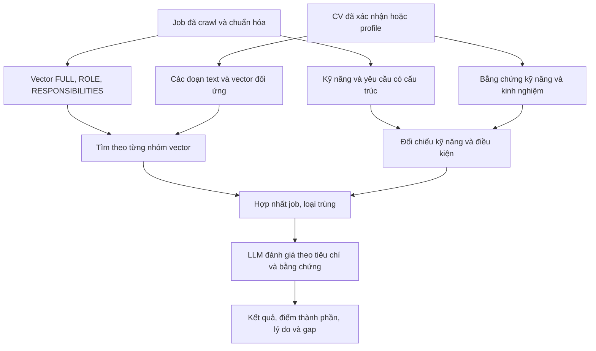

# Kế hoạch embedding job theo từng phần

Ngày lập: 18/10/2026. Trạng thái: đề xuất thiết kế để xem xét, chưa triển khai.

## 1. Mục tiêu và hiện trạng

Mục tiêu là tìm job phù hợp hơn và giải thích được ứng viên phù hợp ở tiêu chí nào,
thiếu bằng chứng ở đâu. Việc tạo thêm vector là một phương án cần đo lường, không tự
bảo đảm điểm matching hoặc ATS chính xác hơn.

Hiện `JobService.embeddingText()` ghép `job_title`, `raw_content`, `parsed_requirements`,
`parsed_responsibilities`, `employment_type` thành một đoạn text để tạo một vector job.
`MatchingService` tạo một vector từ CV hoặc career profile, tìm job theo cosine similarity,
rồi gọi `JOB_MATCH_RERANK` để chấm lại và trả lý do/skill gaps.

Đề xuất vẫn dùng chính job đã crawl. Thay vì chỉ có một đoạn text tổng hợp, tạo thêm
những đoạn text có mục đích riêng và tạo vector độc lập cho mỗi đoạn. Phía ứng viên
cũng cần các đoạn đối ứng; không thể chỉ tách job rồi so mọi phần với cùng một CV tổng hợp.

## 2. Những phần dùng để tạo embedding

| Loại | Text phía job | Text phía ứng viên | Giai đoạn |
| --- | --- | --- | --- |
| `FULL` | Text tổng hợp theo cách hiện tại | Nội dung CV đã xác nhận hoặc profile | Giữ để làm đối chứng và tìm kiếm dự phòng |
| `ROLE` | `job_title` + `role_category` + câu mô tả vai trò, nếu tách được từ `parsed_description` | Chức danh đã làm, vai trò dự án, phần tóm tắt năng lực có căn cứ trong CV | Bản đầu |
| `RESPONSIBILITIES` | `parsed_responsibilities`, thêm tên vai trò làm ngữ cảnh; nhiệm vụ trong description nếu xác định được | Mô tả kinh nghiệm và dự án, công nghệ gắn với công việc đã trình bày | Bản đầu |
| `REQUIREMENTS` | Các yêu cầu trong `parsed_requirements`, giữ ngữ cảnh yêu cầu bắt buộc/ưu tiên | Thông tin kỹ năng, kinh nghiệm, học vấn và chứng chỉ có trong CV | Thử nghiệm tiếp theo |

Bản đầu thêm hai vector `ROLE`, `RESPONSIBILITIES` và giữ `FULL`. Chỉ thêm
`REQUIREMENTS` khi trích xuất yêu cầu đủ tốt và kết quả đánh giá cho thấy có ích.
Yêu cầu tuyển dụng có thể trùng nội dung với vai trò/nhiệm vụ; cần đo lợi ích bổ sung.

### Vai trò: ROLE

Ví dụ text job:

```text
Vị trí: Java Backend Developer.
Nhóm nghề: Backend.
Vai trò: Phát triển dịch vụ backend cho sản phẩm thương mại điện tử.
```

Ví dụ text CV đối ứng:

```text
Chức danh đã làm: Backend Developer.
Vai trò dự án: Phát triển backend cho hệ thống bán hàng.
```

Nguồn CV là `structured_data.experience[].job_title`, `projects[].role` và nội dung
tóm tắt có thông tin thực tế. Tên file hoặc tiêu đề CV có thể do người dùng tự đặt,
không đủ để coi là nghề đã làm.

`candidate_profiles.target_job_title` và `career_goal` giúp tìm việc theo mong muốn.
Giữ chúng dưới nhóm intent riêng; mong muốn làm Java Backend không chứng minh đã có
kinh nghiệm Java Backend. `current_job_title` và `profile_summary` vẫn là thông tin
tự khai, cần ghi rõ nguồn khi dùng làm bằng chứng.

### Nhiệm vụ: RESPONSIBILITIES

Ví dụ text job:

```text
Vai trò: Java Backend Developer.
Nhiệm vụ: Xây dựng REST API, tối ưu truy vấn PostgreSQL,
tích hợp thanh toán và triển khai ứng dụng bằng Docker.
```

Ví dụ text CV đối ứng:

```text
Đã xây dựng REST API bằng Spring Boot cho dự án bán hàng.
Đã tối ưu truy vấn PostgreSQL và đóng gói ứng dụng bằng Docker.
```

Nguồn CV là `experience[].description`, `projects[].description` và
`projects[].technologies`. Mục này trả lời mức liên quan của công việc đã trình bày
với nhiệm vụ trong job, không chỉ kiểm tra danh sách công nghệ.

### Yêu cầu: REQUIREMENTS, triển khai sau

Ví dụ text job:

```text
Bắt buộc: Có kinh nghiệm Java, Spring Boot và cơ sở dữ liệu SQL.
Cần có khả năng thiết kế REST API và kiểm thử dịch vụ backend.
Ưu tiên: Đã triển khai dịch vụ trên AWS.
```

Nguồn đối ứng là phần năng lực của CV, gồm kỹ năng, kinh nghiệm/dự án liên quan,
học vấn và chứng chỉ khi có. Cùng một nội dung có thể xuất hiện ở nhiều nhóm;
không cộng điểm nhiều lần chỉ vì nó được đưa vào nhiều đoạn text.

Vector yêu cầu giúp tìm sự liên quan về ngữ nghĩa. Việc đáp ứng từng yêu cầu vẫn
phải kiểm tra bằng chứng; một điểm cosine cao không xác nhận mọi điều kiện đã đạt.

## 3. Những phần so sánh bằng dữ liệu có cấu trúc

| Tiêu chí | Cách xử lý đề xuất |
| --- | --- |
| Kỹ năng | Chuẩn hóa `skill_id`, tên và alias; đối chiếu required/preferred; liên kết đoạn JD và đoạn CV làm bằng chứng |
| Số năm kinh nghiệm | So số năm theo kỹ năng/công việc khi dữ liệu rõ; không cộng trùng các giai đoạn chồng nhau |
| Seniority | Xem yêu cầu rõ trong JD cùng phạm vi trách nhiệm đã trình bày; thiếu dữ liệu thì chưa xác định |
| Bằng cấp/chứng chỉ | Kiểm tra yêu cầu và bằng chứng cụ thể, phân biệt bắt buộc với ưu tiên |
| Lương/địa điểm/hình thức làm việc | Đối chiếu lựa chọn ứng viên; chỉ dùng làm điều kiện loại khi người dùng chọn điều kiện cứng |

Không cần tạo một vector cho mỗi từ Java, Docker hoặc SQL trong bản đầu. Hai công nghệ
liên quan ngữ nghĩa không tự thay thế nhau: Azure có thể là kinh nghiệm cloud liên quan,
nhưng chưa chứng minh yêu cầu AWS được đáp ứng. Alias chỉ hợp nhất các tên đã xác định
là cùng kỹ năng, ví dụ PostgreSQL/Postgres.

Nếu thử thêm embedding riêng cho kỹ năng về sau, dùng một đoạn `SKILL_CONTEXT` gồm
nhóm kỹ năng và ngữ cảnh sử dụng, ví dụ "Bắt buộc Java/Spring Boot để xây dựng REST API;
ưu tiên AWS để triển khai dịch vụ". Phía CV dùng kỹ năng kèm mô tả dự án/công việc thực tế.
Vector này chỉ bổ sung tìm kiếm; trạng thái đáp ứng mỗi kỹ năng vẫn lấy từ đối chiếu
có cấu trúc và bằng chứng. Đây là thử nghiệm tùy chọn, không thuộc bản đầu.

`market_job_skills`, `resume_skills`, `candidate_profile_skills` đã có sẵn.
Parser hiện dò kỹ năng bằng dictionary và ngữ cảnh của mục requirements/description;
không coi mọi kết quả trích xuất là chắc chắn. Lưu trạng thái chưa xác định khi chưa
biết kỹ năng bắt buộc hay ưu tiên; không đưa yêu cầu chưa rõ vào mẫu số bắt buộc.

Phần benefits, quảng bá công ty, URL, ngày crawl và metadata vận hành không đưa vào
những vector đánh giá năng lực mới. `FULL` cũ được giữ nguyên trong nhánh đối chứng.

## 4. Quy tắc tạo text và xử lý thiếu dữ liệu

1. Dùng dữ liệu job đã chuẩn hóa, ưu tiên section được parser nhận diện.
2. Mỗi đoạn có tên vai trò/ngữ cảnh tối thiểu để giữ ý nghĩa. Không lặp toàn bộ JD vào mọi section.
3. JD thiếu responsibilities: chỉ lấy câu nhiệm vụ từ description nếu có căn cứ;
   không tách được thì đánh dấu section không có dữ liệu và dùng các nhánh còn lại.
4. Section rỗng không tạo vector, không ghi vector toàn số 0 và không coi là điểm 0.
5. CV `READY` dùng nội dung đã được người dùng xác nhận; giữ nguyên ưu tiên
   `structured_data` so với raw extraction trong `ResumeService.canonicalText()`.
6. Mỗi đoạn lưu nguồn field hoặc vị trí câu làm bằng chứng. Có thể dùng AI hỗ trợ
   trích xuất khi cần, nhưng chỉ chấp nhận nội dung có đối chiếu được với nguồn.
7. Tạo text ổn định, không kèm timestamp/ID vận hành không liên quan; hash có phiên bản
   cách dựng text. Áp dụng giới hạn token; nếu section dài cần chia nhỏ theo đoạn có nghĩa
   thì bổ sung thiết kế chunk và cách gộp, không cắt im lặng.

## 5. Luồng matching đề xuất



1. Kiểm tra owner/quyền truy cập và tính hiệu lực của job như hiện tại.
2. Tạo hoặc đọc cache vector phía ứng viên theo từng phần có dữ liệu.
3. Tìm top K job riêng theo `ROLE`, `RESPONSIBILITIES` và `FULL`; có thể bổ sung
   nhánh đối chiếu kỹ năng có cấu trúc để giảm bỏ sót job.
4. Hợp nhất theo job ID, giữ thứ hạng/nguồn tìm ra job. Thử RRF để gộp các danh sách
   mà không giả định điểm của mọi nhánh cùng phân phối. K và số job gửi LLM là cấu hình
   được chọn bằng đánh giá, không phải hằng số chứng minh chất lượng.
5. Đối chiếu từng kỹ năng bắt buộc/ưu tiên, năm kinh nghiệm và điều kiện rõ ràng.
6. LLM nhận cả dữ liệu gốc liên quan, bằng chứng và kết quả từng tiêu chí để chấm lại.
   Giữ vai trò của vector là truy xuất; không lấy cosine làm phần trăm phù hợp hoặc gap.

Ví dụ job bắt buộc Java/Spring Boot/SQL, ưu tiên AWS; CV nêu Java/Spring Boot/Postgres
và Azure: ghi nhận các kỹ năng bắt buộc đã có bằng chứng trình bày, còn AWS chưa đủ
bằng chứng. Không chuyển Azure thành AWS hoặc coi thiếu AWS ưu tiên như thiếu bắt buộc.

### Các chế độ đầu vào

- `SELECTED_CV`: xử lý đúng CV đã chọn, giữ nguồn bằng chứng trong CV đó.
- `CAREER_PROFILE`: dùng current role, summary và skills; thiếu dự án/nhiệm vụ thì
  trả thiếu thông tin, không tự sinh kinh nghiệm từ mục tiêu nghề nghiệp.
- `ALL_CVS`: tạo đầu vào riêng từng CV, hợp nhất job tìm được, đánh giá từng cặp CV/job
  rồi chọn CV hoàn chỉnh phù hợp nhất cho mỗi job. Lưu CV được chọn và nguồn bằng chứng.
  Không lấy vai trò tốt nhất từ CV A cộng nhiệm vụ tốt nhất từ CV B thành một CV giả.

### Quan hệ với ATS và Guest

ATS cho một CV và một job đã chọn có thể đánh giá trực tiếp từ JD/CV cùng dữ liệu
kỹ năng. Không cần chạy tìm kiếm toàn bộ kho job. Có thể dùng lại bộ tiêu chí/bằng chứng;
embedding từng phần chỉ là tín hiệu bổ sung nếu được chứng minh hữu ích.

`GuestTrialService.recommend()` hiện là preview `SKILL_OVERLAP` trên demo CV.
Kế hoạch ưu tiên matching của candidate trước; mở rộng Guest là một bước riêng vì có
hợp đồng trial và quota riêng, không tự chuyển demo preview thành luồng semantic có phí.

## 6. Điểm, gap và cách giải thích

Kết quả chi tiết cần có: tiêu chí, trạng thái, bằng chứng JD/CV, điểm nếu đủ dữ liệu,
nguồn thông tin và phiên bản cách đánh giá. Những nhóm chính gồm vai trò, nhiệm vụ,
kỹ năng bắt buộc, kỹ năng ưu tiên và kinh nghiệm.

Gợi ý trạng thái: `SUPPORTED`, `PARTIAL`, `INSUFFICIENT_EVIDENCE`, `NOT_APPLICABLE`.
Không thấy trên CV thường là chưa đủ bằng chứng, không phải kết luận ứng viên không biết.
Mức phù hợp của một bằng chứng cũng khác mức độ xác thực ngoài đời thực của bằng chứng đó.

Cần trả riêng độ đầy đủ thông tin (`coverage`). Không tự cho một hồ sơ thiếu dữ liệu
điểm tối đa chỉ vì đã bỏ tất cả tiêu chí chưa biết khỏi mẫu số. Nếu thử điểm có trọng số,
chuẩn hóa/hiệu chỉnh các tín hiệu trước và chốt trọng số bằng bộ dữ liệu có người đánh giá;
không công bố một bộ trọng số tùy ý như công thức ATS chuẩn.

`match_reason_json` có thể chứa `criteria`, `retrieval_sections`, `coverage`,
`matched_resume_id`, `scoring_version` và hash đầu vào. Các trường vector score,
điểm LLM và final score cần giữ rõ ý nghĩa khi thêm phương pháp matching mới.

## 7. Thay đổi lưu trữ dự kiến

Đây là danh sách thiết kế migration, chưa phải câu SQL để chạy.

| Thành phần | Thay đổi |
| --- | --- |
| `market_job_embeddings` | Thêm `section_type`, mặc định dữ liệu cũ là `FULL`; lưu hash input của section và phiên bản cách dựng text |
| `resume_embeddings`, `career_profile_embeddings` | Thêm loại phần tương ứng khi triển khai cache vector phía ứng viên |
| `vector_indexing_jobs` | Phân biệt task theo section và phiên bản/input; giữ lease/retry và kiểm tra nội dung trước khi công bố vector |
| Các unique index | Thêm section vào định danh; hiện unique current chỉ theo owner/provider/model nên chưa cho phép nhiều phần current |
| Các truy vấn vector | Lọc section/provider/model, vector current và phiên bản nội dung; cân nhắc index theo section qua đo thực tế |
| Skills/yêu cầu | Tận dụng bảng hiện có; bổ sung bằng chứng, mức yêu cầu/năm kinh nghiệm và thông tin extraction khi thực sự trích được |
| `job_match_results` | Tận dụng JSON hiện có cho điểm thành phần/bằng chứng và phiên bản; bảng riêng chỉ khi cần truy vấn/báo cáo thường xuyên |

Giữ hash phiên bản job để chặn công bố vector từ nội dung cũ; hash section có thể dùng
để tái sử dụng vector khi phần đó không thay đổi. Phải định nghĩa hai hash riêng, không
âm thầm đổi nghĩa `content_hash` mà truy vấn hiện tại dùng để đối chiếu `raw_content_hash`.
Text recipe/provider/model thay đổi phải có đường reindex và cache invalidation tương ứng.
Không so vector từ các model/không gian embedding khác nhau.

## 8. Các bước triển khai và tiêu chí hoàn thành

| Bước | Công việc | Kết quả cần xem được |
| --- | --- | --- |
| 1. Chuẩn bị đối chứng | Chọn các cặp CV/job có đánh giá thủ công, lưu kết quả cách hiện tại, kiểm tra section parser | Có baseline về retrieval, xếp hạng, gap và chi phí |
| 2. Chuẩn hóa đầu vào | Viết bộ dựng text ROLE/RESPONSIBILITIES cho job và CV/profile, giữ nguồn bằng chứng | Xem được text thực sự sẽ gửi embedding; section thiếu có trạng thái rõ |
| 3. DB và indexing | Migration additive, nâng queue/worker/query/cache, tạo hai vector mới và giữ FULL | Theo dõi được trạng thái từng section; retry không ghi đè sai phần, dữ liệu cũ vẫn chạy |
| 4. Matching và giải thích | Retrieval nhiều nhánh, fusion, đối chiếu skills, LLM rubric, xử lý từng CV | Kết quả có job, CV phù hợp nhất, điểm thành phần, bằng chứng và gap |
| 5. Đánh giá và mở dần | So sánh trên tập giữ riêng; bật bằng cấu hình, có đường quay về FULL | Có bằng chứng chất lượng đủ tốt trong ngân sách độ trễ/token/storage |
| 6. Thử thêm REQUIREMENTS | Đo mức cải thiện bổ sung và độ trùng lặp tín hiệu | Chỉ giữ nếu có ích so với hai vector mới |

Những điểm chạm chính trong code: `JobService.embeddingText`, `JobEmbeddingService`,
`JobEmbeddingRepository`, `MatchingService`, `MatchingRepository` và phần dựng/cache
đầu vào CV/profile. Bộ so sánh kỹ năng và tiêu chí nên dùng chung cho matching/ATS
khi phù hợp, giữ riêng kiểm tra quyền và cách tính quota của từng workflow.

## 9. Đo lường và kiểm thử

- Retrieval: Recall@K trên các job đã được đánh giá; không lấy điểm cosine tự làm nhãn đúng.
- Xếp hạng: NDCG@K hoặc precision ở top kết quả, so với baseline trên cùng tập dữ liệu.
- Gap: độ đúng của từng kỹ năng bị gắn thiếu/chưa đủ bằng chứng; đo riêng bắt buộc/ưu tiên.
- Khả năng giải thích: bằng chứng có thật trong CV/JD; không tự tạo kinh nghiệm hoặc năm làm việc.
- Vận hành: độ trễ p95, số vector, token, chi phí reindex và cache hit; không mặc định chi phí tăng đúng bằng số vector.
- Regression: thiếu section, JD dài/lặp, CV đã sửa, job cập nhật trong lúc embedding,
  model thay đổi, retry đồng thời, hết hạn job và phân quyền cache.
- Tình huống nghề nghiệp: Java/JavaScript, AWS/Azure, CV chỉ ghi mục tiêu nghề,
  ứng viên mới tốt nghiệp, JD Việt/Anh, nhiều CV khác nghề và thời gian kinh nghiệm chồng nhau.

Tách dữ liệu hiệu chỉnh và tập đánh giá giữ riêng; không chọn trọng số rồi báo chất lượng
trên chính những ví dụ đã dùng để chọn trọng số. Kiểm thử AI mock kiểm tra nghiệp vụ;
đánh giá độ chính xác cần người gán nhãn và model thật.

## 10. Cơ sở tham khảo

Các tài liệu sau hỗ trợ nguyên tắc chung. Cách chia ROLE/RESPONSIBILITIES và lộ trình
ở trên là đề xuất cho repository này, chưa phải kết quả benchmark của ứng dụng.

- [Elastic: tìm kiếm với nhiều trường vector](https://www.elastic.co/search-labs/blog/scoring-documents-by-the-closest-one-with-multiple-kNN-fields).
- [Pinecone: chia nội dung theo ngữ cảnh và đánh đổi kích thước đoạn](https://www.pinecone.io/learn/chunking-strategies/).
- [Elastic: Reciprocal Rank Fusion để gộp danh sách xếp hạng](https://www.elastic.co/docs/reference/elasticsearch/rest-apis/reciprocal-rank-fusion).
