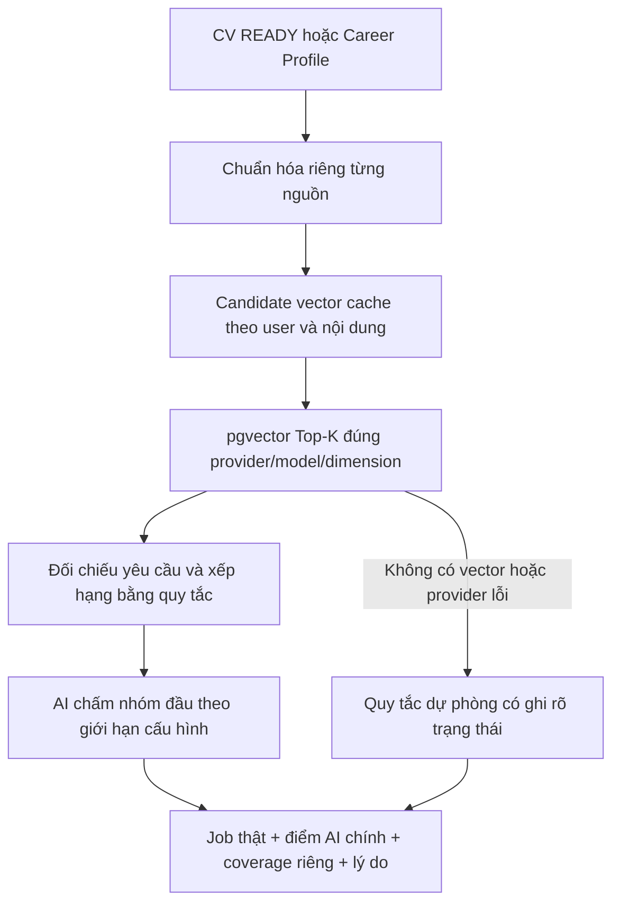

# Recommend Job: pgvector → rules → optional AI reranking

## Cập nhật: lấy điểm LLM làm phần trăm phù hợp

Theo yêu cầu tiếp theo của người dùng, phiên bản `recommendation-v2-ai-score` dùng
**`final_score = điểm LLM hợp lệ`**. Giao diện hiển thị `score × 100%` và xếp hạng giảm
dần theo điểm AI. Rules cung cấp ngữ cảnh và thứ tự chọn job gửi AI; độ bao phủ quy tắc
được giữ riêng, không thay thế điểm phù hợp.

Job chưa được chọn, provider lỗi hoặc chưa có đánh giá hợp lệ có `final_score=null`,
hiển thị **“Chưa có điểm AI”**, xếp sau nhóm có điểm. Điểm 0 hợp lệ do LLM trả vẫn hiện 0%.
Thêm `score_source=LLM/UNAVAILABLE`, `score_status` và
`assessment.suitability_score_available`; coverage giữ ở `assessment.rule_coverage_score`
và `assessment.requirement_coverage`. Không còn dùng coverage>0 hoặc thiếu kinh nghiệm
để chặn lời gọi AI. `.env` người dùng đang đặt giới hạn 10 job/4 lần gọi; giữ nguyên.

Sửa contract prompt bị lệch: trước đây system prompt mô tả JSON cơ bản có 5 trường,
trong khi validator đòi thêm trạng thái và bằng chứng. `AiService` nay gửi JSON schema
đầy đủ cho recommendation, gồm UUID thực và các trường evidence. Prompt active ở
Settings vẫn được nạp. Gemini được hướng dẫn rằng thiếu kỹ năng có thể dẫn tới điểm thấp,
nhưng không đồng nghĩa thiếu dữ liệu để đánh giá; chỉ trả INSUFFICIENT_EVIDENCE khi
nguồn candidate/JD thực sự không đủ để ước lượng mức phù hợp.

Batch có `jd_evidence` văn bản; validator cho phép khác biệt khoảng trắng/xuống dòng
và Unicode tương đương, vẫn từ chối quote bịa/trống. Không cache kết quả AI bị từ chối.
Cache kết quả tăng version để bỏ điểm coverage cũ; cache candidate vector giữ namespace
cũ để không phải gọi embedding lại chỉ vì thay cách tính điểm. Không thay model, dimension,
ATS, Assessment, Roadmap hoặc cấu hình `.env` người dùng.

Kiểm thử bản AI-score: full `formatter:format formatter:validate verify` thành công,
2.039 test (1.939 pass, 100 skipped, 0 failures/errors). Trong đó có 12 bài integration
Recommendation dùng pgvector thật và mock provider; xác nhận điểm AI 0,88 thay coverage 0,
đảo thứ tự theo AI, job ngoài ngân sách không có điểm, thiếu kinh nghiệm vẫn gửi AI,
bằng chứng bịa bị loại và lỗi provider không tạo phần trăm giả. Test `AiService` kiểm tra
schema đầy đủ và prompt quản trị đều thực sự nằm trong request gửi model.
Frontend: 73 test liên quan pass; build/lint pass, gồm hiển thị AI % riêng với coverage
và nhãn chưa có điểm AI. Đây là kiểm thử provider giả lập; chưa phải đánh giá chất lượng
điểm Gemini trên một bộ dữ liệu nhãn thực tế.

Đã đóng gói và rebuild/restart Docker bằng JAR cuối của bản AI-score. Container
`edunexus-app-1` khởi động lúc 18:05 ngày 18/11/2026, health trả UP, schema vẫn V42;
không có migration mới. Giữ nguyên cấu hình 10 job/4 lần gọi của người dùng.

## Kiểm tra trước khi sửa

Ngày kiểm tra: 18/11/2026. Scope chỉ là Job Recommendation; không thay workflow ATS,
Assessment hoặc Learning Roadmap. Repo tham khảo: [MiAI_CV_Matching_AI_Agent](https://github.com/thangnch/MiAI_CV_Matching_AI_Agent);
chỉ tham khảo ý tưởng candidate → semantic search → evaluation, không đưa Python,
LangChain hoặc Chroma vào ứng dụng.

Luồng tại thời điểm nhận yêu cầu: frontend gọi DETAILED cho danh sách; MatchingService
chuyển cả QUICK/DETAILED sang RequirementEvidenceService khi provider được bật.
Service đó embedding từng đoạn CV và từng yêu cầu JD, tính cosine trong Java rồi
gọi Gemini kiểm tra từng nhóm yêu cầu. Đây không phải truy xuất Top-K job bằng
pgvector. Các query pgvector cũ vẫn tồn tại nhưng bị nhánh mới đi trước bỏ qua.
Một lần Gemini trả 503 từng làm rollback cả request và các cache đang trong transaction.

Audit chỉ đọc database thật:

- pgvector 0.8.7; schema và HNSW cosine index đang dùng vector(1024).
- 129 job active/chưa hết hạn; 36 có vector current Gemini gemini-embedding-001
  khớp raw_content_hash; 93 chưa có vector hiện hành tương thích.
- Có vector Ollama qwen3-embedding:0.6b cùng dimension nhưng khác không gian model.
- Hàng đợi Gemini có 311 task FAILED, thông báo quota của tài khoản indexing đã hết.
- Có 10 task cũ ghi provider openai với tên model Gemini, không được coi là Gemini vector.
- Không có bằng chứng lỗi dimension ở môi trường này. Các guard 1024 hiện có là
  ràng buộc schema V10; không thay đổi dimension hoặc model để né lỗi.

## Kế hoạch triển khai

1. Thêm mode RECOMMENDATION riêng trên POST /matching; các nơi gọi QUICK/DETAILED
   và cặp CV–JD cụ thể tiếp tục đi luồng riêng.
2. Chuẩn hóa search profile; ALL_CVS truy xuất theo từng CV rồi hợp nhất job,
   không trộn mục tiêu và bằng chứng giữa các CV. Cache vector riêng theo user,
   nội dung, model, dimension và phiên bản cách dựng input.
3. Query pgvector Top-K theo provider/model/current/source hash, chỉ job còn tuyển.
   Giữ similarity làm điểm truy xuất, không làm phần trăm phù hợp.
4. Dùng QuickJobMatcher/RequirementCoverage/SkillCatalog đánh giá nhóm retrieved.
   Điều kiện chưa đủ bằng chứng giữ UNVERIFIED; Bloom được giữ trong snapshot JD.
5. Rerank tối đa 10–20 job có cơ sở, theo batch JobMatchRerank; lỗi AI chỉ bỏ phần
   advisory và ghi metadata. Không dùng AI đọc toàn catalog.
6. Tái sử dụng cache và bảng matching/vector hiện có. Chỉ thêm metadata tối thiểu
   vào market_job_embeddings để phân biệt input version/source hash, giữ vector cũ.
7. Thêm API backfill dùng hàng đợi hiện có; không tự tăng quota hoặc bỏ qua billing.
8. Kiểm thử native PostgreSQL/pgvector với mock provider, gồm truy xuất Top-K thật,
   model isolation, dimension, cache, multi-user, provider failure và ranking.

## Luồng đã triển khai

`POST /api/v1/matching` giữ nguyên contract basis và bổ sung `mode: RECOMMENDATION`.
Frontend chỉ đổi lời gọi danh sách gợi ý sang mode này. Xem một cặp CV–JD tiếp tục dùng
`DETAILED` cùng `jobId`; `QUICK` tiếp tục chạy quy tắc. Không thay nghiệp vụ ATS,
Assessment hoặc Roadmap trong đợt refactor Recommendation này.



1. Xác thực quyền sở hữu CV, yêu cầu `READY`; CAREER_PROFILE phải tồn tại.
   Search document gồm mục tiêu vị trí, summary, skill canonical, kinh nghiệm, dự án,
   học vấn/chứng chỉ, seniority được khai báo và sở thích địa điểm/hình thức làm việc.
   Không đưa họ tên, email, điện thoại, đường dẫn file vào input. CV trùng nội dung được
   gộp ID; các CV khác nội dung truy xuất riêng, không cộng kỹ năng/kinh nghiệm giữa CV.
2. Cache candidate vector trong `matching_evidence_vectors` đang có, khóa theo user,
   provider, model và hash của document/version/dimension. CV/Profile đổi sẽ có hash mới.
   Vector phải đủ 1024 phần tử, hữu hạn, khác zero. Không gọi LLM để tạo search profile.
3. Với mỗi document, pgvector lấy Top-K (mặc định 75) job đang tuyển/chưa hết hạn.
   Chỉ chấp nhận vector current, đúng provider/model/dimension và source hash.
   Hợp nhất job trùng, giữ document có similarity cao nhất làm nguồn đánh giá của job;
   không dùng bằng chứng từ CV khác để bù yêu cầu.
4. Đánh giá đúng/alias, AND/OR, mandatory/preferred, thiếu/chưa xác minh bằng quy tắc
   hiện có. Số năm liên quan chỉ lấy từ các vai trò có nhắc kỹ năng đó và có ngày tháng,
   hợp nhất các giai đoạn trùng nhau; hoặc số năm kỹ năng được khai báo rõ.
   Không dùng tổng số năm Python để xác nhận số năm Java. Thời gian dùng quy ước tháng
   bao gồm tháng đầu/cuối của QuickJobMatcher hiện có. Không suy Bloom từ số năm.
   Education chưa có phép đối chiếu đáng tin cậy giữ UNVERIFIED; seniority thiếu dữ liệu
   cũng giữ UNVERIFIED. Location/employment là điều kiện mềm. Salary theo chính sách
   tolerance hiện có là hard filter chỉ khi mức lương job được xác định là thấp hơn sàn;
   lương không rõ/không quy đổi được vẫn được giữ với trạng thái chưa xác minh.
5. Lấy nhóm đầu theo cấu hình để AI đánh giá độc lập, kể cả coverage=0 hoặc thiếu kinh nghiệm.
   Tái sử dụng JobMatchRerank: tối đa 3 job/batch, mặc định tối đa 4 lần gọi/request;
   input candidate bị giới hạn 18.000 ký tự, evidence 24.000 ký tự, JD compact theo batch.
   AI phải trả đúng tập UUID thật và quote nguyên văn từ candidate/JD được gửi.
   Câu trả lời thiếu bằng chứng không được dùng để đổi hạng. Lỗi provider dừng các lần
   gọi tiếp theo trong request, giữ toàn bộ kết quả quy tắc và ghi trạng thái bỏ qua AI.

Job embedding được tạo bởi worker hiện có, không tạo lại trong recommendation request.
Input mới `job-search-v2` gồm title, role, seniority, employment, job description sạch,
clauses yêu cầu bắt buộc/ưu tiên, responsibilities và skill canonical. Loại HTML/URL,
không đưa riêng trường benefits/company overview vào embedding. Khi description nhập
gộp, bỏ footer benefits/company nếu có heading rõ. Nội dung không có heading chuẩn vẫn
cần chất lượng parsing từ crawler. Hash input thay đổi khi nội dung ngữ nghĩa thay đổi;
thay salary không tốn embedding mới nhưng cập nhật source provenance.

## Query pgvector

Phần cốt lõi của `RecommendationRepository.semanticTopK`:

```sql
SELECT j.id, j.job_title, 1 - (e.embedding <=> CAST(:candidate AS vector)) AS vector_score
FROM market_job_embeddings e
JOIN market_job_posts j ON j.id = e.market_job_id
WHERE j.status = 'ACTIVE'
  AND (j.valid_through IS NULL OR j.valid_through > now())
  AND e.is_current AND e.embedding IS NOT NULL
  AND e.provider = :provider AND e.model = :model
  AND vector_dims(e.embedding) = :dimensions
  AND COALESCE(e.source_content_hash, e.content_hash) = j.raw_content_hash
  -- Nếu có salary filter: AND j.id = ANY(CAST(:eligible_ids AS uuid[]))
ORDER BY e.embedding <=> CAST(:candidate AS vector)
LIMIT :top_k;
```

Không tải corpus vector lên Java. `ORDER BY` dùng trực tiếp toán tử cosine-distance để
planner có thể dùng HNSW hiện có; bật `hnsw.iterative_scan=strict_order` trong transaction
để giảm thiếu kết quả sau filter. Không ép planner dùng index cho catalog nhỏ; PostgreSQL
có thể chọn sequential scan khi rẻ hơn. Không dùng materialized CTE chặn ANN trong luồng mới.

## Scoring và ranking

- `vector_similarity_score`: cosine similarity (-1..1); dùng truy xuất và tie-break.
- `assessment.requirement_coverage`/`skill_coverage`: quy tắc hiện có, ghi rõ nguồn thiếu.
- `assessment.experience_conditions`: số năm yêu cầu, số năm có bằng chứng, trạng thái.
- `llm_rerank_score`: mức phù hợp LLM 0..1 khi output qua kiểm tra; null nếu chưa có điểm.
- `final_score`: bằng điểm LLM hợp lệ; UI nhân 100 để hiển thị phần trăm. Đây là ước lượng
  mức phù hợp từ nội dung đã cung cấp, không phải xác suất trúng tuyển. Chưa có điểm AI
  thì null và ghi rõ trên giao diện, không lấy coverage lấp chỗ trống.
- `rank_position`: nhóm có điểm AI đứng trước → điểm AI giảm dần → coverage quy tắc →
  kinh nghiệm → preferred coverage → location → employment preference → similarity → UUID.
  Nhóm chưa chấm giữ thứ tự quy tắc phía sau; không trình bày thành 0% phù hợp.

Không cộng các điểm bằng một công thức trọng số tùy ý. Bloom giữ trong assessment để
xem lại nguồn JD, không đưa vào phép trừ điểm vì chưa có bằng chứng proficiency tương ứng.

## Cache, lỗi và quan sát

Recommendation cache dùng Redis hiện có + `job_matching_runs`/`job_match_results`, mặc định
10 phút; cache identity gồm user, basis, CV IDs/hash, model/config/prompt/rules versions,
salary policy/rates, fingerprint catalog và fingerprint vector. Mỗi cache hit nạp lại
result có ownership và tình trạng job hiện tại. Không chia cache candidate giữa user.

Metadata nằm ở `response.recommendation` và `profile_snapshot.recommendation`:

- `vector_used`, `semantic_status`: USED, PARTIAL_INDEX, NO_COMPATIBLE_VECTORS,
  NO_ELIGIBLE_VECTOR_RESULTS, PROVIDER_ERROR, EMPTY_CATALOG.
- `fallback_reason`, `active_jobs`, `compatible_vectors`, `legacy_input_vectors`,
  `retrieved_jobs`, `ranked_jobs`, `candidate_documents`, `embedding_calls`.
- `rerank.status/reason/calls/assessed_jobs`, `timings_ms`, `cacheable`, `ranking_policy`.

Fallback chỉ xảy ra khi không có kết quả vector hoặc embedding provider lỗi. Khi catalog
chỉ có một phần vector, chỉ rank nhóm truy xuất semantic và công khai PARTIAL_INDEX;
không lén bổ sung job chưa có vector. Fallback đọc tối đa 500 job gần đây (có cấu hình),
ghi `RULE_FALLBACK_RECOMMENDATION` và `vector_used=false`. Không cache kết quả lỗi provider
hoặc lỗi rerank để lần bấm sau có thể thử lại. 401/403 vẫn trả lỗi truy cập thật.
Lỗi SQL/query không được nuốt rồi giả vờ semantic đã thành công.

Log `recommendation run=...` ghi số lượng và thời gian normalization, embedding, retrieval,
rules, rerank, tổng pipeline; cache hit có log riêng. Không ghi nội dung CV, API key, token.

## Migration, cấu hình và backfill

V42 chỉ bổ sung `source_content_hash`, `input_version` và index metadata vào bảng
`market_job_embeddings`; không tạo bảng mới, không đổi vector(1024), không xóa vector.
Vector legacy được gắn source hash hiện có và `legacy-full-v1`, vẫn dùng khi đúng model,
dimension và nguồn. Khi reindex, bản cũ giữ lại với `is_current=false`. Candidate cache
dùng bảng đã có từ V41, không tạo cache table khác.

Không cần đổi biến môi trường hiện có. Các biến tùy chọn mới:

| Biến | Mặc định | Giới hạn thực thi |
| --- | --- | --- |
| RECOMMENDATION_TOP_K | 75 | 1–100 mỗi document |
| RECOMMENDATION_RERANK_LIMIT | 12 | 0–20 job |
| RECOMMENDATION_RERANK_MAX_CALLS | 4 | 0–7 batch |
| RECOMMENDATION_RERANK_ENABLED | true | tắt/bật AI advisory |
| RECOMMENDATION_CACHE_SECONDS | 600 | 1–3600 giây |
| RECOMMENDATION_FALLBACK_LIMIT | 500 | 1–5000 job |

Giữ `AI_EMBEDDING_PROVIDER=gemini`, `AI_EMBEDDING_MODEL=gemini-embedding-001`,
`AI_EMBEDDING_DIMENSIONS=1024` của môi trường đã kiểm tra. Không thay chat model.

Sau khi deploy migration, dùng token ADMIN/MANAGER thật:

```http
GET /api/v1/admin/jobs/embeddings/status
Authorization: Bearer <admin-token>

POST /api/v1/admin/jobs/embeddings/backfill?limit=50
Authorization: Bearer <admin-token>
```

Backfill enqueue hàng đợi `vector_indexing_jobs` hiện có. Worker chỉ xử lý khi được bật
và provider embeddings hoạt động. Gọi từng đợt, chờ đợt trước hoàn thành rồi gọi tiếp.
Task được deduplicate theo job/provider/model/input hash; chạy lại an toàn. Admin yêu cầu
indexing chịu hạn mức AI hiện có. Không tự cộng quota, không đổi requested_by để né quota.
Khi đã hết hạn mức, phải xử lý bằng cơ chế cấp hạn mức hợp lệ rồi enqueue lại các task lỗi.
Worker ghi nhận chi phí theo `requested_by` của admin yêu cầu indexing, qua
`ai.embedForUser(work.actor(), ...)`. Hạn mức này khác hạn mức hiển thị cho candidate
đang xem gợi ý; token của candidate còn nhiều không chứng minh indexing còn quota.

Query theo dõi tiến độ (thay model/provider nếu cấu hình khác):

```sql
SELECT provider, model, status, count(*)
FROM vector_indexing_jobs WHERE entity_type='JOB'
GROUP BY provider, model, status;

SELECT count(*) AS active_jobs,
       count(*) FILTER (WHERE EXISTS (
         SELECT 1 FROM market_job_embeddings e WHERE e.market_job_id=j.id
           AND e.is_current AND e.embedding IS NOT NULL
           AND e.provider='gemini' AND e.model='gemini-embedding-001'
           AND vector_dims(e.embedding)=1024
           AND COALESCE(e.source_content_hash,e.content_hash)=j.raw_content_hash
       )) AS compatible_vectors
FROM market_job_posts j
WHERE status='ACTIVE' AND (valid_through IS NULL OR valid_through>now());
```

## File chính của đợt refactor Recommendation

- Mới: `CandidateSearchProfile`, `RecommendationRules`, `RecommendationService`,
  `RecommendationRepository`, migration V42.
- Routing/API: `MatchRequest`, `CareerToolsService`, nhánh mode của `MatchingService`.
- Indexing: `JobEmbeddingSupport`, `JobEmbeddingService`, `JobEmbeddingRepository`,
  `JobService`, `AdminJobController`; legacy queries trong `MatchingRepository` đọc provenance mới.
- AI: getters embedding identity của `AiService`, nhánh recommendation của
  `JobMatchRerank`, `JobMatchResponseSchema`, `AiResponseData`.
- Config: `application.yaml`.
- Frontend: `candidateService`, `candidateMappers`, `types/domain`, `JobsPage`,
  `tests/matching-service.test.mjs`.
- Tests: `RecommendationRulesTests`, `RecommendationIntegrationTests`; cập nhật các test
  indexing/routing/fixture/schema count bị ảnh hưởng. Các thay đổi requirement-evidence,
  ATS và Roadmap từ yêu cầu trước vẫn nằm trong working tree; không phải luồng Recommendation mới.

## Kiểm chứng và giới hạn

`RecommendationIntegrationTests` dùng PostgreSQL 17 + pgvector 0.8.7 thật, chạy Flyway
V1–V42, HTTP authorization thật và chỉ mock AI provider. Bài Top-K dựng hai vector trục
khác nhau, giới hạn K=1, chứng minh response chọn vector gần nhất dù title job khác;
loại model khác, source hash cũ, job hết hạn. Các bài khác kiểm tra cache đổi CV/catalog/model,
multi-user isolation, lỗi 503 embedding/rerank, missing vectors, invalid dimensions,
CV chưa READY, CAREER_PROFILE và bảo toàn lịch sử vector.

Kết quả thực tế ngày 18/11/2026:

- Backend `formatter:format formatter:validate verify` thành công: 2.029 test,
  0 failures/errors, 100 skipped theo điều kiện môi trường. Sau bổ sung hai test indexing
  và hỗ trợ headline `position` của CV, chạy lại `verify` cho 36 test liên quan: pass.
  Tổng báo cáo test cuối: 2.031 test, 1.931 pass, 100 skipped, 0 failures/errors.
  Trong đó 9 bài integration Recommendation/pgvector không bị skip.
- Frontend: 69 test liên quan matching/list/ATS selection pass; `npm run build` và
  `npm run lint` pass. Build còn cảnh báo kích thước bundle hiện có.
- Build dùng bản sao source trong workspace để tránh IDE ghi đè `target/classes` khi Maven
  đang compile. JAR từ bản source đã kiểm thử được copy về target rồi build Docker.
  Formatting của các file Java thay đổi đã được đồng bộ; không giữ thay đổi format
  ngoài phạm vi công việc.
- Đã rebuild/restart `edunexus-app-1`; health `/actuator/health` trả UP.
  Flyway xác nhận V42 thành công trên database thật, không đổi/xóa vector cũ.
  Container cuối đã được rebuild từ JAR gồm cả hỗ trợ headline `position` của CV.
- Audit sau deploy vẫn là 36/129 vector tương thích; 311 task Gemini FAILED vì quota.
  Không tự tăng quota, không đổi tài khoản chịu phí và không enqueue hàng loạt khi đã
  biết indexing đang hết hạn mức. API backfill sẵn sàng để admin chạy sau khi xử lý quota.
- Không kiểm tra được recommendation bằng phiên đăng nhập candidate trên database thật:
  tài khoản synthetic có sẵn trong fixture trả 401. Không seed/reset mật khẩu hoặc tạo
  JWT để vượt xác thực. Kiểm thử end-to-end HTTP có xác thực và pgvector thật đã chạy
  trên database Testcontainers; kết quả đó không được coi là đã test tài khoản của người dùng.

Kiểm chứng trên trang đang dùng: mở Network, chọn request `POST /matching` khi bấm
“Cập nhật đề xuất”. Body phải là `mode: RECOMMENDATION`. Trong response kiểm tra
`recommendation.vector_used=true`, `semantic_status=USED` hoặc `PARTIAL_INDEX`,
`vector_similarity_score` có giá trị và `match_reason_json.retrieval=PGVECTOR_COSINE_TOP_K`.
Nếu `vector_used=false`, đọc `semantic_status/fallback_reason`; UI cũng công khai trạng thái
dự phòng. Có thể gọi trực tiếp bằng token candidate đang đăng nhập:

```json
{
  "basis": "SELECTED_CV",
  "resumeIds": ["<ready-resume-uuid>"],
  "limit": 50,
  "mode": "RECOMMENDATION"
}
```

Giới hạn: chưa có bộ dữ liệu nhãn để hiệu chỉnh độ chính xác điểm LLM; chỉ nhóm trong
giới hạn cấu hình được chấm; học vấn/seniority thiếu cấu trúc giữ chưa xác minh; ANN có thể bỏ lỡ hàng xóm;
ALL_CVS tốn tối đa một embedding và một query cho mỗi CV khác nội dung chưa được cache
(giới hạn 100 CV). Catalog thực tế chỉ có 36/129 vector tương thích tại thời điểm audit;
chưa thể tuyên bố bao phủ toàn bộ job trước khi backfill hoàn thành. Quota indexing là
vấn đề vận hành cần giải quyết hợp lệ; thay code không tự tạo thêm hạn mức.
