# Sequence diagram các luồng nghiệp vụ chính

Bộ tài liệu gồm **16 sequence diagram và 16 class diagram tương ứng**, đối chiếu với controller, service, repository và adapter FE ngày 27/10/2026. Mỗi sơ đồ có ảnh PNG hiển thị ngay trong Markdown, SVG để phóng to và mã Mermaid để chỉnh sửa.

**Xem toàn bộ hình:** [Trang xem sơ đồ](diagrams/sequence/index.html) · [Thư mục ảnh và nguồn](diagrams/sequence/README.md). Trong IDE, mở Markdown Preview để thấy ảnh; không cần cài bộ hiển thị Mermaid. Có thể mở `index.html` bằng trình duyệt để chọn SD và phóng to hình, kể cả khi không có mạng.

## Phạm vi và quy ước

- Đây là trình tự xử lý trong code, không phải bằng chứng đã chạy E2E thành công.
- Đường dẫn API rút gọn trong sơ đồ có tiền tố `/api/v1`.
- Mũi tên service → PostgreSQL đại diện cho thao tác qua repository/`SqlStore`; lược bớt lifeline repository để sơ đồ dễ đọc. Class diagram đi kèm chỉ ra các lớp Java và dependency thực tế của cùng luồng.
- Class diagram chọn các lớp và phương thức liên quan; không phải ERD hoặc sơ đồ đầy đủ mọi trường. `-->` là liên kết/dependency được giữ trong đối tượng, `..>` là sử dụng/gọi kiểu khác; `+` public, `#` protected, `-` private, `$` static. Chữ ký dài được rút gọn; framework/interface được ghi rõ.
- Ngoài API công khai, request đi qua BearerFilter và kiểm tra user/role/ownership. Luồng xác thực dùng lại SD-02.
- Lời gọi `AiService.generate(...)` dùng pipeline chung SD-13; embedding dùng SD-14. Sơ đồ nghiệp vụ giữ tên feature thật để dễ tra code.
- Các bước Admin qua API client không có nghĩa FE đã có form tương ứng. `/admin/ai/*`, `/admin/jobs`, `/admin/support` hiện có route placeholder; SSE tư vấn và RAG là khả năng BE, chưa phải hành vi mặc định của FE.

| Mã | Luồng | API/điểm vào chính |
| --- | --- | --- |
| [SD-01](#sd-01-đăng-ký-xác-minh-email-và-đăng-nhập) | Đăng ký, OTP, login | `/auth/register`, `/auth/verify-email`, `/auth/login` |
| [SD-02](#sd-02-xác-thực-request-refresh-token-và-logout) | Bearer, refresh, logout | `/auth/refresh`, `/auth/logout` |
| [SD-03](#sd-03-tạo-upload-review-confirm-và-phân-tích-cv) | CV thủ công/AI/upload và phân tích | `/resumes`, `/resumes/build`, `/resumes/upload`, confirm/analyses |
| [SD-04](#sd-04-nhập-jd-và-lập-chỉ-mục-embedding) | Import JD, queue embedding | `/admin/jobs`, `/admin/jobs/{id}/index` |
| [SD-05](#sd-05-gợi-ý-việc-làm-matching) | Lọc lương, vector search, rerank/fallback | `POST /matching` |
| [SD-06](#sd-06-đánh-giá-cv-với-một-jd-job_ats) | ATS cho đúng CV và JD | `POST /jobs/{jobId}/ats` |
| [SD-07](#sd-07-tạo-bài-đánh-giá-bằng-hàng-đợi-ai) | Enqueue, worker, polling và reload | `/assessments/generations` |
| [SD-08](#sd-08-nộp-bài-phân-tích-gap-và-lộ-trình-học) | Chấm bài, missing skills, roadmap/progress | answers/submit, `/roadmaps` |
| [SD-09](#sd-09-trợ-lý-nghề-nghiệp-và-rag-tùy-chọn) | Chat có context và RAG | `/assistant/conversations` và messages |
| [SD-10](#sd-10-tạo-phân-công-và-trao-đổi-ca-tư-vấn) | Candidate–Admin–Consultant | `/consultations` |
| [SD-11](#sd-11-thanh-toán-sepay-và-kích-hoạt-gói) | Signed checkout, IPN, settlement | `/payments/sepay/checkout`, `/payments/sepay/ipn` |
| [SD-12](#sd-12-admin-lưu-và-khôi-phục-cấu-hình-ai-và-prompt) | Version/active/audit của cấu hình AI | `/admin/ai/configurations`, `/admin/ai/prompts` |
| [SD-13](#sd-13-pipeline-gọi-ai-chung) | Model, prompt, quota, JSON, telemetry | `AiService.generate*` |
| [SD-14](#sd-14-tạo-embedding-cho-cv) | Embedding CV, cache và version vector | `/resumes/{id}/embedding` |
| [SD-15](#sd-15-ticket-hỗ-trợ-và-phản-hồi-admin) | Ticket, reply, status | `/support/tickets` |
| [SD-16](#sd-16-soạn-nội-dung-ứng-tuyển) | FE assistant flow và BE drafts API | Assistant messages / `/jobs/{id}/application-drafts` |

## SD-01 Đăng ký xác minh email và đăng nhập

**Kết quả:** user Candidate từ `PENDING` thành `ACTIVE`; login mới cấp token. Xác minh OTP tự nó không cấp token.

### Sequence diagram SD-01

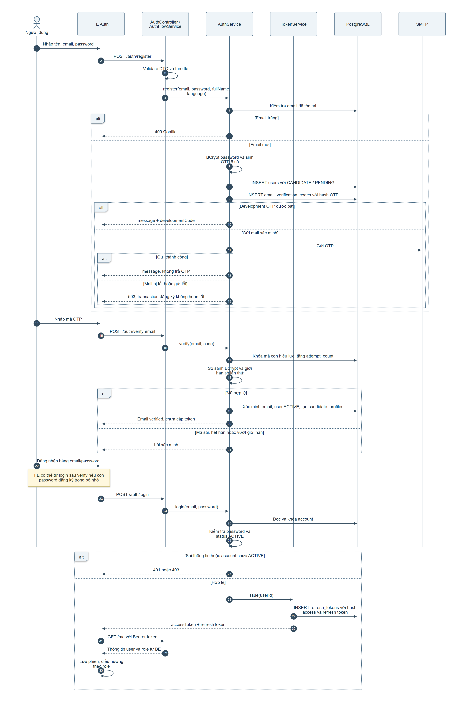

[Mở PNG](diagrams/sequence/sd-01-sequence.png) · [Mở SVG](diagrams/sequence/sd-01-sequence.svg) · [Nguồn Mermaid](diagrams/sequence/sd-01-sequence.mmd)

<details>
<summary>Mã Mermaid của sequence diagram SD-01</summary>

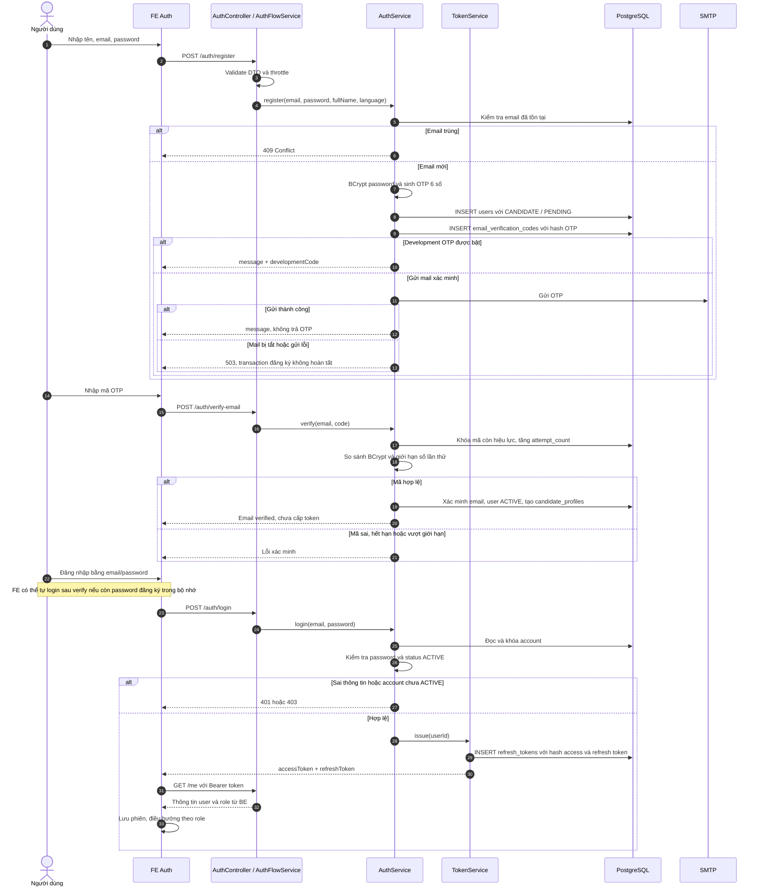

</details>

OTP có hạn 10 phút, resend có cooldown 60 giây, mỗi mã tối đa 5 lần xác minh. Tự đăng ký qua API tạo Candidate; role Consultant/Admin không do form tự cấp.

### Class diagram đi kèm SD-01


[Mở PNG](diagrams/sequence/sd-01-class.png) · [Mở SVG](diagrams/sequence/sd-01-class.svg) · [Nguồn Mermaid](diagrams/sequence/sd-01-class.mmd)

Sơ đồ lớp triển khai cho luồng đăng ký, xác minh và login. Chỉ hiển thị các phương thức chính, lược kiểu tham số và kiểu trả về; các dependency ngoài phạm vi như PasswordEncoder và JavaMailSender được lược bớt. Repository của luồng này dùng SqlStore/JDBC và Map, không suy diễn quan hệ entity từ khóa ngoại.

<details>
<summary>Mã Mermaid và lớp đối chiếu của SD-01</summary>

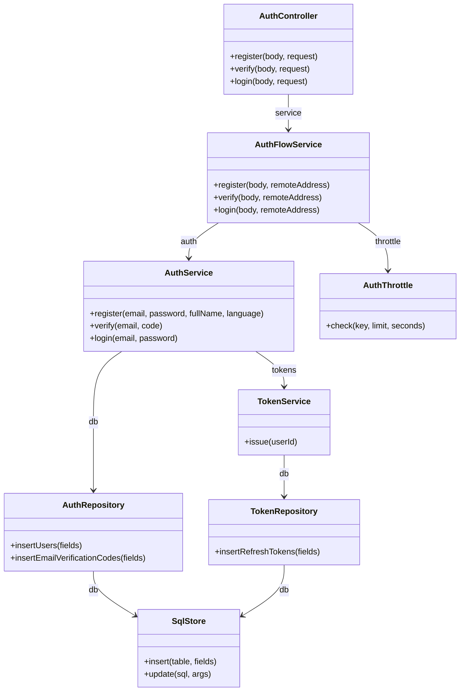

**Lớp đối chiếu:**

- [AuthController](../src/main/java/com/example/intelligent_cv_matching_ai_agent/controller/shared/identity/AuthController.java)
- [AuthFlowService](../src/main/java/com/example/intelligent_cv_matching_ai_agent/service/shared/identity/AuthFlowService.java)
- [AuthService](../src/main/java/com/example/intelligent_cv_matching_ai_agent/service/shared/identity/AuthService.java)
- [TokenService](../src/main/java/com/example/intelligent_cv_matching_ai_agent/service/shared/identity/TokenService.java)
- [AuthThrottle](../src/main/java/com/example/intelligent_cv_matching_ai_agent/security/shared/AuthThrottle.java)
- [AuthRepository](../src/main/java/com/example/intelligent_cv_matching_ai_agent/repository/shared/identity/AuthRepository.java)
- [TokenRepository](../src/main/java/com/example/intelligent_cv_matching_ai_agent/repository/shared/identity/TokenRepository.java)
- [SqlStore](../src/main/java/com/example/intelligent_cv_matching_ai_agent/repository/shared/SqlStore.java)

</details>

## SD-02 Xác thực request refresh token và logout

**Kết quả:** request được gắn đúng actor; refresh quay vòng token; phiên cũ không được ghi đè dữ liệu phiên mới trên FE.

### Sequence diagram SD-02

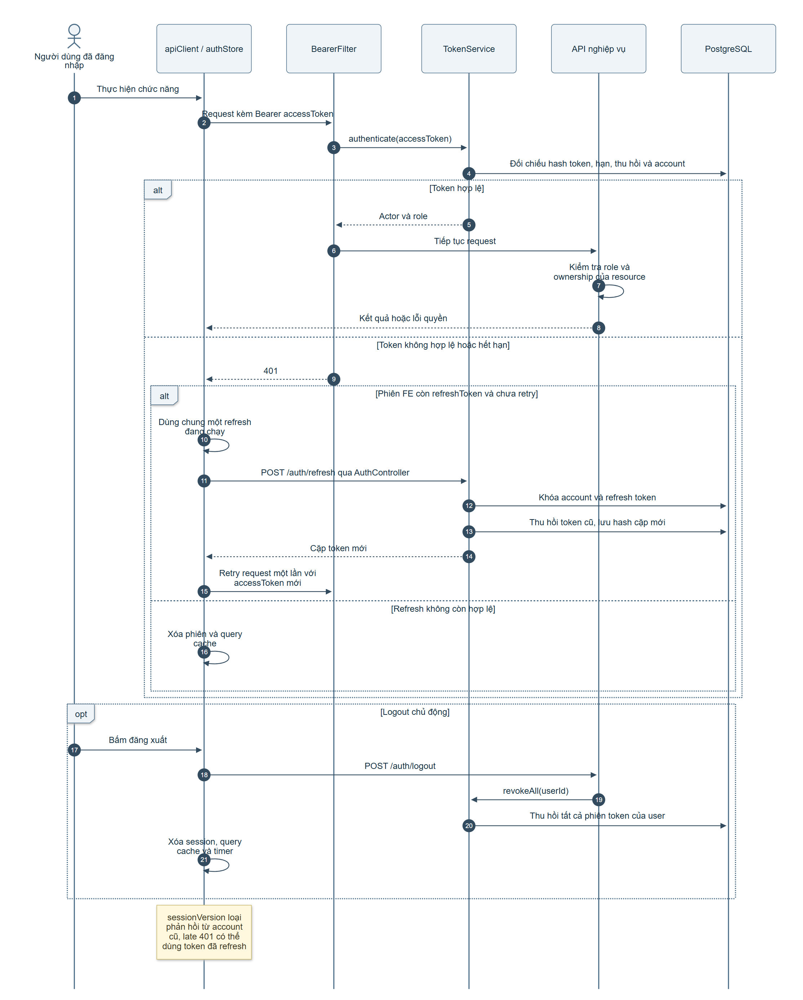

[Mở PNG](diagrams/sequence/sd-02-sequence.png) · [Mở SVG](diagrams/sequence/sd-02-sequence.svg) · [Nguồn Mermaid](diagrams/sequence/sd-02-sequence.mmd)

<details>
<summary>Mã Mermaid của sequence diagram SD-02</summary>

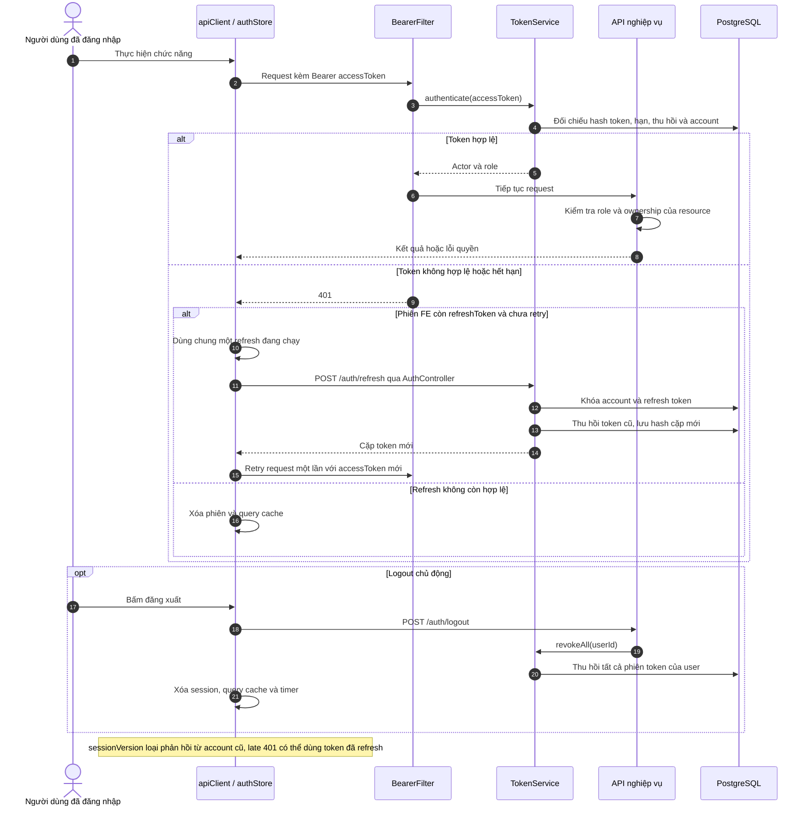

</details>

Access token có hạn 900 giây; refresh token opaque có hạn 30 ngày theo code hiện tại. `authClient` riêng giúp login/refresh không mắc vòng interceptor của `apiClient`.

### Class diagram đi kèm SD-02

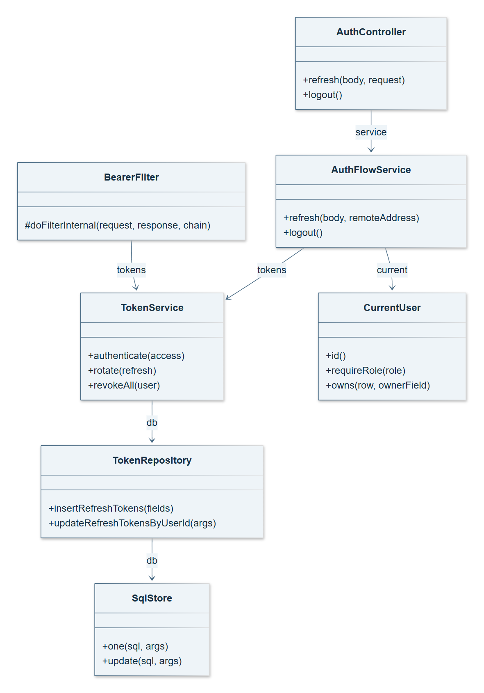

[Mở PNG](diagrams/sequence/sd-02-class.png) · [Mở SVG](diagrams/sequence/sd-02-class.svg) · [Nguồn Mermaid](diagrams/sequence/sd-02-class.mmd)

BearerFilter và AuthFlowService cùng sử dụng TokenService. CurrentUser đọc actor trong SecurityContext; không có lời gọi trực tiếp từ BearerFilter sang CurrentUser. Dấu # là phương thức protected; các lớp nền/framework và dependency throttle được lược để tập trung luồng token. Tên tham số varargs được rút gọn thành args.

<details>
<summary>Mã Mermaid và lớp đối chiếu của SD-02</summary>

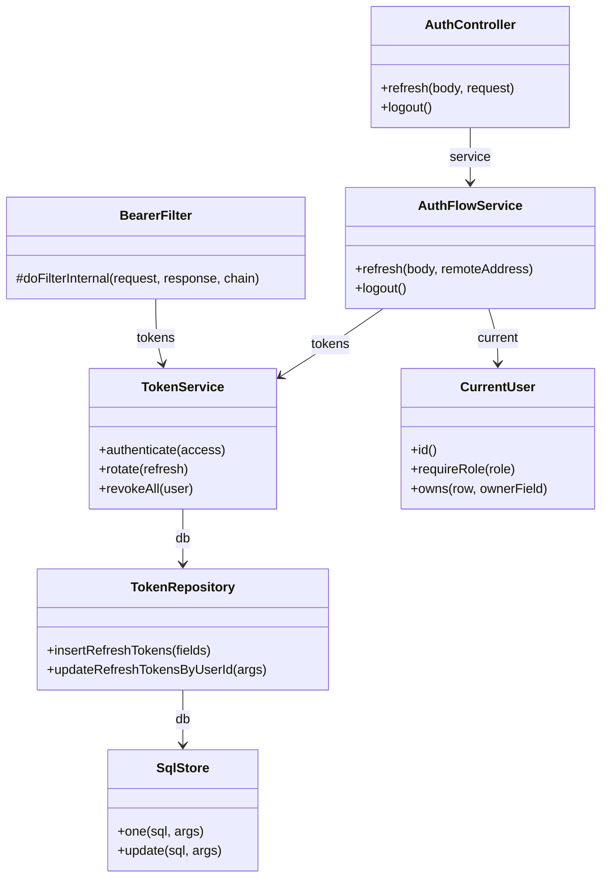

**Lớp đối chiếu:**

- [BearerFilter](../src/main/java/com/example/intelligent_cv_matching_ai_agent/security/shared/BearerFilter.java)
- [CurrentUser](../src/main/java/com/example/intelligent_cv_matching_ai_agent/security/shared/CurrentUser.java)
- [AuthController](../src/main/java/com/example/intelligent_cv_matching_ai_agent/controller/shared/identity/AuthController.java)
- [AuthFlowService](../src/main/java/com/example/intelligent_cv_matching_ai_agent/service/shared/identity/AuthFlowService.java)
- [TokenService](../src/main/java/com/example/intelligent_cv_matching_ai_agent/service/shared/identity/TokenService.java)
- [TokenRepository](../src/main/java/com/example/intelligent_cv_matching_ai_agent/repository/shared/identity/TokenRepository.java)
- [SqlStore](../src/main/java/com/example/intelligent_cv_matching_ai_agent/repository/shared/SqlStore.java)

</details>

## SD-03 Tạo upload review confirm và phân tích CV

**Bảng chính:** `resumes`, `resume_parse_results`, các bảng section CV, `resume_analyses`, `resume_analysis_suggestions`.

### Sequence diagram SD-03

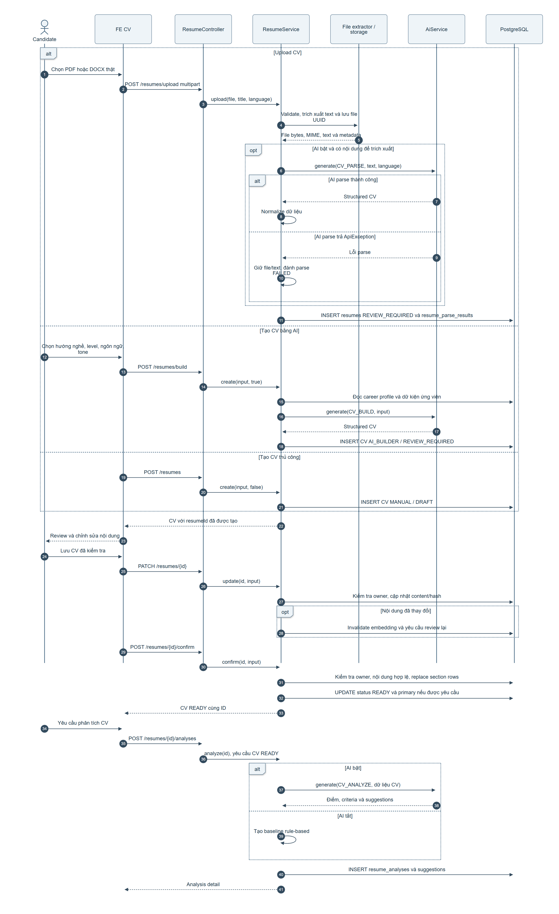

[Mở PNG](diagrams/sequence/sd-03-sequence.png) · [Mở SVG](diagrams/sequence/sd-03-sequence.svg) · [Nguồn Mermaid](diagrams/sequence/sd-03-sequence.mmd)

<details>
<summary>Mã Mermaid của sequence diagram SD-03</summary>

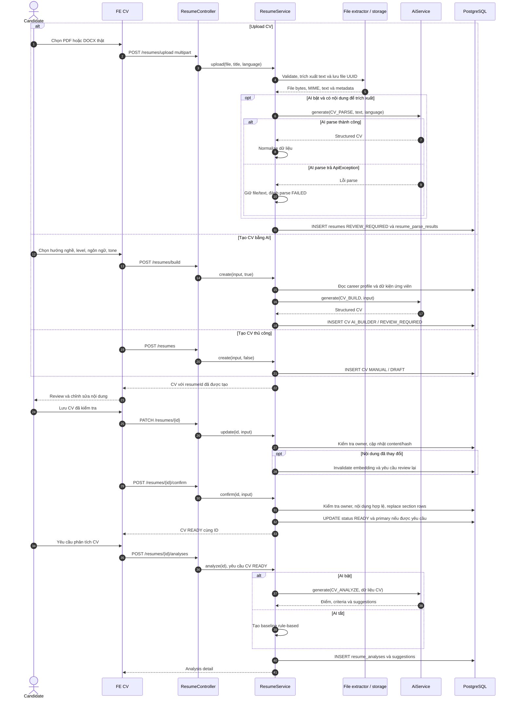

</details>

File không hợp lệ bị chặn ở bước extractor. AI parse lỗi có thể vẫn tạo CV cần review, kèm lỗi trong `resume_parse_results`; không mặc định xem mọi lỗi AI là toàn bộ upload thất bại. FE lưu CV upload/build bằng chính ID đã nhận, không POST tạo thêm CV. Confirm không tự tạo embedding; dùng SD-14 khi cần.

### Class diagram đi kèm SD-03

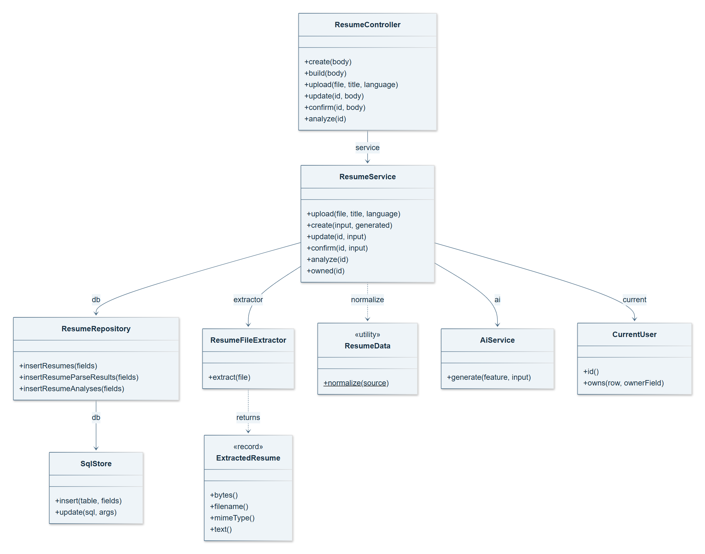

[Mở PNG](diagrams/sequence/sd-03-class.png) · [Mở SVG](diagrams/sequence/sd-03-class.svg) · [Nguồn Mermaid](diagrams/sequence/sd-03-class.mmd)

Sơ đồ thể hiện các lớp ứng dụng thực sự điều phối CV trong SD-03; không đưa storage hoặc PostgreSQL vào danh sách lớp. ExtractedResume là record trả về từ extractor, các dòng bytes/filename/mimeType/text là accessor. Lược các helper kiểm tra chất lượng và chi tiết bảng section; ký hiệu $ chỉ phương thức static.

<details>
<summary>Mã Mermaid và lớp đối chiếu của SD-03</summary>

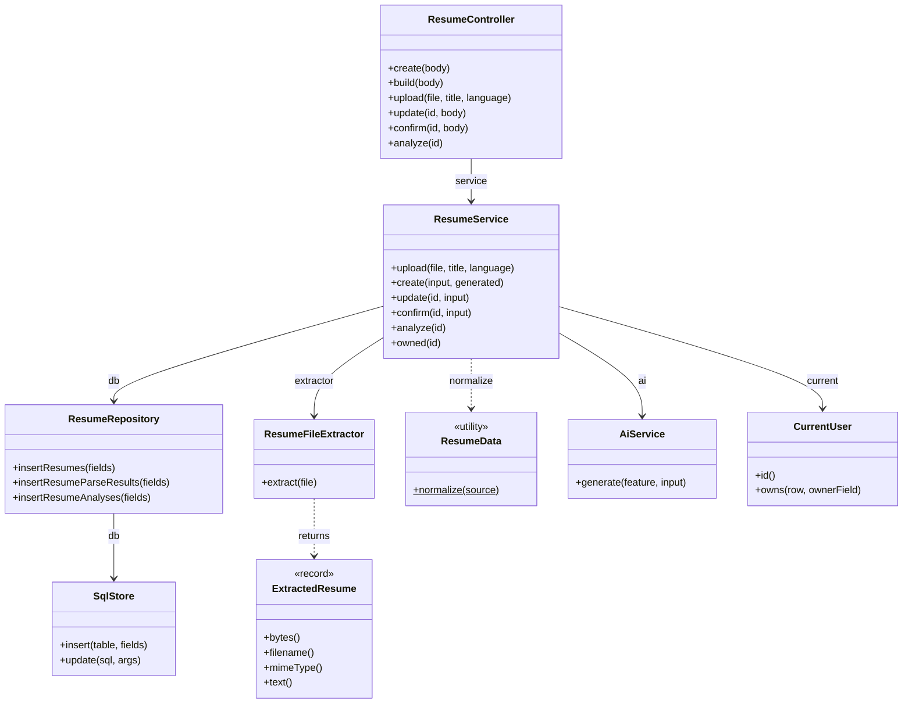

**Lớp đối chiếu:**

- [ResumeController](../src/main/java/com/example/intelligent_cv_matching_ai_agent/controller/candidate/resume/ResumeController.java)
- [ResumeService](../src/main/java/com/example/intelligent_cv_matching_ai_agent/service/candidate/resume/ResumeService.java)
- [ResumeRepository](../src/main/java/com/example/intelligent_cv_matching_ai_agent/repository/candidate/resume/ResumeRepository.java)
- [ResumeFileExtractor](../src/main/java/com/example/intelligent_cv_matching_ai_agent/util/shared/resume/ResumeFileExtractor.java)
- [ExtractedResume](../src/main/java/com/example/intelligent_cv_matching_ai_agent/util/shared/resume/ExtractedResume.java)
- [ResumeData](../src/main/java/com/example/intelligent_cv_matching_ai_agent/util/shared/resume/ResumeData.java)
- [AiService](../src/main/java/com/example/intelligent_cv_matching_ai_agent/service/shared/ai/AiService.java)
- [CurrentUser](../src/main/java/com/example/intelligent_cv_matching_ai_agent/security/shared/CurrentUser.java)
- [SqlStore](../src/main/java/com/example/intelligent_cv_matching_ai_agent/repository/shared/SqlStore.java)

</details>

## SD-04 Nhập JD và lập chỉ mục embedding

**Bảng chính:** `market_job_posts`, `market_job_sources`, `market_job_skills`, `vector_indexing_jobs`, `market_job_embeddings`.

### Sequence diagram SD-04

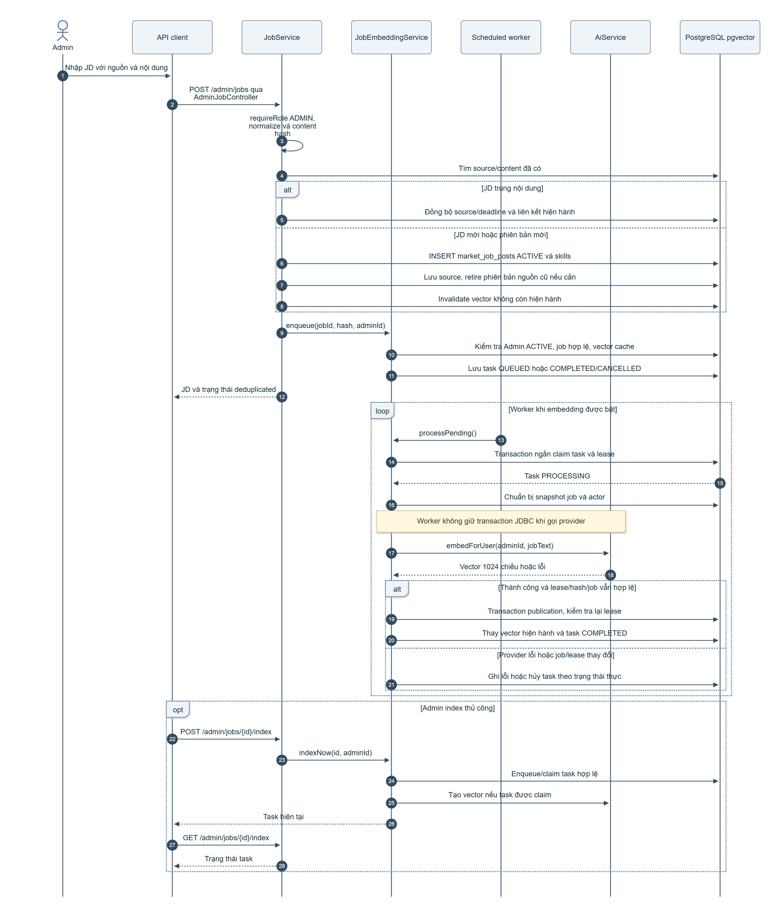

[Mở PNG](diagrams/sequence/sd-04-sequence.png) · [Mở SVG](diagrams/sequence/sd-04-sequence.svg) · [Nguồn Mermaid](diagrams/sequence/sd-04-sequence.mmd)

<details>
<summary>Mã Mermaid của sequence diagram SD-04</summary>

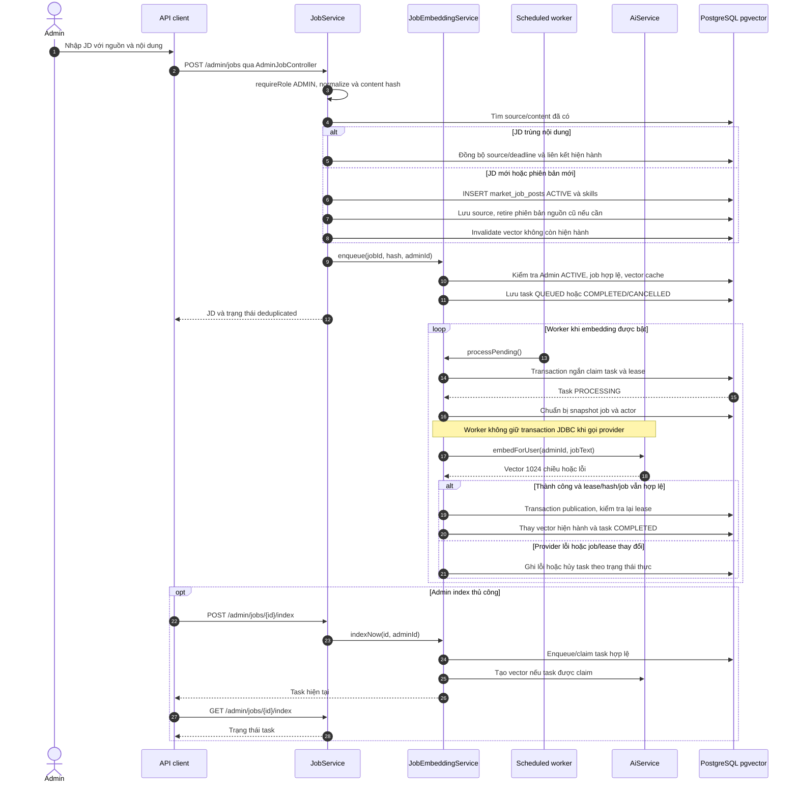

</details>

`indexNow` có thể thực hiện inference ngay trong request nếu claim được task; không đồng nhất mọi request index với một API chỉ enqueue. Luồng crawl cũng cung cấp dữ liệu JD cho hệ thống; sơ đồ này tập trung vào bước nhập/đồng bộ JD và indexing dùng chung.

### Class diagram đi kèm SD-04

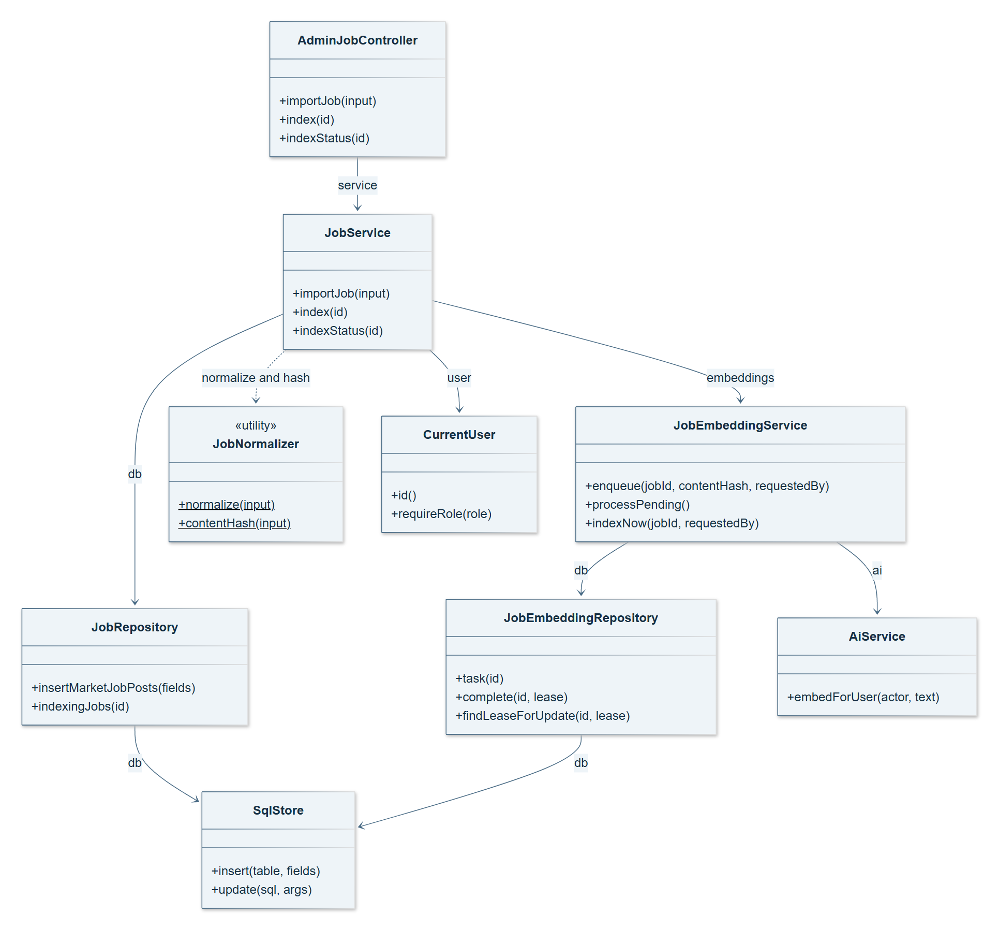

[Mở PNG](diagrams/sequence/sd-04-class.png) · [Mở SVG](diagrams/sequence/sd-04-class.svg) · [Nguồn Mermaid](diagrams/sequence/sd-04-class.mmd)

Scheduled worker của SD-04 là processPending() được lập lịch ngay trên JobEmbeddingService, không phải một lớp Worker được tạo thêm. Sơ đồ tập trung đường import/index đang dùng JobEmbeddingService; lược TransactionTemplate và nhánh tương thích khi service embedding chưa được inject. Các thao tác SQL/lease ở repository, không gán phương thức xử lý nghiệp vụ cho entity.

<details>
<summary>Mã Mermaid và lớp đối chiếu của SD-04</summary>

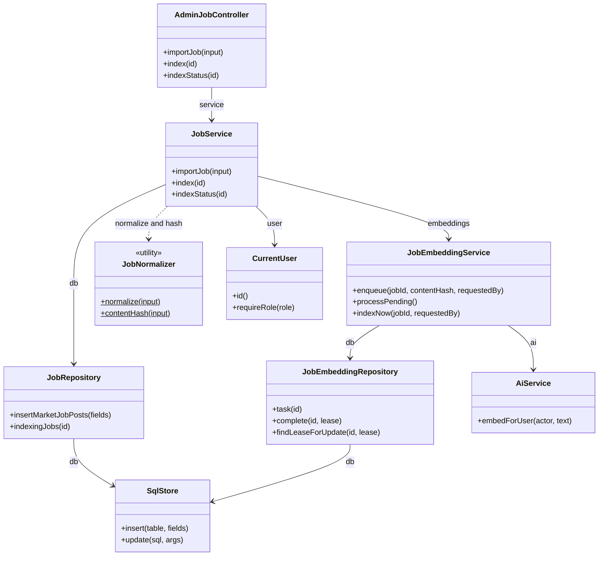

**Lớp đối chiếu:**

- [AdminJobController](../src/main/java/com/example/intelligent_cv_matching_ai_agent/controller/admin/jobs/AdminJobController.java)
- [JobService](../src/main/java/com/example/intelligent_cv_matching_ai_agent/service/shared/jobs/JobService.java)
- [JobEmbeddingService](../src/main/java/com/example/intelligent_cv_matching_ai_agent/service/shared/jobs/JobEmbeddingService.java)
- [JobRepository](../src/main/java/com/example/intelligent_cv_matching_ai_agent/repository/shared/jobs/JobRepository.java)
- [JobEmbeddingRepository](../src/main/java/com/example/intelligent_cv_matching_ai_agent/repository/shared/jobs/JobEmbeddingRepository.java)
- [JobNormalizer](../src/main/java/com/example/intelligent_cv_matching_ai_agent/util/shared/jobs/JobNormalizer.java)
- [AiService](../src/main/java/com/example/intelligent_cv_matching_ai_agent/service/shared/ai/AiService.java)
- [CurrentUser](../src/main/java/com/example/intelligent_cv_matching_ai_agent/security/shared/CurrentUser.java)
- [SqlStore](../src/main/java/com/example/intelligent_cv_matching_ai_agent/repository/shared/SqlStore.java)

</details>

## SD-05 Gợi ý việc làm matching

**Đầu vào:** `basis = CAREER_PROFILE | SELECTED_CV | ALL_CVS`, CV hợp lệ và `limit`. Đây là gợi ý nhiều việc làm; khác SD-06 đánh giá một cặp CV/JD.

### Sequence diagram SD-05

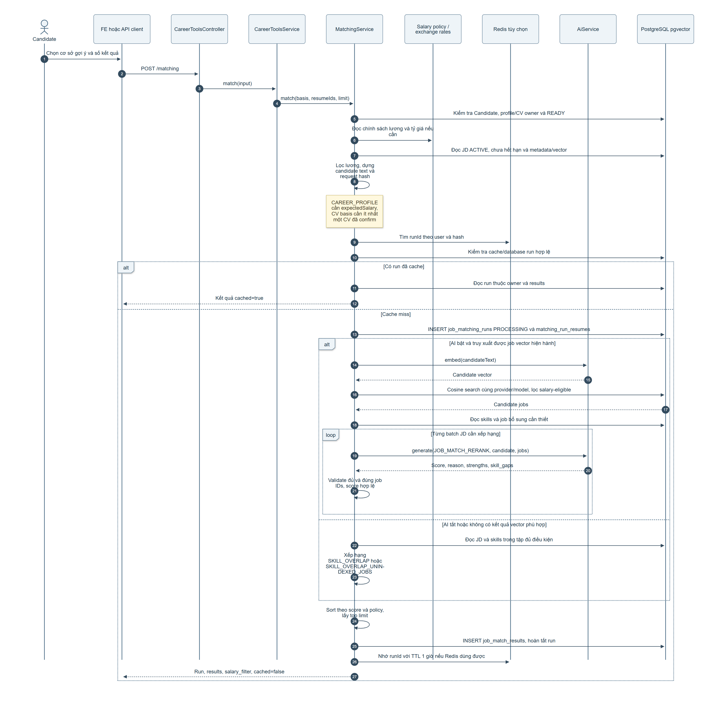

[Mở PNG](diagrams/sequence/sd-05-sequence.png) · [Mở SVG](diagrams/sequence/sd-05-sequence.svg) · [Nguồn Mermaid](diagrams/sequence/sd-05-sequence.mmd)

<details>
<summary>Mã Mermaid của sequence diagram SD-05</summary>

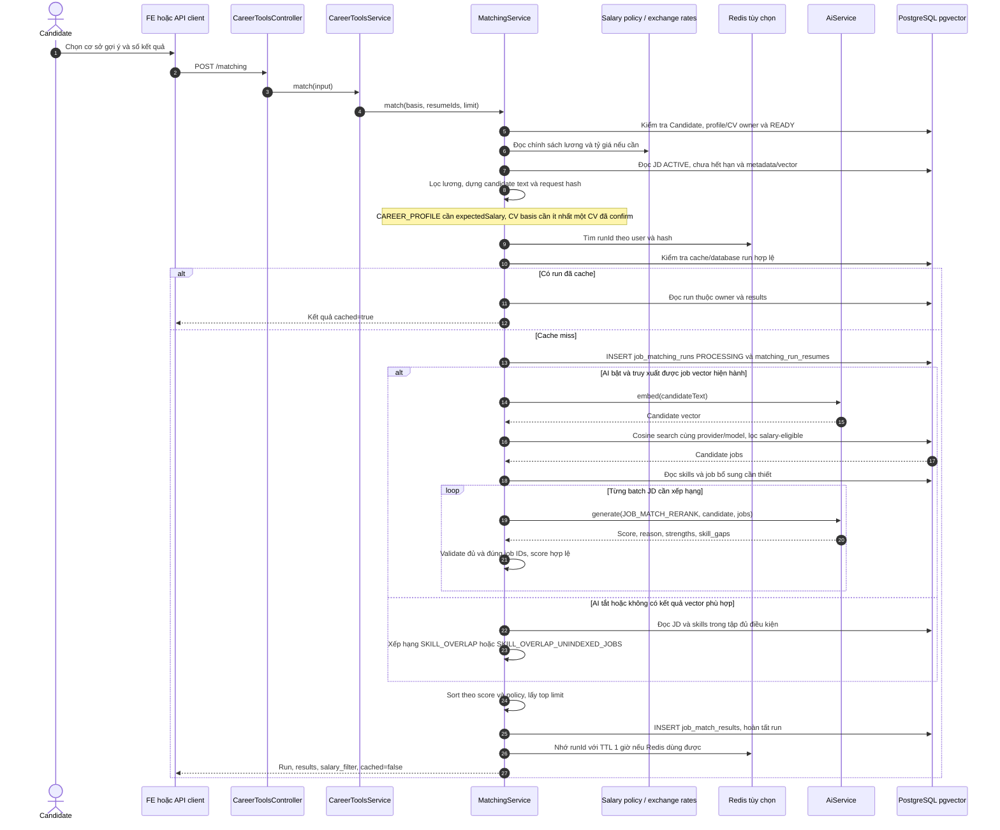

</details>

Nếu tập JD sau lọc lương rỗng, BE có thể lưu/trả run không có kết quả; không bắt buộc gọi model. Lỗi provider/rerank không phải điều kiện để âm thầm coi kết quả LLM thành công. Fallback skill overlap ở đây là các nhánh được code quy định khi AI tắt hoặc chưa có kết quả vector phù hợp. FE hiện có luồng đọc matching history; không suy ra mọi màn jobs tự gọi `POST /matching`.

### Class diagram đi kèm SD-05

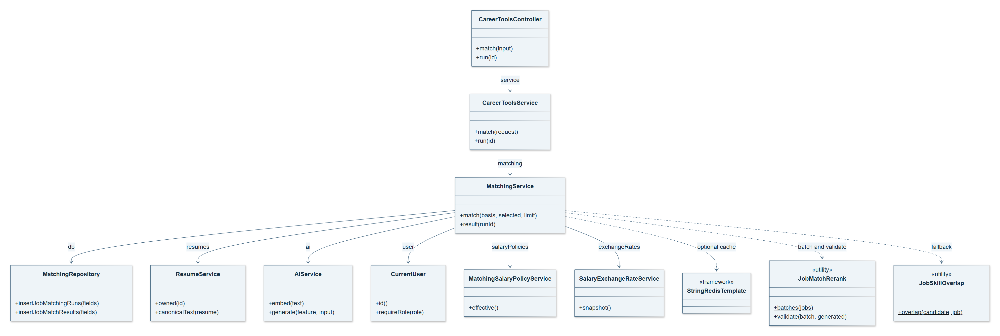

[Mở PNG](diagrams/sequence/sd-05-class.png) · [Mở SVG](diagrams/sequence/sd-05-class.svg) · [Nguồn Mermaid](diagrams/sequence/sd-05-class.mmd)

Controller gọi CareerToolsService, rồi facade này mới gọi MatchingService. Các mũi tên giữ đúng dependency của lớp triển khai, không coi Redis server là một Java class; StringRedisTemplate là lớp framework lấy qua ObjectProvider. Lược SqlStore và dependency nội bộ của các service được dùng để giữ phạm vi đối sánh dễ đọc.

<details>
<summary>Mã Mermaid và lớp đối chiếu của SD-05</summary>

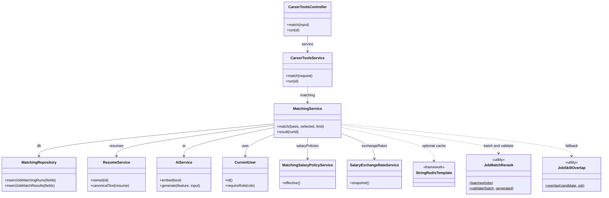

**Lớp đối chiếu:**

- [CareerToolsController](../src/main/java/com/example/intelligent_cv_matching_ai_agent/controller/candidate/jobs/CareerToolsController.java)
- [CareerToolsService](../src/main/java/com/example/intelligent_cv_matching_ai_agent/service/candidate/jobs/CareerToolsService.java)
- [MatchingService](../src/main/java/com/example/intelligent_cv_matching_ai_agent/service/candidate/jobs/MatchingService.java)
- [MatchingRepository](../src/main/java/com/example/intelligent_cv_matching_ai_agent/repository/candidate/jobs/MatchingRepository.java)
- [ResumeService](../src/main/java/com/example/intelligent_cv_matching_ai_agent/service/candidate/resume/ResumeService.java)
- [AiService](../src/main/java/com/example/intelligent_cv_matching_ai_agent/service/shared/ai/AiService.java)
- [CurrentUser](../src/main/java/com/example/intelligent_cv_matching_ai_agent/security/shared/CurrentUser.java)
- [MatchingSalaryPolicyService](../src/main/java/com/example/intelligent_cv_matching_ai_agent/service/shared/jobs/MatchingSalaryPolicyService.java)
- [SalaryExchangeRateService](../src/main/java/com/example/intelligent_cv_matching_ai_agent/service/shared/jobs/SalaryExchangeRateService.java)
- [JobMatchRerank](../src/main/java/com/example/intelligent_cv_matching_ai_agent/util/candidate/jobs/JobMatchRerank.java)
- [JobSkillOverlap](../src/main/java/com/example/intelligent_cv_matching_ai_agent/util/candidate/jobs/JobSkillOverlap.java)

</details>

## SD-06 Đánh giá CV với một JD JOB_ATS

**Điểm vào đúng file đang đọc:** `CareerToolsService.ats(jobId, CvRequest)` gọi feature **`JOB_ATS`**. Bảng kết quả là `job_resume_analyses`, khác `resume_analyses` của phân tích CV tổng quát.

### Sequence diagram SD-06

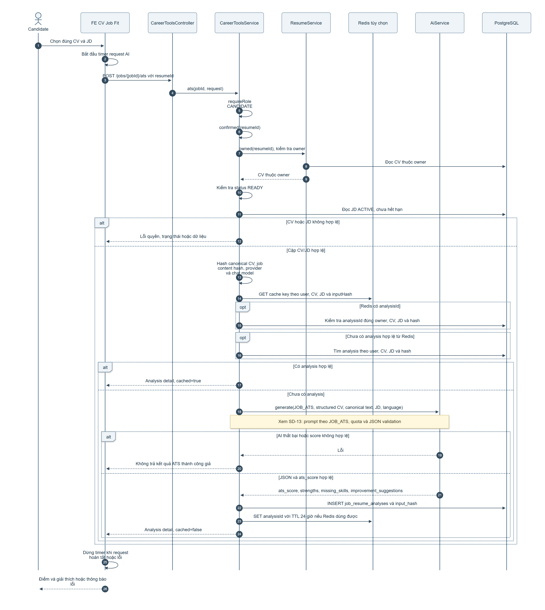

[Mở PNG](diagrams/sequence/sd-06-sequence.png) · [Mở SVG](diagrams/sequence/sd-06-sequence.svg) · [Nguồn Mermaid](diagrams/sequence/sd-06-sequence.mmd)

<details>
<summary>Mã Mermaid của sequence diagram SD-06</summary>

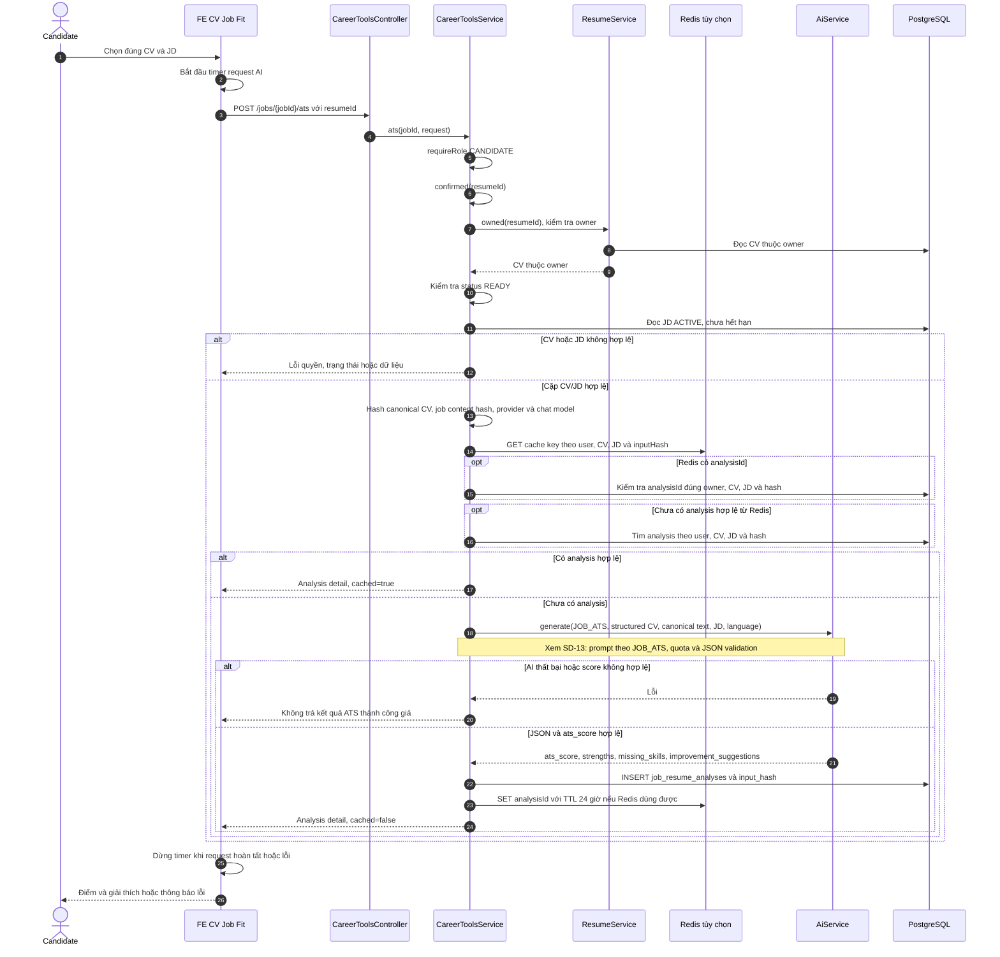

</details>

Redis chỉ lưu ID gợi ý cache; BE vẫn đối chiếu database để kiểm tra quyền và đúng input. Thay prompt `JOB_ATS` hiện không nằm trong input hash này; test prompt bằng cùng CV/JD/model có thể nhận kết quả cũ từ cache. Có thể dùng chat mới cho test prompt hoặc thay dữ liệu CV có chủ đích rồi confirm lại khi kiểm chứng ATS.

### Class diagram đi kèm SD-06

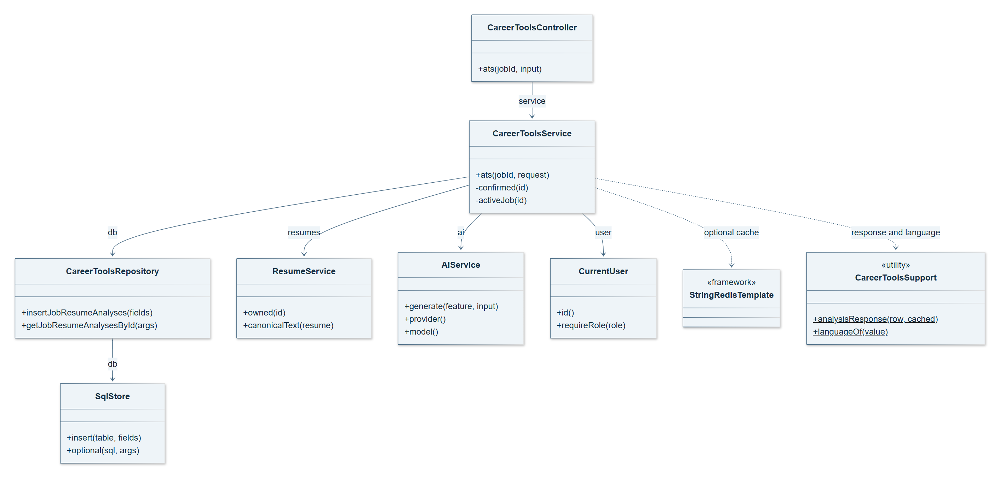

[Mở PNG](diagrams/sequence/sd-06-class.png) · [Mở SVG](diagrams/sequence/sd-06-class.svg) · [Nguồn Mermaid](diagrams/sequence/sd-06-class.mmd)

confirmed() và activeJob() là helper private của CareerToolsService. confirmed() gọi ResumeService.owned() rồi kiểm tra READY; ResumeService không có phương thức confirmed(). Redis chỉ cung cấp ID gợi ý cache; repository vẫn kiểm tra owner, CV, JD và input hash. Lược các dependency phục vụ nghiệp vụ khác của CareerToolsService.

<details>
<summary>Mã Mermaid và lớp đối chiếu của SD-06</summary>

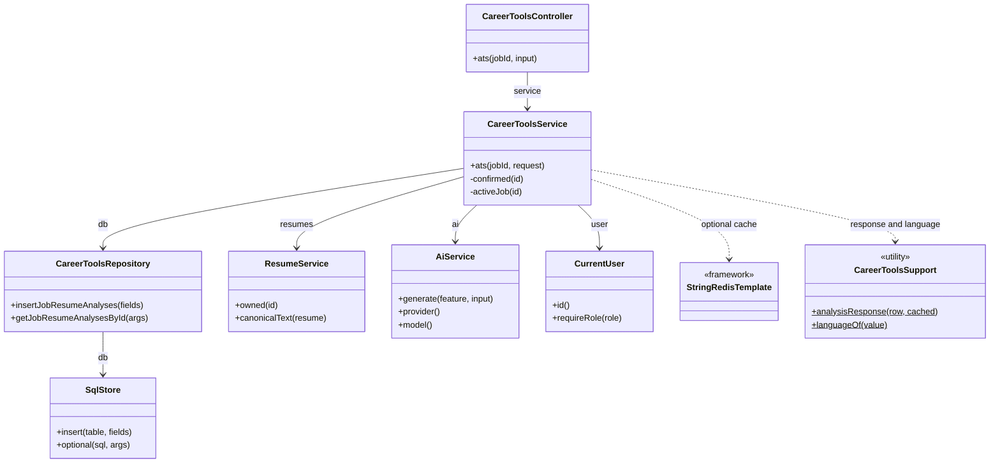

**Lớp đối chiếu:**

- [CareerToolsController](../src/main/java/com/example/intelligent_cv_matching_ai_agent/controller/candidate/jobs/CareerToolsController.java)
- [CareerToolsService](../src/main/java/com/example/intelligent_cv_matching_ai_agent/service/candidate/jobs/CareerToolsService.java)
- [CareerToolsRepository](../src/main/java/com/example/intelligent_cv_matching_ai_agent/repository/candidate/jobs/CareerToolsRepository.java)
- [ResumeService](../src/main/java/com/example/intelligent_cv_matching_ai_agent/service/candidate/resume/ResumeService.java)
- [AiService](../src/main/java/com/example/intelligent_cv_matching_ai_agent/service/shared/ai/AiService.java)
- [CurrentUser](../src/main/java/com/example/intelligent_cv_matching_ai_agent/security/shared/CurrentUser.java)
- [CareerToolsSupport](../src/main/java/com/example/intelligent_cv_matching_ai_agent/util/candidate/jobs/CareerToolsSupport.java)
- [SqlStore](../src/main/java/com/example/intelligent_cv_matching_ai_agent/repository/shared/SqlStore.java)

</details>

## SD-07 Tạo bài đánh giá bằng hàng đợi AI

**Bảng chính:** `assessment_generations`, `assessment_sessions`, `assessment_questions`. Queue là dữ liệu bền vững trong PostgreSQL; request HTTP không đợi model sinh toàn bộ câu hỏi.

### Sequence diagram SD-07

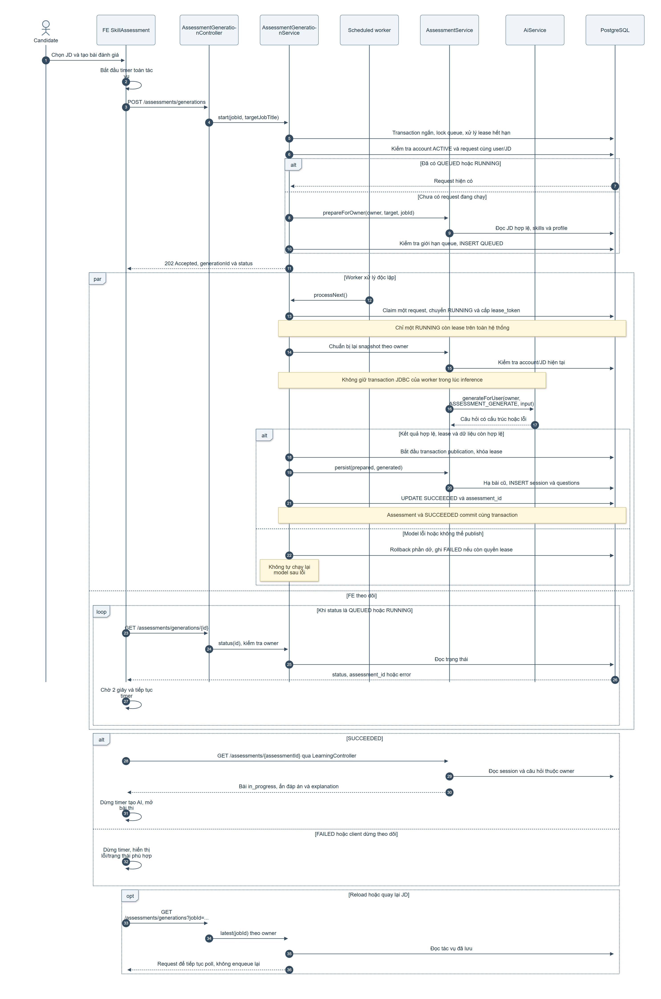

[Mở PNG](diagrams/sequence/sd-07-sequence.png) · [Mở SVG](diagrams/sequence/sd-07-sequence.svg) · [Nguồn Mermaid](diagrams/sequence/sd-07-sequence.mmd)

<details>
<summary>Mã Mermaid của sequence diagram SD-07</summary>

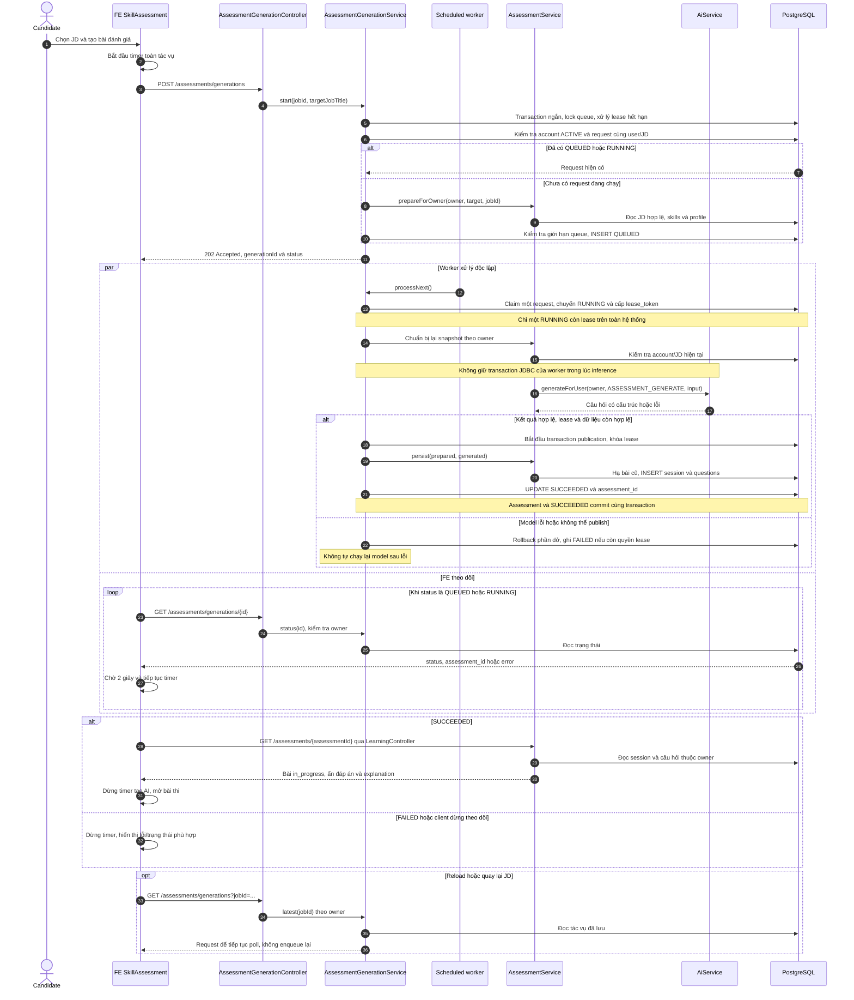

</details>

Code hiện giới hạn 3 tác vụ đang chờ/chạy mỗi user và 50 toàn hệ thống. Lease worker mặc định 30 phút; FE dừng theo dõi liên tục sau deadline 31 phút. Client timeout không tự đổi trạng thái tác vụ BE thành `FAILED`. Worker xử lý lease bị gián đoạn khi queue được kiểm tra tiếp.

### Class diagram đi kèm SD-07

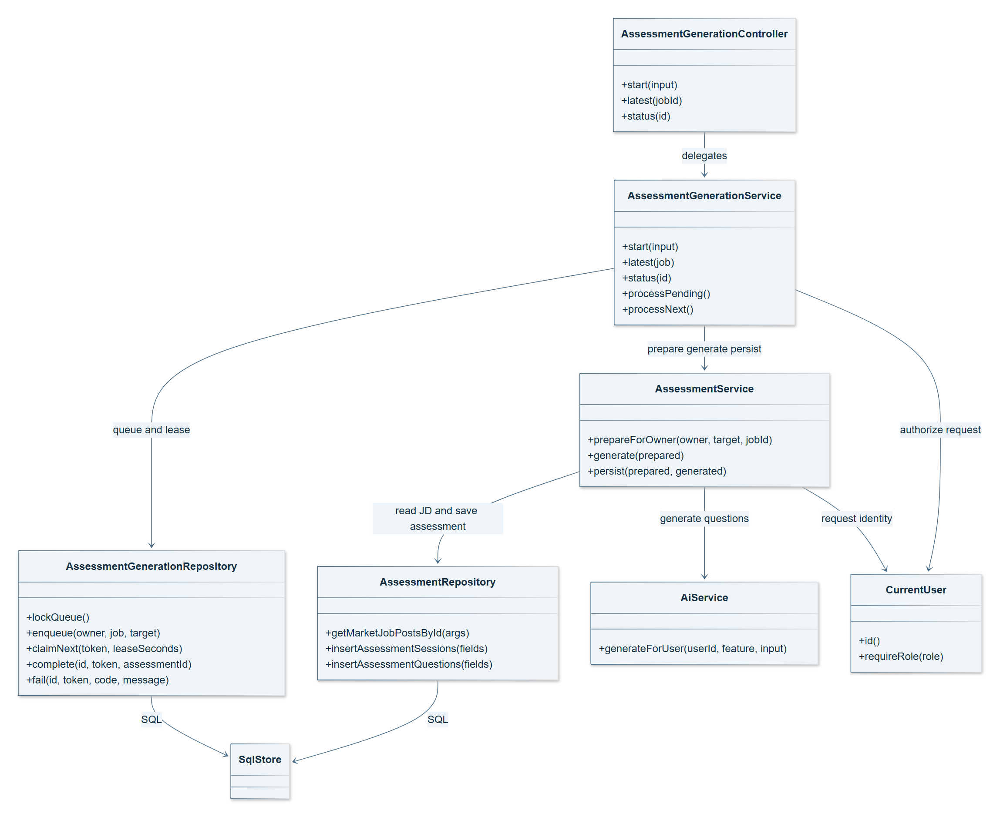

[Mở PNG](diagrams/sequence/sd-07-class.png) · [Mở SVG](diagrams/sequence/sd-07-class.svg) · [Nguồn Mermaid](diagrams/sequence/sd-07-class.mmd)

Worker không phải một lớp riêng: processPending được @Scheduled gọi trong AssessmentGenerationService. Queue/lease lưu qua repository; processNext gọi inference ngoài transaction JDBC và publish assessment cùng trạng thái thành công trong transaction ngắn. Sơ đồ chỉ liệt kê các phương thức tiêu biểu, rút gọn kiểu tham số.

<details>
<summary>Mã Mermaid và lớp đối chiếu của SD-07</summary>

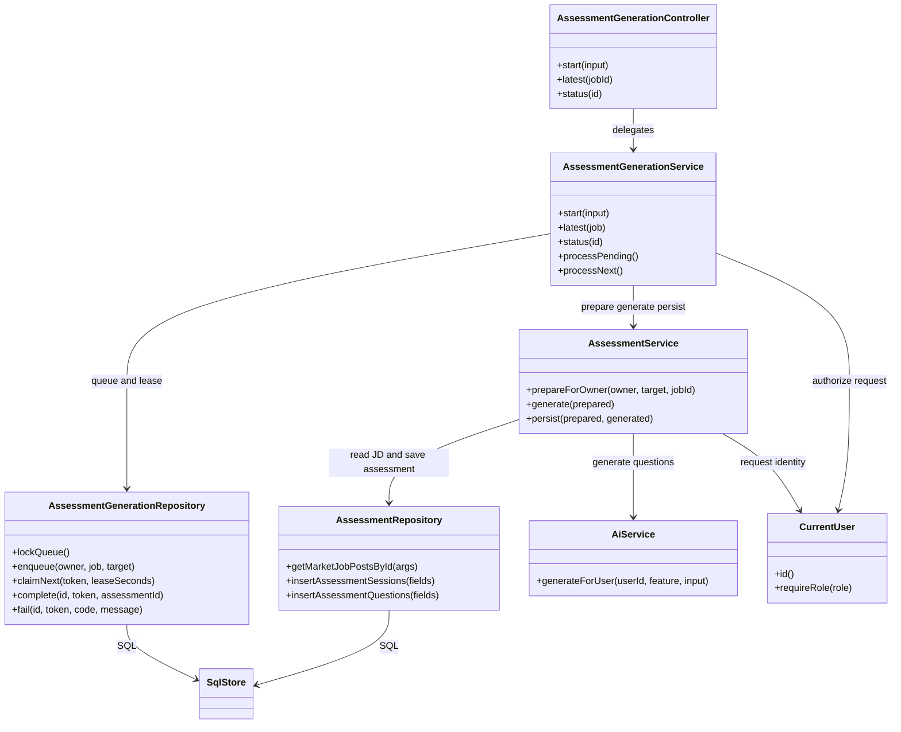

**Lớp đối chiếu:**

- [AssessmentGenerationController](../src/main/java/com/example/intelligent_cv_matching_ai_agent/controller/candidate/learning/AssessmentGenerationController.java)
- [AssessmentGenerationService](../src/main/java/com/example/intelligent_cv_matching_ai_agent/service/candidate/learning/AssessmentGenerationService.java)
- [AssessmentGenerationRepository](../src/main/java/com/example/intelligent_cv_matching_ai_agent/repository/candidate/learning/AssessmentGenerationRepository.java)
- [AssessmentService](../src/main/java/com/example/intelligent_cv_matching_ai_agent/service/candidate/learning/AssessmentService.java)
- [AssessmentRepository](../src/main/java/com/example/intelligent_cv_matching_ai_agent/repository/candidate/learning/AssessmentRepository.java)
- [AiService](../src/main/java/com/example/intelligent_cv_matching_ai_agent/service/shared/ai/AiService.java)
- [CurrentUser](../src/main/java/com/example/intelligent_cv_matching_ai_agent/security/shared/CurrentUser.java)
- [SqlStore](../src/main/java/com/example/intelligent_cv_matching_ai_agent/repository/shared/SqlStore.java)

</details>

## SD-08 Nộp bài phân tích gap và lộ trình học

**Bảng chính:** assessment answers/session, `gap_analyses`, `gap_analysis_skills`, `roadmaps`, nodes/resources/prerequisites.

### Sequence diagram SD-08

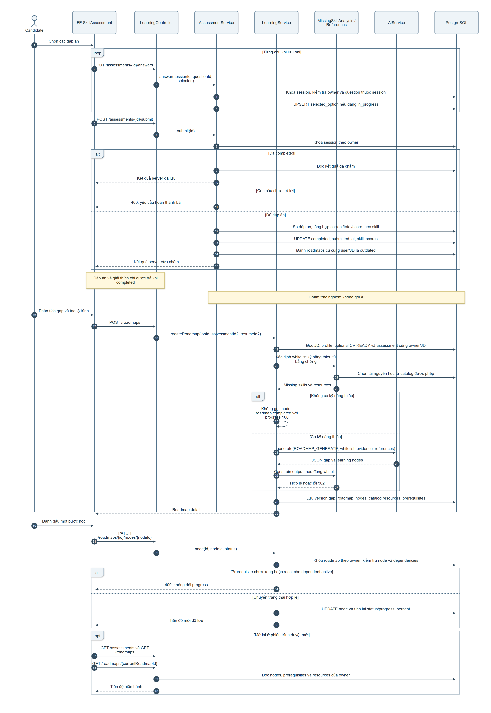

[Mở PNG](diagrams/sequence/sd-08-sequence.png) · [Mở SVG](diagrams/sequence/sd-08-sequence.svg) · [Nguồn Mermaid](diagrams/sequence/sd-08-sequence.mmd)

<details>
<summary>Mã Mermaid của sequence diagram SD-08</summary>

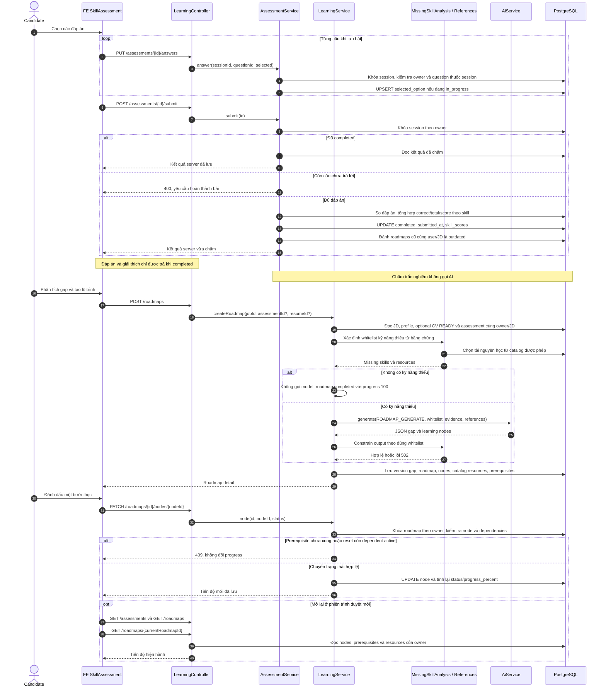

</details>

Assessment hoàn tất không phải điều kiện bắt buộc cho mọi request roadmap: BE có thể dựa profile/CV và bài completed cùng JD nếu có. Điểm dưới 70 tạo `NEEDS_PRACTICE`; không có điểm và không có bằng chứng tạo `MISSING_EVIDENCE`. Tài nguyên/URL được gắn từ catalog, không tin URL AI tự tạo. `createRoadmap` hiện vẫn có transaction bao quanh nhánh gọi model; không áp dụng mô tả “không giữ JDBC transaction” của worker SD-07 cho toàn bộ luồng này.

### Class diagram đi kèm SD-08

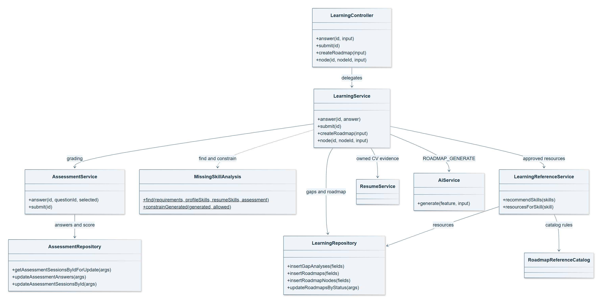

[Mở PNG](diagrams/sequence/sd-08-class.png) · [Mở SVG](diagrams/sequence/sd-08-class.svg) · [Nguồn Mermaid](diagrams/sequence/sd-08-class.mmd)

LearningController gọi LearningService; service này chuyển answer/submit sang AssessmentService. Chấm trắc nghiệm dùng dữ liệu server và không gọi AI. MissingSkillAnalysis là utility static để xác định whitelist và constrain kết quả; createRoadmap vẫn có transaction bao quanh nhánh gọi model. Các lớp được chọn theo luồng, không phải toàn bộ dependency của từng lớp.

<details>
<summary>Mã Mermaid và lớp đối chiếu của SD-08</summary>

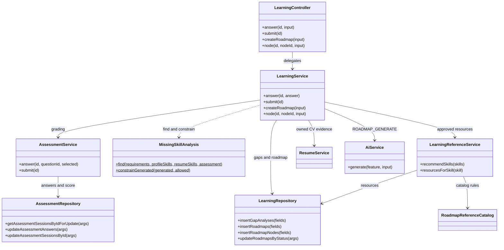

**Lớp đối chiếu:**

- [LearningController](../src/main/java/com/example/intelligent_cv_matching_ai_agent/controller/candidate/learning/LearningController.java)
- [LearningService](../src/main/java/com/example/intelligent_cv_matching_ai_agent/service/candidate/learning/LearningService.java)
- [AssessmentService](../src/main/java/com/example/intelligent_cv_matching_ai_agent/service/candidate/learning/AssessmentService.java)
- [AssessmentRepository](../src/main/java/com/example/intelligent_cv_matching_ai_agent/repository/candidate/learning/AssessmentRepository.java)
- [LearningRepository](../src/main/java/com/example/intelligent_cv_matching_ai_agent/repository/candidate/learning/LearningRepository.java)
- [MissingSkillAnalysis](../src/main/java/com/example/intelligent_cv_matching_ai_agent/util/candidate/learning/MissingSkillAnalysis.java)
- [LearningReferenceService](../src/main/java/com/example/intelligent_cv_matching_ai_agent/service/shared/learning/LearningReferenceService.java)
- [RoadmapReferenceCatalog](../src/main/java/com/example/intelligent_cv_matching_ai_agent/util/shared/learning/RoadmapReferenceCatalog.java)
- [ResumeService](../src/main/java/com/example/intelligent_cv_matching_ai_agent/service/candidate/resume/ResumeService.java)
- [AiService](../src/main/java/com/example/intelligent_cv_matching_ai_agent/service/shared/ai/AiService.java)

</details>

## SD-09 Trợ lý nghề nghiệp và RAG tùy chọn

**Bảng chính:** `career_assistant_conversations`, `career_assistant_messages`, `career_assistant_message_sources`, RAG chunks/embeddings.

### Sequence diagram SD-09

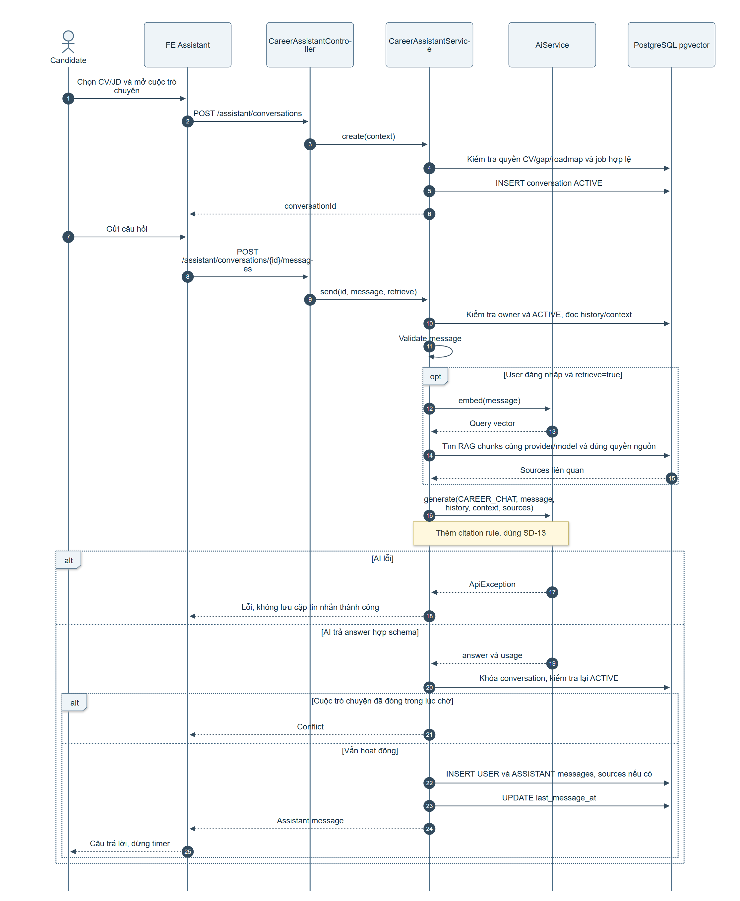

[Mở PNG](diagrams/sequence/sd-09-sequence.png) · [Mở SVG](diagrams/sequence/sd-09-sequence.svg) · [Nguồn Mermaid](diagrams/sequence/sd-09-sequence.mmd)

<details>
<summary>Mã Mermaid của sequence diagram SD-09</summary>

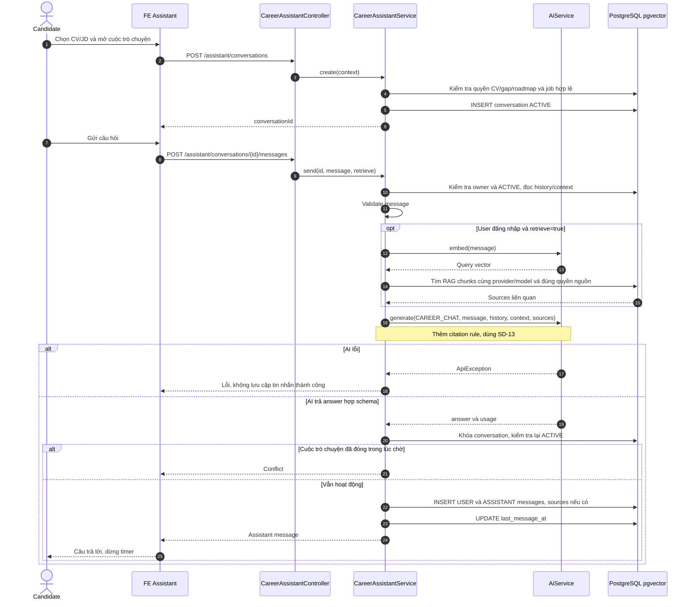

</details>

FE hiện gửi `retrieve:false`; nhánh RAG chỉ chạy khi client thực sự yêu cầu. Guest dùng endpoint `/guest/assistant/...`, header `X-Guest-Session`, kiểm tra guest owner và quota guest; không gửi Bearer của account và không chạy RAG của user.

### Class diagram đi kèm SD-09

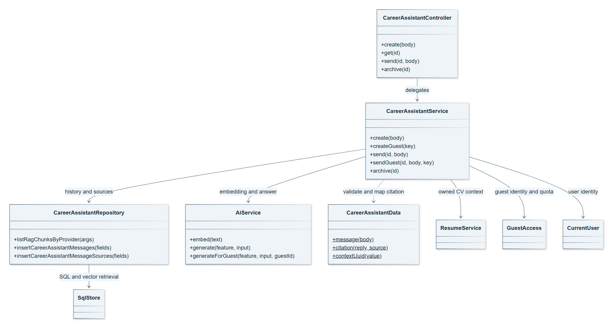

[Mở PNG](diagrams/sequence/sd-09-class.png) · [Mở SVG](diagrams/sequence/sd-09-class.svg) · [Nguồn Mermaid](diagrams/sequence/sd-09-class.mmd)

Các lớp mô tả luồng chat cùng nhánh RAG tùy chọn. retrieve=true mới yêu cầu embedding/retrieval cho user; FE hiện gửi retrieve=false. Guest được xử lý bằng GuestAccess và không chạy nhánh RAG của user. Repository hiện dùng SqlStore và Map, không giả định service trực tiếp thao tác các entity JPA.

<details>
<summary>Mã Mermaid và lớp đối chiếu của SD-09</summary>

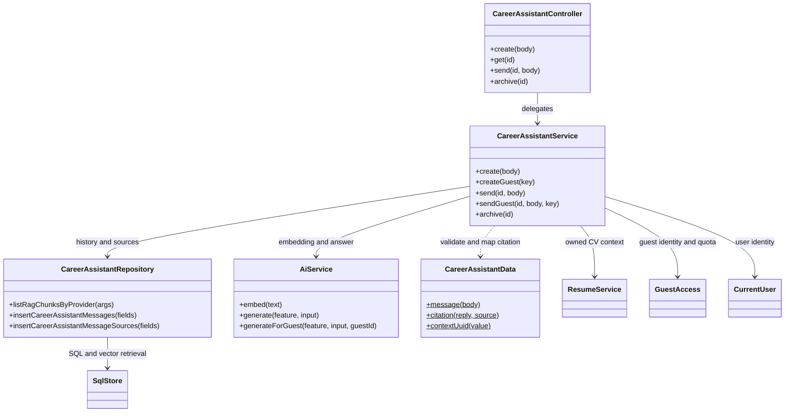

**Lớp đối chiếu:**

- [CareerAssistantController](../src/main/java/com/example/intelligent_cv_matching_ai_agent/controller/candidate/ai/CareerAssistantController.java)
- [CareerAssistantService](../src/main/java/com/example/intelligent_cv_matching_ai_agent/service/candidate/ai/CareerAssistantService.java)
- [CareerAssistantRepository](../src/main/java/com/example/intelligent_cv_matching_ai_agent/repository/candidate/ai/CareerAssistantRepository.java)
- [AiService](../src/main/java/com/example/intelligent_cv_matching_ai_agent/service/shared/ai/AiService.java)
- [CareerAssistantData](../src/main/java/com/example/intelligent_cv_matching_ai_agent/util/candidate/ai/CareerAssistantData.java)
- [ResumeService](../src/main/java/com/example/intelligent_cv_matching_ai_agent/service/candidate/resume/ResumeService.java)
- [GuestAccess](../src/main/java/com/example/intelligent_cv_matching_ai_agent/service/guest/identity/GuestAccess.java)
- [CurrentUser](../src/main/java/com/example/intelligent_cv_matching_ai_agent/security/shared/CurrentUser.java)
- [SqlStore](../src/main/java/com/example/intelligent_cv_matching_ai_agent/repository/shared/SqlStore.java)

</details>

## SD-10 Tạo phân công và trao đổi ca tư vấn

**Trạng thái BE:** `OPEN` và `CLOSED`. Profile/phân tích chỉ được đọc qua ca có quyền truy cập.

### Sequence diagram SD-10

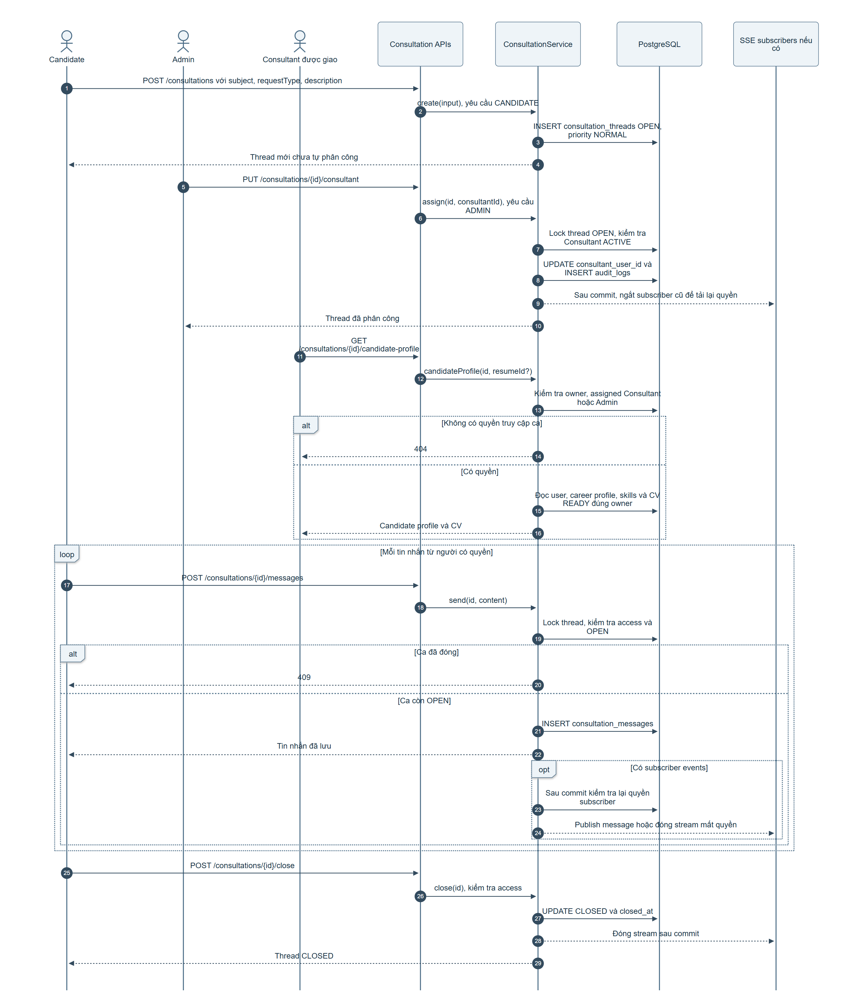

[Mở PNG](diagrams/sequence/sd-10-sequence.png) · [Mở SVG](diagrams/sequence/sd-10-sequence.svg) · [Nguồn Mermaid](diagrams/sequence/sd-10-sequence.mmd)

<details>
<summary>Mã Mermaid của sequence diagram SD-10</summary>

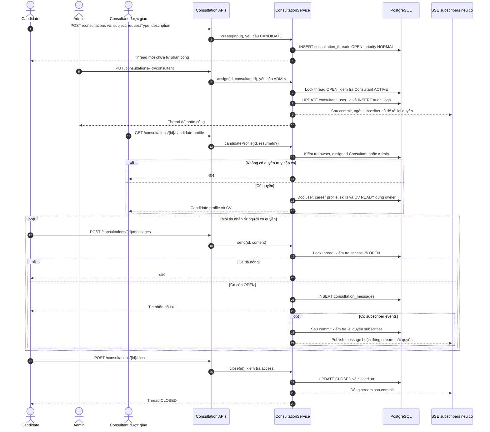

</details>

Tin nhắn Consultant dùng cùng API messages. Đóng ca được cho phép với actor có access, không chỉ riêng Consultant. FE hiện có nhiều nhãn trạng thái hơn BE; meeting/rating/private notes/advice form chưa có đầy đủ API. SSE có trên BE nhưng không giả định FE đang subscribe.

### Class diagram đi kèm SD-10

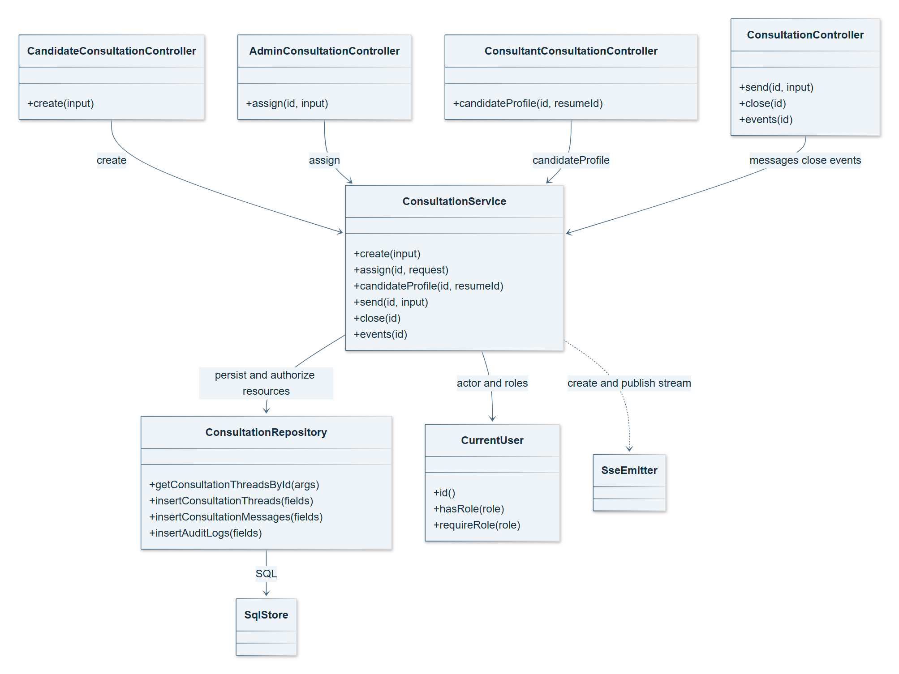

[Mở PNG](diagrams/sequence/sd-10-class.png) · [Mở SVG](diagrams/sequence/sd-10-class.svg) · [Nguồn Mermaid](diagrams/sequence/sd-10-class.mmd)

Bốn controller dùng chung ConsultationService trong các thao tác được chọn của SD-10. SseEmitter là lớp framework Spring có thật, không phải service nghiệp vụ. Subscribers được giữ trong memory của service và sự kiện phát sau commit; có endpoint SSE ở BE không đồng nghĩa FE mặc định subscribe. Không gán quan hệ kế thừa giữa các controller.

<details>
<summary>Mã Mermaid và lớp đối chiếu của SD-10</summary>

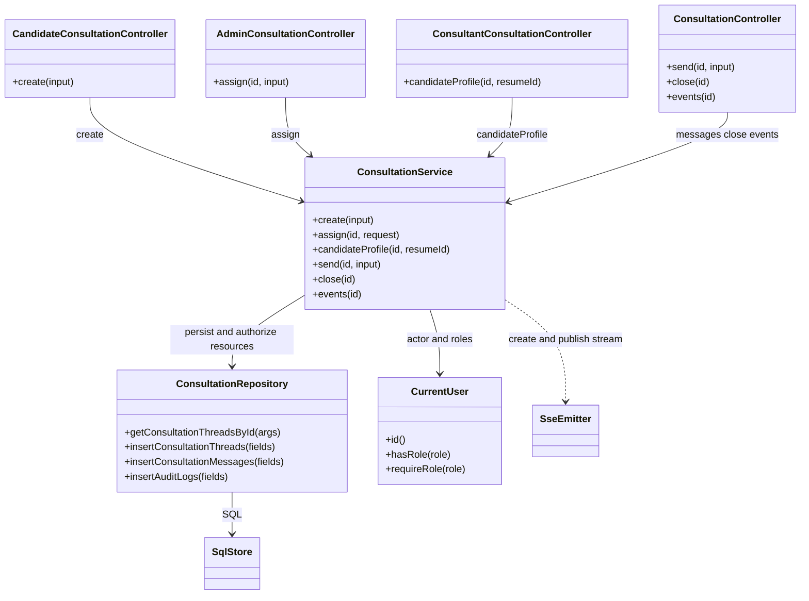

**Lớp đối chiếu:**

- [CandidateConsultationController](../src/main/java/com/example/intelligent_cv_matching_ai_agent/controller/candidate/consultation/CandidateConsultationController.java)
- [AdminConsultationController](../src/main/java/com/example/intelligent_cv_matching_ai_agent/controller/admin/consultation/AdminConsultationController.java)
- [ConsultantConsultationController](../src/main/java/com/example/intelligent_cv_matching_ai_agent/controller/consultant/consultation/ConsultantConsultationController.java)
- [ConsultationController](../src/main/java/com/example/intelligent_cv_matching_ai_agent/controller/shared/consultation/ConsultationController.java)
- [ConsultationService](../src/main/java/com/example/intelligent_cv_matching_ai_agent/service/shared/consultation/ConsultationService.java)
- [ConsultationRepository](../src/main/java/com/example/intelligent_cv_matching_ai_agent/repository/shared/consultation/ConsultationRepository.java)
- [CurrentUser](../src/main/java/com/example/intelligent_cv_matching_ai_agent/security/shared/CurrentUser.java)
- [SqlStore](../src/main/java/com/example/intelligent_cv_matching_ai_agent/repository/shared/SqlStore.java)

</details>

## SD-11 Thanh toán SePay và kích hoạt gói

**Bảng chính:** `payment_orders`, `payment_webhook_events`, `user_subscriptions`, `invoices`, `notifications`.

### Sequence diagram SD-11

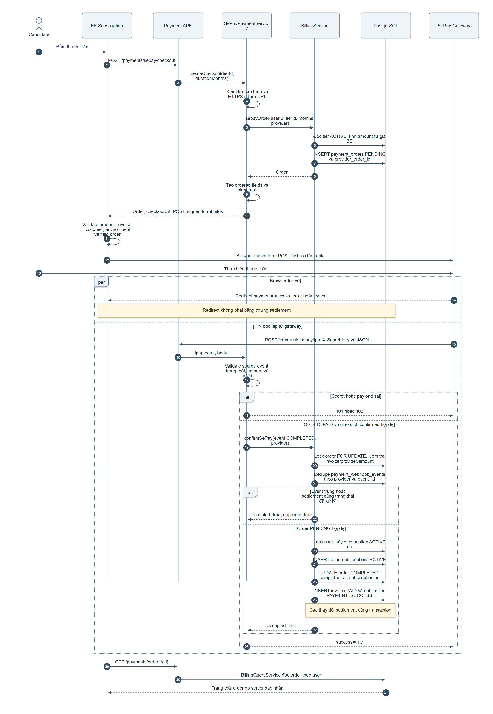

[Mở PNG](diagrams/sequence/sd-11-sequence.png) · [Mở SVG](diagrams/sequence/sd-11-sequence.svg) · [Nguồn Mermaid](diagrams/sequence/sd-11-sequence.mmd)

<details>
<summary>Mã Mermaid của sequence diagram SD-11</summary>

```mermaid
sequenceDiagram
    autonumber
    actor C as Candidate
    participant FE as FE Subscription
    participant API as Payment APIs
    participant SePay as SePayPaymentService
    participant Billing as BillingService
    participant DB as PostgreSQL
    participant Gateway as SePay Gateway

    C->>FE: Bấm thanh toán
    FE->>API: POST /payments/sepay/checkout
    API->>SePay: createCheckout(tierId, durationMonths)
    SePay->>SePay: Kiểm tra cấu hình và HTTPS return URL
    SePay->>Billing: sepayOrder(userId, tierId, months, provider)
    Billing->>DB: Đọc tier ACTIVE, tính amount từ giá BE
    Billing->>DB: INSERT payment_orders PENDING và provider_order_id
    Billing-->>SePay: Order
    SePay->>SePay: Tạo ordered fields và signature
    SePay-->>FE: Order, checkoutUrl, POST, signed formFields
    FE->>FE: Validate amount, invoice, customer, environment và field order
    FE->>Gateway: Browser native form POST từ thao tác click
    C->>Gateway: Thực hiện thanh toán

    par Browser trở về
        Gateway-->>FE: Redirect payment=success, error hoặc cancel
        Note over FE,DB: Redirect không phải bằng chứng settlement
    and IPN độc lập từ gateway
        Gateway->>API: POST /payments/sepay/ipn, X-Secret-Key và JSON
        API->>SePay: ipn(secret, body)
        SePay->>SePay: Validate secret, event, trạng thái, amount và VND
        alt Secret hoặc payload sai
            SePay-->>Gateway: 401 hoặc 400
        else ORDER_PAID và giao dịch confirmed hợp lệ
            SePay->>Billing: confirmSePay(event COMPLETED, provider)
            Billing->>DB: Lock order FOR UPDATE, kiểm tra invoice/provider/amount
            Billing->>DB: Dedupe payment_webhook_events theo provider và event_id
            alt Event trùng hoặc settlement cùng trạng thái đã xử lý
                Billing-->>SePay: accepted=true, duplicate=true
            else Order PENDING hợp lệ
                Billing->>DB: Lock user, hủy subscription ACTIVE cũ
                Billing->>DB: INSERT user_subscriptions ACTIVE
                Billing->>DB: UPDATE order COMPLETED, completed_at, subscription_id
                Billing->>DB: INSERT invoice PAID và notification PAYMENT_SUCCESS
                Note over Billing,DB: Các thay đổi settlement cùng transaction
                Billing-->>SePay: accepted=true
            end
            SePay-->>Gateway: success=true
        end
    end

    FE->>API: GET /payments/orders/{id}
    API->>DB: BillingQueryService đọc order theo user
    DB-->>FE: Trạng thái order do server xác nhận
```

</details>

Retry checkout dùng `POST /payments/orders/{id}/sepay-checkout`, chỉ cho order `PENDING` đúng owner/environment. `TRANSACTION_VOID` được xác thực và acknowledge theo code, không tự thu hồi subscription đã trả tiền.

**Lệch hợp đồng hiện có:** BE cập nhật order thành **`COMPLETED`**, hóa đơn thành **`PAID`**. FE `subscriptionService.ts` hiện chỉ ánh xạ order `PAID` thành success và đọc `paid_at` thay vì `completed_at`. Sơ đồ giữ đúng trạng thái BE; cần đồng bộ adapter trước khi coi bước hiển thị thành công trên FE đã hoàn chỉnh. Tài liệu này không sửa logic thanh toán.

### Class diagram đi kèm SD-11

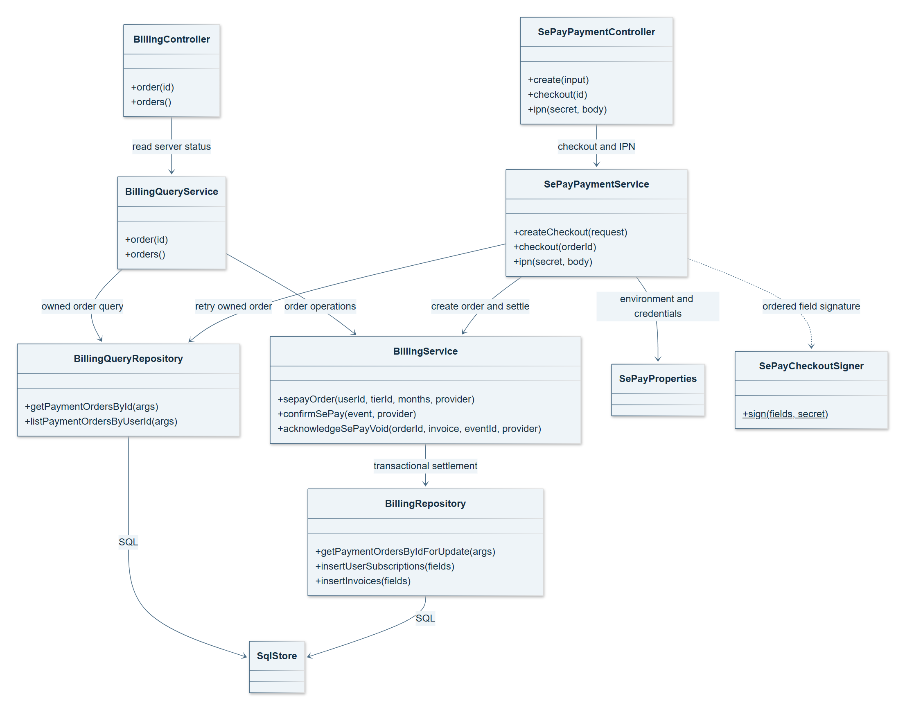

[Mở PNG](diagrams/sequence/sd-11-class.png) · [Mở SVG](diagrams/sequence/sd-11-class.svg) · [Nguồn Mermaid](diagrams/sequence/sd-11-class.mmd)

Class diagram chỉ mô tả các lớp backend; trình duyệt và gateway SePay là tác nhân ngoài. IPN hợp lệ đi qua BillingService để xử lý idempotency và settlement; redirect không kích hoạt gói. BillingController/BillingQueryService đọc trạng thái theo owner. Trạng thái order ở BE là COMPLETED, invoice là PAID; adapter FE còn lệch trạng thái như phần lưu ý SD-11.

<details>
<summary>Mã Mermaid và lớp đối chiếu của SD-11</summary>

```mermaid
classDiagram
    direction TB
    class SePayPaymentController {
        +create(input)
        +checkout(id)
        +ipn(secret, body)
    }
    class SePayPaymentService {
        +createCheckout(request)
        +checkout(orderId)
        +ipn(secret, body)
    }
    class BillingService {
        +sepayOrder(userId, tierId, months, provider)
        +confirmSePay(event, provider)
        +acknowledgeSePayVoid(orderId, invoice, eventId, provider)
    }
    class BillingRepository {
        +getPaymentOrdersByIdForUpdate(args)
        +insertUserSubscriptions(fields)
        +insertInvoices(fields)
    }
    class BillingController {
        +order(id)
        +orders()
    }
    class BillingQueryService {
        +order(id)
        +orders()
    }
    class BillingQueryRepository {
        +getPaymentOrdersById(args)
        +listPaymentOrdersByUserId(args)
    }
    class SePayProperties
    class SePayCheckoutSigner {
        +sign(fields, secret)$
    }
    class SqlStore
    SePayPaymentController --> SePayPaymentService : checkout and IPN
    SePayPaymentService --> SePayProperties : environment and credentials
    SePayPaymentService --> BillingService : create order and settle
    SePayPaymentService --> BillingQueryRepository : retry owned order
    SePayPaymentService ..> SePayCheckoutSigner : ordered field signature
    BillingService --> BillingRepository : transactional settlement
    BillingController --> BillingQueryService : read server status
    BillingQueryService --> BillingQueryRepository : owned order query
    BillingQueryService --> BillingService : order operations
    BillingRepository --> SqlStore : SQL
    BillingQueryRepository --> SqlStore : SQL
```

**Lớp đối chiếu:**

- [SePayPaymentController](../src/main/java/com/example/intelligent_cv_matching_ai_agent/controller/shared/billing/SePayPaymentController.java)
- [SePayPaymentService](../src/main/java/com/example/intelligent_cv_matching_ai_agent/service/shared/billing/SePayPaymentService.java)
- [BillingService](../src/main/java/com/example/intelligent_cv_matching_ai_agent/service/shared/billing/BillingService.java)
- [BillingRepository](../src/main/java/com/example/intelligent_cv_matching_ai_agent/repository/shared/billing/BillingRepository.java)
- [BillingController](../src/main/java/com/example/intelligent_cv_matching_ai_agent/controller/shared/billing/BillingController.java)
- [BillingQueryService](../src/main/java/com/example/intelligent_cv_matching_ai_agent/service/shared/billing/BillingQueryService.java)
- [BillingQueryRepository](../src/main/java/com/example/intelligent_cv_matching_ai_agent/repository/shared/billing/BillingQueryRepository.java)
- [SePayProperties](../src/main/java/com/example/intelligent_cv_matching_ai_agent/config/shared/billing/SePayProperties.java)
- [SePayCheckoutSigner](../src/main/java/com/example/intelligent_cv_matching_ai_agent/util/shared/billing/SePayCheckoutSigner.java)
- [SqlStore](../src/main/java/com/example/intelligent_cv_matching_ai_agent/repository/shared/SqlStore.java)

</details>

## SD-12 Admin lưu và khôi phục cấu hình AI và prompt

**Bảng chính:** `ai_configurations`, `ai_prompt_templates`, `audit_logs`.

### Sequence diagram SD-12

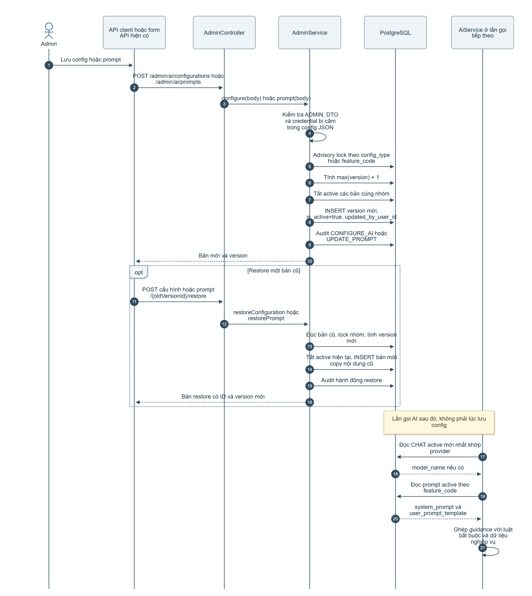

[Mở PNG](diagrams/sequence/sd-12-sequence.png) · [Mở SVG](diagrams/sequence/sd-12-sequence.svg) · [Nguồn Mermaid](diagrams/sequence/sd-12-sequence.mmd)

<details>
<summary>Mã Mermaid của sequence diagram SD-12</summary>

```mermaid
sequenceDiagram
    autonumber
    actor A as Admin
    participant Client as API client hoặc form API hiện có
    participant API as AdminController
    participant Admin as AdminService
    participant DB as PostgreSQL
    participant AI as AiService ở lần gọi tiếp theo

    A->>Client: Lưu config hoặc prompt
    Client->>API: POST /admin/ai/configurations hoặc /admin/ai/prompts
    API->>Admin: configure(body) hoặc prompt(body)
    Admin->>Admin: Kiểm tra ADMIN, DTO và credential bị cấm trong config JSON
    Admin->>DB: Advisory lock theo config_type hoặc feature_code
    Admin->>DB: Tính max(version) + 1
    Admin->>DB: Tắt active các bản cùng nhóm
    Admin->>DB: INSERT version mới, is_active=true, updated_by_user_id
    Admin->>DB: Audit CONFIGURE_AI hoặc UPDATE_PROMPT
    Admin-->>Client: Bản mới và version

    opt Restore một bản cũ
        Client->>API: POST cấu hình hoặc prompt /{oldVersionId}/restore
        API->>Admin: restoreConfiguration hoặc restorePrompt
        Admin->>DB: Đọc bản cũ, lock nhóm, tính version mới
        Admin->>DB: Tắt active hiện tại, INSERT bản mới copy nội dung cũ
        Admin->>DB: Audit hành động restore
        Admin-->>Client: Bản restore có ID và version mới
    end

    Note over AI,DB: Lần gọi AI sau đó, không phải lúc lưu config
    AI->>DB: Đọc CHAT active mới nhất khớp provider
    DB-->>AI: model_name nếu có
    AI->>DB: Đọc prompt active theo feature_code
    DB-->>AI: system_prompt và user_prompt_template
    AI->>AI: Ghép guidance với luật bắt buộc và dữ liệu nghiệp vụ
```

</details>

`/admin/ai/*` FE còn placeholder. Runtime hiện đọc DB CHAT model và prompt; `config_json` RPM/TPM/temperature chưa được dùng để điều khiển request. Embedding model và assessment override lấy từ môi trường. `user_prompt_template` được nối làm hướng dẫn, chưa có nội suy biến kiểu `{{cv}}`. Restore tạo version mới, không bật lại row cũ.

### Class diagram đi kèm SD-12

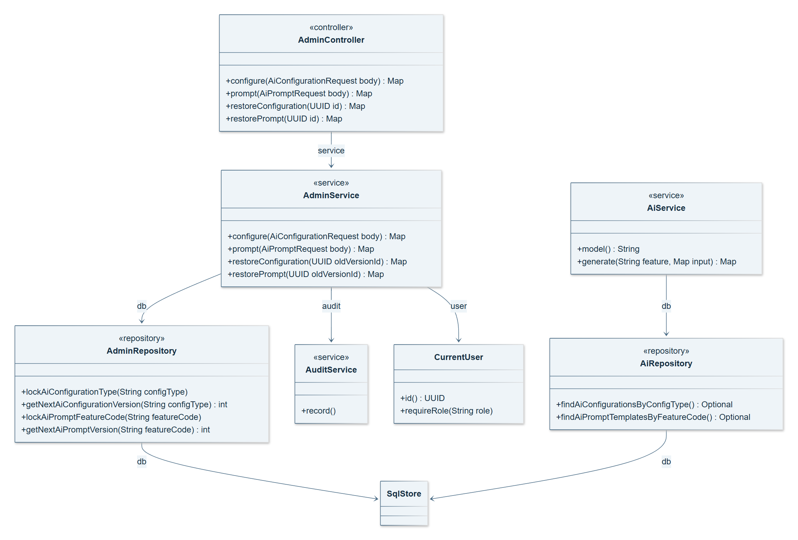

[Mở PNG](diagrams/sequence/sd-12-class.png) · [Mở SVG](diagrams/sequence/sd-12-class.svg) · [Nguồn Mermaid](diagrams/sequence/sd-12-class.mmd)

Class diagram tập trung lớp điều phối và truy cập cấu hình, không coi bảng SQL là lớp entity được luồng này sử dụng. Admin tạo version mới; AiService đọc model CHAT/prompt khi gọi AI sau đó. Phương thức có chữ ký dài được lược tham số; Map/Optional được lược kiểu generic.

<details>
<summary>Mã Mermaid và lớp đối chiếu của SD-12</summary>

```mermaid
classDiagram
    direction TB
    class AdminController {
        <<controller>>
        +configure(AiConfigurationRequest body) Map
        +prompt(AiPromptRequest body) Map
        +restoreConfiguration(UUID id) Map
        +restorePrompt(UUID id) Map
    }
    class AdminService {
        <<service>>
        +configure(AiConfigurationRequest body) Map
        +prompt(AiPromptRequest body) Map
        +restoreConfiguration(UUID oldVersionId) Map
        +restorePrompt(UUID oldVersionId) Map
    }
    class AdminRepository {
        <<repository>>
        +lockAiConfigurationType(String configType)
        +getNextAiConfigurationVersion(String configType) int
        +lockAiPromptFeatureCode(String featureCode)
        +getNextAiPromptVersion(String featureCode) int
    }
    class AuditService {
        <<service>>
        +record()
    }
    class CurrentUser {
        +id() UUID
        +requireRole(String role)
    }
    class AiService {
        <<service>>
        +model() String
        +generate(String feature, Map input) Map
    }
    class AiRepository {
        <<repository>>
        +findAiConfigurationsByConfigType() Optional
        +findAiPromptTemplatesByFeatureCode() Optional
    }
    class SqlStore
    AdminController --> AdminService : service
    AdminService --> AdminRepository : db
    AdminService --> CurrentUser : user
    AdminService --> AuditService : audit
    AdminRepository --> SqlStore : db
    AiService --> AiRepository : db
    AiRepository --> SqlStore : db
```

**Lớp đối chiếu:**

- [AdminController](../src/main/java/com/example/intelligent_cv_matching_ai_agent/controller/admin/management/AdminController.java)
- [AdminService](../src/main/java/com/example/intelligent_cv_matching_ai_agent/service/admin/management/AdminService.java)
- [AdminRepository](../src/main/java/com/example/intelligent_cv_matching_ai_agent/repository/admin/management/AdminRepository.java)
- [AuditService](../src/main/java/com/example/intelligent_cv_matching_ai_agent/service/admin/monitoring/AuditService.java)
- [CurrentUser](../src/main/java/com/example/intelligent_cv_matching_ai_agent/security/shared/CurrentUser.java)
- [AiService](../src/main/java/com/example/intelligent_cv_matching_ai_agent/service/shared/ai/AiService.java)
- [AiRepository](../src/main/java/com/example/intelligent_cv_matching_ai_agent/repository/shared/ai/AiRepository.java)
- [SqlStore](../src/main/java/com/example/intelligent_cv_matching_ai_agent/repository/shared/SqlStore.java)

</details>

## SD-13 Pipeline gọi AI chung

**Feature ví dụ:** `CV_BUILD`, `CV_PARSE`, `CV_ANALYZE`, `JOB_ATS`, `JOB_MATCH_RERANK`, `ASSESSMENT_GENERATE`, `ROADMAP_GENERATE`, `CAREER_CHAT`, `APPLICATION_EMAIL`.

### Sequence diagram SD-13

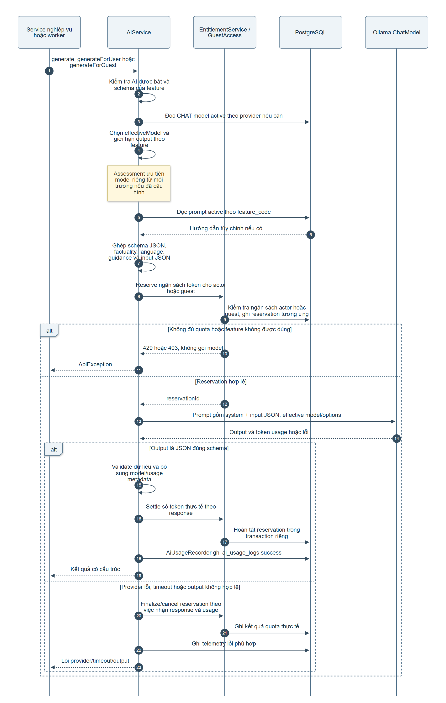

[Mở PNG](diagrams/sequence/sd-13-sequence.png) · [Mở SVG](diagrams/sequence/sd-13-sequence.svg) · [Nguồn Mermaid](diagrams/sequence/sd-13-sequence.mmd)

<details>
<summary>Mã Mermaid của sequence diagram SD-13</summary>

```mermaid
sequenceDiagram
    autonumber
    participant Service as Service nghiệp vụ hoặc worker
    participant AI as AiService
    participant Quota as EntitlementService / GuestAccess
    participant DB as PostgreSQL
    participant Model as Gemini ChatModel

    Service->>AI: generate, generateForUser hoặc generateForGuest
    AI->>AI: Kiểm tra AI được bật và schema của feature
    AI->>DB: Đọc CHAT model active theo provider nếu cần
    AI->>AI: Chọn effectiveModel và giới hạn output theo feature
    Note over AI: Assessment ưu tiên model riêng từ môi trường nếu đã cấu hình
    AI->>DB: Đọc prompt active theo feature_code
    DB-->>AI: Hướng dẫn tùy chỉnh nếu có
    AI->>AI: Ghép schema JSON, factuality, language, guidance và input JSON
    AI->>Quota: Reserve ngân sách token cho actor hoặc guest
    Quota->>DB: Kiểm tra ngân sách actor hoặc guest, ghi reservation tương ứng
    alt Không đủ quota hoặc feature không được dùng
        Quota-->>AI: 429 hoặc 403, không gọi model
        AI-->>Service: ApiException
    else Reservation hợp lệ
        Quota-->>AI: reservationId
        AI->>Model: Prompt gồm system + input JSON, effective model/options
        Model-->>AI: Output và token usage hoặc lỗi
        alt Output là JSON đúng schema
            AI->>AI: Validate dữ liệu và bổ sung model/usage metadata
            AI->>Quota: Settle số token thực tế theo response
            Quota->>DB: Hoàn tất reservation trong transaction riêng
            AI->>DB: AiUsageRecorder ghi ai_usage_logs success
            AI-->>Service: Kết quả có cấu trúc
        else Provider lỗi, timeout hoặc output không hợp lệ
            AI->>Quota: Finalize/cancel reservation theo việc nhận response và usage
            Quota->>DB: Ghi kết quả quota thực tế
            AI->>DB: Ghi telemetry lỗi phù hợp
            AI-->>Service: Lỗi provider/timeout/output
        end
    end
```

</details>

User đăng nhập dùng `ai_token_reservations`, kiểm tra tier và subscription quotas. Guest kiểm tra ngân sách trong `guest_sessions` và tạo `trial_usage_events` trạng thái PROCESSING, không đọc subscription tier của user. `ai_usage_logs` là telemetry, không thay thế bảng kế toán quota. Một số ApiException bị trả sớm không đi qua cùng nhánh ghi log lỗi provider; không suy ra mọi request bị chặn đều có usage log. Các service nghiệp vụ tự quyết định transaction ngoài; riêng worker SD-07/SD-04 chủ động tách inference khỏi transaction JDBC.

### Class diagram đi kèm SD-13

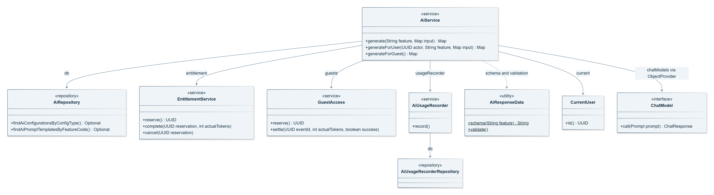

[Mở PNG](diagrams/sequence/sd-13-class.png) · [Mở SVG](diagrams/sequence/sd-13-class.svg) · [Nguồn Mermaid](diagrams/sequence/sd-13-class.mmd)

Các lớp quota user và guest là hai đường kế toán khác nhau. ChatModel là interface Spring AI được AiService gọi qua ObjectProvider; không phải một lớp Java của model server. Chỉ hiện các phương thức liên quan; chữ ký dài được lược tham số và kiểu generic.

<details>
<summary>Mã Mermaid và lớp đối chiếu của SD-13</summary>

```mermaid
classDiagram
    direction TB
    class AiService {
        <<service>>
        +generate(String feature, Map input) Map
        +generateForUser(UUID actor, String feature, Map input) Map
        +generateForGuest() Map
    }
    class AiRepository {
        <<repository>>
        +findAiConfigurationsByConfigType() Optional
        +findAiPromptTemplatesByFeatureCode() Optional
    }
    class EntitlementService {
        <<service>>
        +reserve() UUID
        +complete(UUID reservation, int actualTokens)
        +cancel(UUID reservation)
    }
    class GuestAccess {
        <<service>>
        +reserve() UUID
        +settle(UUID eventId, int actualTokens, boolean success)
    }
    class AiUsageRecorder {
        <<service>>
        +record()
    }
    class AiUsageRecorderRepository {
        <<repository>>
    }
    class AiResponseData {
        <<utility>>
        +schema(String feature) String$
        +validate()$
    }
    class CurrentUser {
        +id() UUID
    }
    class ChatModel {
        <<interface>>
        +call(Prompt prompt) ChatResponse
    }
    AiService --> AiRepository : db
    AiService --> EntitlementService : entitlement
    AiService --> GuestAccess : guests
    AiService --> AiUsageRecorder : usageRecorder
    AiService --> CurrentUser : current
    AiService ..> AiResponseData : schema and validation
    AiService --> ChatModel : chatModels via ObjectProvider
    AiUsageRecorder --> AiUsageRecorderRepository : db
```

**Lớp đối chiếu:**

- [AiService](../src/main/java/com/example/intelligent_cv_matching_ai_agent/service/shared/ai/AiService.java)
- [AiRepository](../src/main/java/com/example/intelligent_cv_matching_ai_agent/repository/shared/ai/AiRepository.java)
- [EntitlementService](../src/main/java/com/example/intelligent_cv_matching_ai_agent/service/shared/billing/EntitlementService.java)
- [GuestAccess](../src/main/java/com/example/intelligent_cv_matching_ai_agent/service/guest/identity/GuestAccess.java)
- [AiUsageRecorder](../src/main/java/com/example/intelligent_cv_matching_ai_agent/service/shared/ai/AiUsageRecorder.java)
- [AiUsageRecorderRepository](../src/main/java/com/example/intelligent_cv_matching_ai_agent/repository/shared/ai/AiUsageRecorderRepository.java)
- [AiResponseData](../src/main/java/com/example/intelligent_cv_matching_ai_agent/util/shared/ai/AiResponseData.java)
- [CurrentUser](../src/main/java/com/example/intelligent_cv_matching_ai_agent/security/shared/CurrentUser.java)

</details>

## SD-14 Tạo embedding cho CV

**Kết quả:** vector thực 1024 chiều, đúng content hash/provider/model, liên kết CV READY của owner.

### Sequence diagram SD-14

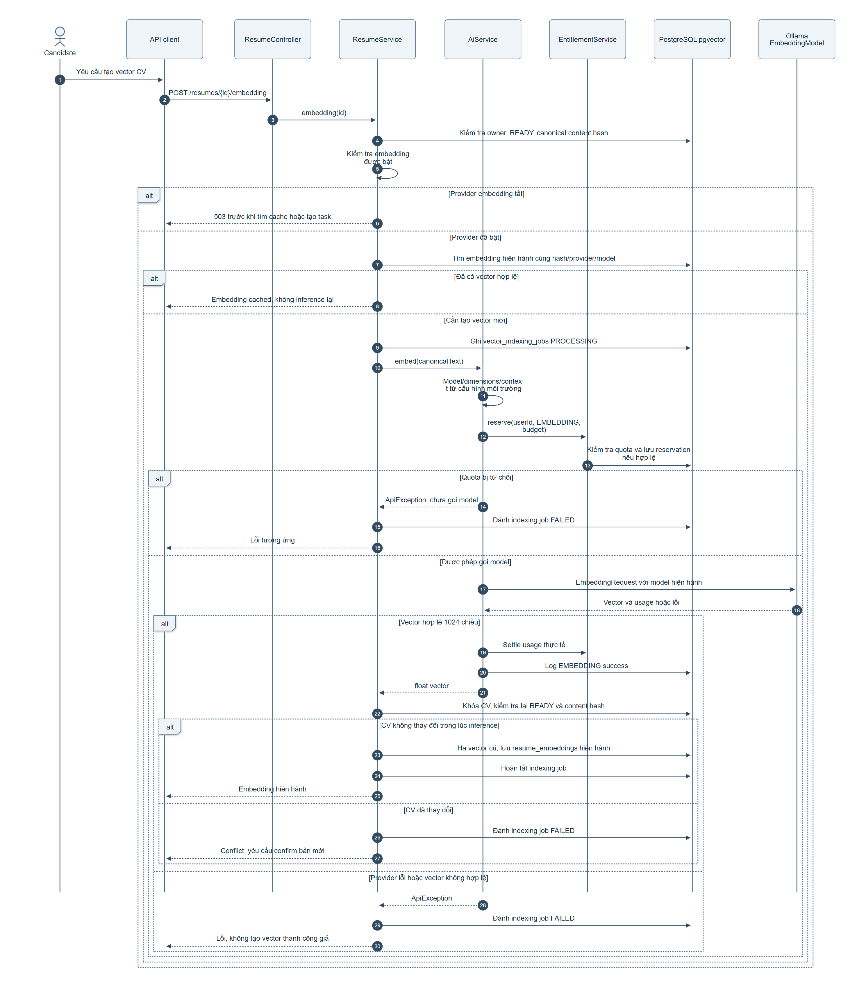

[Mở PNG](diagrams/sequence/sd-14-sequence.png) · [Mở SVG](diagrams/sequence/sd-14-sequence.svg) · [Nguồn Mermaid](diagrams/sequence/sd-14-sequence.mmd)

<details>
<summary>Mã Mermaid của sequence diagram SD-14</summary>

```mermaid
sequenceDiagram
    autonumber
    actor C as Candidate
    participant Client as API client
    participant API as ResumeController
    participant Resume as ResumeService
    participant AI as AiService
    participant Quota as EntitlementService
    participant DB as PostgreSQL pgvector
    participant Model as Gemini EmbeddingModel

    C->>Client: Yêu cầu tạo vector CV
    Client->>API: POST /resumes/{id}/embedding
    API->>Resume: embedding(id)
    Resume->>DB: Kiểm tra owner, READY, canonical content hash
    Resume->>Resume: Kiểm tra embedding được bật
    alt Provider embedding tắt
        Resume-->>Client: 503 trước khi tìm cache hoặc tạo task
    else Provider đã bật
        Resume->>DB: Tìm embedding hiện hành cùng hash/provider/model
        alt Đã có vector hợp lệ
            Resume-->>Client: Embedding cached, không inference lại
        else Cần tạo vector mới
            Resume->>DB: Ghi vector_indexing_jobs PROCESSING
            Resume->>AI: embed(canonicalText)
            AI->>AI: Model/dimensions/context từ cấu hình môi trường
            AI->>Quota: reserve(userId, EMBEDDING, budget)
            Quota->>DB: Kiểm tra quota và lưu reservation nếu hợp lệ
            alt Quota bị từ chối
                AI-->>Resume: ApiException, chưa gọi model
                Resume->>DB: Đánh indexing job FAILED
                Resume-->>Client: Lỗi tương ứng
            else Được phép gọi model
                AI->>Model: EmbeddingRequest với model hiện hành
                Model-->>AI: Vector và usage hoặc lỗi
                alt Vector hợp lệ 1024 chiều
                    AI->>Quota: Settle usage thực tế
                    AI->>DB: Log EMBEDDING success
                    AI-->>Resume: float vector
                    Resume->>DB: Khóa CV, kiểm tra lại READY và content hash
                    alt CV không thay đổi trong lúc inference
                        Resume->>DB: Hạ vector cũ, lưu resume_embeddings hiện hành
                        Resume->>DB: Hoàn tất indexing job
                        Resume-->>Client: Embedding hiện hành
                    else CV đã thay đổi
                        Resume->>DB: Đánh indexing job FAILED
                        Resume-->>Client: Conflict, yêu cầu confirm bản mới
                    end
                else Provider lỗi hoặc vector không hợp lệ
                    AI-->>Resume: ApiException
                    Resume->>DB: Đánh indexing job FAILED
                    Resume-->>Client: Lỗi, không tạo vector thành công giả
                end
            end
        end
    end
```

</details>

Vector hồ sơ/JD/RAG được lưu ở các bảng embedding riêng. Đổi embedding model cần dựng lại vector liên quan; không so vector thuộc các model khác nhau. `ai_configurations` loại EMBEDDING hiện chưa điều khiển model trong luồng này.

### Class diagram đi kèm SD-14

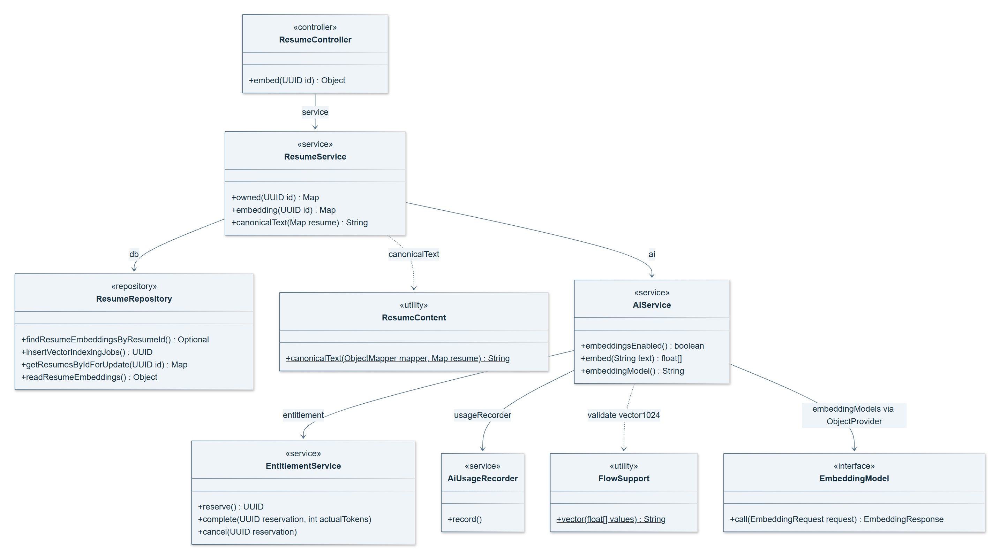

[Mở PNG](diagrams/sequence/sd-14-class.png) · [Mở SVG](diagrams/sequence/sd-14-class.svg) · [Nguồn Mermaid](diagrams/sequence/sd-14-class.mmd)

ResumeController dùng tên method embed, còn ResumeService dùng embedding. ResumeRepository quản lý job/vector bằng SqlStore; không vẽ quan hệ JPA không được luồng này gọi. FlowSupport kiểm tra vector 1024 chiều. Chỉ hiện phương thức liên quan; chữ ký dài và generic được rút gọn.

<details>
<summary>Mã Mermaid và lớp đối chiếu của SD-14</summary>

```mermaid
classDiagram
    direction TB
    class ResumeController {
        <<controller>>
        +embed(UUID id) Object
    }
    class ResumeService {
        <<service>>
        +owned(UUID id) Map
        +embedding(UUID id) Map
        +canonicalText(Map resume) String
    }
    class ResumeRepository {
        <<repository>>
        +findResumeEmbeddingsByResumeId() Optional
        +insertVectorIndexingJobs() UUID
        +getResumesByIdForUpdate(UUID id) Map
        +readResumeEmbeddings() Object
    }
    class ResumeContent {
        <<utility>>
        +canonicalText(ObjectMapper mapper, Map resume) String$
    }
    class AiService {
        <<service>>
        +embeddingsEnabled() boolean
        +embed(String text) float[]
        +embeddingModel() String
    }
    class EntitlementService {
        <<service>>
        +reserve() UUID
        +complete(UUID reservation, int actualTokens)
        +cancel(UUID reservation)
    }
    class AiUsageRecorder {
        <<service>>
        +record()
    }
    class FlowSupport {
        <<utility>>
        +vector(float[] values) String$
    }
    class EmbeddingModel {
        <<interface>>
        +call(EmbeddingRequest request) EmbeddingResponse
    }
    ResumeController --> ResumeService : service
    ResumeService --> ResumeRepository : db
    ResumeService --> AiService : ai
    ResumeService ..> ResumeContent : canonicalText
    AiService --> EntitlementService : entitlement
    AiService --> AiUsageRecorder : usageRecorder
    AiService ..> FlowSupport : validate vector1024
    AiService --> EmbeddingModel : embeddingModels via ObjectProvider
```

**Lớp đối chiếu:**

- [ResumeController](../src/main/java/com/example/intelligent_cv_matching_ai_agent/controller/candidate/resume/ResumeController.java)
- [ResumeService](../src/main/java/com/example/intelligent_cv_matching_ai_agent/service/candidate/resume/ResumeService.java)
- [ResumeRepository](../src/main/java/com/example/intelligent_cv_matching_ai_agent/repository/candidate/resume/ResumeRepository.java)
- [ResumeContent](../src/main/java/com/example/intelligent_cv_matching_ai_agent/util/candidate/resume/ResumeContent.java)
- [AiService](../src/main/java/com/example/intelligent_cv_matching_ai_agent/service/shared/ai/AiService.java)
- [EntitlementService](../src/main/java/com/example/intelligent_cv_matching_ai_agent/service/shared/billing/EntitlementService.java)
- [AiUsageRecorder](../src/main/java/com/example/intelligent_cv_matching_ai_agent/service/shared/ai/AiUsageRecorder.java)
- [FlowSupport](../src/main/java/com/example/intelligent_cv_matching_ai_agent/util/shared/FlowSupport.java)

</details>

## SD-15 Ticket hỗ trợ và phản hồi Admin

**Bảng chính:** `support_tickets`, `support_ticket_messages`, `notifications`, `audit_logs`.

### Sequence diagram SD-15

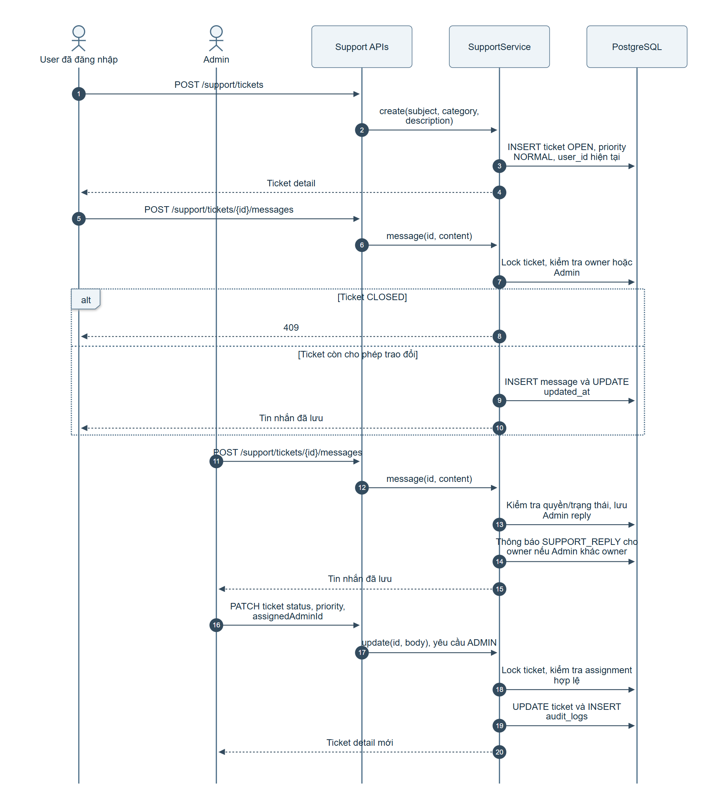

[Mở PNG](diagrams/sequence/sd-15-sequence.png) · [Mở SVG](diagrams/sequence/sd-15-sequence.svg) · [Nguồn Mermaid](diagrams/sequence/sd-15-sequence.mmd)

<details>
<summary>Mã Mermaid của sequence diagram SD-15</summary>

```mermaid
sequenceDiagram
    autonumber
    actor U as User đã đăng nhập
    actor A as Admin
    participant API as Support APIs
    participant Support as SupportService
    participant DB as PostgreSQL

    U->>API: POST /support/tickets
    API->>Support: create(subject, category, description)
    Support->>DB: INSERT ticket OPEN, priority NORMAL, user_id hiện tại
    Support-->>U: Ticket detail

    U->>API: POST /support/tickets/{id}/messages
    API->>Support: message(id, content)
    Support->>DB: Lock ticket, kiểm tra owner hoặc Admin
    alt Ticket CLOSED
        Support-->>U: 409
    else Ticket còn cho phép trao đổi
        Support->>DB: INSERT message và UPDATE updated_at
        Support-->>U: Tin nhắn đã lưu
    end

    A->>API: POST /support/tickets/{id}/messages
    API->>Support: message(id, content)
    Support->>DB: Kiểm tra quyền/trạng thái, lưu Admin reply
    Support->>DB: Thông báo SUPPORT_REPLY cho owner nếu Admin khác owner
    Support-->>A: Tin nhắn đã lưu

    A->>API: PATCH ticket status, priority, assignedAdminId
    API->>Support: update(id, body), yêu cầu ADMIN
    Support->>DB: Lock ticket, kiểm tra assignment hợp lệ
    Support->>DB: UPDATE ticket và INSERT audit_logs
    Support-->>A: Ticket detail mới
```

</details>

Trên FE hiện chưa có đầy đủ màn Admin support tại `/admin/support`; sơ đồ mô tả khả năng API có sẵn. Attachment và Candidate tự đổi trạng thái không được vẽ như chức năng ghi đã hoàn thiện.

### Class diagram đi kèm SD-15

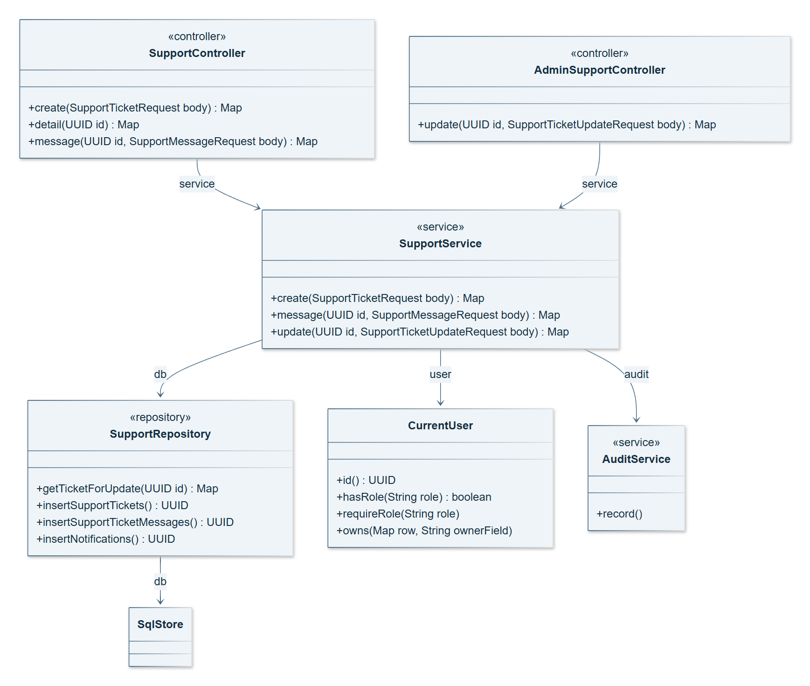

[Mở PNG](diagrams/sequence/sd-15-class.png) · [Mở SVG](diagrams/sequence/sd-15-class.svg) · [Nguồn Mermaid](diagrams/sequence/sd-15-class.mmd)

SupportController phục vụ thao tác ticket/message dùng chung; cập nhật trạng thái, ưu tiên và người xử lý đi qua AdminSupportController. Thông báo SUPPORT_REPLY được ghi bằng SupportRepository; không thêm NotificationService không có trong luồng. Chữ ký dài và generic được rút gọn.

<details>
<summary>Mã Mermaid và lớp đối chiếu của SD-15</summary>

```mermaid
classDiagram
    direction TB
    class SupportController {
        <<controller>>
        +create(SupportTicketRequest body) Map
        +detail(UUID id) Map
        +message(UUID id, SupportMessageRequest body) Map
    }
    class AdminSupportController {
        <<controller>>
        +update(UUID id, SupportTicketUpdateRequest body) Map
    }
    class SupportService {
        <<service>>
        +create(SupportTicketRequest body) Map
        +message(UUID id, SupportMessageRequest body) Map
        +update(UUID id, SupportTicketUpdateRequest body) Map
    }
    class SupportRepository {
        <<repository>>
        +getTicketForUpdate(UUID id) Map
        +insertSupportTickets() UUID
        +insertSupportTicketMessages() UUID
        +insertNotifications() UUID
    }
    class CurrentUser {
        +id() UUID
        +hasRole(String role) boolean
        +requireRole(String role)
        +owns(Map row, String ownerField)
    }
    class AuditService {
        <<service>>
        +record()
    }
    class SqlStore
    SupportController --> SupportService : service
    AdminSupportController --> SupportService : service
    SupportService --> SupportRepository : db
    SupportService --> CurrentUser : user
    SupportService --> AuditService : audit
    SupportRepository --> SqlStore : db
```

**Lớp đối chiếu:**

- [SupportController](../src/main/java/com/example/intelligent_cv_matching_ai_agent/controller/shared/support/SupportController.java)
- [AdminSupportController](../src/main/java/com/example/intelligent_cv_matching_ai_agent/controller/admin/support/AdminSupportController.java)
- [SupportService](../src/main/java/com/example/intelligent_cv_matching_ai_agent/service/shared/support/SupportService.java)
- [SupportRepository](../src/main/java/com/example/intelligent_cv_matching_ai_agent/repository/shared/support/SupportRepository.java)
- [CurrentUser](../src/main/java/com/example/intelligent_cv_matching_ai_agent/security/shared/CurrentUser.java)
- [AuditService](../src/main/java/com/example/intelligent_cv_matching_ai_agent/service/admin/monitoring/AuditService.java)
- [SqlStore](../src/main/java/com/example/intelligent_cv_matching_ai_agent/repository/shared/SqlStore.java)

</details>

## SD-16 Soạn nội dung ứng tuyển

Có hai đường đi trong source. **FE hiện dùng đường A qua assistant**, còn API nghiệp vụ drafts của BE là đường B; không gộp chúng thành cùng một flow đã được FE sử dụng.

### Sequence diagram SD-16

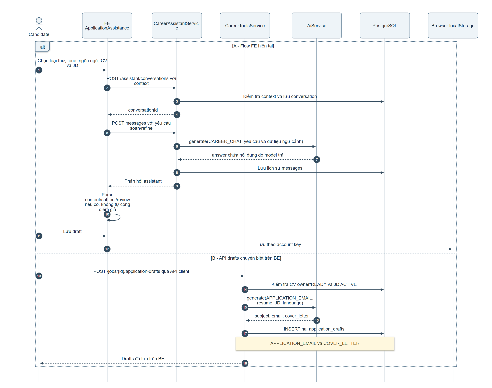

[Mở PNG](diagrams/sequence/sd-16-sequence.png) · [Mở SVG](diagrams/sequence/sd-16-sequence.svg) · [Nguồn Mermaid](diagrams/sequence/sd-16-sequence.mmd)

<details>
<summary>Mã Mermaid của sequence diagram SD-16</summary>

```mermaid
sequenceDiagram
    autonumber
    actor C as Candidate
    participant FE as FE ApplicationAssistance
    participant Chat as CareerAssistantService
    participant Tools as CareerToolsService
    participant AI as AiService
    participant DB as PostgreSQL
    participant Local as Browser localStorage

    alt A - Flow FE hiện tại
        C->>FE: Chọn loại thư, tone, ngôn ngữ, CV và JD
        FE->>Chat: POST /assistant/conversations với context
        Chat->>DB: Kiểm tra context và lưu conversation
        Chat-->>FE: conversationId
        FE->>Chat: POST messages với yêu cầu soạn/refine
        Chat->>AI: generate(CAREER_CHAT, yêu cầu và dữ liệu ngữ cảnh)
        AI-->>Chat: answer chứa nội dung do model trả
        Chat->>DB: Lưu lịch sử messages
        Chat-->>FE: Phản hồi assistant
        FE->>FE: Parse content/subject/review nếu có, không tự cộng điểm giả
        C->>FE: Lưu draft
        FE->>Local: Lưu theo account key
    else B - API drafts chuyên biệt trên BE
        C->>Tools: POST /jobs/{id}/application-drafts qua API client
        Tools->>DB: Kiểm tra CV owner/READY và JD ACTIVE
        Tools->>AI: generate(APPLICATION_EMAIL, resume, JD, language)
        AI-->>Tools: subject, email, cover_letter
        Tools->>DB: INSERT hai application_drafts
        Note over Tools,DB: APPLICATION_EMAIL và COVER_LETTER
        Tools-->>C: Drafts đã lưu trên BE
    end
```

</details>

Không có bước tự gửi thư/email ứng tuyển cho nhà tuyển dụng trong hai flow này. External apply là API ghi sự kiện redirect và trả source URL để người dùng mở nguồn; không phải tự nộp hồ sơ lên website tuyển dụng.

### Class diagram đi kèm SD-16


[Mở PNG](diagrams/sequence/sd-16-class.png) · [Mở SVG](diagrams/sequence/sd-16-class.svg) · [Nguồn Mermaid](diagrams/sequence/sd-16-class.mmd)

Đường A là API assistant mà FE ApplicationAssistance đang dùng; draft FE được giữ trong localStorage theo tài khoản, không vẽ localStorage thành lớp Java. Đường B là API chuyên biệt tạo APPLICATION_EMAIL và COVER_LETTER trên BE. Không vẽ mũi tên từ CareerAssistantService sang CareerToolsService vì code không gọi như vậy. Các phương thức có chữ ký dài được lược tham số và generic.

<details>
<summary>Mã Mermaid và lớp đối chiếu của SD-16</summary>

```mermaid
classDiagram
    direction TB
    class CareerAssistantController {
        <<controller>>
        +create(CreateAssistantConversationRequest body) Object
        +send() Object
    }
    class CareerAssistantService {
        <<service>>
        +create() Map
        +send() Map
    }
    class CareerAssistantRepository {
        <<repository>>
        +insertCareerAssistantConversations() UUID
        +insertCareerAssistantMessages() UUID
    }
    class CareerToolsController {
        <<controller>>
        +createDraft() List
        +drafts() List
        +editDraft() Map
    }
    class CareerToolsService {
        <<service>>
        +createDraft(UUID jobId, DraftRequest request) List
        +drafts(UUID jobId) List
        +editDraft() Map
    }
    class CareerToolsRepository {
        <<repository>>
        +insertApplicationDrafts() UUID
        +listApplicationDraftsById() List
    }
    class AiService {
        <<service>>
        +generate(String feature, Map input) Map
    }
    class ResumeService {
        <<service>>
        +owned(UUID id) Map
        +canonicalText(Map resume) String
    }
    class CurrentUser {
        +id() UUID
        +requireRole(String role)
    }
    CareerAssistantController --> CareerAssistantService : A assistant API
    CareerAssistantService --> CareerAssistantRepository : db
    CareerAssistantService --> AiService : CAREER_CHAT
    CareerAssistantService --> ResumeService : resumes
    CareerAssistantService --> CurrentUser : current
    CareerToolsController --> CareerToolsService : B drafts API
    CareerToolsService --> CareerToolsRepository : db
    CareerToolsService --> AiService : APPLICATION_EMAIL
    CareerToolsService --> ResumeService : resumes
    CareerToolsService --> CurrentUser : user
```

**Lớp đối chiếu:**

- [CareerAssistantController](../src/main/java/com/example/intelligent_cv_matching_ai_agent/controller/candidate/ai/CareerAssistantController.java)
- [CareerAssistantService](../src/main/java/com/example/intelligent_cv_matching_ai_agent/service/candidate/ai/CareerAssistantService.java)
- [CareerAssistantRepository](../src/main/java/com/example/intelligent_cv_matching_ai_agent/repository/candidate/ai/CareerAssistantRepository.java)
- [CareerToolsController](../src/main/java/com/example/intelligent_cv_matching_ai_agent/controller/candidate/jobs/CareerToolsController.java)
- [CareerToolsService](../src/main/java/com/example/intelligent_cv_matching_ai_agent/service/candidate/jobs/CareerToolsService.java)
- [CareerToolsRepository](../src/main/java/com/example/intelligent_cv_matching_ai_agent/repository/candidate/jobs/CareerToolsRepository.java)
- [AiService](../src/main/java/com/example/intelligent_cv_matching_ai_agent/service/shared/ai/AiService.java)
- [ResumeService](../src/main/java/com/example/intelligent_cv_matching_ai_agent/service/candidate/resume/ResumeService.java)
- [CurrentUser](../src/main/java/com/example/intelligent_cv_matching_ai_agent/security/shared/CurrentUser.java)

</details>

## Source đối chiếu

| Nhóm | File/method chính |
| --- | --- |
| Auth | [AuthService](../src/main/java/com/example/intelligent_cv_matching_ai_agent/service/shared/identity/AuthService.java), [AuthFlowService](../src/main/java/com/example/intelligent_cv_matching_ai_agent/service/shared/identity/AuthFlowService.java), [TokenService](../src/main/java/com/example/intelligent_cv_matching_ai_agent/service/shared/identity/TokenService.java) |
| CV | [ResumeService](../src/main/java/com/example/intelligent_cv_matching_ai_agent/service/candidate/resume/ResumeService.java): upload/create/update/confirm/analyze/embedding |
| JD/index | [JobService](../src/main/java/com/example/intelligent_cv_matching_ai_agent/service/shared/jobs/JobService.java), [JobEmbeddingService](../src/main/java/com/example/intelligent_cv_matching_ai_agent/service/shared/jobs/JobEmbeddingService.java) |
| Matching | [MatchingService](../src/main/java/com/example/intelligent_cv_matching_ai_agent/service/candidate/jobs/MatchingService.java): match/result |
| ATS/drafts | [CareerToolsService](../src/main/java/com/example/intelligent_cv_matching_ai_agent/service/candidate/jobs/CareerToolsService.java): ats/createDraft/apply |
| Queue | [AssessmentGenerationService](../src/main/java/com/example/intelligent_cv_matching_ai_agent/service/candidate/learning/AssessmentGenerationService.java), [AssessmentGenerationRepository](../src/main/java/com/example/intelligent_cv_matching_ai_agent/repository/candidate/learning/AssessmentGenerationRepository.java) |
| Assessment/roadmap | [AssessmentService](../src/main/java/com/example/intelligent_cv_matching_ai_agent/service/candidate/learning/AssessmentService.java), [LearningService](../src/main/java/com/example/intelligent_cv_matching_ai_agent/service/candidate/learning/LearningService.java) |
| Assistant | [CareerAssistantService](../src/main/java/com/example/intelligent_cv_matching_ai_agent/service/candidate/ai/CareerAssistantService.java) |
| Consultation/support | [ConsultationService](../src/main/java/com/example/intelligent_cv_matching_ai_agent/service/shared/consultation/ConsultationService.java), [SupportService](../src/main/java/com/example/intelligent_cv_matching_ai_agent/service/shared/support/SupportService.java) |
| Payment | [SePayPaymentService](../src/main/java/com/example/intelligent_cv_matching_ai_agent/service/shared/billing/SePayPaymentService.java), [BillingService](../src/main/java/com/example/intelligent_cv_matching_ai_agent/service/shared/billing/BillingService.java), [BillingRepository](../src/main/java/com/example/intelligent_cv_matching_ai_agent/repository/shared/billing/BillingRepository.java) |
| Admin config/prompt | [AdminService](../src/main/java/com/example/intelligent_cv_matching_ai_agent/service/admin/management/AdminService.java), [AiRepository](../src/main/java/com/example/intelligent_cv_matching_ai_agent/repository/shared/ai/AiRepository.java) |
| Pipeline AI/quota | [AiService](../src/main/java/com/example/intelligent_cv_matching_ai_agent/service/shared/ai/AiService.java), [EntitlementService](../src/main/java/com/example/intelligent_cv_matching_ai_agent/service/shared/billing/EntitlementService.java) |
| FE đối chiếu | [apiClient](../../../FA26SE119-FE/src/services/apiClient.ts), [skillJourneyService](../../../FA26SE119-FE/src/services/skillJourneyService.ts), [subscriptionService](../../../FA26SE119-FE/src/services/subscriptionService.ts), [applicationService](../../../FA26SE119-FE/src/services/applicationService.ts) |

Tài liệu cố ý giữ những khác biệt hiện có giữa API BE và FE thay vì mô tả một hệ thống lý tưởng chưa triển khai. Khi đổi hợp đồng API hoặc transaction/queue/model selection, cần cập nhật các sơ đồ tương ứng.
