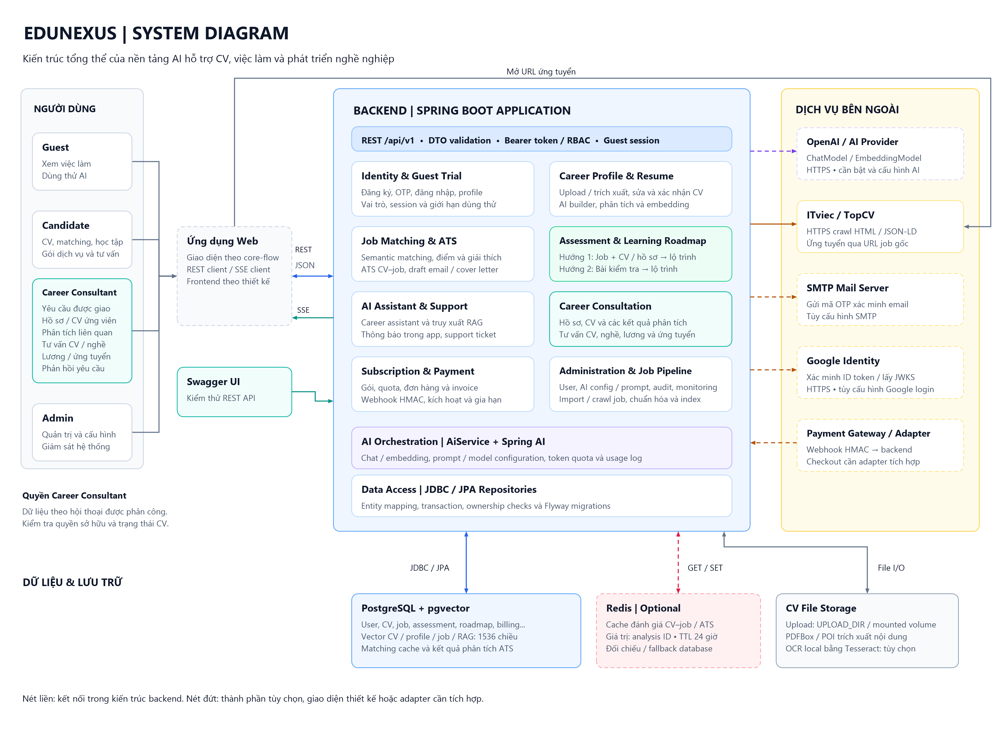
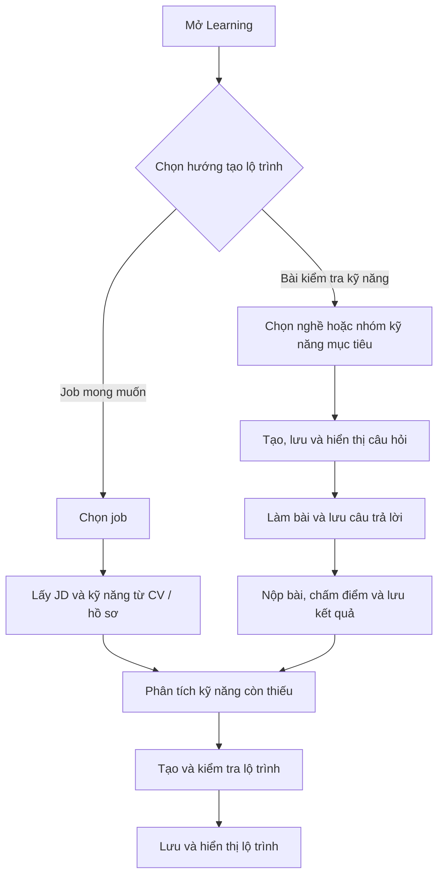

# EduNexus — System Diagram

Sơ đồ mô tả kiến trúc tổng thể theo backend hiện tại và các core-flow của nền tảng.
Các nhóm nghiệp vụ cùng chạy trong một ứng dụng Spring Boot.

## File sử dụng

- [draw.io](diagrams/edunexus-system-diagram.drawio): mở bằng diagrams.net để chỉnh sửa box, nội dung và kết nối.
- [SVG](diagrams/edunexus-system-diagram.svg): ảnh vector để phóng to hoặc xuất PDF.
- [PNG](diagrams/edunexus-system-diagram.png): ảnh 3840 × 2800 px để chèn vào báo cáo.

Nét đứt biểu thị thành phần tùy chọn, giao diện thiết kế hoặc adapter cần tích hợp.
Frontend trong sơ đồ là giao diện theo core-flow; repository này triển khai backend và Swagger UI.

## Thành phần và kết nối

| Thành phần | Vai trò trong hệ thống |
| --- | --- |
| Guest, Candidate, Career Consultant, Admin | Bốn nhóm người dùng truy cập các chức năng theo quyền. |
| Web application | Gọi REST API và nhận sự kiện tư vấn qua SSE. |
| API và bảo mật | `/api/v1`, request DTO validation, JWT bearer access token, RBAC và guest session. |
| Các module nghiệp vụ | Identity/guest, CV/profile, matching/ATS, learning, AI assistant/support, consultation, billing và administration. |
| AI orchestration | `AiService` bên trong backend gọi Spring AI ChatModel/EmbeddingModel, quản lý prompt và hạch toán quota/usage. |
| PostgreSQL + pgvector | Lưu dữ liệu nghiệp vụ, JSONB, vector 1536 chiều, matching cache và kết quả phân tích. |
| Redis tùy chọn | Cache ATS CV–job bằng analysis ID TTL 24 giờ và matching run ID TTL 1 giờ; kết quả được đối chiếu với database. |
| CV file storage | Lưu file upload ở `UPLOAD_DIR` hoặc volume; trích xuất bằng PDFBox/POI, OCR local bằng Tesseract khi được cấu hình. |
| Gemini | Cung cấp chat/embedding qua adapter Spring AI hiện có, khi đã bật và cấu hình AI. |
| ITviec / TopCV | Nguồn crawl job qua HTTPS; ứng viên mở URL gốc để ứng tuyển. |
| SMTP | Gửi OTP xác minh email khi được cấu hình; thông báo nghiệp vụ được lưu trong ứng dụng. |
| Google Identity | Backend xác minh ID token và lấy JWKS qua HTTPS khi bật Google login. |
| Payment gateway / adapter | Gửi webhook có chữ ký HMAC vào backend; phần checkout cần adapter tích hợp. |

Sơ đồ thể hiện PostgreSQL/pgvector là nơi lưu vector của các workflow hiện tại.
Tư vấn dùng REST để gửi tin nhắn và SSE để nhận sự kiện sau khi lưu dữ liệu.

## Career Consultant

Career Consultant là vai trò riêng với mã `CAREER_CONSULTANT`.
Admin phân công yêu cầu tư vấn cho consultant đang hoạt động.
Consultant truy cập dữ liệu của ứng viên thông qua hội thoại được phân công.

| Chức năng của role | Hỗ trợ trong backend hiện tại |
| --- | --- |
| Xem các yêu cầu tư vấn được phân công | `GET /api/v1/consultations` và `GET /api/v1/consultations/{id}`. |
| Xem career profile, CV và kết quả phân tích liên quan của ứng viên | API `/{id}/candidate-profile` trả career profile, skills và một CV READY; `/{id}/candidate-analyses` trả các nhóm kết quả phân tích đã lưu. |
| Tư vấn cải thiện CV và định hướng nghề nghiệp | Gửi nội dung tư vấn bằng tin nhắn trong hội thoại được phân công. |
| Tư vấn kỳ vọng lương và ứng tuyển | Gửi lời khuyên bằng tin nhắn trong hội thoại được phân công. |
| Phản hồi yêu cầu tư vấn của ứng viên | `POST /api/v1/consultations/{id}/messages`; lưu lịch sử và phát sự kiện SSE sau commit. |

`GET /api/v1/consultations/{id}/candidate-profile` chọn CV primary khi không truyền `resumeId`,
hoặc chọn CV READY của ứng viên trong hội thoại khi truyền `?resumeId=...`.

`GET /api/v1/consultations/{id}/candidate-analyses` trả `resume_analyses` kèm suggestions,
`ats_analyses`, `matching_results`, `salary_estimations`, assessments completed với điểm/metadata,
`gap_analyses` kèm skills và roadmaps ready/completed kèm nodes/`prerequisite_ids`/resources.
Chỉ ứng viên chủ hội thoại, ADMIN và consultant đang được phân công được đọc; consultant
cũ mất quyền sau khi phân công lại. Endpoint chỉ đọc kết quả đã lưu, không gọi AI.

Query `resumeId` lọc các nhóm liên kết CV; CV phải READY và thuộc ứng viên trong hội thoại.
Nhóm lương/assessment không bị lọc theo CV. Query `jobId` lọc nhóm liên kết job, còn báo cáo
chất lượng CV không bị lọc theo job. `limit` 1–100 (mặc định 20) và `offset` không âm
(mặc định 0) áp dụng riêng cho từng nhóm; nhóm chưa có dữ liệu trả mảng rỗng.

Consultant chưa có API tải file hoặc liệt kê toàn bộ CV của ứng viên qua quyền được phân công.
Các API riêng của Candidate vẫn kiểm tra quyền sở hữu dữ liệu. Xem
[hợp đồng endpoint](api.md#xem-kết-quả-phân-tích-đã-lưu-của-ứng-viên) và
[các ca kiểm thử tư vấn](swagger-testing.md#tu-van).

## Hai hướng tạo lộ trình học

Nhánh job gọi `POST /api/v1/roadmaps` với `jobId` và có thể kèm `resumeId`.
Assessment không bắt buộc; backend có thể bổ sung kết quả completed hiện hành cùng mục tiêu nếu có.
Nhánh kiểm tra tạo assessment, lưu câu trả lời, submit rồi gọi API roadmap với `assessmentId` đã completed.
Mục tiêu nghề nghiệp của assessment phải phù hợp với mục tiêu của roadmap.
Submit hiện chưa tự gọi tạo roadmap.

AI sinh câu hỏi và nội dung lộ trình. Bài trắc nghiệm được hệ thống chấm bằng đáp án đã lưu.
Các API và cấu trúc lớp được mô tả trong [API](api.md),
[kiến trúc backend](architecture.md) và [hướng dẫn Swagger](swagger-testing.md).
