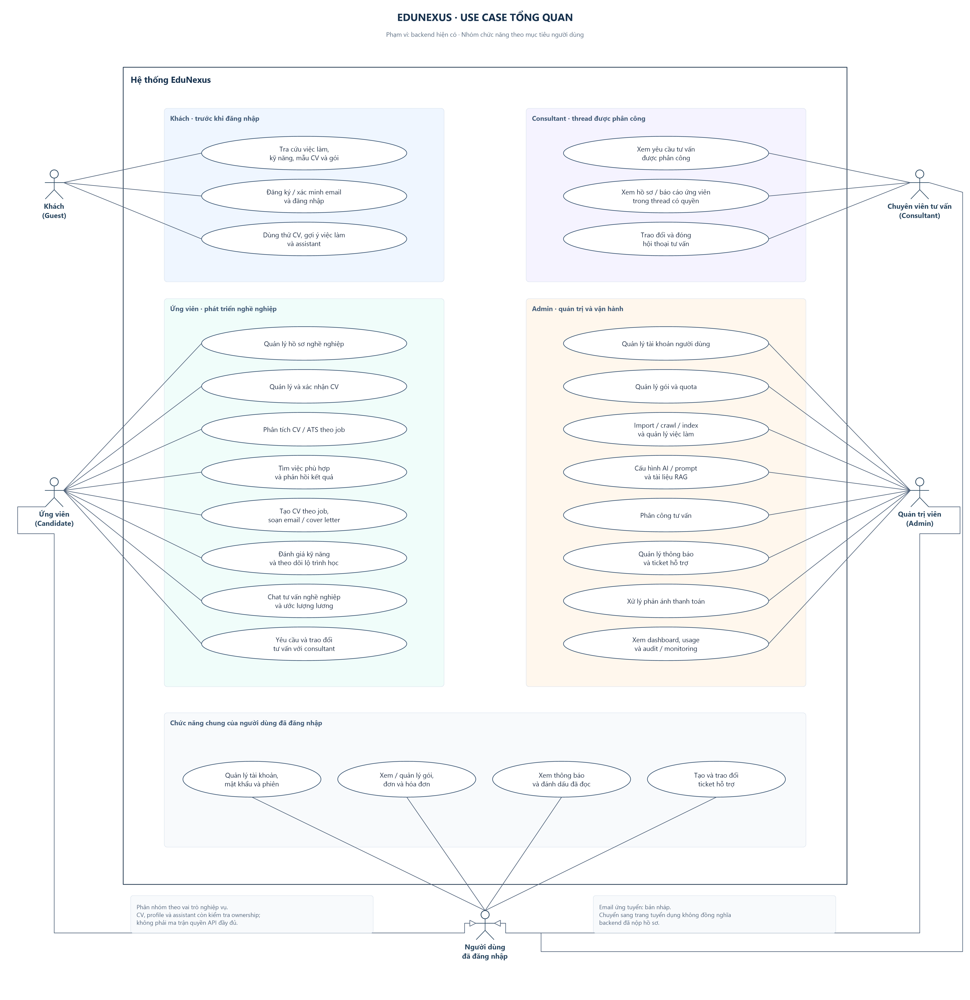
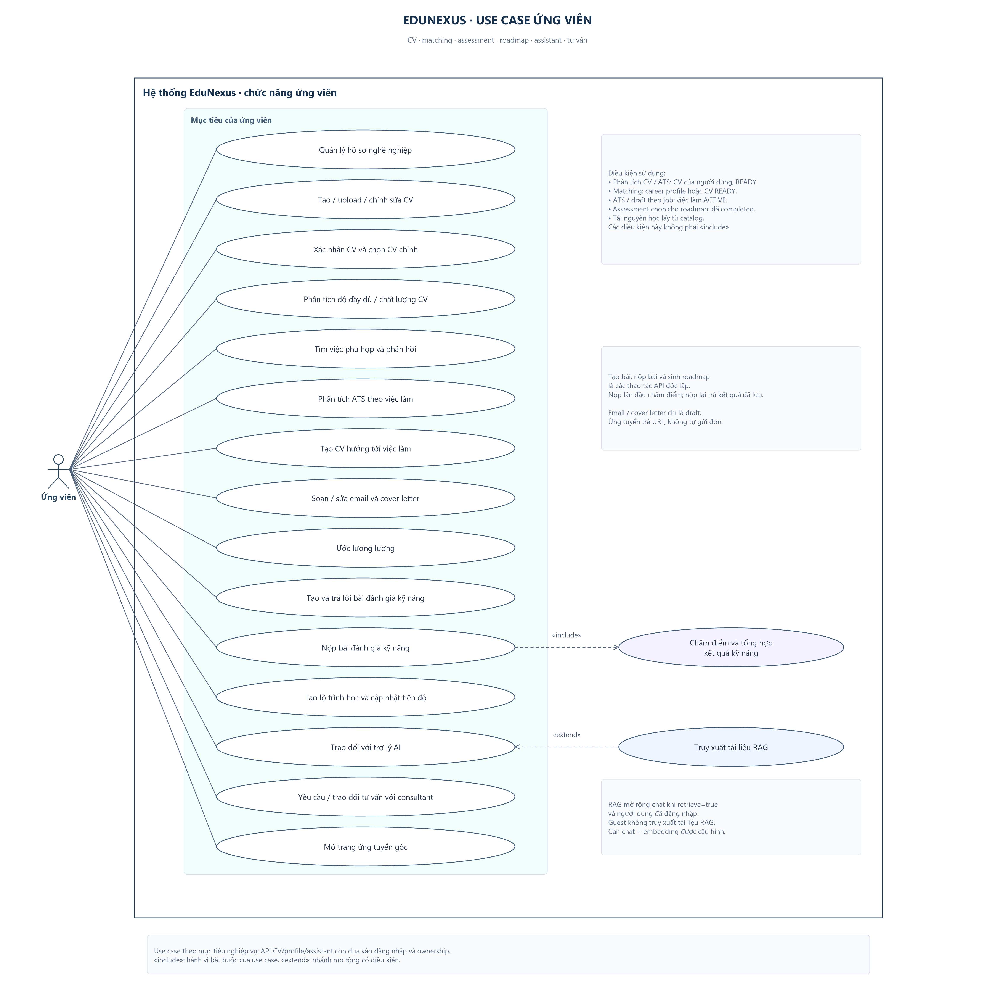
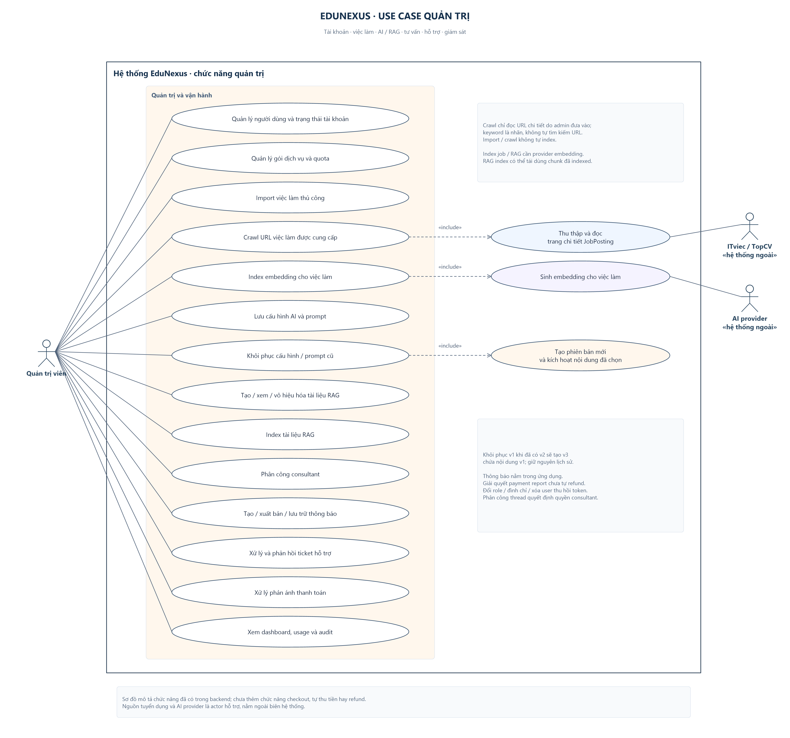
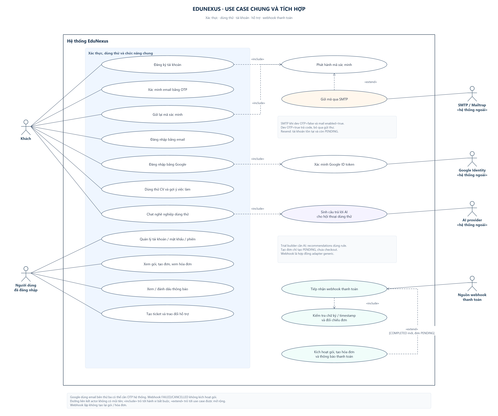

# Use case diagram — EduNexus

Sơ đồ mô tả các mục tiêu người dùng và tương tác bên ngoài của backend hiện có, đối chiếu code ngày **13/10/2026**. Có một hình tổng quan và ba hình chi tiết để sử dụng trong báo cáo. Mỗi hình có PNG độ phân giải gấp đôi và SVG; file draw.io chứa cả bốn trang để chỉnh sửa.

## 1. Tổng quan toàn bộ dự án

Actor chính: **Khách**, **Ứng viên**, **Chuyên viên tư vấn**, **Quản trị viên**. Ứng viên, chuyên viên và admin khái quát hóa về **Người dùng đã đăng nhập** để kế thừa các chức năng chung.

| Actor | Mục tiêu chính |
| --- | --- |
| Khách | Tra cứu danh mục, đăng ký/xác minh/đăng nhập, dùng thử CV, gợi ý việc làm và chat |
| Ứng viên | Career profile, CV, matching, ATS, draft hồ sơ ứng tuyển, assessment/roadmap, assistant, tư vấn |
| Chuyên viên tư vấn | Thread được phân công, hồ sơ/báo cáo ứng viên trong thread, trao đổi và đóng thread |
| Quản trị viên | User, gói/quota, job/crawl/index, AI/prompt/RAG, phân công tư vấn, thông báo, support, payment reports, monitoring |
| Người dùng đã đăng nhập | Tài khoản/mật khẩu/phiên, gói/đơn/hóa đơn, thông báo, ticket hỗ trợ |

Phân nhóm theo vai trò nghiệp vụ chính, không thay thế ma trận quyền API. Code CV/profile/assistant có nhiều thao tác chỉ yêu cầu đăng nhập và ownership; billing/support dùng chung. Đọc hồ sơ/báo cáo tư vấn cho phép candidate chủ thread, consultant đang được phân công và admin.

## 2. Ứng viên

Quan hệ:

- **Nộp bài đánh giá kỹ năng** `«include»` **Chấm điểm và tổng hợp kết quả kỹ năng** trong lần nộp đầu hợp lệ. Nộp lại sau khi completed trả kết quả đã lưu.
- **Truy xuất tài liệu RAG** `«extend»` **Trao đổi với trợ lý AI**: chỉ khi người dùng đăng nhập gửi `retrieve=true`. Guest không chạy retrieval.
- CV READY và job ACTIVE là điều kiện trước của chức năng liên quan; phân tích CV không gọi API confirm thay người dùng.
- Tạo assessment, trả lời/nộp bài và tạo roadmap là các thao tác riêng. Assessment được chọn cho roadmap phải đã completed và phù hợp mục tiêu.
- Email/cover letter chỉ là draft để sửa/copy. Mở trang ứng tuyển gốc không phải backend gửi email hoặc nộp hồ sơ.

Code chính: `ResumeService`, `ProfileService`, `MatchingService`, `CareerToolsService`, `AssessmentService`, `LearningService`, `CareerAssistantService`, `ConsultationService`.

## 3. Quản trị viên

Quan hệ:

- **Crawl URL việc làm được cung cấp** `«include»` **Thu thập và đọc trang chi tiết JobPosting** trong luồng crawl hợp lệ.
- **Index embedding cho việc làm** `«include»` **Sinh embedding cho việc làm**.
- **Khôi phục cấu hình/prompt cũ** `«include»` **Tạo phiên bản mới và kích hoạt nội dung đã chọn**: restore giữ lịch sử; v1 → v2 → restore v1 tạo v3 chứa nội dung v1.
- Import/crawl không tự index. Crawl chỉ nhận URL chi tiết admin cung cấp; keyword là nhãn run.
- RAG index có thể tái dùng chunk đã có vector đúng provider/model. Archive tài liệu ngăn retrieval.
- Resolve payment report không tự refund; thông báo nghiệp vụ được lưu trong ứng dụng.

Code chính: `AdminService`, `JobService`, `JobCrawlService`, `RagDocumentService`, `AnnouncementService`, `SupportService`, `ConsultationService`.

## 4. Chức năng chung và tích hợp bên ngoài

| Actor hỗ trợ | Tương tác đã có |
| --- | --- |
| Google Identity | Backend xác minh Google ID token |
| SMTP / Mailtrap | Gửi mã xác minh email trong chế độ SMTP |
| AI provider | Sinh nội dung/chat/embedding khi provider được cấu hình; hình chung minh họa chat trial |
| ITviec / TopCV | Cung cấp HTML trang tuyển dụng cho crawl, xuất hiện trong hình admin |
| Nguồn webhook thanh toán | Gửi thông báo thanh toán đã ký theo hợp đồng adapter generic |

Quan hệ:

- **Đăng ký** và **Gửi lại mã xác minh** `«include»` **Phát hành mã xác minh** trong luồng hợp lệ. Resend dành cho tài khoản tồn tại và còn PENDING.
- **Gửi mã qua SMTP** `«extend»` **Phát hành mã xác minh** khi `AUTH_EXPOSE_DEV_OTP=false` và `MAIL_ENABLED=true`. Dev OTP bỏ qua SMTP và trả code trong response.
- **Đăng nhập Google** `«include»` **Xác minh Google ID token**. Google account với email bên thứ ba vẫn có thể cần OTP hệ thống.
- **Chat nghề nghiệp dùng thử** `«include»` **Sinh câu trả lời AI cho hội thoại dùng thử**.
- **Tiếp nhận webhook thanh toán** `«include»` **Kiểm tra chữ ký/timestamp và đối chiếu đơn**.
- **Kích hoạt gói, tạo hóa đơn và thông báo** `«extend»` **Tiếp nhận webhook** chỉ với webhook mới hợp lệ, status COMPLETED và đơn còn PENDING. Webhook lặp không tạo lại gói/hóa đơn; FAILED/CANCELLED không kích hoạt gói.

Tạo order chỉ lưu PENDING; backend chưa có adapter checkout/QR/refund/auto-charge. Sơ đồ không thêm các use case đó. Quên mật khẩu qua mail, gửi email ứng tuyển, xuất PDF/DOCX theo template và chuyển history guest sang user cũng chưa có trong triển khai hiện tại.

Code chính: `AuthService`, `GoogleTokenVerifier`, `GuestSessionService`, `CareerAssistantService`, `BillingQueryService`, `WebhookVerifier`, `BillingService`.

## Ký hiệu UML

| Ký hiệu | Ý nghĩa |
| --- | --- |
| Người hình que | Actor ngoài biên hệ thống |
| Hình ellipse | Use case: mục tiêu/hành vi người dùng quan sát được |
| Khung EduNexus | Biên hệ thống đang mô hình hóa |
| Đường liền, không mũi tên | Actor tham gia use case; không biểu diễn thứ tự gọi API |
| Đường đứt, mũi tên mở `«include»` | Trỏ từ use case chính tới hành vi bắt buộc được dùng chung |
| Đường đứt, mũi tên mở `«extend»` | Trỏ từ nhánh có điều kiện tới use case được mở rộng |
| Đường liền, tam giác rỗng | Khái quát hóa actor; tam giác trỏ về actor tổng quát |

Các ô màu chỉ giúp nhóm nghiệp vụ; không phải microservice hoặc luồng tuần tự. Thứ tự gọi API và tiền điều kiện chi tiết xem [project-guide.md](project-guide.md).

## File để chỉnh sửa và xuất báo cáo

- [draw.io — bốn trang](diagrams/edunexus-usecase.drawio): mở bằng diagrams.net để chỉnh trực tiếp.
- [PlantUML — nguồn ngữ nghĩa](diagrams/edunexus-usecase.puml): bốn block `@startuml`, dùng khi muốn sửa bằng text; auto layout có thể khác SVG cung cấp.
- [JSON — mô hình và tọa độ](diagrams/edunexus-usecase-model.json): nguồn dùng chung của bộ PNG/SVG/draw.io.
- [Script render offline](../scripts/dev/GenerateUseCaseDiagrams.ps1): tạo lại PNG/SVG/draw.io từ JSON.

| Hình | PNG | SVG |
| --- | --- | --- |
| Tổng quan | [PNG](diagrams/edunexus-usecase-overview.png) | [SVG](diagrams/edunexus-usecase-overview.svg) |
| Ứng viên | [PNG](diagrams/edunexus-usecase-candidate.png) | [SVG](diagrams/edunexus-usecase-candidate.svg) |
| Admin | [PNG](diagrams/edunexus-usecase-admin.png) | [SVG](diagrams/edunexus-usecase-admin.svg) |
| Chung/tích hợp | [PNG](diagrams/edunexus-usecase-shared.png) | [SVG](diagrams/edunexus-usecase-shared.svg) |

Chạy lại từ thư mục chứa `pom.xml`:

~~~powershell
powershell -NoProfile -ExecutionPolicy Bypass -File scripts/dev/GenerateUseCaseDiagrams.ps1
~~~

Script chỉ đọc mô hình và ghi các artifact sơ đồ. Nó không khởi động backend, gọi AI, gửi mail hay tác động database.

